# 1. Game design

What this covers:

- the story and the goal, as the game's own texts tell them;
- every screen: the menu, the intros, play and its HUD, GAME OVER, the London ending;
- the controls and the rules: lives, bullets, sticks, deaths, the score and the bonus;
- the four levels and their 34 zones, and a route through them;
- what the game does not have.

The recordings it rests on:

| Recording | Load | Patch | Used for |
| --- | --- | --- | --- |
| `c1` | power-on, the original TZX at ROM speed (128K) | none | the menu, the level 1 intro, level 1 in play, a quit |
| `controls` | `after128.szx` (the menu, 128K), the four control methods in turn | none | the menus of each method, Rick answering the keys |
| `gameover` | `after128.szx` (the menu), six deaths to the first boulder | none | GAME OVER at the last life |
| `level1`-`level4` | `menu-cursor.szx` (level 1), the level warps (levels 2-4), the RZX's keys | levels 2-4: the level warp on a clone (LevelTable record N copied over record 0, Level `$E4AD` = N) and POKE 58356,0, infinite lives | the intros of levels 2-4, each level in play, the course of a game |
| `ending` | `warp/ending.szx`: level 4 sent down the path of its last exit | on a clone: the level 4 warp, then Level = 3, the return address `$E406` pushed, PC = LevelEnd `$ABD8` | the closing text, the end bonus |
| `docs/integrate/l1z1left` | `work/stage2/warp/L1Z1.szx`, left held | the zone warp on a clone | L1Z1's left exit is walled |

The mechanics behind each rule are in [doc 10](10-gameplay-logic.md); the data of the levels in
[doc 7](07-objects.md).

## 1.1 The story and the goal

Rick Dangerous (Core Design, Firebird, 1989) is a platform game in four levels. The intros set each one:

| Level | Intro | The task |
| --- | --- | --- |
| 1 | SOUTH AMERICA | Rick's plane crash-lands over the Amazon while he searches for the lost Goolu tribe; he lands among them and must escape |
| 2 | EGYPT, SOMETIME LATER | recover the jewel of Ankhel from fanatics who threaten to smash it |
| 3 | EUROPE, LATER THAT WEEK | rescue Allied prisoners from Schwarzendumpf castle |
| 4 | EUROPE, EVEN LATER | infiltrate the secret missile base before it attacks London |
| end | LONDON, MUCH, MUCH LATER | a hero's welcome; but the Barfian Empire's starships are poised to invade the Earth |

The goal is to cross each level, zone after zone, to its last exit. There is no item to collect to finish a level:
the way out is enough. Treasures and the bonus only add to the score.

The texts are in `src/res/texts`, printed as [doc 8, 8.5](08-hud-and-text.md#85-the-texts) shows.

## 1.2 The screens

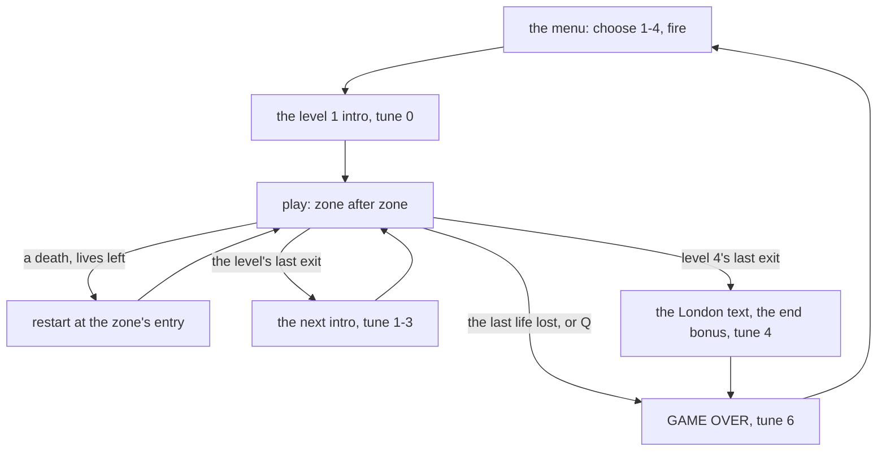

### The menu

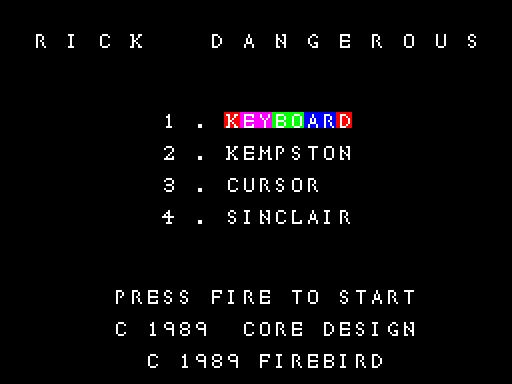

*`c1` frame 30 250 (WALKTHROUGH 6.1).*

The title, the four control methods and the credits. Keys 1-4 choose the method, whose line then cycles through four
colours; fire starts. Tune 5 plays.

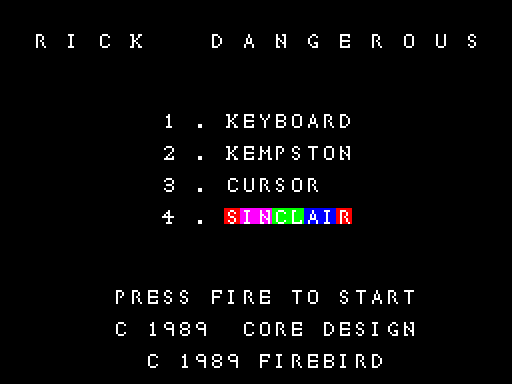

*`controls` frame 1 250.*

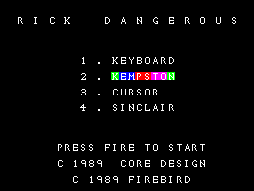

*`controls` frame 1 750.*

### The intros

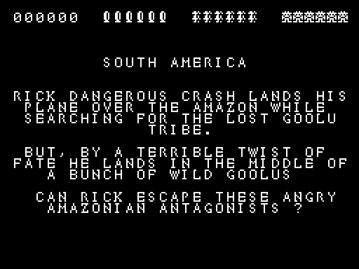

*`c1` frame 30 500.*

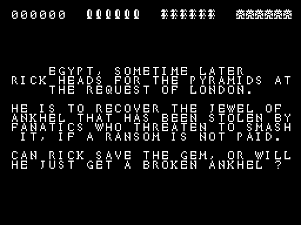

*`level2` frame 0, the warp state.*

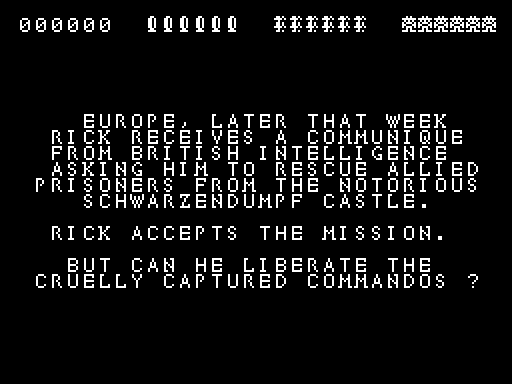

*`level3` frame 0.*

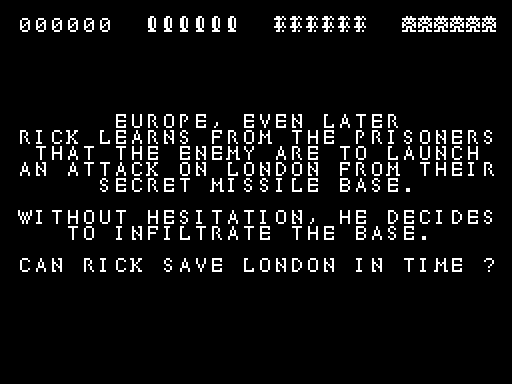

*`level4` frame 0.*

Each intro is white text on black with the HUD already on row 1. Fire starts the level.

### Play and the HUD

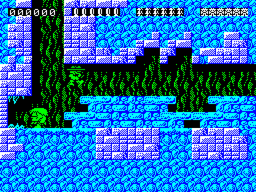

*`c1` frame 31 000.*

How to read it:

- Row 1 is the HUD: the score, then six bullets, six sticks of dynamite and six faces (the lives).
- Below, the zone: Rick (in the hat) at the left, the platforms, the ladders, the creatures and traps.

**The point**: the play area fills the whole screen; the HUD is drawn over it, and the view scrolls up and down inside
a zone as Rick moves.

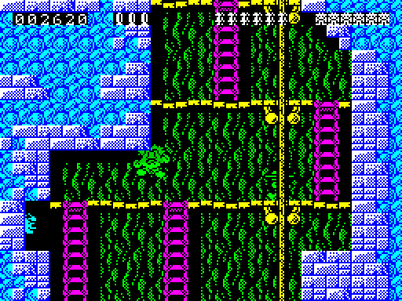

*`c1` frame 31 750.*

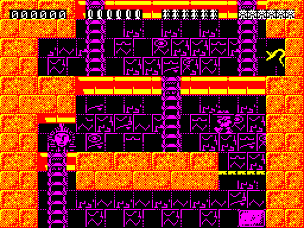

*`level2` frame 500.*

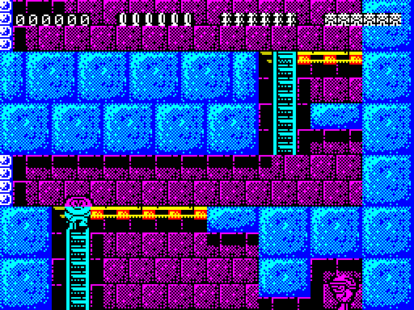

*`level3` frame 500.*

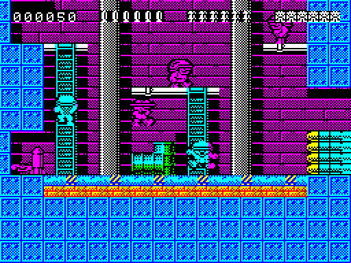

*`level4` frame 250.*

The HUD in detail is [doc 8, 8.3](08-hud-and-text.md#83-the-hud).

### GAME OVER

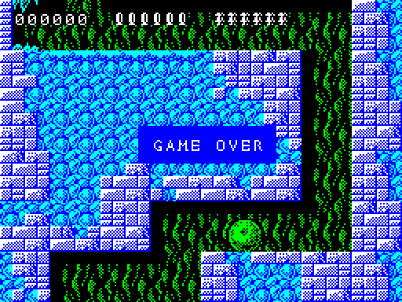

*`gameover` frame 2 500.*

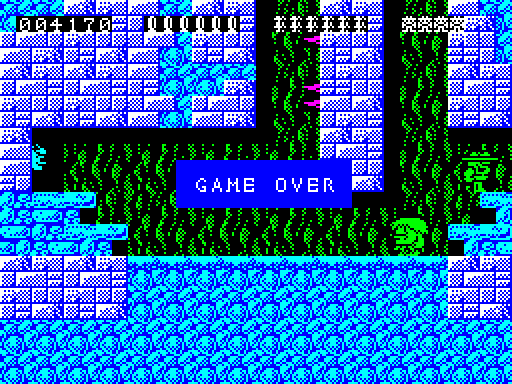

*`c1` frame 33 250: Q quits to the same GAME OVER.*

A band of blue over the last scene; tune 6; fire returns to the menu.

### The ending

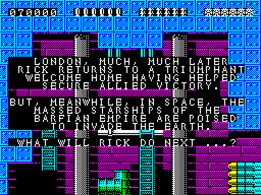

*`ending` frame 250.*

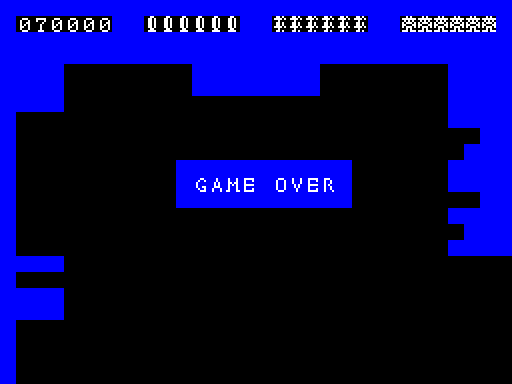

*`ending` frame 500: the game ends on the same GAME OVER, with the end bonus in the score.*

## 1.3 The controls

Four methods, chosen on the menu: 1 the keyboard (O up, K down, Z left, X right, ENTER fire), 2 a Kempston joystick,
3 the cursor keys (5-8, 0 fire), 4 the Sinclair joystick (6-9, 0 fire). P pauses, Q quits.

| Held | Rick |
| --- | --- |
| left or right | walks |
| up | jumps, or climbs a ladder |
| down | crawls, or climbs down |
| fire + left or right | pokes with his stick (sets off traps, pushes some objects) |
| fire + up | shoots, if he has bullets |
| fire + down | drops a lit stick of dynamite, if he has one |

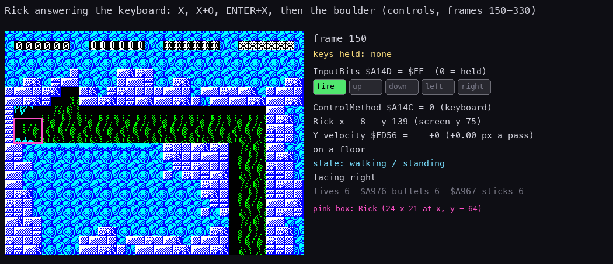

*`controls` frames 150 to 330, every second frame (`python3 tools/fig_controls.py rick --work work/docs/rdB/controls
--inputs tests/inputs/controls.txt --from 150 --to 320 --step 2 --out docs/img/play/rick-keys.gif`).*

How to read it:

- Left: the screen; the pink box is Rick.
- Right: the frame, the keys held, the input bits, Rick's position and state, the lives, bullets and sticks.

**The point**: one key, one move; fire changes what the direction does.

The Kempston method does not read the joystick: Rick walks right on his own ([doc 5, 5.3](05-controls.md#53-the-kempston-bug)).

## 1.4 The rules

| Rule | Value | Where |
| --- | --- | --- |
| lives at a new game | 6 | [doc 10, 10.9](10-gameplay-logic.md#109-lives-the-end-of-a-level-and-the-ending) |
| bullets and sticks | 6 each, filled again at every new life and every level | doc 10, 10.3 and 10.4 |
| a death | an enemy's touch, a trap, a deadly char (spikes, water), one's own blast, a bullet back | [doc 10, 10.7](10-gameplay-logic.md#107-deaths) |
| after a death | Rick restarts at the place he entered the zone | doc 10, 10.9 |
| an enemy shot or blown up | 50 points | [doc 10, 10.8](10-gameplay-logic.md#108-the-bonus-and-the-score) |
| a treasure | 500 points | doc 10, 10.8 |
| the bonus | 2 000 counting down from a start marker; what is left is paid at the end marker | doc 10, 10.8 |
| the end of the game | (lives + 1) x 10 000 | doc 10, 10.9 |
| GAME OVER | at 0 lives, or Q | doc 10, 10.9 |

There is no difficulty setting, no second player, no extra life and no high score table. The game does not end
after level 4 in a loop: it shows the closing text and GAME OVER.

**Worked example: a game of level 1.** The `level1` recording plays someone else's run of level 1:

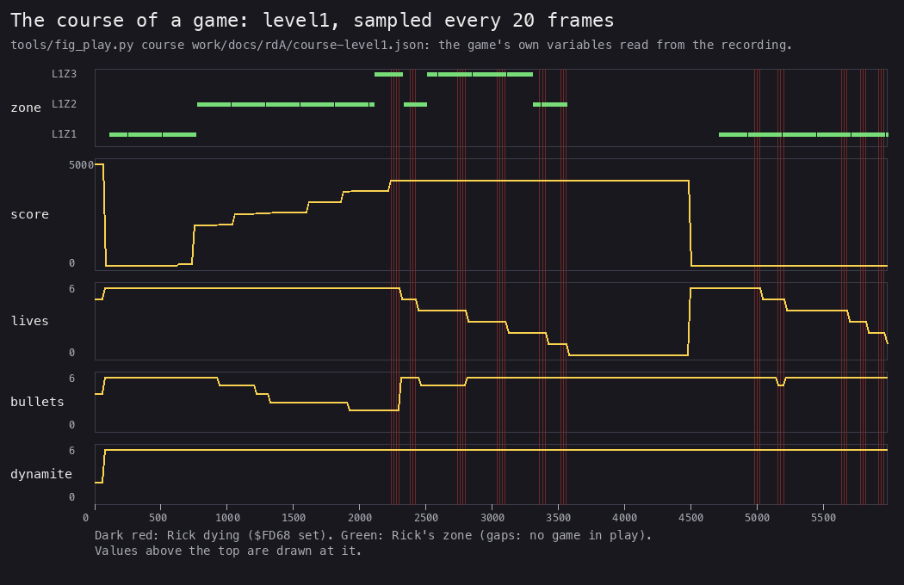

*Drawn by `python3 tools/fig_play.py course work/docs/rdA/course-level1.json docs/img/play/course-level1.png` from
`level1` frames 0-5 980, sampled every 20 frames (`time_travel memory_at`, frame starts).*

How to read it:

- Five panels share the frame axis: the zone, the score, the lives, the bullets, the dynamite.
- Dark red lines are the frames in which Rick is dying.

**The point**: a game of Rick Dangerous is short and deadly: the run gains 50 points for an enemy at frame 640, 1 920
the bonus collected at 755, treasures of 500, and loses six lives in under 3 600 frames (72 seconds) in the first two
zones; GAME OVER, then a new game at 4 500.

**Witness.** The values are the game's own variables read from `level1`: Lives `$A958`, the score `$A9BE`, the zone
record `$AD27`.

## 1.5 The levels and their zones

A level is a chain of zones; a zone is a tall map, 32 chars wide, that the view scrolls through. Rick goes from zone to
zone through exits at the zone's left or right edge.

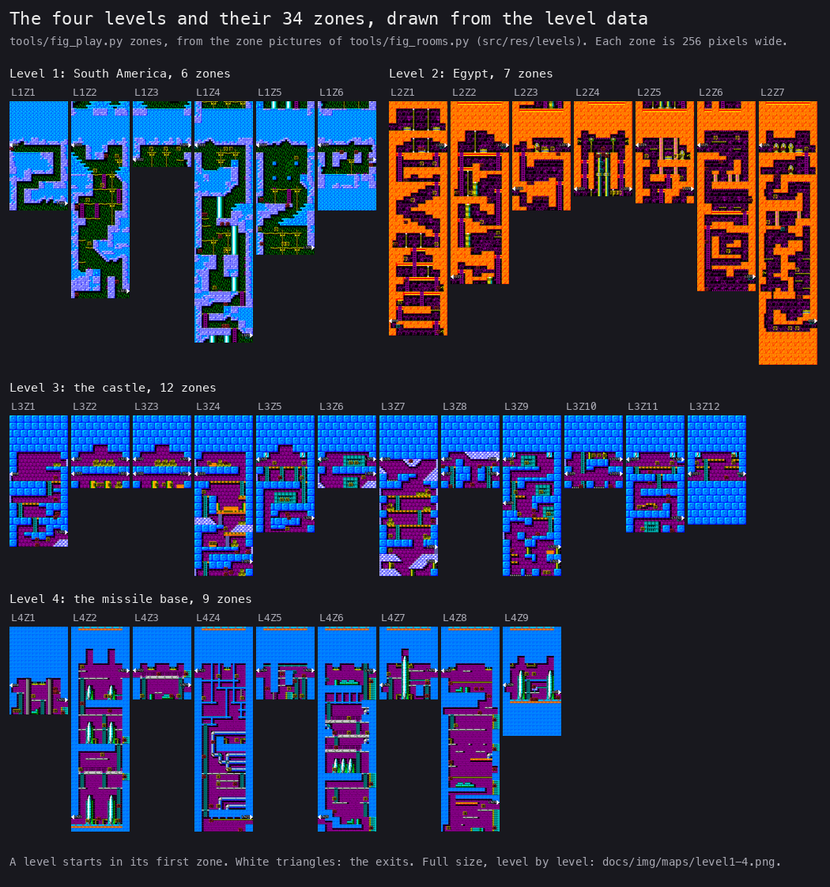

*From the level data, no recording: `python3 tools/fig_rooms.py --out work/stage2/fig` (the zone pictures), then
`python3 tools/fig_play.py zones docs/img/maps/zones.png`.*

How to read it:

- One row per level (levels 1 and 2 share the first), the zones in order, each drawn to the same scale.
- A zone is read top to bottom; its height is its map's.
- The white triangles at the edges are the exits.

**The point**: level 1 is green jungle and grey rock, level 2 orange sandstone, levels 3 and 4 the second char set's
blue bricks and steel. The zones differ in height from 9 to 36 tile rows.

| Level | Zones | Chars | Records |
| --- | --- | --- | --- |
| 1, South America | 6 | set 0 | `$D55C-$D585` |
| 2, Egypt | 7 | set 0 | `$D586-$D5B6` |
| 3, the castle | 12 | set 1 | `$D5B7-$D60A` |
| 4, the missile base | 9 | set 1 | `$D60B-$D649` |

The levels one by one, at a larger scale, with their records: [level 1](img/maps/level1.png),
[level 2](img/maps/level2.png), [level 3](img/maps/level3.png), [level 4](img/maps/level4.png)
([doc 2, 2.5](02-architecture.md#25-levels-zones-and-maps)).

## 1.6 A route

The exits give the route. Each zone after the first has an exit back to the previous zone and one on to the next; the
first zone's back exit leads to `$FFFF` (below), and the last zone's forward exit leads to `$FFFF`, the end of the
level. The table lists the way forward, from the exit records ([doc 7, 7.1](07-objects.md#the-exits)):

| Level | Forward exits (side, at map char row) |
| --- | --- |
| 1 | L1Z1 right 56, L1Z2 right 104, L1Z3 right 24, L1Z4 right 128, L1Z5 right 80, L1Z6 right 32: the end |
| 2 | L2Z1 right 24, L2Z2 right 24, L2Z3 right 24, L2Z4 right 48, L2Z5 right 48, L2Z6 right 96, L2Z7 right 120: the end |
| 3 | L3Z1 right 64, L3Z2 and L3Z3 (several exits between them), L3Z3 right 32, L3Z4 right 80, L3Z5 right 56, L3Z6 right 32, L3Z7 right 72, L3Z8 right 32, L3Z9 right 72, L3Z10 right 32, L3Z11 right 56, L3Z12 right 32: the end |
| 4 | L4Z1 right 40, L4Z2 right 24, L4Z3 right 32, L4Z4 right 104, L4Z5 right 24, L4Z6 right 24, L4Z7 right 24, L4Z8 right 96, L4Z9 right 36: the end |

Level 3 is the one with side ways: some exits lead back, and two zones (L3Z8, L3Z10) have exits that lead into
themselves at the same row: L3Z8 right `$18` and left `$18` to L3Z8 `$18`, L3Z10 right `$18` to L3Z10 `$18`. An exit
moves the view by its row minus the row there (CheckScreenExit `$AB93`: ViewTopRow - (row - row there)), here 0, and
ExitRight `$FBDE` puts Rick at x 2, ExitLeft `$FBCF` at x `$E4`. So Rick leaves by one edge and comes back in at the
other edge of the same zone, at the same height, the zone redrawn and its objects spawned again. No recording takes
these exits.

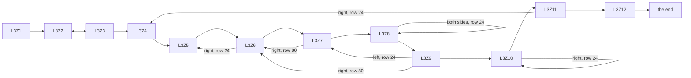

```text
the route of a level:
    zone = LevelTable[level].first zone
    repeat:
        cross the zone to the exit on its far side
        zone = that exit's target
    until the target is $FFFF
```

**Worked example: level 1.** Rick starts in L1Z1 at the left (LevelTable: x 8, y `$8B`) with a boulder behind him.
He runs right and down through the zone to its right exit at row 56, which leads to L1Z2. L1Z2 is entered at the top
left; its exit is at the bottom right, row 104. L1Z3 is short and leads on at row 24. L1Z4, the longest zone of level 1
(33 tile rows), is crossed top to bottom to row 128; L1Z5 to row 80; L1Z6 to its right exit at row 32, which ends the
level and prints the Egypt intro.

**Witness.** `c1` goes from L1Z1 to L1Z2 at frame 31 172-31 173; `level1` crosses it too (zones 1 and 2). The other zones are reached by
the zone warps, one recording each (WALKTHROUGH 6.0).

The first zone of every level also has an exit to `$FFFF`, on the side Rick does not take: L1Z1 left row 24, L2Z1 left
row 120, L3Z1 left row 32, L4Z1 left row 32. They sit at Rick's start height. Rick starts at map row y / 8 +
ViewTopRow: `$8B` / 8 = 17, plus the record's first view row (8, `$68`, `$10`, `$10`), gives rows 25, 121, 33 and 33.
CheckScreenExit takes an exit when Rick's row minus the exit's row is 0, 1 or 2, so each of these exits would match
right at the start.

```text
start row = RickY / 8 + ViewTopRow        ; $8B / 8 = 17
level 1: 17 + 8   = 25   exit row 24: 25 - 24 = 1 < 3, matches
level 2: 17 + 104 = 121  exit row 120: 1, matches
level 3: 17 + 16  = 33   exit row 32: 1, matches
level 4: 17 + 16  = 33   exit row 32: 1, matches
```

**Witness.** `docs/integrate/l1z1left` (the L1Z1 zone warp on a clone, left held from frame 10 to 300): Rick stops at
x 4 against the wall, and ExitLeft `$FBCF` never runs. L1Z1's back exit is walled off. The other three were tried by no
recording, so whether a wall stops Rick there too is not known; taken, one would end the level the way the last exit does (CheckScreenExit goes on to LevelEnd `$ABD8` for
`$FFFF`).

## 1.7 What the game does not have

- no high score table and no hiscore kept between games;
- no difficulty choice, no two-player mode;
- no music in play: the AY plays tunes only at the menu, the intros, GAME OVER and the ending, plus a jingle of 1.6
  seconds when the bonus is taken; in play it plays effects ([doc 9](09-sound.md));
- on a 48K, no music at all: the effects play on the beeper and stop the game while they sound.
