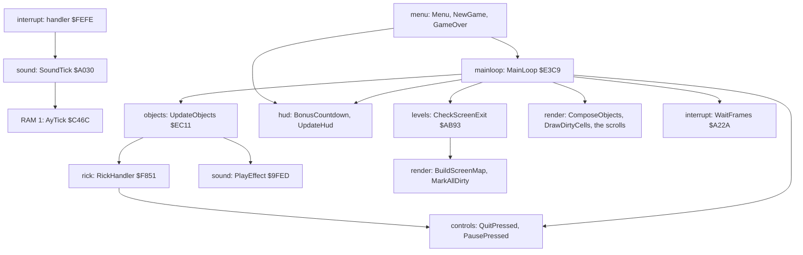
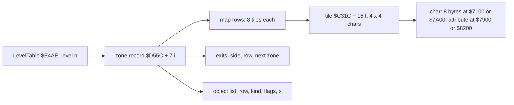

# 2. Architecture

What this covers:

- the stages from the tape to play;
- the memory map of the 48K image, the 128K's pages and RAM 1;
- the heatmap of every recording and the stack;
- the images at the entry and in play, and the modules of the source;
- the levels, zones and maps; the sprites;
- the frame budget;
- the leftovers: code and data the game never uses.

The recordings it rests on:

| Recording | Load | Used for |
| --- | --- | --- |
| `c1` | power-on, the original TZX at ROM speed (128K), 33 400 frames | the load, the entry at 19 010, the menu, level 1 in play; the images |
| `controls`, `gameover`, `ending`, `level1`-`level4` | snapshots (128K) | the stack, the variables, the levels |
| the 48 L1 builds of stage 2: `c1g`, `controls`, `gameover`, `level1`-`level4`, the 34 zones, `ending2`, six spots | as listed in [WALKTHROUGH 6.0](../WALKTHROUGH.md#60-the-recordings) | the heatmap, the stack's low mark, the witness counts |

## 2.1 Stages from the tape to play

```mermaid
flowchart LR
    A["BASIC 'Rick': CLEAR 50000"] --> B["'Rick1' at $CD00: RANDOMIZE USR 52480"]
    B --> C["Bleepload group 1: 48 blocks, marker $64"]
    C --> D["group 2: 140 blocks, marker $34, $6E00-$F9FF"]
    D --> E["group 3: 6 blocks, marker $35, $4000-$45FF"]
    E --> F["Start $AB4D: DI, LD SP,0, DetectPaging $A043"]
    F --> G["128K: $5E00 to RAM 1, CALL $A030 at $FF11"]
    G --> H["Menu $E219"]
    H --> I["NewGame $E2DC, LevelIntro $E311"]
    I --> J["MainLoop $E3C9, HALT at $E40F"]
    J --> K["GameOver $E35D"]
    K --> H
```



The tape and its blocks are in [doc 3, 3.1](03-build-and-load.md#31-the-tape-block-by-block). In `c1` the interrupts
stay disabled through the turbo load. Start `$AB4D` runs in frame 19 010, and the first byte of the RAM 1 copy is
written at T-state 70 589. The menu is on screen by frame 30 200, and play is under way at 31 500.

At the start the game tests the paging. On the 128K it copies `$5E00-$6BA3` (`$0DA4` bytes, the AY player and its
tunes) to RAM 1 at `$C000` and puts `CALL $A030` into the IM 2 handler at `$FF11`. On a 48K it sets Is48K `$A08D` =
`$FF` instead, and the effects go to the beeper ([doc 9, 9.1](09-sound.md#91-two-engines)). After the copy the
`$5E00` area is reused for the composed chars and the char map.

## 2.2 The memory map

The game is one flat image, `$5B00-$FFFF`, the same on both machines. Only the 128K adds RAM 1.

| Range | What | Module | Witness |
| --- | --- | --- | --- |
| `$4000-$5AFF` | the screen | | screenshots, [WALKTHROUGH 6.1](../WALKTHROUGH.md#61-screenshots) |
| `$5B00-$5BFF` | the mirror table: n with its bits reversed, built by BuildMirrorTable `$AB6A` | `loader` area, reused | written after the entry |
| `$5C00-$5CFF` | the char properties, one byte per char code, built by BuildCharProps `$F6A9` | | entry to play diff |
| `$5D00` up | the composed chars: char n at `$5CF0` + 8n, a background char with sprites drawn in | | entry to play diff `$5C37-$5F0F` |
| `$5E00-$6BA3` | as loaded: the AY player and its tunes, copied to RAM 1 on a 128K | `loader` | CopyPlayerToRam1 `$A069`, `c1` frame 19 010 |
| `$6500-$6A7F` | the char map: 32 columns x 44 rows; rows 8-31 (`$6600-$68FF`) are the screen's | | BuildScreenMap `$AD5A` |
| `$6B00-$707F` | the cell flags (the char map + `$600`); the screen's part `$6C00-$6EFF`, the sentinel `$FF` at `$6F00` | `screenwork` from `$6E00` | DrawDirtyCells `$A25D` |
| `$6A80`, `$7080` | two 126-byte sprite frames copied by Start from `$6BA4`: the box pictures of kinds 16 and 19 | | [doc 4](04-game-loop.md) |
| `$7100-$78FF`, `$7900-$79FF` | char set 0 (levels 1-2): 256 chars of 8 bytes, and their attributes | `charsets` | the maps (2.5) |
| `$7A00-$81FF`, `$8200-$82FF` | char set 1 (levels 3-4) and its attributes | `charsets` | as above |
| `$8300-$8400` | the IM 2 table, 257 bytes of `$FE`: the vector is `$FEFE` (`I` = `$83`) | `interrupt` | written by SetUpInterrupts `$A215` |
| `$8401-$9E94` | 54 sprite frames, 24 x 21 pixels, 126 bytes each | `sprites` | [2.6](#26-sprites) |
| `$9E95-$9FEC` | the font: 43 glyphs of 8 bytes | `font` | [doc 8, 8.1](08-hud-and-text.md#81-the-font) |
| `$9FED-$A102` | the sound: PlayEffect, StartTune, SoundTick, the paging test, the beeper | `sound`, `setup` | [doc 9](09-sound.md) |
| `$A103-$AF63` | code: the controls, the interrupt, the renderer, the HUD and texts, the start, the level's screens | several | executed (heatmap) |
| `$A958`, `$A967`, `$A976`, `$A9BE` | lives, sticks, bullets, the score (among the HUD code) | `hud` | [doc 8, 8.3](08-hud-and-text.md#83-the-hud) |
| `$AF64-$E218` | the level data: maps, tiles, kinds, zones, exits, object lists, animations, scripts | `leveldata` | [doc 7, 7.1](07-objects.md#71-the-level-data-byte-by-byte) |
| `$E219-$E4AD` | the menu, the new game, quit, GAME OVER, the main loop `$E3C9` (its HALT at `$E40F`) | `menu`, `mainloop` | executed |
| `$E4AE-$E4E4` | LevelTable: 5 records of 11 bytes, the fifth the ending | `levels` | [doc 8, 8.5](08-hud-and-text.md#85-the-texts) |
| `$E4E5-$EA8D` | the texts | `text` | screenshots |
| `$EA8E-$EC76` | the object table: 12 slots of 30 bytes from `$EA8E`, Rick in the first | `objects` | [doc 7, 7.3](07-objects.md#73-the-object-table-ea8e) |
| `$EC77-$FD53` | code: the objects, the traps, Rick, his gun and his dynamite | `objects`, `rick` | executed |
| `$FD54-$FD7C` | Rick's state: YFraction `$FD55`, ZoneChange `$FD61`, Dying `$FD68`, DeathDone `$FD69`, ... | `vars` | [doc 7, 7.8](07-objects.md#78-the-game-variables) |
| `$FD7D-$FEFD` | SpawnObjects and the map build | `levels` | executed |
| `$FEFE-$FF1D` | the IM 2 handler; `$FF11-$FF13` its music slot | `interrupt` | executed every interrupt |
| `$FFEC-$FFFF` | the stack, under SP = `$0000` | `interrupt` | the low mark below |

### The 128K's pages

| Page | At | Holds | Accessed in the recordings |
| --- | --- | --- | --- |
| RAM 5 | `$4000` | the screen and the image's low part | always |
| RAM 2 | `$8000` | the image's middle | always |
| RAM 0 | `$C000` | the image's top | always; paged out only inside PlayEffect, StartTune and SoundTick |
| RAM 1 | `$C000` when paged | the AY player and its music, `$C000-$CDA3` | 24 702 520 instructions over the recordings |
| RAM 3, 4, 6, 7 | | nothing | never |

The game never uses the second screen (RAM 7) nor the extra pages. RAM 1 holds 0 nonzero bytes at the entry and
3 356 in play (`work/images/entry.ram.bin`, `play.ram.bin`).

RAM 1 in detail:

| Range | What |
| --- | --- |
| `$C000-$C0A9` | PeriodTable: 85 tone periods |
| `$C0AA-$C0E1` | MixerShadow, the three channel records (18 bytes each), NoisePeriod |
| `$C0E2-$C353` | StartNote, SilenceAll, UpdateAy, ChannelStep and the envelope phases, VibratoStep, WriteAy |
| `$C354-$C38C` | the older entries: OldTick, MusicOn `$C35A`, OldPlayEffect |
| `$C38D-$C3E3` | the three tracks' state and InstrumentMap |
| `$C3E4-$C6E4` | AyPlayTune, AyTick, TrackStep, PatternCommand, the ornaments, AyPlayEffect, EffectChannel |
| `$C6E5-$CDA3` | the music data: patterns, TuneTable, order lists, pattern pointers, instruments, effects |

### The heatmap


*The 48 L1 builds of stage 2 merged (117 178 frames). Made with `python3 tools/fig_heatmap.py work/docs/rdA/l1-all.json
docs/img/heatmap.png`; the merge is `work/docs/rdA/l1-all.json` (its `sources` list names the 48 files).*

How to read it:

- Four panels of the 48K map, 256 bytes a row, `$4000` at the top: executed, read, written, and the three as red,
  green and blue together. The colour is log2 of the count.
- The labels between the panels name the regions of the table above.
- The strip at the bottom is RAM 1: its reads and writes. The L1 file keeps only a total of the instructions run in
  a paged bank.

**The point**: the code is two blocks, `$9FED-$AF63` and `$E219-$FEFD`, with the handler at `$FEFE`. The level data,
the char sets, the sprites and the font are only read. Writes go to the screen, to the buffers `$5B00-$707F`, to the
variables among the code and to the object table.

**Worked example.** The written panel's top rows are the screen: the renderer's writers ([doc 6](06-rendering.md)).
The next band, `$5B00-$707F`, is the composed chars, the char map and the cell flags. The dots in `$A9xx` are the HUD's
counters and the score; the line near `$EA8E` is the object table.

### The stack

The game sets SP = `$0000` at Start (`LD SP,0` at `$AB4E`), so the stack runs down from `$FFFF`. SP is `$0000` at the
main loop's HALT `$E40F` in every snapshot.

Over the 48 recordings the lowest byte written in `$FF20-$FFFF` is `$FFEC`: the deepest stack is 20 bytes. The stage 1
recordings alone give:

| Recording | Low mark |
| --- | --- |
| `level1`, `level2`, `level3`, `gameover` | `$FFEE` |
| `level4` | `$FFF0` |
| `controls` | `$FFF2` |

The handler `$FEFE-$FF1D` sits 206 bytes below the low mark. The only writes in `$FE00-$FF1D` are the three bytes of
the music slot `$FF11-$FF13`, once, at the start.

**Witness.** The merged L1's write counts: `$FF11`-`$FF13` and `$FFEC-$FFFF` are the only written bytes from `$FE00`
up.

## 2.3 The images: loaded, at the entry, in play

| Image | Where | Made by |
| --- | --- | --- |
| at the entry | `work/mkgame/original.bin`, `$5B00-$FFFF`, 42 240 bytes | `python3 tools/image.py` (SkoolKit `tap2sna.py` simulates the whole load up to `$AB4D`) |
| at the entry, from the emulator | `work/images/entry.{cpu,ram,view}.bin` | `c1` frame 19 010, T-state 70 580 |
| at the menu | `work/images/menu.*` | `c1` frame 30 200 |
| in play | `work/images/play.*` | `c1` frame 31 500, level 1 |
| the rebuilt image | `build/game.bin`, `build/music.bin` | `sh tools/build.sh`: identical to the entry image ([doc 3, 3.13](03-build-and-load.md#313-the-source-build)) |

The tap2sna image and the emulator's image at the entry differ only in 39 bytes, in `$5B89-$5BDD`. The game writes
the mirror table over that area after the entry, so the 39 bytes never reach play.

**Entry to menu:** 755 bytes differ:

- `$5B00-$5BFF`: the mirror table;
- `$6A80-$6AFD` and `$7081-$70FC`: the two frames Start copies from `$6BA4`;
- `$8300-$8400`: the IM 2 table;
- `$A14C-$A14D`: the control method and the input;
- `$A237`: the interrupt counter;
- `$AB3C` CyclePhase and `$E462-$E463`;
- `$FF11-$FF13`: `CALL $A030` in the handler;
- `$FFE4-$FFFF`: the stack.

**Entry to play:** 3 545 bytes in 47 runs. The large ones:

- `$5C37-$5F0F`: the char properties and the composed chars;
- `$6500-$6C9E`: the char map and the cell flags;
- `$7900`: the level's colour in char 0's attribute;
- `$A958-$A976`: the lives, the sticks and the bullets;
- `$A9BF-$A9C2`: the score's digits (the image holds 0 9 3 0 0 0, a new game clears it);
- the object table `$EAAC-$EBF3`;
- Rick's state `$FD55-$FD62`.

About 60 bytes change inside the code: patched operands and variables kept among the code. Among them: the sprite
drawer's operands `$A442-$A487`, CounterAttr's operand `$AA38`, OldHudCounts `$A93A-$A93C`, and bytes in
`$AD21-$ADB7` and `$E495-$E499`. Each is named in the source.

## 2.4 The modules

The source is cut into 19 modules by the annotations `src/game/game.ann` (221 entries, 127 of them code). Each module
is one `.asm` file in `src/game`, written by `kit/mkgame.py`.

| Module | Ranges | Bytes | Code entries | What |
| --- | --- | --- | --- | --- |
| `loader` | `$5B00-$6DFF` | 4 864 | 0 | what the load leaves below the game: the second stage, the AY player as loaded |
| `screenwork` | `$6E00-$70FF` | 768 | 0 | the end of the cell flags and a frame slot |
| `charsets` | `$7100-$82FF` | 4 608 | 0 | the two char sets and their attributes |
| `interrupt` | `$8300-$8400`, `$A215-$A238`, `$FEFE-$FFFF` | 551 | 3 | the IM 2 table, its set-up, the frame wait, the handler |
| `sprites` | `$8401-$9E94` | 6 804 | 0 | the 54 frames |
| `font` | `$9E95-$9FEC` | 344 | 0 | the 43 glyphs |
| `sound` | `$9FED-$A042`, `$A08D-$A102` | 204 | 5 | PlayEffect, StartTune, SoundTick, the beeper |
| `setup` | `$A043-$A08C`, `$AB4D-$AB92` | 144 | 3 | the paging test, the copy to RAM 1, Start, the mirror table |
| `controls` | `$A103-$A214` | 274 | 8 | the four control methods, the start, pause and quit keys |
| `render` | `$A239-$A8BE`, `$ADB9-$AEBD`, `$AF18-$AF55` | 1 993 | 15 | the char map, the cell flags, the composer and drawers, the redraws, the scrolls |
| `hud` | `$A8BF-$AB4C`, `$ABD8-$AC71`, `$AF56-$AF63`, `$E466-$E49A` | 875 | 16 | the HUD, the score, the printers, the menu colours, the level's end, the bonus count |
| `levels` | `$AB93-$ABD7`, `$AC72-$ADB8`, `$E32C-$E359`, `$E4AE-$E4E4`, `$FD7D-$FEFD` | 882 | 10 | the exits, the screen load, the restart point, the map build, the spawner |
| `objects` | `$AEBE-$AF17`, `$EA8E-$EC76`, `$ED43-$F850` | 3 409 | 37 | the object table, its update, the kinds' handlers, the traps |
| `leveldata` | `$AF64-$E218` | 12 981 | 0 | maps, tiles, kinds, zones, exits, object lists, animations, scripts |
| `menu` | `$E219-$E32B`, `$E35A-$E3AE` | 360 | 4 | the menu, the new game, quit, GAME OVER |
| `mainloop` | `$E3AF-$E465`, `$E49B-$E4AD` | 202 | 5 | NewLife, MainLoop, the frame counter, Random |
| `text` | `$E4E5-$EA8D` | 1 449 | 0 | the texts |
| `rick` | `$EC77-$ED42`, `$F851-$FD53` | 1 487 | 21 | Rick, his gun and his dynamite |
| `vars` | `$FD54-$FD7C` | 41 | 0 | Rick's state |

The bytes count from each module's first entry to the next module's: `loader` includes the old system area and the
music's first copy. The table is made by `python3 work/docs/rdA/modules.py` from `src/game/game.ann`.



Each pass of the main loop ([doc 4, 4.4](04-game-loop.md#44-the-main-loop-step-by-step)):

```text
MainLoop:
    if Q: Quit
    UpdateObjects()            ; objects, rick: every slot's handler
    BonusCountdown()           ; hud
    pause on P
    if Rick's death is over: a life less, NewLife or Quit
    if Rick left the zone: CheckScreenExit(); CheckGameComplete
    HALT
    ComposeObjects(); WaitFrames(1); DrawDirtyCells(); UpdateHud()
    scroll the view if Rick is near the top or the bottom
```

### The state variables

| Variable | Address | Witness |
| --- | --- | --- |
| Lives | `$A958` | 6 at a new game; ZXDB's infinite-lives POKE 58356 (`$E3F4`) is in the main loop |
| Dynamite, the sticks | `$A967` | 6 at a new game and a new life |
| Bullets | `$A976` | 6 at a new game and a new life |
| Score | `$A9BE-$A9C3` | six digits; `level1` 001970 at frame 755 |
| Level | `$E4AD` | 0-3, 4 at the ending; set by the warps ([WALKTHROUGH 6.0](../WALKTHROUGH.md#60-the-recordings)) |
| GameComplete | `$E440` | `$FF` after the closing text (`ending`) |
| RickX, RickY | `$EAAD`, `$EAAE` | changes at every scroll in `level1` (`$8C` at frame 443, `$8F` at 452) |
| ZoneChange, ExitSide | `$FD61`, `$FD62` | set when Rick walks off a side |
| Dying, DeathDone | `$FD68`, `$FD69` | set when Rick dies, and when his fall has played out |
| ControlMethod | `$A14C` | the menu's choice (`controls`) |
| the input | `$A14D` | the bits read this pass |
| the interrupts this pass | `$A237` | 0 after the HALT |

The full list is in [doc 7, 7.8](07-objects.md#78-the-game-variables). Which counter is which, from the code and the
screen: [doc 8, 8.3](08-hud-and-text.md#83-the-hud).

## 2.5 Levels, zones and maps

LevelTable `$E4AE` has a record per level: the intro text, Rick's start and the first zone (the resource
`src/res/levels/leveltable.txt`, the words by name). The zones are 7-byte
records from `$D55C`: 6 for level 1, 7 for level 2, 12 for level 3 and 9 for level 4, 34 in all. The levels' first
zones are at `$D55C`, `$D586`, `$D5B7` and `$D60B`.

| Offset | Field |
| --- | --- |
| +0 | char set: 0 (`$7100`, levels 1-2) or 1 (`$7A00`, levels 3-4) |
| +1-2 | the zone's map rows (in `$AF64-$C31B`) |
| +3-4 | its exits, 5 bytes each; an exit to `$FFFF` ends the level |
| +5-6 | its object list |

A map row is 8 tile numbers. A tile is 4 x 4 char codes at `$C31C` + 16 x tile, and a char is 8 bitmap bytes in its
set with one attribute byte. So a map row is 32 chars wide, the screen's width.



```text
draw zone z:
    rec = $D55C + 7 * z
    set = rec[0]; map = word(rec + 1)
    for each map row r, tile column c:
        t = map[8 * r + c]
        for i, j in 0..3: char[4r + i][4c + j] = mem[$C31C + 16 t + 4 i + j]
```

**Worked example: L1Z1.** The record at `$D55C` is `00 64 AF 4A D6 FC D7`: char set 0, map `$AF64`, exits `$D64A`,
objects `$D7FC`. Its first map row is tile `$46` eight times. Tile `$46` (70) is at `$C31C` + 16 x 70 = `$C77C`:
`D9 DA D9 DA / DB DC DB DC / D9 DA D9 DA / DB DC DB DC`, a jungle pattern of four chars. The zone is decoded in full,
with its exits and objects, in [doc 7, 7.2](07-objects.md#72-one-zone-decoded-l1z1).

`tools/mapdraw.py` draws every zone of a level from these tables alone, with no emulator involved:


*Drawn from `build/game.bin` by `tools/mapdraw.py`, one picture per level; no recording.*

How to read them:

- Each column is one zone, headed by its record's address and its height in tile rows.
- The maps show the tiles only: enemies and traps come from the zone's object list ([doc 7](07-objects.md)).

**The point**: a level is a chain of tall zones; Rick goes through them by the exits, and the view scrolls inside a
zone. The level data is 12 981 bytes, the largest module.

**Witness.** The zone recordings `L1Z1`-`L4Z9` start in each of the 34 zones (WALKTHROUGH 6.0); doc 7 checks the
slots of L1Z1 against its data.

## 2.6 Sprites

The 54 frames at `$8401-$9E94` are 24 x 21 pixels, 126 bytes each: 21 rows of three (mask, pixels) pairs. The
drawer POPs them and draws each pair as (background AND mask) OR pixels. A frame faces one way only: bit 7 of the
object's animation byte mirrors it through the table at `$5B00`. The format, the drawers and the mirror are in
[doc 6, 6.4](06-rendering.md#64-the-sprites).


*From `build/game.bin`: `python3 tools/fig_objects.py frames docs/img/sprites/sheet.png`; no recording.*

How to read it:

- One cell per frame: the frame, its number and its address.
- Under it, the object kinds whose record at `$D31C` or animation list names the frame ([doc 7, 7.6](07-objects.md#76-the-kinds-their-animations-and-their-scripts)).
- "by code": no kind names the frame; the code picks it.

**The point**: frames 0-3 and 5-9 show Rick and are picked by the code; the enemies' first frames (18, 23, 27) are
in their kind records and the frames after them are picked by the code; from frame 32 on, the frames are traps,
scenery and effects named by the kinds' animation lists.

**Worked example.** Frame F is at `$8401` + 126 F. Rick standing is frame 2: `$8401` + 252 = `$84FD`, the address the
object table holds for Rick in the `play` image. An animation byte B gives `$8383` + 126 B: B = 3 gives `$84FD`
again.

**Witness.** In `c1` frame 31 500 Rick's slot `$EA8E` holds `$84FD` at +4/+5 (the `play` image).

## 2.7 The frame budget

In play a pass is two frames: the main loop waits for two interrupts ([doc 4](04-game-loop.md)). The budget per
module, over four recordings:


*L1Z2, L2Z5, L3Z9 and `c1` from the entry. Made with `python3 ../../kit/fig_budget.py
work/stage2/zones/L1Z2/l1.json work/stage2/zones/L2Z5/l1.json work/stage2/zones/L3Z9/l1.json work/stage1/c1/l1.json
--ann src/game/game.ann --ann src/music/music.ann,page=1,label=music --by module --out docs/img/arch/budget.png`.*

How to read it:

- Each bar is one recording, split by the module that ran each instruction.
- "render" is the compose and the drawing; "objects" and "rick" are the logic; "interrupt" is mostly the idle wait
  WaitFramesLoop.

**The point**: the drawing takes about half of the CPU, the logic under a tenth, the music about 5 % on a 128K. The
rest is waiting for the second frame: the 25 Hz lock leaves room for the heaviest zones. The step-by-step costs are in
[doc 4, 4.4](04-game-loop.md#44-the-main-loop-step-by-step).

## 2.8 The leftovers

Code and data in the image that no recording uses:

| What | Where | Why it is there | Witness |
| --- | --- | --- | --- |
| UnusedBuildMirror | `$A75D` | a second copy of BuildMirrorTable with a RET; nothing calls it | not executed in any recording |
| the decoy last block | group 1 block 47, `src/res/loader/lastblock.bin` | read and checked but never stored; only three pointers in it are used, the rest looks like stage 2 and ends in `JP $AB4D` and `JP $5D94` ([doc 3, 3.6](03-build-and-load.md#36-the-decoy-last-block)) | LoadLastBlock ran once in `c1`; the jumps were not executed in any recording |
| Award1, Award10, Award100, Award1000 | `$A9C5-$A9E2` | five-digit awards no code adds | no reader |
| ScorePad | `$A9C4` | `$FF` after the score's units | no reader |
| the score in the image | `$A9BE` | 0 9 3 0 0 0: the build's last game | cleared by NewGame |
| the old music entries | RAM 1 `$C354-$C38C` | an older AyPlayEffect (always channel A) and its jumps | not executed in any recording |
| effects 5 and 7, instruments 5-7, 12 patterns | RAM 1 | sounds no call site asks for ([doc 9, 9.8](09-sound.md#98-known-only-from-the-code)) | not executed in any recording |
| Menu's `LD DE,$780A` | `$E229` | overwritten at once by `LD DE,$40EA` | executed, no effect |
| DrawCounter's `LD A,($6B00)` / `AND A` | `$AA76` | A is loaded again at once | executed, no effect |

**The point**: the image is tidy. The leftovers are small: a copied routine, a few awards, an older sound entry,
and the loader's decoy, which is there on purpose.
