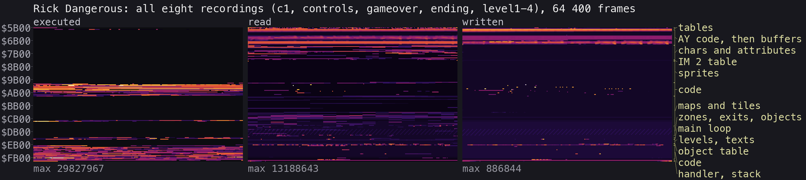
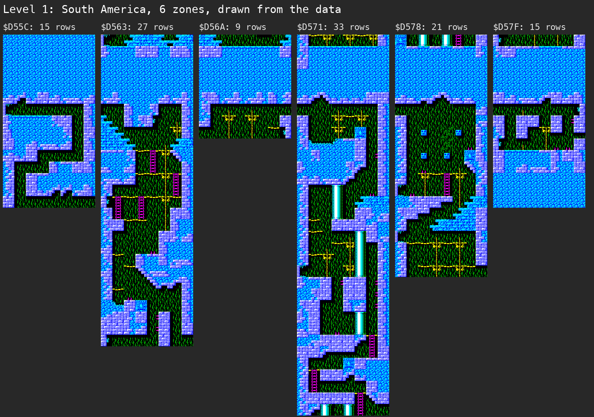
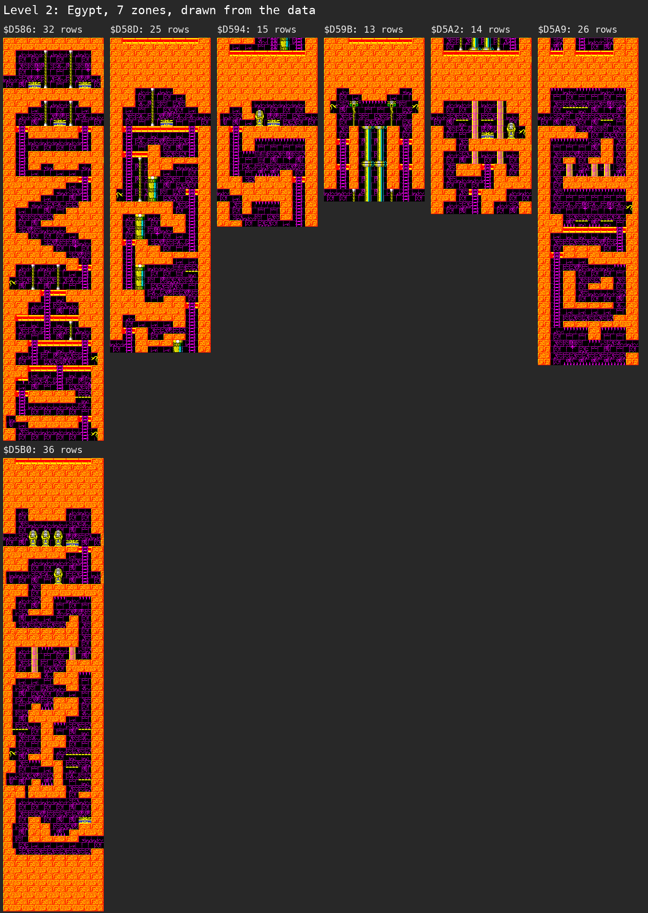
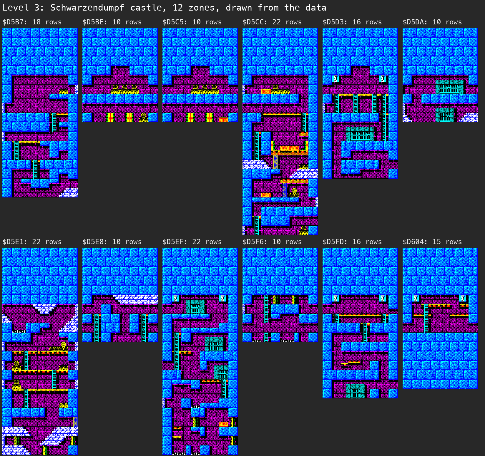
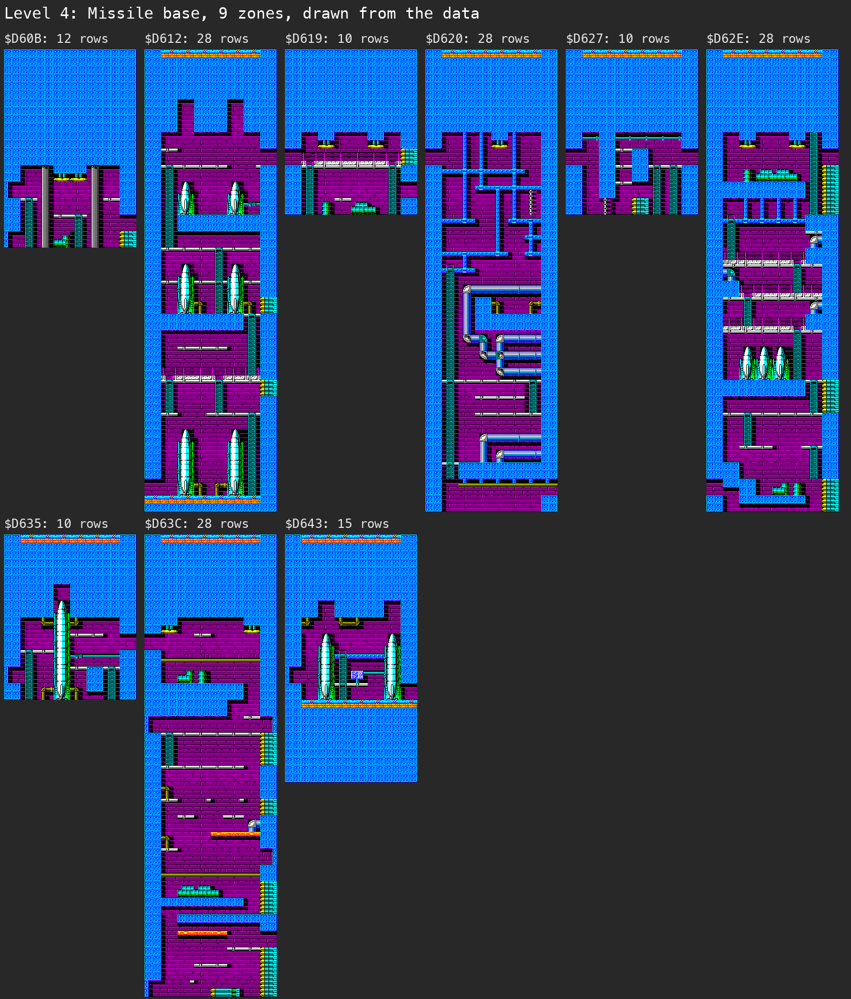
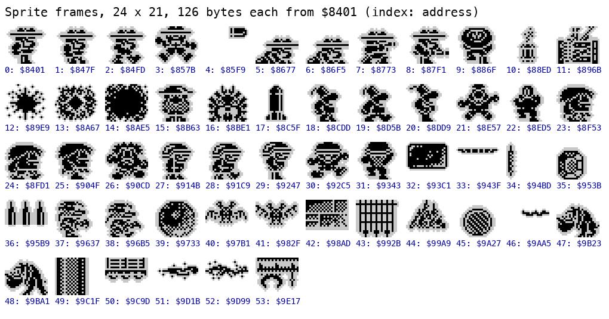

# 2. Architecture

What this covers: the machine budget, the memory map (a figure), stages from the medium to play, the frame, the main
loop's call graph, the module map. The recordings it rests on: `c1` (power-on, the original TZX at ROM speed on the
128K, 33 400 frames) and `controls`, `gameover`, `ending`, `level1`-`level4` (from snapshots, no load), all listed in
[WALKTHROUGH 6.0](../WALKTHROUGH.md#60-the-recordings).

<!-- Figures this document needs (GUIDE.md 4.2), remove each line when it is in: -->
<!-- - the main loop's call graph (stage 2) -->

## 2.1 Stages from the tape to play

```mermaid
flowchart LR
    A["BASIC 'Rick'<br/>CLEAR 50000"] --> B["'Rick1' at $CD00<br/>RANDOMIZE USR 52480"]
    B --> C["Bleepload group 1<br/>48 blocks, marker $64"]
    C --> D["group 2<br/>140 blocks, marker $34<br/>$6E00-$F9FF"]
    D --> E["group 3<br/>6 blocks, marker $35<br/>$4000-$45FF"]
    E --> F["entry $AB4D<br/>DI, LD SP,0, CALL $A043"]
    F --> G["128K: $5E00 to RAM 1<br/>CALL $A030 at $FF11"]
    G --> H["menu $E219"]
    H --> I["intro text, level N"]
    I --> J["main loop $E3C9<br/>HALT $E40F"]
    J --> K["GAME OVER $E35D"]
    K --> H
```



The tape and its blocks are in [doc 3, 3.1](03-build-and-load.md#31-the-tape-block-by-block). In `c1` the interrupts
stay disabled through the turbo load. The game's entry `$AB4D` runs in frame 19 010, and the first byte of the RAM 1
copy is written at T-state 70 589. The menu is on screen by frame 30 200, and play is under way at 31 500.

At the entry the game tests the paging (`$A043`). On the 128K it copies `$5E00-$6BA3` (`$0DA4` bytes, the AY player
and its tunes) to RAM 1 at `$C000`. It then puts `CALL $A030` into the IM 2 handler at `$FF11`. On a 48K it sets
`$A08D` = `$FF` instead, and the effects go to the beeper routine `$A08E`. RAM 1 holds 0 nonzero bytes at the entry
and 3 356 in play (`work/images/entry.ram.bin`, `play.ram.bin`). After the copy, the `$5E00` area is reused for
buffers (below).

## 2.2 The memory map

| Range | What | Witness |
| --- | --- | --- |
| `$4000-$5AFF` | the screen | screenshots, [WALKTHROUGH 6.1](../WALKTHROUGH.md#61-screenshots) |
| `$5B00-$5BFF` | bit-reversal table, one byte per byte value, built at `$AB6A`; the sprite drawer mirrors a frame through it | written after the entry (entry to menu diff) |
| `$5C00-$5CE7` | char properties, built by `$F6A9` from run-length pairs at `$F6C0` (set 0) and `$F6D0` (set 1) | code `$F6A9`; entry to play diff |
| `$5CE8-$64FF` | composed chars, `$5CE8` + code x 8 | entry to play diff `$5C37-$5F0F` |
| `$5E00-$6BA3` | as loaded: the AY player and tunes, copied to RAM 1 `$C000` on a 128K; buffers after that | the copy loop `$A069`, `c1` frame 19 010 |
| `$6500-$6AFF` | the playfield char map, 44 rows of 32 chars | entry to play diff `$6500-$6C9E` |
| `$6B00-$6EFF` | cell flags (char map + `$600`) and, from `$6C00`, the cells the redraw `$A834` scans, up to the sentinel at `$6F00` | code `$A834` |
| `$7100-$78FF` | char bitmaps, set 0 (levels 1 and 2), 8 bytes each | the maps are drawn from them ([2.5](#25-levels-zones-and-maps)) |
| `$7900-$79FF` | char attributes, set 0 | as above |
| `$7A00-$81FF` | char bitmaps, set 1 (levels 3 and 4) | as above |
| `$8200-$82FF` | char attributes, set 1 | as above |
| `$8300-$8400` | the IM 2 table, 257 bytes of `$FE`: the vector is `$FEFE` (`I` = `$83`) | written after the entry (entry to menu diff) |
| `$8401-$9E94` | 54 sprite frames, 24 x 21 pixels, 126 bytes each | [2.6](#26-sprites) |
| `$9FED-$A0FF` | sound and paging: effects `$9FED`, music `$A016`, the music tick `$A030`, the paging test `$A043`, the RAM 1 copy `$A069`, the 48K beeper `$A08E` | executed (heatmap) |
| `$A100-$AF63` | code: controls, the sprite drawer `$A419`, the redraw `$A834`, the entry `$AB4D`, the level-end path `$ABD8`, the closing effect `$AF56`; variables among it (below) | executed |
| `$AF64-$C31B` | level maps: rows of 8 tile numbers | [2.5](#25-levels-zones-and-maps) |
| `$C31C-$D31B` | tiles: 4 x 4 char codes, 16 bytes each | as above |
| `$D55C-$D649` | zones: 34 records of 7 bytes | as above |
| `$D64A-$D7FB` | zone exits (5 bytes each, `$FFFF` = the level's end) and object lists | as above |
| `$E219-$E4AD` | menu `$E219`, init `$E2DC`, intro `$E324`, quit `$E35A`, GAME OVER `$E35D`, main loop `$E3C9` with its HALT at `$E40F`; the variables `$E440`, `$E4AD` | executed |
| `$E4AE-$E9FF` | level table (4 records of 11 bytes) and the texts: intros at `$E4E5`, `$E5FC`, `$E70A`, `$E80E`, the closing text at `$E8F9` | screenshots `intro-level1`-`4`, `ending-text` |
| `$EA8E-$EBF3` | object table, 30 bytes per object; bytes +4-5 point to the sprite frame (Rick's is `$84FD`) | entry to play diff `$EAAC-$EBF3` |
| `$EC00-$FCFF` | code: objects, traps, shots, dynamite and the effects' call sites | executed |
| `$FD55-$FD69` | play state: zone change `$FD61`, death flag `$FD69` | entry to play diff `$FD55-$FD62` |
| `$FEFE-$FF1D` | IM 2 handler | executed every interrupt; not written in play |
| `$FFEE-$FFFF` | stack, under `SP` = `$0000` | low mark below |

The figure is the L1 of all eight recordings (64 400 frames), merged and drawn by the kit:

```
python3 tools/l1merge.py work/stage1/l1-all.json work/stage1/{c1,controls,gameover,ending,level1,level2,level3,level4}/l1.json
python3 ../../kit/heatmap.py work/stage1/l1-all.json docs/img/heatmap.png --regions work/stage1/regions-fig.txt \
    --panels executed,read,written --columns 3
```



The executed panel shows the code in three blocks: `$9FED-$AF63`, `$E219-$FCFF` and the handler at `$FEFE`. The maps,
tiles and sprites are only read. The writes go to the tables at `$5B00`, to the playfield buffers `$6500-$6EFF`, to
the object table and to the stack.

**The stack.** The game sets `SP` = `$0000` at the entry (`LD SP,0` at `$AB4E`), so the stack runs down from `$FFFF`.
SP is `$0000` at the main loop's HALT `$E40F` in every snapshot. The lowest byte written in each recording is the
stack's low mark:

| Recording | Low mark |
| --- | --- |
| `level1`, `level2`, `level3`, `gameover` | `$FFEE` |
| `level4` | `$FFF0` |
| `controls` | `$FFF2` |

The deepest stack is 18 bytes. The handler `$FEFE-$FF1D` sits 208 bytes below it, and no byte of `$FE00-$FF1D` is
written in play.

## 2.3 The images: loaded, at the entry, in play

| Image | Where | Made by |
| --- | --- | --- |
| at the entry | `work/mkgame/original.bin`, `$5B00-$FFFF`, 42 240 bytes | `python3 tools/image.py` (SkoolKit `tap2sna.py` simulates the whole load up to `$AB4D`) |
| at the entry, from the emulator | `work/images/entry.{cpu,ram,view}.bin` | `c1` frame 19 010, T-state 70 580 |
| at the menu | `work/images/menu.*` | `c1` frame 30 200 |
| in play | `work/images/play.*` | `c1` frame 31 500, level 1 |

The tap2sna image and the emulator's image at the entry differ only in 39 bytes, in `$5B89-$5BDD`. The game writes
the bit-reversal table over that area after the entry, so the 39 bytes never reach play.

**Entry to menu:** 755 bytes differ:
- `$5B00-$5BFF`: the bit-reversal table;
- `$6A80-$6AFD` and `$7081-$70FC`: buffers;
- `$8300-$8400`: the IM 2 table;
- `$A14C-$A14D`: the control method and input;
- `$A237`: the interrupt counter;
- `$AB3C` and `$E462-$E463`;
- `$FF11-$FF13`: `CALL $A030` in the handler;
- `$FFE4-$FFFF`: the stack.

**Entry to play:** 3 545 bytes in 47 runs. The large ones:
- `$5C37-$5F0F`: char properties and composed chars;
- `$6500-$6C9E`: the char map, the cell flags and the redraw list;
- `$7900`: attributes;
- `$A958-$A976`: lives, dynamite and bullets;
- `$A9BF-$A9C2`;
- the object table `$EAAC-$EBF3`;
- the play state `$FD55-$FD62`.

About 60 bytes change inside the code blocks as well: `$A259-$A25A`, `$A442`, `$A458-$A459`, `$A47A`, `$A47F` and
`$A486-$A487` (in the sprite drawer); `$A605`, `$A61C`, `$A631`, `$A6AE-$A6CD`, `$A73C`, `$A80F-$A831`,
`$A93A-$A93C`, `$AA38`, `$AB95-$AB96`, `$AD21-$ADB7`, `$AF4F-$AF50`, `$E495-$E499`, `$ED3F-$ED41` and `$F173`
(`work/images/entry.view.bin` against `play.view.bin`). Some are patched operands, others variables kept among the
code. Stage 2 names each one.

## 2.4 The state variables

| Variable | Address | Witness |
| --- | --- | --- |
| lives | `$A958` | 6 in play (`play` image); the HUD's count; ZXDB's infinite-lives POKE (58356 = `$E3F4`) is in the main loop |
| dynamite | `$A967` | 6 in play |
| bullets | `$A976` | 6 in play |
| level | `$E4AD` | 0-3, set by the warps ([WALKTHROUGH 6.0](../WALKTHROUGH.md#60-the-recordings)); the intro text follows it |
| game complete | `$E440` | `$FF` after level 4's end (`ending`) |
| Rick's map position | `$EAAE` | changes at every scroll in `level1` (`$8C` at frame 443, `$8F` at 452) |
| zone change | `$FD61` | set when Rick takes an exit |
| death | `$FD69` | set when Rick dies |
| control method | `$A14C` | the menu's choice (`controls`) |
| input | `$A14D` | the bits read this pass |
| interrupts this pass | `$A237` | 0 after the HALT (WALKTHROUGH section 1) |

The score is not placed yet. `$A9BF-$A9C2` changes between the entry and play, and stage 2 checks it against the HUD.

## 2.5 Levels, zones and maps

A level's record in the table at `$E4AE` points to its first zone. The zones are 7-byte records from `$D55C`: 6 for
level 1, 7 for level 2, 12 for level 3 and 9 for level 4. The levels' first zones are at `$D55C`, `$D586`, `$D5B7` and
`$D60B`.

| Offset | Field |
| --- | --- |
| +0 | char set: 0 (`$7100`, levels 1-2) or 1 (`$7A00`, levels 3-4) |
| +1-2 | the zone's map rows (in `$AF64-$C31B`) |
| +3-4 | its exits, 5 bytes each; `$FFFF` ends the level |
| +5-6 | its objects |

A map row is 8 tile numbers. A tile is 4 x 4 char codes at `$C31C` + tile x 16, and a char is 8 bitmap bytes in its
set with one attribute byte. So a row of the map is 32 chars wide, the screen's width. `tools/mapdraw.py` draws every
zone of a level from these tables alone, with no emulator involved:









Each column is one zone, headed by its record's address and its height in tile rows. The maps show the tiles only:
enemies and traps come from the zone's object list (stage 2).

## 2.6 Sprites

The 54 frames at `$8401-$9E94` are 24 x 21 pixels, 126 bytes each. The drawer at `$A419` pops three byte pairs per row
and draws each pair as an AND mask followed by OR pixels. A frame faces one way only: bit 0 of the object's byte +6
mirrors it through the bit-reversal table at `$5B00`. `tools/spritesheet.py` drew the sheet from the data:



Frame 2 (`$84FD`) is Rick, as the object table shows in play. The other frames will be named in stage 2, from the
objects that point to them.
