# 3. Build and load

What this covers:

- the tape block by block, with its times;
- the BASIC loader;
- Firebird's Bleepload as this tape uses it: Rick1's tape reader, the block formats, the key, the two ciphers, the
  decoy block, LoadGroup and the duplicator check;
- the stages from power-on to the game, with the frames of a real load;
- the static decode checked against the recording;
- the 48K and 128K paths;
- the other releases and the hacks;
- the source build.

The recordings it rests on:

| Recording | Load | Frames | Used for |
| --- | --- | ---: | --- |
| `c1` | power-on, the 128 menu's Tape Loader, the original TZX at ROM speed | 33 400 | every loader stage, every frame number in this document |
| `beeper48` | a 48K state with Is48K = `$FF` | 1 600 | the 48K path after the load |

Conventions:

- A frame is 70 908 T-states (the 128K). Frame 0 of `c1` is power-on.
- `F:T` is frame F, T-state T within it. The frames of routine entries come from `find_last execute` on `c1`
  ([WALKTHROUGH 6.0](../WALKTHROUGH.md) opens it on an instance).
- The tools are this case's: `tools/bleepload.py` (both ciphers, both ways), `tools/tzxblocks.py`,
  `tools/basic_list.py`, `tools/mktape.py` and `tools/fig_load.py`.

## 3.1 The tape block by block

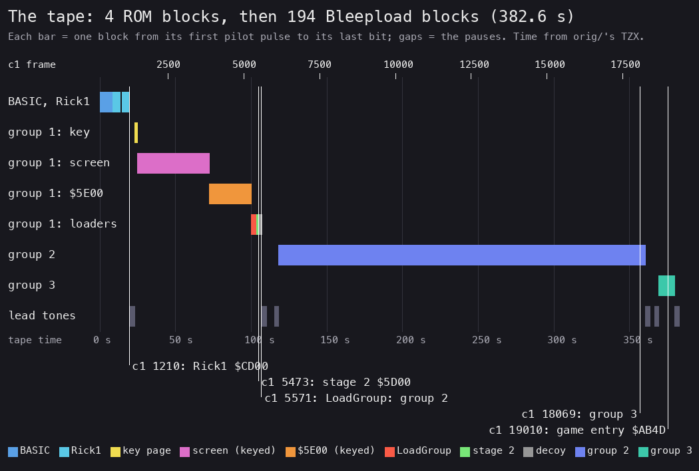

*The tape against time. Drawn by `python3 tools/fig_load.py tape docs/img/load/tape.png` from orig/'s TZX alone: each
block's pilot, sync and data pulses in T-states at 3.5 MHz, then its pause. The `c1` frame axis on top is placed by
one event: Rick1 runs at `c1` 1210:16820, right after its block ends. The five white lines are `c1` routine entries
(`find_last execute`).*

How to read it:

- There is one lane per kind of block. A bar runs from a block's first pilot pulse to its last bit.
- The bottom lane holds the 2.88 s lead tones before each group.
- The white lines are where the loader reached each stage in `c1`. Each falls at the end of the right bar, which
  checks the time axis against the recording.

| TZX blocks | What | Size (data + 2) | Loads at | Time |
| --- | --- | ---: | --- | ---: |
| 0 | text "Created with Ramsoft MakeTZX" | | | |
| 1-2 | Program "Rick", LINE 10, ROM speed | 19, 183 | BASIC | 5.1 + 2.9 s |
| 3-4 | Bytes "Rick1", ROM speed: the first loader stage | 19, 514 | `$CD00` (512 bytes) | 5.1 + 4.9 s |
| 5-58 | group 1: a 2.88 s tone, then 48 turbo blocks (marker `$64`) | 268-275 each | `$C900`, `$CF00-$FBFF`, `$5D00`, and one never stored | 83.8 s |
| 59-204 | group 2: a 2.88 s tone, then 140 turbo blocks (marker `$34`) | 267 each | `$6E00-$F9FF` | 240.7 s |
| 205-216 | group 3: a 2.88 s tone, then 6 turbo blocks (marker `$35`) | 267 each | `$4000-$45FF` | 10.2 s |

The "turbo" blocks are not fast:

- Their timings are the ROM's: pilot 2165 T, sync 667 and 735 T, bits 856 and 1712 T.
- Only the pilot is short: about 249 pulses, where the ROM writes 8063 or 3223.
- The whole tape is 382.6 s, or 19 129 frames. The game is entered at `c1` 19 010.

**The point**: the tape is long because it is cut into 194 blocks of 256 bytes, each with its own pilot and header.
That is not for speed but for the protection: every block carries its own address and check, and group 1's blocks
carry code.

## 3.2 The BASIC

The BASIC "Rick" (`src/tape/basic.asm`, listed by `python3 tools/basic_list.py`):

| Line | Statement | What it does |
| ---: | --- | --- |
| 10 | `REM RICK DANGEROUS  v.2/89` | a version tag: "v.2", 1989 |
| 20 | `CLEAR 50000` | RAMTOP at `$C350`: the BASIC stack below Rick1 and the loader's pages |
| 30 | `BORDER 0: PAPER 0: INK 0: CLS` | a black screen; ink = paper hides what loads into it |
| 40 | `PRINT AT 1,8; PAPER 1; INK 7;" RICK DANGEROUS "` | the title band, white on blue |
| 50 | `LOAD "Rick1" CODE 52480` | the next ROM block, to `$CD00` |
| 60 | `RANDOMIZE USR 52480` | Rick1 runs |

Witness: `c1` 700 shows the title band (the first picture of [3.9](#39-the-stages-from-power-on-to-the-game)). The
first 53 bytes of this program are still in the game image at `$5CCB` (BasicLeft); stage 2 overwrote the rest at
`$5D00`.

**The point**: the BASIC is plain and short. Everything after line 60 is machine code that reads its own blocks.

## 3.3 Rick1: the first stage and its tape reader

Rick1 is 512 bytes at `$CD00-$CEFF` (`src/loader/rick1.asm`). It reads the 48 blocks of group 1 one by one into the
buffer at `$FE00`. Each block is checked, its payload is copied where the block says, and then Rick1 jumps into the
block's own tail. That tail is `JP NextBlock` (`$CD1B`) for blocks 0-45 and `JP $5D00` for block 46, the second stage.

So the tape decides where Rick1 goes next. The jump to stage 2 is data, not code.

### Its tape reader against the ROM's

LoadBlock `$CD6E` is the ROM's LD-BYTES (`$0556`) with these changes:

| ROM LD-BYTES | Rick1 LoadBlock | Effect |
| --- | --- | --- |
| 256 leader pulses needed | `LD H,$64`: 100 | the short pilot of every block |
| `RET NZ` on a wrong flag | `NOP` | the flag `$FF` is read but not checked |
| BREAK tests in LD-EDGE-1 | none | the load cannot be stopped |
| the parity test at the end | none (EI, return) | CheckBlock makes an XOR checksum instead |
| verify mode works | `JR NC,$` | verify mode hangs |

The border shows the state. It stripes red and yellow on the leader (C flips by `XOR $24` from `$02`), and blue and
cyan on the data (C `XOR 3` after the sync). The length to read is not fixed: BlockLength makes `$109` + N, where N
comes from the block before ([3.4](#34-the-block-formats-byte-by-byte)).

### The loop

```text
Rick1Start:
    open stream 2; print INK 9, PAPER 8; wanted = 0; print "Searching 00"
    filler = 8
NextBlock:
    read a block of $109 + filler bytes into $FE00
    if marker != $64: go to NextBlock               # another group: skip it
    if number != wanted: BadBlock, go to NextBlock   # "Block ? NN", then "Rewind to NN" or "Searching NN"
    if XOR of the block's bytes but the last != the last: BadBlock, go to NextBlock
    copy the 256 payload bytes to dest; print "Loading NN"
    filler = (the last byte AND 7) + 1               # the next block's length
    wanted = wanted + 1
    jump to the JP that follows this block's filler  # JP NextBlock, or JP $5D00
```

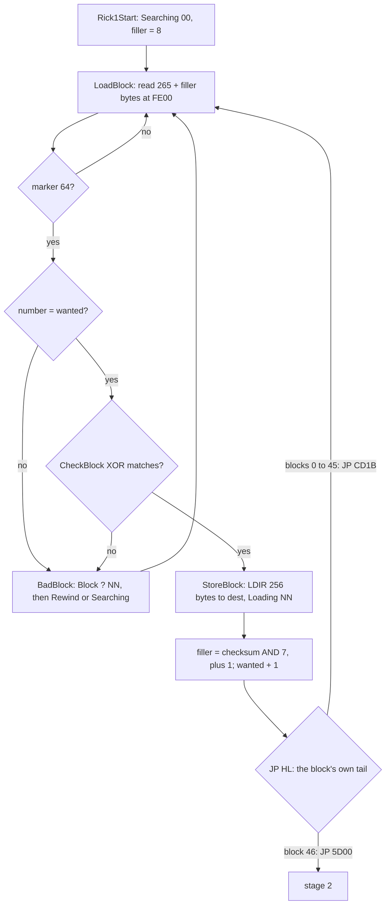

The asm of the tail (`build/rick1.lst`):

```text
CD3B CD 59 CD    CALL StoreBlock       ; payload to dest; IX = $CD3E
CD3E CD 57 CE    CALL ShowLoading      ; "Loading NN"
CD41 21 04 FF    LD HL,BlockFiller     ; $FF04: N
CD44 7E          LD A,(HL)
CD45 23          INC HL                ; SkipFiller: HL = $FF04 + N
CD46 3D          DEC A
CD47 20 FC       JR NZ,SkipFiller
CD49 23 23 23 23 INC HL (4 times)      ; HL = the checksum
CD4D 7E          LD A,(HL)
CD4E 2B 2B 2B    DEC HL (3 times)      ; HL = the JP after the filler
CD51 E6 07       AND $07
CD53 3C          INC A
CD54 32 15 FF    LD (NextFiller),A
CD57 14          INC D                 ; the next block wanted
CD58 E9          JP (HL)               ; into the tape's own code
```

StoreBlock ends with `POP IX`, `PUSH IX`, `RET`. So it leaves IX = `$CD3E`, its own return address inside Rick1.
Stage 2 pushes that IX and makes the key from the page it points into ([3.5](#35-the-key-and-group-1s-cipher)).

Witness: Rick1Start at `c1` 1210:16820. StoreBlock ran 47 times and LoadBlock 48 times: block 47 is read by stage 2
through the same LoadBlock. BadBlock and the rewind message were not executed in any recording: `c1` loads every
block in order. They are known only from the code.

**The point**: Rick1 is the ROM loader with its safety checks removed, plus a chain of jumps that the tape supplies.
A copier that saves the blocks as ROM blocks breaks the chain twice: the lengths come from the checksums, and the
jumps come from the blocks.

## 3.4 The block formats byte by byte

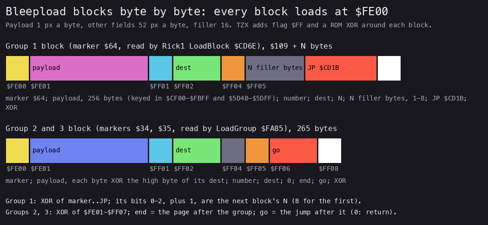

*The two block formats. Drawn by `python3 tools/fig_load.py format docs/img/load/blocks.png`. The field widths are not
to scale: the 256-byte payload is drawn at 1 px a byte, the other fields at 52 px a byte and the filler at 16.*

How to read it:

- Every block of every group loads at `$FE00`. The labels under the bars are the buffer addresses.
- A group 1 block varies in length: its filler is N bytes, 1 to 8.
- A group 2 or 3 block is always 265 bytes. Its `$FF04` is 0 and no code reads it.

| Offset | Address | Group 1 (Rick1) | Groups 2, 3 (LoadGroup) |
| --- | --- | --- | --- |
| 0 | `$FE00` | marker `$64` | marker `$34` or `$35` |
| 1-256 | `$FE01-$FF00` | the payload (keyed in `$CF00-$FBFF` and `$5D40-$5DFF`) | the payload, each byte XOR its dest page |
| 257 | `$FF01` | the block's number (`$00-$2F`) | the number (`$00-$8B`, `$00-$05`) |
| 258-259 | `$FF02-$FF03` | dest | dest |
| 260 | `$FF04` | N | 0 |
| 261 | `$FF05` | N filler bytes, then `JP $CD1B` (block 46: `JP $5D00`) | end: the page after the group |
| 262-263 | `$FF06-$FF07` | | go: where to jump after the last block (0: return) |
| last | | the XOR of all bytes before it | `$FF08`: the XOR of `$FE01-$FF07` |

The TZX block adds the flag `$FF` before the block and a ROM-style XOR after it. No loader checks either.

**Worked example: the chained lengths.** Block 0 (the key page) is `$109` + 8 = 273 bytes. Its checksum byte is
`$7B`. `$7B AND 7` = 3, plus 1 = 4. So block 1 is `$109` + 4 = 269 bytes, and its `$FF04` holds 4. Its filler is
`C2 FC DF 8B`, followed by `C3 1B CD` (`JP $CD1B`). These bytes come from orig/'s TZX by `tools/bleepload.py`.

**The point**: the length of block n + 1 hangs on every byte of block n. A tape duplicator that changes one byte of a
block makes the next one unreadable.

## 3.5 The key and group 1's cipher

Stage 2 (`$5D00`, block 46) arrives half enciphered: `$5D00-$5D3F` are plain and `$5D40-$5DFF` are keyed. Its plain
head loads block 47, makes the key, then deciphers its own tail and the pages `$CF00-$FBFF`.

**The key.** Block 0 put the 256-byte key page at `$C900`. The key is that page XOR both pages of Rick1:

key[i] = keypage[i] XOR Rick1[`$CD00` + i] XOR Rick1[`$CE00` + i], for i = 0 to 255.

MakeKey `$5D12` writes the key over the key page. Rick1's own bytes are the key material. Change one instruction of
Rick1, to stop it or to print a message, and every keyed byte comes out wrong.

**The two keyed ranges:**

- DecipherSelf `$5D24`: the byte at `$5D00` + i, for i = `$40` to `$FF`, XOR key[i - `$40`];
- DecipherGroup1 `$5D3D`: the byte at address a, for a = `$CF00` to `$FBFF`, XOR key[a AND `$FF`].

The second range comes from block 47's buffer: KeyedFrom `$FEE9` = `$CF00`, KeyedEnd `$FEEC` = `$FC`.

### Both directions

Deciphering, as stage 2 runs it:

```text
MakeKey:
    for i in 0..255:
        keypage[i] = keypage[i] XOR rick1[$CD00 + i] XOR rick1[$CE00 + i]   # now the key
DecipherSelf:
    for i in $40..$FF:
        mem[$5D00 + i] = mem[$5D00 + i] XOR key[i - $40]
DecipherGroup1:
    for a in $CF00..$FBFF:
        mem[a] = mem[a] XOR key[a AND $FF]
```

Enciphering, as `tools/bleepload.py` builds the tape. XOR is its own inverse, so one function serves both ways:

```text
tape_keypage[i] = key[i] XOR rick1[$CD00 + i] XOR rick1[$CE00 + i]
tape_payload[a] = plain[a] XOR key[a AND $FF]          for a in $CF00..$FBFF
tape_stage2[i]  = plain[i] XOR key[i - $40]            for i in $40..$FF
```

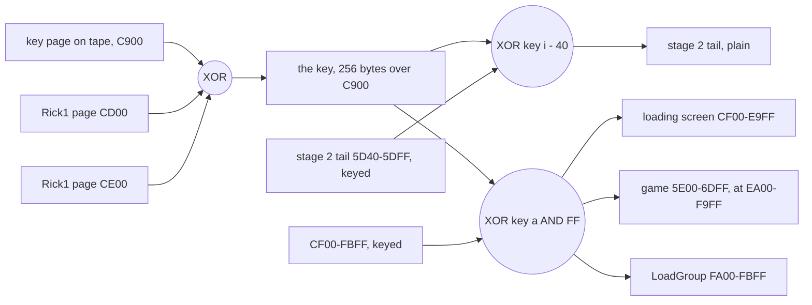

The asm (`build/stage2.lst`):

```text
5D12 F3          DI                    ; MakeKey
5D13 E1          POP HL                ; IX from StoreBlock: $CD3E
5D14 2E 00       LD L,$00              ; HL = $CD00
5D16 ED 5B E7 FE LD DE,(KeyPagePtr)    ; DE = $C900
5D1A 1A          LD A,(DE)             ; MakeKeyLoop: the key page byte
5D1B AE          XOR (HL)              ; XOR Rick1[$CD00 + i]
5D1C 24          INC H
5D1D AE          XOR (HL)              ; XOR Rick1[$CE00 + i]
5D1E 25          DEC H
5D1F 12          LD (DE),A
5D20 2C          INC L
5D21 1C          INC E
5D22 20 F6       JR NZ,MakeKeyLoop
  ...
5D3D ED 5B E7 FE LD DE,(KeyPagePtr)    ; DecipherGroup1: DE = the key
5D41 2A E9 FE    LD HL,(KeyedFrom)     ; HL = $CF00
5D44 1A          LD A,(DE)             ; DecipherLoop
5D45 AE          XOR (HL)
5D46 77          LD (HL),A
5D47 23          INC HL
5D48 1C          INC E                 ; the key index wraps with the page
5D49 20 F9       JR NZ,DecipherLoop
5D4B 3A EC FE    LD A,(KeyedEnd)       ; $FC
5D4E BC          CP H
5D4F 20 F3       JR NZ,DecipherLoop
```

### Worked example on the real bytes

These are orig/'s TZX bytes, from `tools/bleepload.py`. The plain bytes are the built image's.

| Address | Tape byte | Key page | Rick1 `$CD00`+i | Rick1 `$CE00`+i | Key | Plain | What it is |
| --- | --- | --- | --- | --- | --- | --- | --- |
| `$CF00` | `$0F` | `$00` | `$3E` | `$3E` | `$00` | `$0F` | the loading screen's first byte |
| `$CF01` | `$AD` | `$46` | `$02` | `$16` | `$52` | `$FF` | its second byte |
| `$CF02` | `$E6` | `$99` | `$CD` | `$3D` | `$69` | `$8F` | its third byte |
| `$5D40` | `$FE` | `$00` | `$3E` | `$3E` | `$00` | `$FE` | the last byte of `LD DE,(KeyPagePtr)` at `$5D3D` |
| `$5D41` | `$78` | `$46` | `$02` | `$16` | `$52` | `$2A` | `LD HL,(nn)`: the first keyed opcode |

Step by step for `$CF01`:

1. `$46` XOR `$02` = `$44`.
2. `$44` XOR `$16` = `$52`: the key byte.
3. `$AD` XOR `$52` = `$FF`: the plain byte.

Key byte 0 is `$00`: Rick1's bytes at `$CD00` and `$CE00` are both `$3E`, and the key page holds `$00` there. So the
boundary at `$5D40`, in the middle of the instruction at `$5D3D`, does not show: that byte is the same on tape and in
memory.

### The animation

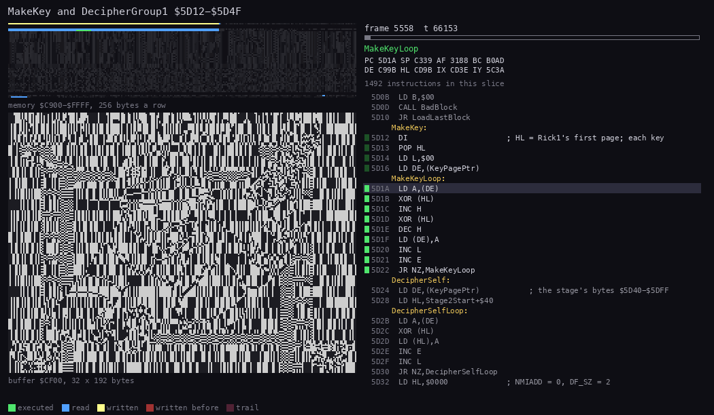

*DecipherGroup1 at work, `c1` 5558:56000 to 5567:27000, 60 pictures. The view is the buffer `$CF00` drawn as a screen
(32 x 192), which becomes the loading screen. The right panel shows memory `$C900-$FFFF` and the listing. Made with
`python3 ../../kit/routine_anim.py --work work/docs/rdA/c1 --window 5558:56000-5567:27000 --listing build/stage2.lst
--listing build/rick1.lst --view buffer:CF00:32x192:screen --range C900-FFFF --pictures 60 --out
docs/img/routines/DecipherGroup1.gif`.*

How to read it:

- The left view starts as noise: the keyed bytes Rick1 stored.
- The loop walks down the buffer. Each row turns into the picture as the key passes over it.
- It ends at `$FBFF`, after the screen, the game's `$5E00` bytes and LoadGroup.

Witness: MakeKey at `c1` 5558:56559, DecipherGroup1 at 5559:8862, the last page check `$5D4E` at 5567:26063. The
decipher of `$2D00` bytes takes 8 frames.

**The point**: a 256-byte XOR key alone would be weak. Tying it to Rick1's own code is the protection: a patched
first stage deciphers garbage.

## 3.6 The decoy last block

Block 47 of group 1 is read and checked by stage 2 (LoadLastBlock `$5D02`), but never stored. Its dest field says
`$FF0E`, and nothing copies it there.

Only three things in it are read, in the buffer:

| Address | Bytes | Read by | Meaning |
| --- | --- | --- | --- |
| `$FEE7` | `00 C9` | MakeKey, DecipherSelf, DecipherGroup1 | KeyPagePtr: the key page `$C900` |
| `$FEE9` | `00 CF` | DecipherGroup1 | KeyedFrom: `$CF00` |
| `$FEEC` | `FC` | DecipherGroup1 | KeyedEnd: the page after the range |

The rest is bait:

- 247 of its 256 payload bytes equal block 46's enciphered stage 2. Only the payload bytes `$E6-$EE` differ: the
  three pointers, then `C3 4D AB`, a `JP $AB4D` (the game's entry).
- Its tail is number `$2F`, dest `$FF0E`, N = 5, the filler `C2 C3 1B C3 C3`, then `JP $5D94` and the check `$AD`.
  `$5D94` is the middle of the instruction at `$5D93`. Nothing jumps through it: stage 2 never runs `JP (HL)` on
  this block.

`src/res/loader/lastblock.bin` holds the block as the tape has it, and the build writes it back unchanged.

Witness: LoadLastBlock ran once in `c1`, before MakeKey at 5558:56559. The decoy's `JP $5D94` and `JP $AB4D` were not
executed in any recording; their being bait is known from the code.

**The point**: someone tracing the load by hand sees a block that looks like stage 2 again and ends in a jump. Both
lead nowhere. The real content of block 47 is three pointers.

## 3.7 LoadGroup and the page cipher of groups 2 and 3

LoadGroup `$FA00` (`src/loader/loadgroup.asm`, deciphered from group 1's blocks 44-45) is Rick1 again with other
fields:

- every block is `$109` bytes: no filler, no chain;
- the marker is a parameter: `$34` for group 2, `$35` for group 3;
- the status and error lines move: rows 19 and 20 under the picture for group 2, rows 10 and 13 for group 3;
- each byte is stored XOR the high byte of its destination address (StorePage `$FA6C`);
- the group ends at the block whose end field equals the page after it, then jumps to go (0 in both groups: return).

```text
StorePage (deciphering, as LoadGroup runs it):
    for i in 0..255:
        mem[dest + i] = buffer[$FE01 + i] XOR (dest >> 8)
group23_cipher in tools/bleepload.py (enciphering):
    tape[i] = plain[dest + i] XOR (dest >> 8)
```

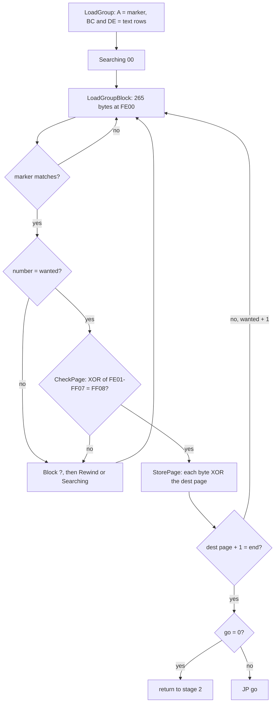

The asm of the store (`build/loadgroup.lst`):

```text
FA6C D5          PUSH DE                ; StorePage
FA6D E5          PUSH HL
FA6E ED 5B 02 FF LD DE,(BlockDest)
FA72 21 01 FE    LD HL,BlockPayload
FA75 01 00 01    LD BC,$0100
FA78 3A 03 FF    LD A,(BlockDest+1)     ; StorePageLoop: the dest page
FA7B AE          XOR (HL)
FA7C 77          LD (HL),A              ; deciphered in the buffer
FA7D ED A0       LDI                    ; then to dest, BC - 1
FA7F EA 78 FA    JP PE,StorePageLoop
FA82 E1          POP HL
FA83 D1          POP DE
FA84 C9          RET
```

**Worked example.** Group 2's block 0 has dest `$6E00`, end `$FA`, go `$0000` and the check byte `$94`. Its first
four payload bytes on tape are `6E 6E 6E 6E`. XOR `$6E` gives `00 00 00 00`: the cell flags at `$6E00`, zero as
loaded. A run of zeros in the image shows on tape as the page number repeated. The last block of group 2 is number
`$8B` (139) with dest `$F900`, and `$F9` + 1 = `$FA` ends the group. Group 3 ends at `$46`.

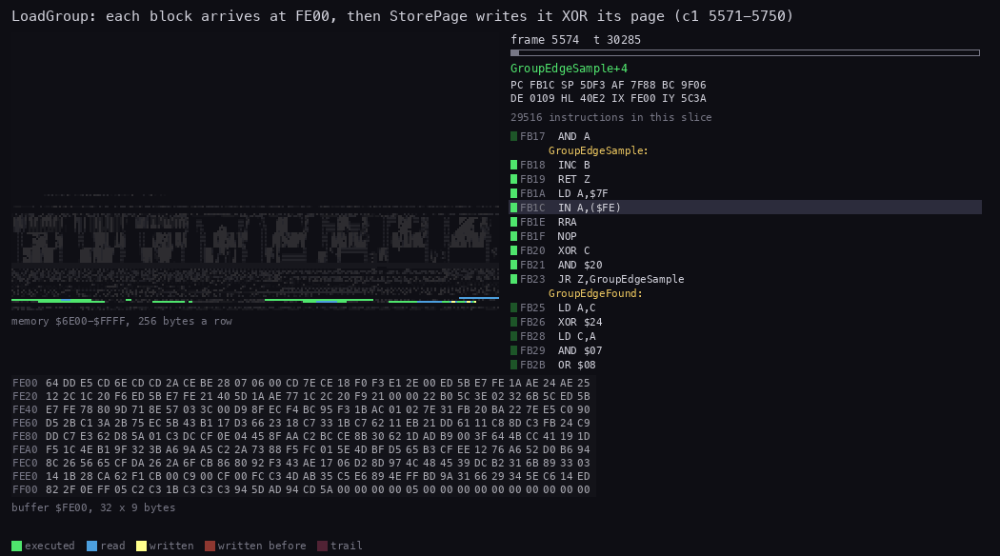

*LoadGroup at work, `c1` 5571:32000 to 5750:0, 60 pictures of 211 009 T each. The view is the buffer `$FE00` as hex
rows (32 x 9 bytes), where each block arrives. The right panel shows memory `$6E00-$FFFF` and the code running. Made
with `python3 ../../kit/routine_anim.py --work work/docs/rdA/c1 --window 5571:32000-5750:0 --listing
build/loadgroup.lst --listing build/stage2.lst --view buffer:FE00:32x9:hex --range 6E00-FFFF --pictures 60 --out
docs/img/routines/LoadGroup.gif`.*

How to read it:

- Most pictures show the edge loop (GroupEdgeSample): the tape is slow and the CPU waits for each edge.
- The buffer fills byte by byte. At a block's end StorePage XORs it in place and copies it out in one burst.

Witness: LoadGroup for group 2 at `c1` 5571:32720, for group 3 at 18069:33916. StorePage ran 146 times.

**The point**: the second cipher is weak on purpose. It only has to stop a plain header-and-bytes copy from making
sense; the strong part was group 1.

## 3.8 The start and the duplicator check

After group 2, stage 2 clears the screen to attribute 0, so ink = paper = black. Group 3 then loads into
`$4000-$45FF`, the top third of the bitmap, where it is invisible. Stage 2 copies it to `$FA00-$FFFF`, over LoadGroup
itself, which is no longer needed.

Then StartOrVerify `$5D98`:

```text
enable interrupts; read the keyboard with the ROM's KEY-SCAN
if exactly two keys are held and their codes differ by $21:
    LD-BYTES in verify mode: $A11E bytes from $5E00 against a ROM-speed block with flag $FF
    border = green if they agree, black if not; loop forever
else:
    jump to $AB4D, the game
```

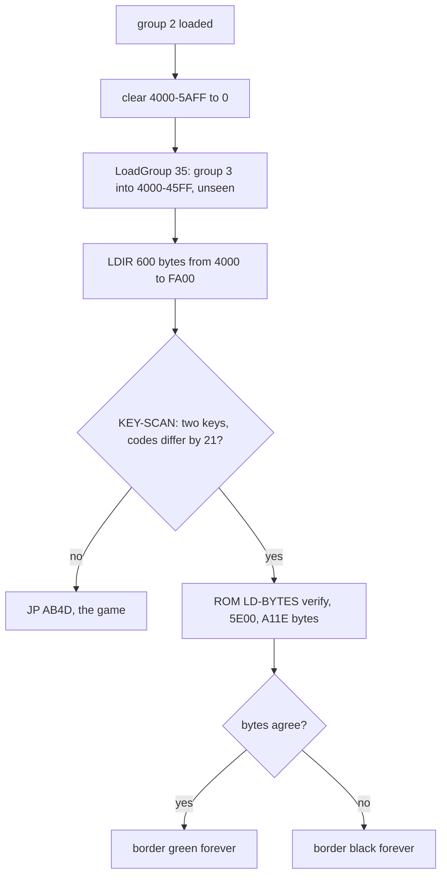

The check serves the duplicating house, not the player. With the two keys held at the end of the load, a master tape
followed by a plain image can be compared with memory.

Witness: the entry `$AB4D` at `c1` 19010:70483. VerifyImage was not executed in any recording: `c1` holds no keys at
the end of the load. It is known only from the code.

**The point**: the game is not started by a loader that could be skipped. It is started at the end of a chain where
every link depends on the one before.

## 3.9 The stages from power-on to the game

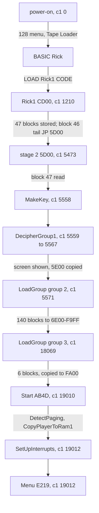

| Stage | Entry | `c1` frame:T | Code | Writes |
| --- | --- | --- | --- | --- |
| Rick1 | `$CD00` | 1210:16820 | `src/loader/rick1.asm` | `$C900`, `$CF00-$FBFF`, `$5D00` (as on tape) |
| stage 2 | `$5D00` | 5473:21527 | `src/loader/stage2.asm` | the key, then the keyed ranges in place |
| MakeKey | `$5D12` | 5558:56559 | | `$C900-$C9FF` |
| DecipherGroup1 | `$5D3D` | 5559:8862 | | `$CF00-$FBFF`; then the screen and `$5E00-$6DFF` |
| LoadGroup, group 2 | `$FA00` | 5571:32720 | `src/loader/loadgroup.asm` | `$6E00-$F9FF` |
| LoadGroup, group 3 | `$FA00` | 18069:33916 | | `$4000-$45FF`, then `$FA00-$FFFF` |
| the game | `$AB4D` | 19010:70483 | `src/game/game.asm` | see [doc 4](04-game-loop.md) |

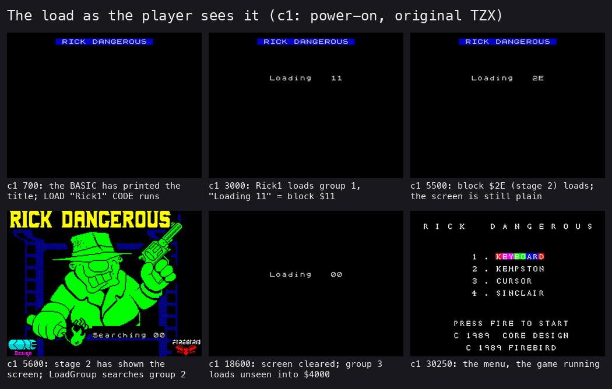

*Six moments of `c1`. Drawn by `python3 tools/fig_load.py screens work/docs/rdA/shots docs/img/load/screens.png` from
shots taken by `python3 ../../kit/screen_shot.py --work work/docs/rdA/c1 --out-dir work/docs/rdA/shots --scale 2
basic=700 rick1=3000 stage2=5500 g2=5600 g3=18600 menu=30250`.*

How to read it:

- "Loading 11" is hex: block `$11` of group 1. Group 1 counts up to `$2E`.
- The loading screen appears only after block 47, at about frame 5567. Until then it is keyed noise at `$CF00`, never
  on the screen.
- During group 3 the screen is all black, but the loader prints in its own colours, so "Loading 00" still shows.

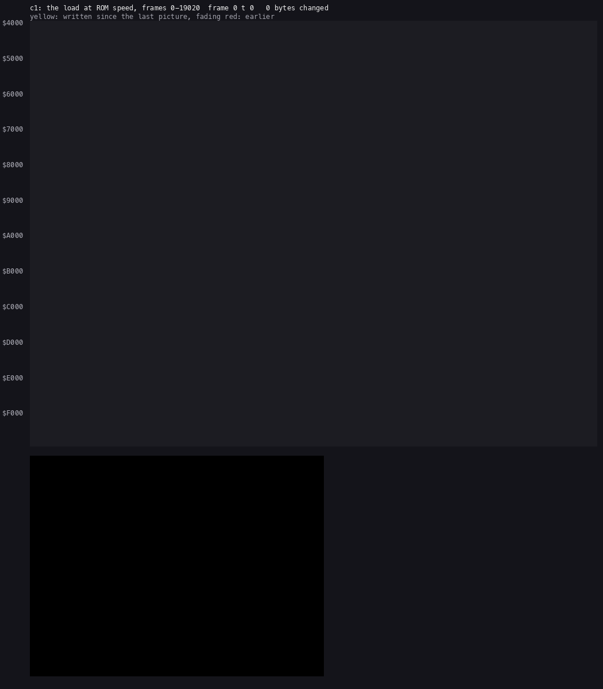

*Memory `$4000-$FFFF` over the load, one picture every 200 frames, `c1` 0 to 19 020, 95 pictures. Each cell is a byte,
bright where it was written since the last picture. Made with `python3 ../../kit/memanim.py --work work/docs/rdA/c1
--from 0 --to 19020 --step 14181600 --from-address 4000 --to-address FFFF --screen --cell fit --out
docs/img/load/load-memory.gif`.*

How to read it:

- The first third: group 1 fills `$C900-$FBFF` page by page, and `$5D00`.
- A flash over `$CF00-$FBFF` at about frame 5559: the decipher. The screen area then fills with the picture.
- The long middle: group 2 fills `$6E00-$F9FF` upwards, one page every 1.75 s.
- The end: group 3 at `$4000`, then its copy to `$FA00`.
- The count in the title line ("4461 bytes changed" on the last picture) is the bytes changed since the previous picture,
  not the total: the load writes all of `$4000-$FFFF`.

**The point**: the order of the load is the order of trust. Nothing keyed is used until the key exists, and the game
is written last, over the loaders.

## 3.10 The static decode against the recording

`tools/bleepload.py check` deciphers orig/'s TZX without an emulator. Its result against the image at the entry
(`tools/image.py`; `c1` enters Start at 19010:70483, and the emulator's image `work/images/entry.*` is taken 97 T
later, at 19010:70580, inside DetectPaging):

| Part | Static decode | `c1` at the entry | Differences |
| --- | --- | --- | --- |
| `$5E00-$6DFF` | group 1, keyed, deciphered | the image | none |
| `$6E00-$F9FF` | group 2, page XOR | the image | none |
| `$FA00-$FFFF` | group 3, page XOR | the image | none |
| stage 2 `$5D00-$5DFF` | block 46, keyed from `$40` | the image | 24 bytes `$5DE7-$5DFE`: the loader's stack (zeros on tape) |
| the 194 turbo blocks | rebuilt from their plain payloads | | 0 bad |

The check ends with `194 turbo blocks rebuilt from their plain payloads; 0 bad`. The stage 1 image (SkoolKit's
tap2sna, a full load simulation) matched `c1`'s image except 39 bytes: `$5B89`, `$5BC7-$5BD2`, `$5BD7-$5BE9`,
`$5BEB-$5BEC`, `$5BFB`, `$5C06` and `$5C78` (the 128K ROM's work space and system variables, which the game
overwrites), and `$FFFE-$FFFF` (Start's `CALL DetectPaging` return, pushed after `$AB4D`).

**The point**: the cipher is fully understood. The tape is rebuilt from the plain source, byte for byte
([3.13](#313-the-source-build)).

## 3.11 The 48K and the 128K paths

The tape is the same for both machines. The loaders use only the ROM's KEY-SCAN, LD-BYTES and print routines, which
both ROMs have at the same addresses.

The split comes after the load, at the game's entry:

| Step | 128K | 48K |
| --- | --- | --- |
| DetectPaging `$A043` | a write with RAM 1 paged in does not show in RAM 0 | the write shows: one RAM |
| then | CopyPlayerToRam1 `$A069`: `$5E00-$6BA3` to RAM 1 `$C000`; the handler slot `$FF11` becomes `CALL $A030` | Set48K `$A05F`: Is48K `$A08D` = `$FF` |
| `$5E00-$6DFF` afterwards | the game's work space (the char map, the cell flags) | the same; the AY image is never used |
| sound | the AY player in RAM 1: tunes and effects | BeeperEffect `$A08E`: effects only, no tunes |

Witness: DetectPaging at `c1` 19010:70514, CopyPlayerToRam1 at 19010:70632. Set48K itself was not executed in any
recording: `beeper48` starts from a state taken after the entry, with Is48K = `$FF`. The 48K branch is known from the
code and that state.

**The point**: one image serves both machines. On a 48K the 3.4 KB of AY code are loaded and then overwritten.

## 3.12 The releases and the hacks

The case covers the standard Spectrum releases only. Every copy the collection index lists was compared with the
original twice (stage 1): block by block (`tools/copy_blocks.py`, `work/stage1/copy-blocks.txt`), and by looking for
562 pieces of 64 bytes of the game image inside each copy (`work/stage1/copy-image.txt`).

| Copy | What it is | How it differs from the original |
| --- | --- | --- |
| ZXDB `RickDangerous.tzx.zip` | the original (this case) | the reference |
| ZXDB `RICKDAN1.TZX` | another dump of the Firebird tape | the BASIC and Rick1 identical; 150 of the 198 data blocks equal: the 4 ROM blocks and all 146 blocks of groups 2 and 3, so `$6E00-$FFFF` loads the same; the 48 blocks of group 1 differ (lengths too), its key page in 255 of 256 bytes |
| ZXDB `RICKDAN1.TAP` | the same dump as a TAP | a 774-byte BASIC that POKEs Rick1 to read a TAP |
| ZXDB `Rick Dangerous.dsk` | the +3 disk release | 558 of the 562 image pieces whole |
| ZXDB Kixx, MCM, IBSA, Erbe; TOSEC `[a2]` TAP | the re-releases | one 41 246-byte block behind a small loader; MCM, Erbe and `[a2]`: 397 of 562 pieces, a later build with its code moved (+8 from `$A13B`, +26 from `$E2D1`, down to +19 at `$F88C`) |
| zxart and vtrd TR-DOS conversions and hacks | other people's work | packed or patched: 0 to 527 pieces |

What the second dump's group 1 is was not settled. Deciphered with its own key page by this case's cipher
(`tools/bleepload.py`, run by `work/docs/rdA/othercopy.py`), it gives garbage: the loading screen differs from ours in
6 831 of 6 912 bytes, stage 2 in 190 of 256. So either its group 1 is damaged, or it was mastered with a cipher
other than ours. Groups 2 and 3, which do not use the key, are byte for byte ours; no copy of the game loaded from it
was compared.

**The hacks.** ZXDB's POKE file names addresses in the original. Each one lands on an instruction this source
explains:

| POKE | Address | Instruction there | Effect |
| --- | --- | --- | --- |
| `58356,0` | `$E3F4` | `DEC A` in the main loop's death step: Lives - 1 | a NOP: infinite lives |
| `64075,0` | `$FA4B` | `DEC A` in FireShoot: one shot used | a NOP: infinite bullets |
| `64166,0` | `$FAA6` | `DEC A` in DropDynamite: one stick used | a NOP: infinite dynamite |
| `58300,n` | `$E3BC` | the 6 of `LD A,$06` in NewLife | n bullets and sticks each life |
| `44012,n` | `$ABEC` | the 6 of `LD A,$06` in LevelEnd | n bullets and sticks at each level |
| `58104,n` | `$E2F8` | the 6 of `LD A,$06` in NewGame | n lives at the start (NewGame also stores A in the bullets and sticks, but StartLevel always goes on to NewLife, which sets them to 6, or to the `58300` value) |
| `63524,195` | `$F824` | `JP Z,HitsYes` in HitsObstacle, after the test against slot 0 | `JP`: whenever slot 0 is in use, every bullet or thrown object hits ("kill most enemies on arrival") |
| `63218,195` | `$F6F2` | `JP C,OverlapNo` in ObjectsOverlap | `JP`: no two objects ever overlap ("no touch") |
| `58357,58` | `$E3F5` | `LD (Lives),A` after the death's `DEC A` | `$3A`: `LD A,(Lives)`, the store turned into a load: infinite lives |
| `64076,58` | `$FA4C` | `LD (Bullets),A` in FireShoot | as above: infinite bullets |
| `64167,58` | `$FAA7` | `LD (Dynamite),A` in DropDynamite | as above: infinite dynamite |

The last three are ZXDB's "alt" set. The same file lists the re-release's addresses, for example `58381` for the
lives: 25 bytes after `$E3F4`, the shift from `$E397` on (from `$E2D1` to there it is +26). Its two `[+3]` POKEs,
`58357,0` and `43092,54`, are for the +3 disk's build, whose code lies 1 byte up from `$E3F4` at least; they were not
checked against that build. The stage 2 zone recordings used POKE `58356,0` on a clone and say so.

**The point**: the classic cheats all hit a `DEC A` before a store, or the 6 of a refill.

## 3.13 The source build

`tools/build.sh` assembles every part with sjasmplus. Then `tools/mktape.py` writes the TZX from `src/tape/tape.txt`,
which lists every block with its timing, pilot count and pause as the original has them.

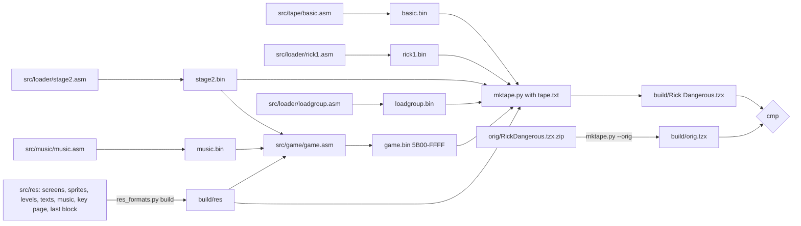

| Input | Becomes | On the tape |
| --- | --- | --- |
| `src/tape/basic.asm` | `basic.bin` | TZX block 2 |
| `src/loader/rick1.asm` | `rick1.bin` | TZX block 4; also the key material |
| `src/res/loader/keypage.bin` | as it is | group 1 block 0 |
| `src/res/screens` (the loading screen) | `res/screens/loading.scr` | group 1 blocks 1-27, keyed |
| `game.bin` `$5E00-$6DFF` | | group 1 blocks 28-43, keyed |
| `src/loader/loadgroup.asm` | `loadgroup.bin` | group 1 blocks 44-45, keyed |
| `src/loader/stage2.asm` | `stage2.bin` | group 1 block 46, keyed from `$40` |
| `src/res/loader/lastblock.bin` | as it is | group 1 block 47 |
| `game.bin` `$6E00-$F9FF` | | group 2, page XOR |
| `game.bin` `$FA00-$FFFF` | | group 3, page XOR |
| the filler bytes and pilot counts | `src/tape/tape.txt` | as the original |

The run ends with `build: identical to orig/RickDangerous.tzx.zip's "Rick Dangerous.tzx" (build/orig.tzx)`.

**The point**: every byte of the tape is produced from source. The key page and the decoy are kept as data because
they are what the authors chose; the cipher around them is code.
