# 4. Game loop

What this covers:

- the program's state machine from the entry to the game over, with every transition and its witness;
- the interrupt: IM 2, the vector table, the handler line by line, its cost, and where the code runs with interrupts
  off;
- the main loop `$E3C9`: the order of work in a pass, how it locks to the frame, and what each step costs;
- what happens when a pass runs over: lost interrupts and 3-frame passes;
- the heavy passes: the scroll and the zone change, against the beam;
- every delay, pause and timer, measured.

The recordings it rests on:

| Recording | Load | Frames | Used for |
| --- | --- | ---: | --- |
| `c1` | power-on, the original TZX at ROM speed (128K) | 33 400 | the entry, the menu, the intro, level 1 play from 30 500, two deaths, a pause, a quit, GAME OVER |
| `c1g` | the game window of `c1`, from the entry | 14 390 | the interrupt counts |
| `gameover` | `after128.szx`, no POKE | 3 000 | a natural GAME OVER (six deaths) |
| `ending2` | a level 4 warp on a clone, the door opened by a patch | 2 000 | LevelEnd and the game complete |
| the zone recordings | warps on a clone (stage 2, POKE `58356,0`) | 2 000 each | the pass costs in other zones |
| `beeper48` | a 48K state | 2 000 | the handler without music |

Conventions:

- A frame is 70 908 T-states (the 128K). The beam figures put the INT at frame T 1846 and the first paper line at
  frame T 16 212 (kit's frame convention; 228 T a line).
- `F:T` is frame F, T-state T within it. Entry frames come from `find_last execute` on `c1`.
- A **pass** is one run of the main loop, from `$E3C9` back to `$E3C9` ([terms](README.md#terms)).
- The step costs come from `work/docs/rdA/steps.py` over kit access traces (`.uatr`) of `c1`. It counts the T-states
  between the entries of each step, and the interrupt (`$FEFE-$FF1D` and what it calls) apart.

## 4.1 The shape

Rick Dangerous runs a single loop with one interrupt:

- The interrupt (IM 2, every frame) counts frames and, on a 128K, plays the music.
- The main loop does everything else: the input, the objects, the drawing, the HUD, the scroll.
- The loop waits for two interrupts a pass: a HALT, then WaitFrames for one more tick. So a pass takes **2 frames**,
  25 passes a second, whenever the work fits.

The menu, the intro, the level end and GAME OVER are not passes of the main loop. Each is a small loop of its own that
polls a key.

**The point**: the game is locked to 25 Hz by design. The second wait gives the compose step a whole frame to itself.

## 4.2 The state machine

```mermaid
stateDiagram-v2
    [*] --> Start: JP AB4D from stage 2
    Start --> Menu: tables built, JP E219
    Menu --> NewGame: fire or ENTER, then released
    NewGame --> LevelIntro: score 0; lives, bullets, dynamite 6
    LevelIntro --> StartLevel: text printed, tune 0
    StartLevel --> NewLife: fire pressed, the level's first zone loaded
    NewLife --> Pass: Rick alive, ammo 6, RestartScreen
    Pass --> Pass: 2 frames
    Pass --> Scroll: RickY at least CC, or below 60
    Scroll --> Pass: 8 rows moved, 14 to 19 frames
    Pass --> ZoneChange: ZoneChange set
    ZoneChange --> Pass: LoadScreen, about 9 frames
    ZoneChange --> LevelEnd: the exit leads to FFFF
    LevelEnd --> Pass: levels 1 to 3, the next level's first zone
    LevelEnd --> GameOver: level 4 done, GameComplete FF
    Pass --> Paused: P
    Paused --> Pass: P again
    Pass --> NewLife: DeathDone, lives left
    Pass --> GameOver: DeathDone, the last life
    Pass --> GameOver: Q, via Quit
    GameOver --> Menu: a key pressed
```

| Transition | Trigger | Code | Witness (`c1` unless said) |
| --- | --- | --- | --- |
| stage 2 to Start | the load's end | `$5DBB` `JP $AB4D` | 19010:70483 |
| Start to Menu | always | `$AB90` `JP Menu` | 19012:65979 |
| Menu to NewGame | StartPressed, then its release | MenuTestFire `$E2D1`, MenuWaitRelease `$E2D7` | NewGame at 30467:698 |
| NewGame to LevelIntro | always | falls through at `$E311` | the intro tune call `$E324` at 30471:53276 |
| LevelIntro to StartLevel | fire released | IntroWaitRelease `$E327` | StartLevel polls from 30471:56924 to 30500 |
| StartLevel to NewLife | fire pressed, Lives not 0 | `JR NZ,NewLife` at the end of StartLevel | NewLife at 30506:58088 |
| a pass to a scroll | Rick's y `$EAAE` >= `$CC` or < `$60`, not dying | `$E42B-$E43B` | ScrollViewDown at 30723:37282, 14 runs |
| a pass to a zone change | ZoneChange `$FD61` set by Rick's exit | `$E3FD-$E403` | CheckScreenExit at 31172:34081, 32512, 32726 |
| a zone change to LevelEnd | the exit's screen is `$FFFF` | CheckScreenExit | `ending2` (the only run of `$ABD8`) |
| LevelEnd to GameOver | level 4 done | GameComplete = `$FF`, then `$E40A` | `ending2` |
| a pass to NewLife | DeathDone `$FD69`, Lives - 1 not 0 | `$E3EB-$E3FB` | 32717:47142, 32825:34602 |
| a pass to GameOver | DeathDone and the last life | `$E3F8` `JP Z,Quit` | `gameover`, `level1` |
| a pass to GameOver | Q | `$E3CC` `JR Z,Quit` | Quit at 33101:31034, GameOver at 33101:63889 |
| a pass to the pause and back | P pressed, released, pressed, released | `$E3D7-$E3E9` | the 161-frame pass at `c1` 32849 |
| GameOver to Menu | StartPressed after a release | GameOverWaitPress `$E38E` `JP Z,Menu` | `gameover` (`c1` ends while GAME OVER waits) |

Start does these once:

1. `DI`, `LD SP,0`.
2. DetectPaging `$A043`; on a 128K, CopyPlayerToRam1 ([doc 3, 3.11](03-build-and-load.md#311-the-48k-and-the-128k-paths)).
3. SetUpInterrupts `$A215` (4.3).
4. Two 126-byte sprite frames, from `$6BA4` to `$6A80` and `$7080`.
5. BuildMirrorTable `$AB6A`: `$5B00` + n = n with its bits reversed ([doc 6](06-rendering.md)).
6. Border 0, then `JP Menu`.

Witness: Start at `c1` 19010:70483, SetUpInterrupts at 19012:16638, BuildMirrorTable at 19012:31995, Menu at
19012:65979.

**The point**: the program has one real loop. Everything that waits for the player (menu, intro, level end, game over)
is a polling loop outside it. The music keeps playing there because only the interrupt runs it.

## 4.3 The interrupt

**The mode.** SetUpInterrupts `$A215` fills the 257 bytes `$8300-$8400` with `$FE`, sets I = `$83` and IM 2. Whatever
byte the bus holds, the vector read is `$FEFE`. The handler sits there, at the top of memory, just under the stack.

```text
A215 F3          DI                     ; SetUpInterrupts
A216 21 00 83    LD HL,Im2Table
A219 06 00       LD B,$00
A21B 36 FE       LD (HL),$FE            ; FillVectorTable: 256 times
A21D 23          INC HL
A21E 10 FB       DJNZ FillVectorTable
A220 36 FE       LD (HL),$FE            ; the 257th byte, $8400
A222 3E 83       LD A,$83
A224 ED 47       LD I,A
A226 ED 5E       IM 2
A228 FB          EI
A229 C9          RET
```

**The handler**, Im2Handler `$FEFE`:

```text
FEFE F3          DI
FEFF F5          PUSH AF
FF00 C5          PUSH BC
FF01 D5          PUSH DE
FF02 E5          PUSH HL
FF03 DD E5       PUSH IX
FF05 FD E5       PUSH IY
FF07 3A 37 A2    LD A,(FrameTicks)      ; the count WaitFrames waits on
FF0A 3C          INC A
FF0B 32 37 A2    LD (FrameTicks),A
FF0E CD 9B E4    CALL FrameTick         ; the 32-bit FrameCount at $E462
FF11 00 00 00    NOP, NOP, NOP          ; 128K: CALL SoundTick $A030 (patched by $A081)
FF14 FD E1       POP IY
FF16 DD E1       POP IX
FF18 E1          POP HL
FF19 D1          POP DE
FF1A C1          POP BC
FF1B F1          POP AF
FF1C FB          EI
FF1D C9          RET
```

SoundTick `$A030` pages RAM 1 in (`OUT ($7FFD)` with 1), calls AyTick `$C46C`, pages RAM 0 back and enables
interrupts. The handler's own pops and EI follow.

```text
on each interrupt:
    FrameTicks = FrameTicks + 1            # WaitFrames compares it with C
    FrameCount = FrameCount + 1 (32 bits)  # Random mixes it into its state
    if 128K: page RAM 1 in, AyTick, page RAM 0 back
```

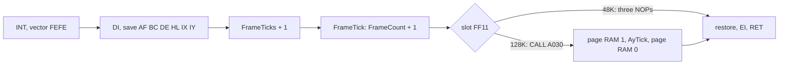

**The cost**, measured with `$RS interrupts` over each recording (the entries of `$FEFE` and their T-states):

| Recording | Entries per frame | T an entry | Of the CPU |
| --- | ---: | ---: | ---: |
| `beeper48` (48K, no music) | 0.99 | 276 | 0.4 % |
| `c1g` (menu, play, game over) | 14 301 / 14 390 | 1 733 | 2.4 % |
| `L1Z1` | 0.99 | 3 385 | 4.7 % |
| `L1Z6` | 0.97 | 3 068 | |
| `L2Z5` | 1 679 / 2 000 = 0.84 | 3 538 | 4.2 % |
| `L3Z9` | 0.97 | 3 611 | |
| `L4Z8` | 0.95 | 3 124 | |
| the spot `L2Z4-34` | 1.00 | 4 626 | 6.5 % |

The 276 T on the 48K are the fixed part. Everything above it on the 128K is AyTick.

**Worked example: the fixed part.** 4 (DI) + 4 x 11 + 2 x 15 (the pushes) + 13 + 4 + 13 (FrameTicks) + 17 + 57
(the call of FrameTick and its body, no carry) + 12 (the NOPs) + 4 x 10 + 2 x 14 (the pops) + 4 + 10 = 276 T. The
IM 2 acknowledge adds 19 T before the first instruction.

**Where interrupts are off.** These run under `DI`:

| Code | Why |
| --- | --- |
| MarkAllDirty `$A239` | it uses SP to fill the cell flags fast |
| the sprite drawers (SpriteDrawAligned and SpriteDrawShifted in render.asm) | they use SP to read the sprite rows |
| BuildScreenMap `$AD5A` | it uses SP to write the char map |
| ClearOffscreenFlags `$AF18` | it uses SP to clear the flags |
| PlayEffect `$9FED`, the AY player | paging: RAM 1 must stay in while it runs |
| the handler itself | |

An interrupt that arrives in one of them waits. If the region outlasts the INT pulse (about 32 T), the interrupt is
lost ([4.6](#46-lost-interrupts-and-the-3-frame-pass)).

**The point**: the interrupt is small and fixed. The game's timing depends on it only through FrameTicks, so a lost
interrupt costs a frame of the loop and a tick of the music, nothing else.

## 4.4 The main loop, step by step

```text
MainLoop:
    if Q held: go to Quit
    UpdateObjects                       # every object's handler, Rick first
    BonusCountdown                      # the timed bonus, if it runs
    if P held: wait for its release, a press, a release      # the pause
    if DeathDone:
        Lives = Lives - 1               # $E3F4, the POKE 58356
        if Lives = 0: go to Quit
        go to NewLife
    if ZoneChange:
        CheckScreenExit                 # LoadScreen, or LevelEnd
        if GameComplete: go to GameOver
        go to MainLoop
    HALT                                # wait for interrupt 1
    FrameTicks = 0
    ComposeObjects                      # the sprites into the char cells
    PausePressed                        # the result is not used
    WaitFrames(1)                       # wait for interrupt 2
    DrawDirtyCells                      # the changed cells to the screen
    UpdateHud
    if not Dying:
        if RickY >= $CC: ScrollViewDown
        else if RickY < $60: ScrollViewUp
    go to MainLoop
```

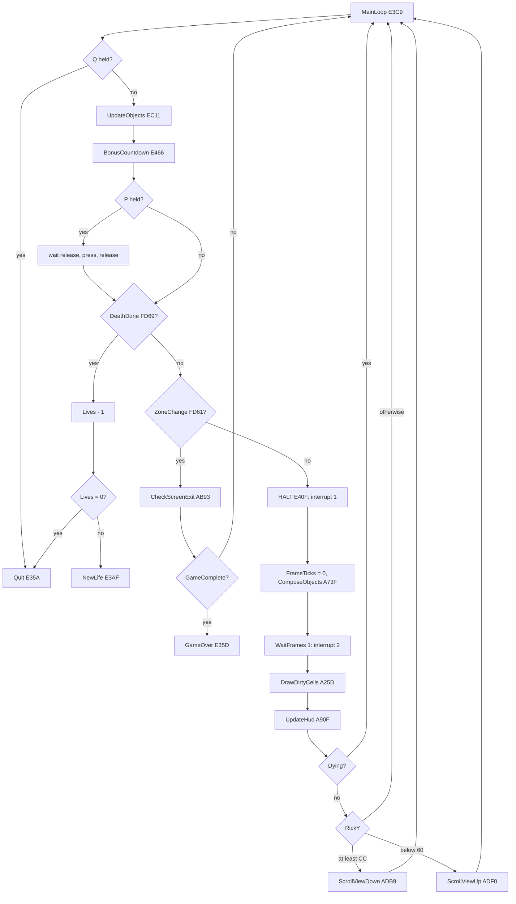

The asm of the frame part (`build/game.lst`):

```text
E40F 76          HALT                   ; MainLoopHalt: interrupt 1
E410 AF          XOR A
E411 32 37 A2    LD (FrameTicks),A
E414 CD 3F A7    CALL ComposeObjects    ; the sprites into the char cells
E417 CD 44 A1    CALL PausePressed      ; the result is not used
E41A 0E 01       LD C,$01
E41C CD 2A A2    CALL WaitFrames        ; interrupt 2
E41F CD 5D A2    CALL DrawDirtyCells    ; the changed cells to the screen
E422 CD 0F A9    CALL UpdateHud
E425 3A 68 FD    LD A,(Dying)
E428 A7          AND A
E429 20 13       JR NZ,MainLoopNext
E42B 3A AE EA    LD A,(RickY)
E42E FE CC       CP $CC
E430 38 05       JR C,CheckScrollUp
E432 CD B9 AD    CALL ScrollViewDown
  ...
A22A FB          EI                     ; WaitFrames
A22B 3A 37 A2    LD A,(FrameTicks)      ; WaitFramesLoop
A22E B9          CP C
A22F DA 2B A2    JP C,WaitFramesLoop
A232 AF          XOR A
A233 32 37 A2    LD (FrameTicks),A
A236 C9          RET
```

### Why a pass is two frames

1. The HALT at `$E40F` returns after interrupt 1. The pass clears FrameTicks at once.
2. ComposeObjects runs: about 24 000 T in a typical pass.
3. WaitFrames(1) spins until FrameTicks >= 1, that is until interrupt 2.
4. DrawDirtyCells runs right after interrupt 2, while the beam is still in the top border, so its writes land ahead of
   the beam ([4.5](#45-a-pass-against-the-beam)).
5. The logic of the next pass follows (UpdateObjects and the rest), then the HALT waits for interrupt 3.

So the screen is written once every 2 frames, always early in a frame, and the composing is done in the other frame.

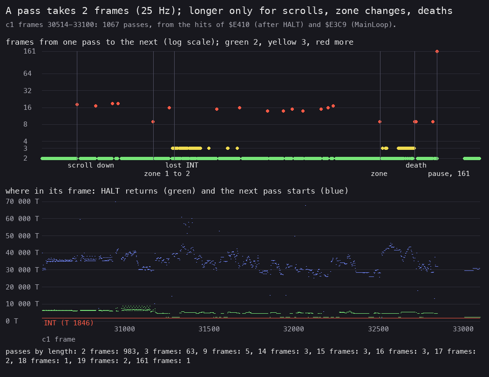

*Every pass of `c1`'s play, frames 30 514 to 33 100. Drawn by
`python3 tools/fig_loop.py work/docs/rdA/c1-halts.txt docs/img/loop/passes.png`
from the hits of `$E410` and `$E3C9` (`find_last execute` on `c1`, by `work/docs/rdA/hits.py`).*

How to read it:

- Top: the frames from one return of the HALT to the next, on a log scale. Green is 2, yellow 3, red more.
- The labelled lines mark the events behind the long passes: the first scroll, the zone changes, a run of lost
  interrupts, a death and the pause.
- Bottom: where in its frame each HALT returned (green: the INT plus the handler), and where the next pass started
  (blue: the end of the drawing and the HUD).

| Frames a pass | Passes | What makes them |
| ---: | ---: | --- |
| 2 | 983 | the typical pass |
| 3 | 63 | a lost interrupt ([4.6](#46-lost-interrupts-and-the-3-frame-pass)) |
| 9 | 5 | a zone change or a restart |
| 14-19 | 14 | a scroll |
| 161 | 1 | the pause |

The 2000-frame zone recordings show the same, with 647 to 997 passes each. The 400-frame spot recordings show exactly
200 passes of 2 frames.

**The point**: the loop is a fixed 25 Hz loop with room to spare. The blue points sit between 25 000 and 45 000 T of
the second frame: the pass's logic is done long before the next interrupt.

### What each step costs

Measured by `work/docs/rdA/steps.py` over traces of `c1` (shares of all T-states in the window):

| Step | One pass, 31097-31099 | 50 passes, 31000-31099 | 40 passes, 31290-31389 (zone 2) |
| --- | ---: | ---: | ---: |
| ComposeObjects `$A73F` | 13.3 % | 31.6 % | 41.0 % |
| DrawDirtyCells `$A25D` | 16.6 % | 21.7 % | 20.9 % |
| UpdateObjects `$EC11` | 3.5 % | 5.4 % | 7.9 % |
| the interrupt | 6.6 % | 6.8 % | 2.5 % |
| HALT (idle) | 26.2 % | 19.4 % | 10.1 % |
| WaitFramesLoop (idle) | 33.1 % | 14.6 % | 17.1 % |

The first two windows are zone 1, with few objects. The third is zone 2, with more objects and 18 lost interrupts in
40 passes.

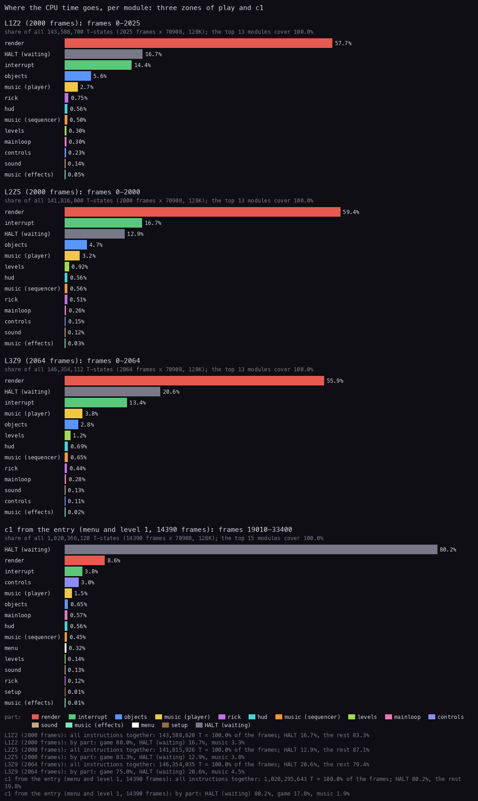

*The frame budget by module for L1Z2, L2Z5, L3Z9 and `c1` from the entry. Made with `python3 ../../kit/fig_budget.py
work/stage2/zones/L1Z2/l1.json work/stage2/zones/L2Z5/l1.json work/stage2/zones/L3Z9/l1.json work/stage1/c1/l1.json
--ann src/game/game.ann --ann src/music/music.ann,page=1,label=music --by module --out docs/img/arch/budget.png`.*

How to read it:

- Each bar is one recording, split by the module that ran each instruction.
- "render" is the compose and the drawing. "objects" and "rick" are the logic.
- The "interrupt" share is mostly WaitFramesLoop, the idle wait, not the handler: WaitFrames `$A22A` lies in the
  interrupt module's range.

**The point**: the compose and the drawing take about half of the CPU, the game logic under a tenth. The rest is
waiting: the 25 Hz lock leaves headroom for the heaviest zones.

### The animation of a pass

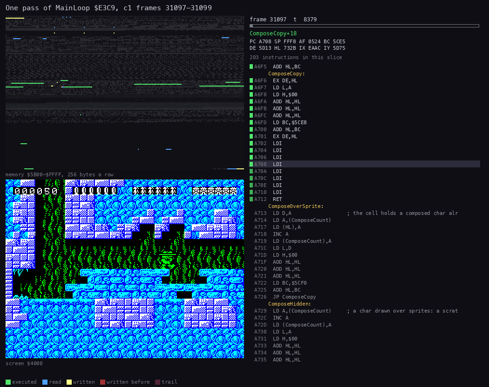

*One typical pass, `c1` 31097:6400 to 31099:7100, 72 pictures. The view is the screen; the right panel shows memory
`$5B00-$FFFF` and the code running, with the AY player in RAM 1. Made with `python3 ../../kit/routine_anim.py --work
work/docs/rdA/c1 --window 31097:6400-31099:7100 --listing build/game.lst --page 1=build/music.lst --page-name 1="the AY
player" --view screen --range 5B00-FFFF --pictures 72 --out docs/img/routines/MainLoop.gif`.*

How to read it:

- Frame 31097: the HALT returns. ComposeObjects builds the sprites into composed chars (writes at `$5CE8` up and in the
  char map), then WaitFramesLoop spins.
- Frame 31098: DrawDirtyCells copies the flagged cells to the screen in a burst, then UpdateHud. UpdateObjects moves
  Rick and the enemies, and the HALT waits.

**The point**: the two frames do different jobs. Frame A composes off screen; frame B puts the result on screen and
thinks.

## 4.5 A pass against the beam

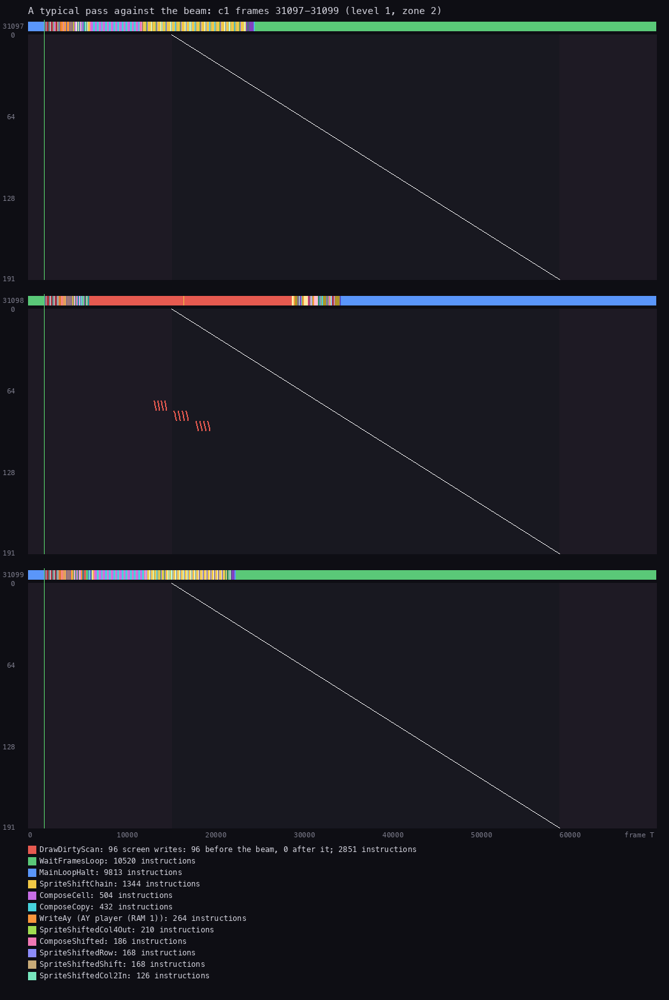

*The screen writes of one pass against the raster. Made with `python3 ../../kit/beam_timeline.py --work
work/docs/rdA/c1 --window 31097:0-31100:0 --listing build/game.lst --page 1=build/music.lst --page-name 1="the AY
player" --machine 128k --out docs/img/loop/beam-pass-31097.png`.*

How to read it:

- Each band is a frame. The coloured strip on top is the routine running at each T-state.
- The diagonal is the beam. A write to the left of it lands before the beam draws that line.
- The red ticks are DrawDirtyScan's writes: 96 in this pass, all before the beam.

**The point**: a typical pass never tears. DrawDirtyCells starts right after interrupt 2, and its few writes stay
ahead of the beam.

## 4.6 Lost interrupts and the 3-frame pass

When the compose of frame A runs past the next INT with interrupts off, that interrupt is lost. WaitFrames then waits
for the following one, and the pass takes 3 frames.

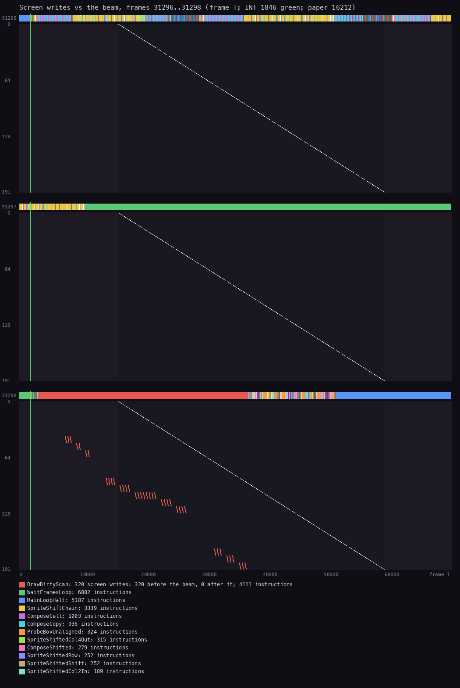

*Frames 31296-31298 of `c1`, in zone 2. Made with `python3 ../../kit/beam_timeline.py --work work/docs/rdA/c1 --window
31296:0-31299:0 --listing build/game.lst --page 1=build/music.lst --page-name 1="the AY player" --machine 128k --out
docs/img/loop/beam-lost-31296.png`.*

How to read it:

- Frame 31296: the HALT returns, then the compose (SpriteShiftChain, ComposeCell and the rest) fills the frame.
- Frame 31297: the compose is still running at the INT (the white line), inside SpriteDrawShifted with interrupts off.
  The interrupt is not taken. WaitFramesLoop then spins all frame.
- Frame 31298: the next interrupt comes. DrawDirtyScan writes 320 bytes, all ahead of the beam.

Witness: Im2Handler `$FEFE` ran in 31294, 31295, 31296 and 31298, not in 31297. The pass from 31296 to 31299 is 3
frames.

**Worked example.** In the 50 passes of 31000-31099, every pass is 2 frames, and the handler ran 100 times. In the 40
passes of 31290-31389, 100 frames passed but there were only 82 interrupts: 18 were lost. Each lost interrupt adds a
frame to its pass and drops one tick of the music.

**The point**: the game slows down by design when a zone is busy. It does not tear and does not crash: it drops to
about 17 Hz for a while, and the music lags with it.

## 4.7 The heavy passes: the scroll and the zone change

**The scroll.** When Rick's y reaches `$CC` (near the bottom) or drops below `$60` (near the top), the view moves 8 map
rows, in two steps of 4:

```text
ScrollViewDown:
    ClearOffscreenFlags
    repeat 2 times:
        ShiftMapUp                 # the char map up 4 rows, the changed cells flagged
        ShiftMarksUp               # the composed-char flags with it
        ShiftObjects(-32)          # every object 32 pixels up
        ViewTopRow = ViewTopRow + 4
        WaitFrames(4)
        RedrawScreen               # every flagged cell, with its attribute
    BuildScreenMap
    SpawnObjects(rows ViewTopRow + 32 on, 8 rows)
    DrawDirtyCells
```

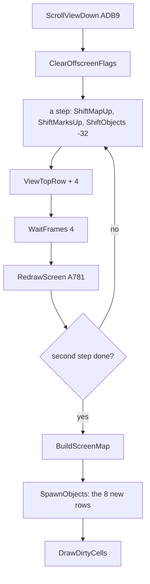

```text
ADB9 CD 18 AF    CALL ClearOffscreenFlags
ADBC 06 02       LD B,$02               ; two steps
ADBE C5          PUSH BC                ; ScrollDownStep
ADBF CD 25 AE    CALL ShiftMapUp
ADC2 CD 76 AE    CALL ShiftMarksUp
ADC5 01 E0 FF    LD BC,$FFE0            ; -32
ADC8 CD BE AE    CALL ShiftObjects
ADCB 3A B7 AD    LD A,(ViewTopRow)
ADCE C6 04       ADD A,$04
ADD0 32 B7 AD    LD (ViewTopRow),A
ADD3 0E 04       LD C,$04
ADD5 CD 2A A2    CALL WaitFrames        ; 4 frames
ADD8 CD 81 A7    CALL RedrawScreen
ADDB C1          POP BC
ADDC 10 E0       DJNZ ScrollDownStep
ADDE CD 5A AD    CALL BuildScreenMap
```

RedrawScreen saves the cell flags of the HUD row (`$6C21-$6C40`) and the sentinel, calls DrawAllDirtyCells `$A834`,
then restores both. It draws every flagged cell with its attribute: almost the whole play area, twice.

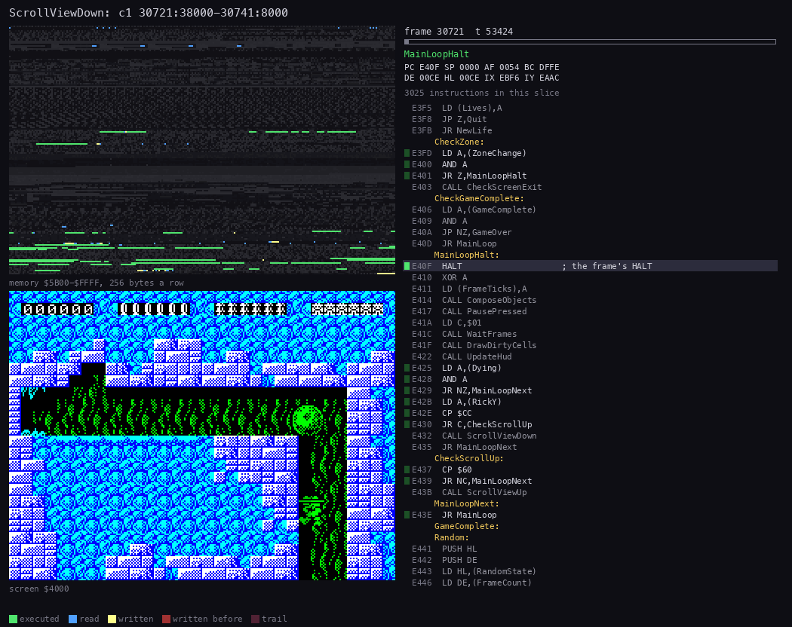

*The first scroll of `c1`: Rick climbs down out of the start screen. `c1` 30721:38000 to 30741:8000, 90 pictures. Made
with `python3 ../../kit/routine_anim.py --work work/docs/rdA/c1 --window 30721:38000-30741:8000 --listing
build/game.lst --page 1=build/music.lst --page-name 1="the AY player" --view screen --range 5B00-FFFF --pictures 90
--out docs/img/routines/ScrollViewDown.gif`.*

How to read it:

- The screen jumps twice by 4 rows (32 pixels), each jump after a wait of 4 frames.
- The redraw runs down the screen at about one char row per 16 000 T, so it takes several frames.

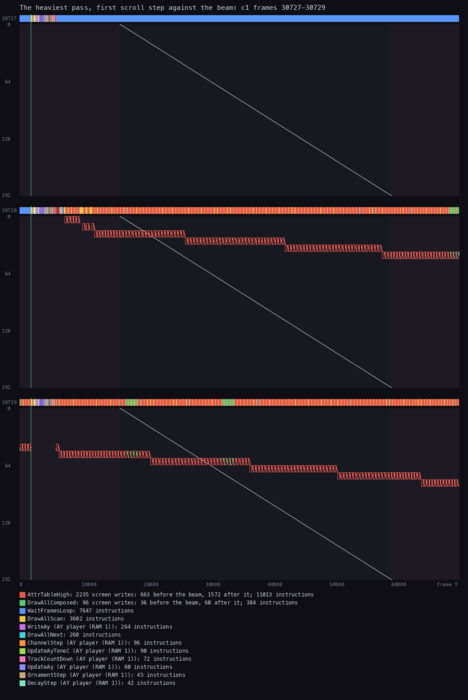

*The first redraw of that scroll against the beam. Made with `python3 ../../kit/beam_timeline.py --work
work/docs/rdA/c1 --window 30721:0-30742:0 --listing build/game.lst --page 1=build/music.lst --page-name 1="the AY
player" --machine 128k --frames 30727-30729 --out docs/img/loop/beam-scroll-30727.png`.*

How to read it:

- RedrawScreen writes 2235 bytes over three frames.
- 663 of them land before the beam and 1572 after it. The redraw is slower than the beam, so the picture tears for a
  few frames.

Witness: ScrollViewDown ran 14 times in `c1`. The first ran at 30723:37282, with its two RedrawScreen calls at
30728:5904 and 30734:13704.

**The zone change.** When Rick leaves through an exit, ZoneChange is set, and the next pass calls CheckScreenExit. That
finds the exit record and calls LoadScreen `$AC83`: the char set if it changes, the map built, the objects spawned, the
whole screen redrawn. Such a pass takes 9 frames.

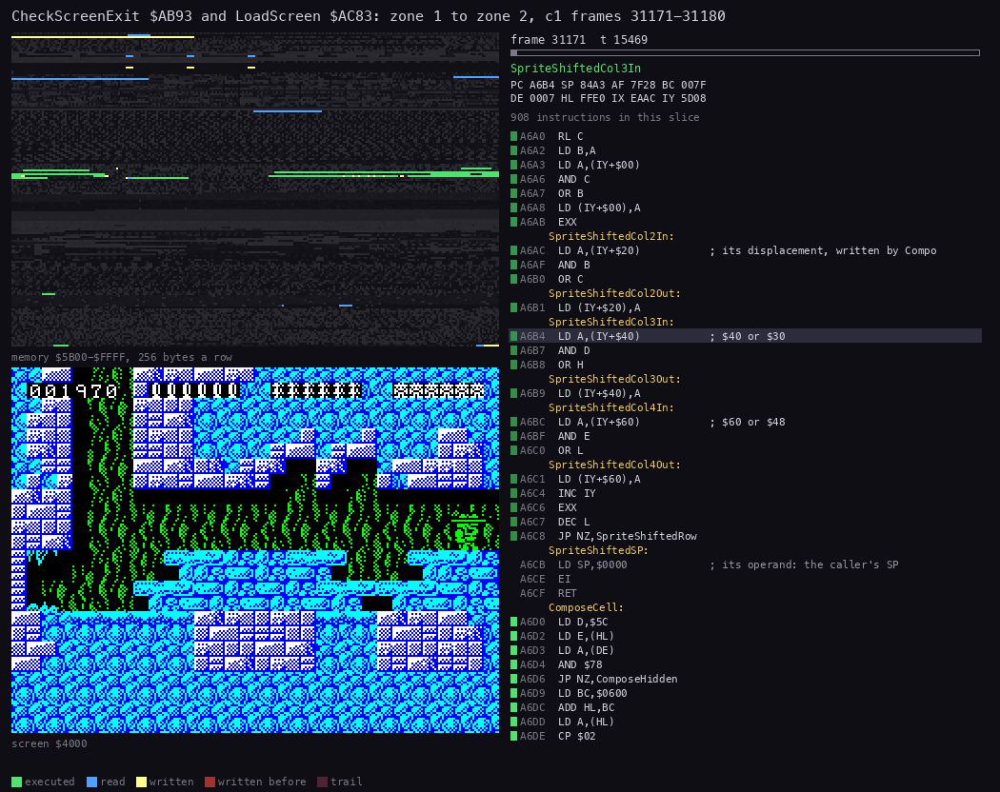

*Rick leaves zone 1 on the right. `c1` 31171:6600 to 31181:7000, 80 pictures. Made with `python3
../../kit/routine_anim.py --work work/docs/rdA/c1 --window 31171:6600-31181:7000 --listing build/game.lst --page
1=build/music.lst --page-name 1="the AY player" --view screen --range 5B00-FFFF --pictures 80 --out
docs/img/routines/LoadScreen.gif`.*

Witness: CheckScreenExit at `c1` 31172:34081, 32512:33032 and 32726:50832. LoadScreen at 30500, 30506, 31172, 32512,
32717, 32726 and 32825: the level start and each restart load a screen too.

**The point**: the only passes that tear are those that redraw everything, the scroll and the zone change. The authors
accepted a few torn frames there for a cell-based renderer that never tears in normal play.

## 4.8 Delays, pauses and timers

| Where | How long | Measured |
| --- | --- | --- |
| a pass | 2 frames (40 ms); 3 when an interrupt is lost | `c1`: 983 of 1067 passes are 2 frames |
| the menu | HALT, HALT a round: 2 frames; the highlight steps once a round | MenuFrame `$E267` |
| the level intro | until fire is released, then pressed | `c1`: 30471 to 30500, 29 frames |
| a scroll | WaitFrames(4) twice plus two redraws: 14-19 frames | `c1`: 14 scrolls |
| a zone change | about 9 frames | `c1`: 5 passes of 9 |
| a death | Rick falls off the bottom: 60-82 frames from KillRickNow to NewLife | `c1`: `$FBF2` at 32635, NewLife at 32717; `$FBF2` at 32765, NewLife at 32825 |
| the pause | until P is pressed, released, pressed, released | `c1`: one pass of 161 frames at 32849 |
| the timed bonus | BonusDivider: one step every 30 passes (60 frames, 1.2 s): the tens digit - 1 | BonusCountdown `$E466` |
| the level end and GAME OVER | until a key is released, then pressed | `ending2`, `gameover` |
| FrameCount `$E462` | +1 every interrupt, 32 bits | Random `$E441` adds it to its state |

**The point**: the game's timers count passes, not frames, so the bonus runs slower when the game slows down. Only
FrameTicks and FrameCount count real frames.

## 4.9 Known only from the code

- GameOver back to the Menu: `c1` ends while GAME OVER waits for a key. The `gameover` recording goes back to the
  menu.
- Set48K `$A05F` was not executed in any recording ([doc 3, 3.11](03-build-and-load.md#311-the-48k-and-the-128k-paths)).
- The second PausePressed at `$E417` runs every pass, and its result is never used. It costs a port read a pass.
- `LD HL,(RickY)` at `$E3D1` loads HL before BonusCountdown, which does not read it.
- SoundTick's `EI` at `$A041` enables interrupts inside the handler, before its pops. The INT pulse is long over by
  then, so no second interrupt can nest.
