# 5. Controls

What this covers:

- the menu's four control methods and how each one is read into one byte, InputBits `$A14D`;
- the Kempston bug at `$A19F`: the joystick is never read, and Rick walks right for ever;
- the single keys: 1-4 on the menu, the start key, P (pause) and Q (quit);
- how Rick's code turns the byte into moves (the moves themselves are in [doc 10](10-gameplay-logic.md)).

The recordings it rests on ([WALKTHROUGH 6.0](../WALKTHROUGH.md#60-the-recordings)):

| Recording | Load | Frames | Used for |
| --- | --- | ---: | --- |
| `controls` | `after128.szx` (the menu, no POKE) | 2 500 | each method in turn: keyboard, Sinclair, Kempston, cursor; each game quit with Q |
| `c1` | power-on, the original TZX at ROM speed | 33 400 | the menu keys 2, 4, 1, 3; the cursor keys in play; the pause; Q |
| `level1`-`level4` | snapshots, the cursor keys | 6 000 each | the cursor method in long play |

## 5.1 One byte for every device

All the game's moves come from one byte, InputBits `$A14D`. ReadInput `$A14E` writes it; nothing else does.

| Bit | 4 | 3 | 2 | 1 | 0 |
| --- | --- | --- | --- | --- | --- |
| Meaning | fire | up | down | left | right |

The byte is active low: ReadInput starts from `$FF` and clears one bit for each thing it finds held. The Kempston
interface uses the same bit order, but active high.

Who reads it:

| Reader | What it takes |
| --- | --- |
| MoveRick `$F85D` (calls ReadInput at `$F86B` once a pass) | every bit, at `$F8DC`, `$F9A4`, `$F9C4`, `$FBC2` |
| StartPressed `$A123` (through StartFireTest) | bit 4 only |

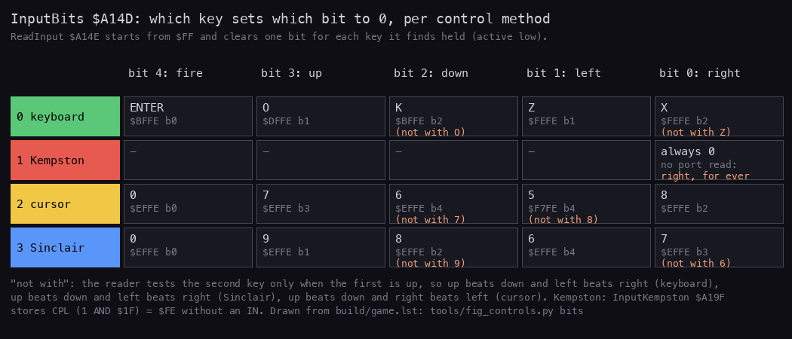

*Drawn from `build/game.lst` by `python3 tools/fig_controls.py bits --out docs/img/controls/inputbits.png`. The
script checks each port and bit it draws against the listing.*

How to read it:

- A row is a control method, a column a bit of InputBits.
- Each cell names the key, its port and the bit read.
- "not with" marks the key read only when the other key of the pair is up.

**The point**: four devices become one byte, so Rick's code never knows which device is in use.

## 5.2 The four methods

```text
ReadInput:
    InputBits = $FF
    if method = 0 (keyboard):
        if O held: clear up        else if K held: clear down
        if Z held: clear left      else if X held: clear right
        if ENTER held: clear fire
    if method = 1 (Kempston):
        InputBits = NOT (1 AND $1F)            # no IN: always $FE
    if method = 2 (cursor keys, port $EFFE):
        if 0 held: clear fire
        if 8 held: clear right
        if 7 held: clear up        else if 6 held: clear down
        if right not cleared and 5 held: clear left
    if method = 3 (Sinclair, port $EFFE):
        if 0 held: clear fire
        if 6 held: clear left      else if 7 held: clear right
        if 9 held: clear up        else if 8 held: clear down
```

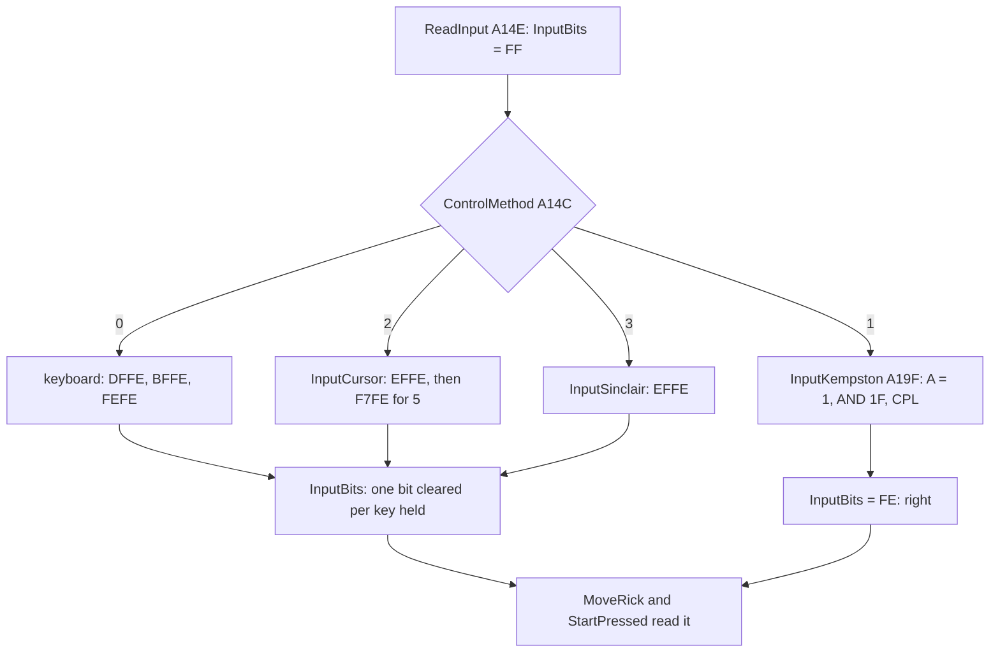

The keyboard path (`$A15B-$A19E`):

```text
A14E E5          PUSH HL                ; ReadInput
A14F 21 4D A1    LD HL,InputBits
A152 36 FF       LD (HL),$FF
A154 3A 4C A1    LD A,(ControlMethod)
A157 A7          AND A
A158 C2 9F A1    JP NZ,InputKempston
A15B 01 FE DF    LD BC,$DFFE            ; O: up
A15E ED 78       IN A,(C)
A160 CB 4F       BIT 1,A
A162 C2 6A A1    JP NZ,ReadKeyDown
A165 CB 9E       RES 3,(HL)
A167 C3 76 A1    JP ReadKeyLeft         ; up beats down
A16A 01 FE BF    LD BC,$BFFE            ; ReadKeyDown: K
  ...
A191 01 FE BF    LD BC,$BFFE            ; ReadKeyFire: ENTER
A194 ED 78       IN A,(C)
A196 CB 47       BIT 0,A
A198 C2 9D A1    JP NZ,ReadInputDone
A19B CB A6       RES 4,(HL)
A19D E1          POP HL                 ; ReadInputDone
A19E C9          RET
```

The keys of each method:

| Method | Up | Down | Left | Right | Fire | Ports |
| --- | --- | --- | --- | --- | --- | --- |
| 0 keyboard | O | K | Z | X | ENTER | `$DFFE`, `$BFFE`, `$FEFE` |
| 1 Kempston | - | - | - | always | - | none |
| 2 cursor | 7 | 6 | 5 | 8 | 0 | `$EFFE`, `$F7FE` |
| 3 Sinclair (Interface 2, joystick 1) | 9 | 8 | 6 | 7 | 0 | `$EFFE` |

The pairs are exclusive. On the keyboard and the Sinclair stick, up beats down and left beats right. On the cursor
keys, up beats down and right beats left.

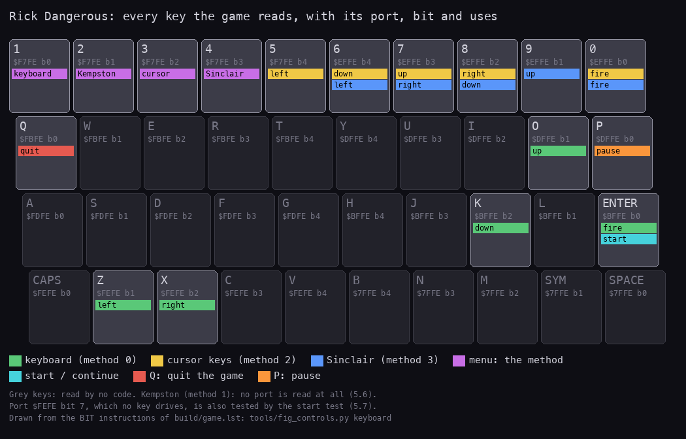

*Drawn from `build/game.lst` by `python3 tools/fig_controls.py keyboard --out docs/img/controls/keyboard.png`.*

How to read it:

- The Spectrum's keyboard, its half-rows labelled with their ports.
- A coloured key is read by a method; the colour is the method's, as in the menu.

**Worked example: X and O held on the keyboard.**

1. InputBits = `$FF` (`1111 1111`).
2. O is held: `$DFFE` bit 1 is 0, so RES 3 gives `$F7`. K is not tested.
3. Z is up: `$FEFE` bit 1 is 1. X is held: bit 2 is 0, so RES 0 gives `$F6` (`1111 0110`).
4. ENTER is up: the byte stays `$F6`.

MoveRick reads bit 3 (up: a jump) and bit 0 (right). Rick jumps to the right.

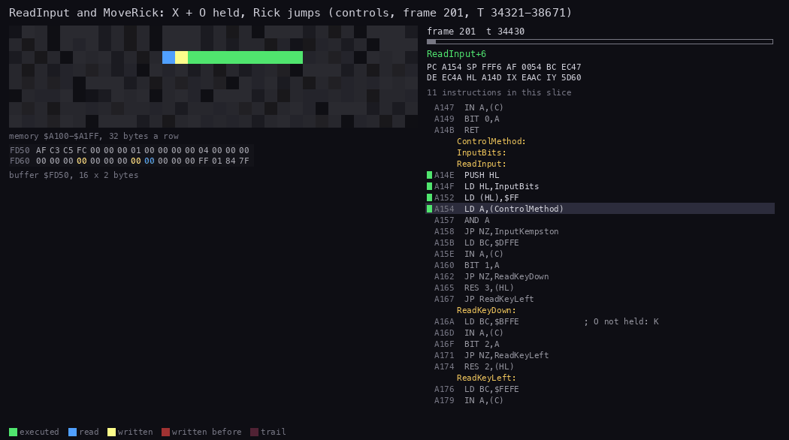

*`controls` frame 201, T 34 321 to 38 671, 40 pictures. Made with `python3 ../../kit/routine_anim.py --work
work/docs/rdB/controls --window 201:34321-201:38671 --listing build/game.lst --page 1=build/music.lst --page-name
1="the AY player" --view buffer:FD50:16x2:hex --range A100-A1FF --pictures 40 --out
docs/img/routines/ReadInput.gif`.*

How to read it:

- Left: the memory of `$A100-$A1FF` (the control code and InputBits), then Rick's state at `$FD50-$FD6F`.
- Right: the code running. ReadInput runs first, then MoveRick, then the jump's effect on the AY player.
- `$FD55-$FD56` (Rick's y speed) takes the jump's value.

**The point**: the code reads each key with its own `IN` and `BIT`, about 20 instructions, once a pass. It costs
under 300 T-states.

Witness (L1 runs of each path's first instruction):

| Method | `controls` | `c1` | others |
| --- | ---: | ---: | --- |
| 0 keyboard (`$A15B`) | 32 112 | 5 572 | `gameover` 110 714, `ending` 187 306 |
| 1 Kempston (`$A1A4`) | 52 007 | 30 | |
| 2 cursor (`$A1AF`, after the method test) | 33 215 | 53 211 | `level1` 118 103, `level2` 4 348, `level3` 4 043, `level4` 2 072 |
| 3 Sinclair (`$A1E6`) | 36 847 | 30 | |

The keyboard counts are high in the menus because StartPressed calls ReadInput on every poll. The cursor row counts
`$A1AF`, the first instruction after `CP $02`: InputCursor `$A1AA` itself also runs for the Sinclair method, which
falls through it (70 062 runs in `controls`, 53 242 in `c1`).

## 5.3 The Kempston bug

The Kempston path never reads the joystick:

```text
A19F FE 01       CP $01                 ; InputKempston: method 1?
A1A1 C2 AA A1    JP NZ,InputCursor
A1A4 E6 1F       AND $1F                ; A is still 1, the method number
A1A6 2F          CPL                    ; $FE
A1A7 77          LD (HL),A              ; InputBits = $FE: "right"
A1A8 E1          POP HL
A1A9 C9          RET
```

**Worked example.** A holds the method number, 1, from `LD A,(ControlMethod)` at `$A154`.

| Step | A | Binary |
| --- | --- | --- |
| at `$A1A4` | `$01` | `0000 0001` |
| AND `$1F` | `$01` | `0000 0001` |
| CPL | `$FE` | `1111 1110` |

Bit 0 (right) is 0, so "right" is held. Every other bit is 1, so nothing else is.

`AND $1F` then `CPL` is exactly what a Kempston reader does after `IN A,($1F)`: the interface gives the same five bits
(right, left, down, up, fire), active high. One instruction is missing: `IN A,($1F)` (`DB 1F`) between `$A1A1` and
`$A1A4`. With it the code would be right.

The fire button is lost with the rest: StartPressed calls ReadInput and tests bit 4, which is always 1 here, so with
the Kempston chosen only ENTER starts a game or passes the screens that wait for fire.

Which releases have the bug (a byte search of every copy in `work/candidates/`):

| Release | Bytes at InputKempston | Bug |
| --- | --- | --- |
| Firebird tape (this case), RICKDAN1 dump, the +3 disk, the zxart hacks and translations | `FE 01 C2 AA A1 E6 1F 2F` | yes |
| MCM, Erbe, IBSA, TOSEC `[a2]` TAP, ZXDB `RICKDANG.Z80` | `FE 01 C2 B4 A1 DB 1F E6 1F 2F 77 E1 C9` | no: `IN A,($1F)` inserted |
| Kixx | the pattern found in neither form (its block is packed) | not known |

The later build put the missing `DB 1F` in, which is why its code from InputKempston on lies 2 bytes further up than
here and its jump targets are shifted (`$A1B4` for `$A1AA`, [doc 3, 3.12](03-build-and-load.md#312-the-releases-and-the-hacks)).
So Firebird's own re-builds fixed the bug; the original tape and every copy made from it keep it.

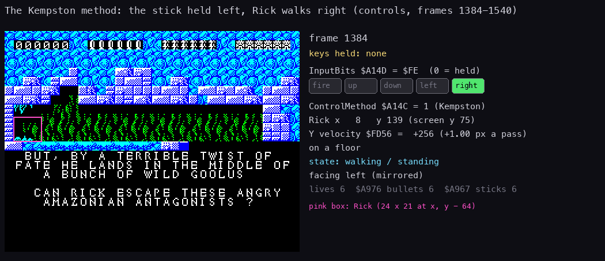

*`controls` frames 1 384 to 1 540, 53 pictures. Made with `python3 tools/fig_controls.py rick --work
work/docs/rdB/controls --inputs tests/inputs/controls.txt --from 1384 --to 1540 --step 3 --title "The Kempston method:
the stick held left, Rick walks right (controls, frames 1384-1540)" --out docs/img/play/kempston-bug.gif`.*

How to read it:

- Left: the screen of each frame, Rick in a pink box.
- Right: the input held by the script, InputBits as five lamps (green: 0, held), and Rick's state from memory.
- The script holds the stick left. InputBits is `$FE` at every frame, and Rick walks right on his own.

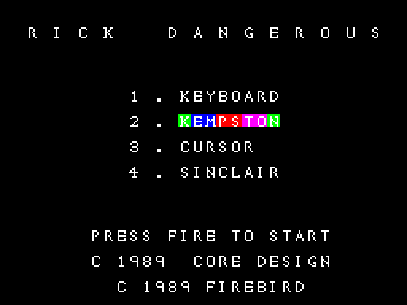

*The menu of `controls` with key 2 pressed: the Kempston line cycles its colours. Nothing on the menu shows the bug;
it shows only in play.*

Witness: `controls` selects the Kempston with key 2 and plays: `$A1A4` runs 52 007 times, and InputBits is `$FE`
throughout. `$A1A4` runs 30 times in `c1`, where the menu passes over the Kempston method. The byte search above is
the witness for the releases.

**The point**: a player who picks the Kempston cannot play: Rick walks right on his own, into the first danger.
The other three methods work, so the bug was easy to miss in testing with a keyboard.

## 5.4 The menu keys and the start

The menu (Menu `$E219`, [doc 4, 4.2](04-game-loop.md#42-the-state-machine)) polls, every second frame:

```text
MenuFrame:
    HALT, HALT
    cycle the colours of the chosen method's line
    for key in 1, 2, 3, 4:
        if the key is held and its method is not chosen:
            ControlMethod = the key - 1
            paint the old line plain
    if StartPressed: wait for its release, then NewGame
```

| Key | Test | Port, bit | Method | Its line on the menu |
| --- | --- | --- | --- | --- |
| 1 | Key1Pressed `$A103` | `$F7FE` b0 | 0 keyboard | attributes `$58EE`, 8 cells |
| 2 | Key2Pressed `$A10B` | `$F7FE` b1 | 1 Kempston | `$592E`, 8 |
| 3 | Key3Pressed `$A113` | `$F7FE` b2 | 2 cursor | `$596E`, 6 |
| 4 | Key4Pressed `$A11B` | `$F7FE` b3 | 3 Sinclair | `$59AE`, 8 |

CycleAttributes `$AB18` paints the chosen line with one of CycleColours `$AB3D` (`$4F $4F $57 $57 $5F $5F $67 $67`,
bright white ink on blue, red, magenta, green paper), stepped by the phase `$AB3C` mod 8. The old line goes back to
PlainColours `$AB45` (`$47`).

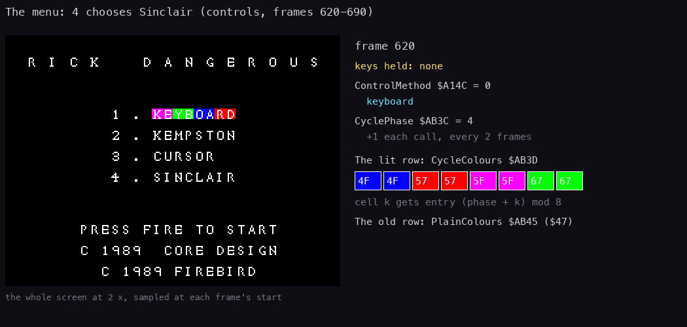

*`controls` frames 620 to 690, every second frame, 36 pictures. Made with `python3 tools/fig_controls.py menu --work
work/docs/rdB/controls --inputs tests/inputs/controls.txt --from 620 --to 690 --step 2 --title "The menu: 4 chooses
Sinclair (controls, frames 620-690)" --out docs/img/play/menu-keys.gif`.*

How to read it:

- The menu's screen, with the key the script holds.
- The script presses 4 at frame 640: the colour cycling moves to the Sinclair line, the keyboard line turns plain white.
  ENTER at 680 starts the game. The keys 2, 4, 1, 3 in turn are pressed in `c1`'s menu.

Two of the methods' menus as seen in the recordings (the cursor menu looks the same, its line highlighted):

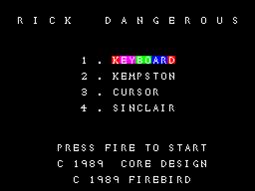

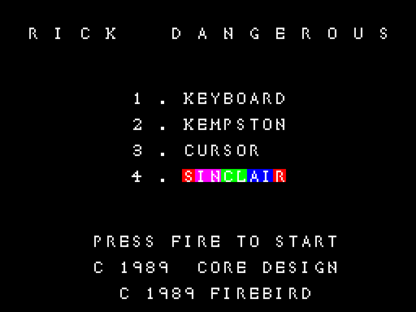

**StartPressed** `$A123` gives Z when any of these is held:

1. ENTER (`$BFFE` bit 0);
2. bit 7 of port `$FEFE`;
3. the chosen method's fire (it calls ReadInput, then tests bit 4).

Bit 7 of a keyboard port is not a key. A standard Spectrum returns 1 there, so the second test never fires on a real
machine. It may be a leftover of a development set-up.

Every caller uses StartPressed twice: wait while it is held, then wait until it is held again (or the other way
round). So a key held from the screen before never skips the next one.

| Caller | Waits for |
| --- | --- |
| Menu `$E219` | a release, then (MenuTestFire `$E2D1`) a press, then (MenuWaitRelease `$E2D7`) a release |
| LevelIntro, StartLevel (`$E327`, `$E32C`) | a release, then a press |
| GameOver (`$E389`, GameOverWaitPress `$E38E`) | a release, then a press |
| LevelEnd (`$AC38`, `$AC3D`) | a release, then a press |

## 5.5 Pause and quit

Two keys work in play, tested once a pass by the main loop ([doc 4, 4.4](04-game-loop.md#44-the-main-loop-step-by-step)):

| Key | Test | Port, bit | Effect |
| --- | --- | --- | --- |
| Q | QuitPressed `$A13C` | `$FBFE` b0 | Quit `$E35A`: GAME OVER at once, the lives kept |
| P | PausePressed `$A144` | `$DFFE` b0 | the pause |

```text
E3D7 CD 44 A1    CALL PausePressed      ; P held?
E3DA 20 0F       JR NZ,CheckDeath
E3DC CD 44 A1    CALL PausePressed      ; PauseRelease: wait for P up
E3DF 28 FB       JR Z,PauseRelease
E3E1 CD 44 A1    CALL PausePressed      ; PauseWaitPress: wait for P down
E3E4 20 FB       JR NZ,PauseWaitPress
E3E6 CD 44 A1    CALL PausePressed      ; PauseResume: wait for P up
E3E9 28 FB       JR Z,PauseResume
```

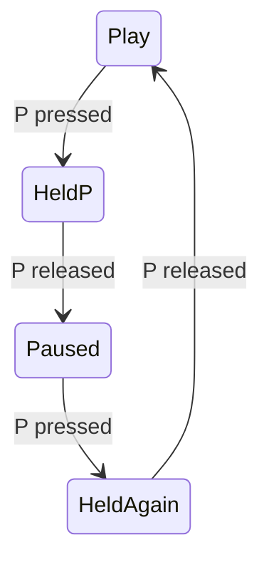

The pause is a busy loop: no HALT, no screen work. The interrupt still runs, so a sound effect already started plays to its end (in play there is no tune, only effects;
[doc 1, 1.7](01-game-design.md#17-what-the-game-does-not-have)).
The objects freeze because UpdateObjects is not called.

Witness: in `c1` the pause holds one pass for 161 frames, from frame 32 849; the polls of PausePressed run 9 228,
139 455 and 10 050 times in its three waits. Q at `c1` 33 101 goes to Quit (33 101:31 034), then GameOver
(33 101:63 889), as the [quit picture](img/play/quit-game-over.png) shows.

**The point**: P toggles on its release, not on its press, so a held P cannot flicker the pause on and off.

## 5.6 From the keys to Rick

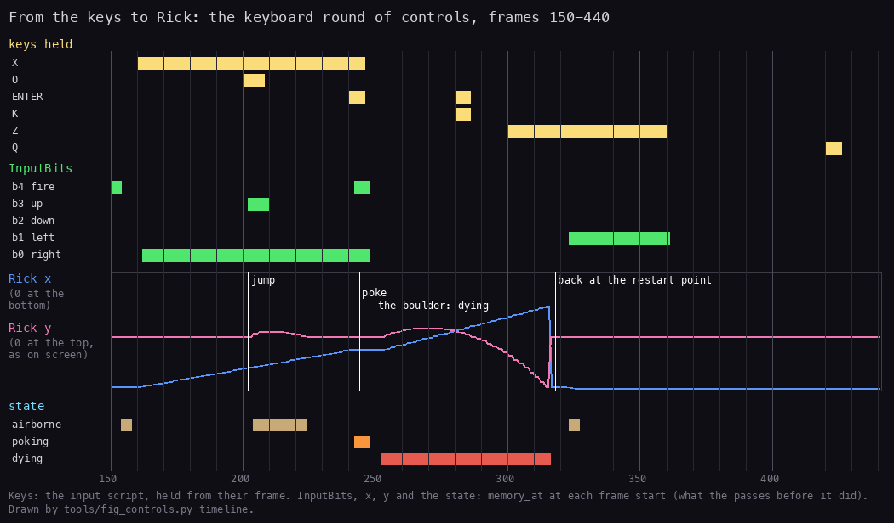

*`controls` frames 150 to 440. Drawn by `python3 tools/fig_controls.py timeline --work work/docs/rdB/controls --inputs
tests/inputs/controls.txt --from 150 --to 440 --title "From the keys to Rick: the keyboard round of controls, frames
150-440" --out docs/img/controls/timeline.png`, from `time_travel memory_at` at
each frame's start.*

How to read it:

- Top: the keys the script holds.
- Middle: InputBits' five bits (green: cleared, held), one pass later.
- Bottom: Rick's x and y, then his state: airborne, poking, dying.
- X held: right, Rick walks. O: a jump. ENTER and X: a poke with the stick. Then the boulder kills him, and he
  restarts at the restart point.

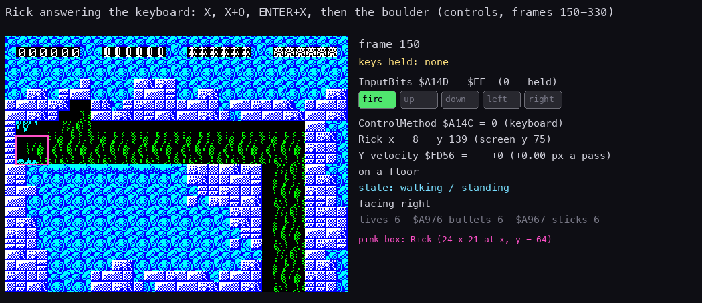

*`controls` frames 150 to 330, every second frame. Made with `python3 tools/fig_controls.py rick --work
work/docs/rdB/controls --inputs tests/inputs/controls.txt --from 150 --to 330 --step 2 --title "Rick answering the keyboard: X, X+O, ENTER+X, then the
boulder (controls, frames 150-330)" --out docs/img/play/rick-keys.gif`.*

How to read it:

- Left: the screen, Rick in a pink box; right: the keys held, InputBits as lamps, Rick's state.
- The first picture (frame 150) shows no key held but the fire lamp lit: InputBits still holds the pass that read
  ENTER at frames 140-143; the next pass clears it.

How fire combines with the directions (MoveRick, [doc 10, 10.2](10-gameplay-logic.md#102-rick)):

| Held | Rick |
| --- | --- |
| left or right | walks 2 pixels a pass (a pass is 2 frames) |
| up | jumps, or climbs a ladder |
| down | crawls, or climbs down a ladder |
| fire + left or right | pokes with the stick |
| fire + up | shoots, if he has bullets |
| fire + down | drops a stick of dynamite, if he has one |

Witness: walking and jumping in every recording of play. A poke (`$F9DC`): `controls` 9, `level1` 9, `level2` 20,
`level3` 175. A shot (`$FA4B`): `c1` 4. A stick dropped (`$FAA6`): `level2` 1, `level3` 6.

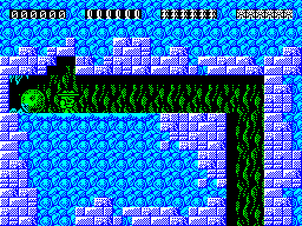

*`controls`, the Kempston round: Rick walks right on his own, the boulder rolling behind him.*

**The point**: fire is a modifier, not an action of its own. The same five bits give nine actions.

## 5.7 Known only from the code

- Bit 7 of port `$FEFE` as a start key: no recording or real machine pulls it low.
- The second PausePressed at `$E417` in every pass: its result is never used ([doc 4, 4.9](04-game-loop.md#49-known-only-from-the-code)).
