# 6. Rendering

What this covers:

- the buffers between the level data and the screen: the char map, the cell flags, the composed chars;
- the zone build: tiles of 4 x 4 chars into the char map;
- the dirty-cell drawer, which puts on screen only the cells that changed;
- the sprites: their format, the composer `$A2EC`, the masks, the shift chain and the mirror table `$5B00`;
- sprites passing behind the scenery;
- the scroll and the full redraw;
- who writes each screen byte, and when, against the beam.

The recordings it rests on:

| Recording | Load | Used for |
| --- | --- | --- |
| `c1` | power-on, the original TZX at ROM speed (128K) | a typical pass (31 097), a mirrored sprite (30 708), the scroll (30 721), the zone change (31 172) |
| `L1Z1` | the zone warp of `work/stage2/warp/L1Z1.szx` (128K) | Rick's restart: the full redraw (frames 134-145) |
| all the zone recordings | the zone warps | the second char set (levels 3 and 4) |

## 6.1 The pipeline

The game never draws a sprite on the screen. It draws sprites into copies of the background chars, then copies those
chars to the screen. Every buffer is one byte or one char per screen cell:

| Buffer | Range | One entry is | Written by |
| --- | --- | --- | --- |
| char map | `$6500-$6A7F` | a char code: 32 columns x 44 rows; rows 8-31 (`$6600-$68FF`) are the screen's | BuildScreenMap `$AD5A`, the scroll shifts |
| cell flags | `$6B00-$707F` (the map + `$600`) | 0 clean, 1 draw the map's char, n >= 2 draw composed char n; `$FF` the end | ComposeCell, the drawers, MarkAllDirty |
| composed chars | `$5D00` up | char n at `$5CF0` + 8n: 8 bytes, a background char with sprites drawn over it | ComposeCell `$A6D0`, the sprite drawers |
| char sets | `$7100` (levels 1-2), `$7A00` (levels 3-4) | 256 chars of 8 bytes | loaded |
| char attributes | `$7900`, `$8200` | one attribute per char code | loaded; `$7900` is rewritten with each level's colour |
| char properties | `$5C00-$5CFF` | one byte per char code: ladder, deadly, wall, floor, and "in front" | BuildCharProps `$F6A9` |

The screen part of the flags is `$6C00-$6EFF`, 24 rows of 32. The sentinel `$FF` at `$6F00` stops the scan.

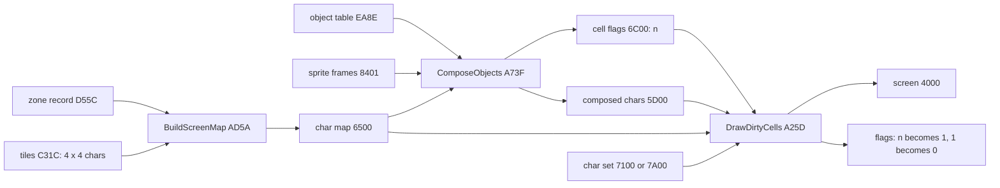

A cell's life over two passes:

1. A sprite covers the cell. ComposeCell takes a new composed char n, copies the background char into it, and sets
   the cell's flag to n. The drawer then masks the sprite into it.
2. DrawDirtyCells copies composed char n to the screen and sets the flag to 1.
3. Next pass, the sprite has moved away. DrawDirtyCells sees flag 1, draws the map's char (the background again) and
   sets the flag to 0.

**The point**: the screen holds no sprite state at all. Each pass rebuilds the sprites from the map, so nothing ever
has to be erased: the flag 1 left behind does the erasing.

## 6.2 The zone build: tiles into the char map

A zone's map is rows of 8 tile numbers ([doc 7, 7.1](07-objects.md#71-the-level-data-byte-by-byte)). A tile is 4 x 4
char codes, 16 bytes at Tiles `$C31C` + 16 x tile. BuildScreenMap `$AD5A` fills the char map with 11 tile rows
(44 char rows), starting at the map row of ViewTopRow `$ADB7`.

```text
BuildScreenMap:
    src = MapBlockTable + (ViewTopRow AND $FC) * 2      # 8 tiles a map row, 4 char rows a tile row
    dst = $6500
    repeat 11 tile rows:
        repeat 8 tiles:
            tile = Tiles + 16 * byte at src; src = src + 1
            copy its 4 rows of 4 chars to dst, dst + 32, dst + 64, dst + 96
            dst = dst + 4
        dst = dst + 96                                   # the next tile row
```

```text
AD5A F3          DI                     ; BuildScreenMap
AD5B ED 73 B1 AD LD (BuildMapSP+$0001),SP
AD5F 3A B7 AD    LD A,(ViewTopRow)
AD62 E6 FC       AND $FC
AD64 6F          LD L,A
AD65 26 00       LD H,$00
AD67 29          ADD HL,HL              ; 2 bytes of map a char row: 8 a tile row
AD68 ED 4B B5 AD LD BC,(MapBlockTable)
AD6C 09          ADD HL,BC
  ...
AD7B 7E          LD A,(HL)              ; BuildMapBlock: the tile number
AD7C 6F          LD L,A
AD7D 26 00       LD H,$00
AD7F 29          ADD HL,HL
AD80 29          ADD HL,HL
AD81 29          ADD HL,HL
AD82 29          ADD HL,HL              ; x 16
AD83 01 1C C3    LD BC,Tiles
AD86 09          ADD HL,BC
AD87 3E 04       LD A,$04
AD89 06 00       LD B,$00
AD8B 0E 20       LD C,$20               ; BuildMapBlockRow: 4 chars, then 32 on
AD8D ED A0       LDI
AD8F ED A0       LDI
AD91 ED A0       LDI
AD93 ED A0       LDI
```

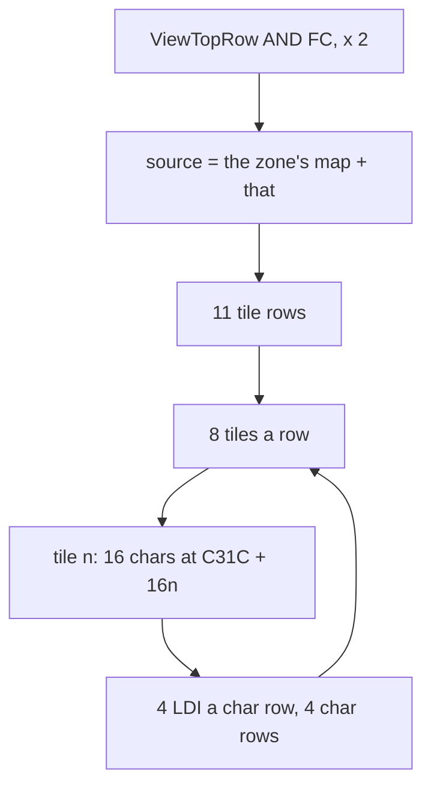

**Worked example: zone L1Z1, map row 5.** Zone record `$D55C` = `00 64 AF 4A D6 FC D7`: char set 0, map `$AF64`. Map
row 5 is at `$AF64` + 40 = `$AF8C`: `54 49 48 71 54 53 55 54`. Its first tile, `$54`, is at `$C31C` + `$540` =
`$C85C`. Its 16 bytes become the char map's 4 x 4 block at the tile's column 0. The rows above it, 0-4, are all tile
`$46`: chars `D9 DA D9 DA / DB DC DB DC / D9 DA D9 DA / DB DC DB DC`, the rock wall of the zone's top (char codes 193-251
are walls in set 0, [doc 10, 10.1](10-gameplay-logic.md#101-the-world-chars-and-their-properties)).

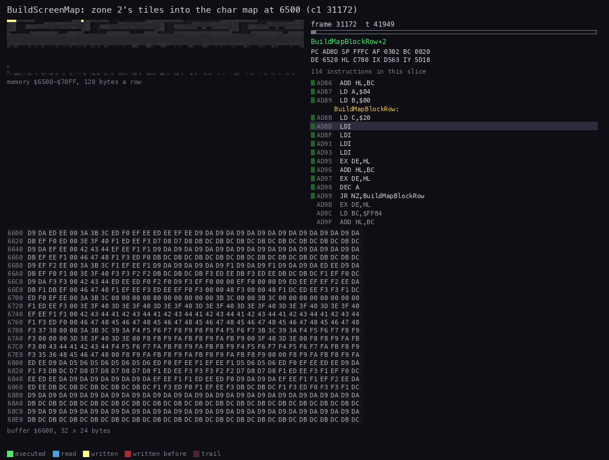

*`c1` 31 172:41 000 to 31 173:27 000, 60 pictures: Rick has left zone 1 on the right. Made with `python3
../../kit/routine_anim.py --work work/docs/rdA/c1 --window 31172:41000-31173:27000 --listing build/game.lst --page
1=build/music.lst --page-name 1="the AY player" --view buffer:6600:32x24:hex --range 6500-70FF --pictures 60 --out
docs/img/routines/BuildScreenMap.gif`.*

How to read it:

- The hex view is the screen part of the char map, `$6600-$68FF`, 32 codes a row.
- The memory map above it shows `$6500-$70FF`: the char map, then the cell flags.
- The writes run down in bands 4 rows tall: one tile row at a time, 8 tiles across.
- Then RedrawScreen walks the flags (all 1 after MarkAllDirty) and the screen is drawn.

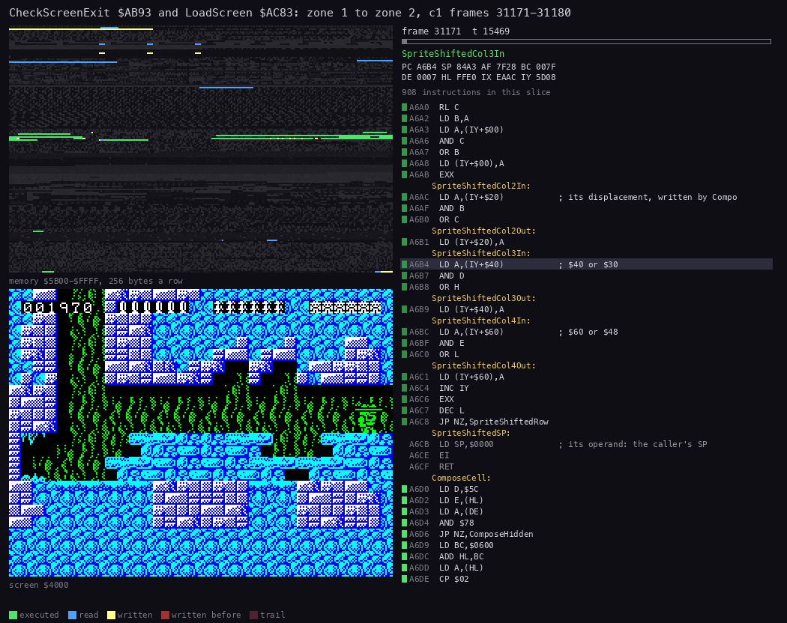

*The whole zone change on screen, `c1` 31 171-31 181 ([doc 4, 4.7](04-game-loop.md#47-the-heavy-passes-the-scroll-and-the-zone-change)).*

Witness: BuildScreenMap ran 21 times in `c1`: at each level start and restart, each zone change (31 172, 32 512,
32 726) and each scroll.

**The point**: a zone is 8 bytes a tile row, 32 times less than its chars. The build costs one frame and runs only at
a zone change or a scroll.

## 6.3 Only the changed cells: DrawDirtyCells

DrawDirtyCells `$A25D` runs once a pass, right after the second interrupt ([doc 4, 4.4](04-game-loop.md#44-the-main-loop-step-by-step)).
It walks the 768 flags of the screen:

```text
DrawDirtyCells:
    flags[$6F00] = $FF                 # the sentinel
    MaskHudCells                       # the HUD's cells: flags 0, so the map never covers it
    for each flag from $6C00:
        if flag = 0: next
        if flag = $FF: return
        screen = $4000 + ((H - $6C) * $800) + L     # the cell's address in its third
        if flag = 1: draw map char (the byte $600 below the flag) from CharsetBase; flag = 0
        else:        draw composed char n at $5CF0 + 8n; flag = 1
```

```text
A25D 3E FF       LD A,$FF               ; DrawDirtyCells
A25F 32 00 6F    LD (CellFlagsRow24),A  ; the sentinel
A262 CD BF A8    CALL MaskHudCells
A265 21 FF 6B    LD HL,$6BFF
A268 AF          XOR A                  ; DrawDirtyNext
A269 23          INC HL                 ; DrawDirtyScan: 23 T a clean cell
A26A B6          OR (HL)
A26B CA 69 A2    JP Z,DrawDirtyScan
A26E 3D          DEC A
A26F CA AE A2    JP Z,DrawDirtyMapChar  ; flag 1: the map's char
A272 FE FE       CP $FE
A274 C8          RET Z                  ; flag $FF: the end
A275 36 01       LD (HL),$01            ; a composed char: draw it, leave 1
A277 E5          PUSH HL
A278 EB          EX DE,HL
A279 6F          LD L,A                 ; n - 1
A27A 26 00       LD H,$00
A27C 29          ADD HL,HL
A27D 29          ADD HL,HL
A27E 29          ADD HL,HL
A27F 01 F8 5C    LD BC,$5CF8            ; $5CF0 + 8n
A282 09          ADD HL,BC
A283 7A          LD A,D
A284 D6 6C       SUB $6C                ; the screen third
A286 87          ADD A,A
A287 87          ADD A,A
A288 87          ADD A,A
A289 F6 40       OR $40
A28B 57          LD D,A
A28C ED A0       LDI                    ; 8 times: a byte, then down one pixel row
A28E 1B          DEC DE
A28F 14          INC D
```

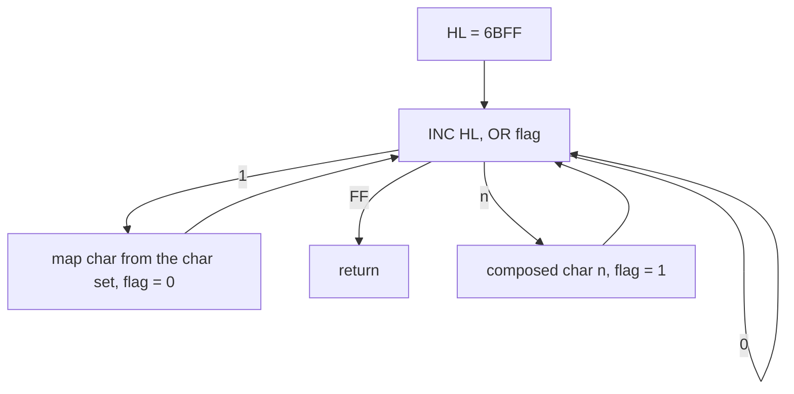

**Worked example: the flag at `$6D45`.**

| Step | Value |
| --- | --- |
| H - `$6C` | 1: the middle third |
| x 8, OR `$40` | `$48` |
| L | `$45`: pixel row 0 of char row 2 in the third, column 5 |
| the screen byte | `$4845`, then `$4945`, ... `$4F45` for the 8 pixel rows |

That cell is char row 10, column 5. Its map char is at `$6D45` - `$600` = `$6745`, in the char map's row 8 + 10.

**The cost.** The scan costs 23 T-states per clean flag: 768 x 23 = 17 664 T a pass, a quarter of a frame, however
little changed. A cell drawn costs 8 LDI plus 7 x (DEC DE, INC D): 198 T for its bytes.

Witness: `c1` pass 31 097 drew 12 cells (96 screen writes, [doc 4, 4.5](04-game-loop.md#45-a-pass-against-the-beam)).
DrawDirtyCells took 16.6 % of that pass's three frames.

**The point**: the drawer writes the screen in raster order, cell by cell, right after the interrupt. With a dozen
cells it finishes far ahead of the beam ([figure](img/loop/beam-pass-31097.png)).

## 6.4 The sprites

**The format.** The 54 frames at SpriteFrames `$8401` are 24 x 21 pixels, 126 bytes each: 21 rows of 6 bytes.
A row holds three (mask, pixels) pairs, in the order the drawers POP them:

| Byte of the row | 0 | 1 | 2 | 3 | 4 | 5 |
| --- | --- | --- | --- | --- | --- | --- |
| Holds | pixels 3 | pixels 2 | pixels 1 | mask 1 | mask 3 | mask 2 |

Column 1 is the left one. A screen byte becomes (background AND mask) OR pixels. Frame F is at `$8401` + 126 F; an
object's animation byte B (= F + 1, bit 7 the mirror) gives `$8383` + 126 B.

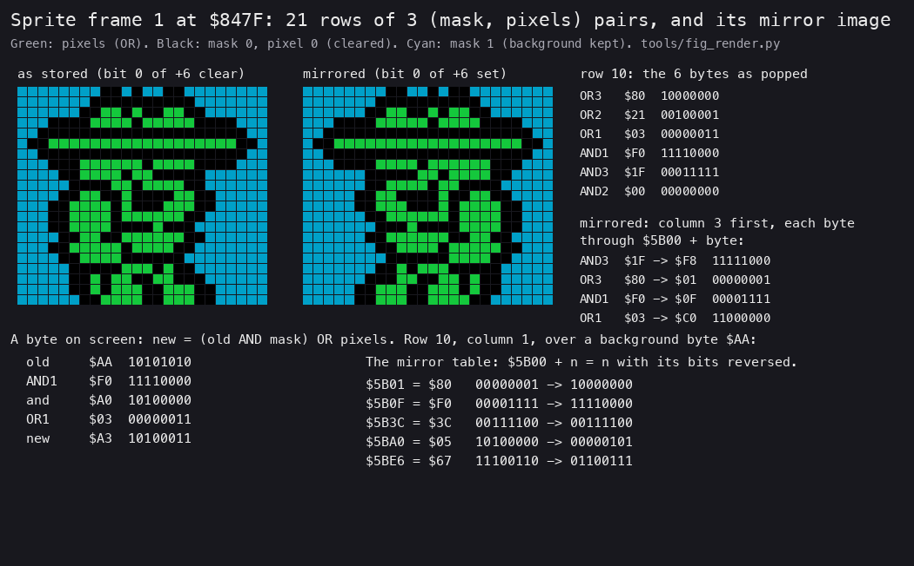

*Frame 1 (`$847F`, Rick walking). Drawn from `build/game.bin` by `python3 tools/fig_render.py sprite 1
docs/img/render/sprite-mirror.png`.*

How to read it:

- Left: the frame as stored. Green is a pixel, black a pixel cleared by the mask, cyan the background kept.
- Middle: the same frame mirrored, as the drawer makes it.
- Right: row 10's six bytes as popped, and the four bytes after the mirror.
- Bottom: the AND / OR rule on one byte, and five entries of the mirror table.

The whole sheet of frames, with the kinds that use each one, is in [doc 2, 2.6](02-architecture.md#26-sprites).

**The composer.** ComposeObjects `$A73F` sets ComposeCount `$A73C` = 2, then calls ComposeObject `$A2EC` for every
used slot of the object table. ComposeObject:

```text
ComposeObject(IX):
    if the frame word +4 is 0 or the object is off the map: return
    cell = $6500 + 32 * (y / 8) + x / 8
    if x AND 7 = 0:                                  # aligned: 3 columns
        rows = 3 cells if y AND 7 < 4 else 4
        for each column, for each cell: ComposeCell
        SpriteDrawAligned: 21 rows, POP 3 pairs, mask and OR into the buffers
    else:                                            # 4 columns, shifted
        for each of 4 columns, each cell: ComposeCell
        SpriteDrawShifted: each row shifted right by x AND 7 through the shift chain
```

ComposeCell `$A6D0` gives a cell a fresh composed char:

```text
ComposeCell(cell):
    if property[char at cell] AND $78: return a scratch buffer       # the sprite passes behind
    flag = flags[cell]
    n = ComposeCount; ComposeCount = n + 1
    if flag >= 2: copy composed char flag into char n                # a second sprite in the cell
    else:         copy the char set's char into char n
    flags[cell] = n
```

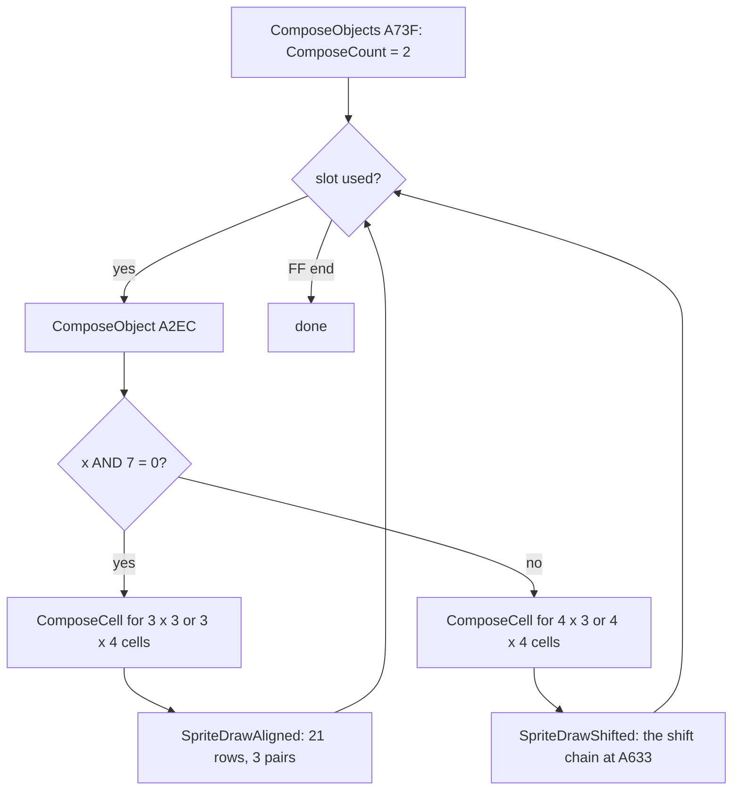

The drawers read the frame with SP: `LD SP,frame`, then three POPs a row. Interrupts are off while they run
([doc 4, 4.3](04-game-loop.md#43-the-interrupt)). The column offsets of the composed buffers (24 or 32 bytes apart)
are written into the drawers' `(IY+d)` operands before the loop:

```text
A463 D9          EXX                    ; SpriteAlignedRow: three pairs popped into HL, BC, DE'
A464 6F          LD L,A
A465 7E          LD A,(HL)
A466 D9          EXX
A467 67          LD H,A
A468 FD 7E 00    LD A,(IY+$00)          ; SpriteAlignedPut: column 1
A46B A0          AND B                  ; mask
A46C B1          OR C                   ; pixels
A46D FD 77 00    LD (IY+$00),A
A470 FD 7E 20    LD A,(IY+$20)          ; column 2: its offset written by ComposeObject
A473 A2          AND D
A474 B4          OR H
A475 FD 77 20    LD (IY+$20),A
A478 FD 7E 40    LD A,(IY+$40)          ; column 3
A47B A3          AND E
A47C B5          OR L
A47D FD 77 40    LD (IY+$40),A
A480 FD 23       INC IY
A482 D9          EXX
A483 10 DE       DJNZ SpriteAlignedRow
```

**The shift chain.** For x AND 7 = s, not 0, each row's three bytes are shifted right by s into four. The chain at
`$A633` is a run of shift instructions; the drawer enters it at `$A633` + 14 s, so it runs only the last s steps.
The mask shifts in 1 bits from the left (keeping the background), the pixels 0 bits.

**The mirror.** Bit 0 of the object's +6 selects the mirrored path. SpriteAlignedJump `$A441` holds `JP $A468` (plain)
or `JP $A444` (mirrored); ComposeObject writes the operand. The mirrored path swaps columns 1 and 3 and reverses every
byte through the table at `$5B00`:

```text
A444 7D          LD A,L                 ; SpriteAlignedMirror: swap the pairs of columns 1 and 3
A445 69          LD L,C
A446 4F          LD C,A
A447 78          LD A,B
A448 43          LD B,E
A449 5F          LD E,A
A44A 22 58 A4    LD (SpriteAlignedPair+$0001),HL
A44D 26 5B       LD H,$5B               ; each byte through $5B00 + byte
A44F 68          LD L,B
A450 46          LD B,(HL)
  ...
```

BuildMirrorTable `$AB6A` fills the table once at the start: `$5B00` + n = n with its 8 bits reversed. A mirrored row
costs one table lookup (7 T) per byte, 6 a row.

**Worked example: row 10 of frame 1, mirrored** (the figure's right panel). Mask 3 `$1F` becomes `$F8` and becomes the
left column's mask; pixels 3 `$80` become `$01`. Column 1's `$F0` and `$03` become `$0F` and `$C0` on the right.

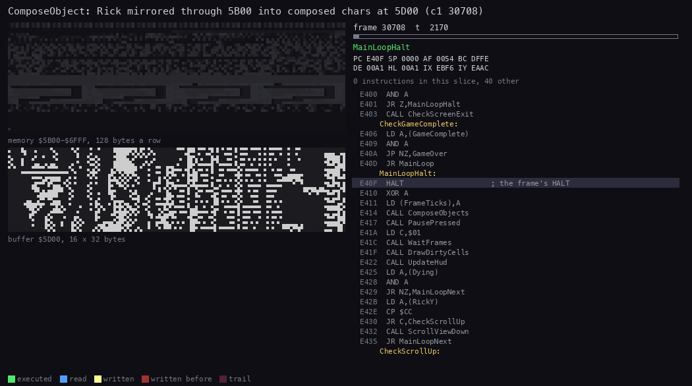

*`c1` 30 708:1 800 to 30 708:24 000, 60 pictures: the compose step of one pass, Rick facing left. Made with `python3
../../kit/routine_anim.py --work work/docs/rdA/c1 --window 30708:1800-30708:24000 --listing build/game.lst --page
1=build/music.lst --page-name 1="the AY player" --view buffer:5D00:16x32:columns --range 5B00-6FFF --pc A2EC-A732
--pictures 60 --out docs/img/routines/ComposeObject.gif`.*

How to read it:

- The memory map is `$5B00-$6FFF`: the mirror table on top (read, blue, while the mirrored drawer runs), the
  composed chars, the char map and the flags.
- The buffer view shows `$5D00-$5EFF` in columns of 32 bytes: a column of 4 composed chars is one column of the
  sprite, 32 pixel rows tall.
- The code panel names the drawer at work: SpriteAlignedMirror for Rick, SpriteShiftedRow for the enemies.

Witness: SpriteAlignedMirror `$A444` ran 525 times in `c1` before frame 31 200, the first at 30 708:10 787 (Rick
facing left). SpriteShiftedMirror's lookup `$A607` ran 2 163 times. The aligned paths: `$A3B5` 1 056 and `$A329`
1 127 runs; the shifted: `$A48A` 1 619 and `$A531` 316 (`c1`).

**The point**: the game stores each frame facing one way only. The mirror table costs 256 bytes and halves the 6 804
bytes the frames would need for both directions.

## 6.5 Behind the scenery

ComposeCell tests the char's property byte (`$5C00` + char) with `$78`: bits 3-6. If any is set, the cell gets a
scratch buffer that is never shown, and its flag is left alone. The sprite is drawn into the scratch buffer, so it
vanishes behind that char.

| Property bit | Meaning ([doc 10, 10.1](10-gameplay-logic.md#101-the-world-chars-and-their-properties)) | Hides sprites |
| --- | --- | --- |
| 1 | ladder | no |
| 2 | deadly | no |
| 3 | scenery in front (set 0: chars 95-181; set 1: 63-206) | yes |
| 4 | platform | yes |
| 5 | spring | yes |
| 6 | wall | yes |
| 7 | floor | no |

Witness: ComposeHidden `$A729` ran 2 452 times in `c1` and 29 147 in `level4`.

**The point**: the walls and the foliage hide the sprites without any depth sorting: one AND per cell decides it.

## 6.6 The scroll and the full redraw

The view moves by whole cells, 4 char rows at a time, twice: [doc 4, 4.7](04-game-loop.md#47-the-heavy-passes-the-scroll-and-the-zone-change)
has the steps, the animation and the beam figure. What the renderer does in a step:

| Step | Routine | What |
| --- | --- | --- |
| 1 | ShiftMapUp `$AE25` | the char map moves up 4 rows; each cell whose char changes gets flag 1 |
| 2 | ShiftMarksUp `$AE76` | the composed-char flags (2 and up) move with it, leaving a 1 behind |
| 3 | ShiftObjects `$AEBE` | every object's y moves by -32; an object that leaves the map is freed |
| 4 | RedrawScreen `$A781` | DrawAllDirtyCells `$A834`: every flagged cell, with its attribute |

RedrawScreen saves the 32 flags of the HUD's row (`$6C21-$6C40`) and the sentinel, and puts them back after, so the
HUD is never drawn over. DrawAllDirtyCells writes the attribute of each cell from the char's attribute: its
`LD H,$79` operand at AttrTableHigh `$A853` is patched to `$82` for the second char set by LoadScreen.

MarkAllDirty `$A239` sets all 768 flags to 1 with 384 PUSHes of `$0101` (SP = `$6F00`, interrupts off). LoadScreen,
the level end and the restart use it before RedrawScreen.

**Code vs screen on a real frame.** The full redraw after Rick's restart in L1Z1:

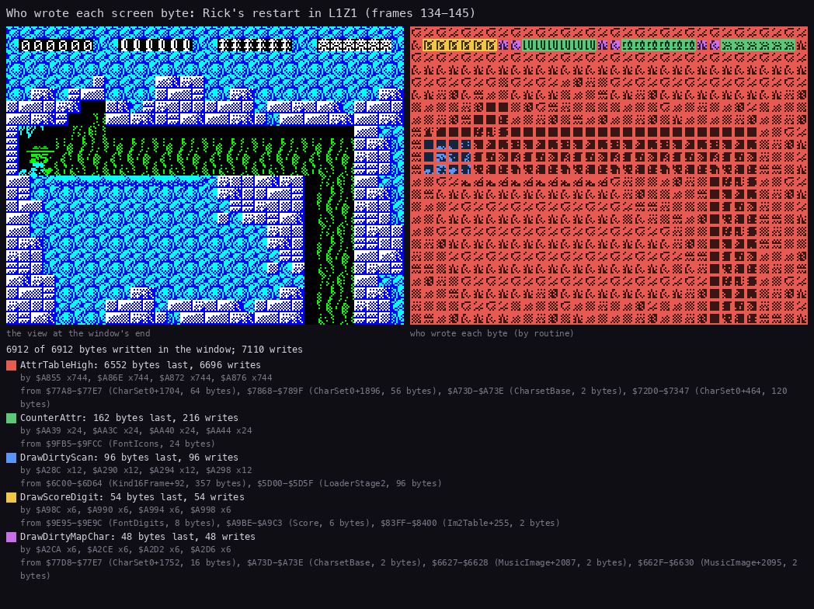

*`L1Z1` frames 134:28 000 to 145:0: NewLife, RestartScreen, the redraw and the first passes. Made with `python3
../../kit/writers_map.py --work work/docs/rdA/z11 --window 134:28000-145:0 --listing build/game.lst --listing
build/music.lst --view screen --sources --out docs/img/render/writers-restart.png`.*

How to read it:

- Left: the screen at the window's end. Right: each byte coloured by the routine that wrote it last.
- Red, "AttrTableHigh": 6 552 bytes, the full redraw. The name is an inner label of DrawAllDirtyCells (its patched
  operand at `$A853`); the writes are DrawAllDirtyCells'.
- Green, CounterAttr: the HUD's three counters as icons (from the font's icons, `$9FB5-$9FCC`).
- Yellow, DrawScoreDigit: the six score digits (from the font's digits).
- Blue and purple: DrawDirtyScan and DrawDirtyMapChar, the first passes after the redraw: Rick drawn (blue, from the
  composed chars at `$5D00`), and the cells he left restored (purple, from the char set).
- The lists under the picture name the instructions that wrote and the memory each one copied from.

**The point**: four routines write the play screen: the full redraw, the per-pass drawer (two paths) and the HUD's
two printers. Nothing else ever touches `$4000-$5AFF` in play.

## 6.7 The second char set

Zone byte +0 picks the char set: 0 for levels 1 and 2 (`$7100`, attributes `$7900`), 1 for levels 3 and 4 (`$7A00`,
`$8200`). LoadScreen `$AC83` writes CharsetBase `$A73D` and patches the attribute page into `$A853` and `$AA80`.
`$7900` (char 0, the empty space) is rewritten with the level's colour at each level start (`$E320`, `$AC14`).

The two sets as `src/res` keeps them:

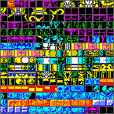

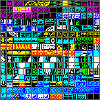

Witness: the second set ran in `level3` (7 LoadScreens) and `level4` (30), and in every L3 and L4 zone recording.

## 6.8 What it costs

From [doc 4, 4.4](04-game-loop.md#what-each-step-costs): in zone 1 of `c1` the compose takes 31.6 % of the CPU and the
drawing 21.7 %; in the busier zone 2, 41.0 % and 20.9 %. The cost grows with the objects on screen (9-16 ComposeCell
calls an object, 8 LDI each) and with the cells they cover.

| Part | Fixed per pass | Per object or cell |
| --- | --- | --- |
| ComposeObjects | the walk of 12 slots | an object: 9-16 cells, 21 rows of 3 or 4 bytes |
| DrawDirtyCells | 17 664 T, the scan of 768 flags | 198 T a cell's bytes, plus the address |
| MaskHudCells | up to 24 flags cleared | |

## 6.9 Known only from the code

- UnusedBuildMirror `$A75D`: a second copy of BuildMirrorTable with a RET. Nothing calls it; no recording ran it.
- MaskHudCells `$A8BF` jumps into its clearing loop with HL = 0 when `$A976` (the bullets; the source calls it
  Dynamite, [doc 8, 8.3](08-hud-and-text.md#83-the-hud)) is 0. B zero bytes are then written to `$0000` up, the
  ROM: harmless. No recording runs with no bullets.
- ScrollViewUp `$ADF0` ran only in `level2` (11 times): every other recording only scrolls down.
