# 7. Objects

What this covers:

- the level data byte by byte: the level table, the zone records, the maps, the tiles, the exits, the object lists;
- one zone, L1Z1, decoded by hand and checked against the slots the game filled;
- the object table `$EA8E`: 12 slots of 30 bytes;
- the spawner SpawnObjects `$FD7D`, and the update dispatch UpdateObjectSlot `$EC15`;
- the kinds `$D31C`, their animation lists and their movement scripts, with the boulder of L1Z1 at work;
- the triggers and the collision tests;
- the game variables.

The recordings it rests on:

| Recording | Load | Used for |
| --- | --- | --- |
| `c1` | power-on, the original TZX at ROM speed (128K) | the zone change at 31 172-31 173 (the spawn of L1Z2), the boulder set off at 30 533, the object table at 31 500 |
| `L1Z1` | the zone warp `work/stage2/warp/L1Z1.szx` (128K; a patch on a clone, see [WALKTHROUGH](../WALKTHROUGH.md)) | Rick's restart at frame 134: the zone rebuilt, its objects spawned again |
| all 34 zone recordings, the 6 spot recordings | the zone and spot warps | every kind spawned and run at least once |

Rick, the enemies and the traps as the player meets them are in [doc 10](10-gameplay-logic.md). This document is
their data and their machinery.

## 7.1 The level data byte by byte

All the level data sits in one block, `$AF64-$E218`, kept as the resource `src/res/levels` (levels.txt, tiles.txt,
kinds.txt). Its tables point into each other:

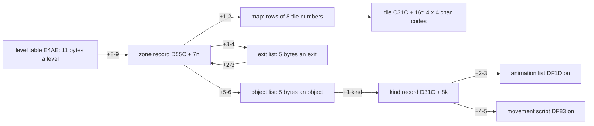

| Table | Range | Entry | Fields |
| --- | --- | --- | --- |
| level table | `$E4AE-$E4E4` | 11 bytes, 5 records | +0-1 intro text, +2-3 its screen address, +4 the colour of char 0, +5 Rick's x, +6-7 Rick's y, +8-9 the first zone record, +10 the first map row in view |
| zone records | `$D55C-$D649` | 7 bytes, 34 zones | +0 char set (0: `$7100`, else `$7A00`), +1-2 map, +3-4 exit list, +5-6 object list |
| maps | `$AF64-$C31B` | 8 bytes a map row | a tile number per 32 pixels |
| tiles | `$C31C-$D31B` | 16 bytes, 256 tiles | 4 rows of 4 char codes |
| kinds | `$D31C-$D55B` | 8 bytes, 72 kinds | +0 width, +1 height (pixels), +2-3 a graphic or an animation list, +4-5 a movement script, +6 / +7 the trigger box (chars) |
| exit lists | from `$D64A` | 5 bytes, `$FF` ends | +0 side (0 left, 1 right), +1 map char row, +2-3 the zone entered (`$FFFF`: the level's end), +4 the row there |
| object lists | `$D7FC-$DF1C` | 5 bytes, `$FF` + "term" ends | +0 map char row, +1 kind (bit 7: taken), +2 flags, +3 x and a row offset, +4 the trigger box's x and a row offset |
| animation lists | `$DF1D-$DF82` | a byte a picture, `$FF` wraps | bit 7 mirror, bits 0-6 the frame + 1, 0 no picture |
| movement scripts | `$DF83-$E218` | 3 bytes a step, `$FF` ends | count (passes), dx, dy (signed) |

A "map char row" is a row of 8 pixels. A map row of tiles is 4 of them.

The five level records, read from `build/game.bin`:

| n | Bytes | Level |
| --- | --- | --- |
| 0 | `E5 E4 A1 40 04 08 8B 00 5C D5 08` | South America: text `$E4E5` at `$40A1`, colour 4, Rick at x 8, y `$8B`, zone `$D55C`, top row 8 |
| 1 | `FC E5 E1 40 03 08 8B 00 86 D5 68` | Egypt: zone `$D586`, top row `$68` |
| 2 | `0A E7 E1 40 05 10 8B 00 B7 D5 10` | Schwarzendumpf castle: zone `$D5B7`, top row `$10` |
| 3 | `0E E8 E1 40 03 10 8B 00 0B D6 10` | the missile base: zone `$D60B`, top row `$10` |
| 4 | `F9 E8 E1 40 03 74 C8 00 0B D6 08` | the ending: only the text (London) is read |

LoadScreen `$AC83` (the `.ann` calls a zone record a "screen record") takes a zone record in IX and the top row in
C. It patches every pointer into the code that uses it:

```text
LoadScreen(IX = zone record, C = top row):
    RestartScreenRecord = IX                  # where a lost life restarts
    char set, attribute page and property set = by +0
    MapBlockTable $ADB5   = +1-2              # BuildScreenMap's source
    ViewTopRow $ADB7      = C
    the operand of CheckScreenExit ($AB95) = +3-4
    the operand of SpawnObjects ($FD7E)    = +5-6
    BuildCharProps; BuildScreenMap; ResetObjects; ...
```

```text
AC83 DD 22 27 AD LD (RestartScreenRecord),IX
AC99 DD 7E 00    LD A,(IX+$00)          ; the char set
ACB0 DD 6E 01    LD L,(IX+$01)
ACB3 DD 66 02    LD H,(IX+$02)
ACB6 22 B5 AD    LD (MapBlockTable),HL
ACB9 ED 43 B7 AD LD (ViewTopRow),BC
ACBD DD 6E 03    LD L,(IX+$03)
ACC0 DD 66 04    LD H,(IX+$04)
ACC3 22 95 AB    LD (CheckScreenExit+$0002),HL   ; the exit list, into an LD IX,nn
ACC6 DD 6E 05    LD L,(IX+$05)
ACC9 DD 66 06    LD H,(IX+$06)
ACCC 22 7E FD    LD (SpawnObjects+$0001),HL      ; the object list, into an LD HL,nn
ACCF CD A9 F6    CALL BuildCharProps
ACD2 CD 5A AD    CALL BuildScreenMap
ACD5 CD F7 EB    CALL ResetObjects
```

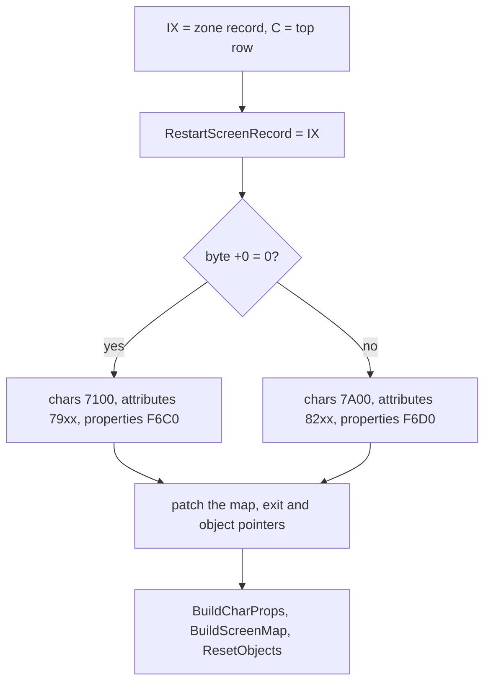

Witness: LoadScreen runs 7 times in `c1` and 30 times in `level4`.

**The point**: the zone record is read once. LoadScreen keeps its address in RestartScreenRecord `$AD27` for the
restart, and nothing else reads it: the map, the exit list and the object list live as operands inside the
instructions that read them.

### The exits

CheckScreenExit `$AB93` runs when Rick has walked off a side (`$FD61` set by MoveRick, the side in `$FD62`). It looks
for an exit on that side whose row is at most 2 rows above Rick's map row:

```text
CheckScreenExit:
    C = RickY / 8 + ViewTopRow                # Rick's map char row
    for each 5-byte exit until $FF:
        if +0 = side and 0 <= C - (+1) < 3:
            new top = ViewTopRow - ((+1) - (+4))
            if +2-3 = $FFFF: LevelEnd $ABD8
            else: LoadScreen(+2-3, new top)
            return
```

```text
ABAA DD 7E 00    LD A,(IX+$00)          ; ExitScan: the side
ABAD B8          CP B
ABAE C2 78 AC    JP NZ,ExitNoMatch
ABB1 79          LD A,C
ABB2 DD 96 01    SUB (IX+$01)           ; Rick's row - the exit's row
ABB5 FE 03       CP $03
ABB7 D2 7B AC    JP NC,ExitNextEntry
ABBA DD 7E 01    LD A,(IX+$01)
ABBD DD 96 04    SUB (IX+$04)
ABC0 4F          LD C,A
ABC1 3A B7 AD    LD A,(ViewTopRow)
ABC4 91          SUB C                  ; the new zone's top row
ABC8 DD 6E 02    LD L,(IX+$02)
ABCB DD 66 03    LD H,(IX+$03)
ABCE 7C          LD A,H
ABCF FE FF       CP $FF                 ; $FFFF: the level's end
```

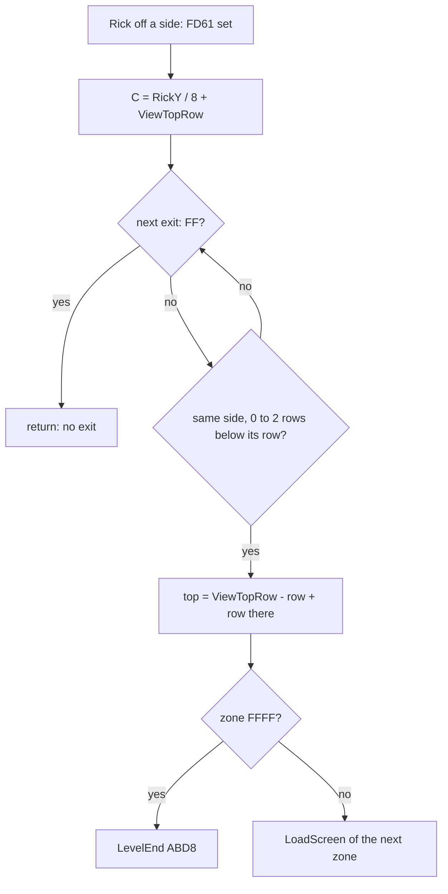

**Worked example.** L1Z1's right exit is `01 38 63 D5 18`. Rick leaves on the right (side 1) with his map row C
between `$38` and `$3A`. The new top row is ViewTopRow - (`$38` - `$18`) = ViewTopRow - 32. Rick keeps his y on the
screen, so L1Z2 (`$D563`) appears with its row `$18` where L1Z1's row `$38` was. Witness: the exit in `c1` at 31 172
(CheckScreenExit runs 3 times in `c1`, 5 in `level1`).

**The point**: an exit is a pair of rows, not a door. The zones join edge to edge, so a corridor carries on through
the exit at the same height on the screen.

## 7.2 One zone decoded: L1Z1

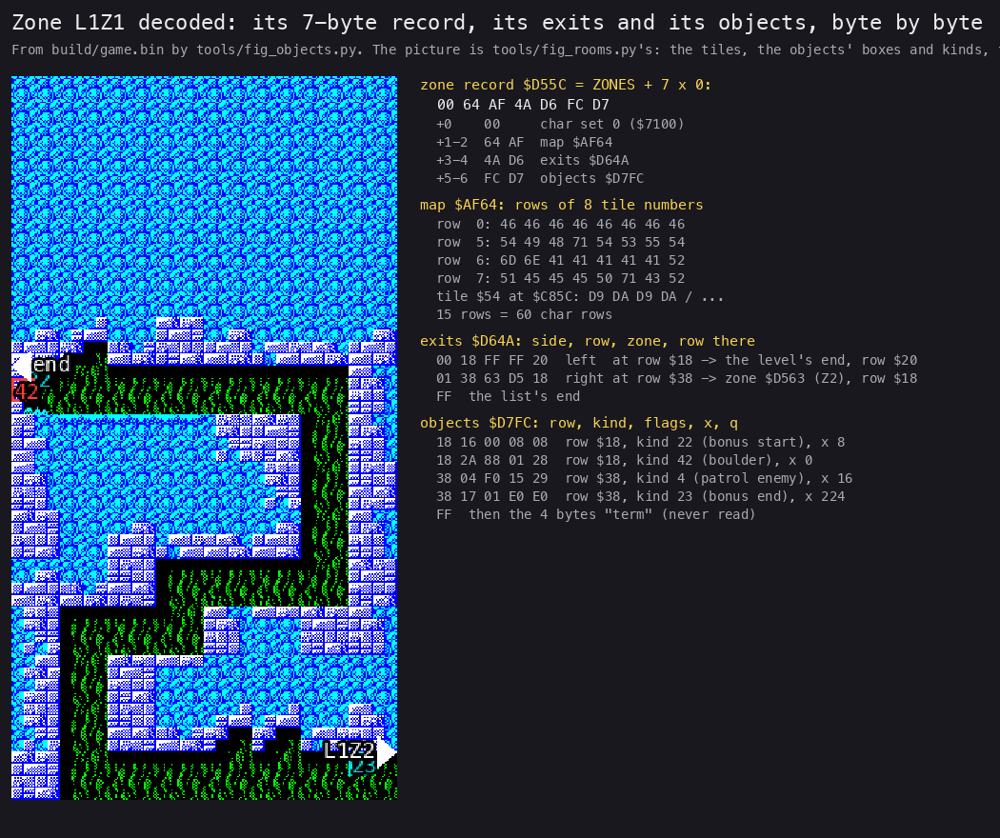

*Drawn from `build/game.bin` by `python3 tools/fig_rooms.py --out work/stage2/fig` (the picture, once) and `python3
tools/fig_objects.py zone L1Z1 docs/img/objects/zone-L1Z1.png`. Static data: no recording; the slots it predicts are
checked against `L1Z1` frame 134 below.*

How to read it:

- Left: the zone as tools/fig_rooms.py draws it from src/res/levels, 2 pixels a map pixel. Boxes are objects (yellow
  a picture kind, cyan a marker, red an actor), triangles the exits.
- Right, top to bottom: the 7-byte zone record, 4 rows of its map, its exits, its objects.
- Every hex byte on the right is read from the image; the words after it are its decode.

The record by hand:

| Bytes | Field | Value |
| --- | --- | --- |
| `00` | +0 char set | set 0: chars `$7100`, attributes `$7900`, properties set 0 |
| `64 AF` | +1-2 map | `$AF64`, the first byte of the map block |
| `4A D6` | +3-4 exits | `$D64A` |
| `FC D7` | +5-6 objects | `$D7FC`, the first object list |

The map has 15 rows of tiles, 60 map char rows. Rows 0-4 are all tile `$46`, solid rock (chars `$D9-$DC`, in set 0's wall run 193-251). Row 5 is
`54 49 48 71 54 53 55 54`. Tile `$54` is 16 bytes at `$C31C` + 16 x `$54` = `$C85C`. BuildScreenMap copies those 16
char codes as a 4 x 4 block into the char map ([doc 6, 6.2](06-rendering.md#62-the-zone-build-tiles-into-the-char-map)).

The exits:

| Bytes | Decode |
| --- | --- |
| `00 18 FF FF 20` | left, at map row `$18`: to `$FFFF`, the level's end |
| `01 38 63 D5 18` | right, at row `$38`: to L1Z2 (`$D563`), row `$18` there |

The objects:

| Bytes | Row | Kind | Flags | x | +4 |
| --- | --- | --- | --- | --- | --- |
| `18 16 00 08 08` | `$18` | 22, the bonus start marker | none | 8, offset 0 | trigger x 8 |
| `18 2A 88 01 28` | `$18` | 42, the boulder | `$88`: Rick's centre triggers it; deadly when triggered | 0, offset 1 | trigger x `$28` |
| `38 04 F0 15 29` | `$38` | 4, a patrolling enemy | `$F0` | `$10`, offset 5 | `$28`, offset 1 |
| `38 17 01 E0 E0` | `$38` | 23, the bonus end marker | one-shot | `$E0` | `$E0` |

Then `$FF` and the four bytes `term` close the list. No code reads `term`.

Every level's first zone has a left exit to `$FFFF`. Rick starts at x 8 facing right. In `L1Z1` he cannot reach
it: `l1z1left` (the `L1Z1` zone warp, a patch on a clone, left held for 290 frames) stops him at x 4, because the
step to x 2 meets a wall (ProbeBox `$F5D5` blocked 145 times) before X can go below 0, so ExitLeft `$FBCF` never
runs. The other three first zones were not tried.

The check against the game: after Rick's first death in `L1Z1`, RestartScreen `$AD29` loads the zone again and the
spawner fills the slots. The two records of row `$18` are spawned; the two of row `$38` are below the view and wait.

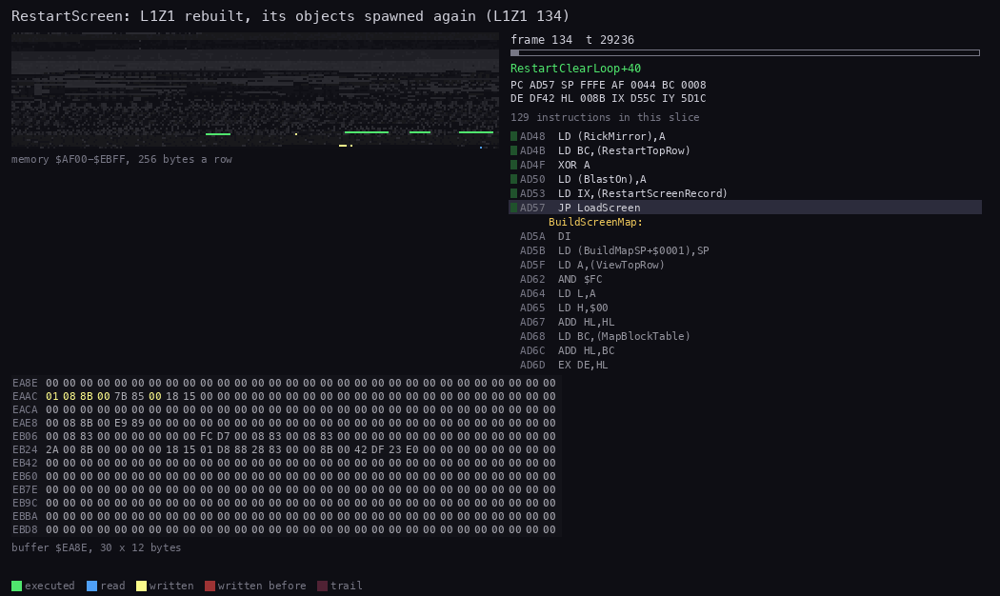

*`L1Z1` 134:28 000 to 135:31 271, 60 pictures (1 236 T each). Made with `python3 ../../kit/routine_anim.py --work
work/docs/rdA/z11 --listing build/game.lst --listing build/music.lst --window 134:28000-135:31271 --view
buffer:EA8E:30x12:hex --range AF00-EBFF --pictures 60 --out docs/img/routines/RestartScreen.gif`.*

How to read it:

- The hex block is the object table, one slot of 30 bytes a row (`$EA8E` at the top).
- The memory strip above it is `$AF00-$EBFF`: the map block, the tiles, the zone records and the object lists.
- Yellow bytes are written in that picture; red ones were written earlier in the window.
- At the end, slot 4 (`$EB06`) holds the marker and slot 5 (`$EB24`) the boulder.

The slots at frame 135, against the hand decode:

| Slot | Bytes 0-3 | Decode | From the record (ViewTopRow 8) |
| --- | --- | --- | --- |
| 4 `$EB06` | `16 08 83 00` | kind 22, x 8, y `$83` = 131 | y = (`$18` - 8 + 0) x 8 + 3 = 131 |
| 5 `$EB24` | `2A 00 8B 00` | kind 42, x 0, y `$8B` = 139 | y = (`$18` - 8 + 1) x 8 + 3 = 139 |

The boulder's slot goes on: frame `$DF42` (its animation list, until TrapMove picks a frame), size `$18 x $15`, list
entry `$D801`, flags `$88`, trigger x `$28`, trigger y `$0083`, home x 0, home y `$008B`, script `$E023`. Each value is
the decode's.

**The point**: a zone is 7 bytes of pointers and three lists. The whole of L1Z1 is 7 + 120 + 11 + 25 bytes, plus the
tiles it shares with its level.

## 7.3 The object table `$EA8E`

ObjectTable `$EA8E` holds 12 slots of 30 bytes; a `$FF` at `$EBF6` ends it. The slots have owners:

| Slot | Address | Owner |
| --- | --- | --- |
| 0 | `$EA8E` | object 0: a moving solid block (flag bit 1 in its record), a wall for Rick |
| 1 | `$EAAC` | Rick (kind 1) |
| 2 | `$EACA` | Rick's bullet (kind 2) |
| 3 | `$EAE8` | Rick's dynamite (kind 3) |
| 4-8 | `$EB06-$EB7E` | the zone's objects of kind 16 and up |
| 9-11 | `$EB9C-$EBD8` | the zone's enemies, kinds 4-15 |

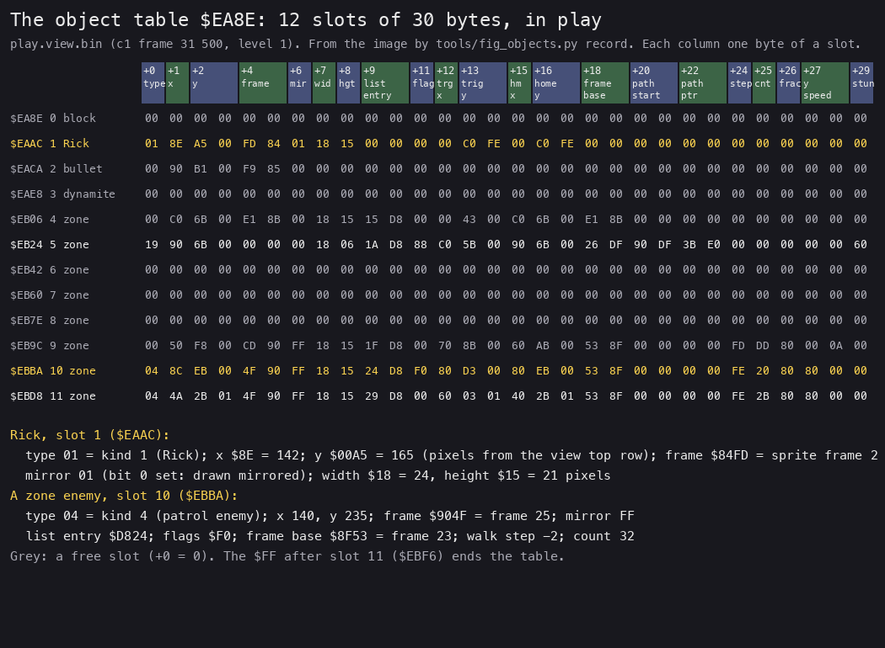

*Drawn from `work/images/play.view.bin` (a 64K view of `c1` at frame 31 500, level 1, zone 2) by `python3
tools/fig_objects.py record work/images/play.view.bin docs/img/objects/record.png`.*

How to read it:

- The coloured headers name the fields, one column a byte.
- One row is a slot; grey rows are free (+0 = 0).
- Rick (slot 1) and an enemy (slot 10) are spelled out below the table.

| Offset | Field | Notes |
| --- | --- | --- |
| +0 | type | bits 0-6 the kind, bit 7 deadly (a trap) or hit (a box); 0 free |
| +1 | x | 0 to `$E7` |
| +2-3 | y | 16 bits, from the view's top row |
| +4-5 | frame | the sprite frame's address |
| +6 | mirror | bit 0: drawn mirrored |
| +7, +8 | width, height | pixels, from the kind's +0 / +1 |
| +9-10 | list entry | the object record it came from |
| +11 | flags | from the record's +2, below |
| +12 | trigger x | the record's +4 AND `$F8`; for a patrolling enemy, its patrol length |
| +13-14 | trigger y | ((record row AND `$F8`) - top + (+4 AND 7)) x 8 + 3 |
| +15, +16-17 | home x, home y | where a path restarts |
| +18-19 | frame base or animation list | the kind's +2-3 |
| +20-21, +22-23 | script start, script pointer | the kind's +4-5 |
| +24 | step | walk step (+2 or -2), animation index, climb state |
| +25 | count | passes done in the current script step, patrol count |
| +26-28 | y fraction, y speed | 8.8 speed, +`$80` a pass, at most `$0800` |
| +29 | stun count | 20 passes after a stick hit; the spawner puts (+4 AND 7) x 32 here |

The flags byte +11:

| Bit | 7 | 6 | 5 | 4 | 3 | 2 | 1 | 0 |
| --- | --- | --- | --- | --- | --- | --- | --- | --- |
| Meaning | Rick's centre triggers it | the stick triggers it | the bullet triggers it | the blast triggers it | deadly when triggered | deadly at spawn and when reset | object 0 | one-shot |

**Worked example.** Rick's slot at `c1` 31 500 starts `01 8E A5 00 FD 84 01 18 15`. Kind 1, x `$8E` = 142, y
`$00A5` = 165, in pixels from the view's top row (ViewTopRow, 8 char rows above the screen's top), not from the
map's top. Frame `$84FD` = `$8401` + 126 x 2: frame 2, in the air. Mirror `01`: drawn mirrored, he faces left.
Size `$18 x $15` = 24 x 21 pixels.

**The point**: a slot is the kind's record and the object's record merged, plus the state. Once spawned an object
never looks at the level data again, except to mark its record taken.

## 7.4 The spawner SpawnObjects `$FD7D`

A zone's object list is sorted by row. SpawnObjects takes the rows D to D + E - 1 (the rows that came into view: all
of them at a zone's start, a band at a scroll) and puts each object that is not taken, and has a free slot, into one.

```text
SpawnObjects(D = first row, E = rows):
    find the first record with row >= D           # sorted: stop at $FF
    for each record while row < D + E:
        if kind bit 7 (taken): skip
        if flags bit 1: slot = $EA8E if free, else skip      # object 0
        elif kind < 16: slot = FindSlotLowKind $FEB2         # 3 slots from $EB9C, never this record twice
        else:           slot = FindSlotHighKind $FEA1        # 5 slots from $EB06
        if no slot: skip
        type = kind; x = +3 AND $F8
        y = ((row AND $F8) - ViewTopRow + (+3 AND 7)) x 8 (+ 3 unless object 0)
        width, height, frame, script from the kind record $D31C + 8 kind
        list entry = this record; flags = +2; if flags bit 2: type bit 7 (deadly)
        trigger x = +4 AND $F8; trigger y = ((row AND $F8) - ViewTopRow + (+4 AND 7)) x 8 + 3
        +24 to +28 = 0
```

```text
FD7D 21 00 00    LD HL,$0000            ; the object list, patched by LoadScreen
FD94 DD 7E 00    LD A,(IX+$00)          ; SpawnLoop: until $FF or row D + E
FD97 FE FF       CP $FF
FD99 C8          RET Z
FD9A B8          CP B
FD9B D0          RET NC
FDA0 DD 7E 01    LD A,(IX+$01)
FDA3 A7          AND A
FDA4 FA 98 FE    JP M,SpawnNext         ; taken
FDA8 DD CB 02 4E BIT 1,(IX+$02)
FDAC CA BC FD    JP Z,SpawnLowKind
FDAF 3A 8E EA    LD A,(ObjectTable)     ; object 0: only into slot 0
FDB2 A7          AND A
FDB3 C2 98 FE    JP NZ,SpawnNext
FDBC FE 10       CP $10                 ; SpawnLowKind
FDBE D2 CC FD    JP NC,SpawnHighKind
FDC2 CD B2 FE    CALL FindSlotLowKind
FDCD CD A1 FE    CALL FindSlotHighKind  ; SpawnHighKind
FE10 DD 7E 01    LD A,(IX+$01)          ; the kind record: kind x 8
FE13 87          ADD A,A
FE14 6F          LD L,A
FE15 26 00       LD H,$00
FE17 29          ADD HL,HL
FE18 29          ADD HL,HL
FE19 11 1C D3    LD DE,ObjectKinds
FE49 DD 7E 02    LD A,(IX+$02)
FE4C FD 77 0B    LD (IY+$0B),A          ; the flags
FE4F CB 57       BIT 2,A
FE51 CA 58 FE    JP Z,SpawnTrigger
FE54 FD CB 00 FE SET 7,(IY+$00)         ; deadly from the start
```

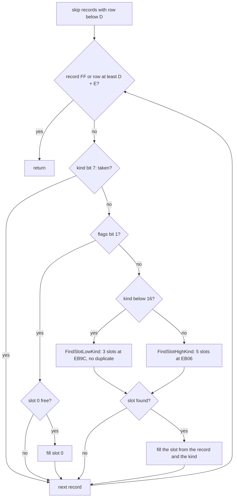

The spawn of L1Z2 in `c1`:

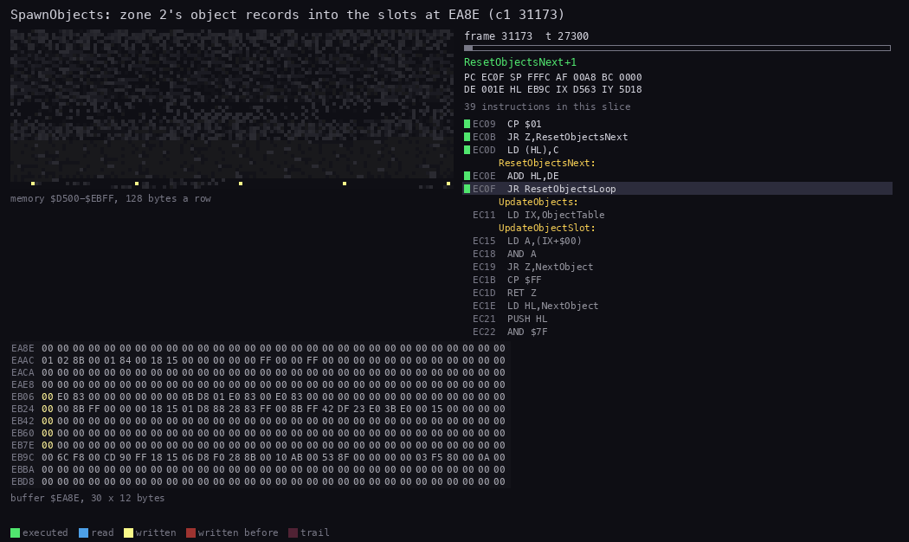

*`c1` 31 173:27 000 to 31 173:42 000, 50 pictures. Made with `python3 ../../kit/routine_anim.py --work work/docs/rdA/c1
--listing build/game.lst --page 1=build/music.lst --page-name 1="the AY player" --window 31173:27000-31173:42000
--view buffer:EA8E:30x12:hex --range D500-EBFF --pictures 50 --out docs/img/routines/SpawnObjects.gif`.*

How to read it:

- The hex block is the object table, a slot a row. The strip above is `$D500-$EBFF`: zone records, object lists,
  kinds, scripts and the table.
- The red bytes fill four slots: a treasure (kind `$12`) and an actor (kind `$19`) at `$EB06` / `$EB24`, two
  patrolling enemies (kind 4) at `$EB9C` / `$EBBA`.
- The listing at the right ends in the redraw (DrawAllDirtyCells): the spawn is over and the screen is drawn.

**Worked example.** The boulder's record `18 2A 88 01 28` at `$D801`, at Rick's restart in `L1Z1` (ViewTopRow 8):

1. The row `$18` lies inside the rows in view: spawned.
2. Kind `$2A` = 42 has bit 7 clear (not taken). Flags `$88` have bit 1 clear (not object 0). 42 is 16 or more: one of
   the 5 slots from `$EB06`. Slot 4 already holds the marker of the record before it, so slot 5, `$EB24`.
3. x = `$01` AND `$F8` = 0. y = (`$18` - 8 + 1) x 8 + 3 = 139 = `$8B`.
4. The kind record at `$D31C` + 8 x 42 = `$D46C` is `18 15 42 DF 23 E0 04 04`: width 24, height 21, animation list
   `$DF42`, script `$E023`, trigger box 4 x 4 chars.
5. Flags `$88` have bit 2 clear: the type stays `$2A`, harmless until triggered.
6. Trigger x = `$28` AND `$F8` = 40. Trigger y = (`$18` - 8 + 0) x 8 + 3 = 131.

RestartScreen.gif above shows exactly these bytes land in slot 5. Witness: SpawnObjects runs 35 times in `c1`.
Object 0 is spawned (`$FDB6`) only in `level2` and `level3`.

**The point**: objects exist only near the view. The four levels hold 331 object records, but never more than 8 zone
objects live at once.

## 7.5 The update and its dispatch

UpdateObjects `$EC11` runs once a pass ([doc 4, 4.4](04-game-loop.md#44-the-main-loop-step-by-step)). For each slot it
chooses a handler by the kind:

```text
UpdateObjectSlot:
    for IX = each slot until type $FF:
        if type = 0: next
        kind = type AND $7F
        if kind = $47: DyingEnemyObj $F1B7       # a killed enemy, falling out
        elif kind >= 24: TrapObj $EDFC           # every actor
        else: ObjectHandlers[kind]               # Rick, bullet, dynamite, enemies, boxes, treasures, markers
```

```text
EC15 DD 7E 00    LD A,(IX+$00)          ; UpdateObjectSlot
EC18 A7          AND A
EC19 28 20       JR Z,NextObject
EC1B FE FF       CP $FF
EC1D C8          RET Z
EC1E 21 3B EC    LD HL,NextObject
EC21 E5          PUSH HL                ; the handler returns into NextObject
EC22 E6 7F       AND $7F
EC24 FE 47       CP $47
EC26 CA B7 F1    JP Z,DyingEnemyObj
EC29 FE 18       CP $18
EC2B D2 FC ED    JP NC,TrapObj
EC2E 87          ADD A,A
EC2F 6F          LD L,A
EC30 26 00       LD H,$00
EC32 01 47 EC    LD BC,ObjectHandlers
EC35 09          ADD HL,BC
EC36 5E          LD E,(HL)
EC37 23          INC HL
EC38 56          LD D,(HL)
EC39 EB          EX DE,HL
EC3A E9          JP (HL)
EC3B 01 1E 00    LD BC,$001E            ; NextObject: 30 bytes on
EC3E DD 09       ADD IX,BC
EC40 18 D3       JR UpdateObjectSlot
```

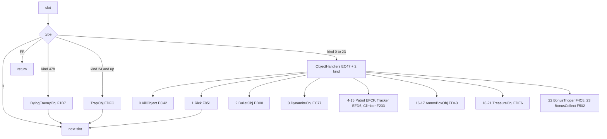

| Handler | Kinds | Runs (L1, a recording) |
| --- | --- | --- |
| TrapObj `$EDFC` | 24-70 | `c1` 1 299, `level2` 7 377, `level3` 9 162 |
| ClimberObj `$F233` | 6, 9, 12, 15 | `level4` 3 517 |
| EnemyCommon `$EFDB` (from PatrolObj `$EFCF`, TrackerObj `$EFD6`) | 4, 5, 7, 8, 10, 11, 13, 14 | `level1` 1 681 |
| BulletObj `$ED00` | 2 | `c1` 25, `level3` 84 |
| DynamiteObj `$EC77` | 3 | `level2` 50, `level3` 300 |
| TreasureObj `$EDE6` | 18-21 | 4 takes in `c1` |
| AmmoBoxObj `$ED43` | 16, 17 | 11 zone recordings; a box taken once, in `L1Z4` |
| KillObject `$EC42` | a type `$80` | not executed in any recording (`c1`, `c1g`, `controls`, `gameover`, `level1`-`level4`, `ending2`, `beeper48`, the 34 zone and 6 spot recordings) |

UpdateObjectSlot runs 563 418 times over all the recordings: 13 a pass, the 12 slots and the end mark.

**The point**: one compare splits the 72 kinds in two. Every kind from 24 up is the same machine, TrapObj, driven by
its data; only the kinds below 24 have code of their own.

## 7.6 The kinds, their animations and their scripts

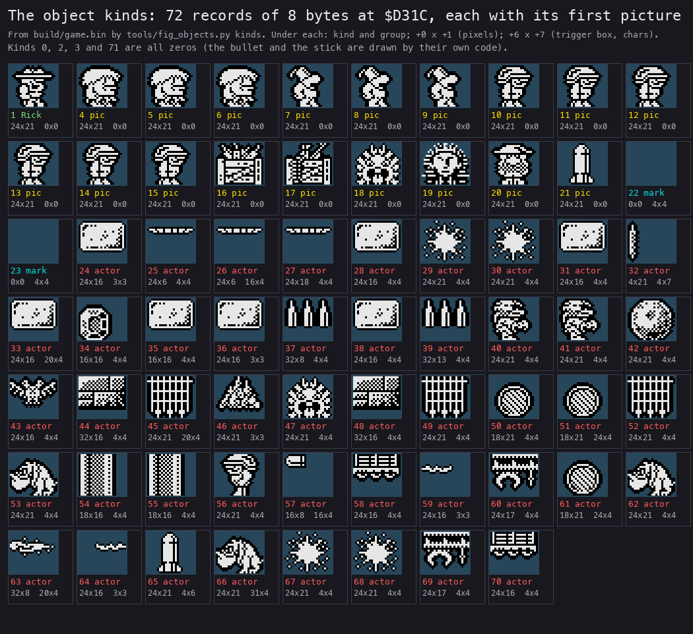

*Drawn from `build/game.bin` by `python3 tools/fig_objects.py kinds docs/img/objects/kinds.png`. Static data.*

How to read it:

- One cell a kind, its first picture over a dark square: the graphic for kinds 4-21, the first non-empty frame of
  the animation list for kinds 24-70.
- Yellow: picture kinds (enemies, boxes, treasures). Cyan: the two bonus markers (no picture). Red: the actors.
- Under each: the kind's +0 x +1 (the object's box in pixels) and +6 x +7 (the trigger box in chars).

The groups, as `src/res/levels/README.md` names them:

| Kinds | Name | +2-3 | Script | Handler |
| --- | --- | --- | --- | --- |
| 0, 2, 3, 71 | `kindK` | 0 | none | own code (the bullet and the stick set their own frames) |
| 1 | `kind1` | 0 | none | Rick `$F851`; +0 / +1 = 24 x 21 |
| 4-15 | `picK` | the enemy's frame base (`$8F53`, `$8CDD`, `$914B`) | none | Patrol, Tracker, Climber |
| 16-21 | `picK` | a graphic (`$6A80` the dynamite box, `$896B` the bullet box, the treasures) | none | AmmoBoxObj, TreasureObj |
| 22, 23 | `markK` | 0 | none | the bonus markers; trigger box 4 x 4 |
| 24-70 | `actorK` | an animation list | a movement script | TrapObj |

An animation list is a byte a picture. The frame is at `$8383` + 126 x (byte AND `$7F`), so the byte is the frame
number + 1. Bit 7 mirrors it, 0 means no picture, and `$FF` goes back to index 1. TrapMove `$EE0B` steps the index
+24 by one a pass.

A movement script is 3 bytes a step: a count of passes, then dx and dy (signed). TrapMove moves the object by
(dx, dy) every pass until the count is reached, then takes the next step. `$FF` ends the script.

```text
TrapMove (IX = an actor's slot):
    byte = anim[+24]; if byte = $FF: byte = anim[0]
    frame = byte AND $7F ? $8383 + 126 x (byte AND $7F) : none; mirror = bit 7
    if +24 = 0: TrapTriggers; return                # waiting: no picture, no move
    +24 = next index (back to 1 at $FF)
    step = script[+22]; +25 += 1
    if +25 > count: next step; at $FF: TrapPathEnd
    x += dx (leaving 0-$E7 ends the path); y += dy ($12A or more ends it)
TrapPathEnd:
    if one-shot and Rick not dying: free the slot
    else: type bit 7 = flag bit 2; +24 = 0; x, y = home; wait again
```

```text
EE0B DD 7E 18    LD A,(IX+$18)          ; TrapMove: the animation index
EE11 DD 6E 12    LD L,(IX+$12)
EE14 DD 66 13    LD H,(IX+$13)          ; the animation list
EE19 09          ADD HL,BC
EE1A 7E          LD A,(HL)
EE1B FE FF       CP $FF
  ...
EE4A 01 83 83    LD BC,$8383            ; frame n at $8383 + 126 n
EE4D 09          ADD HL,BC
EE4E DD 75 04    LD (IX+$04),L
EE51 DD 74 05    LD (IX+$05),H
EE54 DD 7E 18    LD A,(IX+$18)
EE57 A7          AND A
EE58 CA 2E EF    JP Z,TrapTriggers      ; index 0: waiting for a trigger
EE81 DD 6E 16    LD L,(IX+$16)          ; TrapPath: the script pointer
EE84 DD 66 17    LD H,(IX+$17)
EE87 DD 7E 19    LD A,(IX+$19)          ; passes done in this step
EE8A BE          CP (HL)                ; TrapPathStep
EE8B DA E2 EE    JP C,TrapStepMove
EE8E 23          INC HL
EE8F 23          INC HL
EE90 23          INC HL                 ; the next step
EE91 7E          LD A,(HL)
EE92 FE FF       CP $FF
EE94 C2 D4 EE    JP NZ,TrapNextStep
EE97 3A 68 FD    LD A,(Dying)           ; TrapPathEnd
EE9E DD CB 0B 46 BIT 0,(IX+$0B)
EEA2 CA AA EE    JP Z,TrapRestart
EEA5 DD 36 00 00 LD (IX+$00),$00        ; one-shot: gone
```

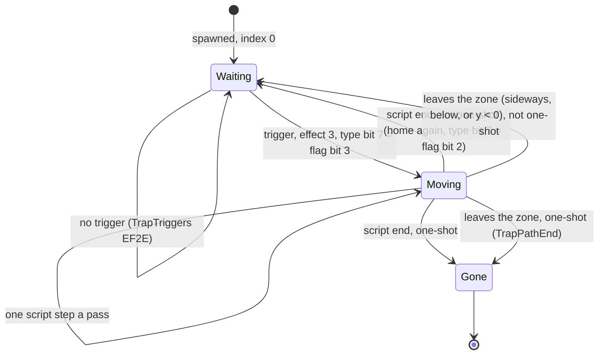

### The boulder at work

The boulder (kind 42) is L1Z1's first actor. Its kind record is `18 15 42 DF 23 E0 04 04`. Its animation list `$DF42`
is `00 28 FF`: index 0 is "no picture", so while it waits nobody sees it; index 1 is `$28`, frame 39, the boulder.
Its script `$E023` has nine steps:

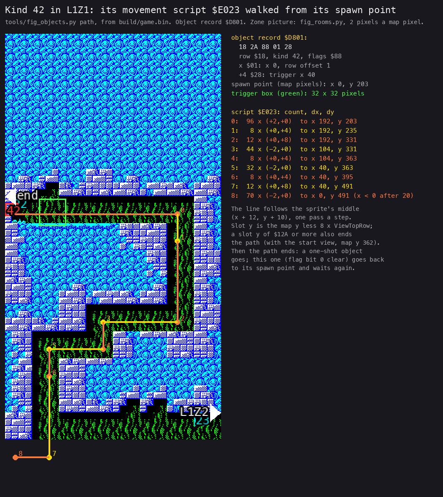

*Drawn from `build/game.bin` by `python3 tools/fig_objects.py path L1Z1 42 docs/img/objects/boulder-path.png`, over
tools/fig_rooms.py's picture of the zone. Static data; the run is the animation below.*

How to read it:

- The green square is the trigger box: 4 x 4 chars from x 40, at the boulder's row.
- The line is the boulder's middle along the nine script steps, numbered at their ends, in map pixels.
- The list on the right gives each step: passes x (dx, dy), and where it ends.

**Worked example.** Rick starts at x 8, y `$8B`. His centre (x + 12, y + 10) is (20, 149), left of the box. He walks
right 2 pixels a pass. PointInTrigger's x test is `CP E` with the box's left edge in A, so the point must be above 40:
at x 30 his centre is at 42, inside. TrapTriggers then sets the type to `$2A` OR `$80` (flag bit 3), the index to 1,
the script pointer to `$E023`, and plays effect 3. From the next pass the boulder rolls right at 2 pixels a pass, as
fast as Rick walks. Step 0 lasts 96 passes, 192 pixels, to the shaft at x 192. Steps 1 and 2 drop it 32 + 96 pixels.

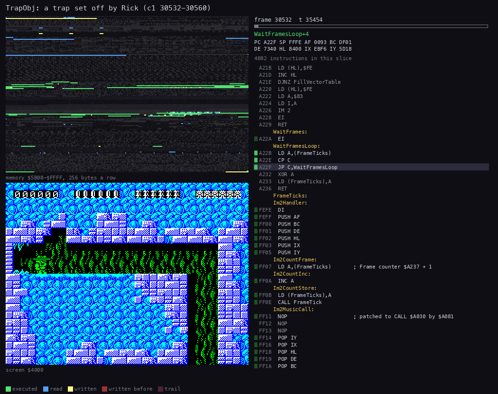

*`c1` 30 532 to 30 560, 56 pictures. Made with `python3 ../../kit/routine_anim.py --work work/docs/rdA/c1 --listing
build/game.lst --page 1=build/music.lst --page-name 1="the AY player" --window 30532:0-30560:0 --view screen --range
5B00-FFFF --pictures 56 --out docs/img/routines/TrapObj.gif`.*

How to read it:

- The screen is at the bottom; the boulder rolls in from the left edge behind Rick.
- The listing follows the dispatch: UpdateObjectSlot sends kind 42 to TrapObj every pass.
- The memory strip shows the writes to the boulder's slot each pass (x, the frame, the counters).

Witness: effect 3 from TrapTriggers (`$EFCB`) at `c1` 30 533:35 467. The `gameover` recording has six deaths to this
boulder ([doc 10, 10.6](10-gameplay-logic.md#106-traps)).

The second kind at work is the patrolling enemy (kind 4, PatrolObj `$EFCF`). Slot 10 at `c1` 31 500 holds kind 4 at
x 140, frame 25 = base 23 + 2, walk step -2, count 32. Its walk, and its death to Rick's bullet, are in
[doc 10, 10.5](10-gameplay-logic.md#105-enemies).

**The point**: the 47 actor kinds are data. A rolling boulder, a spear from a wall and a dropping block differ only in
their animation list, their script and their flags; one routine of 467 bytes (`$EDFC-$EFCE`) runs them all.

## 7.7 Triggers and collisions

Five tests decide every contact in the game:

| Test | Address | Boxes | Used by |
| --- | --- | --- | --- |
| RickTouches | `$F6E0` | Rick's body (x + 5 to x + 17, y to y + 20; 8 lower when crawling) against the object's +7 x +8 box | traps, enemies, boxes, treasures |
| PointInTrigger | `$F7C3` | a point against the trigger box (+12, +13-14; the size from the kind's +6 / +7, chars x 8) | TrapTriggers, the bonus markers |
| point in box | `$F742` | a point strictly inside the object's +7 x +8 box | the bullet's hit point |
| in the blast | `$F76F` | the object's box against the blast: from the stick's x - 4, y - 4 to x + 28, y + 25 (33 x 30 pixels, clamped at 0), overlapping the object's box | DynamiteObj: Rick, enemies, boxes |
| char properties | `$5C00` | a char cell under Rick or an enemy | walls, floors, ladders, deadly cells ([doc 10, 10.1](10-gameplay-logic.md#101-the-world-chars-and-their-properties)) |

TrapTriggers `$EF2E` checks the four trigger kinds in a fixed order, by the flag bits:

```text
TrapTriggers:
    if Rick is dying: return
    if bit 7 and (RickX + 12, RickY + 10) in the trigger box: go
    if bit 6 and the stick is out (Poking $FD63) and its point in the box: go
    if bit 5 and the bullet is alive and its hit point in the box: the bullet is used up; go
    if bit 4 and the blast is on and its centre in the box: go
    return
go: type bit 7 = flag bit 3; index = 1; count = 0; script pointer = start; effect 3
```

```text
EF2E 3A 68 FD    LD A,(Dying)
EF31 A7          AND A
EF32 C0          RET NZ
EF33 DD 7E 0B    LD A,(IX+$0B)
EF36 CB 7F       BIT 7,A
EF38 CA 52 EF    JP Z,TrapTestStick
EF3B 3A AD EA    LD A,(RickX)
EF3E C6 0C       ADD A,$0C
EF40 5F          LD E,A
EF41 3A AE EA    LD A,(RickY)
EF44 C6 0A       ADD A,$0A
EF46 6F          LD L,A
EF47 26 00       LD H,$00
EF49 CD C3 F7    CALL PointInTrigger
EF4C CA A4 EF    JP Z,TrapTriggered
  ...
EFA4 DD 7E 00    LD A,(IX+$00)          ; TrapTriggered
EFA7 E6 7F       AND $7F
EFA9 DD CB 0B 5E BIT 3,(IX+$0B)
EFAD CA B2 EF    JP Z,TrapSetType
EFB0 F6 80       OR $80                 ; deadly while it moves
EFB2 DD 77 00    LD (IX+$00),A
EFB5 DD 36 18 01 LD (IX+$18),$01
EFB9 DD 36 19 00 LD (IX+$19),$00
EFC9 3E 03       LD A,$03
EFCB CD ED 9F    CALL PlayEffect
```

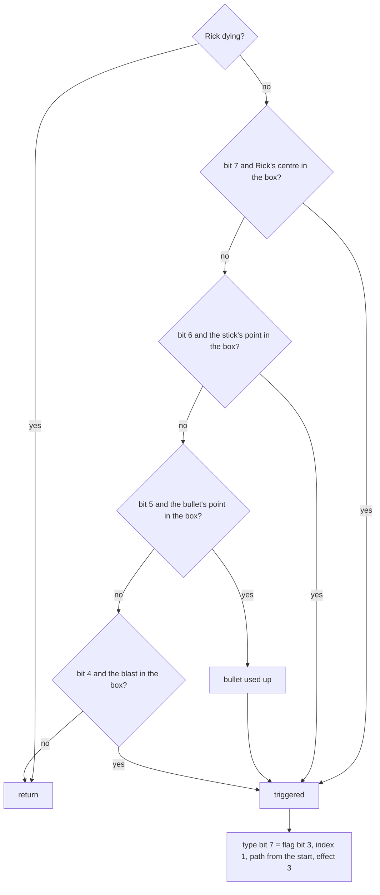

PointInTrigger `$F7C3` finds the box's size through the type, at `$D322` + 8 x kind:

```text
F7C3 DD 7E 0C    LD A,(IX+$0C)          ; the box's left edge
F7C6 BB          CP E
F7C7 D2 0F F8    JP NC,PointInTriggerNo  ; the point must be right of it
F7CC DD 7E 00    LD A,(IX+$00)
F7CF 87          ADD A,A                ; bit 7 (deadly) drops out here
F7D0 6F          LD L,A
F7D1 26 00       LD H,$00
F7D3 29          ADD HL,HL
F7D4 29          ADD HL,HL
F7D5 01 22 D3    LD BC,$D322            ; the kind's +6: width, then height, in chars
```

**Worked example.** The boulder's box runs in x from 40 (exclusive) to 40 + 4 x 8 = 72, and in y from 131 to 163.
Rick's point (42, 149) at x 30 passes both halves: the trap goes.

**The point**: the triggers are points, not boxes. Rick's centre, the stick's tip, the bullet's tip and the blast's
centre each set off a trap only if the designer set the matching flag, so a trap can wait for the dynamite while Rick
walks past it untouched.

## 7.8 The game variables

The variables of a game in progress, with their values in `c1` at frame 31 500 (level 1, zone 2, after one shot):

| Variable | Address | Value at 31 500 | Written by |
| --- | --- | --- | --- |
| Level | `$E4AD` | 0 | NewGame `$E2F1`, the level change `$ABFA` |
| GameComplete | `$E440` | 0 | NewGame `$E2F4`, LevelEnd `$AC52` (`$FF` after level 4) |
| RickX | `$EAAD` | `$8E` | MoveRick, the zone change (`$E4` after a left exit, `$02` after a right one) |
| RickY | `$EAAE-$EAAF` | `$00A5` | MoveRick |
| ViewTopRow | `$ADB7` | `$10` | LoadScreen, the scrolls `$ADB9` / `$ADF0` |
| MapBlockTable | `$ADB5` | `$AFDC` (L1Z2's map) | LoadScreen |
| Lives | `$A958` | 6 | NewGame, MainLoop `$E3F1` (- 1 a death) |
| Bullets | `$A976` | 5 | FireShoot `$FA4B` (- 1), the bullet box (6), NewLife (6) |
| Dynamite | `$A967` | 6 | DropDynamite `$FA9C` (- 1 at `$FAA6`), the dynamite box (6), NewLife (6) |
| Score | `$A9BE-$A9C3` | `00 00 02 05 02 00` = 2 520 | AddScore: six decimal digits, highest first |
| Dying, DeathDone | `$FD68`, `$FD69` | 0, 0 | KillRick `$FBED`, DeathFall `$FC16` (DeathDone stored at `$FC47`) |
| ZoneChange, ExitSide | `$FD61`, `$FD62` | 0, 1 | MoveRick at the edges |
| Poking, PokeX, PokeY | `$FD63-$FD66` | 0 | the stick `$F9DC` |
| YFraction, YVelocity | `$FD55`, `$FD56-$FD57` | `$80`, `$0200` | MoveRick (8.8 pixels a pass) |
| DynFuse, BlastX, BlastY, BlastOn | `$ECED-$ECF1` | 0 | DropDynamite `$FAB1`, DynamiteObj |
| BonusActive | `$FD6C` | 0 | BonusTrigger `$F4C8`, BonusCollect `$F502` |
| BonusDivider, BonusDigits | `$E495`, `$E496-$E49A` | `02`, `00 01 09 02 00` (1 920 left from the last bonus) | BonusCountdown `$E466` |
| ControlMethod | `$A14C` | 2, the cursor keys | the menu |

FireShoot `$FA4B` takes one from Bullets `$A976`, DropDynamite (`$FAA1`, `$FAA7`) from Dynamite `$A967`, and the HUD
draws `$A976` beside a bullet ([doc 8, 8.3](08-hud-and-text.md#83-the-hud) shows it on the screen).

**Worked example.** At 31 500 Bullets is 5: FireShoot ran at 31 326:38 121 and the HUD lost one bullet at 31 329.
Dynamite is 6: no stick was dropped in `c1`.

**The point**: the whole state of a game is a few dozen bytes, the object table, and the "taken" bits of the object
lists: NewGame `$E2DC` clears bit 7 in 365 five-byte groups from `$D7FD`, the 331 records and the 34 zone
terminators.

## 7.9 Known only from the code

- KillObject `$EC42` (kind 0 with bit 7 set) frees its slot. Not executed in any recording: no slot ever held the
  type `$80`.
- The left exits to `$FFFF` in the first zones of levels 2-4: no recording tried them (`L1Z1`'s is walled off, 7.2).
- The four bytes `term` after every object list: nothing reads them.
- Slot +29 gets (+4 AND 7) x 32 at the spawn; only the stun count is seen to use the byte.
- Slot +13 / +14 of an enemy: not read by the enemy code.
