# 8. HUD and text

What this covers:

- the font: 43 glyphs of 8 x 8, the game's own character codes;
- the two printers, PrintText `$AA8D` and PrintLines `$AAE9`;
- the HUD: the score and three counters on char row 1, and how they share the row with the play area;
- the score and its awards;
- every text: the menu, the four intros, the closing text, GAME OVER; the menu's colour cycle;
- what is known only from the code.

There is no high score table: the game keeps no score past the current game, and no text names one.

The recordings it rests on:

| Recording | Load | Used for |
| --- | --- | --- |
| `c1` | power-on, the original TZX at ROM speed (128K) | the menu (30 250), the level 1 intro printed (30 469-30 471), the HUD drawn at the start (30 490-30 700), one bullet less (31 329), the GAME OVER after Q (33 250) |
| `gameover` | power-on, the original TZX (128K), six deaths | GAME OVER at the last life (2 500) |
| `level2`, `level3`, `level4` | the level warps (WALKTHROUGH 6.0) | the intros of levels 2-4 (frame 0) |
| `ending` | stage 1: a warp into level 4's end, PC = `$ABD8` ([WALKTHROUGH](../WALKTHROUGH.md)) | the closing text (250), GAME OVER after it (500) |
| `ending2` | the L4Z9 warp with the door freed | the end bonus in the score (250 to 500) |
| `level1` | the level 1 warp | the bonus added to the score (755) |

The game logic behind the counters (what a shot, a stick and a life cost) is in [doc 10](10-gameplay-logic.md).
The cell flags the HUD clears and sets are the renderer's ([doc 6](06-rendering.md)).

## 8.1 The font

The font is 43 glyphs of 8 bytes at Font `$9E95-$9FEC`, one byte a pixel row, the top row first. It is kept as the
resource `src/res/graphics/font.png` (one row of 43 cells, see `src/res/graphics/README.md`).

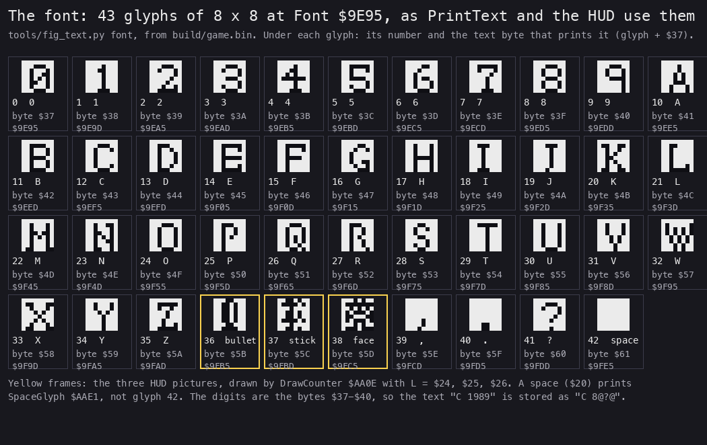

*From `build/game.bin`, the image every recording runs. Made with `python3 tools/fig_text.py font
docs/img/text/font.png`.*

How to read it:

- Each box is one glyph, drawn 6 times its size, black on white as the resource keeps it.
- Under the glyph: its number, what it shows, the text byte that prints it, and its address.
- The three yellow frames are the HUD's pictures, which no text uses.

**The point**: the font has no lower case, no punctuation but `,` `.` `?`, and no copyright sign. Its order is the
digits, then the letters, then the HUD's three pictures, so a text byte is not ASCII for the digits.

The glyphs in numbers:

| Glyphs | What | Text bytes | Used by |
| --- | --- | --- | --- |
| 0-9 | the digits | `$37-$40` | the score (DrawScore takes the digit itself), the credits' "1989" |
| 10-35 | A-Z | `$41-$5A` (ASCII) | every text |
| 36 | a bullet | (`$5B`, not used) | DrawBullets `$A968`, the bullets counter |
| 37 | a stick of dynamite | (`$5C`, not used) | DrawDynamite `$A959`, the sticks counter |
| 38 | Rick's face | (`$5D`, not used) | DrawLives `$A94A` |
| 39-41 | `,` `.` `?` | `$5E`, `$5F`, `$60` | the intros and the closing text, and the menu (the `.` of the control list, "1 . KEYBOARD") |
| 42 | blank | (`$61`, not used) | nothing: a space prints SpaceGlyph `$AAE1` |

The letters keep their ASCII codes because the printer subtracts `$37`: `'A'` = `$41` gives glyph 10. The digits
pay for it: `'1'` would be `$31` and glyph -6, so a 1 is stored as `$38`, which is ASCII `'8'`. The credits' "1989"
is the bytes `$38 $40 $3F $40`, which read as ASCII "8@?@".

## 8.2 The printers: PrintText and PrintLines

**PrintText** `$AA8D` prints one text. HL points at the text, DE is the screen address of the first cell, C the
attribute. It prints a byte a cell, left to right, until `$FF`.

**PrintLines** `$AAE9` prints a list of texts, one per char row, until `$FE`. Every line gets the attribute `$47`
(bright white on black). A text of only `$FF` is an empty line.

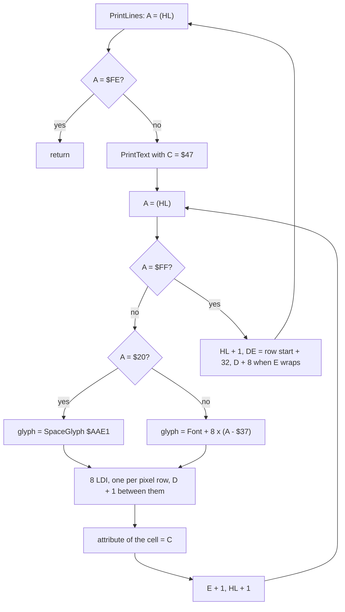

In pseudocode:

```text
PrintLines(HL, DE):
    while mem[HL] != $FE:
        PrintText(HL, DE, C = $47)          ; HL left on the $FF
        HL += 1
        E += 32; if E wrapped: D += 8       ; the next char row, across a third
PrintText(HL, DE, C):
    while mem[HL] != $FF:
        glyph = SpaceGlyph if mem[HL] == $20 else Font + 8 * (mem[HL] - $37)
        for row in 0..7: screen[DE + row * 256] = glyph[row]
        attrs[$5800 + third(D) * 256 + E] = C
        E += 1; HL += 1
```

The code, the glyph and its attribute (`$AA9F-$AADE`):

```asm
PrintChar:
  PUSH HL
  PUSH DE
  PUSH BC
  SUB $37             ; text byte -> glyph number
  LD L,A
  LD H,$00
  ADD HL,HL
  ADD HL,HL
  ADD HL,HL           ; 8 bytes a glyph
  LD BC,Font          ; $9E95
  ADD HL,BC
PrintGlyph:
  LDI                 ; pixel row 0
  DEC DE
  INC D               ; the next pixel row is 256 bytes on
  LDI                 ; ... six more pairs ...
  POP BC
  POP DE
  PUSH DE
  LD A,D
  RRA
  RRA
  RRA
  AND $07
  OR $58              ; the attribute row of the cell's third
  LD D,A
  LD A,C
  LD (DE),A           ; the cell's attribute
  POP DE
  POP HL
  INC E               ; the next cell; never past column 31
  INC HL
  JP PrintText
```

PrintText takes the third from D (`$40`, `$48`, `$50` give `$58`, `$59`, `$5A`) and the cell from E. It works only on
pixel row 0 of a char row, which every caller gives. A text never crosses the end of a row: E would wrap into the
same row's start.

The cost, counted from the listing: about 455 T-states a char, 8 LDI of 16 each being 128 of them. A full intro
of about 250 chars takes about 114 000 T-states, 1.6 frames of the 128K's 70 908.

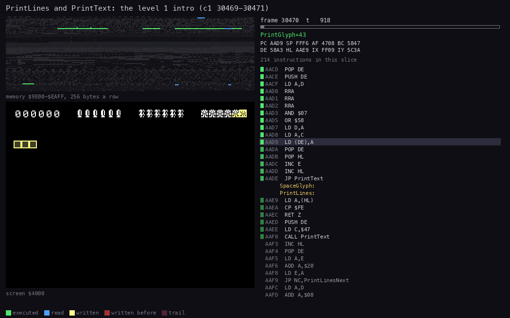

*`c1` from 30 469:70 000 to 30 471:56 000, 70 pictures. Made with `python3 ../../kit/routine_anim.py --work
work/docs/rdA/c1 --window 30469:70000-30471:56000 --view screen --range 9E00-EAFF --pictures 70 --title "PrintLines
and PrintText: the level 1 intro (c1 30469-30471)" --listing build/game.lst --out
docs/img/routines/PrintText.gif`.*

How to read it:

- Left, the screen as the recording has it at each picture.
- Right, the listing around the instruction running, and the memory `$9E00-$EAFF` with the bytes read: the font at
  `$9E95` and the text at `$E4E5`.
- The text appears line by line, from SOUTH AMERICA down to the last question mark.

**The point**: the intro is printed over about two frames, line by line, while the music already plays; nothing
waits for the beam.

**Worked example: the credits' year.** CreditsText `$EA51` holds, after `PRESS FIRE TO START` and two `$FF`, the bytes
`$43 $20 $38 $40 $3F $40`.

| Byte | - `$37` | Glyph | Font address | Shows |
| --- | --- | --- | --- | --- |
| `$43` | 12 | 12 | `$9E95` + 96 = `$9EF5` | C |
| `$20` | (space) | - | SpaceGlyph `$AAE1` | blank |
| `$38` | 1 | 1 | `$9E9D` | 1 |
| `$40` | 9 | 9 | `$9EDD` | 9 |
| `$3F` | 8 | 8 | `$9ED5` | 8 |
| `$40` | 9 | 9 | `$9EDD` | 9 |

The line is the menu's "C 1989 CORE DESIGN": a plain C, as the [menu](img/play/menu.png) shows; the font has no
copyright sign.

**Worked example: a line across a third.** The level 1 intro starts at `$40A1` (char row 5, column 1). Its lines go
to `$40C1`, `$40E1`, then E = `$E1` + `$20` = `$01` with a carry, so D = `$40` + 8: the fourth line is at `$4801`,
char row 8, the first row of the middle third.

**Witness.** PrintText runs in `beeper48`, `c1`, `controls`, `ending2`, `gameover`, `l1end` and `level1` (its L1
witness, 4 504 runs in all). The intro in the animation is the text of `src/res/texts/SouthAmericaText.txt`, line for line.

## 8.3 The HUD

The HUD is char row 1 of the screen (`$4020-$403F`): the score and three counters of six cells. Row 0 above it and
the rest of row 1 belong to the play area.

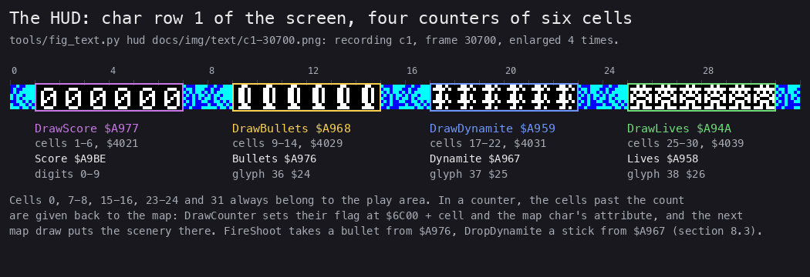

*`c1` frame 30 700, level 1 in play ([the screenshot](img/text/c1-30700.png)). Made with `python3 ../../kit/screen_shot.py --work work/docs/rdA/c1 --out-dir
work/docs/rdA/shots8 play=30700`, then `python3 tools/fig_text.py hud docs/img/text/c1-30700.png
docs/img/text/hud.png`.*

How to read it:

- The strip is char row 1, enlarged 4 times; the numbers above are columns.
- Each frame is a counter: the routine that draws it, its cells and screen address, the variable it shows, the glyph.
- The cells outside the frames show the scenery.

**The point**: the HUD is not a panel. It is 24 cells of the play area that the renderer is told to leave alone.

### The parts

| Cells | Routine | Screen | Variable | Glyph | Attribute |
| --- | --- | --- | --- | --- | --- |
| 1-6 | DrawScore `$A977` | `$4021` | Score `$A9BE`, six digits | the digit | `$47` |
| 9-14 | DrawBullets `$A968` | `$4029` | Bullets `$A976` | 36, a bullet | `$47` |
| 17-22 | DrawDynamite `$A959` | `$4031` | Dynamite `$A967`, the sticks | 37, a stick | `$47` |
| 25-30 | DrawLives `$A94A` | `$4039` | Lives `$A958` | 38, a face | `$47` |

Which byte is which comes from the code, not from the order of the variables:

- FireShoot takes one from `$A976` (`$FA3E`, `$FA4C`) and gives up when it is 0;
- DropDynamite takes one from `$A967` (`$FAA1`, `$FAA7`);
- the counter of `$A976` draws glyph 36, the bullet; the counter of `$A967` draws glyph 37, the stick.

So the bullets come first on the screen (`$4029`) though their byte lies after the sticks' in memory; the
names Bullets, Dynamite, DrawBullets and DrawDynamite follow the code.

### Who draws the row

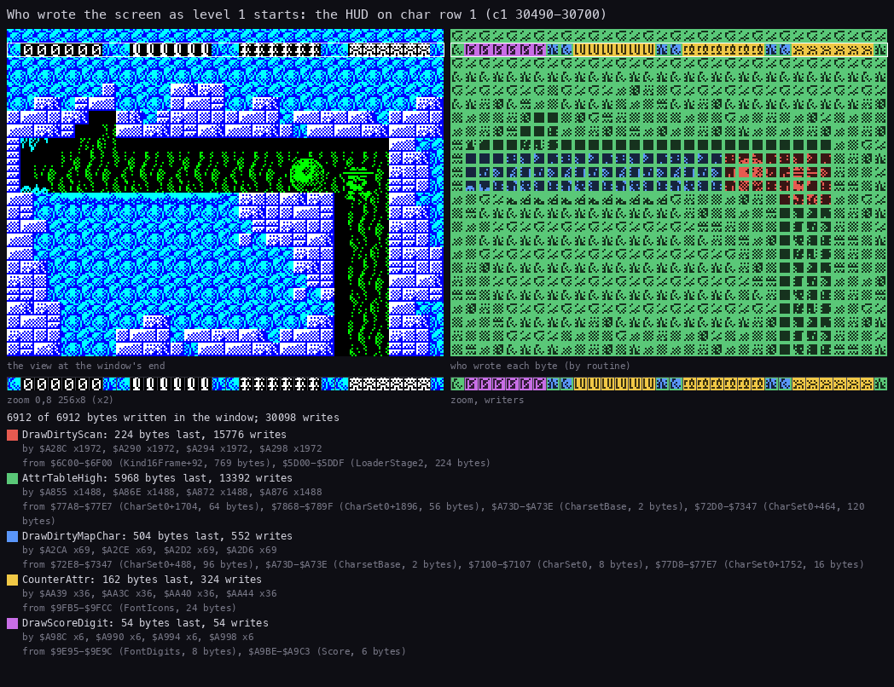

*`c1` from 30 490:0 to 30 700:0. Made with `python3 ../../kit/writers_map.py --work work/docs/rdA/c1 --window
30490:0-30700:0 --listing build/game.lst --view screen --sources --zoom 0,8,256,8 --title "Who wrote the screen as
level 1 starts: the HUD on char row 1 (c1 30490-30700)" --out docs/img/text/hud-writers.png`.*

How to read it:

- Left, the screen at the window's end; right, each byte coloured by the routine that wrote it last.
- The zoom row under them is char row 1, the HUD.
- The legend gives each writer, its instructions and where its bytes came from.

**The point**: two writers own the HUD and nothing else writes there.

- DrawScoreDigit (purple) wrote 54 bytes: 6 digits of 8 pixel rows, and 6 attributes. Its source is FontDigits
  `$9E95-$9E9C` (the 0 glyph: the score is 000000) and Score `$A9BE-$A9C3`.
- CounterAttr (yellow), the loop of DrawCounter, wrote 162 bytes: 18 icons of 8 rows and 18 attributes. Its source
  is FontIcons `$9FB5-$9FCC`, glyphs 36-38.
- The map writers (DrawDirtyScan, DrawAllScan, DrawDirtyMapChar) never
  write a HUD cell. The other cells of row 1 are theirs.

### The cell flags: how the map leaves the HUD alone

The renderer keeps a flag per screen cell at `$6C00` + cell (a byte; row 1 is `$6C20-$6C3F`). A flag of 1 makes the
next DrawDirtyCells `$A25D` draw the map's char there ([doc 6](06-rendering.md)). Two routines keep the HUD's
flags at 0:

- **MaskHudCells** `$A8BF`, called by DrawDirtyCells and DrawAllDirtyCells before they scan, clears the score's six
  flags `$6C21-$6C26`, then as many flags as each counter has icons: from `$6C29`, `$6C31`, `$6C39`.
- **DrawCounter** `$AA0E` sets to 1 the flags of the cells it does not fill, and gives them the map char's
  attribute. The next draw puts the scenery back there.

So a counter that loses an icon gives its cell back to the map in the same pass.

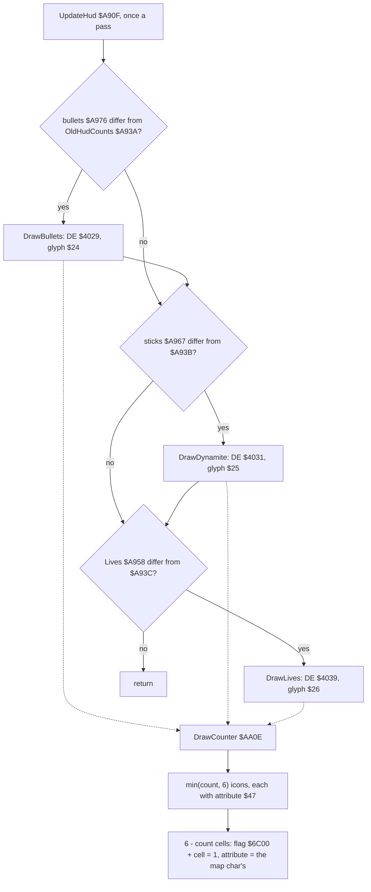

In pseudocode:

```text
UpdateHud:                                   ; MainLoop $E422, GameOver, LevelEnd $ABF3
    for (var, old, draw) in ((Bullets  $A976, $A93A, DrawBullets),
                             (Dynamite $A967, $A93B, DrawDynamite),
                             (Lives   $A958, $A93C, DrawLives)):
        if var != old: old = var; draw()
DrawCounter(A = count, DE = screen, L = glyph, H = attribute):
    attr = $5800 + third(D) * 256 + E
    n = min(count, 6)
    for i in 0..n-1: attr[i] = H; screen cell DE + i = Font[glyph]
    for i in n..5:   flags[$6C00 + E + i] = 1
                     attr[i] = CharAttr[mapchar[$6600 + E + i]]   ; table $79xx or $82xx
```

The code that gives a cell back (`$AA64-$AA8C`):

```asm
DrawCounterRest:
  POP HL              ; H = the count drawn (the saved AF)
  LD A,$06
  SUB H
  RET Z               ; six icons: nothing to give back
  PUSH AF
  LD A,B
  ADD A,$0E           ; $58 + $0E = $66: the map chars at $6600 + cell
  LD H,A
  LD L,C
  LD A,B
  ADD A,$14           ; $58 + $14 = $6C: the cell flags
  LD D,A
  LD E,C
  POP AF
DrawCounterRestLoop:
  PUSH AF
  LD A,($6B00)        ; read, then A is reloaded: no effect
  AND A
  LD A,$01
  LD (DE),A           ; flag 1: the map draws this cell
  PUSH DE
  LD E,(HL)           ; the map's char here
CounterAttrTableHigh:
  LD D,$79            ; $79 (set 0) or $82 (set 1), patched by LoadScreen
  LD A,(DE)           ; that char's attribute
  LD (BC),A
  POP DE
  INC DE
  INC HL
  INC BC
  POP AF
  DEC A
  JP NZ,DrawCounterRestLoop
  RET
```

DrawCounter shows at most 6 icons: a count of 7 or more is drawn as 6. The game never gives more than 6
([doc 10](10-gameplay-logic.md)). DrawHud `$A93D` draws all four parts at a new game and at a new life;
UpdateHud draws a counter only when it changed. The score is drawn by AddScore, which ends in a jump to DrawScore.

The cost, counted from the listing: UpdateHud with nothing changed is about 176 T-states with its call; one icon is
about 330 T-states; a full counter about 2 100 and the score about 2 200. A shot that costs a bullet redraws one
counter: about 2 000 T-states in that pass.

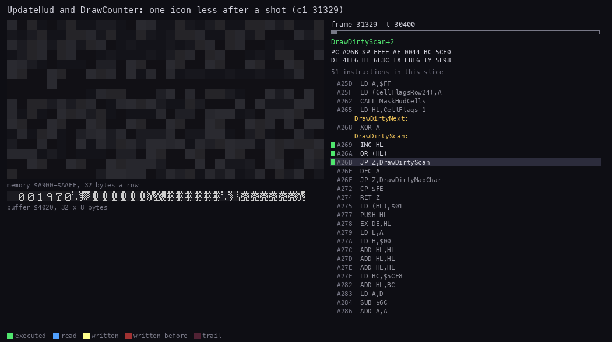

*`c1` from 31 329:30 000 to 31 329:50 000, 50 pictures. Made with `python3 ../../kit/routine_anim.py --work
work/docs/rdA/c1 --window 31329:30000-31329:50000 --view buffer:4020:32x8:screen --range A900-AAFF --pictures 50
--title "UpdateHud and DrawCounter: one icon less after a shot (c1 31329)" --listing build/game.lst --out
docs/img/routines/UpdateHud.gif`.*

How to read it:

- Left, char row 1 of the screen (`$4020`, 32 cells) as it is at each picture.
- Right, the listing at the running instruction and the memory `$A900-$AAFF`: the counters, OldHudCounts, the score.
- The bullets' counter is drawn again with five icons; its sixth cell keeps the bullet until the map's next draw.

**The point**: only the counter that changed is drawn, and the cell it gives up is handed to the map, not cleared.

**Worked example: one bullet less, `c1` 31 329.** FireShoot ran at 31 326:38 121 and left `$A976` = 5
([doc 10](10-gameplay-logic.md)). At 31 329 UpdateHud finds OldHudCounts `$A93A` = 6, so it calls DrawBullets.

1. DrawBullets: DE = `$4029`, L = `$24`, H = `$47`, A = 5.
2. DrawCounter: the attribute address is B = (`$40` >> 3) AND 3 OR `$58` = `$58`, C = `$29`: BC = `$5829`.
3. The glyph is `$9E95` + 8 x `$24` = `$9FB5`, the bullet. It is drawn at `$4029`-`$402D`, attributes `$5829`-`$582D`
   = `$47`.
4. The rest: 6 - 5 = 1 cell, cell `$2E` (row 1, column 14). The flag `$6C2E` = 1. The attribute `$582E` = the
   attribute in `$79xx` of the map char at `$662E`.
5. At the next scan MaskHudCells clears only five flags from `$6C29`, so DrawDirtyCells draws column 14 from the map.

The two screens around it:

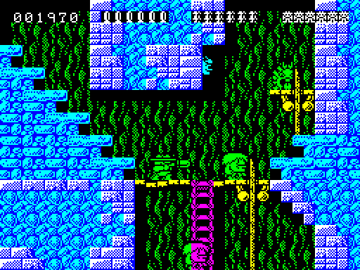

*`c1` 31 329:30 000: six bullets in cells 9-14. `python3 ../../kit/screen_shot.py --work work/docs/rdA/c1 --out-dir
work/docs/rdA/shots8 hudA=31329:30000`.*

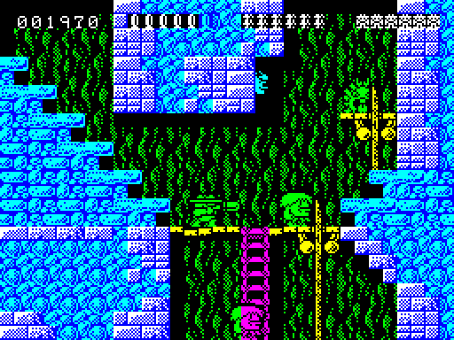

*`c1` 31 330: five bullets. Cell 14 still holds the bullet's pixels, now in the map char's colours: DrawCounter
gave the cell its attribute, and the map has not drawn its char there yet. Same command, `hudB=31330`.*

**Witness.** UpdateHud runs 42 930 times over all the recordings (its L1 witness), DrawCounter 1 176. The two
screens above show the counter before and after.

## 8.4 The score

Score `$A9BE-$A9C3` is six decimal digits, a byte each, the highest first. A new game clears it (`$E2FC-$E305`).
The image holds 0 9 3 0 0 0, a value left from the build.

**AddScore** `$A9E8` adds a five-digit award. DE points at the award's units digit; the five digits are added to the
score's last five, from the units up, with a carry. The carry then goes into the first digit, which wraps from 9
to 0. It ends with a jump to DrawScore.

The awards are five-byte numbers next to the score:

| Award | Address | Digits | Added by |
| --- | --- | --- | --- |
| Award1 | `$A9C5` | 00001 | no reader |
| Award10 | `$A9CA` | 00010 | no reader |
| Award50 | `$A9CF` | 00050 | an enemy killed (`$F18D`) |
| Award100 | `$A9D4` | 00100 | no reader |
| Award500 | `$A9D9` | 00500 | a treasure (`$EDF3`) |
| Award1000 | `$A9DE` | 01000 | no reader |
| LevelBonus | `$A9E3` | (Lives + 1) 0 0 0 0 | the end of the game (`$AC2F`-`$AC35`) |
| the bonus | `$E49A` | what is left of 2000 | BonusCollect (`$F52C`) |

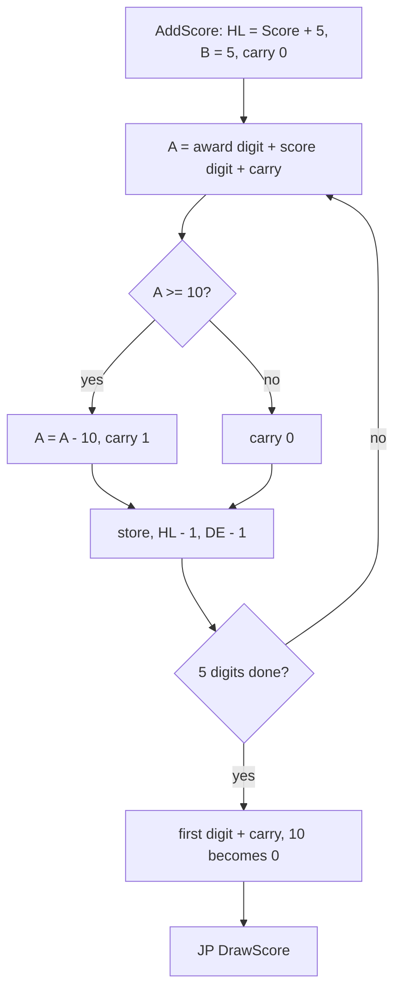

```text
AddScore(DE = award's units digit):
    carry = 0
    for i in 5..1:                         ; Score+5 down to Score+1
        a = Score[i] + award[...] + carry
        carry = a >= 10; Score[i] = a - 10 if carry else a
    Score[0] = (Score[0] + carry) mod 10   ; 999 999 + 1 gives 000 000
    DrawScore()
```

```asm
AddScoreDigit:
  LD A,(DE)
  ADC A,(HL)          ; award digit + score digit + carry
  CP $0A
  JP NC,AddScoreCarry
  OR A                ; carry 0
AddScoreStore:
  LD (HL),A
  DEC HL
  DEC DE
  DJNZ AddScoreDigit
  ...
AddScoreCarry:
  SUB $0A             ; digit - 10, carry 1
  SCF
  JP AddScoreStore
```

**Worked example: the bonus, `level1` frame 755.** The bonus count holds 0 1 9 2 0 when Rick takes it
([doc 10](10-gameplay-logic.md#108-the-bonus-and-the-score)); the score is 000050.

| Digit | Score | Award | Carry in | Result |
| --- | --- | --- | --- | --- |
| units | 0 | 0 | 0 | 0 |
| tens | 5 | 2 | 0 | 7 |
| hundreds | 0 | 9 | 0 | 9 |
| thousands | 0 | 1 | 0 | 1 |
| ten thousands | 0 | 0 | 0 | 0 |
| hundred thousands | 0 | - | 0 | 0 |

The score becomes 001970, as the HUD shows from frame 755 ([doc 10](10-gameplay-logic.md)).

**Worked example: the end bonus, `ending2`.** At the closing text LevelEnd stores Lives + 1 = 7 in LevelBonus's
first digit and adds 7 0 0 0 0: the score goes from 000000 at frame 250 to 070000 at frame 500.

**Witness.** AddScore runs 38 times over the recordings (`c1`, `ending2`, `L1Z3`, `L2Z6`, `L3Z2`, `L3Z6`, `L3Z11`,
`L3Z12`, `L4Z2`, `level1`, `level2`, `level4`). The score rows of `level1` (8.4) and `ending2` show its result.

## 8.5 The texts

Ten texts sit in two places: GAME OVER's two at `$E397-$E3AE`, the others at `$E4E5-$EA8D`. Each is a file in
`src/res/texts`, turned into bytes by `tools/res_texts.py`.

| Text | Address | Bytes | Printed by | At | Seen |
| --- | --- | --- | --- | --- | --- |
| TitleText | `$E9FB` | 32 | PrintLines, Menu `$E219` | `$4041`, row 2 | `c1` 30 250 |
| ControlsText | `$EA1B` | 54 | PrintLines, Menu | `$40EA`, rows 7-13 | `c1` 30 250 |
| CreditsText | `$EA51` | 61 | PrintLines, Menu | `$5047`, rows 18-22 | `c1` 30 250 |
| SouthAmericaText | `$E4E5` | 279 | PrintLines, LevelIntro `$E311` | `$40A1`, row 5 | `c1` 30 500 |
| EgyptText | `$E5FC` | 270 | PrintLines, LevelEnd `$AC1A` | `$40E1`, row 7 | `level2` 0 |
| CastleText | `$E70A` | 260 | PrintLines, LevelEnd | `$40E1` | `level3` 0 |
| MissileBaseText | `$E80E` | 235 | PrintLines, LevelEnd | `$40E1` | `level4` 0 |
| LondonText | `$E8F9` | 258 | PrintLines, LevelEnd | `$40E1` | `ending` 250 |
| GameOverBlankText | `$E397` | 12 | PrintText, GameOver `$E35D` | `$484B`, `$488B` | `gameover` 2 500 |
| GameOverText | `$E3A3` | 12 | PrintText, GameOver | `$486B` | `gameover` 2 500 |

The intro's text pointer, screen address and an attribute come from LevelTable `$E4AE`, 11 bytes a level
([doc 7](07-objects.md#71-the-level-data-byte-by-byte)). The attribute goes to `$7900`, the attribute of map char
0 in set 0.

### The menu

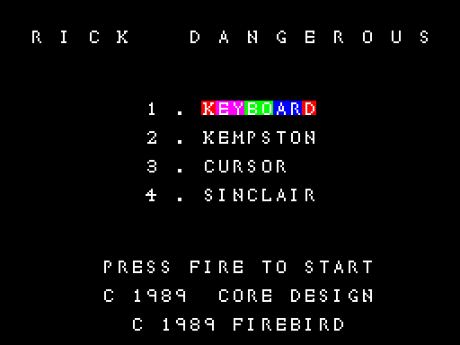

*`c1` frame 30 250 (WALKTHROUGH 6.1).*

How to read it:

- The title in spaced letters on row 2; the four methods on rows 7, 9, 11 and 13; the credits on rows 18-22.
- The chosen method's word is coloured: its paper cycles through blue, red, magenta and green.

**The point**: the menu is three PrintLines calls on a cleared screen, and one attribute cycle.

The title is spaced in the text itself: `" R I C K    D A N G E R O U S "`. Empty lines are texts of just `$FF`.

**CycleAttributes** `$AB18` colours A cells from DE with a table of 8 attributes. Its phase CyclePhase `$AB3C` moves
on by one per call, and cell i gets table[(phase + i) AND 7]. The menu calls it once a pass, two HALTs, so the
colours move one cell every 2 frames.

| Table | Address | Bytes |
| --- | --- | --- |
| CycleColours | `$AB3D` | `$4F $4F $57 $57 $5F $5F $67 $67`: bright white on blue, red, magenta, green |
| PlainColours | `$AB45` | `$47` eight times |

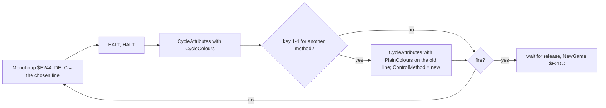

```text
CycleAttributes(A = cells, HL = table, DE = first attribute):
    CyclePhase = (CyclePhase + 1) AND 7
    for i in 0..A-1: attr[DE + i] = table[(CyclePhase + i) AND 7]
```

The chosen lines' attribute rows, with their widths: keyboard `$58EE`, 8; Kempston `$592E`, 8; cursor `$596E`, 6;
Sinclair `$59AE`, 8. Each is the method's word, from column 14.

**Worked example.** With phase 3 after the call, the 8 cells of KEYBOARD get table[3..7, 0..2] =
`$57 $5F $5F $67 $67 $4F $4F $57`: K red, E Y magenta, B O green, A R blue, D red. The [menu](img/play/menu.png) shows the same
order, from one phase.

The menu's key handling and the method choice are in [doc 5](05-controls.md).

### The level intros

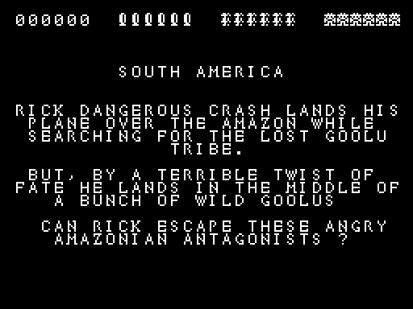

*`c1` frame 30 500 (WALKTHROUGH 6.1).*

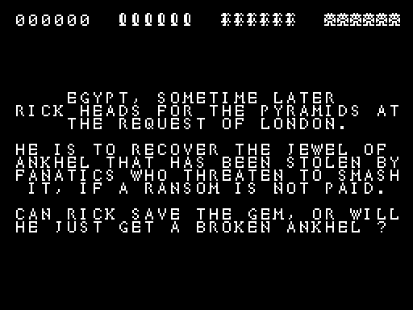

*`level2` frame 0, the warp state.*

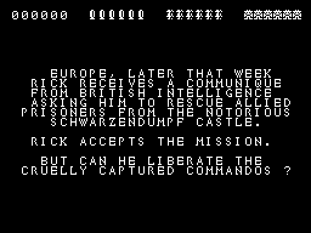

*`level3` frame 0, the warp state.*

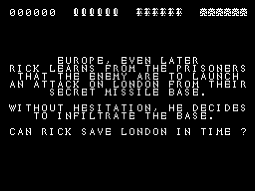

*`level4` frame 0, the warp state.*

How to read them:

- Row 1 is the HUD, drawn before the text: at a new game it shows 000000 and six of each counter.
- The text is white on black (`$47`), printed by PrintLines from LevelTable's screen address.

**The point**: an intro is a cleared play area with the HUD kept, a text and a tune; fire starts the level.

The first intro comes from NewGame: ClearScreen, the HUD, then LevelIntro `$E311` prints record 0's text and plays
tune 0. Later intros come from LevelEnd (`$ABF6` on): Level `$E4AD` goes up by one, `$AC07` picks record Level,
prints it and plays tune Level (1-4). Both wait for fire to be let go, then pressed.

### The ending

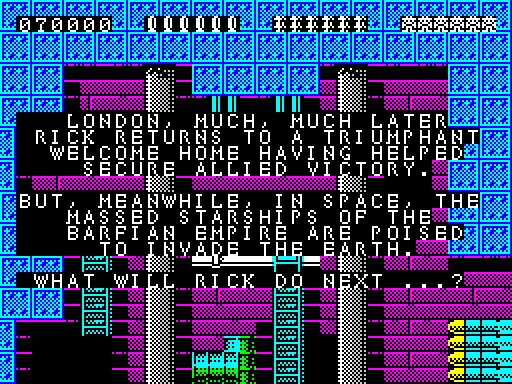

*`ending` frame 250 (WALKTHROUGH 6.1).*

The closing text is LevelTable's record 4. It is printed by the same path as an intro, with tune 4. One thing
differs: with Level = 4, LevelEnd adds the end bonus (8.4) before it waits for fire. Then CheckGameComplete `$E406`
jumps to GameOver.

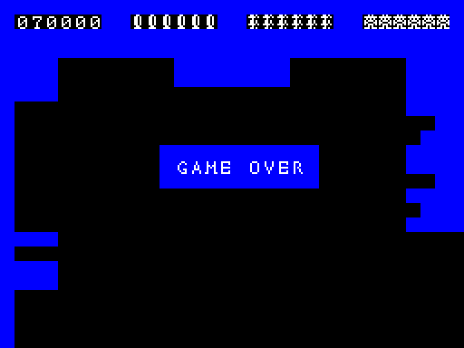

*`ending` frame 500.*

### GAME OVER

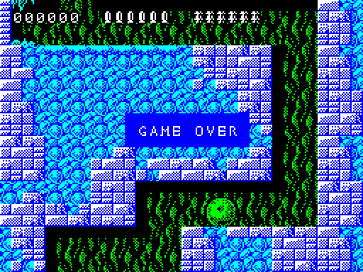

*`gameover` frame 2 500 (WALKTHROUGH 6.1).*

How to read it:

- A band of three rows over the play area, columns 11-21: blue, then GAME OVER in white on blue, then blue.
- The lives' counter is empty: its six cells show the scenery.

**The point**: GAME OVER is printed over the last scene, not on a cleared screen.

GameOver `$E35D` first calls UpdateHud and DrawDirtyCells, so the HUD shows the last life gone. Then it prints three
texts of 11 cells with PrintText:

| Screen | Text | Attribute |
| --- | --- | --- |
| `$484B`, row 10, column 11 | GameOverBlankText, 11 spaces | `$49`: blue ink on blue paper |
| `$486B`, row 11 | GameOverText, " GAME OVER " | `$4F`: bright white on blue |
| `$488B`, row 12 | GameOverBlankText | `$49` |

It plays tune 6, waits until fire is let go and pressed, and jumps to Menu `$E219`. The Q key in play reaches the same
code through Quit `$E35A` ([quit picture](img/play/quit-game-over.png), `c1` 33 250).

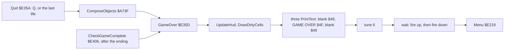

```text
Quit:                                  ; $E35A
    ComposeObjects()                   ; then falls into GameOver
GameOver:                              ; $E35D
    UpdateHud(); DrawDirtyCells()
    PrintText(GameOverBlankText, $484B, $49)
    PrintText(GameOverText,      $486B, $4F)
    PrintText(GameOverBlankText, $488B, $49)
    StartTune(6)
    wait until fire is up; wait until fire is down
    goto Menu
```

```asm
Quit:
  CALL ComposeObjects     ; $E35A, falls through
GameOver:
  CALL UpdateHud
  CALL DrawDirtyCells
  LD DE,$484B
  LD HL,GameOverBlankText
  LD C,$49
  CALL PrintText
  LD DE,$486B
  LD HL,GameOverText
  LD C,$4F
  CALL PrintText
  LD DE,$488B
  LD HL,GameOverBlankText
  LD C,$49
  CALL PrintText
  LD A,$06
  CALL StartTune
```

**Worked example.** `$486B`: D = `$48` is the middle third, E = `$6B` = 3 x 32 + 11, so row 8 + 3 = 11, column 11.
PrintText's attribute address is (`$48` >> 3) AND 7 OR `$58` = `$59`, so `$596B`. The text has 11 bytes before its
`$FF`, so it covers columns 11-21: the band in the picture.

**Witness.** GameOver runs in `c1` (Q), `controls` (Q after each method), `gameover` and `level1` (six deaths), and
after the closing text in `ending`.

## 8.6 Known only from the code

- **MaskHudCells writes to the ROM.** With the bullets `$A976` at 0, the `JP Z` at `$A8CF` jumps into the clearing
  loop with HL = 0 and B as the caller left it, so it writes zeros at `$0000` onwards up to 256 times. The ROM
  ignores the writes. With the sticks or the lives at 0 the code skips properly. Seen in `emptygun` (the `L1Z1`
  zone warp, a patch on a clone): from the sixth shot at frame 420, 139 of MaskHudCells' 350 runs take the `JP Z`
  with HL = 0 (MaskBullets `$A8D9` runs 211 times).
- **The awards Award1, Award10, Award100 and Award1000** have no reader in the code.
- **ScorePad** `$A9C4` (`$FF`) follows the units digit and is never read.
- **DrawCounter's** `LD A,($6B00)` / `AND A` at `$AA76` has no effect: A is loaded again at once and the flags are not
  tested.
- **A count above 6** is drawn as 6 icons; no recording has one, and the game never gives more than 6.
- **Glyph 42**, the blank, is never printed: spaces use SpaceGlyph `$AAE1`.
- **Menu's first `LD DE,$780A`** at `$E229` is overwritten at once by `LD DE,$40EA`.
- **The score's top digit** wraps from 9 to 0 at 1 000 000; no recording comes near.
