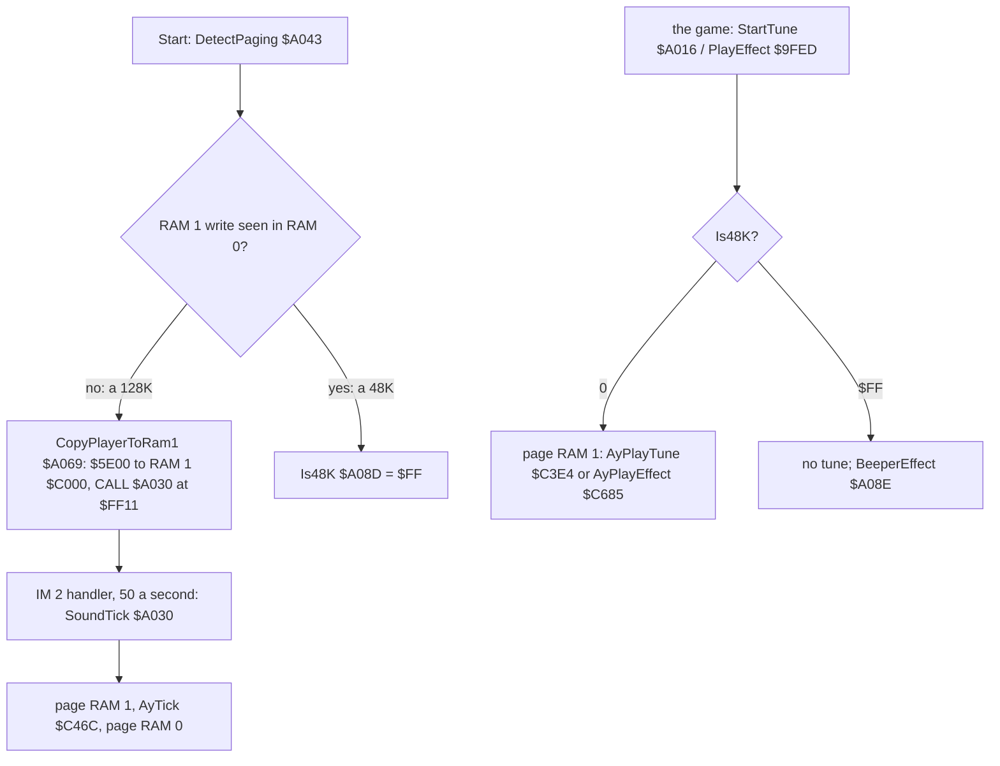
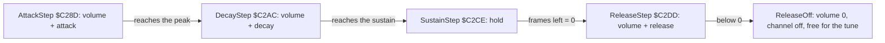
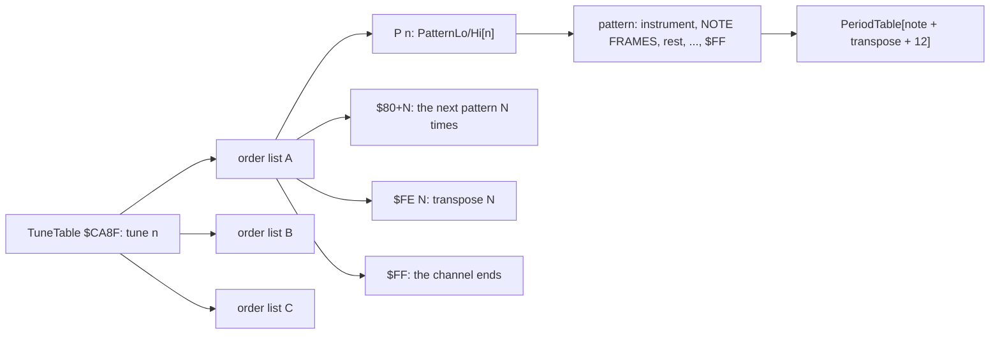
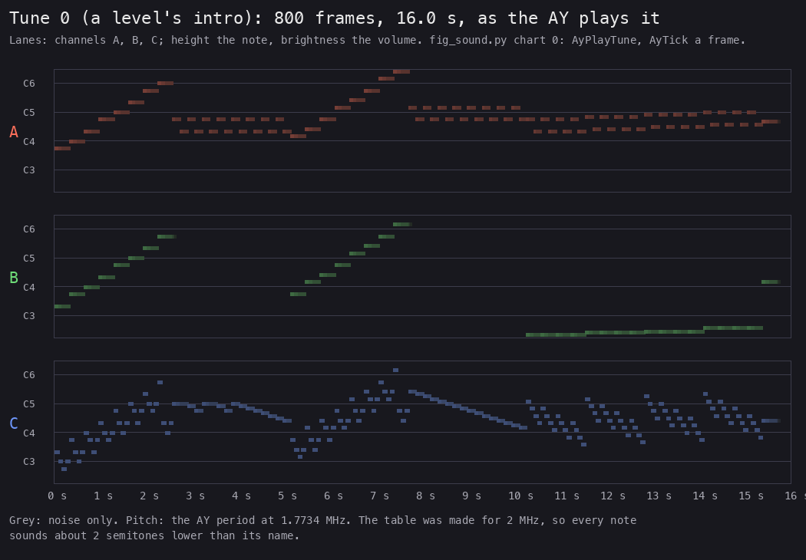
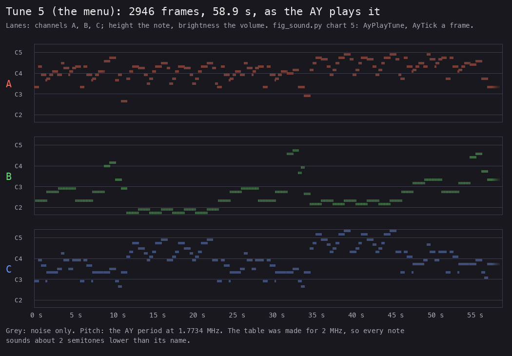
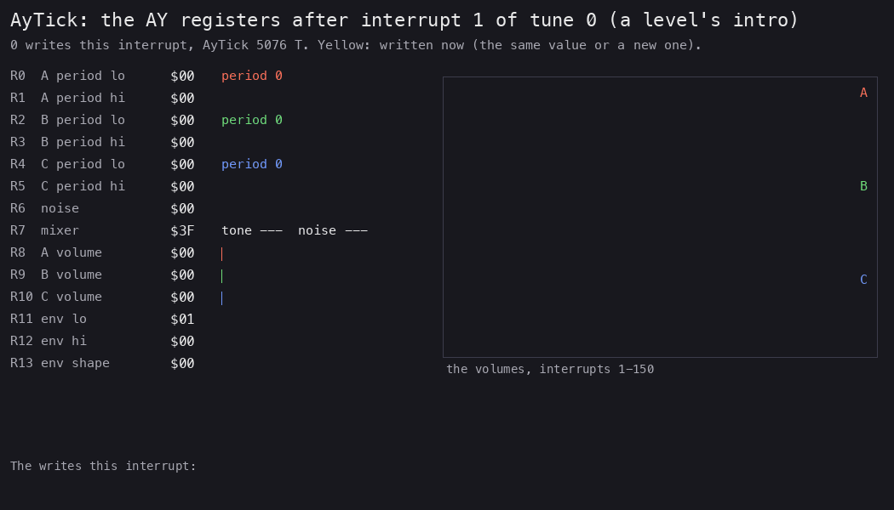
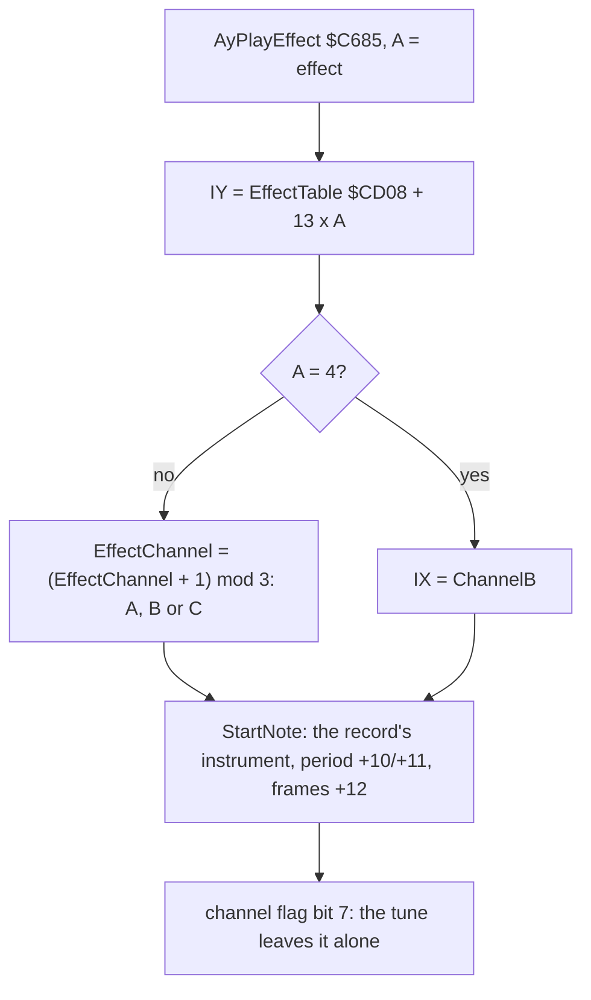
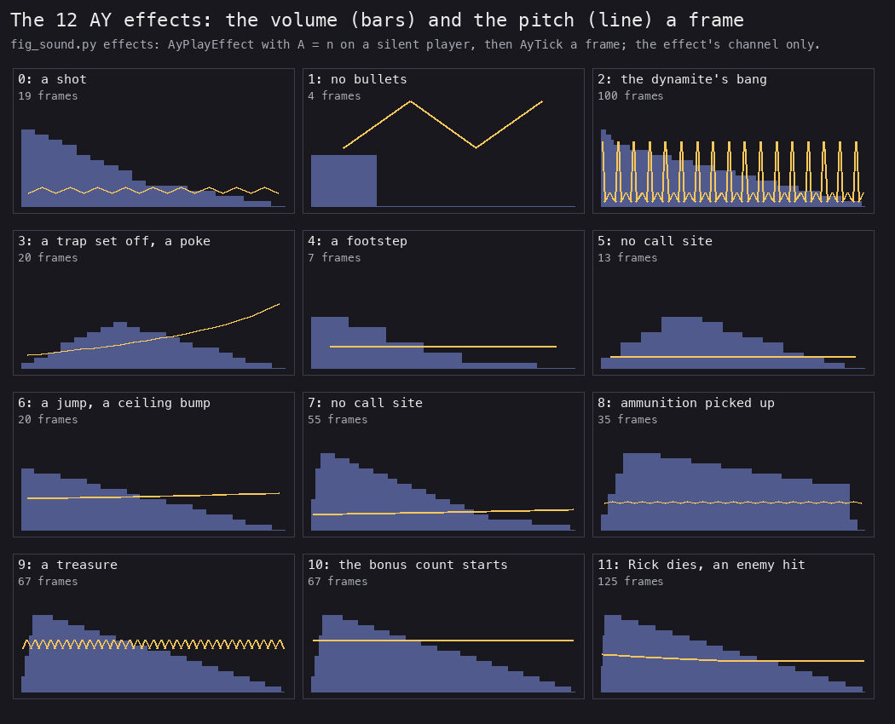
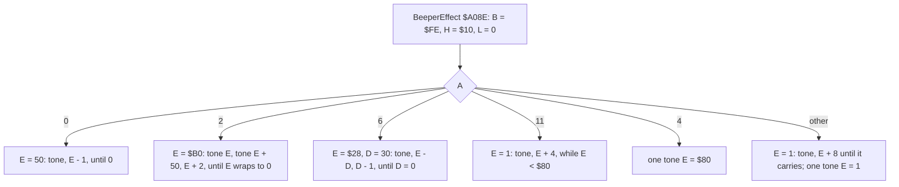
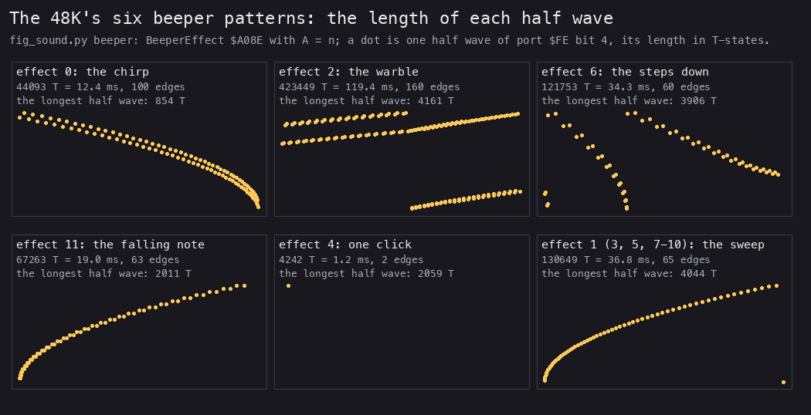

# 9. Sound

What this covers:

- the two engines: the AY player in RAM 1 on a 128K, the beeper on a 48K, and how the game picks one;
- the AY player: the channel records, the software volume envelope, the once-a-frame tick;
- the music format: the tune table, the order lists, the patterns, the period table; one pattern decoded by hand;
- the eight tunes and the twelve effects, each decoded and rendered, with its cost;
- the 48K's beeper effects: six patterns of square waves;
- what is known only from the code.

The recordings it rests on:

| Recording | Load | Used for |
| --- | --- | --- |
| `c1` | power-on, the original TZX at ROM speed (128K) | the player copied and hooked; tunes 5 and 0; SoundTick 14 301 runs |
| `controls`, `gameover`, `level1`-`level4`, `ending`, `ending2`, `L1Z4` | the original TZX or the warps (128K) | the tunes and effects as the game calls them (the witness counts) |
| `beeper48` | the original loaded on a 48K (`work/stage2/beeper48`) | the 48K path: Is48K `$FF`, 98 beeper effects, all six branches |

The sounds themselves are not taken from the recordings. `tools/fig_sound.py` runs the built player (`build/music.bin`)
and the beeper routine (`build/game.bin`) on SkoolKit's Z80 simulator, the way the game calls them, and logs every
port write. The charts, the WAV and MP3 files and the costs below come from that run. Nothing was played.

## 9.1 Two engines

The game finds out at the start whether the machine can page memory, and picks an engine:

- **128K**: DetectPaging `$A043` writes to `$C000` with RAM 1 paged in and reads it back with RAM 0. The byte is
  unchanged, so the machine pages. CopyPlayerToRam1 `$A069` copies `$0DA4` bytes from `$5E00` to `$C000` in RAM 1.
  It then writes `CALL SoundTick` over three NOPs at `$FF11` in the interrupt handler.
- **48K**: the byte changed: there is one RAM. Set48K puts the byte back and sets Is48K `$A08D` = `$FF`. The
  handler's slot stays three NOPs; there is no music; effects go to the beeper.



The three entries of the game, in the 48K's `$A000` area:

| Entry | What it does on a 128K | On a 48K |
| --- | --- | --- |
| PlayEffect `$9FED` | DI, OUT `$7FFD` = 1, AyPlayEffect `$C685`, OUT `$7FFD` = 0, EI | BeeperEffect `$A08E` |
| StartTune `$A016` | DI, page RAM 1, AyPlayTune `$C3E4`, page RAM 0, EI | returns at once |
| SoundTick `$A030` | DI, page RAM 1, AyTick `$C46C`, page RAM 0, EI | never called |

```asm
SoundTick:
  DI
  LD A,$01
  LD BC,$7FFD
  OUT (C),A           ; RAM 1 at $C000
  CALL AyTick
  XOR A
  LD BC,$7FFD
  OUT (C),A           ; RAM 0 back
  EI
  RET
```

**Worked example.** `c1` ran SoundTick 14 301 times in its 33 400 frames: from the copy during the load on, once an
interrupt. `beeper48`'s start state has Is48K = `$FF` and three NOPs at `$FF11`.

**Witness.** DetectPaging and CopyPlayerToRam1 run once in `c1`. Set48K runs in no recording: `beeper48` starts
after the load, with Is48K already `$FF`.

## 9.2 The AY player

The player keeps a record of 18 bytes for each AY channel: ChannelA `$C0AB`, ChannelB `$C0BD`, ChannelC `$C0CF`.

| Offset | What |
| --- | --- |
| +0, +1, +2 | the masks for register 7: tone on, noise on, both off |
| +3/+4 | the note's period |
| +5 | the volume, 0-255 (the AY gets it / 8) |
| +6 | the frames left (0 released, `$FF` held) |
| +7, +8 | the vibrato delay and the steps left |
| +9/+10, +11/+12 | the offset added to the period, and its step a frame |
| +13/+14 | the envelope phase routine |
| +15/+16 | the instrument |
| +17 | the instrument's flags; bit 7 set while an effect owns the channel |

MixerShadow `$C0AA` is register 7 as last written. While its six low bits are all set nothing sounds.

**StartNote** `$C0E2` loads a channel from a 10-byte instrument, a period and a duration. It turns the channel's tone
and/or noise on in MixerShadow and sets the phase to AttackStep.

**AyTick** `$C46C` runs once an interrupt. It calls UpdateAy `$C19F`, which returns at once while every channel is off
(MixerShadow AND `$3F` = `$3F`); otherwise it steps the three channels and writes AY registers 7, 0-6 and 8-10.
Then, while a tune plays (MusicOn `$C35A` not 0), it steps the three tracks with TrackStep `$C4B4`.

The volume envelope is in software; the AY's own envelope is never used. SilenceAll `$C15E`, called by AyPlayTune
`$C3E4` before each tune, writes R11 = 1 and R12 = R13 = 0 (`$C17B-$C187`); no volume reaches bit 4 (the largest is
127 / 8 = 15), so the envelope is never selected and R11 has no effect. ChannelStep `$C25B` counts the duration down,
moves the vibrato, and jumps to the channel's phase routine:



```text
each frame, for each channel that sounds:
    if 0 < frames_left < $FF: frames_left -= 1
    VibratoStep()                                ; period offset += step after the delay
    phase():
        Attack:  v += attack;  if v >= peak:    v = peak;    phase = Decay
        Decay:   v += decay;   if v < sustain:  v = sustain; phase = Sustain
        Sustain: if frames_left == 0:           phase = Release
        Release: v += release; if v < 0:        v = 0; channel off; effect flag off
UpdateAy: AY volume = v / 8; AY period = period + offset
```

```asm
AttackStep:
  LD A,(IX+$05)       ; the volume
  ADD A,(IY+$00)      ; + the attack step
  CP (IY+$04)         ; the peak
  JR NC,AttackPeak
  LD (IX+$05),A
  RET
AttackPeak:
  LD A,(IY+$04)
  LD (IX+$05),A
  LD HL,DecayStep     ; the next phase
  LD (IX+$0D),L
  LD (IX+$0E),H
  RET
```

**Worked example: one note of instrument 0.** Instrument 0 is attack 127, decay -2, sustain 32, release -8, peak 54,
tone. Its 10 bytes at `$CCB8` are `$7F $FE $20 $F8 $36 $FF $00 $00 $00 $01`.

| Frame | Phase | Volume | AY volume (/ 8) |
| --- | --- | --- | --- |
| 1 | attack: 0 + 127 is past 54 | 54 | 6 |
| 2-4 | decay | 52, 50, 48 | 6 |
| 5-8 | decay | 46, 44, 42, 40 | 5 |
| 9-12 | decay | 38, 36, 34, 32 | 4 |
| 13-16 | sustain | 32 | 4 |

The simulator's register log of tune 0, channel A, gives the same: volume 6 for frames 1-4, 5 for 5-8, 4 for 9-16.
At frame 17 the next note starts at 6 again.

The cost, from the simulator: AyTick takes 1 000-6 600 T-states a frame while a tune plays, a median of about
3 500-3 900 (5 % of the 128K's 70 908). With only an effect sounding, about 2 200-2 700. The SoundTick wrapper adds
about 90.

**Witness.** AyTick runs 47 434 times in the recordings (its L1 witness), ChannelStep 99 282, AttackStep 6 357,
DecayStep 37 089, SustainStep 15 122, ReleaseStep 7 788.

## 9.3 The music format

All the music data is in RAM 1 after the player. It is kept as one editable text, `src/res/music/music.txt`
([its README](../src/res/music/README.md) gives the format line by line).

| Table | Address | What |
| --- | --- | --- |
| PeriodTable | `$C000` | 85 tone periods by semitones, from C-1 (the resource `src/res/music/periods.txt`) |
| Patterns | `$C6E5-$CA8E` | 55 patterns |
| TuneTable | `$CA8F-$CABE` | 8 tunes x 3 order list pointers (channels A, B, C) |
| OrderLists | `$CABF-$CC49` | 24 order lists |
| PatternLo, PatternHi | `$CC4A-$CCB7` | the patterns' addresses |
| Instruments | `$CCB8-$CD07` | 8 instruments of 10 bytes |
| EffectTable | `$CD08-$CDA3` | 12 effects of 13 bytes |



**An order list**: a byte under `$80` plays that pattern; `$80`+N plays the next pattern N times; `$FE` N transposes
the following patterns by N semitones; `$C0`+K V sets instrument slot K (no tune uses it); `$FF` ends the channel.

**A pattern**: `$80`+N selects instrument slot N; a byte under `$7E` is a note, followed by its frames; `$7F` F is
a rest; `$7E` LO HI F is a period given directly (no tune uses it); `$FF` ends the pattern.

**The periods.** The table is 2 000 000 / 16 / f of the equal-tempered scale: an Atari ST's YM2149 at 2 MHz. The
Spectrum's AY runs at 1.7734 MHz, so every note sounds about two semitones lower than its name. Two entries carry a
typo in bit 5 of the low byte: index 20 (G#2) is 1 236 (`$04D4`), not 1 204, and index 24 (C-3) is 988 (`$03DC`),
not 956; those two notes are about half a semitone flat. The index 20 typo is heard: tune 0, the level intro, plays
period 1 236 on channel B from frame 641 (about 13 s), and tune 2 on channel B from its first frame (the simulator,
`fig_sound.ay_run`, tunes 0-7). No tune plays index 24. The last entry, 84, is 24, not 30.

**Worked example: tune 0, pattern 0, by hand.** TuneTable's first entry gives channel A's order list at `$CABF`:

```text
$CABF: 00 88 04 FE 05 00 88 04 FE 00 84 04 FE 01 84 04 ...
        P0 x8 P4 t+5 P0 x8 P4 t+0 x4 P4 t+1 x4 P4 ...
```

So channel A plays pattern 0 once, pattern 4 eight times, then the same a fourth higher (+5), then pattern 4 rising a
semitone each four times. Pattern 0 is at PatternLo/Hi[0] = `$C6E5`:

```text
$C6E5: 80 17 10 1A 10 1E 10 23 10 26 10 2A 10 2F 10 32 10 FF
```

| Bytes | Meaning | Index (+ 12) | Period | Sounds on the Spectrum |
| --- | --- | --- | --- | --- |
| `80` | instrument slot 0 | | | |
| `17 10` | note `$17`, 16 frames | 35 (B-3) | 506 | 219 Hz, about A3 |
| `1A 10` | note `$1A`, 16 frames | 38 (D-4) | 426 | 260 Hz, about C4 |
| `1E 10` | note `$1E` | 42 (F#4) | 338 | 328 Hz, about E4 |
| `23 10` | note `$23` | 47 (B-4) | 253 | 438 Hz, about A4 |
| `26 10` | note `$26` | 50 (D-5) | 213 | 520 Hz |
| `2A 10` | note `$2A` | 54 (F#5) | 169 | 656 Hz |
| `2F 10` | note `$2F` | 59 (B-5) | 127 | 873 Hz |
| `32 10` | note `$32` | 62 (D-6) | 106 | 1 046 Hz |
| `FF` | the end | | | |

The pitch is 1 773 400 / 16 / period. Pattern 0 is a B minor arpeggio over three octaves as written, an A minor one
as heard: 8 notes of 16 frames, 2.56 seconds. The simulator's log of channel A shows period 506 for frames 1-16 and
426 from frame 17, as the table says.

**Witness.** TrackStep runs 43 833 times in the recordings. The tune numbers read from TuneTable are 0, 5, 6 in
`controls` and `gameover`; 0, 5, 6, 7 in `level1`; 4, 5, 6 in `ending`.

## 9.4 The tunes

| Tune | Called from | When | Frames | Seconds | Recordings | Audio |
| --- | --- | --- | --- | --- | --- | --- |
| 0 | `$E324` LevelIntro | the first intro of a game | 790 | 15.8 | `controls`, `gameover`, `level1` | [tune0.mp3](audio/tune0.mp3) |
| 1 | `$AC20` LevelEnd | level 1 done: under the Egypt intro | 1 142 | 22.8 | `l1end` (from 9:33 543) | [tune1.mp3](audio/tune1.mp3) |
| 2 | `$AC20` | level 2 done: under the castle intro | 571 | 11.4 | none | [tune2.mp3](audio/tune2.mp3) |
| 3 | `$AC20` | level 3 done: under the missile base intro | 1 203 | 24.1 | none | [tune3.mp3](audio/tune3.mp3) |
| 4 | `$AC20` | level 4 done: under the closing text | 778 | 15.6 | `ending`, `ending2` | [tune4.mp3](audio/tune4.mp3) |
| 5 | `$E220` Menu | the menu | 2 936 | 58.7 | `controls`, `gameover`, `level1`, `ending` | [tune5.mp3](audio/tune5.mp3) |
| 6 | `$E386` GameOver | GAME OVER | 298 | 6.0 | `controls`, `gameover`, `level1`, `ending` | [tune6.mp3](audio/tune6.mp3) |
| 7 | `$F531` BonusCollect | the bonus taken | 78 | 1.6 | `level1` | [tune7.mp3](audio/tune7.mp3) |

The frames are those of the simulator until MusicOn falls to 0. A tune does not loop: at its end the channels fall
silent. The MP3 files were made from the logged register writes (`python3 tools/fig_sound.py audio docs/audio`,
through unreal-ng's `psg2wav.py`, then `lame -V 4`).



*From `build/music.bin`, no recording: `python3 tools/fig_sound.py chart 0 docs/img/sound/tune0.png`.*

How to read it:

- One lane per AY channel; time runs right, 50 frames a second.
- A mark's height is the note as heard (the C lines are the octaves at 1.7734 MHz); its brightness is the volume.

**The point**: channels A and B climb the arpeggio of pattern 0 and its copies, channel C plays a running line
under them, and the last part rises by a semitone four times. The whole is a 16-second fanfare for the intro.



*From `build/music.bin`: `python3 tools/fig_sound.py chart 5 docs/img/sound/tune5.png`.*

How to read it: as tune 0. Tune 5 is the longest, 58.7 seconds; its channel B repeats pattern 17 under many
transposes (`x4 P17 t+5 x4 P17 ...`).

**The point**: the menu tune is mostly one short pattern moved about by transposes, which keeps the data small:
the 55 patterns of all eight tunes take 938 bytes and the 24 order lists 395.



*The first 150 interrupts of tune 0, from the simulator: `python3 tools/fig_sound.py anim 0
docs/img/routines/AyTick.gif`.*

How to read it:

- Left, the 14 AY registers after the interrupt; yellow ones were written by this AyTick.
- Beside the periods, the note they sound; beside the volumes, a bar.
- Right, the three volumes over the interrupts so far.

**The point**: while a channel sounds, AyTick writes registers 7, 0-6 and 8-10 every interrupt, changed or not: 11
writes, about 4 000 T-states. With all channels off it writes nothing: of the 47 434 UpdateAy calls, 33 094 did the
full update (SoundHookStart `$C345` ran 33 124 times, 30 of them from SilenceAll), and WriteAy ran 364 244 times, not
11 x 47 434. The
volume curve of each note (6, 5, 4, held) is the software envelope of 9.2.

## 9.5 The effects

**AyPlayEffect** `$C685` takes the effect's 13 bytes at EffectTable + 13 x A: an instrument's 10 bytes, a period and
a duration. It starts them on a channel with StartNote and marks the channel as the effect's (+17 bit 7), so the
tune's notes skip it until the release ends. Effect 4, the footsteps, always takes channel B. The others take the
channels in turn: EffectChannel `$C6E4` goes 1, 2, 0, 1, ... (B, C, A, B, ...).



```text
AyPlayEffect(A):
    IY = EffectTable + 13 * A
    if A == 4: IX = ChannelB
    else: EffectChannel = (EffectChannel + 1) mod 3; IX = Channel[EffectChannel]
    StartNote(IX, instrument = IY, period = IY[10..11], frames = IY[12])
```

```asm
AyPlayEffect:
  ...
  LD E,A
  LD L,A
  LD H,$00
  ADD HL,HL
  ADD HL,HL           ; 4A
  LD C,L
  LD B,H
  ADD HL,HL           ; 8A
  ADD HL,BC           ; 12A
  LD C,A
  LD B,$00
  ADD HL,BC           ; 13A
  LD BC,EffectTable
  ADD HL,BC
  PUSH HL
  POP IY
```



*From `build/music.bin`, each effect on a silent player: `python3 tools/fig_sound.py effects
docs/img/sound/effects.png`.*

How to read it:

- One panel per effect: the bars are the AY volume a frame, the yellow line the pitch (higher is higher).
- For a noise effect the line is the noise period (register 6).

**The point**: the effects are single notes with an envelope and a slide or a vibrato; the long ones (the bang,
a death) are long only because their decay is slow.

| Effect | Sound | Frames | AyTick T | Game call | Witness | Audio |
| --- | --- | --- | --- | --- | --- | --- |
| 0 | noise, a slide | 19 | 2 535 | a shot, `$FA50` | `level3` 7 runs | [effect0.wav](audio/effect0.wav) |
| 1 | noise | 4 | 2 576 | fire with no bullets, `$FA47` | `emptygun` 2 (frames 500, 580) | [effect1.wav](audio/effect1.wav) |
| 2 | noise, a slide | 100 | 2 380 | the dynamite's bang, `$EC93` | `level3` 6 | [effect2.mp3](audio/effect2.mp3) |
| 3 | noise, a slide down | 20 | 2 438 | a trap set off `$EFCB`, a poke `$F9EF` | `level4` 62 | [effect3.wav](audio/effect3.wav) |
| 4 | tone and noise, channel B | 7 | 2 260 | Rick's steps: crawl `$FCB8`, climb `$FD0D`, walk `$FD44` | `level3` 357 | [effect4.wav](audio/effect4.wav) |
| 5 | noise | 13 | 2 260 | none | not executed in any recording | [effect5.wav](audio/effect5.wav) |
| 6 | tone, a slide up after 4 frames | 20 | 2 393 | a jump `$FADB`, a head against a ceiling `$F97D` | `level2` 53, 67 | [effect6.wav](audio/effect6.wav) |
| 7 | tone, a slide up after 3 frames | 55 | 2 393 | none | not executed in any recording | [effect7.mp3](audio/effect7.mp3) |
| 8 | tone, a vibrato | 35 | 2 522 | ammunition picked up, `$ED76` | `L1Z4` once | [effect8.wav](audio/effect8.wav) |
| 9 | tone, a vibrato | 67 | 2 522 | a treasure, `$EDEC` | `level1` 4 | [effect9.mp3](audio/effect9.mp3) |
| 10 | tone, as 9 without vibrato | 67 | 2 247 | the bonus count starts, `$F4FE` | `controls` 7 | [effect10.mp3](audio/effect10.mp3) |
| 11 | tone, a slide that stops | 125 | 2 393 | Rick dies `$FBF4`, an enemy hit `$F17E` | `level4` 29 | [effect11.mp3](audio/effect11.mp3) |

The frames count until the effect's channel is silent; AyTick T is the median of those frames. Effects up to a second are WAV files; the five longer ones (2, 7, 9, 10, 11) are MP3 (`lame -V 4`), from the same
`python3 tools/fig_sound.py audio docs/audio`. AyPlayEffect itself
costs about 1 000 T-states once, in the game's pass.

**Worked example: effect 4, a footstep.** Its record is attack 127, decay -20, sustain 14, release -11, peak 85,
tone and noise, period 952, 1 frame.

| Frame | Phase | Volume | AY volume |
| --- | --- | --- | --- |
| 1 | attack: 0 + 127 is past the peak | 85 | 10 |
| 2-4 | decay, -20 a frame | 65, 45, 25 | 8, 5, 3 |
| 5 | decay: 5 is below the sustain | 14 | 1 |
| 6 | sustain: the frame is over, so release next | 14 | 1 |
| 7 | release: 14 - 11 | 3 | 0 |
| 8 | release: below 0, the channel off | 0 | 0 |

The simulator's log of channel B gives 10, 8, 5, 3, 1, 1, 0: the staircase of the panel. With period 952 the tone is
1 773 400 / 16 / 952 = 116 Hz, mixed with noise of period 23.

## 9.6 The 48K beeper

On a 48K, PlayEffect calls **BeeperEffect** `$A08E`. It plays square waves on port `$FE` bit 4 and does nothing else
while it plays: the game stops for the effect's length. BeeperTone `$A0F6` is one wave: OUT L = `$00` (speaker low,
border black), wait E loops, OUT H = `$10` (speaker high), wait E loops (BeeperEffect sets HL = `$1000`). A wait of E loops is about 16 x E T-states.

Six patterns, chosen by the effect number:

| Effect | Pattern | E sequence | Edges | Length | Game event |
| --- | --- | --- | --- | --- | --- |
| 0 | the chirp | 50 tones, E = 50 down to 1 (rising pitch) | 100 | 44 093 T, 0.62 frames | a shot |
| 2 | the warble | E and E + 50 in turn, E from `$B0` by 2 until it wraps: 80 tones | 160 | 423 449 T, 5.97 frames | the bang |
| 6 | the steps down | 30 tones from `$28`, E - 30, - 29, ... modulo 256 | 60 | 121 753 T, 1.72 frames | a jump, a head against a ceiling |
| 11 | the falling note | E = 1, 5, ... `$7D`: 32 tones | 63 | 67 263 T, 0.95 frames | Rick dies, an enemy hit |
| 4 | one click | one tone, E = `$80` | 2 | 4 242 T, 0.06 frames | a footstep |
| any other | the sweep | E = 1, 9, ... `$F9`, then one tone of E = 1 | 65 for 1, 3, 9; 66 for 8, 10 | 130 649 T, 1.84 frames | 1, 3, 8, 9, 10 |



```text
BeeperTone(E):                         ; one square wave
    OUT ($FE), $00;  wait E loops       ; L: speaker low
    OUT ($FE), $10;  wait E loops       ; H: speaker high
the sweep (A not 0, 2, 4, 6, 11):
    E = 1
    repeat: BeeperTone(E); E += 8  until E passes 255     ; 32 tones
    repeat: BeeperTone(E); E -= 8  while no borrow        ; E = 1: one tone
```

```asm
BeeperTone:
  OUT (C),L           ; speaker low ($00), border black
  LD C,E
BeeperWaitLow:
  DEC C
  JR NZ,BeeperWaitLow ; 16 T a loop
  OUT (C),H           ; speaker high ($10)
  LD C,E
BeeperWaitHigh:
  DEC C
  JR NZ,BeeperWaitHigh
  RET
```



*From `build/game.bin`: `python3 tools/fig_sound.py beeper docs/img/sound/beeper.png`.*

How to read it:

- One panel per pattern; time runs right over the effect's length.
- Each dot is one half wave, its height the half wave's length in T-states: higher is a lower pitch.

**The point**: the chirp rises, the falling note falls, the warble alternates two lines, the steps down wrap round
256 and so restart high. The bang holds the 48K game for six frames.

**Worked example: the click, effect 4.** E = `$80` = 128. One wait is 127 loops of DEC C / JR NZ taken (4 + 12 T)
and the last one not taken (4 + 7): 127 x 16 + 11 = 2 043 T. With LD C,E (4) and the OUT (12) that is 2 059 T a half
wave, the panel's "longest half wave". Two half waves and the calls make 4 242 T: one wave of about 860 Hz, 1.2 ms long.

The rendered files: [beeper0.wav](audio/beeper0.wav), [beeper2.wav](audio/beeper2.wav),
[beeper6.wav](audio/beeper6.wav), [beeper11.wav](audio/beeper11.wav), [beeper4.wav](audio/beeper4.wav),
[beeper1.wav](audio/beeper1.wav) (the sweep).

**Witness.** BeeperEffect runs 98 times in `beeper48`, and every branch runs: the chirp, the warble, the steps down,
the falling note, the click and the sweep.

## 9.7 Timing

- The AY player runs in the interrupt handler, once a frame, 50 times a second, whatever the game does. A tune's
  speed does not depend on the game's passes (one every 2 frames in play, [doc 4](04-game-loop.md)).
- Its cost, 1 000-6 600 T-states, is taken from the frame in which the interrupt falls.
- Effects start in the game's pass and play on in the interrupt.
- On a 48K there is no tick; each effect blocks the game for its length, from 0.06 to 5.97 frames.

## 9.8 Known only from the code

- **Effects 5 and 7** have no call site: not executed in any recording.
- **Instruments 5, 6 and 7**: 5 is used only by pattern 42, which no order list names; 6 and 7 by no pattern.
- **Twelve patterns** (21, 28-30, 34-37, 39, 42, 49, 50) are named by no order list; 34-37 are empty.
- **The instrument slot command** (`$C0`+K in an order list), **the period command** (`$7E` in a pattern) and
  **the ornaments** (`$88`-`$BF`) are in the player; no tune uses them.
- **An older effect entry** OldPlayEffect `$C365` (always channel A) and the old entries at `$C354`-`$C364`: not
  executed in any recording.
- **The hooks** SoundHookStart `$C345` and SoundHookEnd `$C346` are bare RETs.
- **Tunes 2 and 3**: no recording reaches the end of levels 2 and 3 (the level warps start at the intros). They are
  known from the data, rendered by the simulator. Tune 1 plays in `l1end` (a patch on a clone: the `L1Z6` warp with
  the right exit's flags set; StartTune `$A016` with A = 1 at frame 9:33 543).
- **Effect 1** (an empty gun) runs in `emptygun`: the CALL at `$FA47` at frames 500 and 580, after six shots. The
  "c1 146" that the music annotation once gave for `$FA47` was LoadGroup's code at the same address during the load
  (the block `$FA43-$FA48` runs 146 times, once a block of groups 2 and 3); in `c1g`, the game window, `$FA45` never
  runs.
- **The beeper's first OUT** goes to port `$FE00` + the effect number, since C still holds it. For an odd effect
  (11, and 1, 3, 9 of the sweep) the ULA ignores that half wave: 63 edges, not 64, and 65 for the sweep, not 66.
- **The 48K beeper's "siren"**: the code has a down loop after the rising one. It adds `$F8` to E = 1, gets no carry
  and stops after one tone, so the sweep only rises (an earlier annotation called it up and down).
