# 10. Gameplay logic

What this covers:

- the world as Rick feels it: the char properties;
- Rick: walking, jumping, climbing, crawling, falling;
- his three tools: the gun, the dynamite and the stick;
- the enemies, the traps, every way to die;
- the bonus and the score, the lives, the end of a level and the ending;
- what is notable, and what is known only from the code.

The recordings it rests on:

| Recording | Load | Used for |
| --- | --- | --- |
| `c1` | power-on, the original TZX at ROM speed (128K) | a jump (30 984), a shot that kills (31 326), the boulder (30 533), a death (32 634) |
| `level1` | `work/stage1/probe/menu-cursor.szx`, the keys of the RZX archive's `rick1.rzx` (frames 1-6 000) | the course of a game: zones, score, deaths, GAME OVER, a new game; the bonus collected (755) |
| `L1Z1` | the zone warp `work/stage2/warp/L1Z1.szx` (a patch on a clone; infinite lives, POKE 58356,0) | a ceiling bump (26-33), a stick of dynamite and Rick's death in its blast (10-70), a death fall (223-262) |
| `L2Z4` | the zone warp of L2Z4 | the spring |
| `ending2` | the L4Z9 warp with the door already blown (said so in its input script) | the level's end, the bonus, London, GAME OVER |
| `beeper48` | the original on a 48K | the same rules on the 48K |

The data behind the objects (records, kinds, scripts) is in [doc 7](07-objects.md).

## 10.1 The world: chars and their properties

Rick never looks at a pixel. Every test of the world reads a char code from the char map and looks up one byte for
it in a 256-byte table at `$5C00`. BuildCharProps `$F6A9` fills that table from 8 (count, property) pairs whenever a
zone is entered (LoadScreen picks the pairs by the zone's char set). The pairs are the resource
`src/res/levels/charprops.txt` (one line a run), which the build turns back into the bytes.

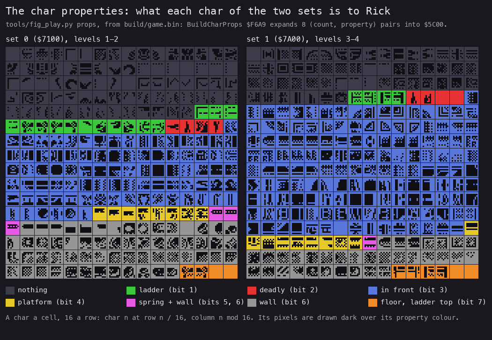

*Drawn from `build/game.bin` by `python3 tools/fig_play.py props docs/img/play/props.png`. Static data: the pairs at
`$F6C0` and `$F6D0`, the chars at `$7100` and `$7A00`.*

How to read it:

- Each panel is a char set, 16 chars a row: char n at row n / 16, column n mod 16.
- The colour of a cell is the char's property; the char's own pixels are drawn dark over it.
- The legend names the bits.

| Bit | Value | Meaning | Set 0 (levels 1-2) | Set 1 (levels 3-4) |
| --- | --- | --- | --- | --- |
| none | `$00` | empty space | 0-76 | 0-54 |
| 1 | `$02` | ladder | 77-90 | 55-58 |
| 2 | `$04` | deadly | 91-94 | 59-62 |
| 3 | `$08` | in front: hides sprites, not solid | 95-181 | 63-206 |
| 4 | `$10` | platform: stops a fall only | 182-189 | 207-215 |
| 5, 6 | `$60` | spring (and a wall) | 190-192 | 216 |
| 6 | `$40` | wall | 193-251 | 217-249 |
| 7 | `$80` | floor, also a ladder's top: stops a fall, climbable down | 252-255 | 250-255 |

```text
BuildCharProps(DE = the pairs):
    HL = $5C00
    repeat 8 times:
        count, property = the next pair
        write property count times
```

```text
F6AF 1A          LD A,(DE)              ; the count
F6B0 47          LD B,A
F6B1 13          INC DE
F6B2 1A          LD A,(DE)              ; the property
F6B3 77          LD (HL),A              ; BuildCharPropsFill
F6B4 2C          INC L
F6B5 10 FC       DJNZ BuildCharPropsFill
F6C0 4D 00       DEFB $4D,$00           ; CharPropsSet0: 77 x nothing
F6C2 0E 02       DEFB $0E,$02           ; 14 x ladder
F6C4 04 04       DEFB $04,$04           ; 4 x deadly
F6C6 57 08       DEFB $57,$08           ; 87 x in front
F6C8 08 10       DEFB $08,$10           ; 8 x platform
F6CA 03 60       DEFB $03,$60           ; 3 x spring
F6CC 3B 40       DEFB $3B,$40           ; 59 x wall
F6CE 04 80       DEFB $04,$80           ; 4 x floor
```

ProbeBox `$F5D5` ORs the properties of the chars under Rick's box into ProbeResult `$F6A8`. It counts ladders only
under the middle column, and floor or platform only on the bottom row. It also sets bit 6 (wall) when the box
overlaps object 0 (ProbeBoxObject0 `$F624`), so a solid object 0 stops Rick like a wall. The overlap itself
(`$F64E`) ran once, in `level2`; the test (`$F643`) ran in `level2` and `level3`.

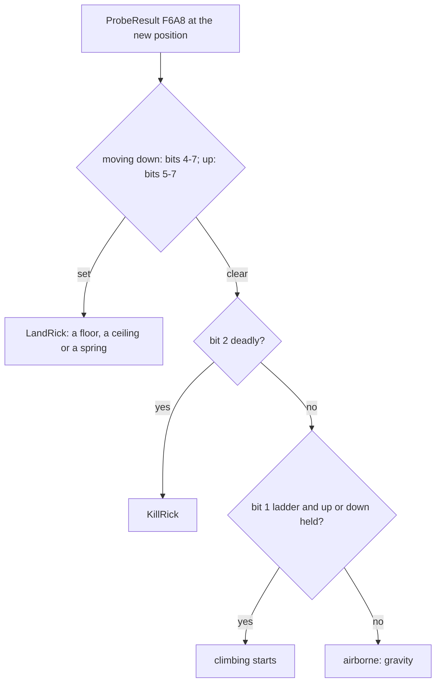

**Worked example.** Char 92 of set 0 is in the run 91-94: property `$04`, deadly. A zone of level 1 that puts one
of those four chars under Rick's box kills him on the pass he moves into it, with no object involved. Char 185 is in
182-189: a platform. Rick falls onto it and stands; jumping up through it, the up mask `$E0` ignores bit 4, so he
passes.

Witness: BuildCharProps runs at each LoadScreen (7 in `c1`, 30 in `level4`). The deadly chars kill in the zone
recordings (KillRick through `$F8CA`).

**The point**: the world is 16 bytes of data. The whole of a level's physics comes from where the designer put
four kinds of char, and a platform differs from a floor only in which direction it stops you.

## 10.2 Rick

Rick is object 1, kind 1, a 24 x 21 sprite. RickHandler `$F851` calls MoveRick `$F85D` once a pass, then picks his
frame (ChooseRickFrame `$FC60`). One pass is 2 frames in play ([doc 4](04-game-loop.md#44-the-main-loop-step-by-step)),
so every "a pass" below is 25 times a second.

| Move | Control | Rule | Code |
| --- | --- | --- | --- |
| walk | left, right | 2 pixels a pass; a wall (bits 4-6 at the new x) stops him | WalkRick `$F903` |
| jump | up, on a floor | y speed `$FA80` (-5.5 pixels a pass), effect 6 | Jump `$FAD3` |
| fall | no floor | y speed + `$80` (0.5) a pass, at most `$0800` (8 pixels a pass) | MoveRickGravity `$F8EC` |
| climb | up or down on a ladder | 2 pixels a pass; sideways 2 off the ladder | ClimbRick `$FB14` |
| down at a ladder top | down, on `$80` chars, left and right not held, x AND `$1F` < `$0A` | x snaps to (x AND `$F0`) + 4, Climbing `$FD59` = `$FF`: he climbs down (ClimbRick treats bits 1 and 7 alike, `$FB69` AND `$82`) | DownFloorTest `$FAE6`, the snap `$FAFC` (`level1`, `level3`) |
| crawl | down, on a floor (not a ladder top) | the box 8 pixels lower; walks at 2 pixels a pass | SetCrawl `$FB0E` |
| spring | land on a spring at 2 pixels a pass or more (slower: he stands on it) | bounce: up held `$F800` (-8 pixels a pass), else 254 - the speed | LandRick `$F9AC`, `$F9B2` |
| leave the zone | walk past x 0 or `$E7` | x becomes `$E4` or `$02`, the exit is looked up | ExitLeft `$FBCF`, ExitRight `$FBDE` |

**Down at a ladder top.** The `$80` chars are both a floor and the head of a ladder. With down held on the floor,
DownFloorTest decides between crawling and climbing down:

```text
FAE6 CB 79       BIT 7,C                ; a $80 char under Rick?
FAE8 CA 0C FB    JP Z,StartCrawl
FAEB E6 03       AND $03                ; left and right not held
FAED FE 03       CP $03
FAEF C2 0C FB    JP NZ,StartCrawl
FAF2 DD 7E 01    LD A,(IX+$01)
FAF5 E6 1F       AND $1F                ; x AND $1F < 10?
FAF7 FE 0A       CP $0A
FAF9 D2 0C FB    JP NC,StartCrawl
FAFC DD 7E 01    LD A,(IX+$01)          ; the snap
FAFF E6 F0       AND $F0
FB01 F6 04       OR $04
FB03 DD 77 01    LD (IX+$01),A
FB06 3E FF       LD A,$FF
FB08 32 59 FD    LD (Climbing),A
```

Worked example: Rick at x `$86` = 134: `$86` AND `$1F` = 6 < 10, so x becomes `$80` + 4 = `$84` = 132 and he
climbs down from the next pass. At x `$8E` (`$0E` = 14) he crawls instead. Witness: the snap `$FAFC` ran in `level1`
and `level3`.

```text
MoveRick (once a pass):
    if dying: DeathFall; return
    ReadInput
    if climbing: ClimbRick; return
    y' = y + speed (8.8)
    probe Rick's box at y' (low box when crawling)
    if a solid char (falling: bits 4-7, rising: bits 5-7): LandRick   # floor, ceiling, spring, then fire / jump
        # LandRick's controls, down held on the floor (DownFloorTest $FAE6):
        #   a $80 char under him, left and right not held, x AND $1F < $0A: x = (x AND $F0) + 4, climbing = on
        #   else: crawl
    else:
        airborne; if deadly: KillRick
        y = y'
        if a ladder and up or down: climbing = on; return
        speed = min(speed + $80, $0800)
    WalkRick                                                          # left / right, walls, the zone edges
```

```text
F86B CD 4E A1    CALL ReadInput
F86E 3A 59 FD    LD A,(Climbing)
F871 A7          AND A
F872 C2 14 FB    JP NZ,ClimbRick
F879 3A 55 FD    LD A,(YFraction)
F87C 5F          LD E,A
F87D DD 56 02    LD D,(IX+$02)
F880 DD 4E 03    LD C,(IX+$03)
F883 2A 56 FD    LD HL,(YVelocity)
F88D 19          ADD HL,DE              ; MoveRickFall: the new Y, the new fraction
F88E 89          ADC A,C
F8B0 06 F0       LD B,$F0               ; MoveRickCheck: the solid mask falling
F8B2 3A 57 FD    LD A,(YVelocity+$0001)
F8B5 A7          AND A
F8B6 F2 BB F8    JP P,MoveRickAir
F8B9 06 E0       LD B,$E0               ; rising: a platform does not stop a jump
F8BB 3A A8 F6    LD A,(ProbeResult)     ; MoveRickAir
F8BE 4F          LD C,A
F8BF A0          AND B
F8C0 C2 5D F9    JP NZ,LandRick
F8C8 CB 51       BIT 2,C
F8CA C2 ED FB    JP NZ,KillRick
F8EC 2A 56 FD    LD HL,(YVelocity)      ; MoveRickGravity: + $80, at most $0800
F8EF 01 80 00    LD BC,$0080
F8F2 09          ADD HL,BC
F8F3 7C          LD A,H
F8F4 A7          AND A
F8F5 FA 00 F9    JP M,MoveRickSetVel    ; rising (negative): no cap
F8F8 FE 08       CP $08
F8FA DA 00 F9    JP C,MoveRickSetVel
F8FD 21 00 08    LD HL,$0800
```

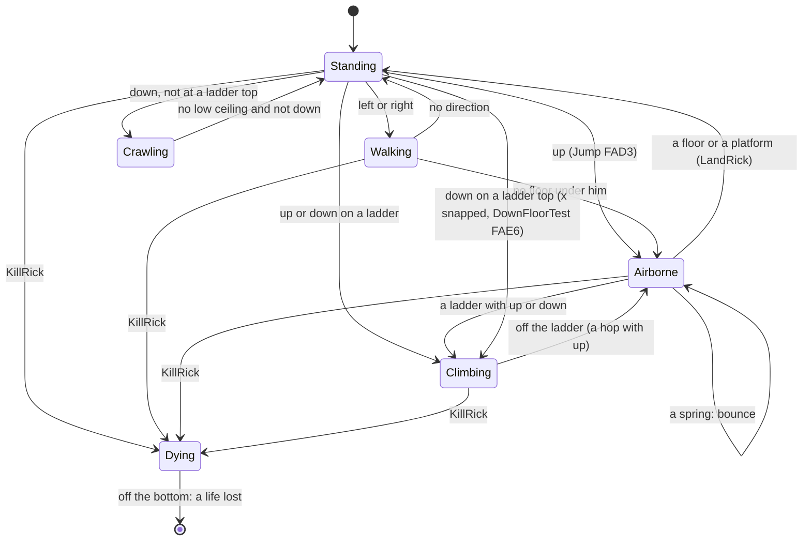

### The jump

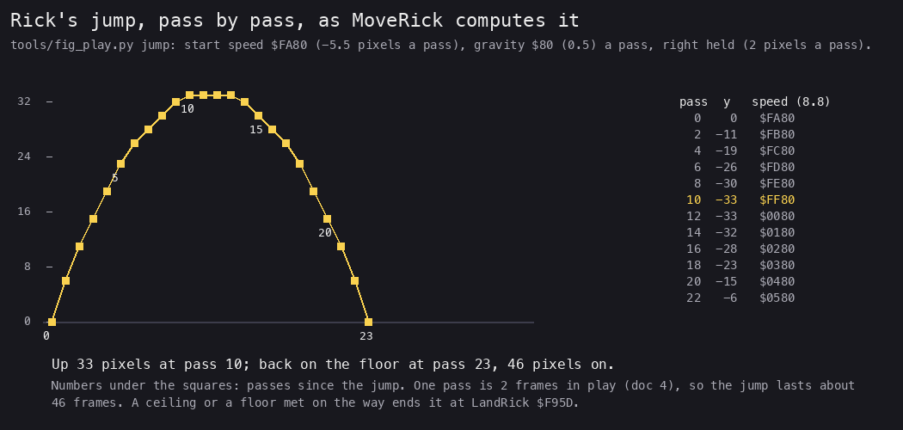

*Computed from the constants in `build/game.bin` by `python3 tools/fig_play.py jump docs/img/play/jump-arc.png`, as
MoveRick computes it; checked against `L1Z1` frames 26-33 below.*

How to read it:

- The squares are Rick's y relative to the floor, one a pass; x moves 2 pixels a pass with right held.
- The table gives the y and the 8.8 speed every second pass; the apex is highlighted.
- A ceiling or a floor on the way ends the arc early (LandRick).

**Worked example.** The jump in `L1Z1` at frame 26, read from the recording through `time_travel memory_at` (RickY
`$EAAE`, YFraction `$FD55`, YVelocity `$FD56`, frame starts):

| Frame | y | Fraction, speed | What happened |
| --- | --- | --- | --- |
| 26 | 139 | 0, `$0100` | on the floor (`$0100` is the floor's speed) |
| 27 | 139 | 0, `$FA80` | Jump: speed -5.5 |
| 29 | 133 | `$80`, `$FB00` | y + (-5.5): 133.5; speed + 0.5 |
| 31 | 128 | `$80`, `$FB80` | y + (-5): 128.5 |
| 33 | 128 | 0, `$0000` | a ceiling: y kept, speed 0, effect 6 |
| 49 | 139 | 0, `$0100` | back on the floor after falling |

The values change every second frame: one pass is 2 frames. The first two steps are the figure's first two squares.

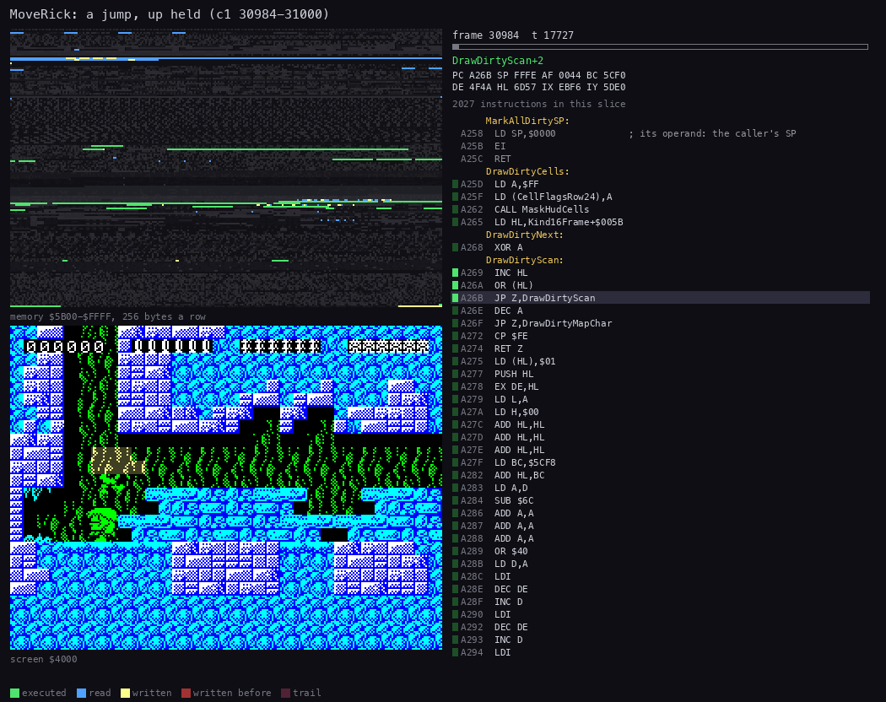

*`c1` 30 984 to 31 000, 64 pictures: the take-off, 8 of the jump's 23 passes (the apex and the landing are in
jump-arc.png above). Made with `python3 ../../kit/routine_anim.py --work work/docs/rdA/c1 --listing
build/game.lst --page 1=build/music.lst --page-name 1="the AY player" --window 30984:0-31000:0 --view screen --range
5B00-FFFF --pictures 64 --out docs/img/play/jump.gif`.*

How to read it:

- The screen shows Rick leave the floor and rise: the take-off only. The listing shows the routine running at each
  picture: MoveRick in the passes, and DrawDirtyCells and WaitFramesLoop between them (the first and last pictures).
- The memory strip shows the writes each pass to Rick's slot at `$EAAC` and to the speed at `$FD55-$FD57`.

Witness: Jump `$FAD3` runs in every game recording (`c1` at 30 984, 31 122, 31 389, 31 439, 32 088, 32 478). The
spring bounce (`$F9AC`, `$F9B2`) runs only in `L2Z4` (6 and 17 times).

**The point**: Rick's jump is a fixed parabola, 33 pixels high and 46 pixels long. The player cannot shorten it,
so every gap and every ceiling in the levels is drawn to that one arc.

## 10.3 The gun

Fire with up shoots. One bullet can be out at a time (object 2), and there are 6 bullets a life.

```text
FireShoot (fire + up, on the floor):
    once per press (FireLatch $FD5E)
    if a bullet is out ($EACA): nothing
    if bullets ($A976) = 0: effect 1; return            # emptygun frames 500, 580
    bullets -= 1; effect 0
    bullet: kind 2, x = Rick's x, y = Rick's y + 6, frame $85F9 (frame 4)
    BulletDx $ED3F = +8, or -8 (and mirrored) facing left
BulletObj (each pass):
    x += BulletDx; off the screen: gone
    hit point = (x, or x + $17 going right; y + 5)
    a solid char there ($F535): gone
```

```text
FA39 3A CA EA    LD A,(BulletObject)
FA3C A7          AND A
FA3D C0          RET NZ                 ; one bullet at a time
FA3E 3A 76 A9    LD A,(Bullets)         ; $A976
FA41 A7          AND A
FA42 C2 4B FA    JP NZ,FireShoot
FA45 3E 01       LD A,$01               ; none left: the click
FA47 CD ED 9F    CALL PlayEffect
FA4B 3D          DEC A                  ; FireShoot
FA4C 32 76 A9    LD (Bullets),A
FA4F AF          XOR A
FA50 CD ED 9F    CALL PlayEffect        ; effect 0, the shot
FA53 3E 02       LD A,$02
FA55 32 CA EA    LD (BulletObject),A
FA73 3E 08       LD A,$08
FA75 32 3F ED    LD (BulletDx),A
ED00 3A 3F ED    LD A,(BulletDx)        ; BulletObj
ED07 DD 86 01    ADD A,(IX+$01)
ED10 32 40 ED    LD (BulletHitX),A      ; BulletStore
ED19 01 05 00    LD BC,$0005
ED1C 09          ADD HL,BC
ED1D 22 41 ED    LD (BulletHitY),HL
ED20 CD 35 F5    CALL IsSolidAt
ED23 C8          RET Z
ED24 C3 3A ED    JP BulletGone
```

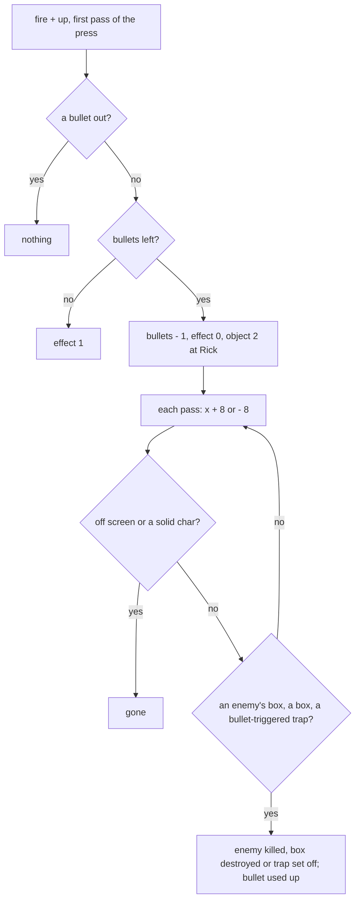

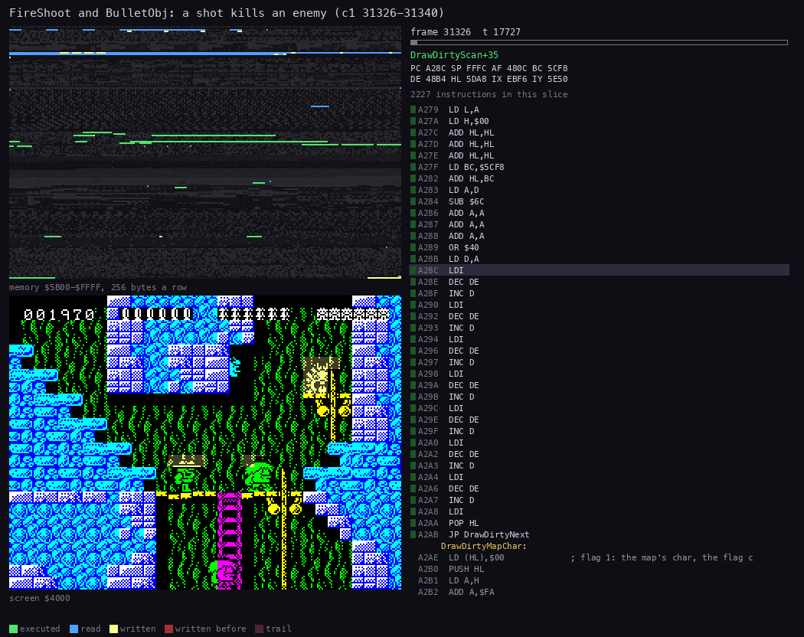

*`c1` 31 326 to 31 340, 56 pictures. Made with `python3 ../../kit/routine_anim.py --work work/docs/rdA/c1 --listing
build/game.lst --page 1=build/music.lst --page-name 1="the AY player" --window 31326:0-31340:0 --view screen --range
5B00-FFFF --pictures 56 --out docs/img/routines/FireShoot.gif`.*

How to read it:

- The screen at the bottom: Rick fires; the bullet crosses the screen; the enemy it meets flips and falls.
- The HUD loses one bullet at 31 329 ([doc 8](08-hud-and-text.md#83-the-hud)).
- The listing shows the composer and the drawers at work: the bullet is just one more sprite.

**Worked example.** At `c1` 31 326:38 121 FireShoot runs with `$A976` = 6: it becomes 5 (the value at 31 500, [doc
7, 7.8](07-objects.md#78-the-game-variables)). The bullet moves 8 pixels a pass, 4 pixels a frame, so it crosses the
232-pixel play area in 29 passes. KillEnemy `$F17C` runs at 31 337, 11 frames later: the enemy was about 40 pixels
away.

Witness: FireShoot in `c1` 4 times, `level1` 6, `level2` 4, `level3` 7, `level4` 2. The click of an empty gun
(`$FA45`) runs only in `emptygun` (a patch on a clone), at frames 500 and 580; no plain recording reaches it.

**The point**: six shots a life, one at a time. The gun is a resource, not a weapon of choice: NewLife gives back 6,
so the player who dies keeps fighting at full ammunition.

## 10.4 The dynamite and the stick

Fire with down drops a stick of dynamite (object 3) at Rick's feet. Fire with left or right pokes the stick, his
walking cane, in front of him.

```text
DropDynamite (fire + down, on the floor):
    if a stick is out ($EAE8) or none left ($A967 = 0): nothing
    sticks -= 1; object 3 at Rick's x, y; DynFuse $ECED = 50
DynamiteObj (each pass):
    fuse -= 1
    fuse = 0: the slot and BlastOn cleared
    fuse >= 20: the burning stick (mirrored every other pass); at 20: effect 2, the bang
    fuse < 20: the blast: BlastX = x + 12, BlastY = y + 10, BlastOn = $FF, frame BlastFrames[fuse / 4]
               fuse >= 4 and Rick in the blast box (33 x 30 from x - 4, y - 4): KillRick
the stick (fire + left or right):
    Poking $FD63 = $FF; the point PokeX = x + $17 (right) or x (left), PokeY = y + 14
    effect 3 once a press
```

```text
EC77 3A ED EC    LD A,(DynFuse)         ; DynamiteObj
EC7A 3D          DEC A
EC7B C2 85 EC    JP NZ,DynamiteTick
EC7E DD 77 00    LD (IX+$00),A          ; 0: the stick is gone
EC81 32 F1 EC    LD (BlastOn),A
EC85 32 ED EC    LD (DynFuse),A         ; DynamiteTick
EC8B FE 14       CP $14
EC8D C2 97 EC    JP NZ,DynamiteFuseFrame
EC91 3E 02       LD A,$02
EC93 CD ED 9F    CALL PlayEffect        ; the bang, at 20
EC97 DA A2 EC    JP C,DynamiteBlast     ; below 20
ECA2 CB 3F       SRL A                  ; DynamiteBlast: fuse / 4
ECA4 CB 3F       SRL A
ECA7 DD 7E 01    LD A,(IX+$01)
ECAA C6 0C       ADD A,$0C
ECAC 32 EE EC    LD (BlastX),A
ECBC 3E FF       LD A,$FF
ECBE 32 F1 EC    LD (BlastOn),A
ECD8 3A ED EC    LD A,(DynFuse)
ECDB FE 04       CP $04
ECDD D8          RET C                  ; the last 4 passes do not kill
ECE0 DD 21 AC EA LD IX,RickObject
ECE4 CD 6F F7    CALL InBlast
ECE9 C0          RET NZ
ECEA C3 ED FB    JP KillRick
FA9C 3A E8 EA    LD A,(DynamiteObject)  ; DropDynamite
FAA1 3A 67 A9    LD A,(Dynamite)        ; $A967: the sticks
FAA6 3D          DEC A
FAA7 32 67 A9    LD (Dynamite),A
FAAF 3E 32       LD A,$32               ; the fuse: 50 passes
FAB1 32 ED EC    LD (DynFuse),A
```

```mermaid
stateDiagram-v2
    [*] --> Burning: dropped, fuse 50
    Burning --> Burning: fuse - 1 a pass
    Burning --> Blast: fuse 20, effect 2
    Blast --> Blast: fuse 19 to 4: kills Rick, enemies, boxes; sets off blast traps
    Blast --> Fading: fuse 3 to 1: drawn, harmless to Rick
    Fading --> [*]: fuse 0, the slot freed
```


*`L1Z1` 9 to 100, 91 pictures, one a frame. Made with `python3 ../../kit/routine_anim.py --work work/docs/rdA/z11
--listing build/game.lst --listing build/music.lst --window 9:0-100:0 --view screen --range 5B00-FFFF --pictures 91
--out docs/img/routines/DynamiteObj.gif`.*

How to read it:

- At the start Rick drops the stick and walks on; the burning stick blinks (the mirror flips every pass).
- The blast grows and shrinks over 19 passes (fuse 19 to 1), through the five BlastFrames.
- Rick has walked back into it: he hops up and falls through the floor, dead.

**Worked example.** The drop runs at `L1Z1` frame 10:32 603: the fuse is 50. The bang (effect 2 at `$EC93`) comes
at 68:32 517, 58 frames later: 30 passes from 50 to 20, so 29 passes of 2 frames. Two frames later, at 70:35 571,
KillRickNow runs: the blast's first test found Rick inside. The infinite-lives POKE of the warp keeps the game going.

The stick does not kill. An enemy hit by it (`$F742` at PokeX / PokeY) is stunned for 20 passes (+29); a trap with
flag bit 6 is set off. Witness: the poke (`$F9DC`) runs in `controls` 9 times, `level1` 9, `level2` 20, `level3`
175, and in `L1Z4`, `L3Z6`, `L4Z5`, `L4Z9`. Sticks are dropped in 15 zone recordings (from `L1Z1` to `L4Z9`), in
`level2` (1) and `level3` (6).

**The point**: the dynamite is the only weapon that kills everything, Rick included. The fuse gives him 30 passes,
1.2 seconds, to walk 60 pixels away; the blast box reaches about 30 pixels around the stick
(x - 4 to x + 28, y - 4 to y + 25).

## 10.5 Enemies

Twelve enemy kinds, in three behaviours. Eight of them (the patrollers and the trackers) share one routine,
EnemyCommon `$EFDB`; the four climbers run ClimberObj `$F233`, with the same tests in another order. They differ by
their graphic (one per level, the last shared by levels 3 and 4) and by the behaviour:

| Kinds | Handler | Behaviour |
| --- | --- | --- |
| 4, 7, 10, 13 | PatrolObj `$EFCF` | walks to and fro, turning at a wall, a ledge, or after +12 / 2 steps |
| 5, 8, 11, 14 | TrackerObj `$EFD6` | the same, but at x AND `$1E` = `$10` turns to face Rick |
| 6, 9, 12, 15 | ClimberObj `$F233` | falls; on a floor walks, with a random direction at x AND `$1E` = 8 (WalkerOnFloor `$F406`); on a ladder with Rick above, climbs towards him |

The graphic goes by level, not by behaviour (the kind's +2-3, [doc 7, 7.6](07-objects.md#76-the-kinds-their-animations-and-their-scripts)):

| Kinds (patroller, tracker, climber) | Graphic | Level |
| --- | --- | --- |
| 4, 5, 6 | frame 23 (`$8F53`) | 1 |
| 7, 8, 9 | frame 18 (`$8CDD`) | 2 |
| 10, 11, 12 and 13, 14, 15 | frame 27 (`$914B`) | 3 and 4 |

```text
EnemyCommon (IX = a patroller or a tracker):
    EnemyFall $F02F:
        fall: y += the speed (+`$80` a pass up to `$0800`); y >= $12D: gone
            a deadly char under it: KillEnemy; falling onto Rick: KillRick
        on a floor: y = 8n + 3; frame = base + EnemyWalkFrames[x bits 2-3]
            stunned: count down; touching Rick still kills him
            else x += step (2 or -2) within 0-$E7; turn at a wall or a ledge, after +12 / 2 steps,
                 or (a tracker) towards RickX when x AND $1E = $10
            touching Rick: KillRick
    if it overlaps object 0 or a deadly actor of the slots from $EB06 (HitsObstacle $F812): KillEnemy
    if hit by the bullet ($F742 at the bullet's point): KillEnemy; the bullet is used up
    if in the blast ($F76F): KillEnemy
    if the stick's point inside it: stunned for 20 passes (+29)
ClimberObj $F233 (IX = a climber):
    ClimberMove $F266: in the blast: KillEnemy; the stick: stunned (+29 = 20); stunned: count down and stay;
                       +24 = 0: ClimberFall $F362; else climb 2 pixels towards Rick, or step towards RickX
    ClimberFall $F362, on a floor (WalkerOnFloor $F406): y = 8n + 3; on a ladder at x AND $0E = 4 with Rick
                       above: +24 = 1 (climb); else walk 2 pixels, turning at a wall or at x $E8;
                       at x AND $1E = 8: direction = Random $E441 bit 0 ? -2 : +2 (WalkerStepX $F4AA)
    touching Rick: KillRick
    HitsObstacle $F812: KillEnemy
    hit by the bullet: KillEnemy; the bullet is used up
KillEnemy $F17C:
    effect 11, type $47 (DyingEnemyObj), y speed $FC00, score + 50, the drift 3 or -3, one-shot: record taken
```

```text
EFCF AF          XOR A                  ; PatrolObj
EFD0 32 73 F1    LD (TracksRick),A
EFD3 C3 DB EF    JP EnemyCommon
EFD6 F6 FF       OR $FF                 ; TrackerObj
EFD8 32 73 F1    LD (TracksRick),A
EFDB CD 2F F0    CALL EnemyFall         ; EnemyCommon: fall or walk first
EFDE CD 12 F8    CALL HitsObstacle      ; object 0 or a deadly actor
EFE1 CA 7C F1    JP Z,KillEnemy
...
F233 CD 66 F2    CALL ClimberMove       ; ClimberObj: blast, stick, climb or fall
F236 CD E0 F6    CALL RickTouches
F239 CC ED FB    CALL Z,KillRick
F23C CD 12 F8    CALL HitsObstacle
F23F CA 7C F1    JP Z,KillEnemy
```

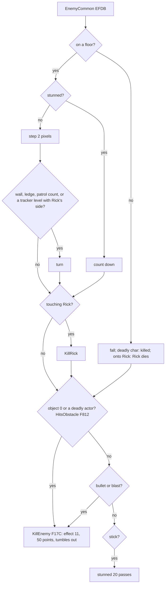

The climbers (ClimberObj `$F233`) run the blast and the stick first, then the climb or the fall, then the touch on
Rick, HitsObstacle and the bullet.

```mermaid
stateDiagram-v2
    [*] --> Falling: spawned
    Falling --> Walking: a floor under it (WalkerOnFloor F406)
    Falling --> Climbing: a ladder at x AND 7 = 4, Rick above
    Walking --> Walking: 2 pixels a pass; a wall or x E8: turn
    Walking --> Walking: x AND 1E = 8: Random bit 0 picks left or right
    Walking --> Climbing: a ladder at x AND 0E = 4, Rick above
    Walking --> Falling: no floor
    Climbing --> Falling: off the ladder (+24 = 0)
    Falling --> Dead: a deadly char, the blast, the bullet, object 0
    Walking --> Dead: the blast, the bullet, object 0
    Climbing --> Dead: the blast, the bullet, object 0
    Dead --> [*]: KillEnemy F17C
```

The walk on a floor and its random turn (`$F4A1-$F4B9`):

```text
F4A1 DD 73 01    LD (IX+$01),E          ; the new x
F4A4 7B          LD A,E
F4A5 E6 1E       AND $1E
F4A7 FE 08       CP $08
F4A9 C0          RET NZ
F4AA CD 41 E4    CALL Random            ; x AND $1E = 8: a random direction
F4AD E6 01       AND $01
F4AF 1E 02       LD E,$02
F4B1 CA B6 F4    JP Z,WalkerSetDir      ; bit 0 = 0: right
F4B4 1E FE       LD E,$FE               ; bit 0 = 1: left
F4B6 DD 73 19    LD (IX+$19),E
```

The generator itself is in [doc 7](07-objects.md#the-random-numbers). Witness: `$F4AD` runs 3 times in `c1`, 19 in
`level1`, 32 in `level2`, 13 in `level3` and 137 in `level4`.

**Worked example.** Slot 10 at `c1` 31 500 ([doc 7, 7.3](07-objects.md#73-the-object-table-ea8e)): kind 4, x 140,
walk step -2, frame 25. Its base is frame 23; x = 140 = `%10001100`, bits 2-3 = 3, so the walk frame is base + the
table's entry for 3. Each pass x goes 138, 136, ... until a wall or the patrol count turns it. Killed, it becomes type
`$47`, flies up at 4 pixels a pass, drifts 3 pixels a pass towards the middle (+3 when x < `$80`, else -3, KillEnemyDrift `$F1A3`) and leaves the zone at the bottom.

Witness: KillEnemy runs in `c1` 5 times (31 038, 31 337, 31 611, 31 737, 32 326), `level1` 5, `level2` 4, `level4` 2.
PatrolObj runs 693 times in `c1`, TrackerObj 178, ClimberObj's climb only in `level4` (869). Every enemy kind is
spawned in some zone recording.

**The point**: three behaviours, twelve faces. A tracker is a patroller with one extra test, and it only re-aims at
fixed x positions, so the player can still outrun it.

## 10.6 Traps

Every kind from 24 to 70 is a trap or a moving actor run by TrapObj ([doc 7, 7.6](07-objects.md#76-the-kinds-their-animations-and-their-scripts)).
The trigger, the danger and the path are all data. The flags each kind carries in the level data:

| Kinds | Levels | Set off by | Deadly | Path | Picture ([kinds.png](img/objects/kinds.png)) |
| --- | --- | --- | --- | --- | --- |
| 25, 26 | 1, 2 | Rick (25: or the stick) | while it moves | 70 passes x 8 pixels sideways | a thin bar |
| 27, 37, 39, 59, 62, 64 | 1-4 | Rick, the stick or the bullet | while it moves (37: always) | out and back, 744 passes | a bar, spikes, a head |
| 29, 30 | 2 | Rick | while it moves | 26 steps, 584 pixels sideways | a flash (frame 12) |
| 32, 65 | 2, 4 | Rick (32: or the stick) | while it moves | 70 passes up | a narrow bar, a rocket |
| 33, 45, 48, 49, 57, 60, 63, 69, 70 | 1-4 | Rick | always | loops of 1-19 steps | blocks, a portcullis, a wall, a bullet, a machine, a missile, a cart |
| 34, 47 | 1, 2 | Rick | no | one step, one-shot | a round shield, a spider |
| 36, 38 | 2 | the bullet | always | loops | blocks |
| 40, 41 | 2 | Rick, or anything | while it moves | 128 passes sideways | an enemy's figure |
| 42 | 1 | Rick | while it moves | 9 steps | the boulder |
| 43 | 1 | anything | always | 3 steps, a loop | a bat |
| 28, 44, 46, 54, 55, 58, 67, 68 | 1-4 | the blast | 28, 44, 55, 58, 67, 68 | 1-37 steps | blocks, a brick wall, a rock heap, a pillar (55: level 4's door), a cart, flashes (67 / 68: the door's debris) |
| 50, 53, 66 | 3 | the stick, the bullet, the blast, or Rick | yes | 1-2 steps | a round grid, a dog's head |
| 56 | 3, 4 | Rick, the bullet or the blast | no | 7 steps down | a helmeted head |
| 24, 31 | 2 | Rick | always; object 0 (flag bit 1), a solid block | down 48 (24) or 32 (31) pixels, a wait, back up | a block (frame 32) |
| 35 | 2 | Rick | always; object 0 | after 35 passes, 70 passes x 8 pixels down | a block (frame 32) |
| 51, 61 | 3 | Rick | while it moves | 128 passes x 3 pixels, right (51) or left (61) | as kind 50 (frame 45) |
| 52 | 3 | the stick | always | 32 pixels up, a wait, 32 down | as kinds 45 and 49 (frame 43) |

The flags come from the object records of the four levels (`tools/res_levels.py`); the pictures are the kinds' first
frames. The code knows only the numbers.

```text
TrapObj (each pass):
    TrapMove                       # waiting: TrapTriggers; moving: one script step
    if type bit 7 (deadly) and RickTouches: KillRick
```

```text
EDFC CD 0B EE    CALL TrapMove
EDFF DD CB 00 7E BIT 7,(IX+$00)
EE03 C8          RET Z
EE04 CD E0 F6    CALL RickTouches
EE07 CA ED FB    JP Z,KillRick
EE0A C9          RET
```

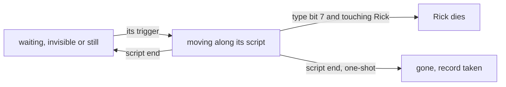

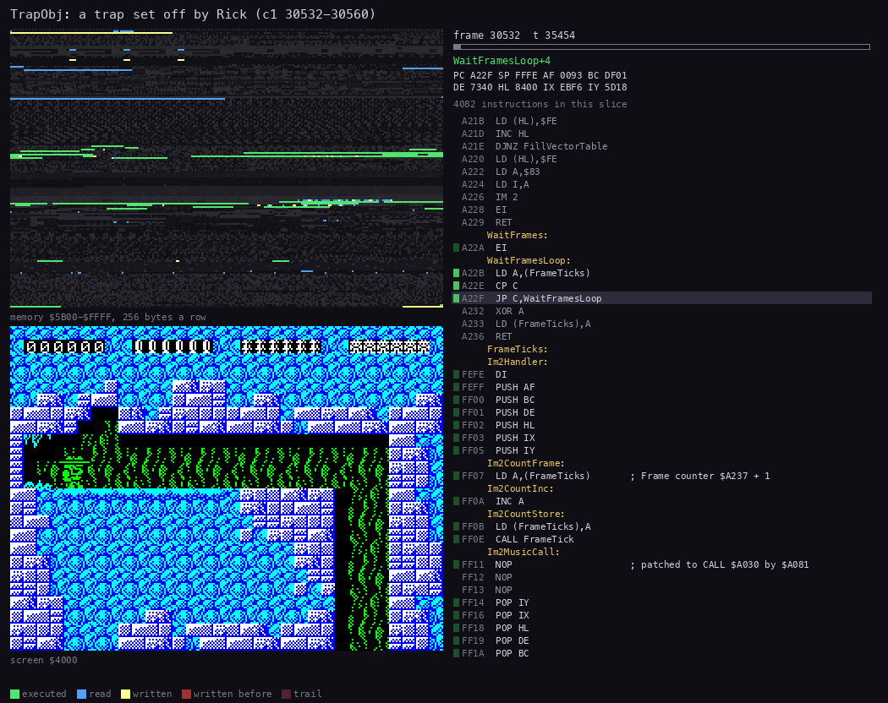

*`c1` 30 532 to 30 560, 56 pictures. The command is in [doc 7, 7.6](07-objects.md#the-boulder-at-work).*

How to read it: the boulder appears at the left edge as Rick walks right, and rolls behind him at his own speed.

**Worked example.** The `gameover` recording loses all six lives to this boulder. Rick's centre enters the trigger
box, the boulder rolls 2 pixels a pass from x 0, and when Rick does not keep moving right it reaches his body box
(x + 5 to x + 17). TrapObj's `RickTouches` then calls KillRick. The trap is not one-shot (flag bit 0 clear), so on
the restart it is home and waiting again.

Witness: effect 3 from TrapTriggers in `c1` 2 times, `controls` 4, `gameover` 6, `level1` 7, `level2` 16, `level3`
10. Every trap kind is spawned in a zone or spot recording (kinds 34, 35, 43, 44, 47, 51 and 69 in the spot
recordings).

**The point**: Rick Dangerous is a game of traps learned by dying. The trap is invisible until its trigger, then
faster than a reaction; the only defence is to know where the trigger box is, or to set it off from afar with the
stick, the bullet or the blast, which is exactly what the flags allow.

## 10.7 Deaths

Every death goes through KillRick `$FBED`:

| Cause | Where |
| --- | --- |
| a deadly char under Rick's box | MoveRick `$F8CA`, WalkRick, ClimbRick |
| touching a deadly trap (type bit 7) | TrapObj `$EE07` |
| touching an enemy that walks, falls, is stunned or climbs | EnemyCommon `$F090`, `$F0F1`, `$F136`; ClimberObj `$F239` |
| his own dynamite's blast (fuse 19 to 4) | DynamiteObj `$ECEA` |

There is no fall damage: Rick lands from any height at 8 pixels a pass.

```text
KillRick:
    if already dying: return
    effect 11; Dying = $FF; speed = $FC00 (4 pixels a pass up)
    drift = +3 if x < $80 else -3                  # towards the middle
DeathFall (MoveRick while dying):
    x += drift; y += speed (no collisions); speed += $80
    y past 255: the slot freed, DeathDone = $FF     # MainLoop takes a life, NewLife or GAME OVER
```

```text
FBED 3A 68 FD    LD A,(Dying)           ; KillRick
FBF0 A7          AND A
FBF1 C0          RET NZ
FBF2 3E 0B       LD A,$0B               ; KillRickNow
FBF4 CD ED 9F    CALL PlayEffect
FBF7 3E FF       LD A,$FF
FBF9 32 68 FD    LD (Dying),A
FBFC 21 00 FC    LD HL,-1024
FBFF 22 56 FD    LD (YVelocity),HL
FC02 3A AD EA    LD A,(RickX)
FC05 FE 80       CP $80
FC07 D2 10 FC    JP NC,KillRickDriftLeft
FC0A 3E 03       LD A,$03
FC0C 32 6A FD    LD (DeathDrift),A
FC16 3A 6A FD    LD A,(DeathDrift)      ; DeathFall
FC19 DD 86 01    ADD A,(IX+$01)
FC1C DD 77 01    LD (IX+$01),A
FC39 ED 4A       ADC HL,BC              ; y + speed
FC3C 7C          LD A,H
FC3D A7          AND A
FC3E CA 4B FC    JP Z,DeathFallStore
FC41 DD 36 00 00 LD (IX+$00),$00        ; off the bottom
FC45 3E FF       LD A,$FF
FC47 32 69 FD    LD (DeathDone),A
```

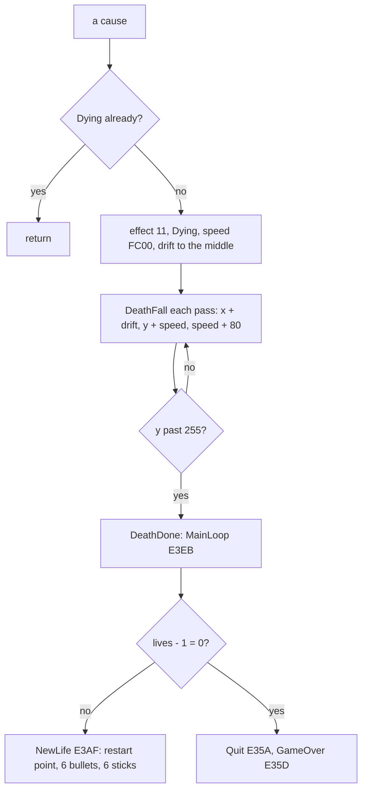

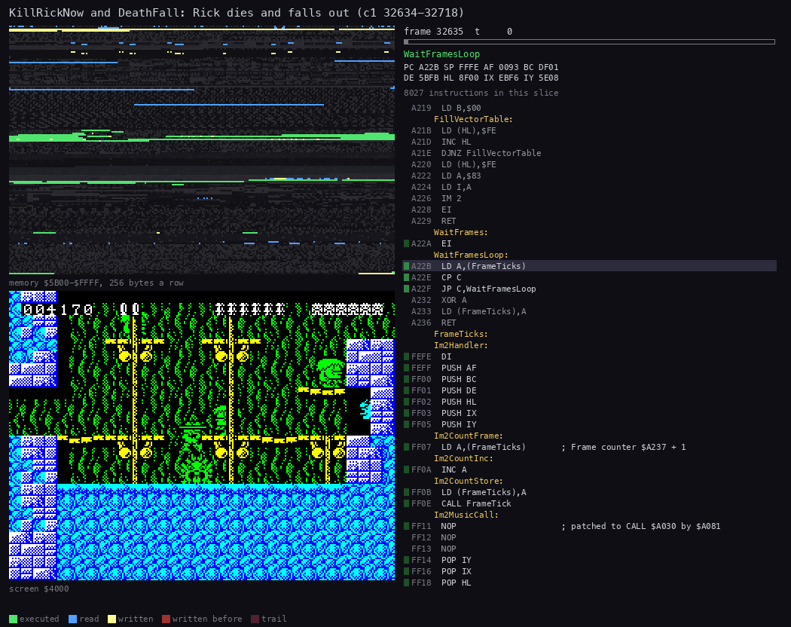

*`c1` 32 634 to 32 718, 84 pictures. Made with `python3 ../../kit/routine_anim.py --work work/docs/rdA/c1 --listing
build/game.lst --page 1=build/music.lst --page-name 1="the AY player" --window 32634:0-32718:0 --view screen --range
5B00-FFFF --pictures 84 --out docs/img/routines/KillRickNow.gif`.*

How to read it:

- Rick hops up, turns over (the mirror flips every 4 passes) and falls through the scenery off the bottom.
- Nothing stops him: DeathFall makes no probe.
- Then the restart: the zone is drawn again ([doc 6](06-rendering.md)) and the HUD loses a head.

**Worked example.** `L1Z1` frame 223, read with `time_travel memory_at`: Rick at x 80, y 128 is killed. 80 is below
`$80`, so the drift is +3:

| Frame | x | y | Speed |
| --- | --- | --- | --- |
| 224 | 80 | 128 | `$FC00` |
| 226 | 83 | 124 | `$FC80` |
| 232 | 92 | 115 | `$FE00` |
| 240 | 104 | 110 | `$0000` (the top of the hop) |
| 250 | 119 | 115 | `$0280` |
| 262 | 137 | 138 | `$0580` |

x grows by 3 every pass, the speed by `$80`. He goes up 18 pixels and then down past the bottom.

Witness: DeathDone set (`$FC41`) in `c1` 2 times, `controls` 3, `gameover` 6, `level1` 11, `level2` 3, `level3` 5,
`level4` 28.

**The point**: the death is the same few lines whatever killed him, and while Rick is dying nothing else can touch
him: KillRick returns at once, the traps' triggers are off, RickTouches answers "no".

## 10.8 The bonus and the score

The score is six decimal digits at `$A9BE`, the highest first. AddScore `$A9E8` adds a five-digit award to the last
five digits, from the units up, with a decimal carry.

| Award | Digits | Added by |
| --- | --- | --- |
| an enemy killed | Award50 `$A9CF`: 00050 | KillEnemy `$F190` |
| a treasure taken | Award500 `$A9D9`: 00500 | TreasureObj `$EDF3` |
| the timed bonus | BonusDigits `$E496`: 02000 less 10 every 30 passes | BonusCollect `$F52C` |
| the end of the game | LevelBonus `$A9E3`: (lives + 1) x 10 000 | the last level's end `$AC35` |

The image also holds the awards 1, 10, 100 and 1 000 that nothing reads, and the score `093000` (cleared by
NewGame).

The timed bonus is a pair of invisible markers, kinds 22 and 23. Touching the start marker sets the bonus to 2 000
and starts the countdown; reaching the end marker in time adds what is left.

```text
BonusTrigger (kind 22): if Rick's centre in its box: free it; BonusActive = $FF; digits = 0 2 0 0 0; effect 10
BonusCountdown (MainLoop, each pass):
    if not active: return
    divider -= 1; if not 0: return
    divider = 30
    if digits are all 0: return
    tens digit -= 1, with a decimal borrow
BonusCollect (kind 23): if active and Rick's centre in its box: inactive; free it; AddScore(digits); tune 7
```

```text
E466 3A 6C FD    LD A,(BonusActive)     ; BonusCountdown
E469 A7          AND A
E46A C8          RET Z
E46B 3A 95 E4    LD A,(BonusDivider)
E46E 3D          DEC A
E46F 32 95 E4    LD (BonusDivider),A
E472 C0          RET NZ
E473 3E 1E       LD A,$1E               ; every 30 passes
E475 32 95 E4    LD (BonusDivider),A
E48B 21 99 E4    LD HL,BonusDigits+$0003   ; the tens digit
E48E 35          DEC (HL)               ; BonusBorrowLoop
E48F F0          RET P
E490 36 09       LD (HL),$09
E492 2B          DEC HL
E493 18 F9       JR BonusBorrowLoop
F521 AF          XOR A                  ; BonusCollect, inside the box
F522 32 6C FD    LD (BonusActive),A
F525 DD 36 00 00 LD (IX+$00),$00
F529 11 9A E4    LD DE,BonusDigits+$0004
F52C CD E8 A9    CALL AddScore
F52F 3E 07       LD A,$07
F531 CD 16 A0    CALL StartTune         ; tune 7
```

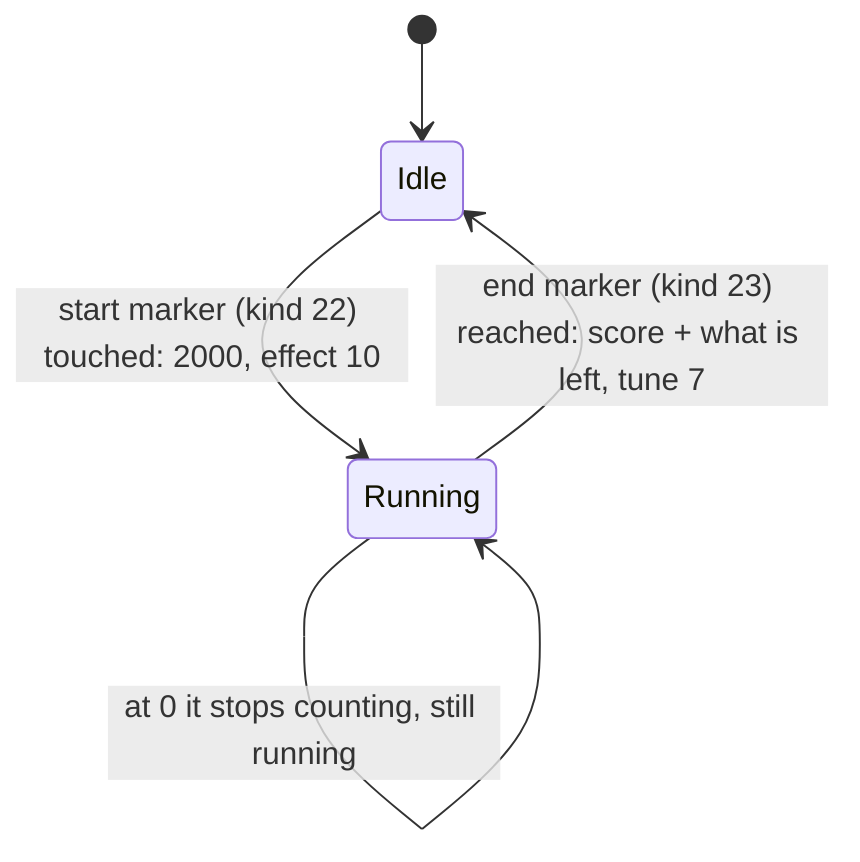

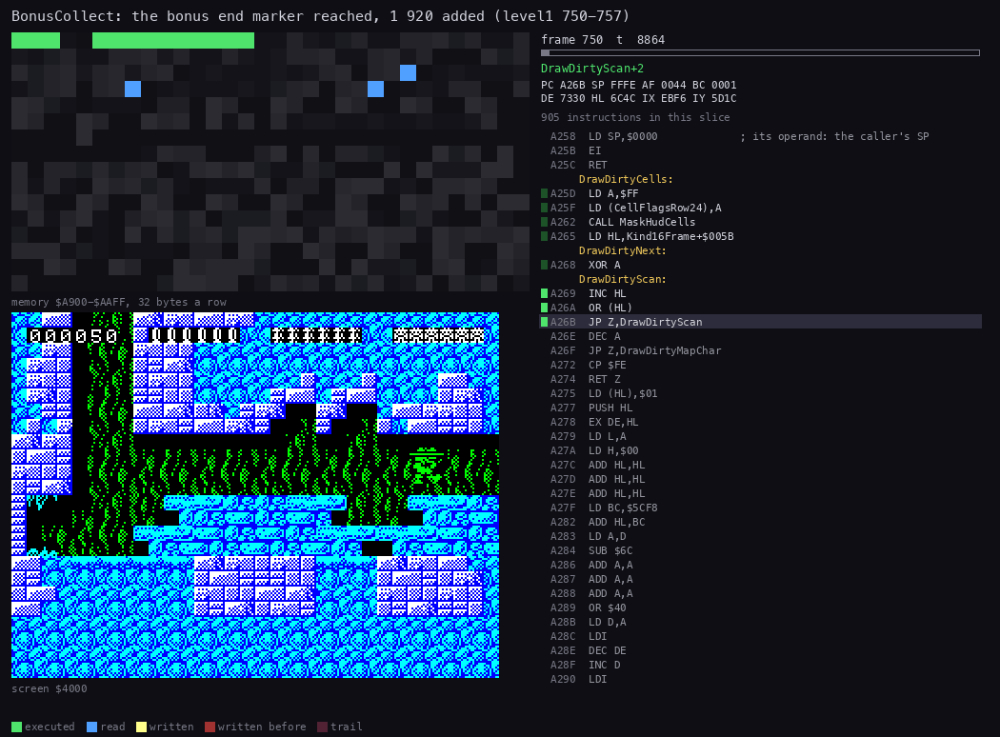

*`level1` 750 to 757, 56 pictures (8 864 T each). Made with `python3 ../../kit/routine_anim.py --work
work/docs/rdA/lv1 --listing build/game.lst --listing build/music.lst --window 750:0-757:0 --view screen --range
A900-AAFF --pictures 56 --out docs/img/routines/BonusCollect.gif`.*

How to read it:

- Rick walks right along the bottom of L1Z1 into the end marker's box (no picture: the marker is invisible).
- The memory strip is `$A900-$AAFF`: the HUD's counters and the score; the score digits change at 755.
- The HUD's score goes from `000050` to `001970`.

**Worked example.** In `level1` the start marker of L1Z1 lies at Rick's start (x 8, row `$18`): the bonus starts at
once, at 2 000. Rick reaches the end marker (x `$E0`, row `$38`) at frame 755. The score was 50 (one enemy), and
becomes 1 970: 1 920 was left, 8 steps of 10. Eight steps take 50 passes for the first (BonusDivider `$E495` starts
at `$32` in the image, and nothing before level 1 has run it down) and 30 for each of the other seven: 260 passes,
the 635 frames since the start (120 to 755) at about 2.4 frames a pass, the scrolls included.

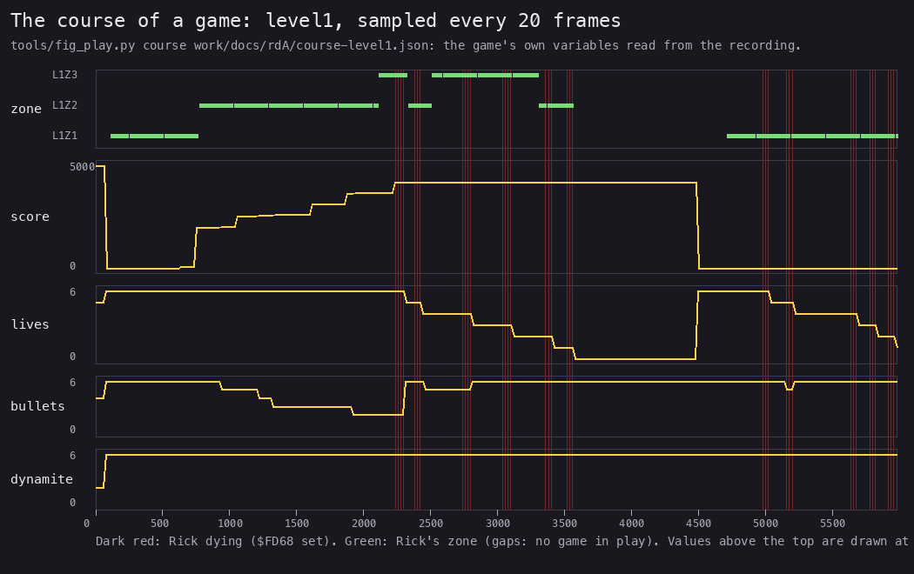

*Drawn by `python3 tools/fig_play.py course work/docs/rdA/course-level1.json docs/img/play/course-level1.png` from
`level1` frames 0-5 980, sampled every 20 frames by `python3 work/docs/rdA/course.py work/docs/rdA/lv1 0 6000 20
work/docs/rdA/course-level1.json` (`time_travel memory_at`, frame starts).*

How to read it:

- Five panels share the frame axis: the zone, the score, the lives, the bullets, the dynamite.
- Dark red lines mark the frames where Rick is dying.
- The score climbs by the steps of the table above: 50 at 640, the bonus at 755, treasures of 500, enemies of 50.
- Each death costs a life and refills the bullets; after the sixth, GAME OVER (3 580), then a new game at 4 500.

Witness: the bonus starts in `c1`, `controls`, `gameover`, `level1`, `level2`; it is collected once in `c1` and once
in `level1`. The score values: `level1` rises to 4 170; `L1Z3` shows 500 (a treasure); `L3Z12` 1 990 (a bonus).

**The point**: the score rewards speed, not killing: one treasure is worth ten enemies, and the bonus pays most
when the player runs the stretch between its markers without a pause.

## 10.9 Lives, the end of a level and the ending

Rick has 6 lives. Each death costs one at MainLoop `$E3F1`; at 0 the game is over. NewLife `$E3AF` restores 6
bullets and 6 sticks and puts Rick at the restart point: the zone and position LoadScreen saved when he last entered a
zone (SaveRestartPoint `$AD01`, called at `$ACFD`). In the course figure above each restart is at the entry of the
zone he died in.

A level ends at an exit to `$FFFF` ([doc 7, 7.1](07-objects.md#71-the-level-data-byte-by-byte)). LevelEnd `$ABD8`
redraws, refills the bullets and the sticks, adds 1 to Level `$E4AD`, prints the next intro and plays tune 1-4. After
level 4 it adds (lives + 1) x 10 000, prints the London text, sets GameComplete `$E440` and the main loop goes to
GAME OVER and the menu.

```text
LevelEnd:
    MarkAllDirty; clear the char map; RedrawScreen
    bullets = sticks = 6; UpdateHud
    Level += 1
    if Level < 4: the next level's text, tune Level; StartLevel
    else: LevelBonus = (lives + 1) 0 0 0 0; AddScore; London; ClearPlayArea; GameComplete = $FF
```

```text
ABD5 C2 72 AC    JP NZ,ExitToScreen     ; not $FFFF
ABD8 CD 39 A2    CALL MarkAllDirty      ; LevelEnd
```

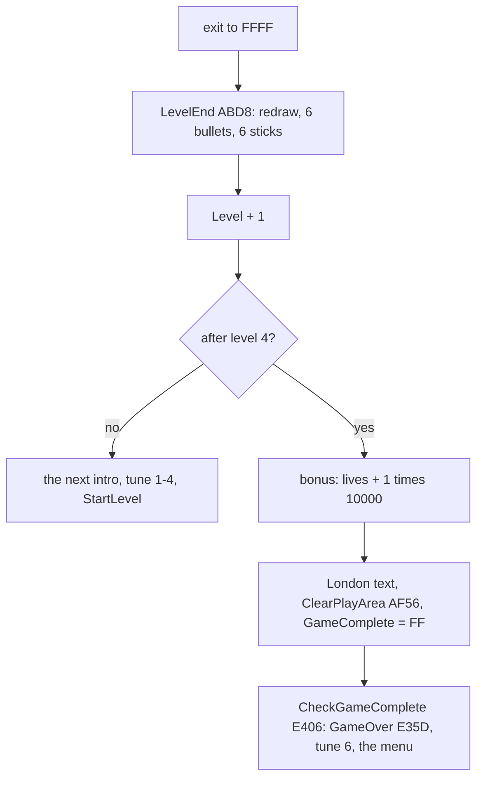

The way out of level 4 is through L4Z9's door, kind 55: a solid object 0 (flags `$1F`: set off by the blast only,
deadly, one-shot). Its trigger box is x `$80-$A0`, y `$83-$A3`, so the stick must lie on the pipe at x 116-148. The
blast frees the door and kind 54; kinds 67 and 68 fly off as debris, deadly once set off. The exit right at row `$24`
then leads to `$FFFF`.

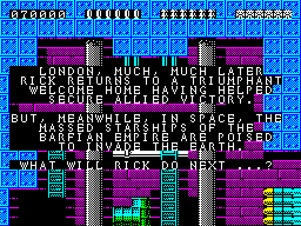

*`ending` frame 250 (the stage 1 recording; WALKTHROUGH 6.1).*

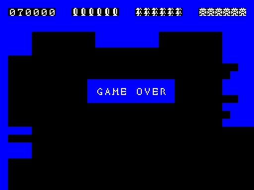

*`ending` frame 500.*

**Worked example.** `ending2` (the L4Z9 warp with the door freed, said so in its input script): the score is
`000000` at frame 250 and `070000` from frame 500. Lives were 6: (6 + 1) x 10 000 = 70 000. LevelEnd runs once,
tune 4 plays, CheckGameComplete goes to GameOver, and the menu follows.

The blast at the pipe was tried six times on the warp: the door opened every time, and Rick died every time, in the
blast at x 108-130 or to the debris. A death puts the door back, as the objects respawn. So the recording's warp
opens the door instead.

**The point**: the last obstacle is the game's own lesson: the dynamite opens the way, and the debris it throws is
one more trap.

## 10.10 Notable features

- **Invisible traps.** An actor's animation list starts with 0, "no picture", so a waiting trap is not drawn at all
  (the boulder, kind 42). The player learns the trigger box by dying.
- **One machine for 47 kinds.** Every trap is a script of (count, dx, dy) steps and a flags byte; TrapObj has no
  case per kind ([doc 7, 7.5](07-objects.md#75-the-update-and-its-dispatch)).
- **Four triggers.** Rick's centre, the stick, the bullet and the blast each set off only the traps flagged for them.
- **A fixed jump.** 33 pixels up, 46 across, 23 passes; no variable height.
- **No fall damage**, but a death fall through the floor.
- **The restart point** is the last zone entered, with full ammunition: a death costs a life and position, never
  bullets or sticks.
- **The timed bonus** counts down in the tens digit only: 2 000 points, 10 a second and a fifth.

## 10.11 Known only from the code

- The left exits to `$FFFF` at the start of levels 2-4; `L1Z1`'s is walled off (`l1z1left`,
  [doc 7, 7.2](07-objects.md#72-one-zone-decoded-l1z1)).
- The end of levels 2 and 3 (tunes 2 and 3): no recording finishes them. Level 1's end ran in `l1end` (a patch on a
  clone: the `L1Z6` warp with the right exit's two flags set): LevelEnd `$ABD8` at frame 1, StartTune with A = 1 at
  9:33 543, then Egypt's text. The empty gun ran in `emptygun` (FireShoot's `$FA45` at frames 500 and 580, after six
  shots).
- The awards 1, 10, 100 and 1 000 (`$A9C5`, `$A9CA`, `$A9D4`, `$A9DE`): nothing adds them.
- The bonus reaching 0: it would take 200 steps, 6 000 passes; no recording waits that long.
- Set48K `$A05F`: the 48K recording starts after it ran.
