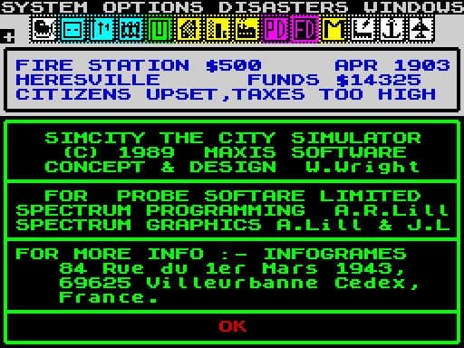
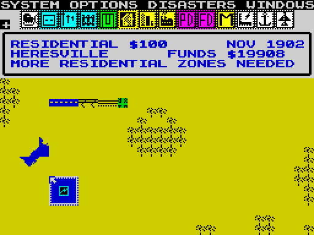
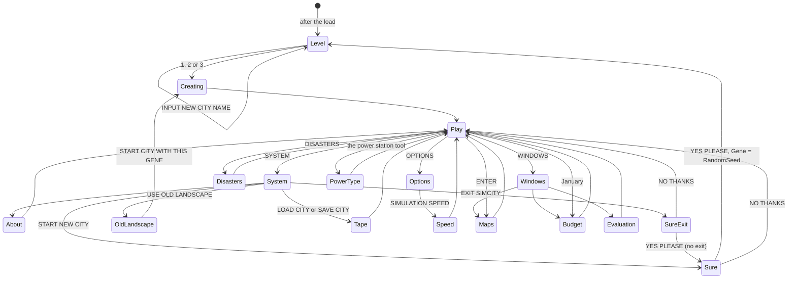
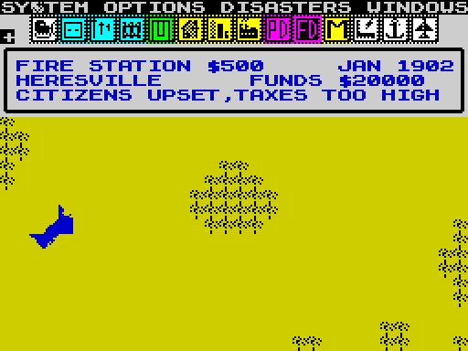
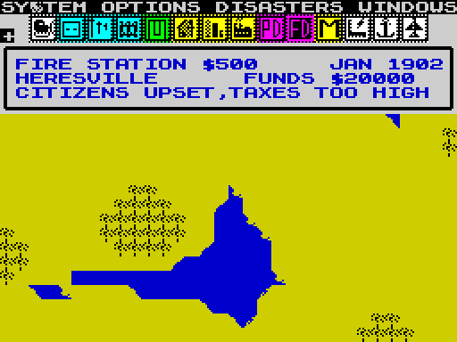
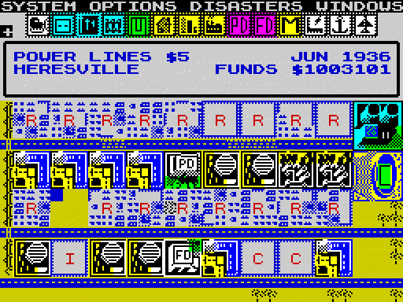
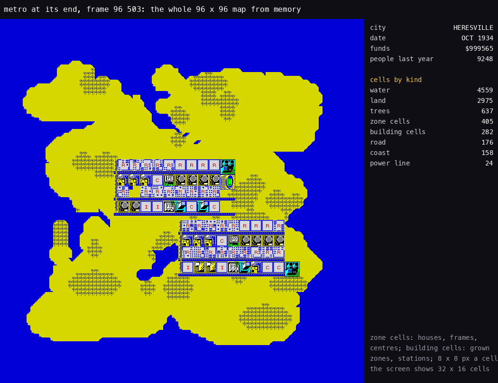

# 1. Game design

What this covers: the game as a player meets it:

- the premise and the credits;
- every screen, menu and dialog;
- starting a city: the level, the name and the five-digit landscape gene;
- the tools with their costs and sizes;
- the rules as the game plays them: zones, power, transport, services, taxes;
- the categories from VILLAGE to MEGALOPOLIS, and what each needs;
- the disasters;
- the evaluation and the advice;
- a whole city;
- what the Spectrum version leaves out compared with Maxis' original.

The recordings it rests on are those of [WALKTHROUGH 6.0](../WALKTHROUGH.md#60-the-recordings). `c1` loads the tape;
the ten bot recordings start from the saved state after the load. Each screenshot's name gives its recording and its
frame (in memory at, `kit/screen_shot.py`). Where a rule comes from the code, its routine is named; the full
mechanics are [doc 10](10-gameplay-logic.md).

## 1.1 The game

The player is the mayor of a city that does not exist yet. They lay out zones, roads, power and services on a 96 x
96 map. The city's people then build, move in, commute, pollute and complain on their own. There is no goal and no
end: the city grows, or it does not.

The ABOUT SIM CITY box gives the credits:

| Line on screen | Meaning |
| --- | --- |
| SIMCITY THE CITY SIMULATOR (C) 1989 MAXIS SOFTWARE | Maxis' game of 1989 |
| CONCEPT & DESIGN W.Wright | Will Wright |
| FOR  PROBE SOFTARE LIMITED | the conversion house ("SOFTARE" sic, the game's own spelling) |
| SPECTRUM PROGRAMMING  A.R.Lill | the Spectrum code |
| SPECTRUM GRAPHICS A.Lill & J.L | the tiles and icons |
| FOR MORE INFO :- INFOGRAMES 84 Rue du 1er Mars 1943, 69625 Villeurbanne Cedex, France | the publisher, 1990 |



*ABOUT SIM CITY, `menus` frame 13 854 (`kit/screen_shot.py`, scale 2). The lines above are quoted byte for byte from
the text at `$A0CC`, double spaces included.*

## 1.2 The play screen



*The play screen with the residential tool chosen, `tools` frame 5526 (`kit/screen_shot.py`, scale 2).*

| Rows | What | Witness |
| --- | --- | --- |
| 0 | the menu bar: SYSTEM, OPTIONS, DISASTERS, WINDOWS | DrawStatusPanel |
| 1-2 | the tool palette: 14 icons of 2 x 2 characters; a tool the funds cannot pay for is greyed | GreyUnaffordable |
| 3-6 | the status box: the tool and its price, the date; the city name and FUNDS; the advice line | PrintFunds, PrintDate, ShowAdvice |
| 8-23 | the map window: 32 x 16 cells of the 96 x 96 map | DrawView, DrawViewRowPass |

The pointer is moved with Q, A, O and P (or a Kempston or Sinclair joystick) and SPACE clicks. It acts on what is
under it:

- on the palette, it picks a tool;
- on the map, it uses the tool;
- on the menu bar, it opens a menu;
- at a window edge, it scrolls the map.

SYMBOL SHIFT with 1-9 or 0 picks tools 0-9 directly, and CAPS SHIFT with 5-8 scrolls. The controls in full are
[doc 5](05-controls.md).

## 1.3 Screens, menus and dialogs

Every screen the game can show, from the screenshots of the recordings:

| Screen | Opened by | What it offers | Screenshot |
| --- | --- | --- | --- |
| SELECT DIFFICULTY LEVEL | the start, START NEW CITY | 1 - EASY, 2 - MEDIUM, 3 - DIFFICULT, INPUT NEW CITY NAME | [levels 1139](img/play/levels-001139-level-menu.png), [the name typed](img/play/levels-001397-city-name-metro.png) |
| CREATING LANDSCAPE | a level chosen | the map being made from the gene | [tools 88](img/play/tools-000088-creating-landscape.png) |
| SYSTEM | the menu bar | ABOUT SIM CITY, START NEW CITY, USE OLD LANDSCAPE, LOAD CITY, SAVE CITY, EXIT SIMCITY, EXIT MENU | |
| ABOUT SIM CITY | SYSTEM | the credits (1.1) | [menus 13 854](img/play/menus-013854-about.png) |
| ARE YOU SURE ? | START NEW CITY, EXIT SIMCITY | NO THANKS, YES PLEASE | [new city](img/play/menus-028370-start-new-city-yes.png), [exit, YES PLEASE lit](img/play/menus-029758-exit-simcity-yes.png), [exit, NO THANKS lit](img/play/menus-029826-exit-simcity-1.png) |
| USE OLD LANDSCAPE | SYSTEM | the current landscape gene; INPUT NEW GENE; START CITY WITH THIS GENE | [gene 00003](img/play/menus-026140-old-landscape.png), [gene 12345](img/play/menus-026326-gene-12345.png) |
| SAVE CITY, LOAD CITY | SYSTEM | the file name, then START TAPE AND PRESS SPACE; the tape messages | [save](img/play/menus-020866-save-start-tape.png), [saving](img/play/menus-020896-saving.png), [searching](img/play/menus-023647-load-searching.png), [loaded](img/play/menus-026017-loaded.png) |
| OPTIONS | the menu bar | AUTO-BULLDOZE, AUTO-BUDGET, SOUND, ZONE DEMOLISH WAIT (each ON / OFF), SIMULATION SPEED | [menus 14 409](img/play/menus-014409-option-auto-budget-toggled.png) |
| SET SIMULATION SPEED | OPTIONS | FAST, NORMAL, SLOW, PAUSED; an asterisk marks the speed | [menus 15 767](img/play/menus-015767-speed-menu.png) |
| DISASTERS | the menu bar | FIRE, FLOOD, EARTHQUAKE, AIR CRASH, TORNADO, NUCLEAR MELTDOWN, DISABLE ALL (ON / OFF) | [menus 18 484](img/play/menus-018484-disasters-menu.png), [disable all](img/play/menus-018666-disable-all.png) |
| WINDOWS | the menu bar | MAPS, BUDGET, EVALUATION | [menus 18 965](img/play/menus-018965-windows-menu.png) |
| MAPS | WINDOWS, or ENTER | the whole map small, a 3 x 3 region picker, eight overlays: CITY, POLLUTN, POLICE, FIREDEP, TRAFFIC, POWER, TRANSPT, CRIME, with a MAX-MIN scale | [maps](img/play/menus-019003-maps.png), [an overlay](img/play/menus-019135-maps-sub3.png), [a region](img/play/menus-019501-maps-region5.png), [by ENTER](img/play/menus-019729-enter-maps.png) |
| FISCAL BUDGET | WINDOWS, and every January | TAX RATE; TAX COLLECTED; TRANS, POLICE, FIRE: AMOUNT REQSTD, AMOUNT ALLCTD, FUND LEVEL; CASH FLOW, PREVIOUS FUND, CURRENT FUNDS; GO WITH THESE FIGURES | [menus 20 006](img/play/menus-020006-budget-tax.png) |
| EVALUATION | WINDOWS | IS THE MAYOR DOING A GOOD JOB?; WHAT ARE THE WORST PROBLEMS?; POPULATION, MIGRATION, ASSESSED VALUE; CATAGORY, GAME LEVEL, CITY SCORE | [menus 20 323](img/play/menus-020323-evaluation.png), [city2's last](img/play/city2-081964-evaluation-end.png) |
| SELECT TYPE | the power station tool | `NUCLEAR POWER STATION $5000`, `COAL POWER STATION $3000`, NONE | [tools 11 069](img/play/tools-011069-select-power-type.png) |

The evaluation's "CATAGORY" is spelt so in the game's text.

Two things the menus do not say:

- **EXIT SIMCITY does not exit.** ExitSimCity `$A0B1` asks ARE YOU SURE ? and, on YES PLEASE, falls into START NEW
  CITY, which asks again (`menus` frames 29 758 and 29 826). There is no way back to BASIC.
- **START NEW CITY takes a random landscape.** NewCityItem `$A0B7` copies RandomSeed into Gene before the level menu,
  so the new map is not gene 00003 but whatever the generator holds; USE OLD LANDSCAPE keeps or types the gene.




## 1.4 Starting a city

A new city is made of three choices:

- **The level** sets the money: EASY 20 000, MEDIUM 10 000, DIFFICULT 5000 (StartSimulation `$830C`). It also raises
  the tax's weight on growth on MEDIUM and DIFFICULT (1.6).
- **The name** is typed into the status box (INPUT NEW CITY NAME, 12 letters). It defaults to HERESVILLE.
- **The landscape gene** is a five-digit number, 00003 for the first city; START NEW CITY draws a random one (1.3). The
  same gene always makes the same map (NewLandscape `$6A8E`): an island of 128 land discs on water, a coast, and 32
  groves of trees. USE OLD LANDSCAPE shows the gene and takes a new one.

Every city starts in January 1902 with an empty island.

| Gene 00003 (the default) | Gene 12345 |
| --- | --- |
|  |  |

*The map window of a new city from two genes, `menus` frames 28 247 and 27 132 (`kit/screen_shot.py`, scale 2).*

[Doc 10](10-gameplay-logic.md) gives the generator in full.

## 1.5 The tools

The 14 tools, with the prices the palette charges (ToolPrices `$6E1E`) and their sizes (ToolSizes `$6DAF`):

| # | Tool | Size | Price | Screenshot |
| ---: | --- | --- | ---: | --- |
| 0 | BULLDOZE | 1 x 1 | 1, more for a building | [tools 1721](img/play/tools-001721-bulldozer.png) |
| 1 | ROAD | 1 x 1 | 10 | [tools 2499](img/play/tools-002499-road.png) |
| 2 | POWER LINES | 1 x 1 | 5 | [tools 3248](img/play/tools-003248-power-line.png) |
| 3 | RAILROAD | 1 x 1 | 20 | [tools 3999](img/play/tools-003999-rail.png) |
| 4 | PARK | 1 x 1 | 10 | [tools 4719](img/play/tools-004719-park.png) |
| 5 | RESIDENTIAL | 3 x 3 | 100 | [tools 5526](img/play/tools-005526-residential.png) |
| 6 | COMMERCIAL | 3 x 3 | 100 | [tools 6332](img/play/tools-006332-commercial.png) |
| 7 | INDUSTRIAL | 3 x 3 | 100 | [tools 7137](img/play/tools-007137-industrial.png) |
| 8 | POLICE STATION | 3 x 3 | 500 | [tools 7944](img/play/tools-007944-police.png) |
| 9 | FIRE STATION | 3 x 3 | 500 | [tools 8748](img/play/tools-008748-fire.png) |
| 10 | STADIUM | 4 x 4 | 3000 | [tools 10 346](img/play/tools-010346-stadium.png) |
| 11 | POWER STATION | 4 x 4 | 4000 to choose; coal 3000, nuclear 5000 | [nuclear](img/play/tools-011107-nuclear.png), [coal](img/play/tools-011898-coal.png) |
| 12 | SEAPORT | 4 x 4 | 5000 | [refused: no funds](img/play/tools-012666-seaport-no-funds.png), [placed](img/play/ports-001989-seaport.png) |
| 13 | AIRPORT | 6 x 6 | 10 000 | [tools 9535](img/play/tools-009535-airport.png) |

How the tools behave:

- **Roads, rails and power lines** join up with their neighbours. They cross each other, and they bridge water.
- **A zone or a building** needs land under its whole box. With AUTO-BULLDOZE on (the default), trees and rubble in
  the box are cleared at 1 a cell.
- **The bulldozer** costs the building's size squared for a building. With ZONE DEMOLISH WAIT on, SPACE must be held
  before a zone goes.
- **A refused site** beeps (ToneBeep `$5B66`), unless a direction key is held. See
  [the refusal](img/play/tools-013457-occupied-beep.png).

Three quirks, known only from the code:

- **The power station** shows `POWER STATION $5000` in its palette text, but the palette tests 4000 (SelectTool,
  GreyUnaffordable). With 3000-3999 in the bank, the coal station (3000) is affordable, yet the tool cannot be
  picked.
- **A park on map column 2** is refused. ParkTool's `CP $02` tests the column, where the land code was meant.
- **The fire stations' funding** is read from the transport request in ApplyFunding ([doc 10](10-gameplay-logic.md)).

## 1.6 The rules: zones and what they need

Three kinds of zone hold the city. The player only lays them out; the people build in them.

| Zone | Grows into | Needs |
| --- | --- | --- |
| RESIDENTIAL (R) | houses, up to 8 a zone and density 64; then a 3 x 3 block, a church or a hospital | power, a road or rail and a trip to work (C or I), low pollution and crime, low taxes, demand |
| COMMERCIAL (C) | shops and offices in four sizes | power, transport, people (R) and industry (I) to serve, demand; an airport adds demand |
| INDUSTRIAL (I) | factories in four sizes | power, transport, people and shops, demand; a seaport adds demand |

A zone's growth is set by its **score**, worked out every pass (ZoneScoreOf `$7EC4`):

```text
score = land value - pollution - crime - tax penalty + demand          (0 to 255)
        = 0 when pollution is 28 or more, or land value is 0
land value  = 127 - distance to the centre + parks, water and trees around    (0 when unpowered or unreached)
crime       = (255 - land value) / 16 - police coverage
tax penalty = 8 x tax rate on EASY, 10 x on MEDIUM, 9 x on DIFFICULT
R demand    = 8 x (C + I - R) + 4 per stadium - 26
C demand    = 8 x ((R + I) / 2 - C) + 4 per airport - 30
I demand    = 8 x ((R + C) / 2 - I) + 4 per seaport - 30
```

A zone with pollution 28 or more scores 0, whatever else (`CP $1C` at `$7ED0`). The tax penalty is not monotonic in
the level: TaxPenaltyOf `$7E9B` adds the rate once for MEDIUM and DIFFICULT and a second time only when Level is not
2, so MEDIUM (Level 1) gets the two adds and DIFFICULT returns after one (`CP $02 / RET Z` at `$7EB4`).

A residential zone adds houses while its density is below score / 2, and loses them above it. The population is 16
times the sum of the R zones' densities.

The services:

- **Power.** Coal stations flood power over 450 cells of lines and zones; nuclear stations over 1350. A zone not
  reached blinks ([the blink](img/play/blink-unpowered.gif)) and does not grow.
- **Police and fire stations** cover a 24 x 24 grid around them, at a strength set by their funding.
- **Churches and hospitals** are never placed by the player. A full R zone becomes one when the city needs it.
- **Stadium, seaport, airport** raise the demand for R, I and C.

**A worked example: why `city2` stops near 6000.** The values come from `city2`'s end state (stage 2's means over a
pass):

1. The tax is 7 % on EASY, so the tax penalty is 8 x 7 = 56.
2. The mean land value is 157, the mean crime 3.
3. The R demand is about -26: C + I equals R, and there is no stadium.
4. The score is 157 - 3 - 56 - 26 = 72 before pollution.
5. The densities settle near score / 2: 22 to 36 in the 17 R zones, 359 in all.
6. The population is 16 x 359 = 5744. The game's year-end figure was 5696.

At a tax of 0 % the score rises by 56, to about 128, but the zones do not fill. Stage 2 ran `metro`'s end state (OCT
1934) at 0 % tax for 13 game years (`work/stage2/ceiling.py`, `ceiling.log`): the highest densities rose from 36-40 to
51-61, nine or ten of the 32-35 R zones stayed at density 0, and an R block appeared now and then (0 or 1). The year-end
population passed 10 000 at the end of 1936 (PopLastYear 10 624, read in APR 1937), about two years after the start, and
stayed between 11 000 and 14 400 after that.

## 1.7 Taxes and the budget

The FISCAL BUDGET opens every January (when BudgetDue is set), or from WINDOWS. AUTO-BUDGET skips it.

- **TAX RATE**: 7 % to start, 0 to 20. The window's field is edited in place.
- **TAX COLLECTED**: last year's population / 100 x the tax rate (TaxIncome `$930E`).
- **TRANS, POLICE, FIRE**: what each asks for (AMOUNT REQSTD), what it gets (AMOUNT ALLCTD) and the share (FUND LEVEL,
  0-100 %). The requests grow with the roads and rails, and with the stations: 100 each.
- **CASH FLOW, PREVIOUS FUND, CURRENT FUNDS**: the year's sum.

An underfunded service decays: the roads fall apart, and the stations cover less.

**A worked example: `city2`'s tax.** Last year's population was 5696 and the tax was 7 %. 5696 / 100 is 56, and 56 x
7 = 392 a year.

**No bankruptcy.** The funds cannot go below zero:

- the palette greys every tool it cannot pay for;
- the budget caps the services at the money there is.

In the `bankrupt` recording, 24 R zones without a road and the tax at 0 % kept the funds at 2680 for five game years
([money spent](img/play/bankrupt-002658-spent.png), [a year-end budget](img/play/bankrupt-024891-window-10.png)). No
text for bankruptcy, impeachment or game over exists in the image.

## 1.8 The categories

The evaluation names the city by last year's population (CategoryOf `$9760`, CategoryLimits `$9750`):

| Category | People | Sum of R densities (people / 16) | What that takes |
| --- | ---: | ---: | --- |
| VILLAGE | up to 2000 | up to 125 | a few powered R zones with a road |
| TOWN | above 2000 | 126 | about 5 R zones at density 25, with jobs and power |
| CITY | above 10 000 | 626 | 18-20 balanced R zones near the centre at 7 % tax, or about 10 full zones near 0 % |
| CAPITAL | above 50 000 | 3126 | R blocks: 17 to 33 of them at densities 96-192, each needing a score of 128 or more |
| METROPOLIS | above 100 000 | 6251 | 33 to 65 blocks |
| MEGALOPOLIS | above 500 000 | 31 251 | at least 163 blocks at the top density, with the C, I, transport and power to feed them |

Every limit is exclusive: CategoryOf computes limit - population (Sub24) and stops on `RET P`, so a population equal
to a limit stays in the lower category; a TOWN needs 2016 people (126 blocks of 16), not 2000.

The category changes nothing in the simulation. CategoryOf runs only when the evaluation opens, and no other code
reads Category `$975F`. The bot cities levelled off at 6000 (`city`, `city2`) and 9300 (`metro`), held by the 7 %
tax.

## 1.9 Time and speed

The calendar runs a month at the end of one, two or four simulation passes: FAST, NORMAL or SLOW. A pass takes 4.8 to
9.4 s of wall time, depending on the city. A month takes about 9.5 s at NORMAL in `c1` (computed: 237 frames a pass, two
passes; the log has 8 months in 17 passes), and 7.4 s and 9.7 s at FAST in `city2` and `metro`. PAUSED stops the growth,
but power, traffic and pollution go on, and a month still ends every 256 passes.
[Doc 4](04-game-loop.md#47-the-speed-masks-and-the-month) gives the masks and the measurements.

## 1.10 The disasters

A disaster comes from the DISASTERS menu, or by chance, and by chance it is always a TORNADO. RandomDisaster `$9144`
runs every 16 UI passes (about 0.76 s in play, at about 21 UI passes a second) unless DISABLE ALL is ON. Its gate passes
when the seed AND `$07FF` is 0, 1 in 2048, and the next Random AND 7 should then pick the disaster. But Random (`$5CC6`,
seed' = (seed + 1) x 254 mod 65 537 - 1) is a fixed sequence, so the 32 seeds that pass the gate fix the next draw: 15
give 7 (none), 16 give 6 and fail the extra 1-in-8 test of the meltdown, and one, `$0000`, gives `$00FD`, 5: the
tornado. The real chance is 1 in 65 536 a try: 65 536 x 0.76 s is about 14 hours of play on average. Fire, flood,
earthquake, air crash and meltdown never come at random (checked over all 65 536 seeds, `work/review/rvA/randdis.py`).

```text
RandomDisaster:  if DisastersOff: return
                 s = Random();  if (s AND $07FF) != 0: return     ; 32 seeds of 65 536 pass
                 a = Random() AND 7                               ; fixed by s: 7, 6 or (s = $0000) 5
                 if a == 0 or a == 7: return
                 if a == 6 and (Random() AND 7) != 0: return      ; all 16 such seeds return here
                 DisasterDue = a                                  ; only ever 5, TORNADO
```

| Disaster | What it does | Screenshot |
| --- | --- | --- |
| FIRE | 1 cell in 128 of what burns catches fire; fire spreads unless the fire coverage puts it out | [fire](img/play/disasters-000655-fire-1.png) |
| FLOOD | 1 coast cell in 32 floods; the water spreads 50 times, then dries back to land | [flood](img/play/disasters-002784-flood-1.png) |
| EARTHQUAKE | a long rumble, then fires and a flood | [earthquake](img/play/disasters-004937-earthquake-1.png) |
| AIR CRASH | needs an airport: the plane flies off its row and crashes, starting a fire | [the choice does nothing here](img/play/disasters-006614-air-crash-0.png): city2 has no airport, so AirCrash returns ([doc 10, 10.12](10-gameplay-logic.md#1012-disasters)) |
| TORNADO | lands on a random land cell, moves toward the centre 1 time in 8, burns what it crosses, and ends at random | [tornado](img/play/disasters-009315-tornado-1.png) |
| NUCLEAR MELTDOWN | needs a nuclear station: the station burns and 1 cell in 16 of the 45 x 45 around it turns to radiation | [meltdown](img/play/disasters-011540-meltdown-1.png) |



*An earthquake spreading over the city in the `disasters` recording, 2000 frames from the menu choice. The other
disasters animate in [the tornado](img/play/disasters-tornado.gif) and [the meltdown](img/play/disasters-meltdown.gif).*

## 1.11 The evaluation and the advice

The EVALUATION opens from WINDOWS. It shows:

- **IS THE MAYOR DOING A GOOD JOB?**: the share of Yes and No;
- **WHAT ARE THE WORST PROBLEMS?**: Traffic, Crime, Taxes, Pollution, Fire, House prices and Unemployment, in %;
- **POPULATION, MIGRATION, ASSESSED VALUE**: the people, the change in a year, and the value of what was built;
- **CATAGORY, GAME LEVEL, CITY SCORE**.

The assessed value counts what was built (AssessCity `$81E3`): 5 a rail, 10 a road, 1000 a police or fire station,
400 a hospital, 3000 a stadium, 5000 a seaport, 10 000 an airport, 3000 a coal and 6000 a nuclear station.

The advice line of the status box shows one of 26 messages. The simulation picks it every pass (Advise `$99AD`), and
the UI prints it every 32 UI passes (ShowAdvice `$9997`):

| Kind | Messages |
| --- | --- |
| zones | MORE RESIDENTIAL ZONES NEEDED, MORE COMMERCIAL ZONES NEEDED, MORE INDUSTRIAL ZONES NEEDED |
| transport | NEED BIGGER ROAD NETWORK, NEED LARGER RAIL SYSTEM, TRANSPORT SYSTEM FALLING APART, TRAFFIC JAMS ARE BAD |
| power | NEED A POWER PLANT, ZONES NEED POWER, BROWNOUTS DETECTED |
| demand | THE PEOPLE WANT A STADIUM, INDUSTRY NEEDS A SEA PORT, COMMERCE NEEDS AN AIRPORT |
| services | PEOPLE DEMAND FIRE DEPT, PEOPLE DEMAND POLICE DEPT, FIRE DEPT NEEDS FUNDS, THE POLICE NEED FUNDS |
| the city | CITIZENS UPSET,TAXES TOO HIGH, TOO MUCH POLLUTION, CRIME TOO HIGH |
| disasters | NUCLEAR MELTDOWN, FIRES HAVE BEEN DETECTED, COASTAL FLOODING DETECTED, MAJOR EARTHQUAKE DETECTED, AIR CRASH !!!, TORNADO DETECTED |

## 1.12 A whole city



*`metro` at its end (frame 96 503, OCT 1934), the whole 96 x 96 map drawn from the memory image with the tiles of
`src/res`. How to read: one cell is 8 x 8 pixels; the screen shows 32 x 16 of them. On the right are the city's name,
date, funds and last year's population, and the cells counted by kind (CellFlags `$6F9C`). The bot built two blocks
of R, C and I zones, with roads and services; the funds were held near 1 000 000 by a poke for the recording. Made with `python3 tools/fig_citymap.py work/stage1/rec/metro/end.szx docs/img/maps/metro-end.png
--title 'metro at its end, frame 96 503: the whole 96 x 96 map from memory'` (the map by `tools/fig_city.py`).*

The point: the default island has room for far more than the bot built. 2975 cells are still free land, and 4559
are water.

## 1.13 What the Spectrum version leaves out

Compared with Maxis' SimCity of 1989 (the Maxis column is the original's published feature list, not checked against its code), from the code and the image's texts (a strings scan,
[WALKTHROUGH 0](../WALKTHROUGH.md#0-the-medium)):

| Maxis' original | The Spectrum version |
| --- | --- |
| eight scenarios (Dullsville, San Francisco 1906, Tokyo, Boston, Rio de Janeiro ...) with goals and a time limit | none: every city is free play on an island from a five-digit gene |
| a scenario lost ends with the mayor thrown out | no game over of any kind: the funds cannot go below zero (1.7) |
| a monster disaster | six disasters, no monster |
| the GRAPHS window and the R/C/I demand gauge | neither; the demand shows only in the advice line |
| a map of 120 x 100 | 96 x 96 |
| the city running at full speed while drawing | two tasks share the Z80: the pointer gets two frames in three, the city the rest ([doc 4](04-game-loop.md#41-the-shape-of-the-program)) |

What the save keeps is only the map, the funds, the date and the name. The coverage, pollution, traffic and counters
are rebuilt by the simulation after a load. The options, the tax rate, the speed and the gene are not kept
([doc 7](07-objects.md)).
