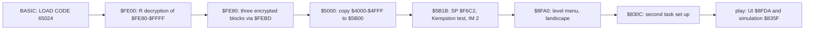

# 2. Architecture

What this covers: the machine budget; the memory map with its heatmap and the two stacks' low marks; the three
images (as loaded, at the entry, in play); the stages from the tape to play; the first sheet of the map tiles and a
whole city drawn from memory.

The recordings it rests on are those of [WALKTHROUGH 6.0](../WALKTHROUGH.md#60-the-recordings): `c1` (power-on,
the tape loaded at signal speed through the game's own loader, the level menu, play) and the ten bot recordings from
the saved state after the load (`tools`, `ports`, `menus`, `growth`, `city`, `city2`, `metro`, `disasters`, `levels`,
`bankrupt`), merged into `work/stage1/l1-all.json` (`tools/l1merge.py`, 11 L1 builds, 428 833 frames). L1 counts
are totals over whole recordings, so they carry no time in the frame.

## 2.1 The machine budget

| | |
| --- | --- |
| Machine | 48K: code and data fill `$5B00-$F7BA` and the IM 2 table `$FCFC-$FE00`; nothing pages, no AY |
| Interrupts | IM 2, I = `$FD`, a 257-byte table of `$FC` at `$FD00-$FE00` (loaded from tape), so every interrupt jumps to `$FCFC`, `JP $F70B` |
| Frame | 69 888 T; the handler reads the keyboard and the joysticks and switches between two tasks, about 1100 T an interrupt ([WALKTHROUGH 1](../WALKTHROUGH.md#1-one-recording-from-power-on)) |
| CPU | two tasks share it: the user interface (main loop `$8FDA`) and the simulation (`$835F`), switched by the interrupt; no HALT in play |
| Sound | the beeper only (doc 9) |
| Stacks | the UI's from `$F6C2` down (`$5B1C LD SP,$F6C2`), the simulation's from its saved frame at `$F6EE` (`$830C`); deepest L1 writes `$F6A4` and `$F6E8` (2.2) |

**The point**: a 48K game that keeps a 96 x 96 map of one byte a cell (9 K) and 7 K of simulation arrays beside
its code, and runs the simulation as a second task under a preemptive interrupt switcher.

## 2.2 The memory map

The 48K's RAM as the game uses it. The counts are L1's, summed over the ten bot recordings
(`work/stage1/rec/*/l1.json`; `c1` is left out of the counts because its tape load writes the whole block); "bytes"
counts the bytes of the range executed, read or written at least once (`work/stage1/regions.txt`, the sums in
`work/stage1/regions-out.txt`; the finer runs: `tools/l1map.py work/stage1/rec/*/l1.json --gap 64`).

| Range | Size | What | Use | Witness |
| --- | ---: | --- | --- | --- |
| `$4000-$5AFF` | 6912 | the screen: menu bar and icons on rows 0-2, the status box rows 3-6, the map view rows 8-23 (32 x 16 cells) | 58 043 522 writes, 5 180 722 reads | the view `$650B` writes the cells from `$4800` and `$5000` |
| `$5B00-$5B07` | 8 | the keyboard's eight half rows, read in every interrupt | 3 264 254 writes | `$F781`; the joysticks fold into the same bits (`$7A01`, `$7A32`) |
| `$5B08-$5B18` | 17 | data read by the input code | 1 420 517 reads, never written | stage 2 |
| `$5B19-$5FC5` | 1197 | code: the entry `$5B1B`, the Kempston test (its flag `$5B7F`), input and print routines; variables kept in it (the city name `$5F68-$5F73`, the cursor `$5CFC-$5CFD`) | 129 376 486 executions; 40 bytes written | `$5B1B-$5B44` |
| `$5FC6-$627B` | 694 | the texts: tool names with prices, months, levels, the six categories, the 27 advice and disaster messages (bit 7 ends each) | read only | `$6317` prints by index |
| `$627C-$6304` | 137 | data read 881 times in all | | stage 2 |
| `$6305-$A881` | 17 789 | the code (11 775 bytes executed) with its variables and tables between: the view `$6434-$65A2` and its pointers `$6505-$650A`; the 24-bit subtraction `$6680`; the map address `$6BDB`; the census `$8443-$844B`; the simulation loop `$835F`; the month `$8E94`; the speed row `$8F67-$8F6B` and table `$8F6C`; funds, date and pass counter `$8F97-$8F9F`; the main loop `$8FDA`; the category thresholds `$9750` and index `$975F`; the advice `$99AD`; save and load `$9E1F-$9EF8`; the menu and dialog texts `$9F40-$A6F0` (the about box `$A0CC`); the speed `$A3AB` | 4 356 713 173 executions; 437 bytes written, all variables in operands and between routines | `tools/l1map.py` |
| `$A882-$A8E3` | 98 | untouched | | L1 |
| `$A8E4-$A903` | 32 | a table | read only (52 320) | stage 2 |
| `$A924-$A92F` | 12 | variables | 4 writes | |
| `$A930-$A94E` | 31 | the save block: a 12-byte name, then 7 bytes from `$8F97` and 12 from `$5F68` ([WALKTHROUGH 6.2](../WALKTHROUGH.md#62-the-city-map-and-the-state)) | written by the save `$9E1F` | `tools/savetap.py` |
| `$A94F-$C44F` | 6913 | the simulation's work arrays: every byte read and written | 12 013 517 reads, 6 866 324 writes | zero in the image; their layout is stage 2's |
| `$C450-$E84F` | 9216 | the city map, 96 x 96, one byte a cell, `$C450 + 96 y + x` | 52 099 504 reads, 692 268 writes | `$6BDB`; all `$02` (clear land) in the image; saved whole by the save |
| `$E850-$EA67` | 536 | data | read only | stage 2 |
| `$EA68-$ED57` | 752 | the tiles of cells `$00-$5D`, 8 bytes each (2.5) | 34 198 857 reads; written only at `$EC88-$EC97` (cells `$44-$45`, an animated tile) | `$647D` |
| `$ED58-$F477` | 1824 | the tiles of the buildings' rows, n = `$00-$E3` (2.5) | read only | `$64FE` |
| `$F478-$F52F` | 184 | data | read only | stage 2 |
| `$F530-$F58D` | 94 | the attributes of cells `$00-$5D` | read only | `$652F` |
| `$F58E-$F671` | 228 | the attributes of the building tiles | read only | `$64EF` |
| `$F672-$F678` | 7 | data | read only | |
| `$F679-$F6A3` | 43 | untouched: the room under the UI's stack | | L1 |
| `$F6A4-$F6C1` | 30 | the UI task's stack (SP = `$F6C2` at the entry) | 517 778 writes; deepest `$F6A4` (5 writes) | `$5B1C` |
| `$F6C2-$F6ED` | 44 | the simulation task's stack below its frame | 1270 writes at `$F6E8-$F6EB`; `$F6C2-$F6E7` untouched | |
| `$F6EE-$F703` | 22 | the simulation task's first frame: ten register words and the return `$835F` at `$F702`, preloaded by `$830C` | 167 868 writes | `$830C-$831A` |
| `$F704-$F70A` | 7 | the scheduler: the running task `$F704`, the no-switch flag `$F705`, the two saved stack pointers `$F707` and `$F709` | 1 131 383 writes | `$F71C-$F73D` |
| `$F70B-$F7BA` | 176 | the interrupt handler `$F70B` and the input routine `$F781`, with a few variables (`$F74E-$F753`) and the ROM tape entries `$F79F`, `$F7AA` | 183 263 122 executions | WALKTHROUGH 1 |
| `$F7BB-$FCFB` | 1345 | untouched | | L1 |
| `$FCFC-$FCFE` | 3 | `JP $F70B`, the interrupt's landing | 1 207 614 executions | |
| `$FCFF-$FE00` | 258 | the IM 2 table (`$FD00-$FE00`, `$FC` each), code1's last 257 bytes | the vector is read at `$FDFF-$FE00`, 343 447 times each (the bus holds `$FF`) | doc 3 |
| `$FE01-$FFFF` | 511 | the loader's leftover: the decrypted loader and the ROM font glyphs in its padding | untouched in play | doc 3 |

The stacks' low marks: L1's deepest write in the UI's stack is `$F6A4` (30 bytes under its top), in the simulation's
`$F6E8` (6 bytes under its preloaded frame). The interrupt's own frame is in those counts: the return and the
handler's ten pushes (`$F70B-$F718`, 22 bytes) land on whichever task's stack is running, and the simulation's frame
`$F6EE-$F703` is rewritten at every switch (167 868 writes). The two stacks are 26 untouched bytes apart
(`$F6C2-$F6E7`), and 43 untouched bytes lie under the UI's (`$F679-$F6A3`).

*The heatmap, all 11 L1 builds with `c1` (`tools/fig_heatmap.py work/stage1/l1-all.json docs/img/heatmap.png`).
How to read: one row a 256-byte page, `$4000` at the top; the colour is log2 of the count; under each grid the
screen page drawn as the screen. Executed: `$5B19-$A881` and the handler at `$F70B`, the loader at `$FE00` and the
mover at `$5000` from `c1`'s load. Read: everything above `$A94F` is data, read evenly: the work arrays, the map
(the broad band from `$C450`), the tiles. Written: the screen, the work arrays and the map, the stacks; the code
area only in scattered variables. The point: code below `$A882`, the simulation's data above it, and the
interrupt machinery at the top.*

## 2.3 Three images: as loaded, at the entry, in play

| Image | What it is | How it was made |
| --- | --- | --- |
| as loaded | `c1`'s memory at the start of frame 16 279, when the loader has put the three blocks in place and the mover `$5000` is about to run | `tools/ttdmem.py work/stage1/c1 16279 0x4000 0xC000` (`work/stage1/c1-16279.bin`) |
| at the entry | the same at frame 16 281, after the mover and the entry's first frame | `work/stage1/c1-16281.bin`; equal to `tools/image.py`'s image but for `$F705` |
| in play | city2's end (DEC 1935) and `c1` at frame 21 534 | `tools/szx.py work/stage1/rec/city2/end.szx`, `work/stage1/c1-21534.bin` |

What changes (`work/stage1/imgdiff.py`, runs of differing bytes):

- **Loaded to entry**: 3862 bytes: `$5B00-$6AFF`, where the mover copies code2's first 4 K from `$4000`; `$F705`
  (set to 1 at `$5B24`) and one byte at `$FF83`. Code2 stays on the screen until the game draws over it; nothing is
  unpacked.
- **Entry to play** (`c1`, 5745 bytes): the map (5522 of 9216 bytes, the landscape made for the new city); the
  keyboard rows; about 40 runs of variables in the code area (`$8443-$845E` the census, `$8F67-$8F9F` speed, funds,
  date and passes, `$6505-$650A` the view's pointers, and operands such as `$6C02-$6C1E`); the tile of cells
  `$44-$45` (`$EC88-$EC97`); the stacks and the scheduler (`$F694-$F709`). No code changes.
- **Entry to city2's end**: 12 962 bytes, the same places plus the work arrays and the screen.

*The 48K memory as loaded, at the entry and in play (`python3 tools/fig_images.py docs/img/memory-images.png`).
How to read: one pixel a byte, one row a 256-byte page from `$4000`; grey by value, orange where the entry differs
from the load, red where play differs from the entry. The point: the mover's copy is the only change before play
(the orange band at `$5B00`); in play the screen and the map change wholesale, the work arrays in places, and the
code not at all.*

## 2.4 The stages from the tape to play

*The stages with their entry addresses (`c1` frames in [WALKTHROUGH 1](../WALKTHROUGH.md#1-one-recording-from-power-on)).*

## 2.5 The map tiles and a whole city

A map byte below `$80` is a cell drawn from 94 tiles at `$EA68 + 8 x cell` with an attribute at `$F530 + cell`
(`$6468-$6496`; the attribute table is put in `$6505` at `$652F`). A byte from `$80` starts one row of a building,
the bytes from `$C0` continue it: the row is `(first AND 7)` cells wide and draws tiles from a second table,
`$ED58 + 8 x n` with attributes at `$F58E + n`, where n = `(second AND $3F) x 8 + (third AND 7)` for its first cell
and one more for each next cell (`$650B-$6557`, `$655B-$6591`, `$64D6-$6501`); a building cut by the view's left
edge is found by stepping back over the `$C0` bytes (`$6593`). Drawn this way the map matches the screen: 0 pixels
differ over the view in city2's and growth's end states, 168 in metro's and 645 in tools' (the cursor, and the
blink and swap cases the drawing leaves out; `python3 tools/fig_tiles.py check ...`).

*The 94 cell tiles and the 228 building tiles as the image holds them (`python3 tools/fig_tiles.py sheet
work/mkgame/original.bin docs/img/sprites/tiles.png --used work/stage1/rec/*/end.szx`). How to read: each tile at 4
times its size with its attribute, labelled by its cell or n in hex; a yellow frame marks the tiles found on a map
of the stage 1 recordings. The point: land, water, trees, roads, rails, power lines and the empty zones are single
cells; developed zones and buildings are rows of tiles from the second table.*

*metro's city at its end (frame 96 503, SEP 1934), the whole 96 x 96 map drawn from memory
(`python3 tools/fig_tiles.py map work/stage1/rec/metro/end.szx docs/img/play/096503-metro-city-map.png`). How to
read: one cell 8 x 8 pixels; the screen shows a 32 x 16 window of it. The point: the landscape (gene 00003) is an
island; the bot's two blocks (`city` with the view at (30, 37), `metro` at (47, 53)) fill a small part of it.*
