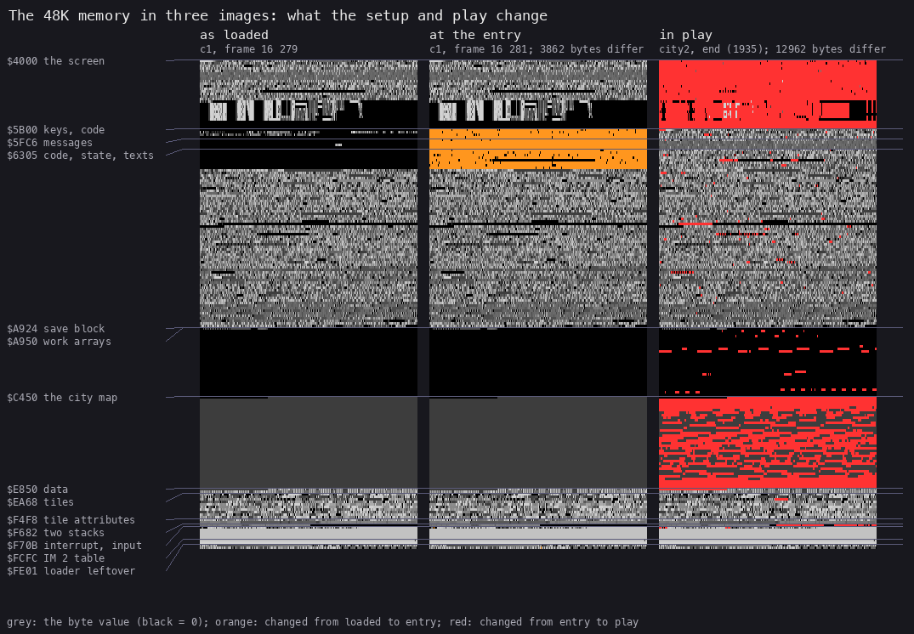
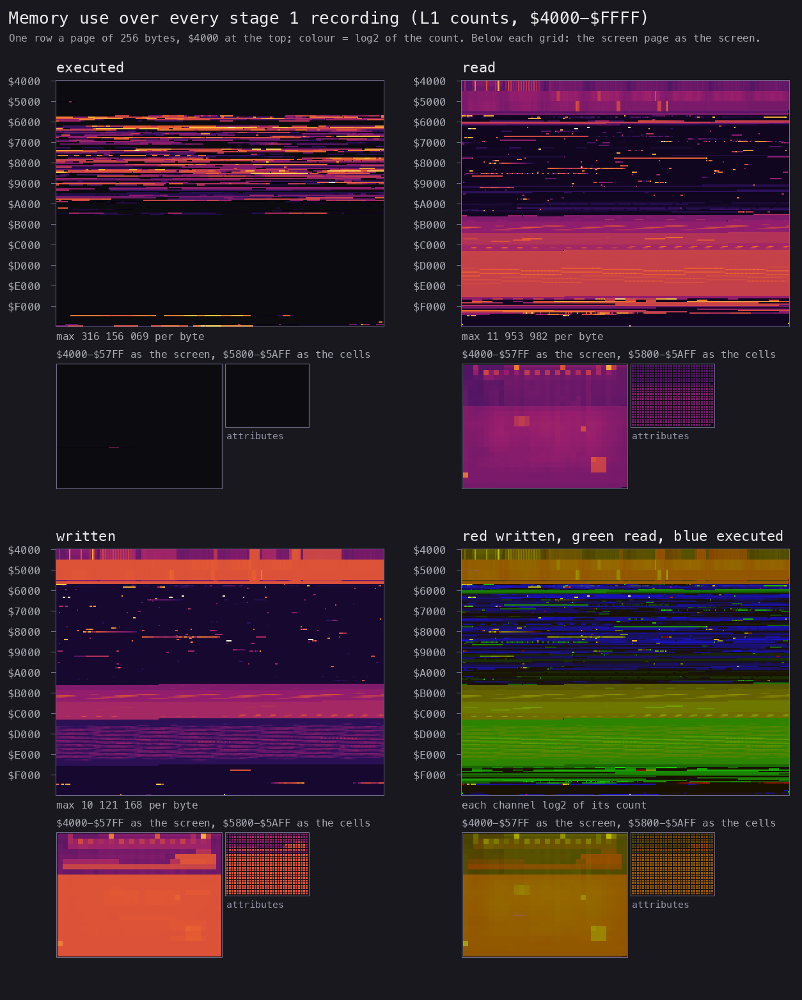
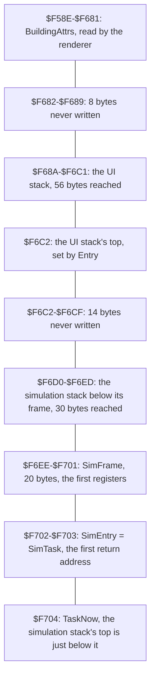
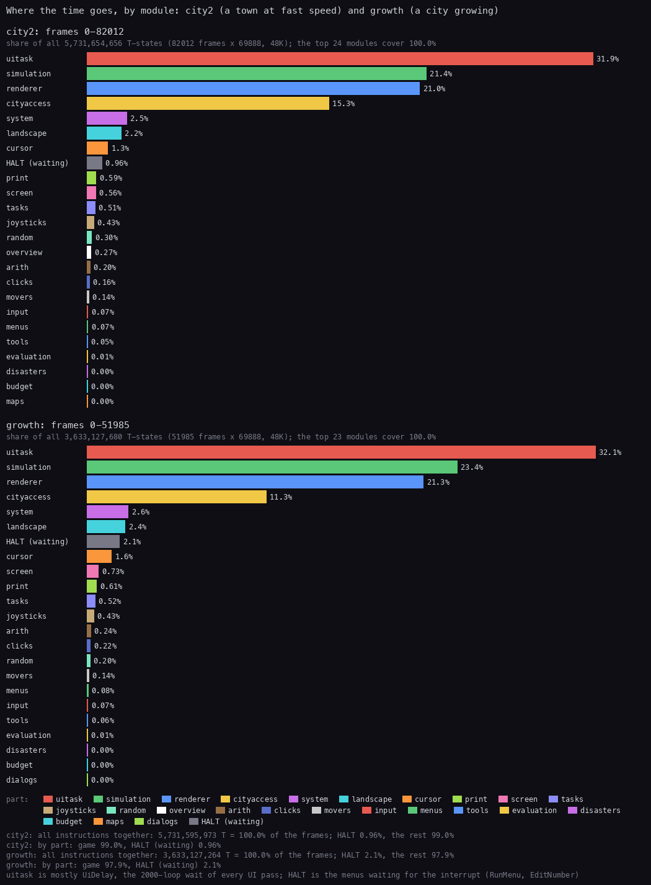
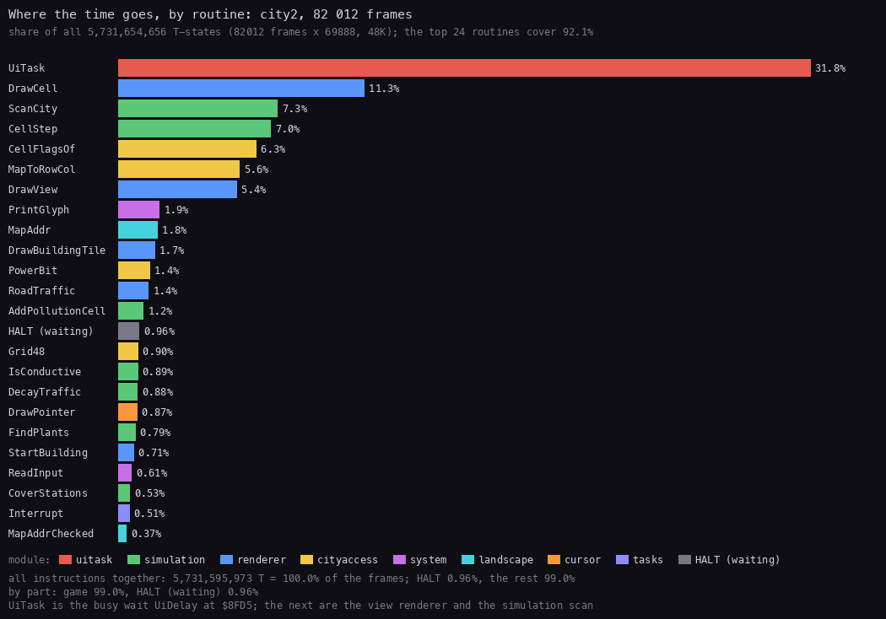
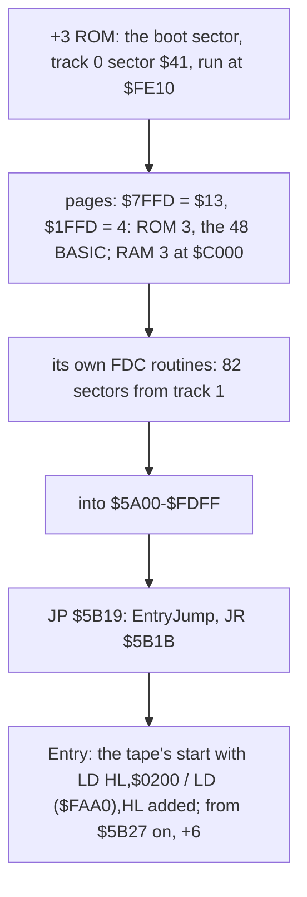
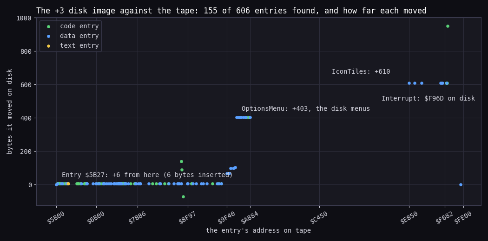
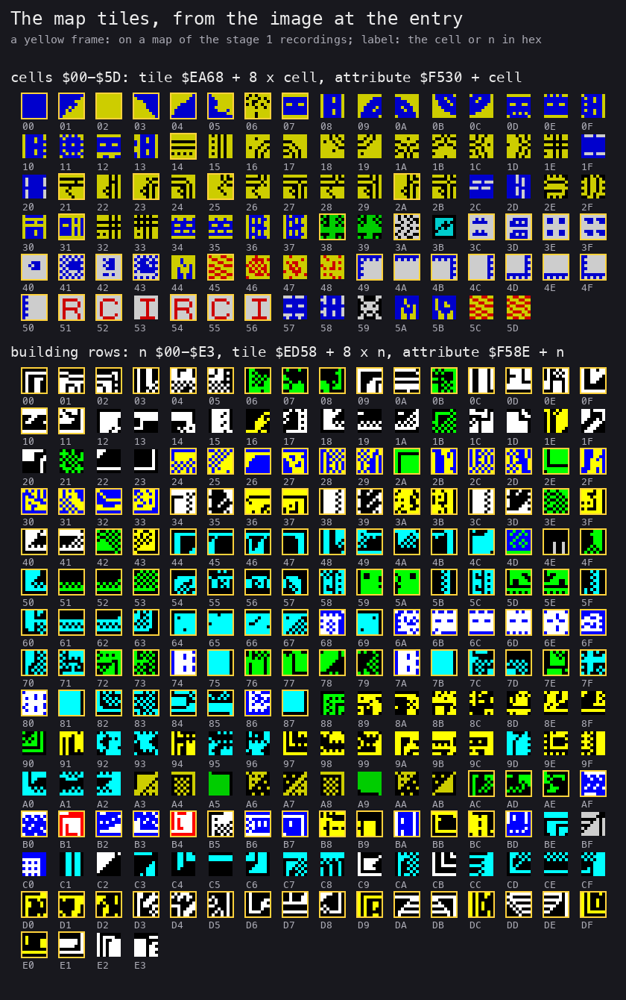
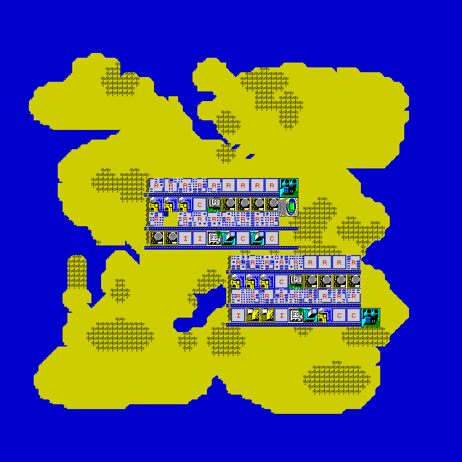

# 2. Architecture

What this covers:

- the machine budget;
- the module map: the 29 modules of `src/game/game.ann` and how the two tasks call into them;
- the memory map, with the names and ranges stage 2 settled;
- the three images (as loaded, at the entry, in play) and the heatmap;
- the two stacks;
- the leftovers;
- the frame budget;
- the +3 disk release;
- the map tiles, in brief (the renderer is [doc 6](06-rendering.md)).

The recordings it rests on are those of [WALKTHROUGH 6.0](../WALKTHROUGH.md#60-the-recordings):

- `c1`: power-on, the tape loaded at signal speed through the game's own loader, the level menu, play;
- the ten bot recordings from the saved state after the load: `tools`, `ports`, `menus`, `growth`, `city`, `city2`,
  `metro`, `disasters`, `levels`, `bankrupt`.

Their L1 builds are merged into `work/stage1/l1-all.json` (`tools/l1merge.py`: 11 builds, 428 833 frames). The
per-address counts of all eleven are in `work/stage2/counts.json`. L1 counts are totals over whole recordings, so
they carry no time within the frame.

## 2.1 The machine budget

| | |
| --- | --- |
| Machine | 48K. Code and data fill `$5B00-$FE00`; nothing pages; no AY |
| Interrupts | IM 2 with I = `$FD`. The 257-byte table at `$FD00-$FE00` holds `$FC` in every byte, so every interrupt goes to `$FCFC`, `JP Interrupt` (`$F70B`) |
| Frame | 69 888 T. The handler reads the keyboard and the joysticks and may switch tasks: about 1000-1100 T a frame, about 1.5 %, of which about 300 T the joystick readers ([doc 4.3](04-game-loop.md#43-the-interrupt-and-the-switch)) |
| CPU | two tasks share it: the UI task (UiTask `$8FA0`, pass `$8FDA`) and the simulation task (SimTask `$835F`), switched by the interrupt. No `HALT` in play; the menus wait with `HALT` |
| Sound | the beeper only ([doc 9](09-sound.md)) |
| Stacks | the UI's from `$F6C2` down, the simulation's from `$F704` down (2.5) |

**The point:** a 48K game that keeps a 96 x 96 map of one byte a cell (9 K) and 7 K of simulation arrays beside its
code. It runs the simulation as a second task under an interrupt that switches tasks.

## 2.2 The module map

Stage 2 split the code from `$5B00` to `$FE00` into 29 modules: 606 entries, each a routine or a data block. A module
is one stretch of addresses. `python3 work/docs/scA/modmap.py` lists them from `game.ann`:

| Module | Range | Bytes | Entries (code) | What |
| --- | --- | ---: | ---: | --- |
| entry | `$5B00-$5B47` | 72 | 2 (1) | the keyboard rows and the entry |
| beeper | `$5B48-$5B7E` | 55 | 2 (2) | the two beeper routines: the disaster noise and the refusal tone |
| input | `$5B7F-$5BFD` | 127 | 7 (4) | the Kempston flag and the key scans |
| screen | `$5BFE-$5CC3` | 198 | 9 (9) | screen addresses, icon drawing and clearing |
| random | `$5CC4-$5CEB` | 40 | 2 (1) | the random generator |
| cursor | `$5CEC-$5DEA` | 255 | 10 (6) | the pointer and the map box |
| print | `$5DEB-$635B` | 1393 | 29 (21) | printing: characters, inline codes, numbers, frames, the status panel and the texts |
| clicks | `$635C-$6432` | 215 | 10 (9) | the pointer's movement and the clicks |
| renderer | `$6433-$65A2` | 368 | 15 (9) | the map view renderer |
| arith | `$65A3-$66F1` | 335 | 13 (11) | the number printers and the arithmetic |
| menus | `$66F2-$6A8B` | 922 | 36 (27) | the menu and dialog engine |
| landscape | `$6A8C-$6CBE` | 563 | 13 (8) | the landscape generator |
| tools | `$6CBF-$753B` | 2173 | 77 (49) | the tools: palette, prices, sites, networks, bridges, the bulldozer and the buildings |
| cityaccess | `$753C-$7734` | 505 | 27 (21) | the city's arrays and cell helpers |
| movers | `$7735-$7A00` | 716 | 18 (14) | the moving objects: the train, the plane, the tornado; the meltdown |
| joysticks | `$7A01-$7A9D` | 157 | 3 (3) | the Kempston and Sinclair joysticks, the shift scroll |
| maps | `$7A9E-$7B85` | 232 | 7 (4) | the maps window |
| simulation | `$7B86-$8F96` | 5137 | 152 (102) | the simulation task: power, coverage, pollution, traffic, land value, crime, demand and the growth of every zone |
| uitask | `$8F97-$90A6` | 272 | 9 (6) | the UI task, with the funds, the date and the pass counter |
| disasters | `$90A7-$9193` | 237 | 11 (10) | the disasters |
| budget | `$9194-$95B7` | 1060 | 19 (14) | the budget |
| evaluation | `$95B8-$9B4D` | 1430 | 24 (15) | the evaluation and the advice |
| overview | `$9B4E-$9E08` | 699 | 14 (9) | the maps window's overview |
| saveload | `$9E09-$9F3F` | 311 | 9 (6) | save and load |
| dialogs | `$9F40-$A883` | 2372 | 54 (30) | the menus' descriptions and actions, the line editor |
| workspace | `$A884-$E84F` | 16 332 | 10 (0) | the movers' sprites, the save header, the work arrays and the map |
| graphics | `$E850-$F681` | 3634 | 6 (0) | the tiles and their attributes |
| tasks | `$F682-$F74D` | 204 | 8 (1) | the task switcher, its frame and its state |
| system | `$F74E-$FE00` | 1715 | 10 (6) | printing glyphs, the input read, the tape, a filled gap, the IM 2 vector |

The code is 19 844 bytes, `$5B00-$A883`. Above it lie 16 K of work space and 3.6 K of tiles, then the interrupt
machinery at the top.

Each task calls into the modules like this:

```mermaid
flowchart TD
    subgraph ui ["UI task: uitask $8FA0"]
        UL["UiLoop / UiPass"]
    end
    subgraph sim ["simulation task: simulation $835F"]
        SP["SimTaskPass $8362"]
    end
    subgraph irq ["interrupt: tasks $F70B"]
        INT["Interrupt"]
    end
    UL --> CUR["cursor: DrawPointer, TrackBox"]
    UL --> CLK["clicks: MovePointer, Click"]
    CLK --> TOOLS["tools: ToolClick, the sites, the bulldozer"]
    CLK --> MENUS["menus: RunMenu, DrawMenu"]
    MENUS --> DLG["dialogs: the descriptions and actions"]
    UL --> REN["renderer: DrawViewRowPass, DrawView"]
    UL --> MOV["movers: DrawMovers, MoveTrain, MovePlane, MoveTornado"]
    UL --> DIS["disasters: RunDisaster, RandomDisaster"]
    UL --> BUD["budget: BudgetWindow"]
    UL --> MAPS["maps, overview: MapsWindow"]
    UL --> PRN["print, arith: PrintFunds, PrintDate"]
    UL --> EVA["evaluation: ShowAdvice, EvaluationWindow"]
    SP --> CA["cityaccess: CellFlagsOf, MapToRowCol"]
    SP --> RND["random"]
    SP --> EVA2["evaluation: Advise $99AD"]
    SP --> ARI["arith: Add24, Div16, Mul16"]
    SP --> BUD2["budget: ApplyFunding, BudgetFigures, TaxIncomeOf"]
    SP --> LAND["landscape: MapAddr, MapAddrChecked"]
    SP --> MOV2["movers: StartPlane, StartTrain, Meltdown"]
    SP --> REN2["renderer: FindBuildingStart"]
    SP --> TOOLS2["tools: PutBuildingSize"]
    REN --> CA
    TOOLS --> CA
    INT --> SYS["system: ReadInput"]
    SYS --> JOY["joysticks: ReadKempston, ReadSinclair"]
```

The simulation module calls out to nine others: the cell access routines, the random generator, Advise, the 24-bit
and 16-bit arithmetic (Add24, Div16, Mul16), the budget's figures (ApplyFunding, BudgetFigures, TaxIncomeOf), the map
addressing of the landscape module (MapAddr, MapAddrChecked), the movers (StartPlane, StartTrain, Meltdown), the
renderer's FindBuildingStart and the tools' PutBuildingSize (every CALL and JP from `$7B86-$8F96`, from the listing).
The UI task reaches nearly everything else.

## 2.3 The memory map

The 48K's RAM as the game uses it, with the stage-2 names. The counts are L1's, summed over the ten bot recordings
(`work/stage1/rec/*/l1.json`, `byte_counts`). `c1` is left out of the counts, because its tape load writes every byte.
The code rows count executed bytes: an instruction counts once for each of its bytes (opcode and operands), so the
3-byte `JP` at `$FCFC` shows 3 x 402 538 for the 402 538 interrupts of the ten recordings.

| Range | Size | What | Use (L1) |
| --- | ---: | --- | --- |
| `$4000-$5AFF` | 6912 | the screen: the menu bar and icons on rows 0-2, the status box on rows 3-6, the map view on rows 8-23 (32 x 16 cells) | 58 043 522 writes, 5 180 722 reads |
| `$5B00-$5B07` | 8 | KeyRows: the keyboard's eight half rows, written by every interrupt; the joysticks fold into the same bits | 3 264 254 writes |
| `$5B08-$5B18` | 17 | KeyNone `$5B08` (a ninth row, always `$FF`), PortHighs `$5B09` (a leftover, 2.6), BitMasks `$5B11` (the eight bit masks) | 1 420 517 reads, never written |
| `$5B19-$5B47` | 47 | EntryJump `$5B19` (a leftover), Entry `$5B1B` | once |
| `$5B48-$A883` | 19 772 | the code of 24 modules (2.2), with its variables between the routines and in operands, and its texts and tables: the menu descriptions in dialogs `$9F40-$A883`, the speed table `$8F6C`, the funds, the date and the pass counter `$8F97-$8F9F` | 4 356 713 173 executed bytes; 437 bytes written |
| `$A884-$A923` | 160 | MoverSprites: the plane, two tornado frames, the train across and down, 32 bytes each | read by DrawMovers |
| `$A924-$A94F` | 44 | SaveName `$A924` (12), SaveHeader `$A930` (31): the tape header of a saved city, and SaveSpare `$A94F` (1, the name's twelfth letter, not saved) | written by the save |
| `$A950-$AB8F` | 576 | FireCover: 24 x 24 fire coverage | the simulation |
| `$AB90-$ADCF` | 576 | PoliceCover: 24 x 24 | the simulation |
| `$ADD0-$B6CF` | 2304 | Pollution: 48 x 48 | the simulation |
| `$B6D0-$BFCF` | 2304 | Traffic: 48 x 48 | the simulation |
| `$BFD0-$C44F` | 1152 | PowerMap: the powered bit of each map cell, 12 bytes a row | PowerFlood |
| `$C450-$E84F` | 9216 | CityMap: 96 x 96, one byte a cell, `$C450 + 96 y + x`; all land (`$02`) in the image | 52 099 504 reads, 692 268 writes |
| `$E850-$EA67` | 536 | IconTiles: 67 icon and frame tiles | read only |
| `$EA68-$ED57` | 752 | CellTiles: 94 cell tiles, cells `$00-$5D`; the fire and flood frames are copied in | 34 198 857 reads |
| `$ED58-$F4F7` | 1952 | BuildingTiles: 244 building tiles | read only |
| `$F4F8-$F681` | 394 | IconAttrs (56), CellAttrs (94), BuildingAttrs (244) | read only |
| `$F682-$F6C1` | 64 | UiStack: the UI task's stack, from `$F6C2` down to at least `$F68A` (2.5) | 517 778 writes |
| `$F6C2-$F703` | 66 | SimStack `$F6C2` (44), SimFrame `$F6EE` and SimEntry `$F702`: the simulation's first frame; its stack grows down from `$F704` to at least `$F6D0` | 167 868 writes |
| `$F704-$F70A` | 7 | TaskNow `$F704`, SwitchOff `$F705`, UiSP `$F707`, SimSP `$F709` | 1 131 383 writes |
| `$F70B-$F7BA` | 176 | Interrupt `$F70B`, the print state `$F74E`, PrintGlyph `$F754`, ReadInput `$F781`, a leftover `$F798`, TapeLoad `$F79F`, TapeSave `$F7AA`, TapePause `$F7AD` | 183 263 122 executed bytes |
| `$F7BB-$FCFB` | 1345 | E5Fill: 1345 bytes of `$E5`, untouched (2.6) | none |
| `$FCFC-$FCFE` | 3 | InterruptJump: `JP Interrupt` | 1 207 614 executed bytes: 402 538 interrupts, 3 bytes each |
| `$FCFF-$FE00` | 258 | InterruptSpare, then the vector table `$FD00-$FE00`, 257 bytes of `$FC` | the vector is read at `$FDFF-$FE00` only, no other byte of the table (so the bus holds `$FF`); L1 counts 343 447 reads of each, fewer than the 402 538 interrupts that each read it once (the byte counts miss accesses, 2.5) |
| `$FE01-$FFFF` | 511 | the loader, as it was left (2.6, [doc 3](03-build-and-load.md)) | untouched in play |

Stage 2 corrected four things in stage 1's map:

- `$A884-$A923` is the movers' sprites, not an untouched gap and a small table;
- the work arrays are five named arrays, not one block of 6913 bytes;
- the building tiles are 244, not 228, and the attribute tables start at `$F4F8`, not `$F530`;
- `$F682-$F6C1` is the UI's stack and `$F7BB-$FCFB` is not a stack at all (2.5, 2.6).

## 2.4 Three images and the heatmap

| Image | What it is | How it was made |
| --- | --- | --- |
| as loaded | `c1`'s memory at the start of frame 16 279: LoadBlock is reading block 7's last byte, the checksum; the mover `$5000` runs later in the same frame | `tools/ttdmem.py work/stage1/c1 16279 0x4000 0xC000` (`work/stage1/c1-16279.bin`) |
| at the entry | the same at frame 16 281, after the mover and the entry's first frame | `work/stage1/c1-16281.bin`; equal to the build's `game.bin` but for `$F705` ([doc 3.9](03-build-and-load.md#39-what-loads-is-what-runs)) |
| in play | `city2`'s end (DEC 1935), and `c1` at frame 21 534 | `tools/szx.py work/stage1/rec/city2/end.szx`, `work/stage1/c1-21534.bin` |

What changes between them (`work/stage1/imgdiff.py`, runs of differing bytes):

- **Loaded to entry**: 3862 bytes. Most are `$5B00-$6AFF`, where the mover copies code2 from `$4000`. The others are
  `$F705` (set to 1 at `$5B24`) and one byte at `$FF83`, a loader operand that is not yet back to `$F9` because
  block 7 is still loading (it returns to `$F9` at the end of every block). Code2 stays on the screen until the game draws over it.
  Nothing is unpacked.
- **Entry to play** (`c1`, 5745 bytes): the map (5522 of 9216 bytes: the landscape of the new city); the keyboard rows;
  about 40 runs of variables in the code area; the fire tile in CellTiles; the stacks and the switch state. No code
  changes.
- **Entry to `city2`'s end**: 12 962 bytes, the same places plus the work arrays and the screen.

*The 48K memory as loaded, at the entry and in play (`python3 tools/fig_images.py docs/img/memory-images.png`). How to
read: one pixel a byte, one row a 256-byte page from `$4000`; grey by value, orange where the entry differs from the
load, red where play differs from the entry. The point: the mover's copy is the only change before play (the orange
band at `$5B00`). In play the screen and the map change wholesale, the work arrays in places, and the code not at
all.*

*The heatmap of all 11 L1 builds with `c1`, made with
`python3 tools/fig_heatmap.py work/stage1/l1-all.json docs/img/heatmap.png`. How to read: one row a 256-byte page, `$4000` at the top; the colour is log2 of the count;
under each grid, the screen page drawn as the screen. Executed: `$5B19-$A883` and the interrupt at `$F70B`, plus the
loader at `$FE00` and the mover at `$5000` from `c1`'s load. Read: everything from `$A884` up is data: the work arrays,
the map (the broad band from `$C450`), the tiles. Written: the screen, the work arrays and the map, the stacks; in the
code area only scattered variables. The point: code below `$A884`, the simulation's data above it, the interrupt
machinery at the top.*

## 2.5 The two stacks

Each task has its own stack, and an interrupt pushes 22 bytes on whichever one is running
([doc 4.3](04-game-loop.md#43-the-interrupt-and-the-switch)). The low marks come from write probes on read-only opens
of `ports` and `menus` (review round 1, rvA): a write watch over each stack, the lowest address written and its frame.
L1's per-byte write counts cannot give the depth: they miss bytes (L1 counts `$F6EA` and `$F6A6` with 4 writes and
their neighbours with more), so the deepest byte L1 shows, `$F6E8` and `$F6A4`, is not the deepest the code reaches.

| Stack | Set by | Top | Deepest write seen | Depth | Spare below it |
| --- | --- | --- | --- | ---: | --- |
| UI task | Entry `$5B1C`: `LD SP,UiStack+$40` = `$F6C2` | `$F6C2` | `$F68A` (`menus` frame 3466; `ports`: `$F692`) | 56 | `$F682-$F689`, 8 bytes, then BuildingAttrs `$F58E-$F681` |
| simulation task | StartSimulation `$8311`: SimSP = SimFrame `$F6EE`; the first switch pops 20 bytes and `RET` takes SimEntry `$F702` | `$F704` | `$F6D0` (`menus` frame 5498; `ports`: `$F6D2`, frame 4126) | 52 | `$F6C2-$F6CF`, 14 bytes, then the UI stack's top |

Neither stack has much to spare:

- The simulation goes deep. The ring scan, ScanCity -> ZoneStep -> ResidentialStep (a jump from ZoneByKind) ->
  ScanRing -> ScanRingCell -> MapAddrChecked, is 16 bytes deep (`$F6F4`): five return addresses and three pushes
  (ZoneStep's HL, ScanRing's and ScanRingCell's BC). With an interrupt's 22 bytes on top it writes `$F6DE`, the low
  mark `ports` reached most often (341 frames). A ring cell picked as a route start goes further: ScanRingCell ->
  PickRouteStart -> Random, which pushes HL, DE and BC, is 22 bytes deep (`$F6EE`), `$F6D8` with an interrupt.
  CellStep is called after ZoneStep has returned, so its CellStepEnd is not on these chains. 52 of the 66 bytes were
  reached; 14 more would write into the UI stack's top.
- The UI's 56 bytes include the interrupt's 22, so the UI's own calls and pushes reach at least 34 bytes. Eight bytes
  more and a push would land in BuildingAttrs, and the map would show a wrong colour.

The depths are those of the recordings, a lower bound: a deeper path no recording took is possible.

**A worked example: the simulation's 52 bytes.** The deepest write, `$F6D0` at `menus` frame 5498, is 52 bytes below
the top `$F704`. If it is the last byte of an interrupt's 22-byte push, the simulation itself was 30 bytes deep at
that moment (`$F6E6`), 30 bytes. The deepest chain read from the code is 22 bytes (the route-start pick, `$F6EE`),
so the 52 bytes need a path 8 bytes deeper still, not identified from the probes (the trip walk, MakeTrip `$856A` ->
TripWalk -> TripStep from ResidentialStep, is a candidate; a write probe on `$F6D0` in `menus` near frame 5498 with
the PC and the stack words would name it). The 14 bytes left (`$F6C2-$F6CF`) are less than one interrupt frame.

## 2.6 Leftovers

Bytes in the image that no code runs or reads, or that are written before any reader sees them:

| Address | Bytes | What | Witness |
| --- | ---: | --- | --- |
| `$5B09` PortHighs | 8 | the eight port high bytes `$FE`, `$FD` ... `$7F`: a table for a key scan; ReadInput uses `RLC B` instead | L1: 0 reads |
| `$5B19` EntryJump | 2 | `JR $5B1B`: the +3 disk boot enters here (2.8); the tape's mover jumps past it to `$5B1B` | L1: never executed |
| `$64D5` BuildingDummy | 1 | a byte IX points at while a building row is drawn; its value is never read | the code |
| `$7657` DivLeftover | 17 | an older copy of a divide (`LD C,H; LD A,L; LD HL,0 ... RET`) | no caller, L1: never executed |
| `$85C4` TripLeftover | 16 | `XOR A; LD ($8568),A; LD HL,($8462); INC HL ...`: code no one calls | L1: never executed |
| `$8F67-$8F6B` | 5 | 8, 7, 7, 7, 1: a speed row the table does not have; SetSpeed overwrites it in the first pass | [doc 4.7](04-game-loop.md#47-the-speed-masks-and-the-month) |
| `$8F6A` | 1 | the fourth speed byte, copied every pass, never read | the code |
| `$835D` SimPaused | 1 | a pause flag ScanCity tests and only InitSimulation writes (0) | the code |
| `$F798` ReadInputLeftover | 7 | `RET; JP $FE0F; JP $FE0F`: jumps into the loader's area | L1: never executed |
| `$F7BB-$FCFB` | 1345 | all `$E5`: the byte a CP/M or +3DOS disk format writes | L1: untouched |
| `$FE14-$FE7F` | 108 | LoaderPadding: the bytes `$14-$7F`, each its own address's low byte | L1: untouched |
| `$FFA5-$FFFF` | 91 | the ROM font `$3E55-$3EAF` ("J" from its sixth row to "U"), saved with the loader | L1: untouched |

The two `JP $FE0F` and the `$E5` fill are left from the +3 disk build (2.8), an inference from the static match of the
two images (review round 1):

- In the disk image, right after ReadInput's `RET` (`$F9FA`), comes a reload routine:
  `DI; LD SP,$F924; LD HL,$0200; LD ($FAA0),HL; ...; LD HL,$5A00; LD BC,$0100; LD D,$52; CALL $FA89; JP $FE0F`. In the +3 boot sector `$FE0F` is the
  `DI` just before its code at `$FE10`, so the jump re-runs the disk's boot loader. On tape the routine is gone and
  only its `JP $FE0F` tails remain.
- The disk image has a `$E5` run too, 236 bytes at `$FC10-$FCFB`, ending at the same address as the tape's fill: the
  tape's master was saved from memory that a disk format had filled with `$E5`.

## 2.7 The frame budget

`kit/fig_budget.py` turns an L1 build into each routine's own T-states as a share of all the frames.

*The CPU's time by module in `city2` (82 012 frames, a town at fast speed) and `growth` (51 985 frames, a city
growing). How to read: each bar is a module's share of all the T-states of the recording; HALT is the time the menus
spend waiting for the interrupt (RunMenu, EditNumber). Made with `python3 ../../kit/fig_budget.py --ann
src/game/game.ann --by module --label city2 --state growth=work/stage1/rec/growth/l1.json
work/stage1/rec/city2/l1.json docs/img/arch/budget-modules.png` (with `--title` and `--note`).*

*The 24 routines that take the most time in `city2`, 92.1 % of it, coloured by module. Made with `python3
../../kit/fig_budget.py --ann src/game/game.ann --by routine --top 24 work/stage1/rec/city2/l1.json
docs/img/arch/budget-routines.png` (with `--title` and `--note`).*

| Module | `city2` | `growth` | Where it goes |
| --- | ---: | ---: | --- |
| uitask | 31.95 % | 32.10 % | UiDelay, the 2000-loop busy wait of every UI pass |
| simulation | 21.43 % | 23.38 % | ScanCity 7.32 %, CellStep 7.01 %, then the zone steps |
| renderer | 21.00 % | 21.25 % | DrawCell 11.29 %, DrawView 5.44 %, DrawBuildingTile 1.67 % |
| cityaccess | 15.29 % | 11.32 % | CellFlagsOf 6.33 %, MapToRowCol 5.57 %, PowerBit 1.44 % |
| HALT | 0.96 % | 2.06 % | the menus |
| the rest | 9.4 % | 9.9 % | system 2.51 / 2.61 % (PrintGlyph 1.89 %), landscape 2.17 / 2.41 % (MapAddr 1.80 %), cursor 1.31 / 1.56 %, print 0.59 / 0.61 %, tasks 0.51 / 0.52 %, joysticks 0.43 / 0.43 % ... |

**A worked example: UiDelay's share.** In `city2`, UiDelay's loop ran 69 574 000 times (`$8FD5` in
`work/stage2/counts.json`), exactly 2000 for each of the 34 787 UI passes. At 26 T a loop that is 1 808 924 000 T. The
recording is 82 012 frames of 69 888 T, 5 731 654 656 T. So UiDelay's loop is 31.6 % of the time. The budget
counts it twice over: the routine UiTask, whose range holds UiLoop and UiDelay, is 31.79 %, and the module uitask,
which adds Periodic and the funds and date printers, 31.95 %.

What the budget says:

- **A third of the CPU waits.** The wait is not idle: it paces the pointer, and the interrupt gives the simulation
  its frames from inside it ([doc 4.4](04-game-loop.md#44-a-frame-with-a-switch-against-the-beam)).
- **The renderer costs as much as the simulation.** It redraws one row of the window every UI pass, about 21 times a
  second, whether the map changed or not.
- **The simulation's 33 % of the frames** go to its own module and to the cell access routines it shares with the
  renderer and the tools.

## 2.8 The +3 disk release

A +3 disk exists: `Sim City (1990)(Infogrames)(+3)(FR)(en).dsk` (sha256 `94828cbf...`), copied to
`work/stage2/plus3/simcity.dsk`. Stage 2 compared it with the tape statically (`work/stage2/plus3.py`,
`work/stage2/plus3align.py`); no +3 instance ran it.

The disk has no +3DOS files. It boots from its own sector:

What the disk leaves out and what it adds:

- **No protection.** There is no R-keyed loader, no encrypted blocks and no loading screen.
- **The same program, reassembled.** `$5B00-$5B1C` holds the same bytes, EntryJump included. In Entry the disk's SP
  is `$F924`, the tape's `$F6C2` plus 610, and SwitchOff's address moves with the system part (`$F967`). Then the
  disk's Entry adds six bytes, `LD HL,$0200; LD ($FAA0),HL` (`21 00 02 22 A0 FA`), right after `LD (SwitchOff),A`.
  From the tape's `$5B27` on, every entry sits 6 bytes higher (NoiseBurst `$5B4E`, ToneBeep `$5B6C` on disk), up to
  the save code; the code bytes differ only in their address operands (KempstonFound `$5B85`, UiTask `$8FA6`).
- **Disk menus.** The SYSTEM menu gains CATALOGUE DISK and SIM FORMAT DISK. LOAD and SAVE become a LOADING / SAVING
  MENU of ten slots (DISK FILES, NAME / NUMBER, FILE0-FILE9), with the errors THERE ARE NO FILES ON THIS DISK, IT IS
  NOT FORMATTED, FORMAT DISK, DISK NOT PRESENT and NO CITY DATA FOUND. So the texts after them move by up to 403
  bytes.
- **The top moves up.** The tiles sit 610 bytes higher (IconTiles at `$EAB2`), and so does the system part: Interrupt
  is at `$F96D`, and `$FCFC` holds `JP $F96D`. The vector table stays at `$FD00`. The disk routines replace TapeLoad
  and TapeSave; TapePause stays, at `$FB64`.
- **EntryJump is used.** The disk enters at `$5B19`, the `JR $5B1B` the tape never runs (2.6). So the tape's image
  carries the disk version's entry.

*How far each entry of `game.ann` moved in the +3 disk's image. How to read: one dot an entry whose first 6 to 16
bytes occur exactly once within `$800` of its tape address in the disk image (155 of 606; most code entries hold
address operands that differ, so they are not found); x is the tape address, y the shift. The steps are +6 from
Entry's `$5B27`, +67 to +104 in the dialogs, +403 from OptionsMenu, +610 for the tiles and the system part. Four dots off
the steps: TapePause, which the disk keeps at `$FB64` (+951, after its disk routines), and three false matches in the
simulation, where the counter idiom of the church, fire and police steps, moved +6 with its counters, reads like the
coal, nuclear and hospital steps' own (disk `$8D96` is the tape's `$8D90` + 6, ChurchCount `$8450` + 6 = `$8456`). Made with
`python3 tools/fig_plus3.py work/stage2/plus3/disk-5A00.bin work/mkgame/original.bin docs/img/arch/plus3-shift.png`.*

**The point:** the disk release is the tape's program with the protection taken out and disk menus put in. Its
entry at `$5B19` is still in the tape's image, two bytes that nothing on tape runs.

## 2.9 The map tiles and a whole city

A map byte below `$80` is a cell. It is drawn from CellTiles `$EA68 + 8 x cell`, with the attribute at CellAttrs
`$F530 + cell`. A byte from `$80` starts one row of a building, and the bytes from `$C0` continue it; the row draws
its tiles from BuildingTiles. [Doc 6](06-rendering.md) gives the renderer in full.

*The cell tiles and the building tiles as the image holds them (`python3 tools/fig_tiles.py sheet
work/mkgame/original.bin docs/img/sprites/tiles.png --used work/stage1/rec/*/end.szx`). How to read: each tile at 4
times its size with its attribute, labelled by its cell or n in hex; a yellow frame marks the tiles found on a map
in the stage 1 recordings. The point: land, water, trees, roads, rails, power lines and the empty zones are single
cells; developed zones and buildings are rows of tiles from the second table.*

*`metro`'s city at its end (frame 96 503, OCT 1934), the whole 96 x 96 map drawn from memory (`python3
tools/fig_tiles.py map work/stage1/rec/metro/end.szx docs/img/play/096503-metro-city-map.png`). How to read: one cell
is 8 x 8 pixels; the screen shows a 32 x 16 window of it. The point: the landscape (gene 00003) is an island, and the
bot's two blocks fill a small part of it.*
