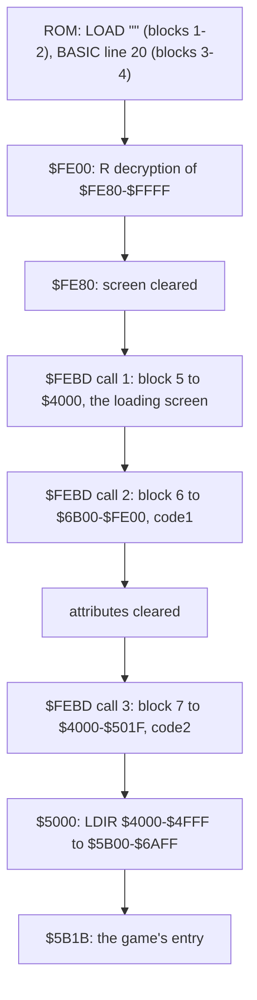

# 3. Build and load

What this covers: the medium block by block, the BASIC, the two-layer loader (an R-register self-decryption, then a
copy of the ROM's LD-BYTES that decrypts every byte it stores), the move of the last block into place, the source
build. The recordings it rests on: `c1` (power-on, `LOAD ""` typed, the original TZX played at signal speed: the
game's loader is its own code at `$FEBD`, so the emulator's LD-BYTES trap never applies; WALKTHROUGH 1).

<!-- Figures this document needs (GUIDE.md 4.2), remove each line when it is in: -->
<!-- - an animation of the R decryption and of a block's load-and-decrypt (`kit/memanim.py`, kit/routine_anim.py) -->
<!-- - the tape as a picture (blocks, times) -->

## 3.1 The tape, block by block

The original release (`orig/SimCity.tzx.zip`, `Sim City.tzx`) holds an archive-info block and seven standard-speed
blocks (TZX id `$10`), every one with the ROM's timings: pilot 2168 T, sync 667 / 735 T, zero 855 T, one 1710 T. The
archive info calls the scheme "Custom Normal Speed": the speed is the ROM's, the format is not. The last three blocks
have no header, carry the flag `$00` (a header's flag) with a header's long pilot (8063 pulses), and their data is
encrypted (3.3). Listed by `python3 tools/tzxblocks.py list "work/media/zxdb-SimCity.tzx/Sim City.tzx"`.

| Block | Kind | Bytes (+2 on tape) | Loads at | Time on tape | Pause after | Loaded by |
| ---: | --- | ---: | --- | ---: | ---: | --- |
| 0 | archive info: "Sim City", "Maxis", "Infogrames", 1990, "Strategy", "9.99 cass/14.99 disk", "Custom Normal Speed", "Perfect TZX sampled from the original cassette by Church of the Latter-Day Speccy", CRASH #79 83 % | | | | | |
| 1 | header: Program "Simcity", length 144, LINE 0 | 17 | | 5.09 s | 1014 ms | the ROM (`LOAD ""`) |
| 2 | the BASIC program, six lines (3.2) | 144 | PROG | 2.74 s | 1882 ms | the ROM |
| 3 | header: Bytes "loader", length 512, start 65024 (`$FE00`) | 17 | | 5.09 s | 1006 ms | the ROM (line 20) |
| 4 | the loader, its tail encrypted (3.3) | 512 | `$FE00-$FFFF` | 4.95 s | 2289 ms | the ROM |
| 5 | headerless, flag `$00`, encrypted: the loading screen | 6912 | `$4000-$5AFF` | 45.91 s | 0 ms | the loader `$FEBD` (call 1) |
| 6 | headerless, flag `$00`, encrypted: code1, the bulk of the game | 37 633 | `$6B00-$FE00` | 222.93 s | 267 ms | the loader (call 2) |
| 7 | headerless, flag `$00`, encrypted: code2, the low part of the game and a mover | 4128 | `$4000-$501F`, then moved to `$5B00-$6AFF` (3.4) | 29.03 s | 0 ms | the loader (call 3) |

- The signal lasts 315.74 s with the pauses (16 110 frames of the 48K at 69 888 T), 322.2 s by the TZX's own pause
  fields; `tools/tzxblocks.py` prints both.
- code1 is one byte longer than the room below the loader: its last byte lands on `$FE00`, the loader's first
  instruction (`DI`), which has run long before.
- The game occupies `$5B00-$FE00` in one piece once code2 is moved: code2's 4096 bytes at `$5B00-$6AFF`, code1 at
  `$6B00-$FE00`.

**The point:** a plain ROM-speed tape on the outside, so any tape deck and copier reads it, but the three blocks a
copier would need are headerless, flagged as headers and encrypted, so `LOAD "" CODE` cannot take them.

## 3.2 The BASIC

`python3 tools/basic_list.py work/stage1/blocks/basic.bin` lists the 144-byte program:

| Line | Text | What it does |
| ---: | --- | --- |
| 10 | `PAPER 0: INK 0: BORDER 0: CLEAR 32767` | black on black, so the loading screen appears only as it is decrypted; RAMTOP below the loader |
| 20 | `LOAD "" CODE 65024` | block 3 and 4: the 512-byte loader at `$FE00` |
| 30 | `RANDOMIZE USR 65024` | into the loader |
| 40 | `POKE 23418,84` | never reached; 23418 is in the system variables (`$5B7A`) |
| 50 | `SAVE "Simcity" LINE 0` | never reached: the mastering line that wrote block 1 and 2 |
| 60 | `LOAD "mast0"` | never reached: the next file of the authors' mastering tape |

The header's LINE 0 autostarts the program at its first line. Lines 40-60 are the authors' leftovers: the program
saved itself with line 50 and went on to load "mast0" from the mastering tape.

## 3.3 The loader

The 512-byte block at `$FE00` has two layers.

**Layer 1, an R-register decryption** (`$FE00-$FE13`, the only clear code). It sets R to 0, then XORs every byte
from `$FE80` to `$FFFF` with the value of R read just before, and jumps to `$FE80`:

```asm
FE00  DI
FE01  LD HL,$FE80
FE04  XOR A
FE05  LD R,A          ; R = 0
FE07  LD A,R          ; the key: R after 2 more M1 cycles, then 8 per byte
FE09  XOR (HL)
FE0A  LD (HL),A
FE0B  INC HL
FE0C  LD A,H
FE0D  OR L
FE0E  JP NZ,$FE07     ; up to $FFFF
FE11  JP $FE80
```

The loop takes eight M1 cycles a byte (`LD A,R` is two, the six others one each), and R's low seven bits count M1
cycles, so the key of the byte at `$FE80 + k` is `(2 + 8 k) AND $7F`. The key depends on the instruction timing,
not on any byte: a disassembler or a single-stepper that touches R gets garbage. `$FE14-$FE7F` is padding: the
bytes `$14-$7F` in order.

| Address | On tape | Key | Decrypted | |
| --- | ---: | ---: | ---: | --- |
| `$FE80` | `$F1` | `$02` | `$F3` | `DI` |
| `$FE81` | `$3B` | `$0A` | `$31` | `LD SP,nn` |
| `$FE82` | `$B5` | `$12` | `$A7` | |
| `$FE83` | `$7B` | `$1A` | `$61` | `LD SP,$61A7` |

**Layer 2, the loader proper** (`$FE80-$FFA4` decrypted): it clears the screen, then calls its tape routine
`$FEBD` three times:

```asm
FE80  DI
FE81  LD SP,$61A7
FE84  LD HL,$4000 / LD DE,$4001 / LD BC,$1AFF / LD (HL),L / LDIR   ; the screen zeroed
FE90  LD IX,$4000 / LD DE,$1B00 / CALL $FEBD                        ; block 5: the screen
FE9A  LD IX,$6B00 / LD DE,$9301 / CALL $FEBD                        ; block 6: code1
FEA4  LD HL,$5800 / ... / LDIR                                      ; the attributes zeroed
FEB0  LD IX,$4000 / LD DE,$1020 / CALL $FEBD                        ; block 7: code2
FEBA  JP $5000
```

`$FEBD` is the ROM's LD-BYTES (`$0556`) copied to RAM and changed, which is why the emulator's tape trap (on the ROM
routine) never fires and `c1` loads at signal speed:

- the flag is `$00`, not `$FF`, and a bad flag returns at once;
- a byte counter at `$FF32` (the operand of `LD A,$00` at `$FF31`, rewritten by the routine itself) is zeroed per
  call and grows by 3 before each data byte;
- each received byte L is stored as `L XOR key XOR E`, where E is the low byte of the count still to load (the
  block's length at the first byte);
- the border stripes through the loader's own colour value at `$FF83`, rewritten as it goes;
- the parity is checked as in the ROM (H must end at 0); an error returns with carry clear, and the caller does not
  test it: a failed block runs on into whatever was loaded.

Worked on block 7's first three bytes (its length `$1020`, so E starts at `$20`):

| Byte | On tape | Key | E | Stored |
| ---: | ---: | ---: | ---: | ---: |
| 0 | `$DC` | `$03` | `$20` | `$FF` |
| 1 | `$E6` | `$06` | `$1F` | `$FF` |
| 2 | `$E8` | `$09` | `$1E` | `$FF` |

`python3 tools/decrypt_tape.py check "work/media/zxdb-SimCity.tzx/Sim City.tzx"` decrypts the three blocks and
encrypts them back: all three come back identical, so the transform is known in both directions. Its output for the
screen is the Probe / Infogrames loading picture, signed "SIMON" (Simon Butler).



## 3.4 The mover and the entry

Block 7 lands in the screen's pixel area, where the attributes, zeroed just before, keep it invisible. Its last 32
bytes hold a mover at `$5000`:

```asm
5000  DI
5001  LD HL,$4000
5004  LD DE,$5B00
5007  LD BC,$1000
500A  LDIR            ; code2's 4096 bytes to $5B00-$6AFF
500C  JP $5B1B        ; the game's entry
```

At `$5B1B` the game sets its stack to `$F6C2`, the border black, tests for a Kempston interface (port `$1F`, 32 768
reads; the flag at `$5B7F`), sets `I = $FD` and IM 2, enables interrupts and jumps to `$8FA0`. The image as it stands
there is written by `python3 tools/image.py work/mkgame/original.bin` from the tape alone: the decrypted loader at
`$FE00`, the screen, code1, the attributes zeroed, code2 at `$4000` and its copy at `$5B00`, and the loader's byte key
`$FF32` as the last call leaves it (`3 x 4128 AND $FF = $60`). Compared with `c1` at frame 16 281 over `$4000-$FFFF`
(`tools/ttdmem.py`), one byte differs: `$F705`, set to 1 by the entry's own `LD ($F705),A` at `$5B24`.

## 3.5 The load in `c1`

`c1` (`work/stage1/c1`, made by `python3 tools/rs_capture.py` with the tape at signal speed, base 37030) holds the
whole load. The stage frames come from its re_session stages, the block frames from a binary search over its
`session.ttd` (`tools/ttdmem.py`: the first frame where the block's last byte, decrypted, is in memory):

| Frame (T in frame) | Event | Witness |
| ---: | --- | --- |
| 1258 (65 246) | the BASIC's `RANDOMIZE USR 65024`: `$FE00` entered | stage `$FE00` |
| 1259 (13 443) | layer 1 done, `$FE80` entered | stage `$FE80` |
| 3561 | block 5 in: the loading screen's last attribute stored | `$5AFF` decrypted, `$5800` not 0 |
| 3862 | block 6's first byte at `$6B00` | ttdmem first frame |
| 14 775 | block 6's last byte at `$FE00` | ttdmem first frame |
| 15 077 | block 7's first byte at `$4000` (the screen's pixels start to change) | ttdmem first frame |
| 16 279 (8372) | the mover `$5000` entered | stage `$5000` |
| 16 280 (51 501) | the game's entry `$5B1B` | stage `$5B1B` |
| 16 310 | the main program `$8FA0` | stage `$8FA0` |

From power-on to the entry: 16 280 frames, 325.6 s at 50 Hz; the tape's own length is 16 110 frames, the rest is
the ROM's start-up, the typed `LOAD ""` and the gaps before each block.

## 3.6 The other releases

Which copies exist and how each differs from this tape is in the case [README](../README.md#other-releases-and-copies).
The Erbe re-release has the same three blocks decrypted, under standard headers, with a BASIC loader of its own.
