# 3. Build and load

What this covers: the tape block by block and as a picture; the BASIC; the protected loader in its two layers (the
tail decrypted with the R register, then a changed copy of the ROM's LD-BYTES that decrypts every byte it stores);
the hang of a failed block; the mover; the load as `c1` saw it, with the loading picture; the check that what
loads is what runs; and the source build that encrypts the blocks back. There is no packer: the only transforms are
the two ciphers, and each is given in both directions, with real bytes and its animation.

The recording it rests on is `c1` (`work/stage1/c1`): the 48K from power-on with zeroed RAM, `LOAD ""` typed and the
original TZX played from the signal at ROM speed, the fast LD-BYTES trap and turbo tape off. The game's own loader
reads the last three blocks, so no emulator trap applies to them ([WALKTHROUGH 1](../WALKTHROUGH.md#1-one-recording-from-power-on)).

Two kinds of frame number are used, and each table says which:

- **"ran in"**: the frame an instruction ran in, from `time_travel probe_frames` (an `exec` or `write` probe) or from
  an access trace;
- **"in memory at"**: a `memory_at` sample at the start of a frame, which shows what the frames before it did. A
  byte written in frame N is in memory at frame N + 1.

```bash
. work/env.sh
python3 ../../kit/rs.py open --work work/docs/scA/c1 --ttd work/stage1/c1/session.ttd --model 48K --port-base 37050
python3 work/docs/scA/probe.py 0 21535 exec:0556 exec:FEBD exec:FE00 exec:FE80 exec:5000 exec:5B1B exec:8FA0 exec:FFA0
python3 work/docs/scA/probe.py 1000 16400 write:4000 write:5800 write:5AFF write:6B00 write:FE00 write:501F write:6AFF
```

## 3.1 The tape, block by block

The original release (`orig/SimCity.tzx.zip`, `Sim City.tzx`) holds an archive-info block and seven standard-speed
blocks (TZX id `$10`). Every one has the ROM's timings: pilot 2168 T, sync 667 / 735 T, zero 855 T, one 1710 T. The
archive info calls the scheme "Custom Normal Speed": the speed is the ROM's, the format is not. The last three blocks
have no header, carry the flag `$00` (a header's flag) with a header's long pilot (8063 pulses), and their data is
encrypted (3.5). Listed by `python3 tools/tzxblocks.py list "work/media/zxdb-SimCity.tzx/Sim City.tzx"`.

| Block | Kind | Bytes (+2 on tape) | Loads at | Time on tape | Pause after | Read by; called (ran in, `c1`) |
| ---: | --- | ---: | --- | ---: | ---: | --- |
| 0 | archive info: "Sim City", "Maxis", "Infogrames", 1990, "Strategy", "9.99 cass/14.99 disk", "Custom Normal Speed", "Perfect TZX sampled from the original cassette by Church of the Latter-Day Speccy", CRASH #79 83 % | | | | | |
| 1 | header: Program "Simcity", length 144, LINE 0 | 17 | | 5.09 s | 1014 ms | the ROM's LD-BYTES `$0556`; 245 |
| 2 | the BASIC program, six lines (3.2) | 144 | PROG (`$5CCB`) | 2.74 s | 1882 ms | the ROM; 515 |
| 3 | header: Bytes "loader", length 512, start 65024 (`$FE00`) | 17 | | 5.09 s | 1006 ms | the ROM (line 20); 705 |
| 4 | the loader, its tail encrypted (3.4) | 512 | `$FE00-$FFFF` | 4.95 s | 2289 ms | the ROM; 961 |
| 5 | headerless, flag `$00`, encrypted: the loading screen | 6912 | `$4000-$5AFF` | 45.91 s | 0 ms | LoadBlock `$FEBD`; 1261 |
| 6 | headerless, flag `$00`, encrypted: code1, the bulk of the game | 37 633 | `$6B00-$FE00` | 222.93 s | 267 ms | LoadBlock; 3561 |
| 7 | headerless, flag `$00`, encrypted: code2 and the mover | 4128 | `$4000-$501F`, then moved to `$5B00-$6AFF` (3.7) | 29.03 s | 0 ms | LoadBlock; 14 775 |

- The signal lasts 322.2 s with the pauses (`tzxblocks.py`: 16 110 frames at 50 Hz).
- code1 is one byte longer than the room below the loader: its last byte lands on `$FE00`, the loader's first
  instruction (`DI`), which has run long before. That byte is `$FC`, the 257th byte of the IM 2 table
  ([doc 4.3](04-game-loop.md#43-the-interrupt-and-the-switch)).
- Once code2 is moved, the game is one piece, `$5B00-$FE00`: code2's 4096 bytes at `$5B00-$6AFF`, code1 at
  `$6B00-$FE00`.

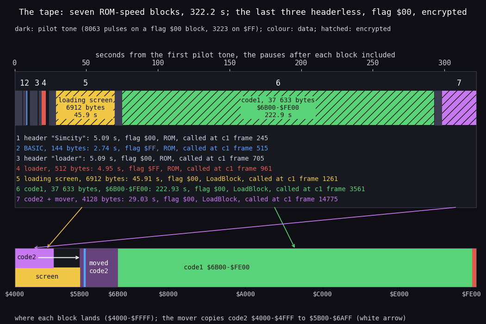

*The seven data blocks of `Sim City.tzx` on a time line, and where each lands in `$4000-$FFFF`. How to read: top,
seconds from the first pilot tone with the pauses; each block is its pilot (dark) and its data (its colour), the
three encrypted blocks hatched; the list gives each block's time, flag, reader and the `c1` frame its reader was
called in (ran in). Bottom, the address space: the screen and code2 share `$4000` (yellow and purple), code1 fills
`$6B00-$FE00` (green), the loader sits at `$FE00` (red), BASIC at PROG (blue line); the white arrow is the mover's
copy. Made with `python3 tools/fig_tape.py "work/media/zxdb-SimCity.tzx/Sim City.tzx" docs/img/load/tape.png
1=245 2=515 3=705 4=961 5=1261 6=3561 7=14775` (timings from `tools/tzxblocks.py`, frames from the probes above).*

**A worked example: the tape's timing gives the load's frames.** A ROM-speed bit is two pulses: 3420 T for a one,
1710 T for a zero. From the end of a block's first data byte to the end of its last, the tape plays every bit of the
bytes between (data bytes 2 to n), so that stretch must equal the frames between LoadBlock's first and last store:

| Block | T for data bytes 2 to n | Frames (69 888 T) | First and last store (ran in, `c1`) | Frames between |
| ---: | ---: | ---: | --- | ---: |
| 5 | 143 140 680 | 2048.1 | `$4000` 1512, `$5AFF` 3560 | 2048 |
| 6 | 762 704 460 | 10 913.2 | `$6B00` 3861, `$FE00` 14 775 | 10 914 |
| 7 | 84 051 630 | 1202.7 | `$4000` 15 076, `$501F` 16 278 | 1202 |

`python3 work/docs/scA/tapetime.py` counts the ones and zeros of each block's bytes from the TZX. The frames agree
to one frame in every block: the loader reads the signal at ROM speed and nothing else holds it.

**The point:** a plain ROM-speed tape on the outside, so any tape deck reads it, but the three blocks a copier needs
are headerless, flagged as headers and encrypted, so `LOAD "" CODE` cannot take them.

## 3.2 The BASIC

`python3 tools/basic_list.py work/stage1/blocks/basic.bin` lists the 144-byte program (`src/tape/basic.ann`):

| Line | Text | What it does |
| ---: | --- | --- |
| 10 | `PAPER 0: INK 0: BORDER 0: CLEAR 32767` | black on black and a black border, so the loading screen appears only as its attributes are stored; RAMTOP at `$7FFF`, below the loader |
| 20 | `LOAD "" CODE 65024` | blocks 3 and 4: the 512-byte loader at `$FE00` |
| 30 | `RANDOMIZE USR 65024` | into LoaderStart `$FE00`, which never returns |
| 40 | `POKE 23418,84` | never reached; 23418 is `$5B7A`, the printer buffer, where code2 later lands (the game holds `$7A` there, inside ToneBeep) |
| 50 | `SAVE "Simcity" LINE 0` | never reached: the mastering line that wrote blocks 1 and 2 |
| 60 | `LOAD "mast0"` | never reached: the next file of the authors' master tape |

The header's LINE 0 starts the program at its first line. Lines 40-60 are the authors' leftovers: the program
saved itself with line 50 and went on to load "mast0" from the master tape. Witness: `c1` leaves BASIC in line 30
(LoaderStart ran in frame 1258, T 65 246), so lines 40-60 never run.

## 3.3 The loader: two layers

The 512-byte block at `$FE00` (`src/loader/loader.ann`) is the protection. Its first 20 bytes are clear code. The
rest is hidden by the R register, and every data byte it then reads is hidden by a running key.

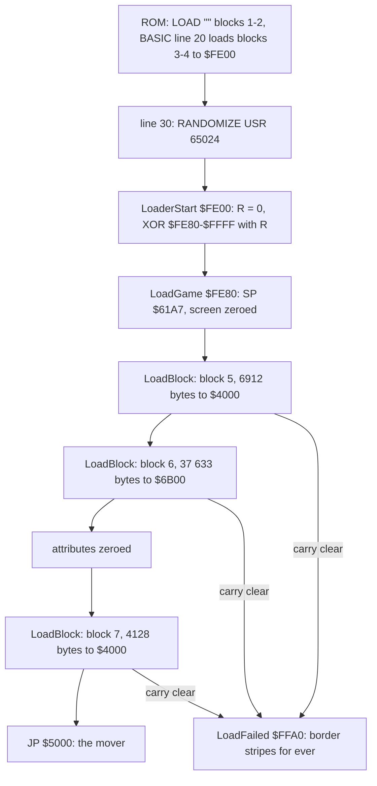

| Layer | Routine | Key | Undone |
| --- | --- | --- | --- |
| 1 | LoaderStart `$FE00-$FE13` | the R register: `(2 + 8 k) AND $7F` for the byte at `$FE80 + k` | once, by the loader itself, at frame 1258 |
| 2 | LoadBlock `$FEBD` | `3 (i + 1) XOR (n - i)`, both AND `$FF`, for byte i of an n-byte block | as each byte arrives |

## 3.4 Layer 1: the R-keyed tail

**What it does.** LoaderStart sets R to 0, then XORs every byte from `$FE80` to `$FFFF` with the value `LD A,R`
reads just before it, and jumps to `$FE80`. The Z80 adds 1 to R's low seven bits at every M1 (opcode fetch) cycle,
so R is a clock of instructions. The loop is eight M1 cycles a byte: `LD A,R` is two (`$ED $5F`), the six others one
each. So the byte at `$FE80 + k` meets the key `(2 + 8 k) AND $7F`. Interrupts are off (`DI`), so no interrupt
acknowledge adds to R. Bit 7 of R stays as `LD R,A` set it, 0.

**Why this way.** The key is no byte in the file: it is the timing of the loop. A cracker who reads the block with a
monitor gets noise, and one who runs it on the Spectrum under a debugger, whose own instructions run between the
steps, gets a different R and garbage. An emulator, or a program that knows the rule, gets the clear code at once.

```text
encrypt (the master tape, tools/tape.py loader):        decrypt (LoaderStart):
for k in 0 .. 383:                                       R = 0
    tape[$FE80 + k] = plain[$FE80 + k]                   for address in $FE80 .. $FFFF:
                      XOR ((2 + 8 k) AND $7F)                key = R               # 2, 10, 18, ... 122, 2, ...
                                                             memory[address] = memory[address] XOR key
                                                         jump LoadGame ($FE80)
```

The two directions are the same XOR. `tools/decrypt_tape.py check` applies the decryption twice and gets the tape's
bytes back.

```asm
FE00  F3        DI
FE01  21 80 FE  LD HL,LoadGame    ; $FE80, the first encrypted byte
FE04  AF        XOR A
FE05  ED 4F     LD R,A            ; R = 0
FE07  ED 5F     LD A,R            ; DecryptLoop: the key, R after two more M1 cycles
FE09  AE        XOR (HL)
FE0A  77        LD (HL),A
FE0B  23        INC HL
FE0C  7C        LD A,H
FE0D  B5        OR L
FE0E  C2 07 FE  JP NZ,DecryptLoop ; until HL wraps to $0000
FE11  C3 80 FE  JP LoadGame
```

`$FE14-$FE7F` is padding: the bytes `$14-$7F` in order, each its own address's low byte (LoaderPadding, no L1 read).

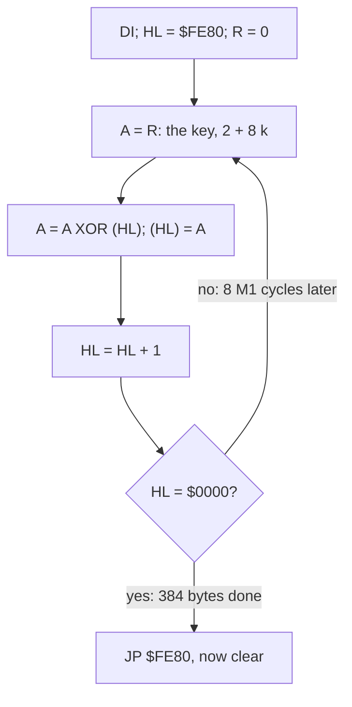

**A worked example.** The key runs 2, 10, 18 ... 122 and then repeats, since `8 x 16 = 128`: the R layer's key has a
period of 16 bytes.

| k | Address | On tape | Key `(2 + 8 k) AND $7F` | Clear | Instruction |
| ---: | --- | ---: | ---: | ---: | --- |
| 0 | `$FE80` | `$F1` | `$02` | `$F3` | `DI` |
| 1 | `$FE81` | `$3B` | `$0A` | `$31` | `LD SP,nn` |
| 2 | `$FE82` | `$B5` | `$12` | `$A7` | its low byte |
| 3 | `$FE83` | `$7B` | `$1A` | `$61` | its high byte: `LD SP,$61A7` |
| 11 | `$FE8B` | `$A5` | `$5A` | `$FF` | the low byte of `LD BC,$1AFF` |
| 16 | `$FE90` | `$DF` | `$02` | `$DD` | the key is back at 2: the prefix of `LD IX,$4000` |

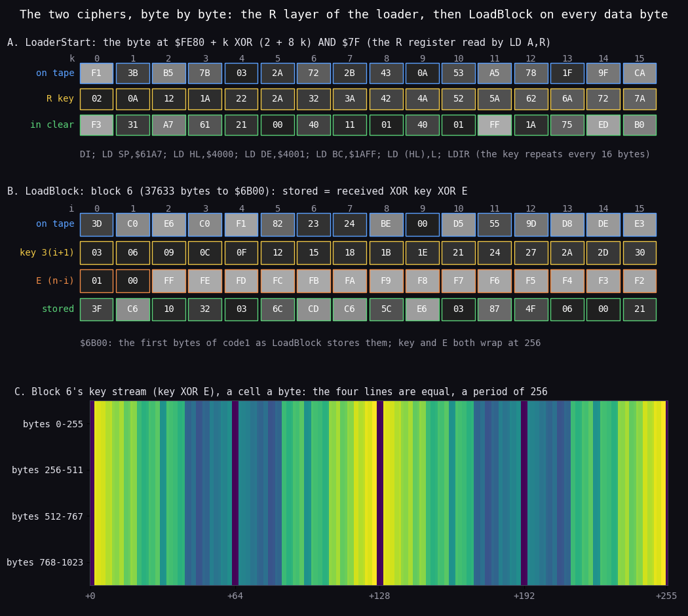

*Both ciphers on the real bytes of `Sim City.tzx` (`python3 tools/fig_cipher.py "work/media/zxdb-SimCity.tzx/Sim
City.tzx" docs/img/load/cipher.png`). How to read: each cell is a byte in hex, its grey its value. A: the loader's
tail `$FE80-$FE8F` on tape (blue), the R key (yellow), the clear code (green), its instructions underneath. B: the
first sixteen bytes of block 6 as received, LoadBlock's key and E, and the byte stored at `$6B00 + i`. C: block 6's
whole key (key XOR E) for 1024 bytes, 256 a line, coloured by value. The point: layer 1's key repeats every 16 bytes
and layer 2's every 256 (the four lines of C are equal), so both are light ciphers whose strength is only that the
rule must be found.*

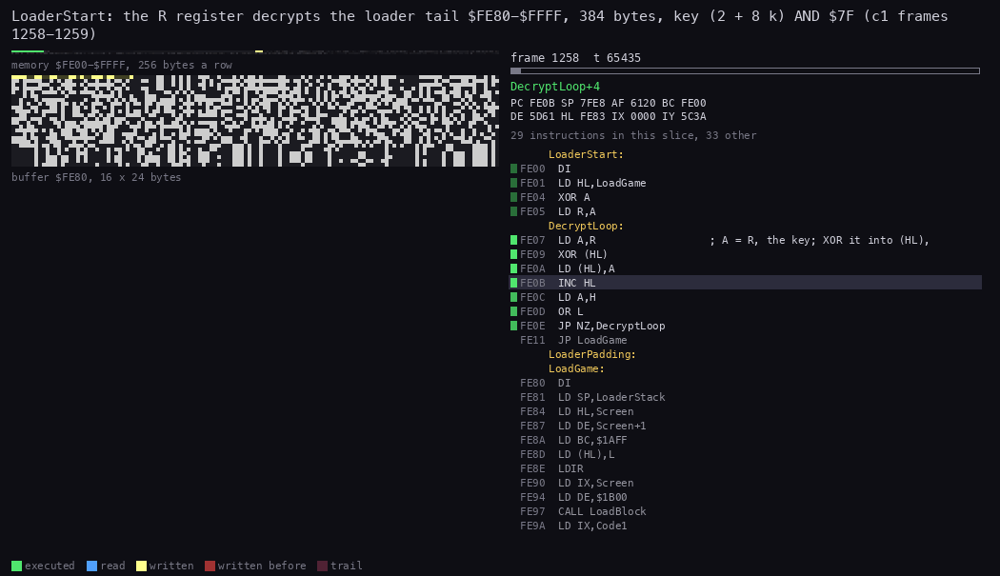

*LoaderStart decrypting the loader's tail, `c1` frames 1258 T 65 000 to 1259 T 16 000 (an access trace of 2852
instructions, 48 pictures of 435 T). How to read: top left, the memory `$FE00-$FFFF` lit by age (yellow written in
this picture, red earlier); under it the 384 bytes `$FE80-$FFFF` as a bitmap of 16 bytes a line, which turn from the
tape's noise into code line by line; right, the listing with the instruction running and the registers. The loop
takes 47 T a byte, 18 048 T for the 384 bytes: `$FE00` ran in frame 1258 at T 65 246 and `$FE80` in frame 1259 at T
13 443. Made with `python3 ../../kit/routine_anim.py --work work/docs/scA/c1 --window 1258:65000-1259:16000
--listing build/loader.lst --view buffer:FE80:16x24:rows --range FE00-FFFF --pc FE00-FE13 --pictures 48 --out
docs/img/routines/LoaderStart.gif`.*

**The point:** the first layer hides the real loader from a reader of the file. It costs 18 048 T, about a quarter
of a frame, once.

## 3.5 Layer 2: LoadGame and LoadBlock

**LoadGame** (`$FE80-$FEBC`, the first code layer 1 clears) sets its stack at `$61A7`, zeroes the screen, and calls
LoadBlock three times. The carry LoadBlock returns is never tested: a failed block does not come back (3.6).

```asm
FE80  DI
FE81  LD SP,LoaderStack            ; $61A7, in RAM code2's copy fills only later
FE84  LD HL,Screen / LD DE,Screen+1 / LD BC,$1AFF / LD (HL),L / LDIR   ; $4000-$5AFF zeroed
FE90  LD IX,Screen / LD DE,$1B00 / CALL LoadBlock     ; block 5, the loading screen, 6912 bytes
FE9A  LD IX,Code1 / LD DE,$9301 / CALL LoadBlock      ; block 6, code1, 37 633 bytes to $6B00-$FE00
FEA4  LD HL,Attributes / LD DE,Attributes+1 / LD BC,$02FF / LD (HL),L / LDIR   ; attributes zeroed
FEB0  LD IX,Screen / LD DE,$1020 / CALL LoadBlock     ; block 7, code2 and the mover, 4128 bytes
FEBA  JP Mover                                        ; $5000
```

**LoadBlock** (`$FEBD-$FF99`) is the ROM's LD-BYTES (`$0556-$05E2`, with LD-EDGE-1 and LD-EDGE-2) copied to RAM
and changed. Being in RAM it escapes the emulator's tape trap, which is on the ROM routine; that is why `c1` reads
these blocks from the signal. The changes against the ROM:

| Where | The ROM | LoadBlock | Effect |
| --- | --- | --- | --- |
| the flag | A' = `$FF` for data | A' = `$00` (`XOR A; SCF; EX AF,AF'`) | a data block flagged as a header; a standard copier's `LOAD "" CODE` skips it |
| the return | pushes SA/LD-RET `$053F` | pushes LoadExit `$FF9A` | a failed block hangs (3.6) |
| the border | `$0F` with MIC, colour bits OR `$02` | `$08`, OR `$00`; LdSync XORs C with `$00` (the ROM `$03`) | black border |
| the stripes | `CPL` of the colour at each edge | XOR with a counter at `$FF83` (LdBorderXor's operand), counted up at LdColourStep, then black again (LdStripe) | thin stripes of changing colour over the data |
| the pilot | stripes through the pilot | LdStripe's `OUT` turned into `LD A,$FE` and LdColourStep's `INC A` into `NOP` at the start; LdSync writes `$D3` (`OUT`) and `$3C` (`INC A`) back | no stripes until the data starts |
| the store | `LD (IX+0),L`, or the VERIFY compare | `key = key + 3` in LdKey's operand `$FF32` (zeroed per call), then `L XOR key XOR E` to `(IX+0)`; no VERIFY | the decryption |

The parity is the ROM's: H collects the XOR of the bytes as received, so the checksum on tape is over the encrypted
stream, and a good block returns with carry set.

```text
encrypt (the master tape, tools/tape.py blocks):         decrypt (LoadBlock, per byte as it arrives):
key = 0                                                  key = 0                      # $FF32, zeroed per call
for i in 0 .. n - 1:                                     count = n                    # DE
    key = (key + 3) AND $FF                              read the flag; it must be $00
    tape[i] = data[i] XOR key XOR ((n - i) AND $FF)      while count > 0:
checksum = XOR of the flag and every tape byte               received = the next byte from the signal
                                                             key = (key + 3) AND $FF
                                                             memory[IX] = received XOR key XOR (count AND $FF)
                                                             IX = IX + 1; count = count - 1
                                                         read the checksum; carry = (parity = 0)
```

```asm
FF2D  EX AF,AF'          ; LdLoop: Z' is set only for the flag byte
FF2E  JR NZ,LdFlag
FF30  PUSH AF
FF31  LD A,$00           ; LdKey: the key, its operand $FF32 rewritten below
FF33  ADD A,$03          ; key + 3
FF35  LD ($FF32),A
FF38  XOR E              ; E: the low byte of the count still to load
FF39  XOR L              ; L: the byte as received
FF3A  LD (IX+$00),A      ; stored
FF3D  POP AF
FF3E  JR LdNext          ; INC IX, DEC DE, then eight bits into L for the next byte
...
FF60  LD A,H             ; after each byte: the parity
FF61  XOR L
FF62  LD H,A
FF63  LD A,D             ; any bytes left?
FF64  OR E
FF65  JR NZ,LdLoop
FF67  LD A,H             ; carry set when H = 0
FF68  CP $01
FF6A  RET                ; to LoadExit $FF9A, pushed at the start
```

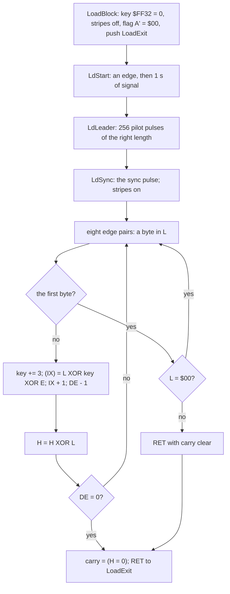

**A worked example: block 6's first three and last two bytes** (n = 37 633, so E starts at `37 633 AND $FF = $01`;
the tape bytes from the TZX, the stores from `tools/decrypt_tape.py`, equal to `c1`'s memory at frame 16 281, 3.9):

| i | Address | On tape | key | E | Stored |
| ---: | --- | ---: | ---: | ---: | ---: |
| 0 | `$6B00` | `$3D` | `$03` | `$01` | `$3D XOR $03 XOR $01 = $3F` |
| 1 | `$6B01` | `$C0` | `$06` | `$00` | `$C6` |
| 2 | `$6B02` | `$E6` | `$09` | `$FF` | `$10` |
| 37 631 | `$FDFF` | `$FE` | `$00` | `$02` | `$FC` |
| 37 632 | `$FE00` | `$FE` | `$03` | `$01` | `$FC` |

The last two rows are the IM 2 table's last two bytes: the same tape byte `$FE`, and two (key, E) pairs whose XOR is
the same, `$02`. A run of zeros in the clear shows on tape as the key stream itself: block 5 starts with zeros, and
on tape it reads `$03 $F9 $F7`, the first three values of key XOR E (`$03 XOR $00`, `$06 XOR $FF`, `$09 XOR $FE`).

The last key of block 7 is `3 x 4128 AND $FF = $60`: it is the byte `$FF32` holds when the game starts, the one
loader byte the entry image owes to the load (3.9).

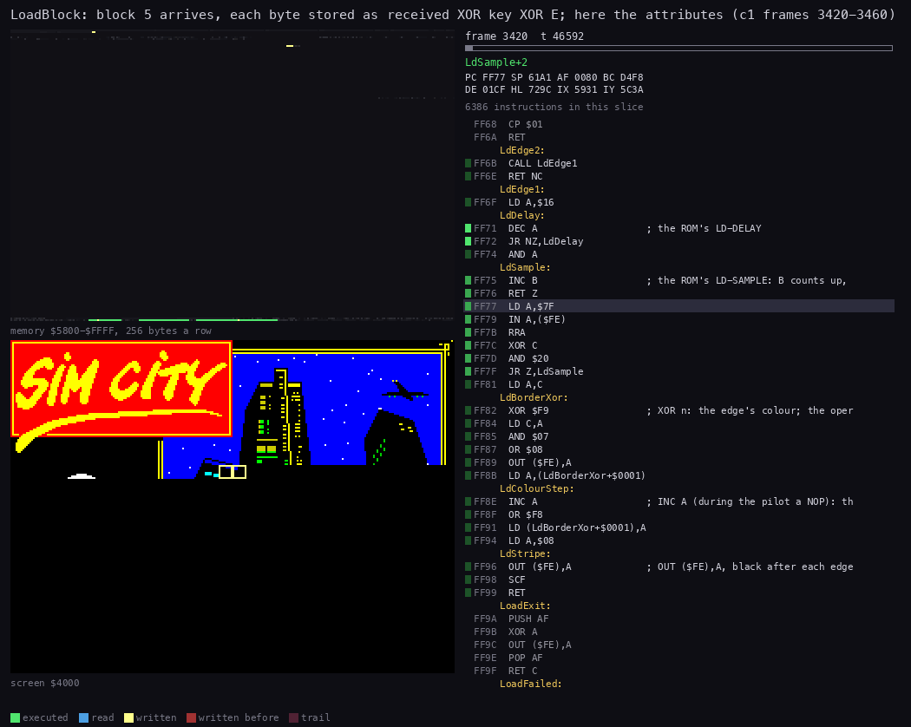

*LoadBlock storing the loading screen's attributes, `c1` frames 3420-3460 (an access trace of 385 319 instructions,
60 pictures of 46 592 T). How to read: top, the memory `$5800-$FFFF` lit by age; middle, the screen, where each new
attribute byte colours one cell of the picture (the pixels came in before, hidden under black attributes); right,
the listing with the instruction running: most of the time goes to LdSample, the edge-sampling loop at `$FF75`; the
store at `$FF31-$FF3A` runs once a byte, about 3.5 times a frame. Made with `python3 ../../kit/routine_anim.py
--work work/docs/scA/c1 --window 3420:0-3460:0 --listing build/loader.lst --view screen --range 5800-FFFF --pc
FEBD-FFA4 --pictures 60 --out docs/img/routines/LoadBlock.gif`.*

**The point:** the second layer is a ROM loader with a changed flag and a changed store. It keeps the ROM's speed,
edge timing and parity, so the tape is as reliable as any ROM tape, yet no ROM routine can load the blocks.

## 3.6 The error path: the hang at `$FFA0`

LoadBlock returns through LoadExit, the address it pushed first. With carry set it returns to LoadGame. With carry
clear (a parity error, a wrong flag, BREAK) it falls into LoadFailed and never leaves:

```asm
FF9A  F5        PUSH AF          ; LoadExit
FF9B  AF        XOR A
FF9C  D3 FE     OUT ($FE),A      ; the border black
FF9E  F1        POP AF
FF9F  D8        RET C            ; a good block: back to LoadGame
FFA0  3C        INC A            ; LoadFailed
FFA1  D3 FE     OUT ($FE),A
FFA3  18 FB     JR LoadFailed
```

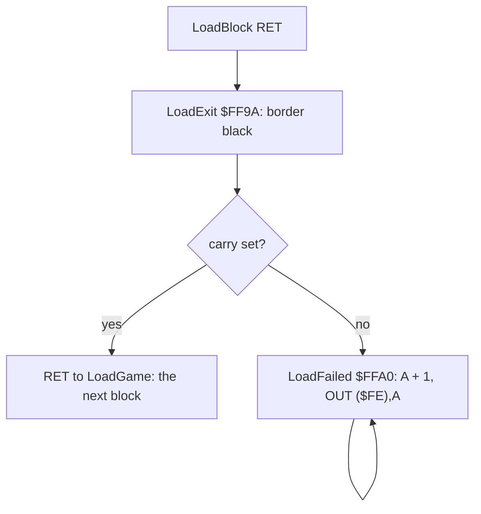

The loop is 27 T (`INC A` 4, `OUT (n),A` 11, `JR` 12). Port `$FE`'s bits 0-2 are the border, so the colour changes
every 27 T, about 54 pixels of a 224 T line: the border fills with thin stripes of all eight colours. Bit 4 is the
speaker: it flips every 16 loops (432 T), a square wave of 3 500 000 / 864 = 4051 Hz. A bad load hangs with a
striped border and a high whine until the machine is reset.

Witness: known only from the code. LoadFailed never ran in `c1` (probe `exec $FFA0`: 0 frames), the only recording
that loads the tape. Stage 1 had read the unchecked carry in LoadGame as "a failed block runs on into what was
loaded"; the pushed LoadExit settles it.

**The point:** the protection has no retry. One bad byte costs the whole five-minute load.

## 3.7 The mover and the entry

Block 7 lands in the screen's pixel area, where the attributes, zeroed just before it, keep it invisible. Its last
32 bytes, `$5000-$501F`, are the mover (`src/mover/mover.ann`): 15 bytes of code and 17 zeros.

```asm
5000  F3        DI               ; MoveCode2
5001  21 00 40  LD HL,$4000
5004  11 00 5B  LD DE,$5B00
5007  01 00 10  LD BC,$1000
500A  ED B0     LDIR             ; code2's 4096 bytes to $5B00-$6AFF
500C  C3 1B 5B  JP $5B1B         ; Entry
```

The LDIR would take 4096 x 21 - 5 = 86 011 T uncontended. In `c1` it took 113 017 T, 1.6 frames: `$5000` ran in frame
16 279 at T 8372 and `$6AFF`, the last byte, was written in frame 16 280 at T 51 501 (69 888 - 8372 + 51 501). Both
ends are in contended memory, the source `$4000-$4FFF` and the destination `$5B00-$6AFF`, so the ULA stretches most
of its reads and writes while it draws the screen. Code2's bytes stay on the screen's pixels until the game draws
over them.

At Entry `$5B1B` the game sets its stack to `$F6C2`, the border black and SwitchOff `$F705` = 1 (no task switch
yet), tests for a Kempston interface (port `$1F`, up to 32 768 reads; KempstonFound `$5B7F`), sets `I = $FD` and
IM 2, enables interrupts and jumps to UiTask `$8FA0` ([doc 4.1](04-game-loop.md#41-the-shape-of-the-program)).

## 3.8 The load in `c1`

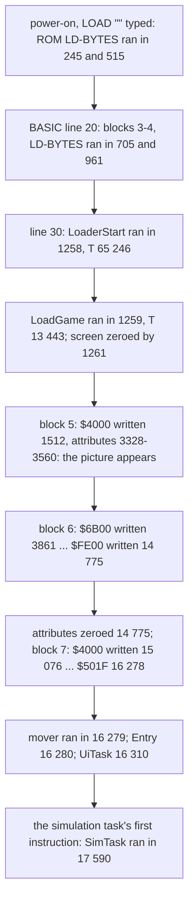

| Frame (ran in) | Event | Probe |
| ---: | --- | --- |
| 245, 515, 705, 961 | the ROM's LD-BYTES for blocks 1-4 | exec `$0556` |
| 1258 (T 65 246) | BASIC's `RANDOMIZE USR 65024`: LoaderStart | exec `$FE00` |
| 1259 (T 13 443) | layer 1 done: LoadGame | exec `$FE80` |
| 1261, 3561, 14 775 | LoadBlock called for blocks 5, 6, 7 | exec `$FEBD` |
| 1512 / 3328 / 3560 | block 5: the first pixel byte, the first attribute, the last attribute | write `$4000`, `$5800`, `$5AFF` |
| 3861 / 14 775 | block 6: the first and the last byte | write `$6B00`, `$FE00` |
| 15 076 / 16 278 | block 7: the first and the last byte | write `$4000`, `$501F` |
| 3561, 14 775, 16 279 | LoadExit, each time with carry set (LoadFailed: no frame) | exec `$FF9A`, `$FFA0` |
| 16 279 (T 8372) | the mover | exec `$5000` |
| 16 280 (T 51 501) | the game's Entry | exec `$5B1B` |
| 16 310 | UiTask: the level menu | exec `$8FA0` |
| 17 590 | SimTask: the simulation task's first pass | exec `$835F` |

From power-on to the entry: 16 280 frames, 325.6 s at 50 Hz. The tape's own length is 16 110 frames; the rest is
the ROM's start-up, the typed `LOAD ""` and the ROM's waits for each pilot.

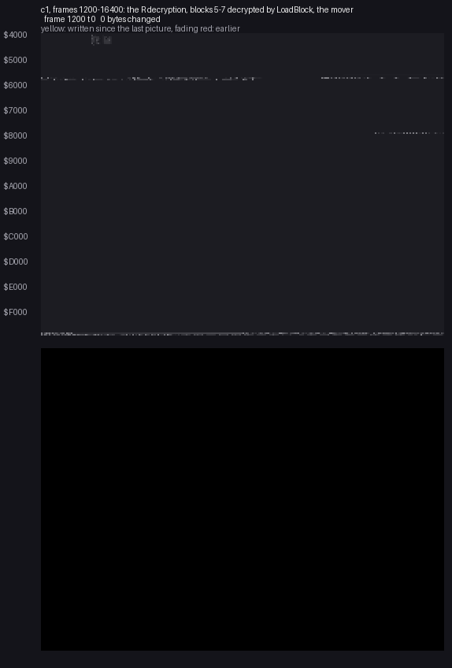

*`c1`, frames 1200-16400, 103 pictures of 150 frames (10 483 200 T) each, each the memory in memory at the start of
its frame (`memory_at`). How to read: top, the memory `$4000-$FFFF`, one row a 256-byte page, grey by value, yellow
for a byte changed since the last picture, fading through red; bottom, the screen as the Spectrum shows it. The
loading picture's pixels arrive under black attributes, then its attributes, and the picture appears by frame 3560;
block 6 then fills `$6B00` upward. Where block 6 stores zeros over zeros (the work arrays, `$A94F-$C44F`) a picture
shows only a few changed bytes. From frame 15 076 block 7 overwrites the pixels at `$4000` while the attributes stay
black (3.7). Made with `python3 ../../kit/memanim.py --work work/docs/scA/c1 --from 1200:0 --to 16400:0 --step
10483200 --from-address 0x4000 --to-address 0xFFFF --screen --delay 120 --hold 2500 docs/img/load/load-c1.gif`.*

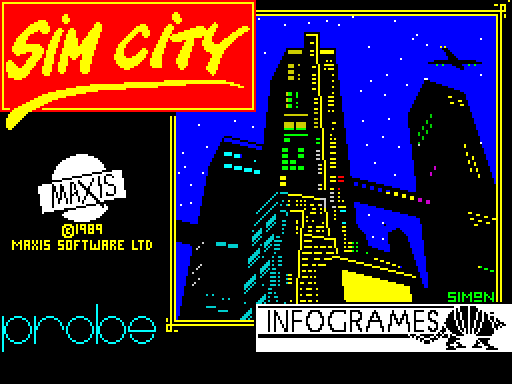

*The loading screen, in memory at `c1` frame 3600 (`python3 ../../kit/screen_shot.py --work work/docs/scA/c1
--out-dir docs/img/load --scale 2 c1-003600-loading-screen=3600`): the Probe / Infogrames title signed "SIMON"
(Simon Butler). It is on the screen from frame 3561 until LoadGame zeroes the attributes in frame 14 775. In the
source it is `src/res/screen/LoadingScreen.png`.*

**The point:** the picture is the only show of the load, and the black-on-black start of line 10 keeps it hidden
until its attributes arrive.

## 3.9 What loads is what runs

| Compared | Bytes that differ | Where, why |
| --- | ---: | --- |
| `build/game.bin` (`$5B00-$FE00`, from the sources) vs `c1` in memory at frame 16 281 (after the mover and Entry's first frame), `work/stage1/c1-16281.bin` | 1 | `$F705` SwitchOff: 0 in the image, set to 1 by Entry's own `LD ($F705),A` at `$5B24` |
| `build/loader.bin` (the clear loader) vs the same | 2 | `$FE00`: code1's last byte `$FC` over the loader's `DI`; `$FF32`: LdKey's operand, `$60` after block 7 (3.5) |
| `tools/decrypt_tape.py check` on the TZX | 0 | each of blocks 5-7 decrypted and encrypted back gives the tape's bytes |

```bash
sh tools/build.sh && python3 work/docs/scA/imgcheck.py    # build/game.bin 1 $F705; build/loader.bin 2 $FE00 $FF32
```

**The point:** nothing is unpacked or patched after the load: the decrypted blocks are the program, so the source
has to give the decrypted bytes, and the build has to encrypt them.

## 3.10 The source build

`tools/build.sh` builds `build/SimCity.tap` from the sources and compares it with the original's seven data blocks.
The two transforms of 3.4 and 3.5 run backwards in `tools/tape.py`, the way the master tape was made:

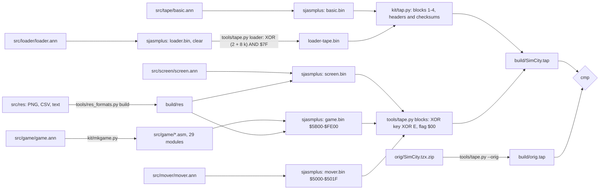

| Block | Source | Made by |
| ---: | --- | --- |
| 1 | the header "Simcity", LINE 0, length 144 found by walking the lines | `kit/tap.py` (`basic:Simcity:0:basic.bin`) |
| 2 | `src/tape/basic.ann` (6 entries) | `kit/mkgame.py --part`, sjasmplus |
| 3 | the header "loader", CODE, 512 bytes at 65024, parameter 2 32912 | `kit/tap.py` (`code:loader:65024:loader-tape.bin:32912`) |
| 4 | `src/loader/loader.ann` (8 entries), its tail encrypted | sjasmplus, `tools/tape.py loader` |
| 5 | `src/screen/screen.ann` with `src/res/screen/LoadingScreen.png` | sjasmplus, `tools/tape.py blocks` |
| 6 | `src/game/game.ann` (598 entries, 29 modules) with `src/res`: `$6B00-$FE00` of `game.bin` | sjasmplus, `tools/tape.py blocks` |
| 7 | `$5B00-$6AFF` of `game.bin`, then `src/mover/mover.ann` (2 entries) | sjasmplus, `tools/tape.py blocks` |

```bash
sh tools/build.sh      # build: identical to the original's blocks 1-7 (build/orig.tap)
```

The run for this document (2026-11-10) printed `build: identical to the original's blocks 1-7 (build/orig.tap)`.
The TZX's archive info, pulse timings and pauses are not data and are not rebuilt.

**The point:** the encrypted blocks come back byte for byte from clear, editable sources: the cipher is a build
step, not a property of the source.

## 3.11 What is known only from the code, and the other releases

- **The hang of a failed block** (3.6): no recording loads a bad tape.
- **The three BASIC lines after line 30** never run (3.2).
- **The padding** `$FE14-$FE7F` and **the font leftover** `$FFA5-$FFFF` (91 bytes equal to the ROM's font at
  `$3E55-$3EAF`, "J" from its sixth row to "U"): no instruction reads them in `c1`. The master tape was saved from
  memory that held a copy of the font there ([doc 2.6](02-architecture.md#26-leftovers)).

The other copies (the Erbe re-release with the same three blocks decrypted under standard headers, the cracks, the
+3 disk) are compared in the case [README](../README.md#other-releases-and-copies); the +3 disk's own loader and
what moved in its image are in [doc 2.8](02-architecture.md#28-the-3-disk-release).
