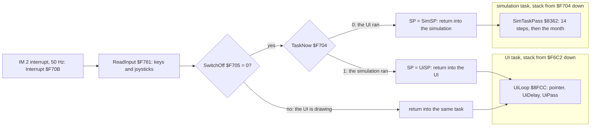
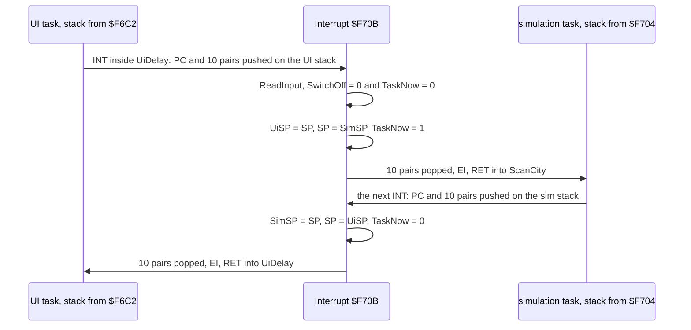
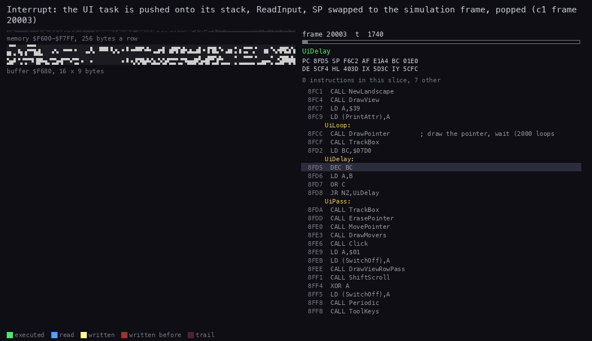
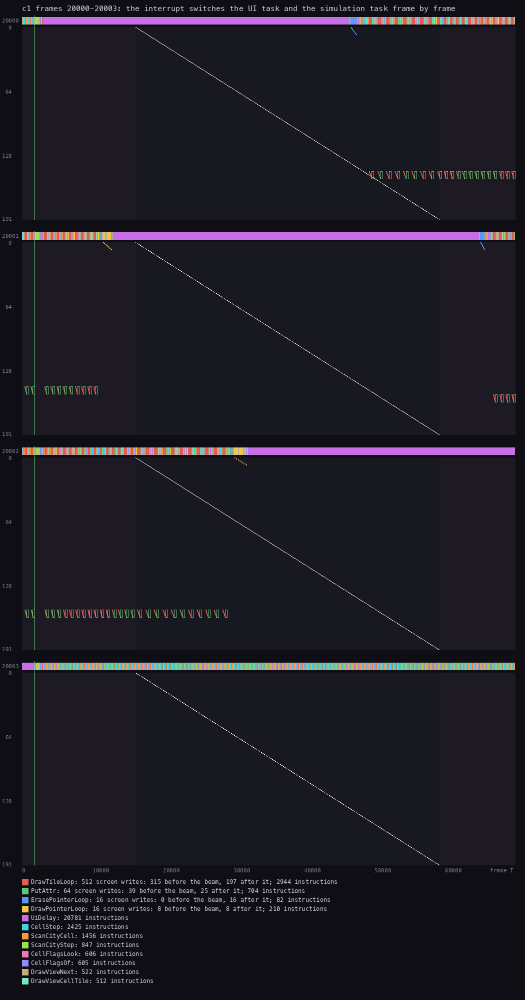
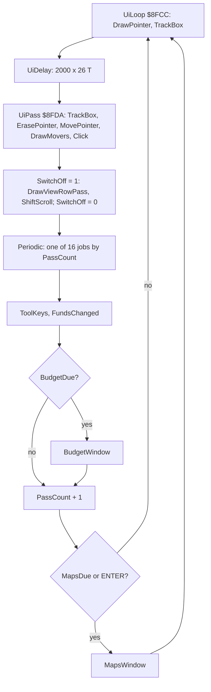
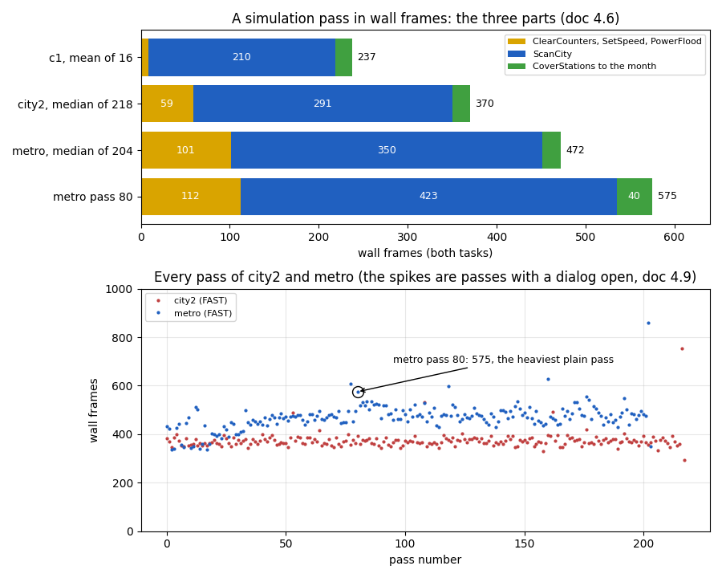
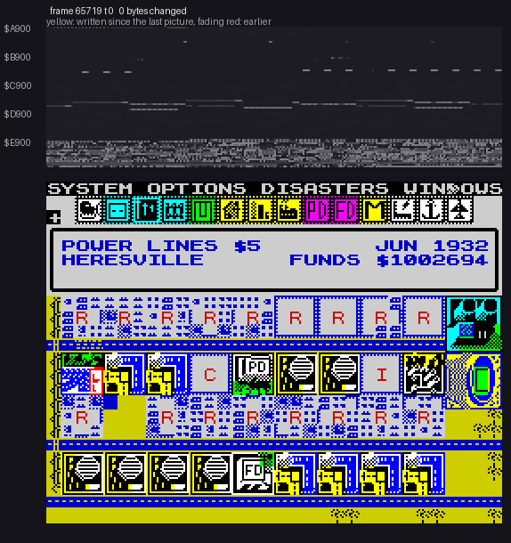
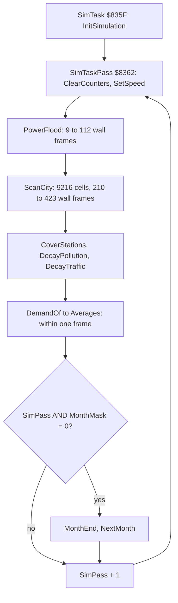

# 4. Game loop

What this covers:

- the shape of the program: two tasks, and an interrupt that swaps them;
- the state machine from the level menu to play;
- the interrupt and the switch: what it saves and what it costs;
- a beam timeline of four frames with a switch;
- the UI task's pass and its busy wait;
- the simulation task's pass and the order of its steps;
- the speed masks and the month;
- the passes per frame of each task, measured in every recording;
- the heaviest simulation pass.

The recordings it rests on are in `work/stage1`. Each loads the original TZX as in [doc 3](03-build-and-load.md):

- `c1`: the load, then the first 5200 frames of play at normal speed, in the default city;
- `city2`: 82 012 frames of a town at fast speed;
- `growth`: 52 000 frames of a city growing, at fast speed;
- `metro`: 96 500 frames of the most built-up map, about 9200 people, at fast speed;
- `work/stage2/counts.json`: the instruction counts (L1) of all eleven recordings, built by `work/stage2/l1count.py`.

Frames are "ran in" unless a table says otherwise. A "ran in" frame is the one an instruction ran in, as
`time_travel probe_frames` reports it. The probes:

```bash
. work/env.sh
python3 ../../kit/rs.py open --work work/docs/scA/city2 --ttd work/stage1/rec/city2/session.ttd --model 48K --port-base 37050
python3 work/docs/scA/probe.py 0 82012 exec:8362 exec:836B exec:836E exec:8386 exec:839B exec:8395 > work/docs/scA/passes-city2.txt
python3 work/docs/scA/passes.py work/docs/scA/passes-city2.txt     # the per-pass table of 4.6 and 4.9
```

## 4.1 The shape of the program

SimCity runs two programs at once on one Z80. Each has its own stack and its own endless loop. Neither calls the
other.

- The **UI task** is UiTask `$8FA0`, with its loop UiLoop `$8FCC` and its pass UiPass `$8FDA`. It moves the pointer,
  draws the map window, takes the clicks and the keys, and runs the menus and the dialogs.
- The **simulation task** is SimTask `$835F`, with its pass SimTaskPass `$8362`. It scans the 96 x 96 map, grows and
  declines the zones, floods the power, counts the people and ends the months.

The IM 2 interrupt is the scheduler, 50 times a second:

1. Interrupt `$F70B` saves every register on the stack of the task it interrupted.
2. Then it swaps the stack pointer to the other task, unless the UI has set SwitchOff `$F705`.
3. It pops the registers and returns. After a swap, that return goes into the other task.

So each frame belongs to one task, and the two tasks take turns a frame at a time.



Neither task waits for the other. They share memory without locks. The UI reads what the simulation writes: the
map, the money, the date. A few UI actions must not be cut in the middle, or a half-made change would show. These set
SwitchOff while they run, so the simulation cannot run inside them (4.3).

**Why this way.** Maxis' SimCity is a city that lives while the player draws in it. On a 3.5 MHz Z80, one simulation
pass over the 9216 cells takes between 72 and 180 frames of CPU (4.8, 4.9). A single loop would freeze the pointer for
seconds at a time. With two tasks, the pointer gets two frames in every three, all the time. The simulation gets the
rest.

## 4.2 From the menu to play

Entry `$5B1B` sets the UI task's stack and SwitchOff = 1, turns IM 2 on, and jumps to UiTask
([doc 3.7](03-build-and-load.md#37-the-mover-and-the-entry)). UiTask is not a loop. It is the start of the UI task, and
it runs once.

```asm
8FA0  LD A,$01 / LD (SwitchOff),A   ; no switch while the city is made
8FA5  CALL StartSimulation          ; SimSP = SimFrame $F6EE, SimEntry $F702 = SimTask, JAN 1902, the funds
8FA8  CALL ClearTopBlack / CALL DrawStatusPanel / CALL AnimateFlood / CALL AnimateFire
8FB4  LD IX,LevelMenuText / CALL ClearWindowArea / CALL DrawMenu / CALL RunMenu   ; the level menu
8FC1  CALL NewLandscape             ; the city from its five-digit seed
8FC4  CALL DrawView
8FC7  LD A,$39 / LD (PrintAttr),A
8FCC  ...                           ; UiLoop, for ever (4.5)
```

StartSimulation (`$830C`) does not run the simulation. It builds a stack for a task that has never run:

- SimSP points to SimFrame `$F6EE`, 20 bytes, zeros in the image;
- the word after them, SimEntry `$F702`, holds the address of SimTask.

The first interrupt that switches to the simulation pops the 20 bytes as its ten register pairs. At the first start
they are zeros. StartSimulation is called again from NewLandscape `$6A8E` for every new city; by then the simulation
stack has run over `$F6EE-$F703`, and StartSimulation rewrites SimEntry (`$831A`) but not the 20 bytes, so a later
start pops whatever the last pass left. That is harmless: SimTask sets every register it uses. Its `RET` then takes
SimEntry and lands on SimTask. So a task starts as if it had been interrupted just before its first instruction.

StartSimulation also sets:

- the date: Year `$8F9C` = 1902 and Month `$8F9B` = 0 (JAN);
- the funds by level: `$4E20` = 20 000 for EASY, `$2710` = 10 000 for MEDIUM, `$1388` = 5000 for DIFFICULT;
- the rest through InitSimulation (`$83A1`), which zeroes the counters, the needs, the movers and SimPaused `$835D`.

```mermaid
stateDiagram-v2
    [*] --> Loading: the tape, doc 3
    Loading --> Entry: JP $5B1B, SwitchOff = 1
    Entry --> LevelMenu: UiTask, StartSimulation
    LevelMenu --> NewCity: RunMenu, a level chosen
    NewCity --> Play: NewLandscape, DrawView, the first UiPass clears SwitchOff
    Play --> Play: UiPass and SimTaskPass take turns, a frame each
    Play --> Window: a menu, a dialog, BudgetDue, MapsDue or ENTER
    Window --> Play: closed
    Play --> NewCity: SYSTEM, NEW CITY, or a LOAD
    Window: SwitchOff = 1 in the menus (inside Click), the budget and the evaluation; the maps window sets it only per cell (LayerOf), so the simulation goes on there
```



In `c1`, Entry ran in frame 16 280 ([doc 3.8](03-build-and-load.md#38-the-load-in-c1)). The simulation's first
instruction ran in frame 17 590. Until then the UI task had every frame, because SwitchOff stayed 1 until the first
UiPass cleared it.

## 4.3 The interrupt and the switch

I is `$FD`, and every byte of the vector table `$FD00-$FE00` is `$FC`. So whatever the data bus holds, the vector read
is `$FCFC`. At `$FCFC` sits InterruptJump: `JP Interrupt`.

```asm
F70B  PUSH IX / PUSH IY / PUSH HL / PUSH DE / PUSH BC / PUSH AF   ; Interrupt: the main set
F713  EX AF,AF' / EXX
F715  PUSH HL / PUSH DE / PUSH BC / PUSH AF                       ; the alternate set
F719  CALL ReadInput        ; $F781: the eight half rows to KeyRows $5B00, then ReadKempston, ReadSinclair
F71C  LD A,(SwitchOff)
F71F  AND A
F720  JR NZ,InterruptReturn ; the UI is in a section that must not be split
F722  LD HL,TaskNow         ; $F704: 0 the UI ran, 1 the simulation ran
F725  LD A,(HL)
F726  AND A
F727  JR Z,InterruptToSim
F729  LD (SimSP),SP         ; the simulation ran: keep its stack pointer
F72D  LD SP,(UiSP)          ; and take the UI's
F731  JR InterruptFlip
F733  LD (UiSP),SP          ; InterruptToSim: keep the UI's
F737  LD SP,(SimSP)         ; and take the simulation's
F73B  XOR $01               ; InterruptFlip
F73D  LD (HL),A             ; TaskNow flipped
F73E  POP AF / POP BC / POP DE / POP HL / EX AF,AF' / EXX         ; InterruptReturn
F744  POP AF / POP BC / POP DE / POP HL / POP IY / POP IX
F74C  EI
F74D  RET                   ; into the task SP now belongs to
```

```text
on every interrupt:
    push IX, IY, HL, DE, BC, AF, then HL', DE', BC', AF'   # on the stack of the task that was running
    read the keyboard and the joysticks into KeyRows
    if SwitchOff == 0:
        if TaskNow == 0:  UiSP = SP;  SP = SimSP           # the UI ran: go to the simulation
        else:             SimSP = SP; SP = UiSP            # the simulation ran: go to the UI
        TaskNow = TaskNow XOR 1
    pop the ten pairs in reverse order                      # from the stack SP now points into
    enable interrupts; return                               # to the PC the interrupt pushed on that stack
```

**What a switch saves.** Everything a task owns is on its own stack: the PC the interrupt pushed, then the ten register
pairs. That is 22 bytes. The rest of the machine state is shared: I, the interrupt mode and the memory. The swap itself
touches two words, UiSP `$F707` and SimSP `$F709`. R is not saved; the game reads it only in DrawMovers (`LD A,R` at
`$77C0`, to pick the tornado's frame), where any value will do.



**The two stacks, measured.** The deepest bytes come from write probes over each stack on read-only opens of `ports`
and `menus` (review round 1); L1's per-byte counts miss bytes and give too shallow a figure.

| Stack | Starts at | Deepest byte seen | Bytes used | Spare |
| --- | --- | --- | ---: | --- |
| UI task, UiStack `$F682-$F6C1` | `$F6C2` (Entry's `LD SP,UiStack+$40`) | `$F68A` (`menus` frame 3466) | 56 | 8 bytes above BuildingAttrs |
| simulation task, SimStack and SimFrame | `$F704` (the top of SimFrame) | `$F6D0` (`menus` frame 5498) | 52 | 14 bytes above the UI stack's top |

The simulation goes five calls below SimTaskPass in the ring scan (ScanCity -> ZoneStep -> ResidentialStep ->
ScanRing -> ScanRingCell -> MapAddrChecked, 16 bytes with the registers its routines save, `$F6F4`), 22 bytes when
a ring cell calls PickRouteStart and Random; an interrupt adds its 22 bytes on top. Neither stack has a wide margin ([doc 2.5](02-architecture.md#25-the-two-stacks)).

**SwitchOff.** These routines set `$F705` to 1 and clear it when they are done:

| Routine | Section |
| --- | --- |
| Entry `$5B1B`, UiTask `$8FA0`, StartSimulation `$830C` | the start, until the first UiPass clears it |
| UiPass `$8FDA` | DrawViewRowPass and ShiftScroll: the redraw of the map window and its scroll |
| Click `$63CD` | ScrollClick, MenuClick and MapClick: a scroll, a menu (RunMenu runs inside it), a change to the map |
| BudgetWindow `$9194` | the budget window |
| EvaluationWindow `$95B8` | the evaluation |
| LayerOf `$9D44` to LayerEnd | the overview maps |

While SwitchOff is 1, the interrupt still reads the keys, so no pointer key is lost. The frame just stays with the UI.

**A worked example: the cost of a switch.** The T-states of each instruction, from the Z80's own table, on the path
to the simulation:

| Part | Instructions | T |
| --- | --- | ---: |
| the IM 2 acknowledge and the vector read | | 19 |
| `JP Interrupt` | | 10 |
| the pushes | `PUSH IX`, `PUSH IY` 15 each; eight more `PUSH` 11 each; `EX AF,AF'`, `EXX` 4 each | 126 |
| ReadInput | `CALL` 17; the set-up 27; eight rows of `IN A,(C)` at 47 T each, less 5; then the two joystick readers | 415 + the joysticks |
| the test and the swap | `LD A,(nn)` 13, `AND A` 4, `JR NZ` 7; `LD HL,nn` 10, `LD A,(HL)` 7, `AND A` 4, `JR Z` 12; `LD (nn),SP` 20, `LD SP,(nn)` 20; `XOR n` 7, `LD (HL),A` 7 | 111 |
| the pops | eight `POP` 10 each; `POP IY`, `POP IX` 14 each; `EX`, `EXX` 4 each | 116 |
| `EI`, `RET` | | 14 |

The sums, without ReadInput:

- a switch to the simulation costs 396 T;
- a switch back to the UI costs 403 T (`JR Z` not taken, 5 T less, then `JR InterruptFlip`, 12 T more);
- a frame without a switch (the `JR NZ` taken) costs 314 T.

L1 agrees to the T-state. It charges Interrupt with its own instructions and the `CALL ReadInput`, but not the
acknowledge, the `JP` or ReadInput itself: 384 T a switch to the simulation, 391 T back, 302 T a frame without a
switch. In `city2` the branches at `$F720` and `$F727` give 27 680 frames without a switch, 27 166 switches to the
simulation (`JR Z` taken) and 27 165 back, and 27 166 x 384 + 27 165 x 391 + 27 680 x 302 = 10 431 744 + 10 621 515 +
8 359 360 = 29 412 619 T, exactly Interrupt's own time in `city2`'s `l1.json`. The stacks are in uncontended memory,
so no wait state adds to the sums.

The L1 budget of `city2` measures Interrupt at 0.51 %, ReadInput at 0.61 % and the joystick readers it calls,
ReadSinclair and ReadKempston, at 0.24 % and 0.17 % of all the time ([doc 2.7](02-architecture.md#27-the-frame-budget)).
Together that is 1.53 %, about 1070 T of a 69 888 T frame, of which about 290 T the joystick readers; the `ports`
witness of doc 5, 5.1 measures 952-1062 T with the IM 2 acknowledge. So the handler costs about 1000-1100 T a frame,
about 1.5 %. (Interrupt and ReadInput alone are about 780 T.)



*Interrupt switching from the UI task to the simulation, `c1` frame 20003, T 1700 to 3700. An access trace, 50 pictures
of 40 T. How to read: top left, the memory `$F600-$F7FF` lit by age (yellow written in this picture, red earlier, blue
read); under it, the 144 bytes `$F680-$F70F` as a bitmap, 16 bytes a line. The UI's stack, in the upper lines, takes the
ten pairs; the simulation's, in the lower lines, gives them back. Right: the listing with the instruction running, the
registers and SP. The INT came at T 1812, inside UiDelay. After the `RET` the simulation runs on; the last picture shows
it in CellStep (`$889C`) with SP = `$F700`. Made with `python3 ../../kit/routine_anim.py --work work/docs/scA/c1
--window 20003:1700-20003:3700 --listing build/game.lst --view buffer:F680:16x9:rows --range F600-F7FF --pc F70B-F74D
--pictures 50 --out docs/img/routines/Interrupt.gif`.*

**The point:** the scheduler is 67 bytes. A task switch costs the pushes and pops of one interrupt. The UI decides,
with one byte, where it must not be cut.

## 4.4 A frame with a switch, against the beam



*`c1` frames 20000-20003 against the raster, from an access trace of the four frames. How to read: one panel a frame.
The bar on top is the frame's T-states, coloured by the routine running. The white vertical line is the INT, at T
1812. The diagonal is the beam on the 192 paper lines. The marks are screen writes at their line and T; a write left
of the diagonal is made before the beam reaches that line. The legend counts each routine's instructions, and its
writes before and after the beam. Made with `python3 ../../kit/beam_timeline.py --work work/docs/scA/c1 --window
20000:0-20004:0 --listing build/game.lst --frames 4 --out docs/img/loop/beam-c1-20000.png --title 'c1 frames
20000-20003: the interrupt switches the UI task and the simulation task frame by frame'`.*

The switches in these frames come from two probes:

- `exec $F733`, the switch to the simulation, ran in frames 20003, 20005 and 20009;
- `exec $F72D`, the switch to the UI, ran in frames 20000, 20004, 20006 and 20010.

| Frame | Task | What runs | Why |
| ---: | --- | --- | --- |
| 20000 | UI | before T 1812 the simulation's tail; after the INT the end of a UiPass, then UiDelay (purple) for most of the frame, then a new UiPass: ErasePointer (blue), then DrawTileLoop and PutAttr on one row of cells | the INT switched from the simulation (`$F72D`) |
| 20001 | UI | the row draw goes on, then DrawPointer (yellow), UiDelay for about 52 000 T, a new pass | the INT came while DrawViewRowPass ran with SwitchOff = 1: no switch |
| 20002 | UI | the row draw, the pointer, then UiDelay to the end of the frame | the same |
| 20003 | simulation | after the INT, CellStep, ScanCityCell, CellFlagsOf and the other cell routines, for the whole frame | the INT came inside UiDelay, with SwitchOff = 0: switched (`$F733`) |

The map window is drawn one character row of cells a pass (DrawViewRowPass, row 8 + PassCount AND 15, 32 cells of
8 pixel bytes and one attribute each). The four frames hold two such passes, so the beam figure counts 2 x 32 x 8 =
512 DrawTileLoop writes and 2 x 32 = 64 PutAttr writes. The writes fall wherever they fall against the beam:
DrawTileLoop wrote 315 of its 512 bytes before the beam reached them and 197 after. The game does not race the beam:
a row drawn a frame late shows its old picture for one frame.

**The point:** the simulation gets a frame when the INT finds SwitchOff clear, which in play is almost always inside
UiDelay, the longest unguarded stretch of the UI pass (0.74 of its 1.58 frames). So the UI's busy wait is what feeds
the simulation.

## 4.5 The UI task's pass

```asm
8FCC  CALL DrawPointer      ; UiLoop
8FCF  CALL TrackBox
8FD2  LD BC,$07D0           ; 2000
8FD5  DEC BC                ; UiDelay: 6 T
8FD6  LD A,B                ; 4 T
8FD7  OR C                  ; 4 T
8FD8  JR NZ,UiDelay         ; 12 T: 26 T a loop, 51 995 T in all
8FDA  CALL TrackBox         ; UiPass
8FDD  CALL ErasePointer
8FE0  CALL MovePointer      ; from the keys and joysticks ReadInput left in KeyRows
8FE3  CALL DrawMovers       ; the train, the plane, the tornado, the traffic marks
8FE6  CALL Click            ; a tool or a menu at the pointer
8FE9  LD A,$01 / LD (SwitchOff),A
8FEE  CALL DrawViewRowPass  ; one row of the map window
8FF1  CALL ShiftScroll      ; the window moved by the pointer at an edge
8FF4  XOR A / LD (SwitchOff),A
8FF8  CALL Periodic         ; one job of sixteen, by PassCount (below)
8FFB  CALL ToolKeys
8FFE  CALL FundsChanged     ; the funds reprinted when they changed
9001  LD A,(BudgetDue) / AND A / CALL NZ,BudgetWindow   ; set by the simulation's MonthEnd
9008  LD HL,PassCount / INC (HL)
900C  LD A,(MapsDue) / AND A / CALL NZ,MapsWindow
9013  LD A,(KeyRowEnter) / AND $01 / CALL Z,MapsWindow  ; ENTER
901B  JR UiLoop
```

UiDelay is the most-run code in the game:

- 316 156 069 loops in the eleven recordings (`$8FD5` in `work/stage2/counts.json`): 2000 for each of the 158 076
  completed UI passes (`$8FDA`), plus 4069 from the four recordings (`bankrupt`, `city`, `growth`, `levels`) that end
  in the middle of a delay; UiLoop started 158 080 times (`$8FCC`);
- at 26 T a loop, 51 995 T, which is 74 % of a frame, in every pass;
- in `city2` UiDelay's loop is 31.6 % of all the time (2.7's worked example); the budget's routine UiTask, whose
  range holds UiLoop and UiDelay, is 31.8 %, and the module uitask, which adds Periodic and the printers, 31.95 %.

It is not wasted time. It sets the pace of the pointer, and it is the window in which the INT can hand the frame to
the simulation (4.4).

**Periodic** (`$901D`) spreads the slow jobs over sixteen passes by PassCount `$8F9F`:

| PassCount | Job |
| --- | --- |
| AND 31 = 0 | ShowAdvice (`$9997`): the next advice line |
| AND 15 = 0 | MoveDisasters (MovePlane, MoveTornado, MoveTrain), then PrintFunds |
| AND 15 = 1 | PrintDate |
| AND 15 = 2 | AnimateFire |
| AND 15 = 3 | AnimateFlood |
| AND 15 = 4 | RunDisaster |
| AND 15 = 5 | RandomDisaster |
| AND 15 = 6 to 15 | nothing |

The L1 counts agree. Periodic ran 158 073 times, and returned with nothing to do 98 778 times: 10 passes in 16.



## 4.6 The simulation task's pass

```asm
835F  CALL InitSimulation   ; SimTask: once
8362  CALL ClearCounters    ; SimTaskPass: the zone, population and service counts to zero
8365  CALL SetSpeed         ; the speed's five values (4.7)
8368  CALL PowerFlood       ; power from the plants along the lines
836B  CALL ScanCity         ; every cell: zones grow and decline, traffic, pollution
836E  CALL CoverStations    ; police and fire coverage
8371  CALL DecayPollution
8374  CALL DecayTraffic
8377  CALL DemandOf         ; R, C and I demand
837A  CALL Averages2
837D  CALL AssessCity       ; CityValue (the category is set by the evaluation only)
8380  CALL PopBalanceOf
8383  CALL ServiceNeeds     ; hospitals, churches
8386  CALL Advise           ; $99AD: the advice the UI will show
8389  CALL Averages
838C  LD A,(SimPass)        ; $835E
838F  LD HL,MonthMask       ; $8F6B
8392  AND (HL)
8393  JR NZ,SimTaskNext
8395  CALL MonthEnd         ; $8E94: taxes; the budget flag in JAN
8398  CALL NextMonth
839B  LD HL,SimPass         ; SimTaskNext
839E  INC (HL)
839F  JR SimTaskPass
```

What each step does is the subject of [doc 10](10-gameplay-logic.md). This section says how long each step takes. The
times are in wall frames, so both tasks' frames count. Pass 80 of `metro` is the heaviest pass without a dialog
(4.9).

| Step | `c1`, mean of 16 | `city2`, median of 218 | `metro`, median of 204 | `metro` pass 80 | Probe |
| --- | ---: | ---: | ---: | ---: | --- |
| ClearCounters, SetSpeed, PowerFlood | 9 | 59 | 101 | 112 | `$8362` to `$836B` |
| ScanCity | 210 | 291 | 350 | 423 | `$836B` to `$836E` |
| CoverStations to the month | 19 | 20 | 21 | 40 | `$836E` to the next `$8362` |
| the whole pass | 237 | 370 | 472 | 575 | `$8362` to `$8362` |
| the simulation's own frames in it | | | | 180 | `exec $F733` in the window |

Advise to NextMonth ran inside one frame in every pass probed (`city2`: Advise `$8386` to SimTaskNext `$839B`);
DemandOf to NextMonth in the step probe of `metro` pass 80 (4.9). They work on small tables, not
on the map. ScanCity is three quarters of a pass. It walks all 9216 cells and calls CellStep and the zone steps for
each.

The simulation gets 33 % of the frames in `city2`. In the budget, the simulation module's own code is 21.4 % of all
the time. Most of the rest of the simulation's frames go to the cell access routines, which the module `cityaccess`
holds (15.3 % in all, with the renderer's share).



*Top: the step table above as bars, wall frames of both tasks. The third part of `city2` and `metro` is the median
pass less the two medians before it, as in the table (the median of that part alone is 18). Bottom: the wall frames of
every pass of `city2` (218) and `metro` (204) against the pass number; the passes above 600 hold an evaluation or the
maps window (4.9), and the ring marks `metro` pass 80. Made with `python3 tools/fig_passes.py work/docs/scA
docs/img/arch/sim-passes.png` from the probe outputs of 4.9.*

A heavy pass has no beam picture of its own: its 575 wall frames are the typical frames of 4.4 repeated, the UI's two
in three and the simulation's one, and a frame given to ScanCity looks like any other simulation frame in the
timeline there (the simulation from the switch to the next INT). What makes a pass heavy is the number of its frames,
which the figure shows.



*One simulation pass: `city2` pass 176, frames 65 719 to 66 140 (`--to 66141:0` is the start of the next frame). 86
pictures, 5 frames apart, each the memory at the start of its frame (`memory_at`). How to read: top, the memory
`$A900-$F7FF`, one row a 256-byte page, grey by value; yellow is a byte changed since the last picture, fading through
red. The work arrays at `$A950-$C44F` and the map at `$C450` change a few bytes at a time as ScanCity walks them.
Bottom, the screen: the UI goes on moving the pointer and redrawing the window all through the pass. Made with `python3
../../kit/memanim.py --work work/docs/scA/city2 --from 65719:0 --to 66141:0 --step 349440 --from-address 0xA900
--to-address 0xF7FF --screen --delay 120 --hold 2500 --layout compact --width 1050 docs/img/routines/SimTask.gif`; the
compact layout makes it 574 px wide, `--width` is only the limit.*



**The point:** a pass is a scan of the map with a little bookkeeping after it. Its length grows with the city. A
month is one, two or four passes, so the bigger the city, the slower its calendar runs.

## 4.7 The speed masks and the month

SPEED in the OPTIONS menu sets Speed `$A3AB`: 0 fast, 1 normal, 2 slow, 3 paused. At the start of every pass, SetSpeed
(`$8F80`) copies the five bytes of that row of SpeedTable `$8F6C` to `$8F67-$8F6B`:

| Speed | GrowTries `$8F67` | IndChance `$8F68` | ComChance `$8F69` | `$8F6A` | MonthMask `$8F6B` | A month every |
| --- | ---: | ---: | ---: | ---: | ---: | --- |
| 0 fast | 8 | `$01` | `$0F` | `$01` | `$00` | pass |
| 1 normal | 4 | `$03` | `$1F` | `$03` | `$01` | 2 passes |
| 2 slow | 3 | `$07` | `$3F` | `$07` | `$03` | 4 passes |
| 3 paused | `$FF` | `$FF` | `$FF` | `$FF` | `$FF` | 256 passes |

```asm
8F80  3A AB A3  LD A,(Speed)        ; SetSpeed: 0 fast, 1 normal, 2 slow, 3 paused
8F83  47        LD B,A
8F84  87        ADD A,A
8F85  87        ADD A,A
8F86  80        ADD A,B             ; A = Speed x 5, the row's offset
8F87  4F        LD C,A
8F88  06 00     LD B,$00
8F8A  21 6C 8F  LD HL,SpeedTable
8F8D  09        ADD HL,BC           ; HL = SpeedTable + 5 x Speed
8F8E  11 67 8F  LD DE,GrowTries
8F91  01 05 00  LD BC,$0005
8F94  ED B0     LDIR                ; five bytes to GrowTries-MonthMask $8F67-$8F6B
8F96  C9        RET
```

What each byte does:

- **GrowTries**: how many frame cells a residential zone tries to raise or lower by a house in a pass (GrowZone
  `$8A40`, DeclineZone `$8A70`).
- **IndChance** and **ComChance**: masks on a random byte. An industrial or commercial zone acts when
  `Random AND mask` is 0. That is 1 in 2, 4 or 8 for industry, and 1 in 16, 32 or 64 for commerce. IndChance gates
  more than industry: ResBuildingStep (`$8B7B`, the R blocks), the church step (`$8D9E`) and the hospital step
  (`$8DC3`) read it too, so the speed sets their pace as well.
- **`$8F6A`, the fourth byte**, has no reader.
- **MonthMask**: the month ends when `SimPass AND MonthMask` is 0.

`$FF` is the pause. GrowZone, DeclineZone and the chance tests return at once when they read `$FF` (`CP $FF / RET Z`).

```asm
8A40  3A 67 8F  LD A,(GrowTries)    ; GrowZone
8A43  FE FF     CP $FF              ; paused?
8A45  C8        RET Z               ; yes: no house raised
```

The pass itself still runs, so power, traffic and pollution go on. The month still turns, once in 256 passes
(`SimPass AND $FF`): about 32 minutes of play in `city2`'s town. No recording pauses, so this is known from the code
only.

Two leftovers sit here:

- The image holds 8, 7, 7, 7, 1 at `$8F67`, a row the table does not have. SetSpeed overwrites it before any reader
  sees it ([doc 2.6](02-architecture.md#26-leftovers)).
- SimPaused `$835D` is a second pause that is never set. ScanCityStep (`$86F3`) skips the zone steps when it is not
  0, but its only writer, InitSimulation, writes 0.

Fast speed is not only more months a minute. It makes the growth itself stronger: 8 tries, and industry acts 1 time in
2. So a city at fast speed also grows more a month.

**A worked example: how long a month is.** A month is MonthMask + 1 passes, and a pass is as long as the city makes
it:

| Recording | Speed | Pass (wall frames) | Passes a month | Month, predicted | Month, from the recording's log |
| --- | --- | ---: | ---: | --- | --- |
| `c1` | normal | 237 | 2 | 474 frames, 9.5 s | 8 months in 17 passes (`exec $8395`) |
| `city2` | fast | 370 | 1 | 370 frames, 7.4 s | MAR 1923 at frame 24 211 to APR 1932 at 64 633: 109 months in 40 422 frames, 371 a month |
| `metro` | fast | 472 | 1 | 472 frames, 9.4 s | JUN 1921 at frame 18 277 to SEP 1934 at 95 121: 159 months in 76 844 frames, 483 a month |

The dates come from the recordings' logs (`work/stage1/rec/city2.log`, `metro.log`). The months agree with the passes
to 1 % in `city2` and to 3 % in `metro`, whose dialogs lengthen a few passes. A year of `metro` takes 1 min 56 s at fast
speed.

## 4.8 The passes per frame of each task

The L1 counts of all eleven recordings give each task's share of the frames:

- the frames are the interrupts (`$F70B`);
- the simulation's frames are the switches to it (`$F733`), since the simulation never sets SwitchOff and so keeps
  each frame it gets for exactly one frame;
- the UI's frames are the rest.

| Recording | Interrupts | Switches to the sim | Sim share | UI passes | UI frames a pass | Sim passes | Wall frames a sim pass | Sim frames a pass | Months |
| --- | ---: | ---: | ---: | ---: | ---: | ---: | ---: | ---: | ---: |
| `c1` | 5224 | 1430 | 27.4 % | 1777 | 2.14 | 17 | 307 | 84 | 8 |
| `levels` | 2319 | 145 | 6.3 % | 179 | 12.15 | 2 | 1160 | 72 | 0 |
| `menus` | 25 647 | 4313 | 16.8 % | 4760 | 4.48 | 50 | 513 | 86 | 24 |
| `tools` | 19 867 | 7090 | 35.7 % | 7977 | 1.60 | 82 | 242 | 86 | 41 |
| `city` | 77 592 | 24 941 | 32.1 % | 31 395 | 1.68 | 216 | 359 | 115 | 189 |
| `city2` | 82 011 | 27 166 | 33.1 % | 34 787 | 1.58 | 219 | 374 | 124 | 218 |
| `growth` | 51 985 | 17 631 | 33.9 % | 22 156 | 1.55 | 174 | 299 | 101 | 155 |
| `metro` | 96 503 | 32 241 | 33.4 % | 38 767 | 1.66 | 205 | 471 | 157 | 204 |
| `disasters` | 12 781 | 4196 | 32.8 % | 5153 | 1.67 | 36 | 355 | 117 | 18 |
| `ports` | 8738 | 2922 | 33.4 % | 3470 | 1.68 | 34 | 257 | 86 | 17 |
| `bankrupt` | 25 095 | 6122 | 24.4 % | 7655 | 2.48 | 66 | 380 | 93 | 60 |

What the table shows:

- **In play, the simulation gets one frame in three.** The switches come in pairs (UI to sim, sim to UI) at the INTs
  that find SwitchOff clear. Between a pair, the UI takes the frames while it redraws a row with SwitchOff set: about
  two of them.
- **A UI pass takes 1.6 UI frames in play.** That is 0.74 frames of UiDelay and about 0.85 of drawing. With two
  frames in three, the UI makes about 21 passes a second (`city2`: 34 787 passes in 82 011 frames).
- **In the menus and dialogs the simulation nearly stops.** A menu runs inside Click, with SwitchOff set. The
  `levels` and `menus` recordings spend most of their frames in menus, so their sim share falls to 6 % and 17 %.
- **A simulation pass is 72 to 157 frames of CPU** (from `levels` to `metro`). It grows with the built-up map: from
  the default land of `c1` to the dense map of `metro`. In play the wall time is 242 to 471 frames, 4.8 to 9.4 s a
  pass (`levels`' 1160 wall frames are menus).

The `c1` row counts from Entry, so its interrupts include the 1310 frames before the simulation started (4.2).

## 4.9 The heaviest simulation pass

The per-pass probes over `city2` and `metro` find the longest passes. The longest of all contain a dialog: while the
evaluation is open SwitchOff stays 1 and the simulation waits; in the maps window SwitchOff is set only per cell while
DrawOverview colours it (LayerOf `$9D4A`), so the pass slows but goes on.

| Recording | Pass | Frames | Wall frames | What is in it |
| --- | ---: | --- | ---: | --- |
| `metro` | 202 | 94 945 to 95 805 | 860 | evaluation-35 (frame 95 264) |
| `metro` | 160 | 74 547 to 75 174 | 627 | evaluation-30 (75 053) |
| `metro` | 77 | 34 066 to 34 673 | 607 | evaluation-20 (34 631) |
| `metro` | 80 | 35 622 to 36 197 | 575 | nothing: the heaviest plain pass |
| `city2` | 216 | 80 591 to 81 345 | 754 | evaluation-35 and the maps |
| `city2` | 176 | 65 719 to 66 140 | 421 | nothing: the heaviest plain pass in `city2` |

**`metro` pass 80**, probed step by step over its window:

| Step | Ran in | Wall frames | Sim frames |
| --- | --- | ---: | ---: |
| ClearCounters, SetSpeed, PowerFlood | 35 622 to 35 734 | 112 | 35 |
| ScanCity | 35 734 to 36 157 | 423 | 133 |
| CoverStations | 36 157 to 36 186 | 29 | 9 |
| DecayPollution | 36 186 | 0 | |
| DecayTraffic | 36 186 to 36 197 | 11 | 3 |
| DemandOf to NextMonth, and the next pass's start | 36 197 | 0 | |
| the whole pass | 35 622 to 36 197 | 575 | 180 |

The simulation's 180 frames are about 12.5 million T-states of its own code. ScanCity is 133 of them. PowerFlood is
the second-heaviest step, and it is the one that grows fastest with the city: from 9 wall frames in `c1` to 112 here.
It floods power along every line from every plant, and the most built-up map has the most to flood.

```bash
python3 ../../kit/rs.py open --work work/docs/scA/metro --ttd work/stage1/rec/metro/session.ttd --model 48K --port-base 37050
python3 work/docs/scA/probe.py 0 96600 exec:8362 exec:836B exec:836E exec:8395 > work/docs/scA/passes-metro.txt
python3 work/docs/scA/passes.py work/docs/scA/passes-metro.txt > work/docs/scA/passes-metro.tab
python3 work/docs/scA/probe.py 35622 36198 exec:8362 exec:8368 exec:836B exec:836E exec:8371 exec:8374 exec:8377 exec:8386 exec:8389 exec:8395 exec:8398 exec:839B exec:F733 > work/docs/scA/pass-metro80.txt
python3 work/docs/scA/passes.py work/docs/scA/pass-metro80.txt
```

**The point:** the heaviest plain pass gives the simulation 180 frames, 3.6 s of its own CPU. Shared with the UI's
two frames in three, it is 11.5 s of wall time for one month of the most built-up map.

## 4.10 What is known only from the code

- **The pause** (4.7): no recording sets SPEED to PAUSED. What it does is read from GrowZone, DeclineZone and the
  chance tests.
- **SimPaused** `$835D` is never set.
- **The fourth speed byte** `$8F6A` is never read.
