# 5. Controls

What this covers:

- the one reader of every device: ReadInput `$F781` in the interrupt, the eight bytes KeyRows `$5B00-$5B07`, and
  how the Kempston and Sinclair joysticks are folded into those bytes;
- the keys as characters: ScanKey, KeyToChar and AnyKey;
- the pointer: how O, P, Q and A move it, at what speed, and what happens at the edges;
- the click: how SPACE is sent to the menu bar, the tool palette, the scroll corner or the map;
- the hidden keys: the tool shortcuts (SYMBOL SHIFT + 1-0), the scroll keys (CAPS SHIFT + 5-8), ENTER for the maps;
- the map click and the drag;
- the menus as an input state machine, and the number fields of the budget;
- the text line (the city name, the landscape number, the file name);
- the keys of the maps window;
- the delay from a key to its effect;
- what is known only from the code.

The recordings it rests on (WALKTHROUGH [6.0](../WALKTHROUGH.md#60-the-recordings)):

- `tools`: 19 867 frames from the level menu, played by the bot on the keyboard.
  - Frames 788-857: O held (the pointer walks left).
  - Frames 13 457-13 607: CAPS SHIFT with 8, 6, 5 and 7, 40 frames apart, each held 30 frames.
  - Frames 13 617-13 841: SYMBOL SHIFT with 1, 2, ... 9, 0, 24 frames apart, each held 8 frames.
- `ports`: 8738 frames, played on the Kempston joystick.
  - Frames 956-996: right and down held.
  - Frames 1000-1200: up held.
- `menus`: 30 136 frames: every menu, the maps window and the budget.
  - The WINDOWS menu opens at 18 929, MAPS is chosen at 18 965.
  - In the maps window: A at 19 003, 19 047, ... 19 267 (44 frames apart), then CAPS SHIFT + 1 ... 9 at 19 311 ...
    19 615, SPACE at 19 653, ENTER at 19 691.
  - The WINDOWS menu again: SPACE at 19 768 (it opens), A at 19 804, SPACE at 19 828 (BUDGET).
  - The budget: SPACE at 19 866 (edit the tax rate), Q at 19 904 and 19 936, SPACE at 19 968 (end of the edit), A at
    20 006, 20 030, 20 054 and 20 078.
  - The landscape number 12345 typed into USE OLD LANDSCAPE.
- `levels`: the city name typed in the level menu.

Frames and times:

- A key "at frame N" is the frame where the input script presses it. The bot holds each key a number of frames.
  `work/docs/scB/inabs.py` prints a recording's `inputs.txt` with absolute frames.
- A memory sample "at frame N" is the state at the start of frame N (TTD `memory_at`, T 0). It shows what frame
  N - 1 left.
- An event "at N:t" is an instruction in an access trace that ran in frame N, t T-states into the 69 888 T frame.
  The traces are in `work/docs/scB/<recording>/traces/`.
- A [pass](README.md#terms) here is one turn of the UI task's loop UiLoop `$8FCC` (doc 04). Its counter is
  PassCount `$8F9F`.

Two tasks share the CPU (doc 04): the UI task and the simulation task. The interrupt swaps them every frame unless
SwitchOff `$F705` is set. While the switch is on, a UI pass takes two to three and a half frames, because every
other frame belongs to the simulation.

## 5.1 One reader in the interrupt

Every device is read in one place. The IM 2 handler, Interrupt `$F70B`, pushes all the registers and calls
ReadInput `$F781` before it decides whether to switch tasks. ReadInput copies the eight keyboard half rows into eight
bytes, KeyRows `$5B00-$5B07`. Then it lets the two joystick readers clear bits in those bytes.

So a joystick looks exactly like keys to the rest of the program:

- Kempston right is P, left is O, down is A, up is Q, fire is SPACE.
- The Sinclair stick (keys 6-0) is folded onto the same five keys.

Only one other routine reads a key port during play: WaitTapeStart `$A2FE`, which SaveCity calls (`$9E1C`) for START
TAPE AND PRESS SPACE. It reads the half row `$7FFE` itself and returns on bit 0, SPACE; the Entry routine's Kempston
test (`$5B2E`) runs once at start-up, before the game. Every other routine that wants a key reads a KeyRows byte.
That is why there is no "control method" menu, and no redefinition: the keyboard and both sticks always work at
once, except at the tape prompt.

```text
A2FE  CD 09 A3      CALL TapeWindow      ; WaitTapeStart: START TAPE AND PRESS SPACE
A301  3E 7F         LD A,$7F             ; WaitTapeLoop: the half row SPACE ... B
A303  DB FE         IN A,($FE)
A305  1F            RRA                  ; bit 0 = SPACE into the carry
A306  D0            RET NC               ; down: start the save
A307  18 F8         JR WaitTapeLoop      ; no HALT: one IN every 39 T
```

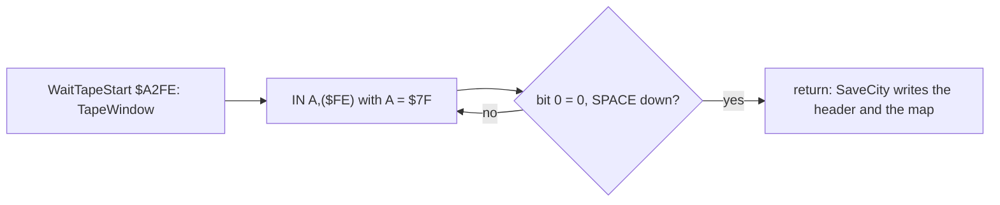

The joysticks are folded into KeyRows only, so at this prompt the Kempston and Sinclair fire buttons do nothing (known
only from the code: the recordings press the SPACE key). Witness: `menus`, SPACE at 20 866 over
[the prompt](img/play/menus-020866-save-start-tape.png), SAVING by 20 896; L1 of `menus` lists WaitTapeStart with
`ports_in` `$7FFE`, its only port.

The game names each byte after a key in it:

| Byte | Half row (port) | Bit 0 | Bit 1 | Bit 2 | Bit 3 | Bit 4 | Named |
| --- | --- | --- | --- | --- | --- | --- | --- |
| `$5B00` | `$FEFE` | CAPS SHIFT | Z | X | C | V | KeyRows |
| `$5B01` | `$FDFE` | A | S | D | F | G | KeyRowA |
| `$5B02` | `$FBFE` | Q | W | E | R | T | KeyRowQ |
| `$5B03` | `$F7FE` | 1 | 2 | 3 | 4 | 5 | KeyRow1 |
| `$5B04` | `$EFFE` | 0 | 9 | 8 | 7 | 6 | KeyRow0 |
| `$5B05` | `$DFFE` | P | O | I | U | Y | KeyRowP |
| `$5B06` | `$BFFE` | ENTER | L | K | J | H | KeyRowEnter |
| `$5B07` | `$7FFE` | SPACE | SYMBOL SHIFT | M | N | B | KeyRowSpace |

A 0 bit is a key down. With no key down, every byte reads `$BF` on the recordings' machine.

A ninth byte, KeyNone `$5B08`, always holds `$FF`. ScanKey and AnyKey read nine rows, and the ninth is this "no
key" row.

```text
Interrupt:                                    ; $F70B, every frame (IM 2)
    push every register, both sets
    ReadInput()
    if SwitchOff = 0:                         ; the tasks may switch
        swap SP between UiSP and SimSP        ; TaskNow tells which one is running
        TaskNow = TaskNow XOR 1
    pop every register; EI; RET

ReadInput:                                    ; $F781
    for row = 0 to 7:                         ; port high byte $FE, $FD, $FB ... $7F
        KeyRows[row] = IN(high byte << 8 | $FE)
    ReadKempston()
    ReadSinclair()

ReadKempston:                                 ; $7A01
    stick = ReadPort1F()                      ; NOT IN($1F), or $FF with no interface
    if stick bit 0 = 0: KeyRowP bit 0 = 0     ; right -> P
    if stick bit 1 = 0: KeyRowP bit 1 = 0     ; left  -> O
    if stick bit 2 = 0: KeyRowA bit 0 = 0     ; down  -> A
    if stick bit 3 = 0: KeyRowQ bit 0 = 0     ; up    -> Q
    if stick bit 4 = 0: KeyRowSpace bit 0 = 0 ; fire  -> SPACE

ReadSinclair:                                 ; $7A32
    if SYMBOL SHIFT down or CAPS SHIFT down: return
    keys = KeyRow0                            ; 0 9 8 7 6
    if 7 down: P;  if 6 down: O;  if 8 down: A;  if 9 down: Q;  if 0 down: SPACE
```

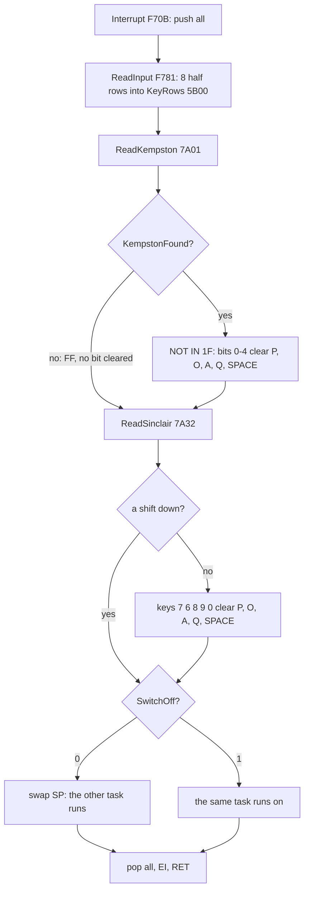

The asm. ReadInput is eleven instructions; RLC B walks the select bit through the port's high byte.

```text
F719  CD 81 F7     CALL ReadInput         ; in Interrupt, after the pushes
F71C  3A 05 F7     LD A,(SwitchOff)
F71F  A7           AND A
F720  20 1C        JR NZ,InterruptReturn  ; no switch while the UI holds it off
F722  21 04 F7     LD HL,TaskNow
...
F781  21 00 5B     LD HL,KeyRows          ; ReadInput
F784  01 FE FE     LD BC,$FEFE
F787  16 08        LD D,$08
F789  ED 78        IN A,(C)               ; ReadInputRow
F78B  77           LD (HL),A
F78C  2C           INC L
F78D  CB 00        RLC B                  ; $FE, $FD, $FB, $F7, $EF, $DF, $BF, $7F
F78F  15           DEC D
F790  20 F7        JR NZ,ReadInputRow
F792  CD 01 7A     CALL ReadKempston
F795  C3 32 7A     JP ReadSinclair
```

ReadPort1F `$5B80` hides the interface's absence. Entry `$5B1B` tests port `$1F` at start-up, up to 32 768 times:
a value of `$1F` or more (a floating bus gives `$FF`) means no interface. Only when every read stays below `$1F` is
KempstonFound `$5B7F` set to 1. Without it, ReadPort1F returns `$FF` (the CPL of 0), and no bit is cleared.

```text
5B80  3A 7F 5B     LD A,(KempstonFound)   ; ReadPort1F
5B83  A7           AND A
5B84  28 02        JR Z,ReadPort1FDone
5B86  DB 1F        IN A,($1F)             ; a Kempston gives 1 for each direction pushed
5B88  2F           CPL                    ; ReadPort1FDone: now 0 for pushed, like a key
5B89  C9           RET
7A01  CD 80 5B     CALL ReadPort1F        ; ReadKempston
7A04  4F           LD C,A
7A05  CB 41        BIT 0,C                ; right
7A07  20 05        JR NZ,KempLeft
7A09  21 05 5B     LD HL,KeyRowP
7A0C  CB 86        RES 0,(HL)             ; P down
7A0E  CB 49        BIT 1,C                ; KempLeft
...
7A29  CB 61        BIT 4,C                ; KempFire
7A2B  C0           RET NZ
7A2C  21 07 5B     LD HL,KeyRowSpace
7A2F  CB 86        RES 0,(HL)             ; SPACE down
7A31  C9           RET
7A32  3A 07 5B     LD A,(KeyRowSpace)     ; ReadSinclair
7A35  E6 02        AND $02
7A37  C8           RET Z                  ; SYMBOL SHIFT down: 6-0 are shortcuts
7A38  3A 00 5B     LD A,(KeyRows)
7A3B  E6 01        AND $01
7A3D  C8           RET Z                  ; CAPS SHIFT down: 5-8 scroll
7A3E  3A 04 5B     LD A,(KeyRow0)
7A41  4F           LD C,A
7A42  CB 59        BIT 3,C                ; 7: right
...
7A66  CB 41        BIT 0,C                ; SincFire: 0
7A68  C0           RET NZ
7A69  21 07 5B     LD HL,KeyRowSpace
7A6C  CB 86        RES 0,(HL)
7A6E  C9           RET
```

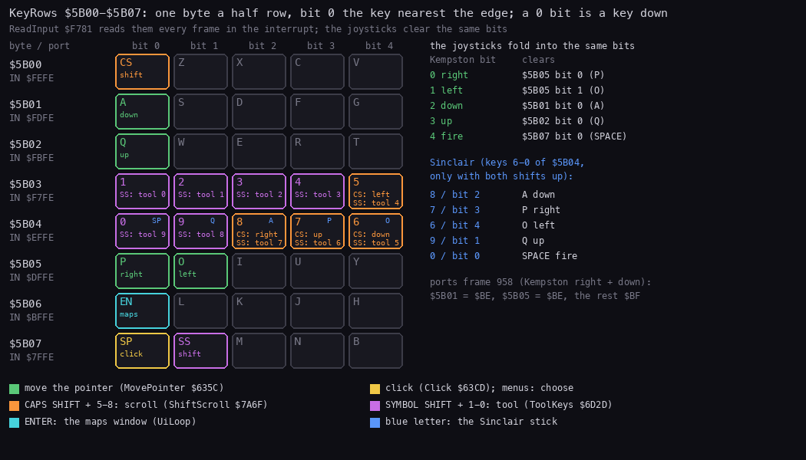

*The keyboard as the game reads it. How to read: one row per KeyRows byte, with its address and port; one box per
key, bit 0 on the left; a coloured frame is a key the game uses, with what it does under it (CS: with CAPS SHIFT,
SS: with SYMBOL SHIFT); a blue letter on 6-0 is the key the Sinclair stick becomes. On the right, which bit each
Kempston direction clears, and the KeyRows witness from `ports` frame 958. Drawn from the code (ReadInput,
ReadKempston, ReadSinclair, MovePointer, Click, ShiftScroll, ToolKeys, UiLoop): `python3 tools/fig_controls.py keys
docs/img/controls/keys.png`.*

The point: the reader is shared, so nothing downstream knows which device was used. One stick push and one key press
leave the same byte.

Worked example 1: the Kempston stick held right and down (`ports`, frame 958).

1. KempstonFound is 1: the `ports` setup has the interface.
2. The interface returns `$05` on port `$1F` (bit 0 right, bit 2 down). CPL gives `$FA`.
3. Bit 0 of `$FA` is 0, so `RES 0,(HL)` on KeyRowP: `$BF` becomes `$BE` (P down).
4. Bit 1 is 1: no O. Bit 2 is 0, so KeyRowA `$5B01` becomes `$BE` (A down). Bits 3 and 4 are 1: no Q, no SPACE.
5. The sample at frame 958 shows `$5B01` = `$BE` and `$5B05` = `$BE`, the other six bytes `$BF`.

Worked example 2: the Sinclair stick pushed left (stepped through from the code).

1. The stick closes key 6: KeyRow0 `$5B04` reads `$AF` (bit 4 clear).
2. Both shifts are up: KeyRows bit 0 and KeyRowSpace bit 1 are 1.
3. BIT 4,C is 0, so `RES 1,(HL)` on KeyRowP: O is down, and MovePointer moves the pointer left.
4. With CAPS SHIFT also down, ReadSinclair returns at `$7A3D`. CAPS SHIFT + 6 is then a scroll, not a stick
   (5.6).

Witness:

- `ports`, frames 957-993: the pointer moves one step right and one step down every pass, with no key in the script
  (5.3).
- The measured cost in `ports` (trace from frame 958): the interrupt with no task switch takes 952-1062 T; ReadInput
  800 T of it, ReadKempston 209 T, ReadSinclair 166 T. So the handler with the input read costs about 1000-1100 T a
  frame, 1.5 % of it; the 780 T of the L1 self-times of Interrupt and ReadInput leave out the callees.
- The Sinclair path is known only from the code: no recording presses 6-0 alone (WALKTHROUGH 6.0, "not reached").
- The memory samples of `$F704-$F705` show the tasks: `0000` and `0100` in turn while they alternate, `0001` while
  the switch is held off.

The point: reading the joysticks costs 375 T a frame even when nobody touches them. In return every routine above can
test a key with one `LD A,(nn)` and one `AND`.

## 5.2 Keys as characters: ScanKey, KeyToChar, AnyKey

Three small routines turn KeyRows into "which key", for the code that wants a character, not a bit.

- ScanKey `$5BB3` finds the first key down. It walks the nine rows (the eighth is SPACE, the ninth KeyNone) and,
  in each, bits 0 to 4. It returns the key's number 0-39 in KeyFound `$5BB2`, or carry set if no key is down. In
  the first row the mask is `$FE`, so CAPS SHIFT alone is never found.
- KeyToChar `$5BDF` calls ScanKey and looks the number up in KeyChars `$5B8A`, 40 bytes in row order:
  `$03`, Z X C V, A S D F G, Q W E R T, 1 2 3 4 5, 0 9 8 7 6, P O I U Y, `$08` (ENTER), L K J H, space, `.`
  (SYMBOL SHIFT), M N B.
- AnyKey `$5BEF` returns NZ if any of the five keys of any of the nine rows is down. CAPS SHIFT counts here.

```text
ScanKey:                                      ; $5BB3
    mask = $FE                                ; CAPS SHIFT ignored in the first row only
    number = 0
    for row = 0 to 8:
        down = (NOT KeyRows[row]) AND $1F AND mask
        if down: return number + lowest set bit of down   ; KeyFound, carry clear
        mask = $FF
        number += 5
    KeyFound = $FF; return with carry         ; no key

KeyToChar:  if ScanKey() finds a key: return KeyChars[KeyFound]
AnyKey:     return any((NOT KeyRows[row]) AND $1F for row = 0 to 8)
```

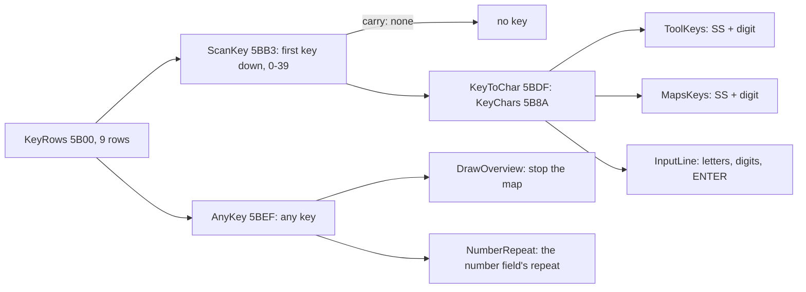

```text
5BB3  21 00 5B     LD HL,KeyRows          ; ScanKey
5BB6  01 00 09     LD BC,$0900            ; nine rows, number 0
5BB9  16 FE        LD D,$FE               ; CAPS SHIFT masked in the first row
5BBB  7E           LD A,(HL)              ; ScanRow
5BBC  2F           CPL
5BBD  E6 1F        AND $1F
5BBF  A2           AND D
5BC0  20 10        JR NZ,ScanBit
5BC2  16 FF        LD D,$FF
5BC4  79           LD A,C
5BC5  C6 05        ADD A,$05
5BC7  4F           LD C,A
5BC8  23           INC HL
5BC9  10 F0        DJNZ ScanRow
5BCB  3E FF        LD A,$FF
5BCD  32 B2 5B     LD (KeyFound),A
5BD0  37           SCF                    ; no key
5BD1  C9           RET
5BD2  0F           RRCA                   ; ScanBit: the lowest set bit
5BD3  30 06        JR NC,ScanNextBit
5BD5  79           LD A,C
5BD6  32 B2 5B     LD (KeyFound),A
5BD9  B7           OR A
5BDA  C9           RET
5BDF  CD B3 5B     CALL ScanKey           ; KeyToChar
5BE2  D8           RET C
5BE3  3A B2 5B     LD A,(KeyFound)
5BE6  5F           LD E,A
5BE7  16 00        LD D,$00
5BE9  21 8A 5B     LD HL,KeyChars
5BEC  19           ADD HL,DE
5BED  7E           LD A,(HL)
5BEE  C9           RET
```

Worked example: SYMBOL SHIFT + 5 (`tools`, frame 13 713), stepped through with the bits the two keys clear.

1. KeyRow1 `$5B03` holds `$AF` (bit 4, key 5, clear); KeyRowSpace `$5B07` holds `$BD` (bit 1, SYMBOL SHIFT,
   clear).
2. Rows 0-2 have no key. Row 3 gives `down` = `$10`; the number is 15 + 4 = 19.
3. KeyChars + 19 is `$35`, the character "5". Row 7, where SYMBOL SHIFT is, is never reached.
4. ToolKeys (5.5) makes tool 4 of it: the status box shows PARK in the screenshot `013737-shortcut-ss5.png`.

Witness: `tools`, frames 13 617-13 841: each SYMBOL SHIFT + digit changes the tool shown (5.5). `menus`: the digits
1-5 of the landscape number 12345 reach InputLine through KeyToChar (5.9).


*The same figure as in 5.1. How to read it for ScanKey: the key number is 5 x the row (0-7, top to bottom) + the bit
(0-4, left to right); KeyChars lists the characters in that order. `python3 tools/fig_controls.py keys
docs/img/controls/keys.png`.*

The point: the scan stops at the first key down, so a shift in a lower row never hides a digit. SYMBOL SHIFT + 5
reads as "5", and the shift is tested apart, by its bit.

## 5.3 The pointer: one step a pass, no acceleration

The pointer is an arrow drawn over the screen (doc 06, 6.8). Two bytes hold where it is:

- PointerX `$5CFC`: 0-62, in half characters;
- PointerY `$5CFD`: 0-184, in pixel lines, in steps of 2.

The arrow itself is drawn on the character grid. DrawPointer puts it at column PointerX / 2 and row PointerY / 8
(doc 06, 6.8). So two steps across move it one column, and four steps down move it one row.

MovePointer `$635C` runs once a pass, after the pointer is erased. It tests O, P, Q and A in KeyRows, in that order,
and moves one step for each key down. So the speed is one step a pass. On the screen the arrow jumps one column every
second pass across, and one row every fourth pass down. There is no acceleration and no repeat delay: a key held for
30 passes moves 30 steps.

The edges are not symmetrical:

- Right: PointerX stops at 62. A step past it jumps to DrawView, the full redraw of the view (doc 06, 6.4).
- Left: PointerX stops at 0, with the same DrawView.
- Down: PointerY stops at 184 (`$B8`), with DrawView.
- Up: PointerY stops at 0 or 1 with a plain return.
- Up, with key 6 held and the pointer at row `$40` (the view's top) or below: the pointer stops at `$40`, with
  DrawView (PointerUpStop). No recording ran this branch.

DrawView at the edge does not scroll. ViewCol and ViewRow do not change; the view is only drawn again. The scroll is
done by other keys (5.6).

```text
MovePointer:                                  ; $635C, once a UI pass
    if O down: PointerLeft()
    if P down: PointerRight()
    if Q down: PointerUp()
    if A down: PointerDown()

PointerRight:  x = PointerX + 1; if x >= 63: DrawView() else PointerX = x
PointerLeft:   x = PointerX - 1; if x = -1:  DrawView() else PointerX = x
PointerDown:   y = PointerY + 2; if y >= 185: PointerY = 184; DrawView() else PointerY = y
PointerUp:
    if PointerY >= $40 and key 6 down:        ; PointerUpStop
        y = PointerY - 2; if y < $40: DrawView() else PointerY = y
    else:
        y = PointerY - 2; if y wrapped below 0: return else PointerY = y
```

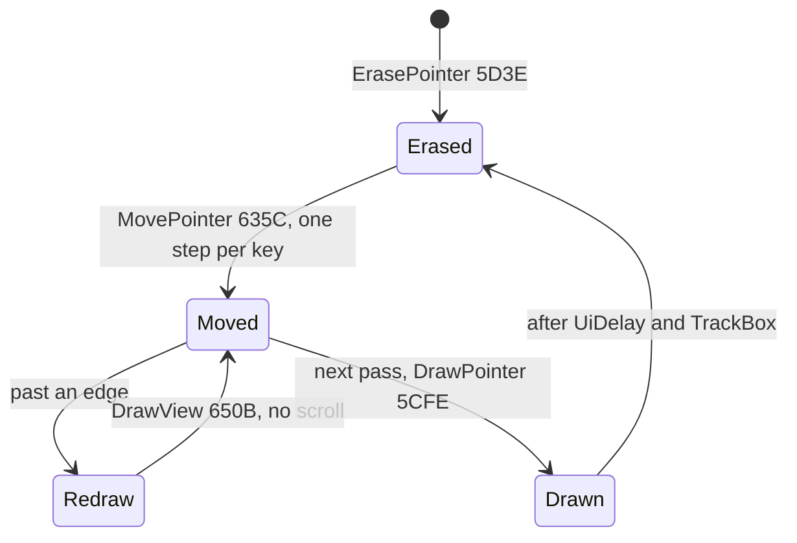

```text
635C  3A 05 5B     LD A,(KeyRowP)         ; MovePointer
635F  E6 02        AND $02                ; O
6361  CC 8A 63     CALL Z,PointerLeft
6364  3A 05 5B     LD A,(KeyRowP)
6367  E6 01        AND $01                ; P
6369  CC 7D 63     CALL Z,PointerRight
636C  3A 02 5B     LD A,(KeyRowQ)
636F  E6 01        AND $01                ; Q
6371  CC 97 63     CALL Z,PointerUp
6374  3A 01 5B     LD A,(KeyRowA)
6377  E6 01        AND $01                ; A
6379  CC B8 63     CALL Z,PointerDown
637C  C9           RET
637D  21 FC 5C     LD HL,PointerX         ; PointerRight
6380  7E           LD A,(HL)
6381  C6 01        ADD A,$01
6383  FE 3F        CP $3F
6385  D2 0B 65     JP NC,DrawView         ; at the edge: redraw, no scroll
6388  77           LD (HL),A
6389  C9           RET
6397  21 FD 5C     LD HL,PointerY         ; PointerUp
639A  7E           LD A,(HL)
639B  FE 40        CP $40
639D  38 07        JR C,PointerUpMove
639F  3A 04 5B     LD A,(KeyRow0)
63A2  E6 10        AND $10                ; key 6
63A4  28 08        JR Z,PointerUpStop
63A6  7E           LD A,(HL)              ; PointerUpMove
63A7  D6 02        SUB $02
63A9  FE FA        CP $FA                 ; wrapped below 0: stay
63AB  D0           RET NC
63AC  77           LD (HL),A
63AD  C9           RET
63B8  21 FD 5C     LD HL,PointerY         ; PointerDown
63BB  7E           LD A,(HL)
63BC  C6 02        ADD A,$02
63BE  FE B9        CP $B9
63C0  30 02        JR NC,PointerDownStop
63C2  77           LD (HL),A
63C3  C9           RET
63C4  36 B8        LD (HL),$B8            ; PointerDownStop
63C6  C3 0B 65     JP DrawView
```

Worked example: O held in `tools` from frame 788.

1. At frame 788 PointerX is 53 and PassCount 58. The script presses O at 788.
2. The pass running then reaches MovePointer: O is down, so PointerLeft makes PointerX 52. The sample at 789 shows
   52 and PassCount 59.
3. Each later pass does the same. The pass ends every 2 or 3 frames: one UI frame, then a simulation frame, and at
   times a frame where the UI holds the switch off for its row redraw.
4. At frame 857 PointerX is 20 and PassCount 91: 33 steps in 33 passes and 69 frames, about 2.1 frames a step.

Witness:

- `tools`, frames 780-865: PointerX, PassCount and `$F704/$F705` sampled every frame
  (`work/docs/scB/pointer-tools-780.csv`, from `work/docs/scB/ptr.py`).
- `ports`, frames 957-993: the Kempston diagonal moves the pointer (+1, +2) every pass.
- The routine costs, traced in `tools` frames 801-805: MovePointer 195-267 T; ErasePointer 685-985 T; DrawPointer
  1485-2038 T.
- PointerUpStop: known only from the code.

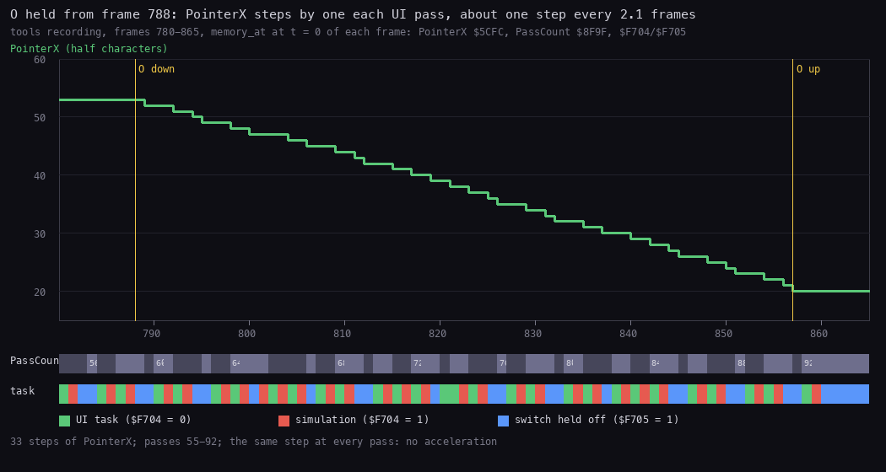

*The pointer's speed is the pass rate. How to read: the green staircase is PointerX at the start of each frame; the
two yellow lines mark O down (788) and O up (857); under it, PassCount (a band per pass, every fourth numbered) and
which task ran the frame (green UI, red simulation, blue the switch held off). Recording `tools`, frames 780-865,
`memory_at` at T 0 of each frame. `python3 tools/fig_controls.py speed work/docs/scB/pointer-tools-780.csv
docs/img/controls/pointer-speed.png`.*

The point: every step of the staircase is one pass. The steps are the same size from the first to the last, so the
pointer does not accelerate; its speed changes only when the pass gets longer.

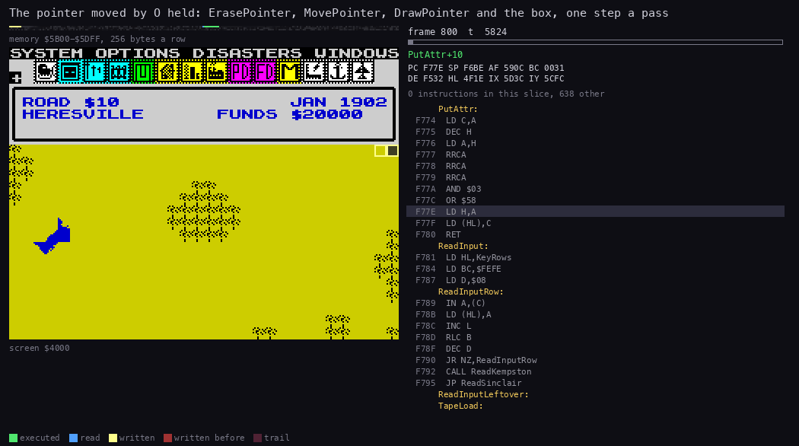

*MovePointer, ErasePointer and DrawPointer over three passes. How to read: left, the screen; right, the listing with
the running instruction lit, and the bytes `$5B00-$5DFF` (KeyRows, PointerX/Y, PointerSave) with their reads and
writes. Recording `tools`, window 800:0-806:0, O held. `python3 ../../kit/routine_anim.py --work
work/docs/scB/tools --window 800:0-806:0 --listing build/game.lst --view screen --pc 5CFE-5DB2,635C-63C8 --range
5B00-5DFF --pictures 72 --title "The pointer moved by O held: ErasePointer, MovePointer, DrawPointer and the box, one step a pass" --out
docs/img/routines/MovePointer.gif`.*

The point: the pointer moves only while it is erased. It is never on screen at two places at once, and the eight
bytes under it are always restored before it moves.

## 5.4 The click: one key, four regions

SPACE is the only "action" key. Click `$63CD` runs once a pass, after MovePointer. If SPACE is down, it turns the
pointer into a character cell:

- ClickCell column = PointerX / 2 (0-31);
- ClickCell row = PointerY / 8 (0-23).

Then it offers the cell to four handlers in turn. Each one returns at once if the cell is not its own:

1. ToolClick `$6D51`: rows 1-2, columns 2-29, the 14 icons of the tool palette (5.5).
2. ScrollClick `$6CBF`: row 2, column 0, the "+" corner, the scroll mode (5.6).
3. MenuClick `$6401`: row 0, the menu bar. OpenMenuAt `$640E` picks the menu by PointerX: below 14 SYSTEM, below 30
   OPTIONS, below 48 DISASTERS, else WINDOWS.
4. MapClick `$7012`: rows 8-23, the view, when the tool's box is shown (5.7).

Rows 3-7 (the status box) and the palette's edge columns do nothing.

Before the last three, Click sets SwitchOff to 1. A menu, the scroll mode or a tool's work then runs with the
simulation stopped: the interrupt no longer switches tasks. Click clears SwitchOff when the handler returns.

```text
Click:                                        ; $63CD, once a UI pass
    if SPACE up: return
    ClickCell = (PointerX / 2, PointerY / 8)
    ToolClick()                               ; the palette
    SwitchOff = 1                             ; the simulation stops
    ScrollClick()                             ; the + corner
    MenuClick()                               ; the menu bar
    MapClick()                                ; the view
    SwitchOff = 0

MenuClick:
    if ClickCell row <> 0: return
    wait for SPACE up
    if PointerX < 14: ShowMenu(SystemMenu)
    elif PointerX < 30: ShowMenu(OptionsMenu)
    elif PointerX < 48: ShowMenu(DisasterMenu)
    else: ShowMenu(WindowsMenu)
    wait for SPACE up
```

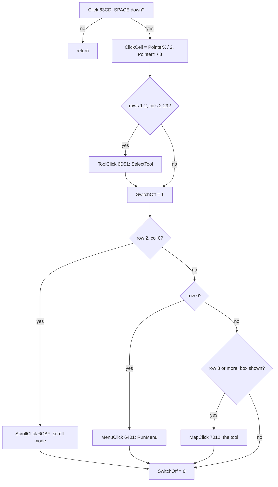

```text
63CD  3A 07 5B     LD A,(KeyRowSpace)     ; Click
63D0  E6 01        AND $01
63D2  C0           RET NZ                 ; SPACE up
63D3  ED 4B FC 5C  LD BC,(PointerX)       ; C = PointerX, B = PointerY
63D7  CB 38        SRL B
63D9  CB 38        SRL B
63DB  CB 38        SRL B                  ; row = PointerY / 8
63DD  CB 39        SRL C                  ; column = PointerX / 2
63DF  ED 43 C9 63  LD (ClickCell),BC
63E3  CD 51 6D     CALL ToolClick
63E6  3E 01        LD A,$01
63E8  32 05 F7     LD (SwitchOff),A       ; the simulation stops
63EB  CD BF 6C     CALL ScrollClick
63EE  CD 01 64     CALL MenuClick
63F1  CD 12 70     CALL MapClick
63F4  AF           XOR A
63F5  32 05 F7     LD (SwitchOff),A
63F8  C9           RET
640E  3A FC 5C     LD A,(PointerX)        ; OpenMenuAt
6411  DD 21 2B A0  LD IX,SystemMenu
6415  FE 0E        CP $0E
6417  DA F2 66     JP C,ShowMenu
641A  DD 21 2F A3  LD IX,OptionsMenu
641E  FE 1E        CP $1E
6420  DA F2 66     JP C,ShowMenu
6423  DD 21 3E A4  LD IX,DisasterMenu
6427  FE 30        CP $30
6429  DA F2 66     JP C,ShowMenu
642C  DD 21 C2 A4  LD IX,WindowsMenu
6430  C3 F2 66     JP ShowMenu
```

Worked example: the WINDOWS menu opened in `menus` at frame 18 929.

1. The bot has put the pointer on "WINDOWS": PointerX is 48 or more, PointerY below 8.
2. SPACE at 18 929. The next pass computes ClickCell row 0, so ToolClick returns (row 0 is not 1-2).
3. SwitchOff becomes 1. ScrollClick returns (row 0 is not 2).
4. MenuClick: row 0. It waits for SPACE up (the bot releases it at 18 935), then OpenMenuAt compares PointerX with
   14, 30 and 48 and opens WindowsMenu.
5. The menu stays up, with the simulation stopped, until an item ends it (5.8). The screenshot
   `018965-windows-menu.png` shows it.

Witness: `menus`, every menu of the bar opened in turn (screenshots `013854-about.png` to `020528-system-menu.png`);
`$F705` reads 1 at every frame sampled from 19 770 to 19 978, while the WINDOWS menu (to 19 828) and then the budget
window are up.

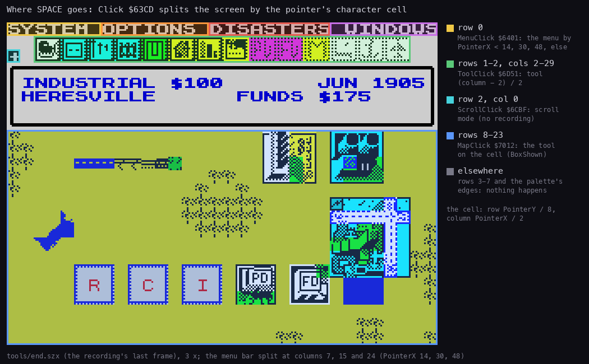

*Where SPACE goes. How to read: the screen at three times its size; yellow to purple, the four menus of row 0 and
where the bar is split (columns 7, 15 and 24, that is PointerX 14, 30 and 48); green, the palette's 14 icons
(ToolClick); cyan, the "+" corner (ScrollClick); blue, the view (MapClick). Recording `tools`, its last frame
(`end.szx`, frame 19 867). `python3 tools/fig_controls.py zones work/stage1/rec/tools/end.szx
docs/img/controls/click-zones.png`.*

The point: the menu bar is split by PointerX, not by the words. The space after SYSTEM and the space after OPTIONS
open those menus; the space before WINDOWS opens WINDOWS.

## 5.5 The palette and the tool shortcuts

The 14 tools have two ways in: a click on their icon, or SYMBOL SHIFT with a digit. Both end in SelectTool `$6D6D`
with the tool number in B.

- ToolClick (`$6D51`): the icon is 2 columns wide from column 2, so tool = (column - 2) / 2: 0 bulldozer, 1 road,
  2 power line, 3 rail, 4 park, 5 residential, 6 commercial, 7 industrial, 8 police, 9 fire, 10 stadium, 11 power
  station, 12 seaport, 13 airport.
- ToolKeys (`$6D2D`), once a pass: with CAPS SHIFT up and SYMBOL SHIFT down, KeyToChar gives a digit; 1-9 select
  tools 0-8 and 0 selects tool 9. Tools 10-13 have no key.

SelectTool refuses a tool the funds cannot pay for: it subtracts the tool's price (ToolPrices `$6E1E`) from Funds
`$8F97` and returns if the result is negative. The refused tool leaves the current one in place, with no sound.
Selecting the current tool again does nothing.

```text
ToolKeys:                                     ; $6D2D, once a UI pass
    if CAPS SHIFT down or SYMBOL SHIFT up: return
    c = KeyToChar(); if no key: return
    if c = "0": SelectTool(9)
    elif "1" <= c <= "9": SelectTool(c - "1")

ToolClick:                                    ; $6D51, from Click
    if ClickCell row not in 1..2 or column not in 2..29: return
    wait for SPACE up
    SelectTool((column - 2) / 2)

SelectTool(tool):                             ; $6D6D
    if Funds - ToolPrices[tool] < 0: return   ; refused
    if tool = CurrentTool: return
    CurrentTool = tool; show it in the status box and the palette
```

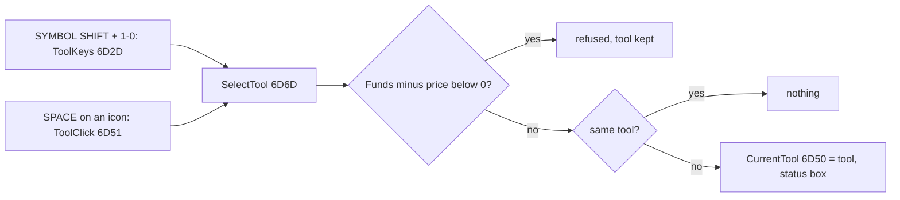

```text
6D2D  3A 00 5B     LD A,(KeyRows)         ; ToolKeys
6D30  E6 01        AND $01
6D32  C8           RET Z                  ; CAPS SHIFT down: no
6D33  3A 07 5B     LD A,(KeyRowSpace)
6D36  E6 02        AND $02
6D38  C0           RET NZ                 ; SYMBOL SHIFT up: no
6D39  CD DF 5B     CALL KeyToChar
6D3C  D8           RET C
6D3D  FE 30        CP $30                 ; "0"
6D3F  20 04        JR NZ,ToolKeysDigit
6D41  06 09        LD B,$09
6D43  18 28        JR SelectTool
6D45  FE 31        CP $31                 ; ToolKeysDigit
6D47  D8           RET C
6D48  FE 3A        CP $3A
6D4A  D0           RET NC
6D4B  D6 31        SUB $31
6D4D  47           LD B,A
6D4E  18 1D        JR SelectTool
6D51  ED 4B C9 63  LD BC,(ClickCell)      ; ToolClick
6D55  78           LD A,B
6D56  A7           AND A
6D57  C8           RET Z                  ; row 0
6D58  FE 03        CP $03
6D5A  D0           RET NC                 ; row 3 or more
6D5B  79           LD A,C
6D5C  FE 02        CP $02
6D5E  D8           RET C
6D5F  FE 1E        CP $1E
6D61  D0           RET NC
6D62  CD F9 63     CALL WaitSpaceUp
6D65  3A C9 63     LD A,(ClickCell)
6D68  D6 02        SUB $02
6D6A  CB 3F        SRL A
6D6C  47           LD B,A
6D6D  C5           PUSH BC                ; SelectTool
6D6E  CD 3A 6E     CALL ToolPrice
6D71  06 00        LD B,$00
6D73  2A 97 8F     LD HL,(Funds)
6D76  3A 99 8F     LD A,(Funds+$0002)
6D79  4F           LD C,A
6D7A  CD 80 66     CALL Sub24             ; Funds - price, 24 bits
6D7D  79           LD A,C
6D7E  C1           POP BC
6D7F  A7           AND A
6D80  F8           RET M                  ; negative: refused
6D81  3A 50 6D     LD A,(CurrentTool)
6D84  B8           CP B
6D85  C8           RET Z
```

Worked example: SYMBOL SHIFT + 1 ... 0 in `tools`, frames 13 617-13 841, with Funds 386 (dollars, decimal; the
screen shows `FUNDS $386`).

| Key | Frame | Tool | Price (dollars) | The status box, 24 frames later |
| --- | ---: | --- | ---: | --- |
| SS + 1 | 13 617 | 0 bulldozer | 1 | `BULLDOZE $1` |
| SS + 5 | 13 713 | 4 park | 10 | `PARK $10` |
| SS + 8 | 13 785 | 7 industrial | 100 | `INDUSTRIAL $100` |
| SS + 9 | 13 809 | 8 police | 500 | still INDUSTRIAL: 386 - 500 is negative, refused |
| SS + 0 | 13 833 | 9 fire | 500 | still INDUSTRIAL: refused |

Witness: the screenshots `013641-shortcut-ss1.png` to `013857-shortcut-ss0.png` of `tools`. The last two show the
refusal: the shortcut for a tool the funds cannot pay is silently ignored.


*The green frame is the palette ToolClick reads: rows 1-2, columns 2-29, 14 icons of 2 x 2 characters. Recording
`tools`, `end.szx`. `python3 tools/fig_controls.py zones work/stage1/rec/tools/end.szx
docs/img/controls/click-zones.png`.*

The point: a shortcut is checked against the funds before anything is drawn, so the player never holds a tool he
cannot use. Tools 10-13 (stadium, power station, seaport, airport) can only be clicked.

## 5.6 Scrolling: CAPS SHIFT + 5-8, and the scroll corner

The view shows 32 x 16 of the 96 x 96 map. Its top-left map cell is ViewCol `$6507` (0-63) and ViewRow `$6508`
(0-79). Two inputs move it.

ShiftScroll `$7A6F` runs once a pass, with SwitchOff held at 1. With CAPS SHIFT down it tests the cursor keys of the
Spectrum: 8 right, 5 left, 7 up, 6 down. Each moves ViewCol or ViewRow by one cell, within the map. If any of the
four keys was down, it jumps to DrawView, which draws the whole view again (doc 06, 6.4). The test is HL <> 0, and
every Scroll routine loads HL with the address of ViewCol or ViewRow before its edge test, so a key held at the edge
redraws the view without moving it. A step is one pass, and a pass with DrawView in it takes about 10 frames, so the
view moves about five cells a second.

The scroll corner is the "+" at row 2, column 0. A click there runs the scroll mode inside ScrollClick:

- O, P, Q, A scroll the view one cell each loop;
- each loop waits for one interrupt (HALT), draws the view and the movers, and adds 4 to PassCount;
- SPACE ends the mode.

No recording clicked the corner.

```text
ShiftScroll:                                  ; $7A6F, once a UI pass (SwitchOff = 1)
    if CAPS SHIFT up: return
    HL = 0
    if 8 down: ScrollRight()                  ; ViewCol + 1, up to 63
    if 5 down: ScrollLeft()                   ; ViewCol - 1, down to 0
    if 7 down: ScrollUp()                     ; ViewRow - 1, down to 0
    if 6 down: ScrollDown()                   ; ViewRow + 1, up to 79
    if HL <> 0: DrawView()                  ; any scroll key, moved or not: HL = ViewCol / ViewRow

ScrollClick:                                  ; $6CBF, from Click
    if ClickCell <> (column 0, row 2): return
    wait for SPACE up
    repeat:
        P: ScrollRight; O: ScrollLeft; Q: ScrollUp; A: ScrollDown
        HALT                                  ; one frame (the simulation is stopped)
        DrawView(); DrawMovers()
        PassCount += 4
    until SPACE down
    wait for SPACE up
```

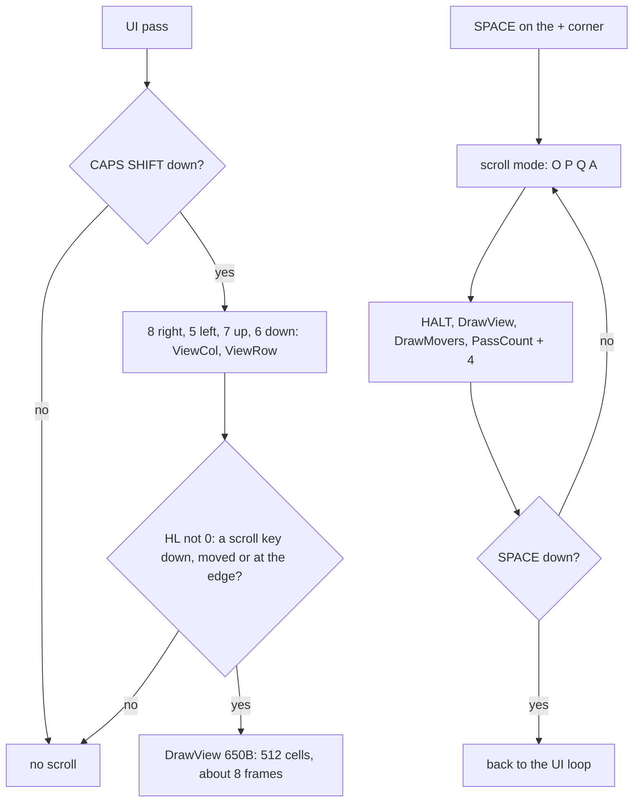

```text
7A6F  3A 00 5B     LD A,(KeyRows)         ; ShiftScroll
7A72  E6 01        AND $01
7A74  C0           RET NZ                 ; CAPS SHIFT up
7A75  21 00 00     LD HL,$0000            ; HL <> 0 after any scroll key
7A78  3A 04 5B     LD A,(KeyRow0)
7A7B  E6 04        AND $04                ; 8
7A7D  CC 0F 6D     CALL Z,ScrollRight
7A80  3A 03 5B     LD A,(KeyRow1)
7A83  E6 10        AND $10                ; 5
7A85  CC 05 6D     CALL Z,ScrollLeft
7A88  3A 04 5B     LD A,(KeyRow0)
7A8B  E6 08        AND $08                ; 7
7A8D  CC 19 6D     CALL Z,ScrollUp
7A90  3A 04 5B     LD A,(KeyRow0)
7A93  E6 10        AND $10                ; 6
7A95  CC 23 6D     CALL Z,ScrollDown
7A98  7C           LD A,H
7A99  B5           OR L
7A9A  C8           RET Z
7A9B  C3 0B 65     JP DrawView
6D0F  21 07 65     LD HL,ViewCol          ; ScrollRight
6D12  7E           LD A,(HL)
6D13  3C           INC A
6D14  FE 40        CP $40                 ; 64: the right edge
6D16  C8           RET Z
6D17  77           LD (HL),A
6D18  C9           RET
6CCD  3A 05 5B     LD A,(KeyRowP)         ; ScrollModeLoop (in ScrollClick)
...
6CED  76           HALT
6CEE  CD 0B 65     CALL DrawView
6CF1  CD 8F 77     CALL DrawMovers
6CF4  21 9F 8F     LD HL,PassCount
6CF7  7E           LD A,(HL)
6CF8  C6 04        ADD A,$04
6CFA  77           LD (HL),A
6CFB  3A 07 5B     LD A,(KeyRowSpace)
6CFE  E6 01        AND $01
6D00  20 CB        JR NZ,ScrollModeLoop
```

Worked example: CAPS SHIFT + 8 in `tools`, from frame 13 457.

1. ViewCol is 30, ViewRow 37. The script holds CAPS SHIFT and 8 from 13 457 to 13 487.
2. The first pass after it: CAPS SHIFT down, 8 down. ScrollRight makes ViewCol 31 and leaves HL = `$6507`, not 0.
3. ShiftScroll jumps to DrawView. In the trace, DrawView runs from 13 458:17 917 to 13 466:24 987: 566 174 T, about
   8.1 frames, all with SwitchOff = 1.
4. Two more passes do the same: ViewCol 32, then 33. The 30 frames held gave three steps, one every 10 frames.
5. Then CAPS SHIFT + 6 at 13 497 moves ViewRow 37 to 40, CAPS SHIFT + 5 at 13 537 brings ViewCol back to 30, and
   CAPS SHIFT + 7 at 13 577 brings ViewRow back to 37.

Witness: `tools`, frames 13 457-13 607 (ViewCol and ViewRow sampled every frame with `work/docs/scB/ptr.py`;
screenshots `013497-scroll-cs8.png` to `013617-scroll-cs7.png`). The scroll mode of the "+" corner is known only from
the code.

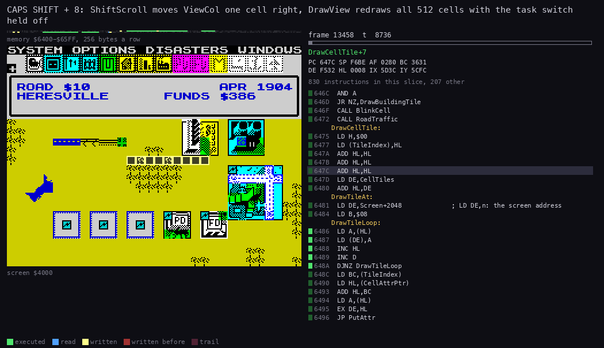

*One CAPS SHIFT + 8 step. How to read: left, the screen, where the view is drawn again row by row, one cell to the
right; right, the listing (ShiftScroll, ScrollLeft-ScrollDown, DrawViewRowPass-StartBuilding) and the bytes
`$6400-$65FF` (ViewCol, ViewRow, BuildingLeft, the self-modified DrawTileAt). Recording `tools`, window
13 458:0-13 468:0. `python3 ../../kit/routine_anim.py --work work/docs/scB/tools --window 13458:0-13468:0 --listing
build/game.lst --view screen --pc 6434-659F,7A6F-7AA0,6D05-6D2C --range 6400-65FF --pictures 80 --title "CAPS SHIFT +
8: ShiftScroll moves ViewCol one cell right, DrawView redraws all 512 cells with the task switch held off" --out docs/img/routines/ShiftScroll.gif`.*

The point: the game has no scroll routine. It moves the view's origin by one cell and draws the whole view again,
which costs eight frames; the simulation is stopped for them.

## 5.7 The map click and the drag

A click in the view (rows 8-23) acts with the current tool. MapClick `$7012` runs only when the tool's box is shown:
TrackBox `$5D55` sets BoxShown `$5D54` when the pointer is in the view and the box fits on screen (doc 06, 6.8).
Then:

1. CrossNetwork `$7086` handles a road, rail or power line crossing another network, or returns with carry to stop.
2. CheckSite `$7103` tests the cells under the box. On failure Refuse `$71E4` sounds the refusal beep, unless a
   direction key is down (a drag).
3. Otherwise the handler of the tool is fetched from ToolHandlers `$6FF6` and called through the self-modified
   `CALL $0000` at ToolCall `$703F`.
4. MapClickWait `$7042` then waits while SPACE is held, unless a direction key is down.

The wait is the drag. With SPACE held alone, the game waits for its release, so one click builds once. With SPACE
and a direction held, MapClickWait returns at once. The next pass moves the pointer, and Click builds again on the
new cell. So holding SPACE and steering paints a road, a rail or a power line along the path.

```text
MapClick:                                     ; $7012, from Click (SwitchOff = 1)
    if ClickCell row < 8 or not BoxShown: return
    if CrossNetwork() stops: return
    if CheckSite() fails: Refuse()            ; the beep, silent while A, Q, P or O is down
    else: ToolHandlers[CurrentTool]()         ; through CALL ToolCall
    while SPACE down:                         ; MapClickWait
        if A, Q, P or O down: return          ; the drag: build again next pass
```

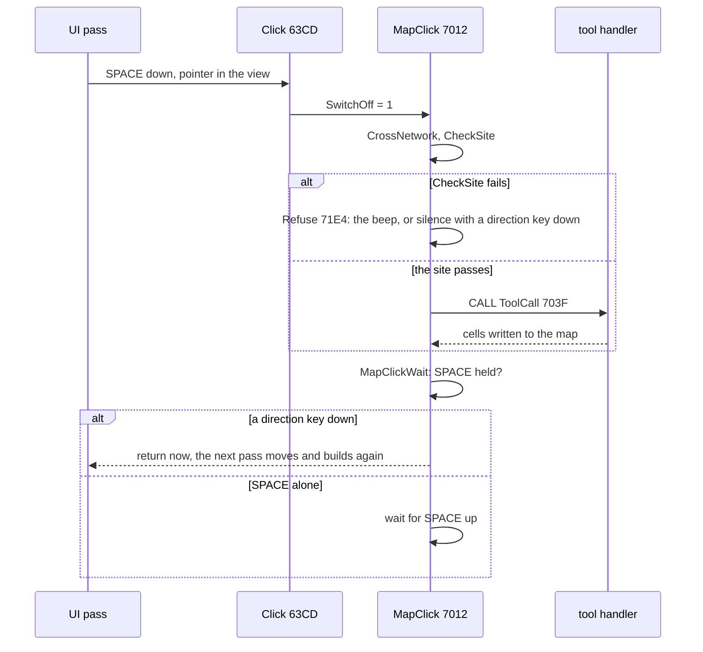

```text
7012  3A CA 63     LD A,(ClickCell+$0001) ; MapClick
7015  FE 08        CP $08
7017  D8           RET C                  ; above the view
7018  3A 54 5D     LD A,(BoxShown)
701B  A7           AND A
701C  C8           RET Z
701D  CD 86 70     CALL CrossNetwork
7020  D8           RET C
7021  CD 03 71     CALL CheckSite
7024  D2 2D 70     JP NC,MapClickTool
7027  CD E4 71     CALL Refuse            ; the beep
702A  C3 42 70     JP MapClickWait
702D  3A 50 6D     LD A,(CurrentTool)     ; MapClickTool
7030  87           ADD A,A
7031  4F           LD C,A
7032  06 00        LD B,$00
7034  21 F6 6F     LD HL,ToolHandlers
7037  09           ADD HL,BC
7038  7E           LD A,(HL)
7039  23           INC HL
703A  66           LD H,(HL)
703B  6F           LD L,A
703C  22 40 70     LD (ToolCall+$0001),HL ; self-modified call
703F  CD 00 00     CALL $0000             ; ToolCall
7042  3A 01 5B     LD A,(KeyRowA)         ; MapClickWait
7045  E6 01        AND $01
7047  C8           RET Z                  ; A: drag
7048  3A 02 5B     LD A,(KeyRowQ)
704B  E6 01        AND $01
704D  C8           RET Z                  ; Q
704E  3A 05 5B     LD A,(KeyRowP)
7051  E6 01        AND $01
7053  C8           RET Z                  ; P
7054  3A 05 5B     LD A,(KeyRowP)
7057  E6 02        AND $02
7059  C8           RET Z                  ; O
705A  3A 07 5B     LD A,(KeyRowSpace)
705D  E6 01        AND $01
705F  28 E1        JR Z,MapClickWait      ; SPACE still down: wait
7061  C9           RET
```

Worked example: a road drawn by the drag, stepped through from the code.

1. Tool 1 (road), the pointer on map cell (40, 40). SPACE and P are down.
2. Click: ClickCell row is 8 or more, BoxShown is 1. CheckSite passes; the road handler writes the road cell.
3. MapClickWait: KeyRowA bit 0 is 1, KeyRowQ bit 0 is 1, KeyRowP bit 0 is 0 (P), so it returns.
4. SwitchOff goes back to 0. The next pass: MovePointer moves the pointer one step right (half a cell). Click runs
   again on the same cell, where the road already is: CrossNetwork does not take a road on a road, CheckSite fails
   (a road code is not in SiteCells `$70FC`), and Refuse stays silent because P is held. No beep and no charge.
5. Two passes later the pointer is on cell (41, 40), and the next road cell is written there.

Witness: `tools`, the road, rail and power line built by the bot (WALKTHROUGH 6.0; screenshots `002499-road.png`,
`003248-power-line.png`, `003999-rail.png`); the refusal beep for "a road on an occupied cell" at
`013457-occupied-beep.png`. How each tool changes the map is doc 10.


*The blue frame: rows 8-23, where a click goes to MapClick. Recording `tools`, `end.szx`. `python3
tools/fig_controls.py zones work/stage1/rec/tools/end.szx docs/img/controls/click-zones.png`.*

The point: the drag is not a separate mode. It is the click repeated on every pass while a direction key keeps the
wait from holding it.

## 5.8 The menus: an input state machine

A menu is drawn by DrawMenu `$67C3` from a description (`src/res/text/menus/*.txt`): one item a line, each with a
kind:

| Kind | Item | What SPACE does |
| ---: | --- | --- |
| 0 | text | nothing: the line cannot be chosen |
| 1 | toggle | XOR 1 on its flag byte (ON / OFF) |
| 2 | action | JP to its routine |
| 3 | separator | - |
| 4 | end | - |
| 8 | number | EditNumber: Q / A change the value, SPACE ends |

RunMenu `$6944` is the state machine. It lights the selected line, then loops:

1. Wait 8 interrupts (8 HALTs).
2. Q: MenuUp (the line above, not past the first). A: MenuDown (not past the last).
3. SPACE: wait for its release, then act by the item's kind.

The highlight is HighlightLine `$6933`: it XORs `$46` into the attributes of columns 1-30 of the line. Calling it
twice puts the line back, so moving the bar is "XOR the old line, XOR the new line".

The menu is opened from Click, so SwitchOff is 1: the simulation is frozen while a menu is up. Each HALT therefore
waits exactly one frame, and the bar moves at most once every 8 frames.

EditNumber `$6996` edits a number field in place (the tax rate and the three fund levels of the budget):

- Q adds 1 up to the field's maximum, A takes 1 down to 0.
- The field is printed in attribute `$45` while it is edited, then `$47`.
- The key repeats with a delay that shrinks. NumberRepeat `$6A31` counts EditRepeat `$6995` down by one on each
  loop while any key is held, and resets it to 10 when no key is down. Each loop waits EditRepeat frames, counted
  after the decrement. So a held key repeats after 9 frames, then 8, 7 ... 1, and from the tenth step on at every
  loop.
- SPACE ends the edit and goes back to the menu.

This shrinking delay is the only acceleration in the game's controls.

```text
RunMenu:                                      ; $6944
    if MenuCount = 0: return
    MenuSelected = 0
    CallMenuHook()                            ; MenuHook $6942: the budget or evaluation window recomputes
    light the line
    loop:
        HALT 8 times                          ; 8 frames: the simulation is stopped
        if Q down: MenuUp()                   ; XOR the old line, XOR the new one
        if A down: MenuDown()
        if SPACE down:
            wait for SPACE up
            item = SelectedItem()
            if item.kind = 2: jump item.routine          ; action
            if item.kind = 1: item.flag XOR= 1; return   ; toggle: the menu closes
            if item.kind = 8: EditNumber(item)           ; number
            return

EditNumber(item):                             ; $6996
    EditRepeat = 10
    loop:
        NumberRepeat()                        ; any key: EditRepeat - 1 (not below 0), none: 10
        print the field
        if SPACE down: wait for its release; print it plain; back to RunMenu's loop
        if Q down and value < max: value + 1
        if A down and value > 0: value - 1
        CallMenuHook()                        ; the budget's totals follow the new value
        HALT EditRepeat times
```

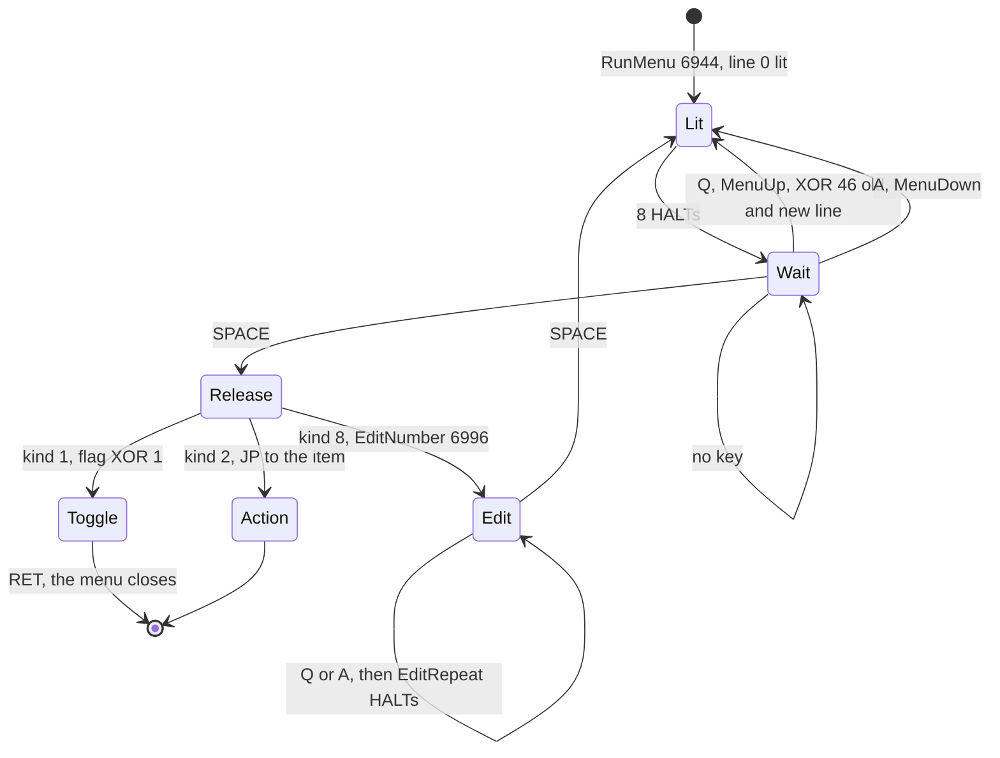

```text
6953  06 08        LD B,$08               ; RunMenuWait
6955  76           HALT                   ; RunMenuHalt: one frame each
6956  10 FD        DJNZ RunMenuHalt
6958  3A 02 5B     LD A,(KeyRowQ)
695B  E6 01        AND $01
695D  CC 54 6A     CALL Z,MenuUp
6960  3A 01 5B     LD A,(KeyRowA)
6963  E6 01        AND $01
6965  CC 6C 6A     CALL Z,MenuDown
6968  3A 07 5B     LD A,(KeyRowSpace)
696B  E6 01        AND $01
696D  28 02        JR Z,RunMenuRelease
696F  18 E2        JR RunMenuWait
6971  3A 07 5B     LD A,(KeyRowSpace)     ; RunMenuRelease
6974  E6 01        AND $01
6976  28 F9        JR Z,RunMenuRelease    ; wait for SPACE up
6978  CD 7E 6A     CALL SelectedItem
697B  23           INC HL
697C  7E           LD A,(HL)
697D  23           INC HL
697E  66           LD H,(HL)
697F  6F           LD L,A
6980  7E           LD A,(HL)              ; the item's kind
6981  FE 02        CP $02
6983  CA 4E 6A     JP Z,MenuAction
6986  FE 01        CP $01
6988  CA 44 6A     JP Z,MenuToggle
698B  FE 08        CP $08
698D  28 07        JR Z,EditNumber
698F  C9           RET
6A31  CD EF 5B     CALL AnyKey            ; NumberRepeat
6A34  28 08        JR Z,NumberRepeatReset
6A36  21 95 69     LD HL,EditRepeat
6A39  7E           LD A,(HL)
6A3A  A7           AND A
6A3B  C8           RET Z                  ; already 0: as fast as the loop
6A3C  35           DEC (HL)
6A3D  C9           RET
6A3E  3E 0A        LD A,$0A               ; NumberRepeatReset
6A40  32 95 69     LD (EditRepeat),A
6A43  C9           RET
```

Worked example 1: A in the WINDOWS menu (`menus`, frame 19 804).

1. The WINDOWS menu is up: MenuHook `$6942` is 0 and MenuCount is 4 (MAPS, BUDGET, EVALUATION, EXIT MENU) from
   19 770 to 19 836. MenuSelected `$6A7D` is 0 (MAPS). `$F705` is 1 at every sampled frame from 19 770 to 19 978.
2. The script presses A at 19 804 for 8 frames.
3. RunMenu is inside its 8 HALTs. When they end, KeyRowA bit 0 is 0: MenuDown XORs `$46` over line 0, makes
   MenuSelected 1, and XORs the next line.
4. The sample at 19 812 shows MenuSelected 1 (BUDGET): the press took effect 8 frames after it began.
5. SPACE at 19 828 opens the budget window: MenuHook becomes BudgetHook `$9346`, MenuCount 5, MenuSelected 0 by
   19 850. SPACE at 19 866, on line 0, opens the tax rate's edit: EditRepeat becomes 10 at 19 876 (screenshot
   `019866-budget.png`, TAX RATE lit).

Worked example 2: Q on the tax rate, already at its maximum (`menus`, frame 19 904).

1. TaxRate `$91E4` is 20 and EditMax `$6990` is 20.
2. Q at 19 904: KeyRowQ reads `$BE` from 19 906. EditUp compares 20 + 1 with 21 and returns: no change.
3. NumberRepeat sees a key: EditRepeat goes from 10 to 9 at 19 909. Q is up at 19 912, so it goes back to 10 at
   19 920.

Witness: `menus`, frames 19 760-20 115, MenuSelected, EditPtr and EditRepeat sampled every 2 frames. The presses of
A at 20 006, 20 030, 20 054 and 20 078 move MenuSelected from 0 to 4; the samples first show 1, 2, 3 and 4 at
20 010, 20 034, 20 058 and 20 082. The shrinking repeat below 9 is known only from the code: the bot never held a
key long in a number field.

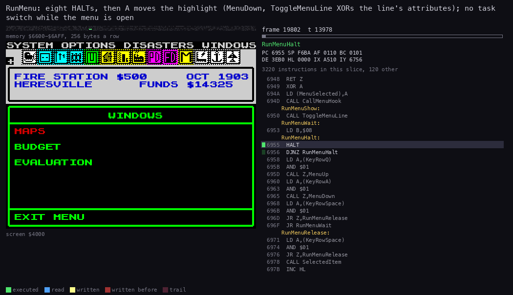

*RunMenu in the WINDOWS menu: A moves the bar from MAPS to BUDGET. How to read: left, the screen; right, the listing (RunMenu, HighlightLine, ScreenAddr)
and the bytes `$6600-$6AFF` (MenuSelected, EditRepeat, the menu description pointers). Recording `menus`, window
19 802:0-19 816:0, A pressed at 19 804. `python3 ../../kit/routine_anim.py --work work/docs/scB/menus --window
19802:0-19816:0 --listing build/game.lst --view screen --pc 6944-6A8F,6933-6943,5BFE-5C27 --range 6600-6AFF
--pictures 70 --title "RunMenu: eight HALTs, then A moves the
highlight (MenuDown, ToggleMenuLine XORs the line's attributes); no task switch while the menu is open" --out docs/img/routines/RunMenu.gif`.*

The point: a menu is a polling loop with an 8-frame beat, and the bar is two XORs. The simulation waits for the
player the whole time a menu is open.

## 5.9 The text line: names and numbers

Three dialogs ask for text: the city name (the level menu, INPUT NEW CITY NAME), the landscape number (USE OLD
LANDSCAPE) and the tape file name. They all use InputLine `$A6FF`. InputName `$A6F9` enters it with InputDigits = 0
(text) and InputLength = 11, one word store of `$0B00`.

InputLine does not wait for the UI loop: it calls ReadInput itself, then KeyToChar, in a tight loop.

- ENTER (KeyChars code `$08`) ends the line.
- With CAPS SHIFT down: 8 moves the cursor right, 5 left. 0 (InputDelete `$A77D`) blanks the character at the
  cursor and the one before it, and leaves the cursor on the latter: InputBlank, CursorLeft, then a fall into
  InputBlank again.
- In number mode, only the digits 0-9 are taken; otherwise any character from space up.
- A character is written at the cursor, and the cursor moves right (it stops at the line's length).
- The repeat: after a key is taken, InputDelay `$A6EF` is set to 1000. While the key stays down, each loop counts it
  down; at 0 the key is taken again. With no key down the delay is 0, so the next press is taken at once.
- ShowInput `$A7A3` prints the whole line on every loop, the cursor's character in attribute `$C7` (flashing), the
  others in `$47`.

```text
InputLine:                                    ; $A6FF
    cursor = 0
    loop:
        ReadInput()
        c = KeyToChar()
        if no key: InputDelay = 0
        elif c = ENTER: return the line
        elif InputDelay > 0: InputDelay - 1   ; the key is still held
        else:
            if CAPS SHIFT down and c = "8": cursor right
            elif CAPS SHIFT down and c = "5": cursor left
            elif CAPS SHIFT down and c = "0": blank at cursor; cursor left; blank at cursor
            elif digits only and c is not a digit: drop it
            elif c >= " ": line[cursor] = c; cursor right
            InputDelay = 1000
        ShowInput()                           ; the line, the cursor flashing
```

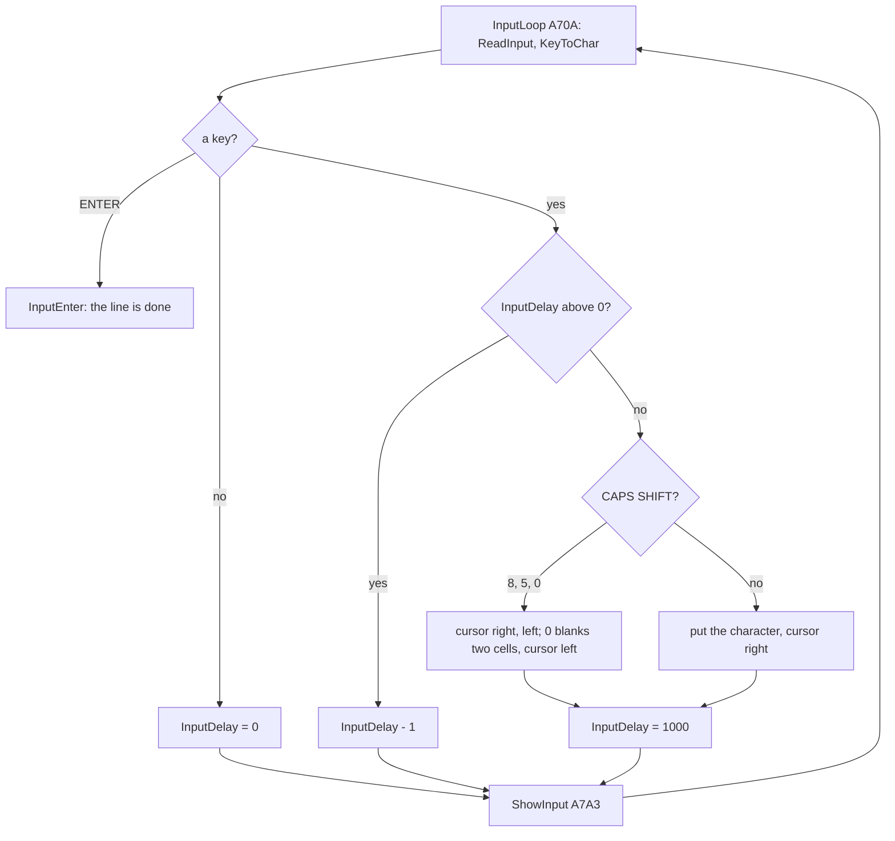

```text
A70A  CD 81 F7     CALL ReadInput         ; InputLoop: its own read
A70D  CD DF 5B     CALL KeyToChar
A710  38 45        JR C,InputNoKey
A712  FE 08        CP $08                 ; ENTER
A714  CA 36 A8     JP Z,InputEnter
A717  47           LD B,A
A718  2A EF A6     LD HL,(InputDelay)
A71B  7C           LD A,H
A71C  B5           OR L
A71D  28 06        JR Z,InputKey
A71F  2B           DEC HL                 ; still held: count down
A720  22 EF A6     LD (InputDelay),HL
A723  18 38        JR InputShow
A725  21 62 A7     LD HL,InputRepeat      ; InputKey: return to InputRepeat
A728  E5           PUSH HL
A729  3A 00 5B     LD A,(KeyRows)
A72C  E6 01        AND $01
A72E  20 12        JR NZ,InputChar        ; CAPS SHIFT up
A730  21 DC A6     LD HL,InputCursor
A733  78           LD A,B
A734  FE 38        CP $38                 ; CS + 8
A736  28 61        JR Z,CursorRight
A738  78           LD A,B
A739  FE 35        CP $35                 ; CS + 5
A73B  28 56        JR Z,CursorLeft
A73D  78           LD A,B
A73E  FE 30        CP $30                 ; CS + 0
A740  28 3B        JR Z,InputDelete
...
A762  21 E8 03     LD HL,$03E8            ; InputRepeat: 1000
A765  22 EF A6     LD (InputDelay),HL
```

Worked example: the landscape number 12345 (`menus`, USE OLD LANDSCAPE).

1. The field holds 00003, in number mode, the cursor on the first digit.
2. Key 1: KeyToChar gives `$31`, a digit. It is written at the cursor; the cursor moves to the second digit;
   InputDelay = 1000.
3. The bot releases 1: KeyToChar finds no key, InputDelay = 0.
4. Keys 2, 3, 4, 5 do the same. ENTER returns 12345, and the game draws another island.

Witness: `menus`, USE OLD LANDSCAPE with 12345 and back to 00003 (WALKTHROUGH 6.0); `levels`, the city name METRO
typed over HERES (the name becomes METROVILLE). The repeat after 1000 loops is known only from the code: no
recording held a key in a text line.


*The keys of the text line are KeyChars: any key, with CAPS SHIFT 5, 8 and 0 as left, right and delete (the orange
CS labels; the "delete" blanks the cell at the cursor and the one before it). `python3 tools/fig_controls.py keys
docs/img/controls/keys.png`.*

The point: the text line reads the keyboard itself, so it works the same whether or not the interrupt switches tasks.
Its repeat is counted in loops, not frames, so its speed depends on how long ShowInput takes to print the line.

## 5.10 The maps window: layers and areas

The maps window (WINDOWS, MAPS, or ENTER on the map) shows one 48 x 48 cell area of the map at a quarter size,
coloured by a layer (doc 06, 6.11). The UI loop calls MapsWindow `$7B51` itself (when MapsDue `$A511` is set or
ENTER is down), after it has cleared SwitchOff: the simulation goes on while the window is open, stopped only inside
each cell's LayerOf `$9D44`, which sets SwitchOff and clears it again. MapsWindow loops:

1. Highlight the area key and the layer name, draw the overview, highlight them back.
2. Leave on SPACE (or when the budget falls due).
3. MapsKeys `$9B8B`, then MapsCounter `$7B50` + 1.

MapsKeys reads:

- every 4th loop: Q for the layer above (MapLayer `$9D43` - 1, AND 7), A for the layer below (+ 1, AND 7);
- every loop: SYMBOL SHIFT with a digit 1-9 sets MapArea `$9C2B` to 0-8.

The overview draw itself stops at the end of a cell row if any key is down (AnyKey). A key press both aborts the draw
and is read by MapsKeys; the next loop starts the draw again from the top.

```text
MapsWindow:                                   ; $7B51
    loop:
        highlight; DrawOverview(MapArea, MapLayer); highlight back
        if BudgetDue or SPACE down: leave (the view is drawn again)
        MapsKeys()
        MapsCounter + 1

MapsKeys:                                     ; $9B8B
    if MapsCounter AND 3 = 0:
        if Q down: MapLayer = (MapLayer - 1) AND 7; return
        if A down: MapLayer = (MapLayer + 1) AND 7; return
    if SYMBOL SHIFT up: return
    c = KeyToChar()
    if "1" <= c <= "9": MapArea = c - "1"
```

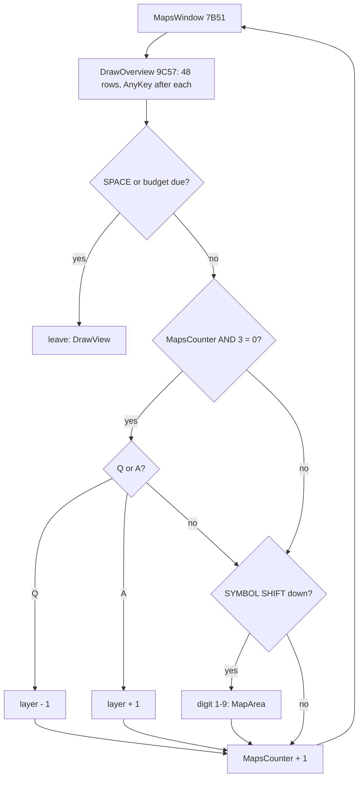

```text
9B8B  3A 50 7B     LD A,(MapsCounter)     ; MapsKeys
9B8E  E6 03        AND $03
9B90  20 11        JR NZ,MapsKeysDigit    ; not the 4th loop: no layer key
9B92  21 43 9D     LD HL,MapLayer
9B95  3A 02 5B     LD A,(KeyRowQ)
9B98  E6 01        AND $01
9B9A  28 1B        JR Z,MapsLayerUp
9B9C  3A 01 5B     LD A,(KeyRowA)
9B9F  E6 01        AND $01
9BA1  28 1A        JR Z,MapsLayerDown
9BA3  3A 07 5B     LD A,(KeyRowSpace)     ; MapsKeysDigit
9BA6  E6 02        AND $02
9BA8  C0           RET NZ                 ; SYMBOL SHIFT up: no area key
9BA9  CD DF 5B     CALL KeyToChar
9BAC  D8           RET C
9BAD  D6 31        SUB $31                ; "1"
9BAF  D8           RET C
9BB0  FE 09        CP $09
9BB2  D0           RET NC
9BB3  32 2B 9C     LD (MapArea),A
9BB6  C9           RET
```

Worked example: the layer and area keys in `menus`, frames 19 003-19 652.

1. MAPS opens on MapLayer 6 (TRANSPT), the value in the image. The script presses A seven times, at 19 003 ...
   19 267.
2. Sampled before each press, MapLayer reads 6, 7, 0, 1, 1, 2, 3 and, at 19 310, 4: six presses moved it, the one
   at 19 135 was lost. A press read in a loop where MapsCounter AND 3 is not 0 does nothing.
3. Then the script presses CAPS SHIFT + 1, CAPS SHIFT + 2 ... CAPS SHIFT + 9. MapsKeysDigit reads KeyRowSpace:
   bit 1 (SYMBOL SHIFT) is 1, so it returns at `$9BA8`.
4. MapArea stays 0 at every frame sampled from 19 310 to 19 652. The screenshots `019349-maps-region1.png` to
   `019653-maps-region9.png` all show area 1, the sea in the north-west corner.

Witness: `menus`, MapArea `$9C2B` and MapLayer `$9D43` sampled before each key (`work/docs/scB/ovcheck.py`). The area
keys with SYMBOL SHIFT are known only from the code: no recording pressed them. WALKTHROUGH 6.0 listed "the 9 regions
(CS+1..9)" as reached; the memory shows they were not, and it now says so.

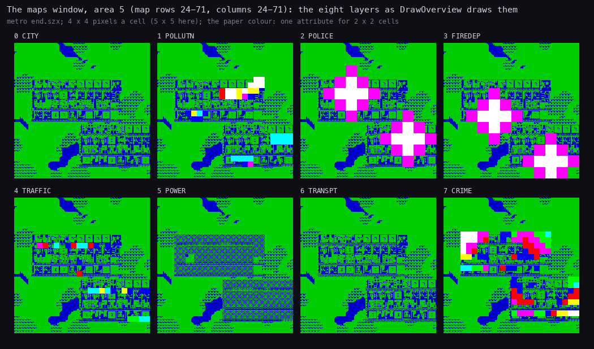

*What MapsKeys chooses: the eight layers (Q and A) of one area (SYMBOL SHIFT + 5 here), drawn by the emulation of
DrawOverview in `tools/fig_render.py` from `metro`'s last frame (doc 06, 6.11). `python3 tools/fig_render.py
overview work/stage1/rec/metro/end.szx 5 docs/img/rendering/overview-metro.png`.*

The point: the layer keys work only on one loop in four, and the area keys need SYMBOL SHIFT, as the tool shortcuts
do. A key pressed during the draw restarts it, so browsing layers quickly never shows a whole map.

## 5.11 Input timing: from the key to the effect

All input is polled. The interrupt refreshes KeyRows every frame; the UI task reads them once a pass. The delay
from a key to its effect is therefore:

| Input | Read by | Delay seen | Where |
| --- | --- | --- | --- |
| O, P, Q, A (pointer) | MovePointer, once a pass | 1 frame to the first step | `tools` 788 to 789 |
| Kempston | ReadKempston every frame, then MovePointer | the same | `ports` 957 |
| SPACE (click) | Click, once a pass | within a pass | `menus` 18 929 |
| CAPS SHIFT + 5-8 | ShiftScroll, once a pass | the next pass, then 8 frames of DrawView | `tools` 13 458 |
| SYMBOL SHIFT + digit | ToolKeys, once a pass | within a pass | `tools` 13 617 |
| Q, A, SPACE in a menu | RunMenu, after 8 HALTs | up to 8 frames | `menus` 19 804 to 19 812 |
| Q, A in a number field | EditNumber, after EditRepeat HALTs | up to 10 frames | `menus` 19 904 |
| keys in a text line | InputLine, every loop | at once | `levels` 1249 (M read in the same frame, T12066); the repeat after 1000 loops: known only from the code |
| SPACE at START TAPE | WaitTapeStart, its own `IN` | within a loop of 39 T | `menus` 20 866 |
| Q, A in the maps window | MapsKeys, every 4th loop | one or more overview draws | `menus` 19 003-19 267 |

A key held for less than a pass can be missed: MovePointer and Click read KeyRows once, at one moment of the pass.
The bot holds every key at least 8 frames, so no recording shows a missed press outside the maps window.

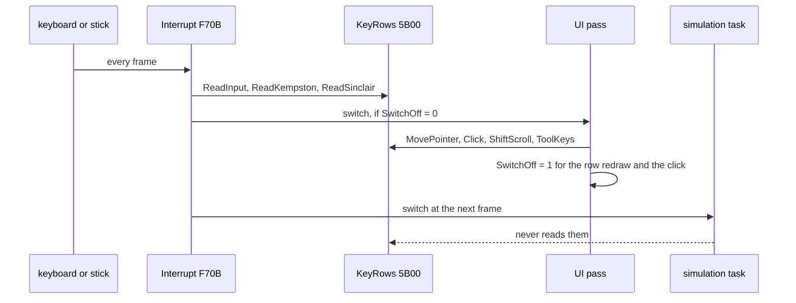


*The timing in one picture: O goes down at 788 (yellow line) and PointerX changes in the next sample; the task band
shows why a pass is two to three frames long. Recording `tools`, frames 780-865. `python3 tools/fig_controls.py
speed work/docs/scB/pointer-tools-780.csv docs/img/controls/pointer-speed.png`.*

The point: the simulation never reads a key. Every control acts in the UI task, and every one that changes the map,
a menu or the view stops the simulation while it acts, except the maps window (5.10), which leaves it running.

## 5.12 What is known only from the code

- The Sinclair stick (ReadSinclair `$7A32`, keys 6-0 with both shifts up): no recording presses 6-0 alone.
- PointerUpStop (`$63AE`): the pointer held at the view's top row while key 6 is down. Why the authors stop the
  pointer there is not clear from the code; no other routine tests key 6 with Q.
- The scroll mode of the "+" corner (ScrollClick `$6CBF`): O, P, Q, A scroll, SPACE ends.
- The number field's shrinking repeat (EditRepeat below 9).
- The text line's repeat after 1000 loops.
- The maps window's area keys (SYMBOL SHIFT + 1-9).
- The fire buttons at START TAPE AND PRESS SPACE: WaitTapeStart `$A2FE` reads the keyboard port itself, so neither
  stick's fire starts the save.
- What happens when the Kempston port reads `$1F` or more at start-up (all four directions and fire held, or a
  floating bus): the game decides there is no interface. The four directions alone read `$0F` and pass.

The hidden keys, all of them, for the player:

| Keys | Effect | Section |
| --- | --- | --- |
| SYMBOL SHIFT + 1-9, 0 | tools 0-8, 9 (refused if unaffordable) | 5.5 |
| CAPS SHIFT + 5, 6, 7, 8 | scroll left, down, up, right by one cell | 5.6 |
| ENTER | the maps window | 5.10 |
| SPACE with O, P, Q or A, on the map | drag: build along the path | 5.7 |
| SYMBOL SHIFT + 1-9 in the maps window | the area | 5.10 |

There is no pause key: the game is paused through OPTIONS, SIMULATION SPEED, PAUSED (doc 04). There is no
redefinition of keys, and no abort key outside the menus.
