# 6. Rendering

What this covers:

- the screen layout: the menu bar, the tool palette, the status box and the 32 x 16 cell view;
- the map as the renderer reads it: the 96 x 96 cells of CityMap `$C450`, the cell codes below `$80`, the building
  rows from `$80` up, and the four tile and attribute tables;
- DrawViewRowPass: one view row a UI pass, the sweep that keeps the view current;
- DrawView: the whole view at once, after a scroll or at an edge of the pointer;
- how a building is drawn from its start byte;
- the blink of unpowered zones and buildings;
- the traffic on roads;
- the pointer and the tool box;
- the movers: the train, the plane and the tornado;
- the fire and flood animation;
- the overview maps of the maps window, and its eight layers;
- code against the screen on real frames, and the beam;
- what the game does not draw (no graphs);
- what is known only from the code.

The recordings it rests on (WALKTHROUGH [6.0](../WALKTHROUGH.md#60-the-recordings)):

- `tools`: 19 867 frames, a town built with every tool on the keyboard. Its last frame (`end.szx`) is the screen of
  most figures. Traces:
  - 800:0-806:0 and 803:0-805:0 (O held, the pointer moving);
  - 13 458:0-13 468:0 (CAPS SHIFT + 8, one DrawView);
  - 19 240:0-19 262:0 and 19 255:0-19 300:0 (idle: the sweep, the train, the blink).
- `menus`: 30 136 frames; the maps window from 18 965 to 19 691.
- `metro`: 96 503 frames, a city of about 2000 people; its last frame is the overview figure's map. The maps window
  is open from 95 849 to 96 227.

Frames and times follow doc 05: a sample "at frame N" is the state at T 0 of frame N; an event "at N:t" ran t
T-states into frame N (69 888 T a frame). A pass is one turn of UiLoop `$8FCC`; its counter is PassCount `$8F9F`.

## 6.1 The screen layout

The game uses the whole 256 x 192 screen and its 768 attributes. Nothing is buffered: every routine writes straight
into the screen at `$4000`. Four areas share it:

| Rows | Columns | What | Drawn by |
| --- | --- | --- | --- |
| 0 | 0-31 | the menu bar: SYSTEM, OPTIONS, DISASTERS, WINDOWS | DrawStatusPanel `$5F13` |
| 1-2 | 2-29 | the 14 tool icons, 2 x 2 characters each | DrawToolIcons `$5DD2` |
| 2 | 0 | the scroll corner "+" | DrawStatusPanel |
| 3-7 | 0-31 | the status box: tool and price, date, city name, funds | DrawStatusBox, PrintDate `$5FAE`, PrintFunds `$5F80` |
| 8-23 | 0-31 | the view: 32 x 16 cells of the map, 8 x 8 pixels a cell | DrawViewRowPass `$6434`, DrawView `$650B` |

One map cell is one character cell, with one attribute. So the view has no colour clash: each cell carries its own
ink and paper. The pointer, the tool box and the movers are drawn over the view in the same screen bytes, and the
row redraw wipes them (6.8, 6.9).

The maps window (6.11) and every menu or dialog (doc 08) are drawn over the view. When they close, DrawView draws
the view again from the map.

```text
Screen:                                       ; one byte per 8 pixels, attributes per 8 x 8
    row 0        menu bar                     ; text (doc 08)
    rows 1-2     tool palette                 ; 14 icons of 2 x 2 tiles (IconTiles $E850)
    row 2, col 0 the scroll corner
    rows 3-7     status box                   ; PrintFunds at pass AND 15 = 0, PrintDate at 1
    rows 8-15    view rows 0-7                ; screen third 1, $4800-$48FF
    rows 16-23   view rows 8-15               ; screen third 2, $5000-$50FF
```

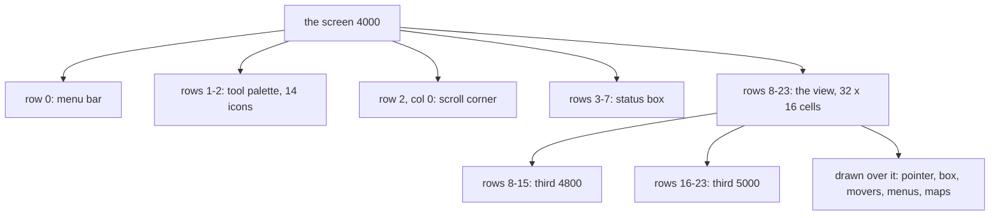

The view's origin on the map is ViewCol `$6507` and ViewRow `$6508`, the map cell at the view's top-left corner.

```text
6505  00 00        DEFW $0000             ; CellAttrPtr
6507  1E           DEFB $1E               ; ViewCol
6508  25           DEFB $25               ; ViewRow
6509  00 00        DEFW $0000             ; ViewCellPtr
```

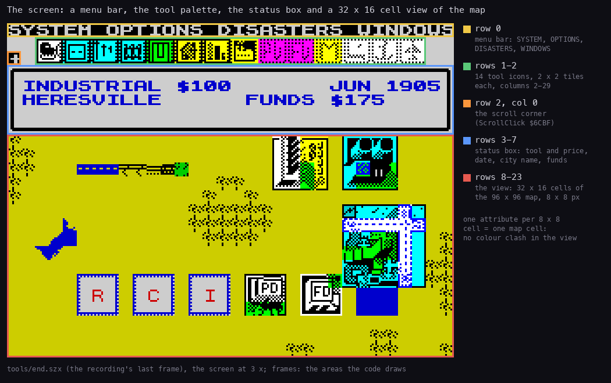

*The screen of SimCity during play. How to read: yellow frame, the menu bar (row 0); green, the palette (rows 1-2);
orange, the scroll corner; blue, the status box (rows 3-7); red, the view (rows 8-23). The legend on the right names
what each holds. Recording `tools`, its last frame (`end.szx`, frame 19 867). `python3 tools/fig_render.py layout
work/stage1/rec/tools/end.szx docs/img/rendering/layout.png`.*

Worked example: where map cell (49, 37) lands on the screen of `tools` `end.szx`.

1. ViewCol is 30 (`$1E`) and ViewRow 37 (`$25`), the values in the image and at the end of `tools`.
2. Column 49 - 30 = 19; row 37 - 37 = 0, so screen row 0 + 8 = 8.
3. The bitmap address is ScreenAddr(8, 19) = `$4813`: the third of rows 8-15 starts at `$4800`.
4. The attribute is `$5900` + 19 = `$5913`.
5. In the figure that is the top-left corner of the coal power station, at the top of the view (6.5).

Witness: the screenshots of every recording (WALKTHROUGH 6.1) show the same layout; `tools` 19 255-19 300 shows who
writes each area (6.12).

The point: one map cell is one character cell. The renderer copies 8 bytes and one attribute per cell, and never
shifts a pixel.

## 6.2 The map and the cells

The map is CityMap `$C450`: 96 rows of 96 bytes, 9216 bytes up to `$E84F`. MapAddr `$6BE6` gives the address of a
cell: `$C450` + 96 x row + column.

A byte below `$80` is a cell code: the number of its tile in CellTiles `$EA68`. There are 94 codes, `$00-$5D`:

- `$00-$06`: water, coast, land, trees;
- `$07-$13`: roads; `$14-$20`: rails; `$21-$2D`: power lines (each 11 shapes and two bridges);
- `$2E-$33`: crossings; `$34-$37`: the traffic tiles (6.7);
- `$38-$39` parks, `$3A` rubble, `$3B` "no power" (the lightning), `$3C-$43` houses;
- `$44` flood, `$45` fire, `$46-$48` rubble, `$49-$50` the frame of a zone;
- `$51-$53` the zone centres R, C, I powered; `$54-$56` the same unpowered; `$57-$58`; `$59` radiation;
- `$5A-$5D`: the frames of the fire and flood animation (6.10).

A byte of `$80` or more belongs to a large building (stadium, power stations, ports, airport). Each row of a
building is a start byte and continuation bytes (6.5).

Four tables hold the graphics. Their sheets are in `src/res/graphics`:

| Table | Address | Entries | Sheet |
| --- | --- | --- | --- |
| CellTiles | `$EA68` | 94 tiles of 8 bytes | `Cells.png` |
| CellAttrs | `$F530` | 94 attributes | `Cells.png` |
| BuildingTiles | `$ED58` | 244 tiles of 8 bytes | `Buildings.png` |
| BuildingAttrs | `$F58E` | 244 attributes | `Buildings.png` |

DrawCell `$6468` draws one cell code: it looks up the tile, copies its 8 bytes down the character cell (INC D), and
writes the attribute through PutAttr `$F774`, which turns the bitmap address into the attribute address.

```text
DrawCell(code):                               ; $6468, DE = the screen address (DrawTileAt)
    if BuildingLeft > 0: DrawBuildingTile(); return     ; inside a building row (6.5)
    code = BlinkCell(code)                    ; unpowered zone centres (6.6)
    code = RoadTraffic(code)                  ; busy roads (6.7)
    tile = CellTiles + 8 x code
    for line = 0 to 7: screen[DE + 256 x line] = tile[line]
    PutAttr(CellAttrs[code])                  ; via CellAttrPtr

PutAttr(A):                                   ; $F774, HL = the bitmap address + 8 lines
    H = H - 1
    H = $58 + ((H >> 3) AND 3)                ; the attribute row block
    (HL) = A
```

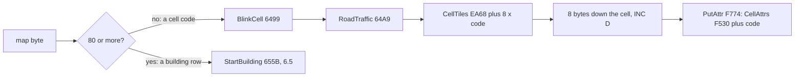

```text
6468  6F           LD L,A                 ; DrawCell
6469  3A 58 65     LD A,(BuildingLeft)
646C  A7           AND A
646D  20 67        JR NZ,DrawBuildingTile
646F  CD 99 64     CALL BlinkCell
6472  CD A9 64     CALL RoadTraffic
6475  26 00        LD H,$00               ; DrawCellTile
6477  22 62 64     LD (TileIndex),HL
647A  29           ADD HL,HL
647B  29           ADD HL,HL
647C  29           ADD HL,HL
647D  11 68 EA     LD DE,CellTiles
6480  19           ADD HL,DE
6481  11 00 48     LD DE,Screen+2048      ; DrawTileAt: the operand is the screen address
6484  06 08        LD B,$08
6486  7E           LD A,(HL)              ; DrawTileLoop
6487  12           LD (DE),A
6488  23           INC HL
6489  14           INC D
648A  10 FA        DJNZ DrawTileLoop
648C  ED 4B 62 64  LD BC,(TileIndex)
6490  2A 05 65     LD HL,(CellAttrPtr)
6493  09           ADD HL,BC
6494  7E           LD A,(HL)
6495  EB           EX DE,HL
6496  C3 74 F7     JP PutAttr
...
F774  4F           LD C,A                 ; PutAttr
F775  25           DEC H
F776  7C           LD A,H
F777  0F           RRCA
F778  0F           RRCA
F779  0F           RRCA
F77A  E6 03        AND $03
F77C  F6 58        OR $58
F77E  67           LD H,A
F77F  71           LD (HL),C
F780  C9           RET
```

The screen address is not passed in a register. It lives in the operand of `LD DE,nn` at DrawTileAt `$6481`, and the
callers write it there: DrawView and DrawViewRowPass store it before each cell. This is self-modifying code.

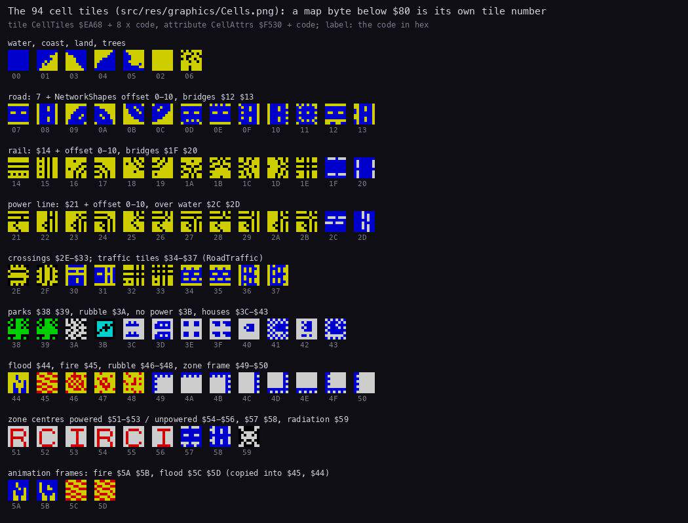

*Every cell code and its tile. How to read: one tile per code, in its own attribute, the code in hex under it; the
groups are the kinds the code tests (water and land, the three networks, crossings and traffic, zones, disasters, the
zone centres, the animation frames). The fire frames `$5A-$5B` and the flood frames `$5C-$5D` are shown in their own
attributes; on the screen they appear in the colours of `$45` and `$44`, where they are copied. Drawn from
`src/res/graphics/Cells.png` (the bytes of CellTiles and CellAttrs). `python3 tools/fig_render.py cells
docs/img/rendering/cells-sheet.png`.*

Worked example: the road cell `$07` at view row 0, column 3, drawn by DrawView (stepped through from the code).

1. DrawTileAt holds `$4803`. The map byte is `$07`, below `$80`, and BuildingLeft is 0.
2. BlinkCell: `$07` is below `$54`, no change. RoadTraffic: the code is `$07`, so it reads the traffic of the cell
   (6.7); with traffic below `$96` the code stays `$07`.
3. HL = `$EA68` + 8 x 7 = `$EAA0`. The 8 bytes go to `$4803`, `$4903`, ... `$4F03`.
4. DE is now `$5003`. PutAttr: H - 1 = `$4F`; `$4F` >> 3 = 9, AND 3 = 1, OR `$58` = `$59`. The attribute
   CellAttrs + 7 = `$F537` goes to `$5903`.

Witness: `tools` 19 255-19 300: DrawTileLoop writes 4352 screen bytes, reading CellTiles, TileIndex and CellAttrs;
PutAttr writes 558 attributes (6.12).

The point: the tile number is the map byte itself. The renderer needs no table between the simulation's cell codes
and the graphics.

## 6.3 DrawViewRowPass: one view row a pass

The view is not drawn every frame. DrawViewRowPass `$6434` draws one of its 16 rows on each UI pass, chosen by
PassCount: row (PassCount AND 15). So the whole view is drawn again every 16 passes, a sweep from top to bottom.

Anything the simulation changes on the map shows when the sweep reaches its row. With about 2.7 frames a pass, a
sweep takes about 43 frames, so the view lags the map by up to 0.85 s.

DrawViewRowPass also sets Blink `$6433` = PassCount AND `$10`, the phase of the traffic tiles (6.7). Then it sets
the screen address and the map address of the row and jumps into DrawView's row loop with one row to draw.

UiLoop calls it with SwitchOff = 1 (doc 04). The row is drawn in one go, with no task switch in the middle.

```text
DrawViewRowPass:                              ; $6434, once a UI pass
    Blink = PassCount AND $10
    row = PassCount AND 15                    ; 0-15
    DrawTileAt = ScreenAddr(row + 8, 0)
    HL = MapAddr(ViewCol, ViewRow + row)
    DE = $40                                  ; 96 - 32: the map's next row
    B = 1                                     ; one row
    jump DrawViewRow                          ; DrawView's loop (6.4)
```

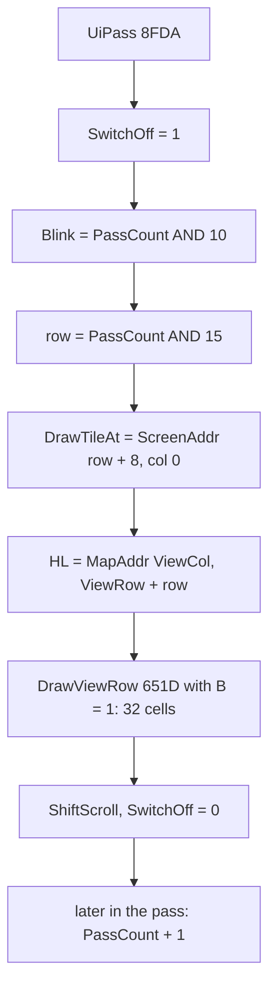

```text
6434  3A 9F 8F     LD A,(PassCount)       ; DrawViewRowPass
6437  E6 10        AND $10
6439  32 33 64     LD (Blink),A
643C  3A 9F 8F     LD A,(PassCount)
643F  E6 0F        AND $0F
6441  C6 08        ADD A,$08
6443  47           LD B,A
6444  0E 00        LD C,$00
6446  CD FE 5B     CALL ScreenAddr
6449  22 82 64     LD (DrawTileAt+$0001),HL
644C  ED 4B 07 65  LD BC,(ViewCol)
6450  3A 9F 8F     LD A,(PassCount)
6453  E6 0F        AND $0F
6455  80           ADD A,B
6456  47           LD B,A
6457  CD E6 6B     CALL MapAddr
645A  11 40 00     LD DE,$0040
645D  06 01        LD B,$01
645F  C3 1D 65     JP DrawViewRow
```

UiLoop shows where the row pass sits in a pass:

```text
8FCC  CD FE 5C     CALL DrawPointer       ; UiLoop
8FCF  CD 55 5D     CALL TrackBox          ; the box inverted (shown)
8FD2  01 D0 07     LD BC,$07D0
8FD5  0B           DEC BC                 ; UiDelay: 2000 loops, 52 000 T
8FD6  78           LD A,B
8FD7  B1           OR C
8FD8  20 FB        JR NZ,UiDelay
8FDA  CD 55 5D     CALL TrackBox          ; UiPass: the box inverted back
8FDD  CD 3E 5D     CALL ErasePointer
8FE0  CD 5C 63     CALL MovePointer
8FE3  CD 8F 77     CALL DrawMovers
8FE6  CD CD 63     CALL Click
8FE9  3E 01        LD A,$01
8FEB  32 05 F7     LD (SwitchOff),A
8FEE  CD 34 64     CALL DrawViewRowPass
8FF1  CD 6F 7A     CALL ShiftScroll
8FF4  AF           XOR A
8FF5  32 05 F7     LD (SwitchOff),A
```

Worked example: the rows drawn in `tools`, frames 19 256-19 300, read from the trace at `$6437` (A = PassCount).

| Frame:T | PassCount | View row | Screen row |
| --- | ---: | ---: | ---: |
| 19 256:55 958 | 68 | 4 | 12 |
| 19 259:23 367 | 69 | 5 | 13 |
| 19 261:66 069 | 70 | 6 | 14 |
| ... | ... | ... | ... |
| 19 285:15 351 | 79 | 15 | 23 |
| 19 287:56 878 | 80 | 0 | 8 |
| 19 299:35 126 | 84 | 4 | 12 |

1. PassCount 68 AND 15 = 4: screen row 12. The call runs from 19 256:55 945 to 19 257:16 395, 30 338 T of wall time
   (the interrupt included).
2. Sixteen passes later (84) the same row is drawn again, 42.6 frames later: 2.67 frames a pass.
3. The 17 row passes of the window take 30 338-40 946 T each; a row with buildings and roads costs more than a row
   of land (6.5, 6.7).

Witness: the trace of `tools` 19 255:0-19 300:0 (`work/docs/scB/tools/traces/`), read with
`work/docs/scB/hits.py` for the costs.

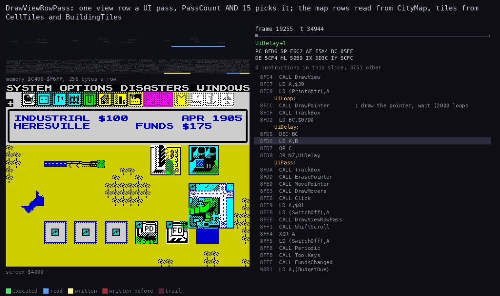

*The sweep at work. How to read: left, the screen, where one view row is drawn on each pass; right, the listing
(DrawViewRowPass, DrawCell, BlinkCell, RoadTraffic, DrawBuildingTile, DrawView, StartBuilding) with the running
instruction lit, and the bytes `$C400-$F6FF` (the map, the tiles and the attributes) with their reads. Recording
`tools`, window 19 255:0-19 300:0, idle. `python3 ../../kit/routine_anim.py --work work/docs/scB/tools --window
19255:0-19300:0 --listing build/game.lst --view screen --pc 6434-659F --range C400-F6FF --pictures 90 --title
"DrawViewRowPass: one view row a UI pass, PassCount AND 15 picks it; the map rows read from CityMap, tiles from
CellTiles and BuildingTiles" --out docs/img/routines/DrawViewRowPass.gif`.*

The point: the game never tracks which cells changed. It redraws one row a pass, in turn, and accepts that the view
is up to 16 passes old.

## 6.4 DrawView: the whole view at once

DrawView `$650B` draws all 16 rows, 512 cells. It runs when the view has to change at once:

- after a scroll (ShiftScroll, the scroll mode; doc 05, 5.6);
- when the pointer is pushed past an edge (doc 05, 5.3);
- when a menu, a dialog or the maps window closes;
- at the start of a game.

Its loop is the one DrawViewRowPass enters:

1. For each of the 32 cells of a row: if no building row is open and the byte is `$80` or more, StartBuilding opens
   one (6.5).
2. ViewCellPtr = the map address (for RoadTraffic); CellAttrPtr = CellAttrs; DrawCell.
3. The screen address + 1. When its low byte wraps, the next third starts: `$5000`.
4. BuildingTile + 1, after every cell, building or not (6.5 explains why this is harmless).
5. After 32 cells: BuildingLeft = 0, the map address + `$40` (to the next map row).

The screen address needs no row arithmetic: the 8 character rows of a third are 256 consecutive low bytes. Row r + 1
starts where row r ended, because the 8 pixel lines of a cell are reached by INC D, not by moving the pointer.

```text
DrawView:                                     ; $650B
    DrawTileAt = $4800                        ; screen row 8, column 0
    HL = MapAddr(ViewCol, ViewRow)
    DE = $40
    for B = 16 rows:                          ; DrawViewRow, entered by DrawViewRowPass with B = 1
        for C = 32 cells:                     ; DrawViewCell
            if BuildingLeft = 0 and (HL) >= $80: StartBuilding()
            ViewCellPtr = HL
            CellAttrPtr = CellAttrs
            DrawCell((HL))
            DrawTileAt + 1; if its low byte is 0: DrawTileAt = $5000
            BuildingTile + 1
            HL + 1
        BuildingLeft = 0
        HL + DE
```

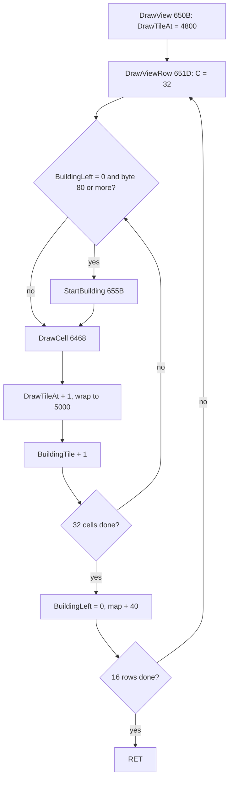

```text
650B  21 00 48     LD HL,Screen+2048      ; DrawView
650E  22 82 64     LD (DrawTileAt+$0001),HL
6511  ED 4B 07 65  LD BC,(ViewCol)
6515  CD E6 6B     CALL MapAddr
6518  11 40 00     LD DE,$0040
651B  06 10        LD B,$10
651D  0E 20        LD C,$20               ; DrawViewRow
651F  3A 58 65     LD A,(BuildingLeft)    ; DrawViewCell
6522  A7           AND A
6523  20 06        JR NZ,DrawViewCellTile
6525  7E           LD A,(HL)
6526  FE 80        CP $80
6528  D4 5B 65     CALL NC,StartBuilding
652B  22 09 65     LD (ViewCellPtr),HL    ; DrawViewCellTile
652E  D9           EXX
652F  21 30 F5     LD HL,CellAttrs
6532  22 05 65     LD (CellAttrPtr),HL
6535  CD 68 64     CALL DrawCell
6538  2A 82 64     LD HL,(DrawTileAt+$0001)
653B  2C           INC L
653C  20 03        JR NZ,DrawViewNext
653E  21 00 50     LD HL,Screen+4096      ; the lower third
6541  22 82 64     LD (DrawTileAt+$0001),HL ; DrawViewNext
6544  2A 59 65     LD HL,(BuildingTile)
6547  23           INC HL
6548  22 59 65     LD (BuildingTile),HL
654B  D9           EXX
654C  23           INC HL
654D  0D           DEC C
654E  20 CF        JR NZ,DrawViewCell
6550  AF           XOR A
6551  32 58 65     LD (BuildingLeft),A
6554  19           ADD HL,DE
6555  10 C6        DJNZ DrawViewRow
6557  C9           RET
...
6BE6  68           LD L,B                 ; MapAddr: B = row, C = column
6BE7  26 00        LD H,$00
6BE9  79           LD A,C
6BEA  44           LD B,H
6BEB  4D           LD C,L
6BEC  29           ADD HL,HL
6BED  09           ADD HL,BC              ; 3 x row
6BEE  29           ADD HL,HL
6BEF  29           ADD HL,HL
6BF0  29           ADD HL,HL
6BF1  29           ADD HL,HL
6BF2  29           ADD HL,HL              ; 96 x row
6BF3  06 00        LD B,$00
6BF5  4F           LD C,A
6BF6  09           ADD HL,BC
6BF7  01 50 C4     LD BC,CityMap
6BFA  09           ADD HL,BC
6BFB  37           SCF
6BFC  C9           RET
```

Worked example: DrawView after CAPS SHIFT + 8 in `tools` (frame 13 458).

1. ShiftScroll has made ViewCol 31. DrawView starts at 13 458:17 917.
2. HL = MapAddr(31, 37) = `$C450` + 3552 + 31 = `$D22F`.
3. Row 0 goes to `$4800-$481F`, row 7 to `$48E0-$48FF`. After the 256th cell L wraps to 0, and row 8 starts at
   `$5000`.
4. It returns at 13 466:24 987: 566 174 T, 8.1 frames, with SwitchOff = 1 the whole time. The simulation does not
   run during it.
5. 566 174 / 16 rows = 35 386 T a row, about the cost of one DrawViewRowPass (6.3).

Witness: the trace of `tools` 13 458:0-13 468:0; the animation of doc 05, 5.6 shows this DrawView row by row
([ShiftScroll.gif](img/routines/ShiftScroll.gif)).

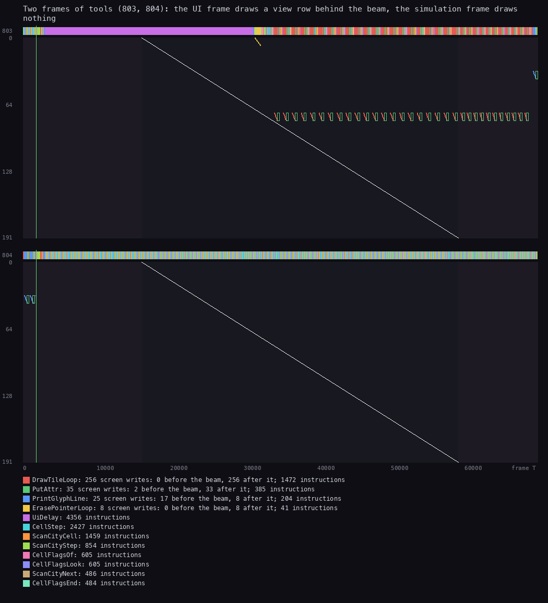

*Two frames of `tools` against the beam. How to read: one band per frame, T across (0-69 888), screen line down
(0-191); the diagonal is the beam; the coloured marks are screen writes by routine (key under the bands). In frame
803 (UI) the pass spends about T 2000-31 000 in UiDelay (purple); ErasePointerLoop (yellow) follows; then
DrawTileLoop and PutAttr draw view row 0 (lines 64-71) after the beam has passed it: 256 of 256 writes behind the
beam. Frame 804 belongs to the simulation and draws nothing in the view. Recording `tools`, window 803:0-805:0.
`python3 ../../kit/beam_timeline.py --work work/docs/scB/tools --window 803:0-805:0 --listing build/game.lst --title
"Two frames of tools (803, 804): the UI frame draws a view row behind the beam, the simulation frame draws nothing"
--out docs/img/rendering/beam-tools-803.png`.*

The point: DrawView is the row pass 16 times. A scroll costs eight frames, and the game hides nothing of it: the
player sees the view redrawn from top to bottom.

## 6.5 Building rows

The large buildings are not made of cell codes. Each map row of a building holds:

- a start byte, `$80-$BF`: bit 7 set, bit 6 clear. Bits 0-2 are the width (4 or 6). Bit 5 marks the top row. Bit 4
  is the power bit, set when the building is powered; only the top row carries it.
- continuation bytes, `$C0-$FF`. The first two hold the building's tile number n: n = ((first AND `$3F`) x 8) +
  (second AND 7). The others are fillers (`$C0`).

The row's tiles are BuildingTiles n, n + 1, ... n + width - 1, each with its BuildingAttrs entry.

StartBuilding `$655B` runs on the first cell of a row whose byte is `$80` or more:

1. If the byte is a continuation (`$C0` or more), FindBuildingStart walks left to the start byte, counting the
   cells in BuildingBack. This happens when the view's left edge cuts a building.
2. BuildingLeft = width - BuildingBack: the cells of this row still to draw.
3. BuildingTile = n + BuildingBack.
4. IX points at the start byte.

DrawBuildingTile `$64D6` then draws BuildingTiles + 8 x BuildingTile for each of the BuildingLeft cells. BuildingTile
goes up by one after every cell (6.4), so the row's tiles come out in order.

After a row, BuildingLeft is 0. The next map row of the building starts again at its own start byte, with its own n:
the four rows of a 4 x 4 building carry n, n + 4, n + 8, n + 12.

```text
StartBuilding:                                ; $655B, HL = the map cell
    IX = HL; BuildingBack = 0
    if (IX) >= $C0: FindBuildingStart()       ; walk left, BuildingBack + 1 per cell
    BuildingLeft = ((IX) AND 7) - BuildingBack
    n = (((IX + 1) AND $3F) << 3) OR ((IX + 2) AND 7)
    BuildingTile = n + BuildingBack

DrawBuildingTile:                             ; $64D6, from DrawCell
    BuildingLeft - 1
    first = (IX); IX = BuildingDummy          ; only the first cell sees the start byte
    if PassCount bit 5 and (first AND $F0) = $A0: DrawBlankCell(); return   ; 6.6
    CellAttrPtr = BuildingAttrs
    draw BuildingTiles + 8 x BuildingTile, attribute BuildingAttrs[BuildingTile]
```

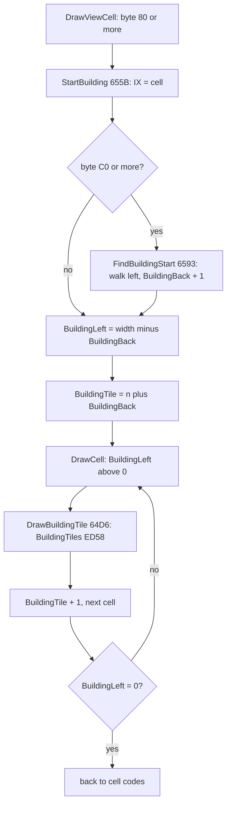

```text
655B  E5           PUSH HL                ; StartBuilding
655C  DD E1        POP IX
655E  AF           XOR A
655F  32 92 65     LD (BuildingBack),A
6562  D9           EXX
6563  DD 7E 00     LD A,(IX+$00)
6566  FE C0        CP $C0
6568  D4 93 65     CALL NC,FindBuildingStart
656B  3A 92 65     LD A,(BuildingBack)
656E  4F           LD C,A
656F  06 00        LD B,$00
6571  DD 7E 00     LD A,(IX+$00)
6574  E6 07        AND $07                ; the width
6576  91           SUB C
6577  32 58 65     LD (BuildingLeft),A
657A  DD 7E 01     LD A,(IX+$01)
657D  E6 3F        AND $3F
657F  6F           LD L,A
6580  26 00        LD H,$00
6582  29           ADD HL,HL
6583  29           ADD HL,HL
6584  29           ADD HL,HL
6585  DD 7E 02     LD A,(IX+$02)
6588  E6 07        AND $07
658A  B5           OR L
658B  6F           LD L,A                 ; n
658C  09           ADD HL,BC
658D  22 59 65     LD (BuildingTile),HL
6590  D9           EXX
6591  C9           RET
6593  21 92 65     LD HL,BuildingBack     ; FindBuildingStart
6596  DD 7E 00     LD A,(IX+$00)          ; FindBuildingStartLoop
6599  E6 C0        AND $C0
659B  FE C0        CP $C0
659D  C0           RET NZ
659E  34           INC (HL)
659F  DD 2B        DEC IX
65A1  18 F3        JR FindBuildingStartLoop
...
64D6  21 58 65     LD HL,BuildingLeft     ; DrawBuildingTile
64D9  35           DEC (HL)
64DA  DD 7E 00     LD A,(IX+$00)
64DD  DD 21 D5 64  LD IX,BuildingDummy    ; a 0 byte for the row's other cells
64E1  21 9F 8F     LD HL,PassCount
64E4  CB 6E        BIT 5,(HL)
64E6  28 07        JR Z,DrawBuildingAttr
64E8  E6 F0        AND $F0
64EA  FE A0        CP $A0
64EC  CA 64 64     JP Z,DrawBlankCell
64EF  21 8E F5     LD HL,BuildingAttrs    ; DrawBuildingAttr
64F2  22 05 65     LD (CellAttrPtr),HL
64F5  2A 59 65     LD HL,(BuildingTile)
64F8  22 62 64     LD (TileIndex),HL
64FB  29           ADD HL,HL
64FC  29           ADD HL,HL
64FD  29           ADD HL,HL
64FE  11 58 ED     LD DE,BuildingTiles
6501  19           ADD HL,DE
6502  C3 81 64     JP DrawTileAt
```

BuildingTile goes up by one after every cell, also after cell codes. That is harmless: StartBuilding sets it afresh
at the start of every building row, and only DrawBuildingTile reads it.

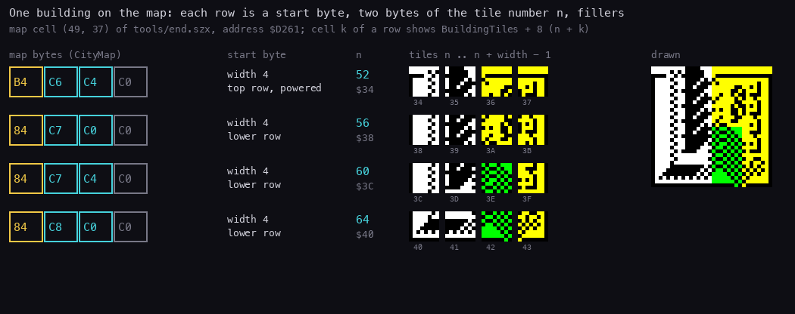

*One building on the map, row by row. How to read: left, the four map bytes of each row (yellow the start byte, cyan
the two bytes of n, grey the filler); then the width and kind the start byte says; n in decimal and hex; the tiles n
to n + 3 from BuildingTiles in their attributes; right, the four rows drawn together. Recording `tools`, `end.szx`
(frame 19 867), map cell (49, 37), address `$D261`. `python3 tools/fig_render.py building
work/stage1/rec/tools/end.szx 49 37 docs/img/rendering/building-row.png`.*

Worked example: the top row of the coal power station at (49, 37) in `tools` `end.szx`.

1. The bytes at `$D261` are `$B4 $C6 $C4 $C0`.
2. `$B4` = 1011 0100: a start byte; bit 5 set (the top row); bit 4 set (powered); width 4.
3. n = ((`$C6` AND `$3F`) x 8) + (`$C4` AND 7) = 6 x 8 + 4 = 52 (`$34`).
4. With the view at ViewCol 30, the cell is drawn at screen column 19, row 8 (6.1). BuildingBack is 0, so
   BuildingTile = 52 and BuildingLeft = 4.
5. The four cells take BuildingTiles + 8 x 52 = `$EEF8` and the next three tiles, with BuildingAttrs `$F5C2-$F5C5`.
6. The rows below start with `$84` (not top, not powered) and n = 56, 60 and 64.

Witness: the drawn picture in the figure is the emulation of these steps by `tools/fig_render.py`; it matches the
building on the real screen of `end.szx` (the [layout figure](img/rendering/layout.png), top of the view). The left
edge case (FindBuildingStart) is known only from the code: no traced DrawView cut a building.

The point: a building costs a start byte and a tile number per row, not a cell code per cell. The map stays one byte
a cell, and the 244 building tiles need no code range below `$80`.

## 6.6 The blink of unpowered zones

An unpowered zone or building blinks a lightning tile, `$3B`. Two routines do it, on the same clock: PassCount bit 5.
For 32 passes the bit is 1 and the lightning is drawn; for the next 32 the real tile is drawn.

- BlinkCell `$6499`: the zone centres `$54-$56` (R, C, I without power) become `$3B` while the bit is 1. The powered
  centres are `$51-$53`, so the simulation chooses the code and the renderer only blinks it.
- DrawBuildingTile `$64D6`: when the bit is 1 and the row's start byte AND `$F0` is `$A0` (a top row, the power bit
  clear), the cell is drawn as `$3B` through DrawBlankCell `$6464`.

The building test reads the start byte only on the row's first drawn cell. After it, IX points at BuildingDummy, a 0
byte. Only the top row has bit 5, so only one cell of an unpowered building blinks: its top-left corner (or the
first cell visible at the view's left edge).

The blink is drawn by the row pass. When the bit flips, the change sweeps down the view over the next 16 passes, row
by row. A whole blink cycle is 64 passes, about 170 frames (3.4 s).

```text
BlinkCell(code):                              ; $6499
    if $54 <= code <= $56 and PassCount bit 5: return $3B
    return code

DrawBlankCell:                                ; $6464
    draw cell tile $3B with the current CellAttrPtr
```

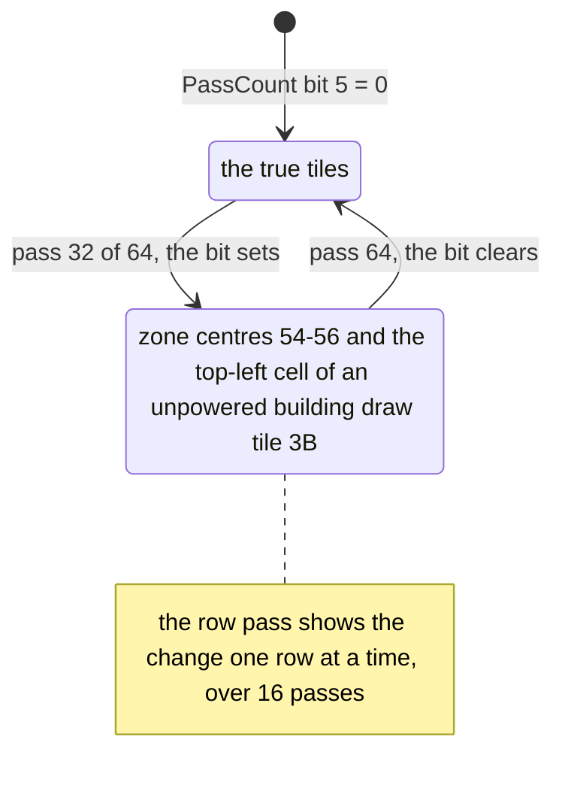

```text
6464  2E 3B        LD L,$3B               ; DrawBlankCell
6466  18 0D        JR DrawCellTile
...
6499  7D           LD A,L                 ; BlinkCell
649A  FE 54        CP $54
649C  D8           RET C
649D  FE 57        CP $57
649F  D0           RET NC
64A0  3A 9F 8F     LD A,(PassCount)
64A3  CB 6F        BIT 5,A
64A5  C8           RET Z
64A6  2E 3B        LD L,$3B               ; the lightning
64A8  C9           RET
```

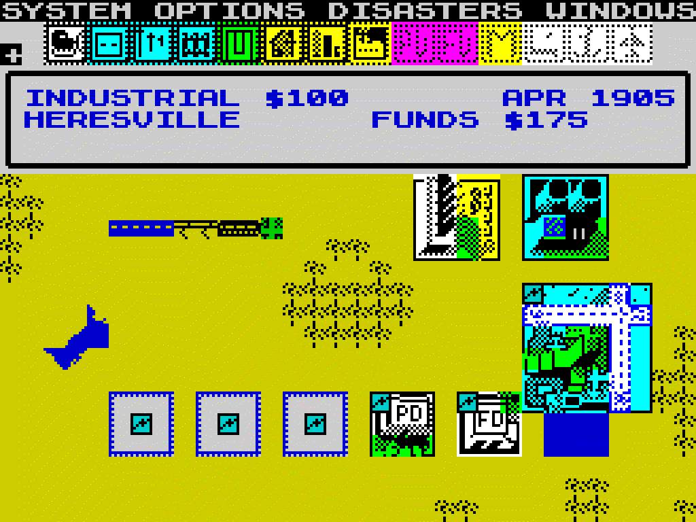

*The blink on the real screen. How to read: every fourth frame of the recording at 4 x; the R, C and I zone centres
and the top-left cells of the police station, the fire station and the industrial block turn into the cyan lightning
and back, one view row at a time; the coal power station (top) is powered and does not blink. The solid blue block is
the tool box over the view (6.8), caught while it is shown. Recording `tools`, frames 19 240-19 560. `python3
../../kit/screen_anim.py --work work/docs/scB/tools --from 19240 --to 19560 --step 4 --scale 4 --delay 60
docs/img/play/blink-unpowered.gif`.*

Worked example: the R zone centre in `tools`, frames 19 240-19 296.

1. At 19 240:32 319 PassCount is 62: bit 5 is 1. The R centre's map byte is `$54` (unpowered). BlinkCell returns
   `$3B`, and the first frame of the animation shows the lightning in the three zones.
2. At pass 64 (19 245:39 047) bit 5 clears. View rows 0, 1, 2 ... are drawn again with the true tiles, one a pass.
3. The R, C and I centres are on screen row 19, view row 11. The pass that draws view row 11 is pass 75, at
   19 274:64 243. From the next frames on, the animation shows R, C and I (frame 19 296 is the fifteenth picture).

Witness: `tools` 19 240-19 560 (the animation); PassCount read from the traces at `$6437`. Only the first cell of a
building blinking is visible in the animation: the police and fire stations show the lightning in their top-left
cell only.

The point: the blink costs nothing extra. It is a substitution inside the row redraw, timed by the pass counter, so
it needs no timer, no list of unpowered zones and no extra drawing.

## 6.7 Traffic on the roads

Two road codes show traffic: `$07` (across) and `$08` (down). RoadTraffic `$64A9` reads the traffic of the cell from
the 48 x 48 Traffic grid `$B6D0` (one byte per 2 x 2 cells; doc 10) and replaces the code:

| Traffic | `$07` becomes | `$08` becomes |
| --- | --- | --- |
| below `$96` | `$07` (empty road) | `$08` |
| `$96-$DB` | `$34` or `$35`, by Blink | `$36` or `$37`, by Blink |
| `$DC` or more | `$34` | `$36` |

Blink is PassCount AND `$10`, set by DrawViewRowPass. It changes every 16 passes, which is one sweep. So each
time the sweep redraws a road row, a medium road shows the other frame: the cars seem to move once a sweep. Heavy
traffic does not move: `$34` and `$36` stay.

The other road shapes (curves, junctions, `$09-$13`) never show traffic.

```text
RoadTraffic(code):                            ; $64A9
    if code = $07: busy = $34
    elif code = $08: busy = $36
    else: return code
    t = Traffic[MapToRowCol(ViewCellPtr)]     ; the 48 x 48 grid
    if t >= $DC: return busy
    if t < $96: return code
    if Blink <> 0: return busy + 1
    return busy
```

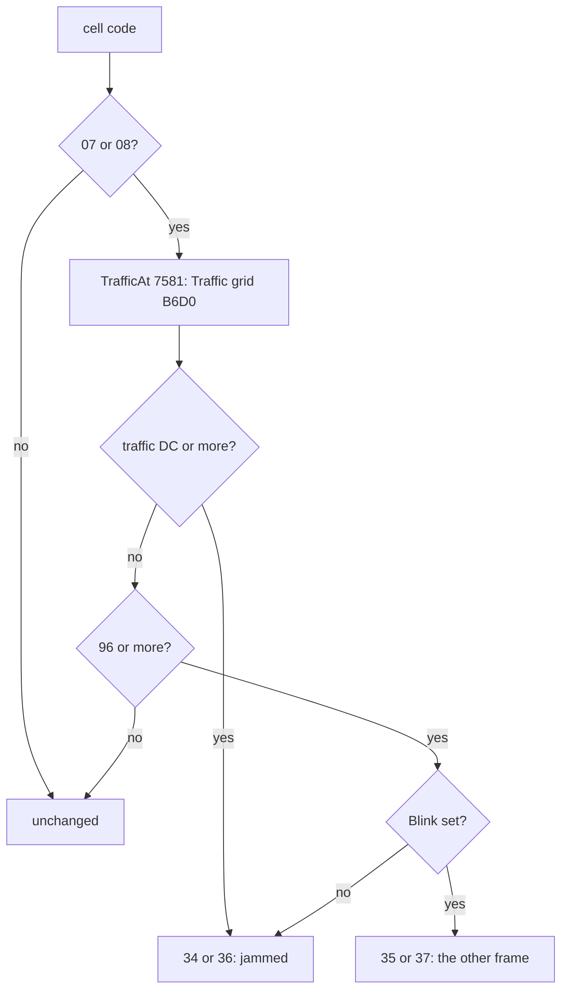

```text
64A9  7D           LD A,L                 ; RoadTraffic
64AA  06 34        LD B,$34
64AC  FE 07        CP $07
64AE  28 05        JR Z,RoadTrafficLook
64B0  06 36        LD B,$36
64B2  FE 08        CP $08
64B4  C0           RET NZ
64B5  E5           PUSH HL                ; RoadTrafficLook
64B6  D5           PUSH DE
64B7  C5           PUSH BC
64B8  2A 09 65     LD HL,(ViewCellPtr)
64BB  CD 35 76     CALL MapToRowCol
64BE  CD 81 75     CALL TrafficAt
64C1  7E           LD A,(HL)
64C2  C1           POP BC
64C3  D1           POP DE
64C4  E1           POP HL
64C5  FE DC        CP $DC
64C7  30 0A        JR NC,RoadTrafficTile
64C9  FE 96        CP $96
64CB  D8           RET C
64CC  3A 33 64     LD A,(Blink)
64CF  A7           AND A
64D0  28 01        JR Z,RoadTrafficTile
64D2  04           INC B
64D3  68           LD L,B                 ; RoadTrafficTile
64D4  C9           RET
```

Worked example: a road across with traffic `$A0` (stepped through from the code).

1. The code is `$07`, so B = `$34`. The Traffic byte is `$A0`: not `$DC` or more, but `$96` or more.
2. In the sweep of passes 64-79, Blink = 64 AND `$10` = 0: the tile is `$34`.
3. In the sweep of passes 80-95, Blink = `$10`: the tile is `$35`.
4. The two tiles (in the [cell sheet](img/rendering/cells-sheet.png)) show the cars in two positions.

Witness: known only from the code. The `tools` town has too little traffic to reach `$96`, and no trace of `metro`
covers a road row.

The point: two tiles and the sweep give moving traffic with no animation code: the sweep is the clock.

## 6.8 The pointer and the tool box

The pointer is an 8 x 8 arrow, ORed onto the screen through a mask:

- DrawPointer `$5CFE` converts the pointer to a character cell (PointerX / 2, PointerY / 8), saves the 8 screen
  bytes there in PointerSave `$5D34`, and writes (screen AND PointerMask) OR PointerShape for each line.
- ErasePointer `$5D3E` puts the 8 saved bytes back at PointerAt `$5D3C`.

The pointer is one byte wide and lands on a character cell, so it never straddles two cells. It moves in whole
characters (doc 05, 5.3). The attribute is not touched: the arrow takes the colours of the cell under it.

The tool box shows where the tool would build. TrackBox `$5D55`:

1. clears PointerInView and BoxShown;
2. returns if PointerY is below `$40` (the pointer is above the view);
3. otherwise computes BoxCell, the cell under the pointer, and returns if the box (BoxSize `$5D4F`, 1 x 1 to 6 x 6)
   would go past row 23 or column 31;
4. sets BoxShown and inverts the box's pixels with InvertBox `$5D8F` (XOR `$FF` over width bytes x 8 lines x
   height).

UiLoop calls TrackBox twice a pass: once after DrawPointer, and once after UiDelay. The second XOR puts the pixels
back. So the box is on the screen only during UiDelay, 52 000 T of a pass, together with the pointer.

```text
UiLoop:                                       ; $8FCC
    DrawPointer()                             ; save 8 bytes, AND mask, OR arrow
    TrackBox()                                ; XOR the box: shown
    wait 2000 loops                           ; UiDelay, 52 000 T
    TrackBox()                                ; XOR again: gone
    ErasePointer()                            ; the 8 bytes back
    MovePointer(); DrawMovers(); Click(); DrawViewRowPass(); ...

TrackBox:                                     ; $5D55
    PointerInView = 0; BoxShown = 0
    if PointerY < $40: return
    BoxCell = ((PointerY - $40) / 8, PointerX / 2)
    if BoxCell row + 8 + box height > 24 or column + box width > 32: return
    BoxShown = 1
    InvertBox()                               ; XOR $FF, width bytes x 8 x height lines
```

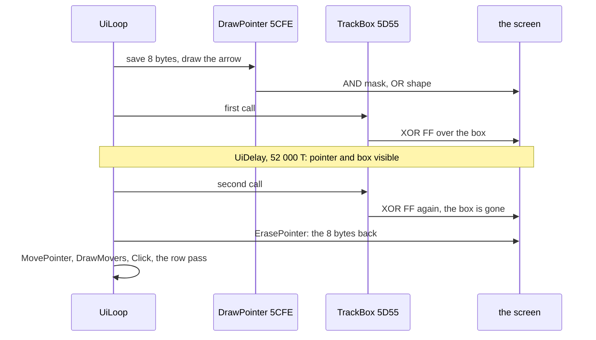

```text
5CFE  ED 4B FC 5C  LD BC,(PointerX)       ; DrawPointer
5D02  CB 38        SRL B
5D04  CB 38        SRL B
5D06  CB 38        SRL B                  ; row = PointerY / 8
5D08  CB 39        SRL C                  ; column = PointerX / 2
5D0A  CD FE 5B     CALL ScreenAddr
5D0D  22 3C 5D     LD (PointerAt),HL
5D10  DD 21 34 5D  LD IX,PointerSave
5D14  FD 21 F4 5C  LD IY,PointerMask
5D18  11 EC 5C     LD DE,PointerShape
5D1B  06 08        LD B,$08
5D1D  7E           LD A,(HL)              ; DrawPointerLoop
5D1E  DD 77 00     LD (IX+$00),A          ; save
5D21  7E           LD A,(HL)
5D22  FD A6 00     AND (IY+$00)           ; mask
5D25  4F           LD C,A
5D26  1A           LD A,(DE)
5D27  B1           OR C                   ; arrow
5D28  77           LD (HL),A
5D29  13           INC DE
5D2A  DD 23        INC IX
5D2C  FD 23        INC IY
5D2E  CD 19 5C     CALL NextPixelLine
5D31  10 EA        DJNZ DrawPointerLoop
5D33  C9           RET
...
5D3E  2A 3C 5D     LD HL,(PointerAt)      ; ErasePointer
5D41  11 34 5D     LD DE,PointerSave
5D44  06 08        LD B,$08
5D46  1A           LD A,(DE)              ; ErasePointerLoop
5D47  77           LD (HL),A
5D48  13           INC DE
5D49  CD 19 5C     CALL NextPixelLine
5D4C  10 F8        DJNZ ErasePointerLoop
5D4E  C9           RET
...
5D55  AF           XOR A                  ; TrackBox
5D56  32 53 5D     LD (PointerInView),A
5D59  32 54 5D     LD (BoxShown),A
5D5C  ED 4B FC 5C  LD BC,(PointerX)
5D60  78           LD A,B
5D61  FE 40        CP $40
5D63  D8           RET C                  ; above the view
5D64  32 53 5D     LD (PointerInView),A
5D67  78           LD A,B
5D68  D6 40        SUB $40
5D6A  CB 3F        SRL A
5D6C  CB 3F        SRL A
5D6E  CB 3F        SRL A
5D70  47           LD B,A
5D71  79           LD A,C
5D72  CB 3F        SRL A
5D74  4F           LD C,A
5D75  ED 43 51 5D  LD (BoxCell),BC
5D79  78           LD A,B
5D7A  C6 08        ADD A,$08
5D7C  47           LD B,A
5D7D  2A 4F 5D     LD HL,(BoxSize)
5D80  78           LD A,B
5D81  84           ADD A,H
5D82  FE 19        CP $19
5D84  D0           RET NC                 ; past row 24
5D85  79           LD A,C
5D86  85           ADD A,L
5D87  FE 21        CP $21
5D89  D0           RET NC                 ; past column 32
5D8A  3E 01        LD A,$01
5D8C  32 54 5D     LD (BoxShown),A
5D8F  CD FE 5B     CALL ScreenAddr        ; InvertBox
5D92  ED 4B 4F 5D  LD BC,(BoxSize)
5D96  CB 20        SLA B
5D98  CB 20        SLA B
5D9A  CB 20        SLA B                  ; height x 8 lines
5D9C  79           LD A,C
5D9D  32 A3 5D     LD (InvertBoxLine+$0003),A ; the width into LD B,n
5DA0  C5           PUSH BC                ; InvertBoxLine
5DA1  E5           PUSH HL
5DA2  06 00        LD B,$00
5DA4  7E           LD A,(HL)              ; InvertBoxByte
5DA5  EE FF        XOR $FF
5DA7  77           LD (HL),A
5DA8  2C           INC L
5DA9  10 F9        DJNZ InvertBoxByte
5DAB  E1           POP HL
5DAC  C1           POP BC
5DAD  CD 19 5C     CALL NextPixelLine
5DB0  10 EE        DJNZ InvertBoxLine
5DB2  C9           RET
```

Because the box and the pointer are on the screen for only part of a pass, they flicker. How much depends on where
the task switch falls: UiDelay runs with SwitchOff = 0, so when the interrupt hands the CPU to the simulation during
the delay, the pointer stays on the screen for that whole simulation frame.

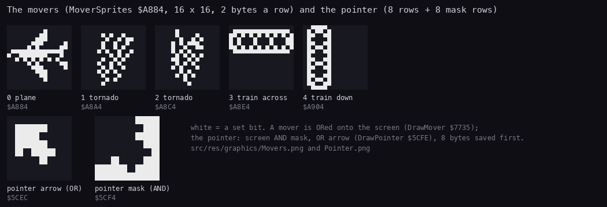

*The sprites. How to read: white is a set bit; top row, the five 16 x 16 movers of MoverSprites `$A884` (2 bytes a
line) with their numbers and addresses; bottom row, the pointer's arrow (ORed) and mask (ANDed), 8 x 8. Drawn from
`src/res/graphics/Movers.png` and `Pointer.png`. `python3 tools/fig_render.py sprites
docs/img/rendering/movers-pointer.png`.*

Worked example: is the pointer on the screen when the beam passes it? (`tools`, frames 789-857, O held.)

1. For each frame, PointerAt gives the cell. The beam reaches the cell's first line at T = 14 336 + 224 x line.
2. At that T the screen bytes are compared with PointerSave: if they differ, the arrow is drawn.
3. The result: 44 of 69 frames show the pointer. Idle at the end of `tools` (19 240-19 400), 114 of 161 frames show
   it.
4. So the pointer is visible in about two frames of three, and missing from the others. On a real Spectrum it
   flickers.

Witness: `work/docs/scB/flicker.py` over `tools` (`work/docs/scB/flicker-tools-789.txt`). The costs from the trace of
19 255-19 300: DrawPointer 1485-2208 T, ErasePointer 685-999 T, TrackBox 5644-7983 T. The InvertBox writes: 2376 in
16 passes, 64 bytes left with it as the last writer (6.12).

The point: the pointer and the box are drawn only for the length of a busy wait and removed before anything else
touches the screen. No routine ever has to draw around them, and the price is a visible flicker.

## 6.9 The movers: train, plane and tornado

Three things move over the map: the train, the plane and the tornado. Their positions are map cells: TrainCell
`$77D3`, PlaneCell `$787A`, TornadoCell `$7995`. MoveDisasters moves them at PassCount AND 15 = 0, every 16 passes
(doc 10). DrawMovers `$778F` draws them every pass, after MovePointer:

- the train, if TrainOut, with TrainSprite (3 across, 4 down), unless its cell is a rail bridge (`$1F` or `$20`): a
  train over water is not drawn;
- the plane, if PlaneOut, with sprite 0;
- the tornado, if TornadoOut, with sprite 1 or 2, picked by bit 0 of the R register: the tornado flickers between
  two shapes at random.

DrawMover `$7735` draws one 16 x 16 sprite (2 x 2 cells) at a map cell:

1. It returns if the cell is outside the view: rows ViewRow to ViewRow + 14, columns ViewCol to ViewCol + 30 (a
   sprite two cells wide and high must fit).
2. Screen row = row - ViewRow + 8; screen column = column - ViewCol.
3. It returns unless (PassCount AND 15) + 8, the row the sweep draws this pass, is at or below the sprite's row.
4. It ORs the 32 sprite bytes onto the screen, 16 lines of 2 bytes.

The code computes a mask from the screen byte, (byte OR byte shifted) AND byte, which is the byte itself. So the
"mask" does nothing, and the sprite is simply ORed over the cells.

Nothing erases a mover. The row redraw does: when the sweep draws the sprite's rows, the old copy is wiped. Step 3
keeps a mover from being drawn at its new place before the sweep has reached it.

```text
DrawMovers:                                   ; $778F, once a UI pass
    if TrainOut and map[TrainCell] not in ($1F, $20): DrawMover(TrainCell, TrainSprite)
    if PlaneOut: DrawMover(PlaneCell, 0)
    if TornadoOut: DrawMover(TornadoCell, 1 + (R AND 1))

DrawMover(row B, column C, sprite):           ; $7735
    if not (ViewRow <= B <= ViewRow + 14): return
    if not (ViewCol <= C <= ViewCol + 30): return
    B = B - ViewRow + 8; C = C - ViewCol
    if (PassCount AND 15) + 8 < B: return     ; the sweep has not reached it
    for line = 0 to 15:                       ; 2 bytes a line
        left byte = left byte OR sprite[2 x line]
        right byte = right byte OR sprite[2 x line + 1]
```

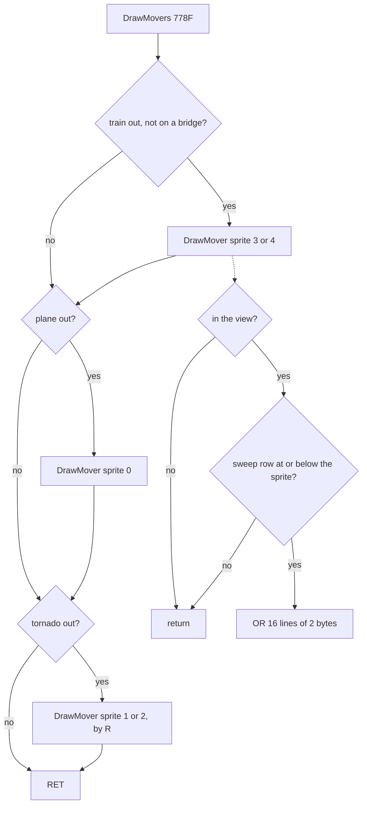

```text
7735  2A 07 65     LD HL,(ViewCol)        ; DrawMover: L = ViewCol, H = ViewRow
7738  5F           LD E,A
7739  78           LD A,B
773A  BC           CP H
773B  D8           RET C                  ; above the view
773C  7C           LD A,H
773D  C6 0E        ADD A,$0E
773F  B8           CP B
7740  D8           RET C                  ; below it
7741  78           LD A,B
7742  94           SUB H
7743  C6 08        ADD A,$08
7745  47           LD B,A                 ; the screen row
7746  79           LD A,C
7747  BD           CP L
7748  D8           RET C
7749  7D           LD A,L
774A  C6 1E        ADD A,$1E
774C  B9           CP C
774D  D8           RET C
774E  79           LD A,C
774F  95           SUB L
7750  4F           LD C,A                 ; the screen column
7751  3A 9F 8F     LD A,(PassCount)
7754  E6 0F        AND $0F
7756  C6 08        ADD A,$08
7758  B8           CP B
7759  D8           RET C                  ; the sweep is above the sprite
775A  6B           LD L,E
775B  26 00        LD H,$00
775D  29           ADD HL,HL
775E  29           ADD HL,HL
775F  29           ADD HL,HL
7760  29           ADD HL,HL
7761  29           ADD HL,HL              ; 32 bytes a sprite
7762  11 84 A8     LD DE,MoverSprites
7765  19           ADD HL,DE
7766  EB           EX DE,HL
7767  CD FE 5B     CALL ScreenAddr
776A  06 10        LD B,$10
776C  E5           PUSH HL                ; DrawMoverLine
776D  7E           LD A,(HL)
776E  4F           LD C,A
776F  CB 27        SLA A
7771  B1           OR C
7772  4F           LD C,A
7773  7E           LD A,(HL)
7774  A1           AND C                  ; byte AND (byte OR byte x 2) = byte
7775  4F           LD C,A
7776  1A           LD A,(DE)
7777  B1           OR C
7778  77           LD (HL),A
7779  13           INC DE
777A  2C           INC L
777B  7E           LD A,(HL)
777C  4F           LD C,A
777D  CB 2F        SRA A
777F  B1           OR C
7780  4F           LD C,A
7781  7E           LD A,(HL)
7782  A1           AND C
7783  4F           LD C,A
7784  1A           LD A,(DE)
7785  B1           OR C
7786  77           LD (HL),A
7787  13           INC DE
7788  E1           POP HL
7789  CD 19 5C     CALL NextPixelLine
778C  10 DE        DJNZ DrawMoverLine
778E  C9           RET
778F  3A D6 77     LD A,(TrainOut)        ; DrawMovers
7792  A7           AND A
7793  28 1E        JR Z,DrawMoversPlane
7795  ED 4B D3 77  LD BC,(TrainCell)
7799  CD DB 6B     CALL MapAddrChecked
779C  7E           LD A,(HL)
779D  FE 1F        CP $1F
779F  28 12        JR Z,DrawMoversPlane   ; on a bridge: not drawn
77A1  FE 20        CP $20
77A3  28 0E        JR Z,DrawMoversPlane
...
77C0  ED 5F        LD A,R
77C2  E6 01        AND $01
77C4  3C           INC A                  ; tornado sprite 1 or 2
```

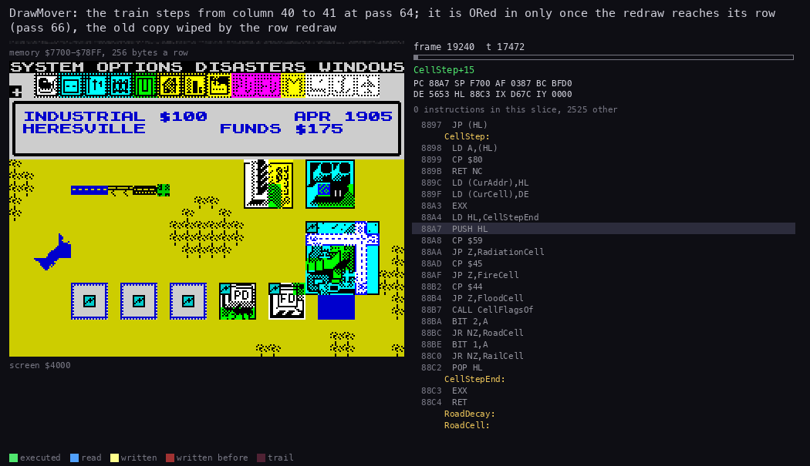

*The train moving one cell. How to read: left, the screen; right, the listing of DrawMover and DrawMovers with the
running instruction lit, and the bytes `$7700-$78FF` (TrainCell, TrainSprite, PlaneCell) with their reads and writes.
Recording `tools`, window 19 240:0-19 262:0. `python3 ../../kit/routine_anim.py --work work/docs/scB/tools --window
19240:0-19262:0 --listing build/game.lst --view screen --pc 7735-77D2 --range 7700-78FF --pictures 88 --title
"DrawMover: the train steps from column 40 to 41 at pass 64; it is ORed in only once the redraw reaches its row (pass
66), the old copy wiped by the row redraw" --out docs/img/routines/DrawMover.gif`.*

Worked example: the train in `tools`, frames 19 240-19 262.

1. MoveDisasters runs at PassCount AND 15 = 0, that is pass 64 (19 245). It moves the train from map column 40 to 41.
2. The train is at screen row 10. Pass 64 sweeps screen row 8, pass 65 row 9: DrawMover returns at `$7759` both
   times. The old copy at column 40 stays on the screen.
3. Pass 66 (19 251) sweeps row 10. DrawMover ORs the train at column 41 first; then the row pass redraws row 10,
   which wipes the top halves of both copies.
4. Pass 67 ORs the train again and then redraws row 11, which wipes the lower halves. From pass 68 the train is
   whole at column 41, and the old copy is gone.

Witness: the trace of `tools` 19 240:0-19 262:0; DrawMovers costs 4321-5982 T a pass with the train in view (and
75 388 T of wall time at 19 266, where a task switch fell inside it). The plane and the tornado are known only from
the code here; doc 10 shows the disasters on the map (the `disasters` recording).

The point: movers cost no erase routine and no save buffer. The sweep cleans up after them, and the price is a
moment where the old and the new copy are both on the screen.

## 6.10 Fire and flood animation

The fire tile `$45` and the flood tile `$44` change their pictures without the map changing. The game rewrites the
tile definitions themselves:

- AnimateFire `$906D` copies tile `$5A` or `$5B` into tile `$45` (CellTiles + `$228`);
- AnimateFlood `$908A` copies tile `$5C` or `$5D` into tile `$44` (CellTiles + `$220`).

The frame is chosen by (PassCount + a random 0-3) AND `$10`, so it changes about every 16 passes, with some jitter.
Periodic `$901D` calls AnimateFire at PassCount AND 15 = 2 and AnimateFlood at 3. UiTask calls both once at the
start, so the image's tiles `$44` and `$45` are only placeholders.

Every fire cell on the map shows the new picture as soon as the sweep redraws it. One copy of 8 bytes animates all of
them.

```text
AnimateFire:                                  ; $906D, at PassCount AND 15 = 2
    frame = ((PassCount + (Random() AND 3)) AND $10) ? $5B : $5A
    CellTiles[$45] = CellTiles[frame]         ; 8 bytes, LDIR

AnimateFlood:                                 ; $908A, at PassCount AND 15 = 3
    frame = ((PassCount + (Random() AND 3)) AND $10) ? $5D : $5C
    CellTiles[$44] = CellTiles[frame]
```

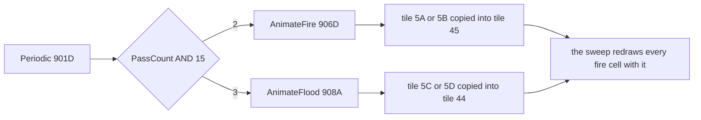

```text
906D  11 90 EC     LD DE,CellTiles+$0228  ; AnimateFire: tile $45
9070  21 38 ED     LD HL,CellTiles+$02D0  ; tile $5A
9073  CD C6 5C     CALL Random
9076  E6 03        AND $03
9078  47           LD B,A
9079  3A 9F 8F     LD A,(PassCount)
907C  80           ADD A,B
907D  E6 10        AND $10
907F  28 03        JR Z,AnimateFireCopy
9081  21 40 ED     LD HL,CellTiles+$02D8  ; tile $5B
9084  01 08 00     LD BC,$0008            ; AnimateFireCopy
9087  ED B0        LDIR
9089  C9           RET
908A  11 88 EC     LD DE,CellTiles+$0220  ; AnimateFlood: tile $44
908D  21 48 ED     LD HL,CellTiles+$02E0  ; tile $5C
9090  CD C6 5C     CALL Random
9093  E6 03        AND $03
9095  47           LD B,A
9096  3A 9F 8F     LD A,(PassCount)
9099  80           ADD A,B
909A  E6 10        AND $10
909C  28 03        JR Z,AnimateFloodCopy
909E  21 50 ED     LD HL,CellTiles+$02E8  ; tile $5D
90A1  01 08 00     LD BC,$0008            ; AnimateFloodCopy
90A4  ED B0        LDIR
90A6  C9           RET
```


*The last row of the sheet: the frames `$5A-$5B` (fire) and `$5C-$5D` (flood) in their own attributes, and above
them the tiles `$44` and `$45` they are copied into. `python3 tools/fig_render.py cells
docs/img/rendering/cells-sheet.png`.*

Worked example: AnimateFire at pass 66 (stepped through from the code).

1. 66 AND 15 = 2, so Periodic jumps to AnimateFire.
2. Random gives, say, 3: 66 + 3 = 69; 69 AND `$10` = 0. HL stays on tile `$5A`.
3. LDIR copies the 8 bytes `$ED38-$ED3F` to `$EC90-$EC97`.
4. At pass 82 the sum is 82-85: AND `$10` = `$10`, so tile `$5B`.

Witness: the fire and flood screenshots of `disasters` (`disasters-000655-fire-1.png`, `disasters-002784-flood-1.png`
in `docs/img/play`) show the tiles on the screen. The frame change is known only from the code: no trace covers a
pass with a fire in the view.

The point: an animation of every burning cell for 8 bytes of LDIR. The cost does not grow with the fire.

## 6.11 The overview maps

The maps window shows a 48 x 48 cell area of the map at a quarter of its size: 4 x 4 pixels a cell, the whole 192 x
192 pixel square from screen column 1. There are nine areas, 24 cells apart (MapAreaCells `$9C45`): area 1 is
rows 0-47, columns 0-47; area 5 is rows 24-71, columns 24-71; area 9 is rows 48-95, columns 48-95.

DrawOverview `$9C57` draws the area cell by cell, with the view's own code paths:

1. A cell code goes through RoadTraffic, with Blink forced to `$10` (BlinkCell is not called: the overview does not
   blink). A building cell goes through the same StartBuilding and BuildingTile counting as DrawView.
2. OverviewCell `$9BC3` shrinks the 8 x 8 tile to 4 x 4: ShrinkLine takes pixels 0, 2, 4 and 6 of tile lines 1, 3,
   5 and 7, and writes them into the left or the right nibble of the screen byte (RightNibble `$9C30`).
3. PutLayerAttr writes attribute `$21` (blue ink on green paper) for the cell's character.
4. LayerOf `$9D44` colours the cell by the layer MapLayer `$9D43` (below).
5. After each row of 48 cells, AnyKey: a key stops the draw (doc 05, 5.10).

One character holds 2 x 2 cells, so the four cells share one attribute. Each writes it in turn, so the last one, the
bottom-right cell, decides the colour of the character.

The eight layers:

| MapLayer | Name | What colours a cell | Colour |
| ---: | --- | --- | --- |
| 0 | CITY | nothing | `$21` everywhere |
| 1 | POLLUTN | Pollution `$ADD0` (48 x 48) >> 5 | LayerColours 1-7 |
| 2 | POLICE | PoliceCover `$AB90` (24 x 24) >> 1 | LayerColours 1-7 |
| 3 | FIREDEP | FireCover `$A950` (24 x 24) >> 1 | LayerColours 1-7 |
| 4 | TRAFFIC | Traffic `$B6D0` (48 x 48) >> 5 | LayerColours 1-7 |
| 5 | POWER | the power bit of the cell | PatternMark: a dot pattern over the pixels |
| 6 | TRANSPT | a road or rail cell (CellFlags AND 6) | PatternMark |
| 7 | CRIME | a zone cell (CellFlags bit 4): (distance to CityCentre / 2 - 1 - police) / 2 | LayerColours 1-7 |

LayerColours `$9CFA` = 0, `$49`, `$52`, `$5B`, `$64`, `$6D`, `$76`, `$7F`: bright blue, red, magenta, green, cyan,
yellow and white paper, with the ink the same colour. A value of 0 leaves `$21`. The window's legend reads "MAX"
white ... blue "MIN".

```text
DrawOverview:                                 ; $9C57, MapArea 0-8, MapLayer 0-7
    OverviewAt = $4008; RightNibble = 0; Blink = $10
    HL = MapAreaAddrs[MapArea]; OverviewOrigin = MapAreaCells[MapArea]
    for 48 rows:
        for 48 cells:
            if no building row open and (HL) >= $80: StartBuilding()
            ViewCellPtr = HL
            OverviewCell((HL))                ; 4 x 4 pixels, RoadTraffic or BuildingTiles
            PutLayerAttr($21)
            LayerOf()                         ; the layer's colour or pattern
            RightNibble = RightNibble XOR 1; if it is 0 again: OverviewAt + 1
            BuildingTile + 1; OverviewCellAt column + 1
            HL + 1
        OverviewAt = 4 pixel lines down; HL + $30; BuildingLeft = 0
        if AnyKey(): return                   ; the draw stops
```

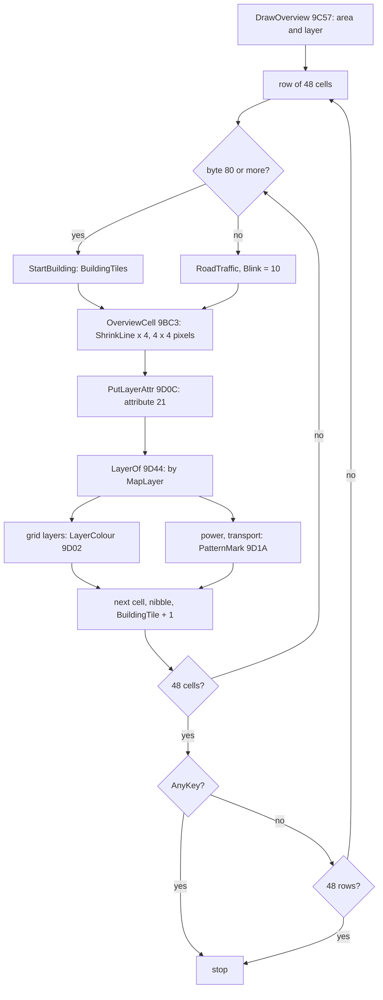

```text
9C57  21 08 40     LD HL,Screen+8         ; DrawOverview
9C5A  22 D7 9B     LD (OverviewAt+$0001),HL
9C5D  AF           XOR A
9C5E  32 30 9C     LD (RightNibble),A
9C61  3E 10        LD A,$10
9C63  32 33 64     LD (Blink),A           ; the overview's traffic is always the second frame
...
9C93  3A 58 65     LD A,(BuildingLeft)    ; DrawOverviewCell
9C96  A7           AND A
9C97  20 06        JR NZ,DrawOverviewDraw
9C99  7E           LD A,(HL)
9C9A  FE 80        CP $80
9C9C  D4 5B 65     CALL NC,StartBuilding
9C9F  22 09 65     LD (ViewCellPtr),HL    ; DrawOverviewDraw
9CA2  D9           EXX
9CA3  CD C3 9B     CALL OverviewCell
9CA6  0E 21        LD C,$21
9CA8  CD 0C 9D     CALL PutLayerAttr
9CAB  CD 44 9D     CALL LayerOf
9CAE  21 30 9C     LD HL,RightNibble
9CB1  7E           LD A,(HL)
9CB2  EE 01        XOR $01
9CB4  77           LD (HL),A
9CB5  20 07        JR NZ,DrawOverviewNext
9CB7  2A D7 9B     LD HL,(OverviewAt+$0001)
9CBA  23           INC HL
9CBB  22 D7 9B     LD (OverviewAt+$0001),HL
...
9CF1  CD EF 5B     CALL AnyKey
9CF4  C1           POP BC
9CF5  E1           POP HL
9CF6  C0           RET NZ                 ; a key: stop
9CF7  10 8D        DJNZ DrawOverviewRow
9CF9  C9           RET
9CFA  00 49 52 5B  DEFB $00,$49,$52,$5B,$64,$6D,$76,$7F ; LayerColours
9D02  A7           AND A                  ; LayerColour
9D03  C8           RET Z                  ; 0: keep $21
9D04  4F           LD C,A
9D05  06 00        LD B,$00
9D07  21 FA 9C     LD HL,LayerColours
9D0A  09           ADD HL,BC
9D0B  4E           LD C,(HL)
9D0C  2A D7 9B     LD HL,(OverviewAt+$0001) ; PutLayerAttr
9D0F  7C           LD A,H
9D10  0F           RRCA
9D11  0F           RRCA
9D12  0F           RRCA
9D13  E6 03        AND $03
9D15  F6 58        OR $58
9D17  67           LD H,A
9D18  71           LD (HL),C
9D19  C9           RET
...
9DD8  21 D0 AD     LD HL,Pollution        ; LayerPollution
9DDB  22 3C 75     LD (GridBase),HL       ; LayerGrid48
9DDE  ED 4B 31 9C  LD BC,(OverviewCellAt)
9DE2  CD 3E 75     CALL Grid48
9DE5  CB 3F        SRL A
9DE7  CB 3F        SRL A
9DE9  CB 3F        SRL A
9DEB  CB 3F        SRL A
9DED  CB 3F        SRL A                  ; 0-255 to 0-7
9DEF  C3 02 9D     JP LayerColour
```

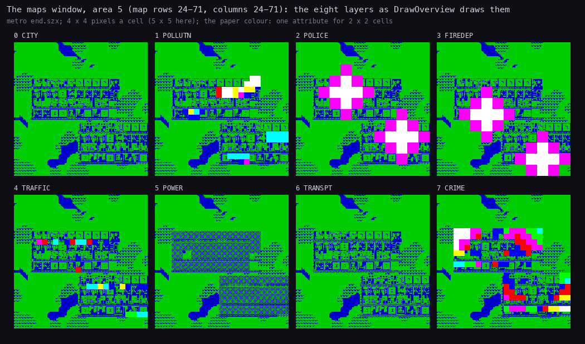

*The maps window of `metro`, area 5. How to read: one panel per layer, numbered as MapLayer, each the 48 x 48 cells
at 4 x 4 pixels (drawn here at 5 x 5); the paper colour is the layer's value, one attribute per 2 x 2 cells; POWER
and TRANSPT mark cells with a dot pattern instead. CITY is the plain map. Drawn by the emulation of DrawOverview in
`tools/fig_render.py` from `metro`'s last frame (`end.szx`, frame 96 503). `python3 tools/fig_render.py overview
work/stage1/rec/metro/end.szx 5 docs/img/rendering/overview-metro.png`.*

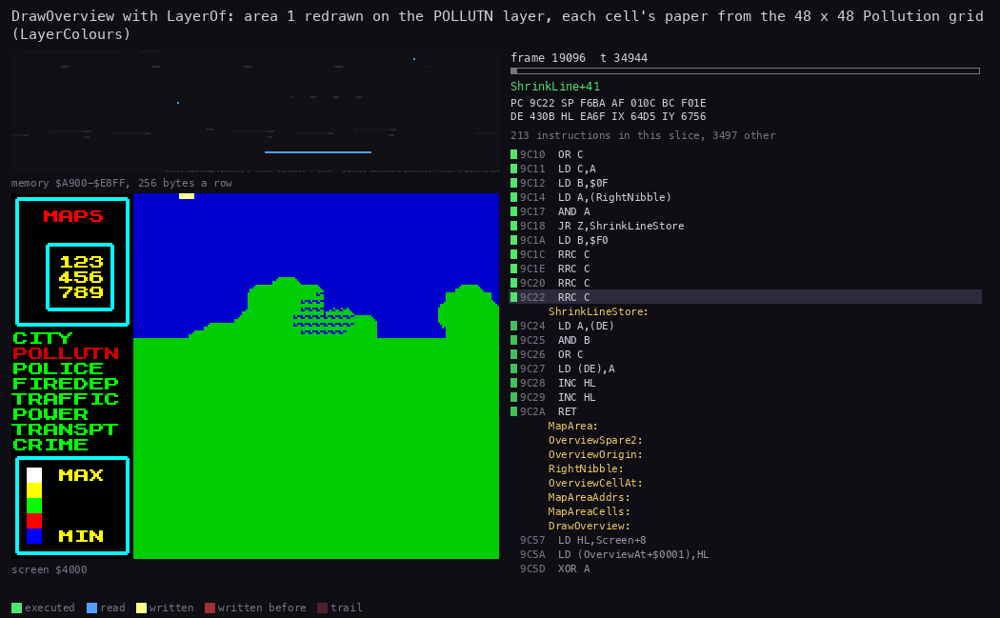

*The overview drawn on the real screen. How to read: left, the screen, where area 1 is drawn row by row at a quarter
size; right, the listing of DrawOverview, OverviewCell, ShrinkLine and LayerOf with the running instruction lit, and
the bytes `$A900-$E8FF` (the coverage and pollution grids, the map, the tiles). Recording `menus`, window
19 096:0-19 136:0, after the A at 19 091. `python3 ../../kit/routine_anim.py --work work/docs/scB/menus --window
19096:0-19136:0 --listing build/game.lst --view screen --pc 9B40-9DEF --range A900-E8FF --pictures 80 --title
"DrawOverview with LayerOf: area 1 redrawn on the POLLUTN layer, each cell's paper from the 48 x 48 Pollution grid
(LayerColours)" --out docs/img/routines/DrawOverview.gif`.*

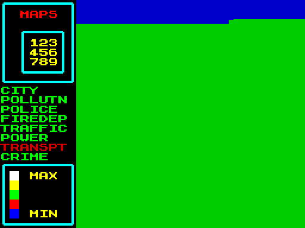

*The real maps window at frame 19 003 of `menus`, the moment the first A was pressed: area 1, the sea of the
north-west corner, with the layer names and the legend. Screenshot of the recording (WALKTHROUGH 6.1).*

Worked example: the cells at overview row 0, columns 0 and 1, of area 1 (stepped through from the code).

1. OverviewAt = `$4008`, RightNibble = 0. Cell (0, 0) is water, code `$00`.
2. OverviewCell: HL = CellTiles + 1 (line 1). ShrinkLine takes bits 7, 5, 3, 1 of line 1 into bits 7-4 and writes
   the left nibble of `$4008`; lines 3, 5, 7 go to `$4108`, `$4208`, `$4308`.
3. PutLayerAttr writes `$21` to `$5808`. On CITY, LayerOf returns at once.
4. RightNibble becomes 1; cell (0, 1) goes into the right nibble of the same 4 bytes and writes `$5808` again.
5. After cell (0, 1) RightNibble is 0 again, and OverviewAt becomes `$4009`.

Witness, checked byte for byte (`work/docs/scB/ovcheck.py`): the emulation in `tools/fig_render.py` was compared with
the real screen of frames of a maps window, in the rows the draw had reached.

- `menus`: 17 frames from 19 002 to 19 652, cell rows 0-18: every bitmap byte and every attribute equal.
- `metro`: 9 frames from 95 849 to 96 227, cell rows 0-23: equal.

Every draw in both recordings was stopped by the next key after 19-24 cell rows of area 1. Those rows are sea and
land with no zone, so every attribute there was `$21`. The shrinking, the building tiles and the default attribute
are verified. The layer colours and patterns are known only from the code; the eight panels of the figure are the
code's result on `metro`'s map.

The point: the overview is the view's renderer run at a quarter scale, with the same building logic and the same
traffic tiles. It is drawn from scratch on every loop of the window and abandoned at the first key.

## 6.12 Code against the screen

Who writes the screen during play? The figure below takes the 16 passes of one sweep and marks each screen byte by
the routine that wrote it last.

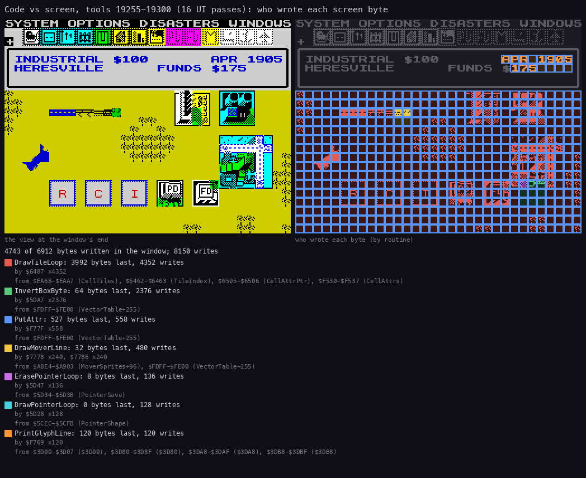

*Code against the screen, `tools` 19 255-19 300 (16 UI passes). How to read: left, the screen at the end of the
window; right, the same screen with each byte coloured by its last writer; under them, each routine with its bytes
(last writer), its writes, its address and what it read. DrawTileLoop (red) wrote the view; PutAttr (blue) the
attributes; InvertBoxByte (green) the box; DrawMoverLine (yellow) the train; ErasePointerLoop and DrawPointerLoop the
pointer's 8 bytes; PrintGlyphLine (orange) the date in the status box. Recording `tools`, window 19 255:0-19 300:0.
`python3 ../../kit/writers_map.py --work work/docs/scB/tools --window 19255:0-19300:0 --listing build/game.lst --view
screen --sources --title "Code vs screen, tools 19255-19300 (16 UI passes): who wrote each screen byte" --out
docs/img/rendering/writers-tools-19255.png`.*

What the figure shows:

| Routine | Bytes last | Writes | Reading |
| --- | ---: | ---: | --- |
| DrawTileLoop `$6487` | 3992 | 4352 | 17 rows of 32 cells, 8 bytes each: one row twice (6.3) |
| PutAttr `$F77F` | 527 | 558 | 544 attributes for the 17 rows, 14 for the status box |
| InvertBoxByte `$5DA7` | 64 | 2376 | the 3 x 3 box: 72 bytes, 33 times; 8 of them then under the pointer |
| DrawMoverLine `$7778`, `$7786` | 32 | 480 | the train, 32 bytes, on 15 passes |
| ErasePointerLoop `$5D47` | 8 | 136 | the pointer's cell, 17 times |
| DrawPointerLoop `$5D28` | 0 | 128 | always erased before the window's end |
| PrintGlyphLine `$F769` | 120 | 120 | the date (PrintDate at PassCount AND 15 = 1) |

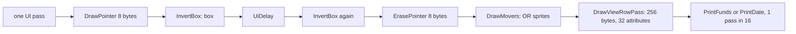

Worked example: the 4352 DrawTileLoop writes.

1. A view row is 32 cells x 8 bytes = 256 bytes.
2. The window holds 17 row passes (PassCount 68-84), so 17 x 256 = 4352.
3. View row 4 (PassCount 68 and 84) was drawn twice. 16 different rows x 256 = 4096 bytes. 3992 of them kept
   DrawTileLoop as the last writer; the other 104 were then written by the box (64), the train (32) and the pointer
   (8).

Witness: the trace of `tools` 19 255:0-19 300:0; the beam figure of 6.4 for one pass against the beam.

The point: during play nearly every screen write is the row sweep. The pointer, the box and the movers are a few
hundred bytes drawn over it and wiped by it.

## 6.13 What the game does not draw

Maxis' original has graphs of population, money, crime and pollution over time. The Spectrum version has none:

- the WINDOWS menu has three windows, MAPS, BUDGET and EVALUATION (`src/res/text/menus/Windows.txt`), and EXIT MENU;
- BUDGET and EVALUATION are text windows (doc 08). While they are open, RunMenu calls their MenuHook `$6942`
  (BudgetHook `$9346`, Evaluate `$9737`), which recomputes and prints numbers, not bars.

The overview layers (6.11) are the only pictures of the city's state. Their seven colours are the game's only
"chart".

The renderer also has no:

- scrolling by pixels: the view moves by whole cells and is redrawn (doc 05, 5.6);
- double buffer: everything is drawn on the visible screen, so the sweep can be seen;
- colour animation: the blink and the traffic change tiles, never attributes.

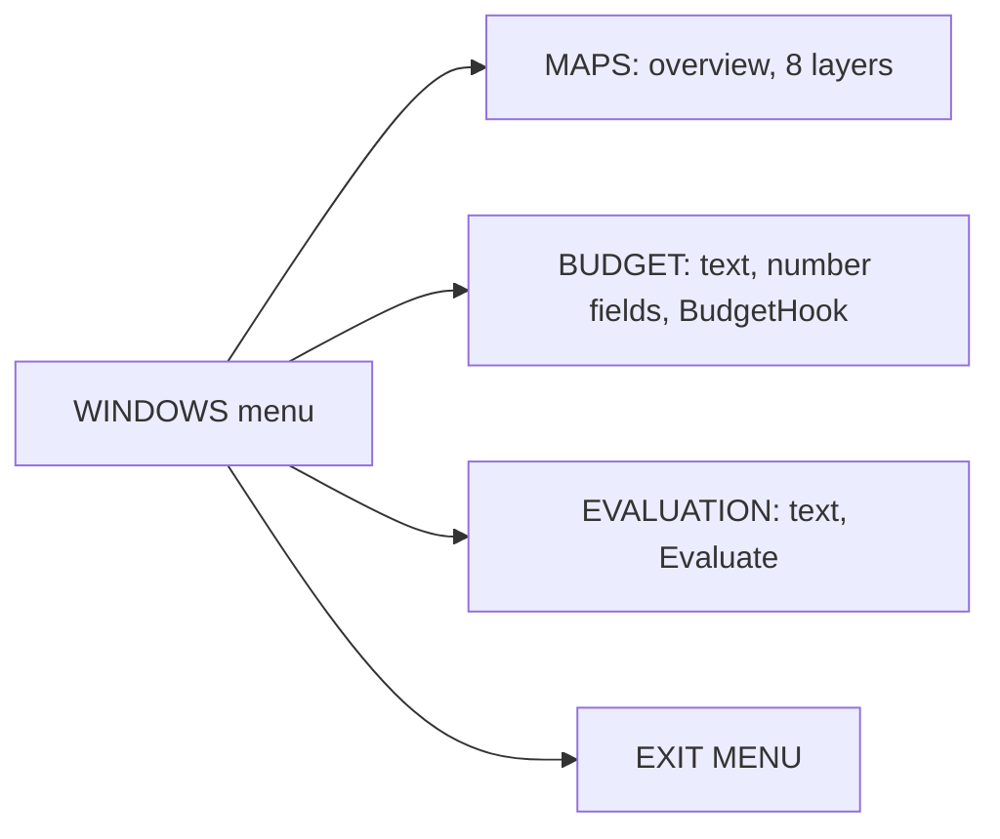

```text
WindowsMenu (src/res/text/menus/Windows.txt):
    action $A512 "MAPS"
    action $9194 "BUDGET"                     ; BudgetWindow: MenuHook = BudgetHook
    action $95B8 "EVALUATION"                 ; EvaluationWindow: MenuHook = Evaluate
    action $6703 "EXIT MENU"
```

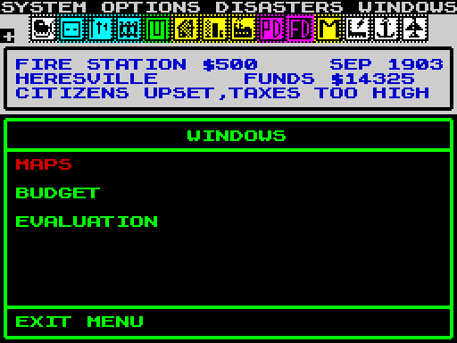

*The WINDOWS menu, `menus` frame 18 965: three windows and no graph. Screenshot of the recording (WALKTHROUGH 6.1).*

Worked example: the budget window's hook (`menus`, 19 768-20 115).

1. BudgetWindow `$9194` stores BudgetHook in MenuHook and calls ShowWindow.
2. RunMenu calls the hook once on entry, and EditNumber calls it after every Q or A (`$69DD`).
3. BudgetHook sets PrintAttr `$47`, calls BudgetFigures and PrintBudget, and sets PrintAttr back to `$45`. It prints
   numbers; nothing else is drawn.

Witness: the WINDOWS menu text and screenshot; the budget window screenshot `menus-020006-budget-tax.png` in
`docs/img/play` (text only).

The point: on 48K the city's history was the first thing to go. The windows show the present, as numbers and as the
overview's colours.

## 6.14 What is known only from the code

- The traffic frames `$34-$37` on real roads (6.7): no trace covers a busy road row.
- The plane and the tornado drawn over the view (6.9), and the tornado's shape picked by the R register.
- A train on a bridge not being drawn (6.9).
- The fire and flood frame change (6.10).
- The overview's layer colours and dot patterns (6.11): every traced draw stopped in rows without zones.
- The view's left edge cutting a building (FindBuildingStart, 6.5).
- The CRIME layer at the centre: for a zone cell on CityCentre itself (distance 0), 15 - (32 - 0) / 2 wraps to
  `$FF`. After the police and the halving, LayerColour reads a byte far past LayerColours as the attribute. Whether a
  zone ever sits on the centre cell is not checked.

Measured, for the record:

| What | Cost | Where |
| --- | --- | --- |
| DrawViewRowPass, one row | 30 338-40 946 T (wall) | `tools` 19 255-19 300 |
| DrawView, 16 rows | 566 174 T (8.1 frames) | `tools` 13 458-13 466 |
| UiDelay | 52 000 T | the code: 2000 x 26 T |
| DrawPointer / ErasePointer | 1485-2208 T / 685-999 T | `tools` 19 255-19 300 |
| TrackBox (with InvertBox) | 5644-7983 T | `tools` 19 255-19 300 |
| DrawMovers (train in view) | 4321-5982 T | `tools` 19 255-19 300 |
| A pass | 2.67 frames | `tools` 19 256-19 300 |
| A sweep of 16 rows | about 43 frames | `tools` 19 256-19 300 |
