# 7. Objects

What this covers: the city as data. The map `CityMap $C450` holds the land, the networks, the zones and the
buildings, one byte a cell. A building is a run of bytes in the map, not a record elsewhere. A zone is its nine map
cells: its state is the cells themselves, with no zone table. Beside the map live five side arrays (fire and police
cover, pollution, traffic, power), the counters each simulation pass rebuilds, the city variables (money, date,
population, the category, the advice), the three movers (train, plane, tornado) and the 31-byte save header. The
rules that change all this are in [doc 10](10-gameplay-logic.md); the drawing is in [doc 06](06-rendering.md).

The recordings and states it rests on (WALKTHROUGH 6.0), each opened on an own instance (port base 37070) after
`source work/env.sh`:

- `growth` (51 985 frames, NORMAL speed until about frame 11 000, simulation pass 36, then FAST; a village with a
  coal plant), opened into `work/docs/scC/growth`. The map and the
  variables were sampled every 100 frames (`work/docs/scC/growth-vars.jsonl`), the side arrays every 1 000 frames
  (`growth-arrays.jsonl`), with `work/docs/scC/sample.py`. Traces: frames 4528-4531 (a residential zone step) and
  19242-19266 (the power flood).
- `city` (77 592 frames, a city of 17 R, 8 C and 8 I zones with a nuclear plant), opened into `work/docs/scC/city`;
  sampled every 250 frames (`city-vars.jsonl`). The bot laid 18 R zones; the one centred at row 45, column 35 never
  appears in any sample (at most 17 R centres, from frame 10 750 on): its box holds the water cell at row 44, column
  34, so CheckSite refused it.
- `disasters` (13 050 frames), opened into `work/docs/scC/dis`; sampled every 50 frames (`dis-vars.jsonl`).
- The end states `work/stage1/rec/metro/end.szx` (frame 96 503 of `metro`) and `work/stage2/ceiling-end.szx` (frame
  80 000 of the stage 2 ceiling run, the only state with a residential block), and the save `menus/town.tap`.

A sample of frame N is the memory at the start of frame N. A simulation pass takes about 300 frames at FAST
([10.1](10-gameplay-logic.md#101-the-simulation-pass)), so a counter sampled mid-pass holds a partial sum; this
document says so wherever it matters.

## 7.1 The map and the cell codes

`CityMap $C450` is 96 rows of 96 bytes, row-major. `MapAddr $6BE6` turns a cell into its byte:
HL = `CityMap` + 96 x B + C, with B the row and C the column. `MapAddrChecked $6BDB` first tests both against 96 and
returns with carry clear when the cell is off the map. The image holds `$02` (land) in every byte; NewLandscape
`$6A8E` makes the real map at run time ([10.11](10-gameplay-logic.md#1011-the-city-generator)).

```asm
MapAddrChecked:
  LD HL,$0060                ; 96
  LD A,B
  CP L
  JR NC,MapAddrOff           ; row 96 or more
  LD A,C
  CP L
  JR NC,MapAddrOff           ; column 96 or more
MapAddr:
  LD L,B
  LD H,$00
  LD A,C
  LD B,H
  LD C,L
  ADD HL,HL                  ; 2 row
  ADD HL,BC                  ; 3 row
  ADD HL,HL
  ADD HL,HL
  ADD HL,HL
  ADD HL,HL
  ADD HL,HL                  ; 96 row
  LD B,$00
  LD C,A
  ADD HL,BC                  ; + column
  LD BC,CityMap
  ADD HL,BC
  SCF                        ; carry: on the map
  RET
```

MapAddr leaves A holding the column. One caller tests A as if it held the cell: the park tool
([10.13](10-gameplay-logic.md#1013-the-tools-placement-and-refusals)).

A byte below `$80` is a cell. Its tile is CellTiles `$EA68` + 8 n and its colour CellAttrs `$F530` + n
([doc 06](06-rendering.md)). Its behaviour comes from one table, `CellFlags $6F9C`, read by `CellFlagsOf $7599`:

| Bit | Meaning | Read by |
| --- | --- | --- |
| 0 | not reshaped: FixNetworkCell leaves it alone (bridges, crossings) | FixNetworkCell `$6EE3` |
| 1 | rail | CellStep (RailCell), MoveTrain, TripStep |
| 2 | road | CellStep (RoadCell), ScanRing (transport), TripStep |
| 3 | conducts power | IsConductive (PowerFlood) |
| 4 | zone cell (frame, house, centre) | GrowCell, DeclineCell |
| 5 | set on the R, C and I zone centres `$51-$56` only | no code reads it |
| 6 | developed: a house, counted into Density | ScanInsideCell `$7DEA` |
| 7 | flammable | Ignite, Spread, MoveTornado |

A building byte (`$80` and up) is not looked up: CellFlagsOf returns `$99` (flammable, zone, conducts, not reshaped)
for it, so a building conducts power and burns.

The codes in groups:

| Codes | Cells |
| --- | --- |
| `$00` | water |
| `$01`, `$03-$05` | coast (MakeCoast picks one by the land round a water cell) |
| `$02` | land |
| `$06` | trees |
| `$07-$11` | road and its shapes (FixNetworkCell); `$12`, `$13` road bridges |
| `$14-$1E` | rail and its shapes; `$1F`, `$20` rail bridges |
| `$21-$2B` | power line and its shapes; `$2C`, `$2D` power line over water |
| `$2E-$33` | crossings: road and rail, road and power, rail and power (`Crossings $7062`) |
| `$34-$37` | road with traffic: drawn only (RoadTraffic), never stored by the simulation |
| `$38`, `$39` | park (`$39` 1 in 8, ParkTool) |
| `$3A` | rubble; `$3B` the no-power lightning tile (BlinkCell shows it for a blinking centre; no code stores it) |
| `$3C-$43` | houses, worth 1-8 each (the code minus `$3B`) |
| `$44` | flood; `$45` fire; `$46-$48` the bulldozer's rubble animation |
| `$49-$50` | the eight empty zone frame cells, one per position round the centre (`ZoneFrame $8A08`) |
| `$51-$53` | R, C, I zone centre, powered; `$54-$56` the same unpowered (they blink) |
| `$57`, `$58` | road-bridge-like cells no code writes to the map (`$57` appears only as a range bound, `CP $57`) |
| `$59` | radiation |

The bridge codes are the network kind plus 11 or 12 (`BridgeSteps $720F`): road 7 gives `$12`/`$13`, rail `$14`
gives `$1F`/`$20`, power `$21` gives `$2C`/`$2D`. CellFlags has 90 rows (`$00-$59`); the tile sheet has 94.

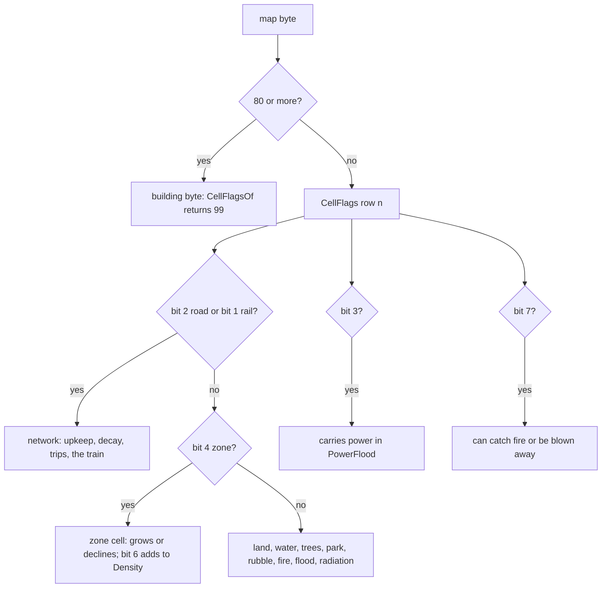

Worked example, the R zone at map rows 44-46, columns 31-33 in `ceiling-end.szx`
([7.3](#73-zones-the-map-is-the-record)). The centre byte is `$51`, flags `%10111001`: flammable, bit 5 (the
centres' unread bit), zone, conducts, not reshaped, and no developed bit. A house byte `$43` has `%11011001`: developed is set, so it counts 8 into
Density. The frame cell `$49` has `%10011001`: a zone cell that counts nothing.

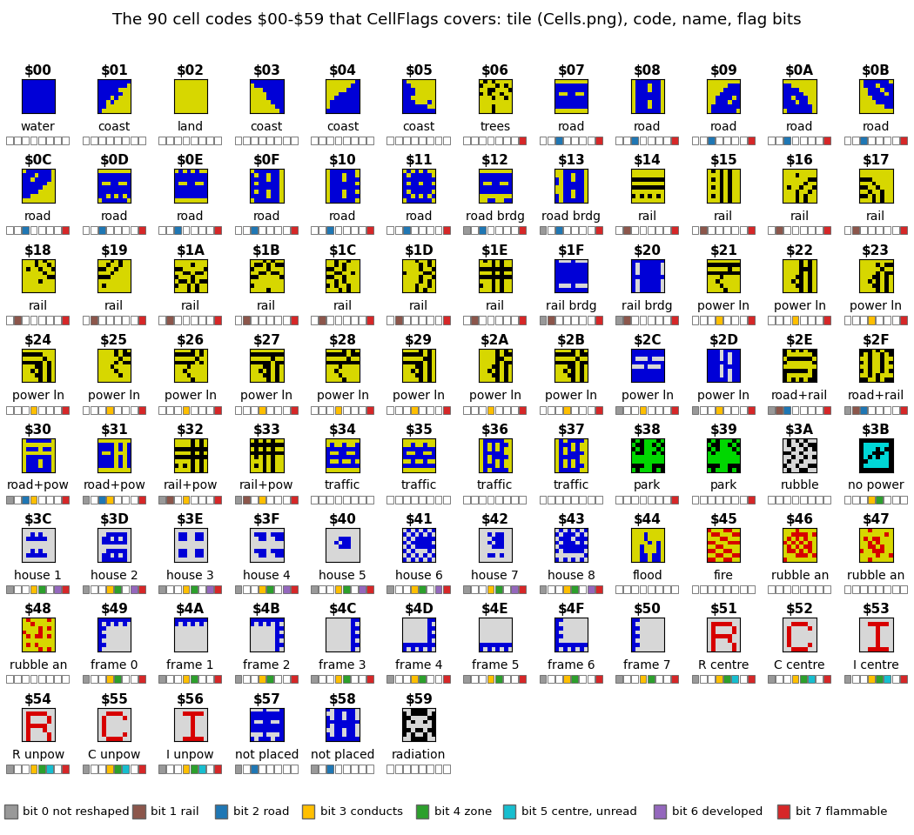

How to read the figure:

- One box per code `$00-$59`: the code, its tile from src/res/graphics/Cells.png (the sheet CellTiles and CellAttrs
  are built from) and a short name.
- The eight squares under each tile are the CellFlags bits 0-7, coloured when set (legend at the bottom). Bit 5
  (light blue) is set only on the six zone centres `$51-$56`, and no code reads it.
- Command: `python3 tools/fig_sim.py cells --out docs/img/sim/cells.png` (from src/res only, no recording).

Witness: tools/fig_city.py draws whole maps from these tiles and codes, and its drawing of the stage-1 memory image
equals the map `docs/img/play/096503-metro-city-map.png`.

**The point**: one byte a cell and one flag byte a code. The whole simulation asks "is it a road, does it burn, does
it carry power" through the same eight bits, and a building answers `$99` without a lookup.

## 7.2 Buildings: runs of bytes in the map

A building is a rectangle of map bytes `$80` and up. Each of its rows starts with a row byte, then two tile number
bytes, then `$C0` fillers:

| Byte of the row | Value | Meaning |
| --- | --- | --- |
| 0 | `$80-$BF` | bit 5: the building's top row; bit 4: powered (BuildingPower writes it each pass, except on the power plants, types 6 and 8, which keep their prefab's set bit); bits 0-2: the width |
| 1 | `$C0` OR (n >> 3) | the high part of this row's first tile number n |
| 2 | `$C0` OR (n AND 7) | the low part of n |
| 3 ... | `$C0` | fillers: cell k of the row shows building tile n + k |

The tile number belongs to the row: each row of a 4 x 4 plant has its own n, 4 apart. The building's type is the top
row's byte 1 AND `$3F`, which is n >> 3 of the top row. `BuildingKinds $8813` turns the type into a routine, a level
and a density:

| Type | Building | Density | Type | Building | Density |
| --- | --- | --- | --- | --- | --- |
| `$00` | police | 10 | `$11-$14` | R block levels 0-3 | 96, 128, 160, 192 |
| `$01` | fire | 10 | `$15-$18` | C buildings levels 0-3 | 10, 20, 30, 40 |
| `$02` | church | 5 | `$1A-$1D` | I buildings levels 0-3 | 16, 32, 48, 64 |
| `$03` | hospital | 10 | `$06` | coal plant | 10 |
| `$04` | stadium | 30 | `$08` | nuclear plant | 10 |
| `$0A` | seaport | 30 | `$0C` | airport | 40 |

A type missing from the table gets no step.

How the scan finds a building: ScanCity `$86C9` walks every byte. A byte with AND `$E0` = `$A0` (a top row byte)
goes to BuildingPower `$870C`, which reads the PowerMap bit of the cell and sets or clears bit 4. The two power
plants (types 6 and 8) jump past it: their top byte keeps the prefab's `$B4`, and ZonePowered stays 0, so CountPowered
adds every plant to UnpoweredZones (which Advise rule 16 reads). Then ZoneStep
`$8789` calls BuildingStep `$886B`:

```asm
BuildingStep:
  LD HL,BuildingKinds
  LD BC,$0004
  LD A,(BuildingType)        ; byte 1 AND $3F of the top row
  LD E,A
BuildingStepLook:
  LD A,(HL)
  CP $FF
  RET Z                      ; not a kind: nothing
  CP E
  JR Z,BuildingStepFound
  ADD HL,BC
  JR BuildingStepLook
BuildingStepFound:
  INC HL
  LD C,(HL)                  ; routine
  INC HL
  LD A,(HL)
  LD (BuildingLevel),A
  INC HL
  LD A,(HL)
  LD (Density),A             ; the kind's density
  SLA C
  LD B,$00
  LD HL,BuildingRoutines
  ADD HL,BC
  LD A,(HL)
  INC HL
  LD H,(HL)
  LD L,A
  JP (HL)
```

The tools put buildings from prefabricated rows. `SeaportBuilding $74E6` is `$A4,$CA,$C4,$C0, $84,$CB,$C0,$C0, ...`:
top byte `$A4` is top row, unpowered, width 4. The simulation puts zone buildings with PutZoneBuilding `$75B0`: tile
base n = DE + 9 A, then three rows `$B3`, `$83`, `$83` with n, n + 3, n + 6. The bases are `$88` (R block), `$AC` (C),
`$D0` (I), `$1B` (hospital) and `$12` (church); A picks the level.

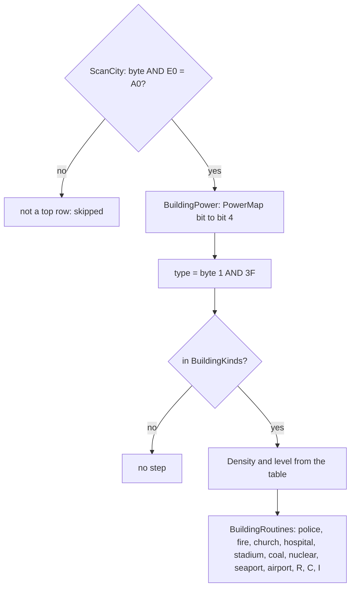

Worked example, `ceiling-end.szx`, the nuclear plant at row 37, column 58:

- Row 1 is `$B4 $C8 $C4 $C0`. `$B4` = `%10110100`: top row, powered, width 4. n = (`$C8` AND `$3F`) x 8 + (`$C4`
  AND 7) = 8 x 8 + 4 = 68. The type is `$08`: nuclear, routine 6.
- Rows 2-4 are `$84 $C9 $C0 $C0`, `$84 $C9 $C4 $C0` and `$84 $CA $C0 $C0`: n = 72, 76, 80, no top bit.
- The R block at (53, 54) is `$B3 $D4 $C3` / `$83 $D4 $C6` / `$83 $D5 $C1`: n = 163, 166, 169, type `$14`, level 3,
  density 192. It is PutZoneBuilding with DE = `$88` and A = 3 (136 + 27 = 163).

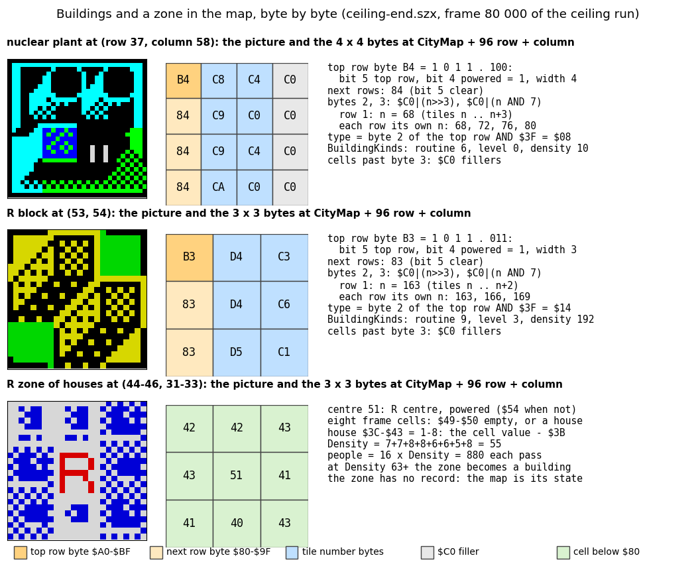

How to read the figure:

- Each row of the figure is one object of `ceiling-end.szx`: its picture (drawn with tools/fig_city.py from the map),
  its bytes as they sit in CityMap, and the decoding.
- Orange: a top row byte; light orange: a lower row byte; blue: the tile number bytes; grey: `$C0` fillers; green:
  plain cells below `$80`.
- The third row is a zone of houses, for comparison: no row byte, no number bytes, only cells.
- Command: `python3 tools/fig_sim.py building --state work/stage2/ceiling-end.szx --out docs/img/sim/building.png`.

Witness: the state above (ceiling run frame 80 000) and every map tools/fig_city.py draws.

**The point**: a building has no record outside the map. Its size, power, kind and picture are all in its own bytes,
and the type is just the tile number divided by 8. Turning a zone into a building is writing nine bytes.

## 7.3 Zones: the map is the record

A zone is 3 x 3 cells: a centre (`$51-$56`) and eight frame cells. Each frame cell is either its empty frame code
(`$49-$50`, one per position) or a house `$3C-$43`. `ZoneFrame $8A08` lists the eight positions:

| k | Row step | Column step | Empty code |
| --- | --- | --- | --- |
| 0 | -1 | -1 | `$49` |
| 1 | -1 | 0 | `$4A` |
| 2 | -1 | +1 | `$4B` |
| 3 | 0 | -1 | `$50` |
| 4 | 0 | +1 | `$4C` |
| 5 | +1 | -1 | `$4F` |
| 6 | +1 | 0 | `$4E` |
| 7 | +1 | +1 | `$4D` |

The zone's state is:

- **Kind and power**: the centre. `$51`/`$52`/`$53` are R/C/I powered, `$54`/`$55`/`$56` unpowered. ZonePower
  `$873C` rewrites the centre from the PowerMap bit every pass.
- **Density** `$8869`: not stored. ZoneByKind sets it to 0, and ScanRing adds (cell - `$3B`) for each developed cell
  of the nine (ScanInsideCell `$7DEA`). Eight houses `$43` give 64.
- **The building stage**: at Density 63 or more an R zone becomes a building; C and I zones become buildings from
  their score ([10.4](10-gameplay-logic.md#104-the-growth-rules-of-r-c-and-i)). From then on the record is the
  building's rows of 7.2.

Population is 16 x Density of every R zone and R block, summed in each pass (AddPopulation `$82EE`).

GrowCell `$8A53` and DeclineCell `$8A83` change one frame cell by one step:

```asm
GrowCell:
  CALL MapAddr               ; the cell PickFrameCell chose
  LD A,(HL)
  CALL CellFlagsOf
  BIT 4,A
  RET Z                      ; not a zone cell
  LD A,(HL)
  CP (IX+$02)                ; its empty frame code?
  JR NZ,GrowCellUp
  LD (HL),$3C                ; empty: the first house
  RET
GrowCellUp:
  LD A,(HL)
  INC A
  CP $44
  JP Z,TripWalkLost          ; already $43: carry, try another cell
  LD (HL),A
  AND A
  RET
DeclineCell:
  CALL MapAddr
  LD A,(HL)
  CALL CellFlagsOf
  BIT 4,A
  RET Z
  LD A,(HL)
  CP (IX+$02)
  JP Z,TripWalkLost          ; already empty: carry, try another cell
  LD A,(HL)
  DEC A
  CP $3B
  JR NZ,DeclineCellStore
  LD A,(IX+$02)              ; below $3C: back to the empty frame code
DeclineCellStore:
  LD (HL),A
  AND A
  RET
```

GrowZone `$8A40` and DeclineZone `$8A70` try GrowTries times (8 at FAST, 4 NORMAL, 3 SLOW; `$FF`, paused, returns at
once) and stop at the first cell that changed, or at a picked frame cell that is not a zone cell (rubble, a road):
GrowCell and DeclineCell return with carry clear there too. PickFrameCell `$8A20` chooses the position with Random AND 7.

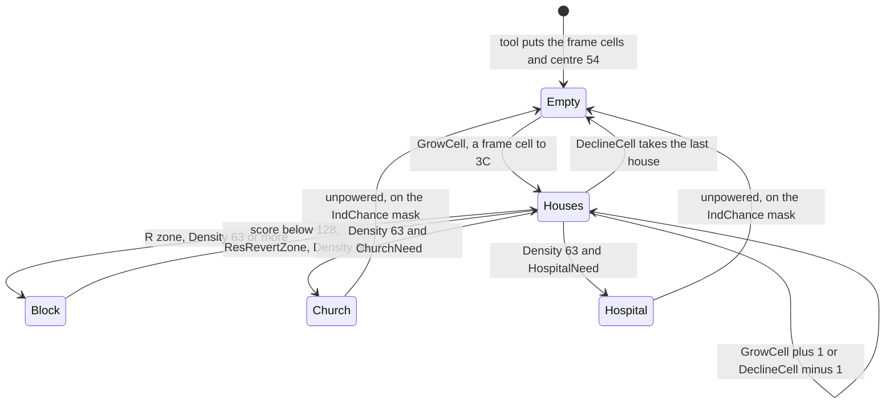

C and I zones never hold houses. Their centre stays `$52`/`$53` (empty) until the score gives a level; then the
whole 3 x 3 becomes a C or I building of that level, and level 0 puts the empty zone back:

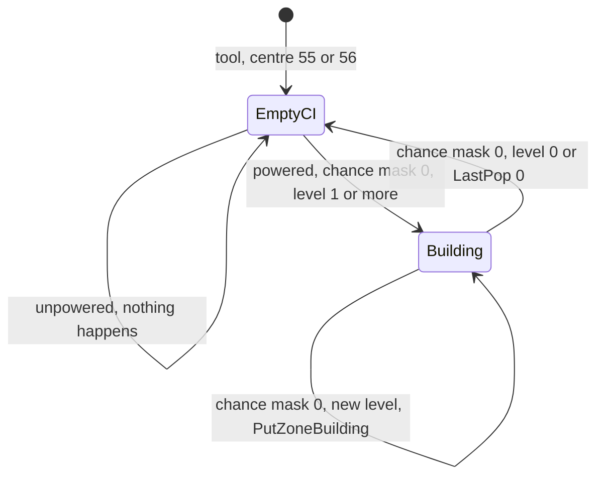

Worked example, the zone of the figure below (city recording, centre at row 45, column 32):

- Up to the sample of frame 9 000 the cell is land, water or coast. From 9 250 to 15 500 the centre is `$54`: the
  zone is laid but unpowered, and Density stays 0.
- The sample of frame 15 750 shows `$51`.
- From there the houses come one cell step at a time: Density 2 at frame 16 250, 5 at 18 000, 10 at 20 000, 18 at
  23 000, 25 at 27 000, 31 at 35 000.
- It then saws between 26 and 34 for the rest of the recording. The score, held down by the 7 % tax (56 points,
  [10.3](10-gameplay-logic.md#103-the-ring-the-land-value-and-the-zone-score)), sets ResTile near 30.

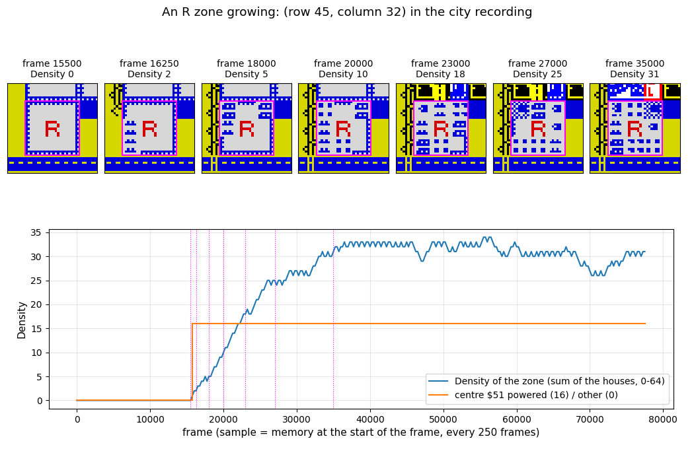

How to read the figure:

- Top: the zone (magenta square) and its neighbours at seven samples, drawn from the sampled map; under each frame
  number the Density computed from the nine bytes.
- Bottom: the Density of the zone in every sample (blue) and its centre (orange: 16 while `$51`, 0 otherwise).
- Command: `python3 tools/fig_sim.py zone --samples work/docs/scC/city-vars.jsonl --at 45,32 --out docs/img/sim/zone.png`
  (samples every 250 frames, `work/docs/scC/sample.py --frames 0-77500:250`).

The zone at work, one ResidentialStep:

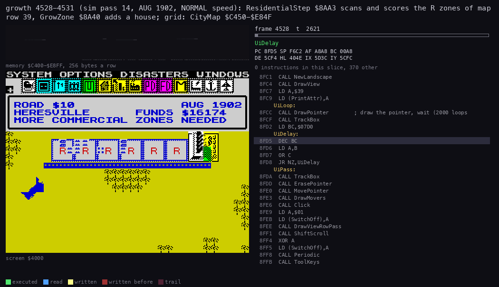

How to read the animation:

- `growth` frames 4528:0-4531:0 (pass 14, AUG 1902, NORMAL speed: the recording runs at NORMAL until pass 36), 80 pictures; the grid is `$C400-$E8FF`, the map.
- Coloured: the bytes ScanRing reads round the zone, then the frame cell GrowCell writes.
- The zone has Density 3, score 21, ResTile 10. Density is below ResTile, so it grows by one house.
- Command: `python3 ../../kit/routine_anim.py --work work/docs/scC/growth --window 4528:0-4531:0 --listing build/game.lst --range C400-E8FF --pc 7D2F-7F78,8A20-8B37,856A-8680 --out docs/img/routines/ResidentialStep.gif`.

**The point**: a zone stores nothing but its nine bytes. Density is recomputed every pass from the houses, so any
write to a house (a fire, a tornado, the bulldozer) changes the population at once. An R zone's whole life is eight
cells counting from `$3C` to `$43`.

## 7.4 The side arrays

InitSimulation `$83A1` clears `$A950-$C44F`, five arrays at coarser grids:

| Array | Address | Grid | Values | Written by | Read by |
| --- | --- | --- | --- | --- | --- |
| FireCover | `$A950` | 24 x 24 (map cell / 4) | 0-15 | StampFire (CoverStations, every 4th pass) | FireAt: a fire's chance to go out |
| PoliceCover | `$AB90` | 24 x 24 | 0-15 | StampPolice | PoliceAt: CrimeOf |
| Pollution | `$ADD0` | 48 x 48 (cell / 2) | 0-255 | StampPollution (plants, industry, seaport, radiation, traffic) | ZonePollution, AvgPollution |
| Traffic | `$B6D0` | 48 x 48 | 0-`$F0` | AddTripTraffic (a road trip) | ZoneTraffic: the land value gate |
| PowerMap | `$BFD0` | 96 x 96, 1 bit a cell, 12 bytes a row | 0/1 | PowerFlood every pass | ZonePower, BuildingPower |

The coverage arrays are cleared at each CoverStations and stamped again from the stations. Pollution and traffic are
not cleared but decay: DecayPollution takes 64 every second pass, DecayTraffic 24 or 34 each pass. The grid helpers
are Grid24 (row / 4 x 24 + column / 4) and Grid48 (row / 2 x 48 + column / 2).

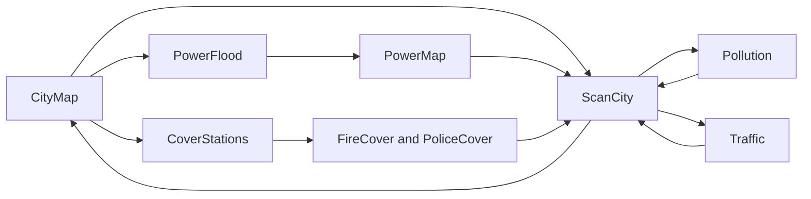

The stamps have no edge clipping. StampFire and StampPolice write a 5 x 5 kernel from Grid24 - 50 (two rows and two
columns up-left), so a station on map rows 0-7 writes up to 50 bytes before `FireCover`, into the sprite and save name
area (known only from the code; no recording builds a station there).

Worked example, `metro` end (frame 96 503), with two police and two fire stations, two nuclear plants and 12
industrial buildings:

- Each station's cover is a 5 x 5 diamond, 15 at the centre and 7 at the rim (strength 15 >> (k - 1),
  [10.7](10-gameplay-logic.md#107-pollution-the-stamps-and-the-coverage)).
- The pollution comes from the nuclear plants (`$30` a pass) and the industry (4 x IndLevel a pass, IndLevel up to
  8). The stamps add up between the decays, to near 200 on the industry rows.
- The traffic lies along the road rows the trips took, up to `$F0` a cell.

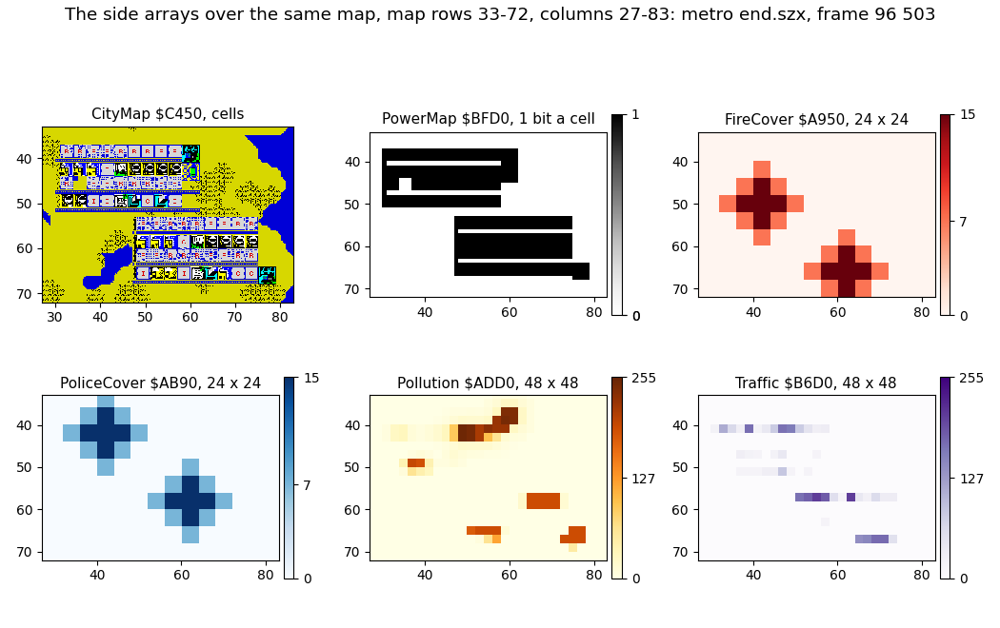

How to read the figure:

- Six panels over the same map area, map rows and columns on the axes: the map, the PowerMap bits, FireCover,
  PoliceCover, Pollution and Traffic. Each array is scaled to the 96 x 96 map (a 24 x 24 cell covers 4 x 4 map cells).
- Colour bars give the stored value.
- Command: `python3 tools/fig_sim.py arrays --state work/stage1/rec/metro/end.szx --label 'metro end.szx, frame 96 503' --out docs/img/sim/arrays.png`.

Witness: the samples of `growth` every 1 000 frames (`growth-arrays.jsonl`) show the same structure for the village:
a single fire and police diamond, and the coal plant's pollution square. Its inner 4 x 4 grid cells hold 255 (191 in
a sample taken just after a decay, as at frame 50 000). Its rim gains 31 a pass, 62 over the two passes between
decays, less than the decay's 64, so it cycles 0, 31, 62 and never builds up (62 at frames 48 000 and 51 000, 31 at
49 000). The kernel's corners add nothing and stay 0.

**The point**: the simulation sees the city through blurred copies. A station covers about 20 x 20 map cells, a
pollution or traffic cell is 2 x 2, and only power is exact to the cell.

## 7.5 The counters and the city variables

`ClearCounters $8480` zeroes the 61 bytes `$8443-$847F` at the start of every pass. ScanCity then counts into them:

| Address | Name | Counts (per pass) |
| --- | --- | --- |
| `$8443` | Population (24 bits) | 16 x Density over R zones and R blocks |
| `$8446`, `$8448`, `$844A` | ResPop, ComPop, IndPop | zones and zone buildings visited, each kind |
| `$844C`, `$844E` | PoliceCount, FireCount | powered stations |
| `$8450`-`$845C` | Church, Hospital, Nuclear, Coal, Stadium, Airport, Seaport counts | buildings |
| `$845E`, `$8460` | UnpoweredZones, PoweredZones | zones and buildings |
| `$8464` | TransportUpkeep | road 1, rail 4, road bridge +3, rail bridge +6 a cell |
| `$8462` | BuildingCount | cleared and copied to LastBuildings by Averages2, but never counted (always 0; the one `INC` is in the dead TripLeftover `$85C4`) |
| `$8466`, `$8468` | PoliceUpkeep, FireUpkeep | +100 per police / fire station: their upkeep |
| `$846A`, `$846C` | RoadCount, RailCount | cells |
| `$846E`-`$847C` | crime, land value, traffic, pollution sums and counts | for the averages |
| `$847E` | FireCells | `$45` cells |

They are only complete at the end of ScanCity. A sample taken mid-pass holds a partial count.

The variables that outlive a pass:

| Address | Name | Size | Meaning |
| --- | --- | --- | --- |
| `$8F97` | Funds | 3 | money; 20 000 / 10 000 / 5 000 at the start by Level |
| `$8F9A` | FundsSpare | 1 | saved with Funds, not used |
| `$8F9B` | Month | 1 | 0-11 |
| `$8F9C` | Year | 2 | from 1902 (`$076E`) |
| `$8E8A` | LastPop | 3 | Population at the last month end (MonthEnd) |
| `$8E90` | PopLastYear | 3 | Population at the last December: taxes, the category |
| `$8E8D` | PopYearBefore | 3 | the year before |
| `$827C`, `$827E`, `$8280` | ResDemand, ComDemand, IndDemand | 2 each | signed demand (DemandOf) |
| `$8265` | PopBalance | 2 | 4 (R - C - I) |
| `$91E4` | TaxRate | 1 | percent, 7 at the start |
| `$975F` | Category | 1 | 0 VILLAGE ... 5, written only by CategoryOf when the evaluation opens |
| `$9996` | Advice | 1 | the message index Advise `$99AD` or a disaster chose |
| `$84A2` | CityCentre | 2 | column, row: the centre the land value and the tornado use |
| `$835E` | SimPass | 1 | pass counter |
| `$835D` | SimPaused | 1 | skip zones and cells; only InitSimulation writes it, with 0, so the skip is dead |
| `$A518` | Level | 1 | 0 easy, 1 medium, 2 difficult |
| `$8F67-$8F6B` | GrowTries, IndChance, ComChance, SpeedSpare, MonthMask | 5 | SetSpeed copies the SpeedTable row each pass |

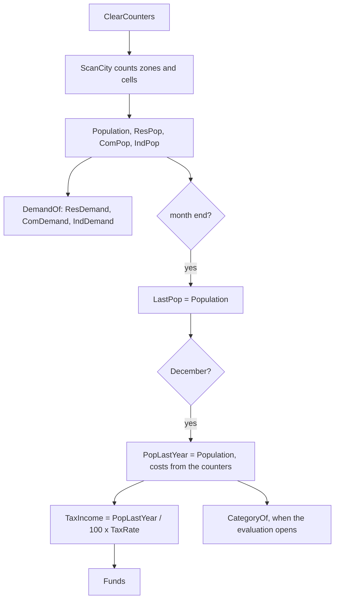

Worked example, the city recording at JAN 1906 (the sample of frame 25 250, the first after the year end):

- PopLastYear 4976, TaxRate 7, so TaxIncome = 49 x 7 = 343.
- The costs are 92 (transport) + 100 (police) + 100 (fire): the cash flow is +51.
- Funds go from 999 952 to 1 000 003.
- LastPop follows the population each month (5 000-6 100 from frame 30 000).
- Category is 0 up to the sample of frame 37 000 and 1 (TOWN) from frame 37 250: CategoryOf ran in between.

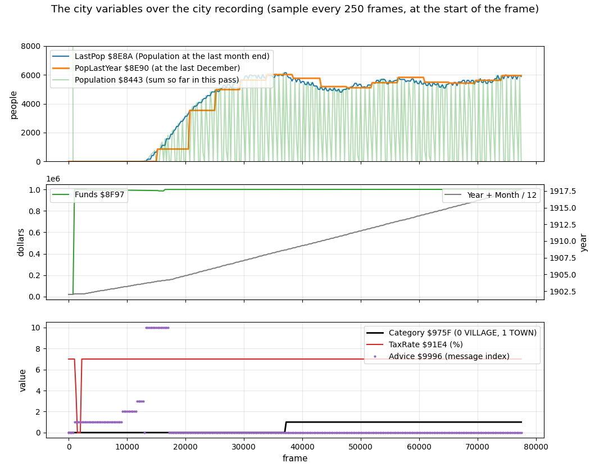

How to read the figure:

- Top: LastPop, PopLastYear and the partial Population of each sample (light green: it saws because the sum restarts
  every pass).
- Middle: Funds (999 999 written twice by the recording) and the date as Year + Month / 12.
- Bottom: Category, TaxRate and Advice. TaxRate is 4 and 0 in the samples of frames 1 250-2 000, while the bot
  edited the budget field, then 7 again.
- Command: `python3 tools/fig_sim.py course --samples work/docs/scC/city-vars.jsonl --out docs/img/sim/course.png`.

Counting mid-scan has a side effect. A C or I building that falls back to its empty zone puts the centre one row
below its top row, where the scan has not been yet, so the zone is counted again in the same pass. The city samples
show IndPop up to 12 (the sample of frame 29 000) with 8 industrial zones on the map.

**The point**: almost nothing about the city is stored; it is counted again every pass. What persists is money, the
date, the two population snapshots and the demand. The year-end snapshot PopLastYear decides taxes and the title.

## 7.6 The movers: train, plane, tornado

Three movers have fixed records, one of each at most. The UI task moves them on every 16th of its own passes:
Periodic `$901D` calls MoveDisasters (MovePlane, MoveTornado, MoveTrain) when PassCount AND `$0F` is 0 (L1 9 884
moves against 158 073 UI passes). So in this section a "move" is one such call, not a simulation pass. DrawMovers
draws them as 16 x 16 sprites ([doc 06](06-rendering.md)).

| Record | Address | Bytes |
| --- | --- | --- |
| Train | `$77D3-$77DB` | TrainCell (column, row), TrainSprite, TrainOut, TrainBack, TrainTurn, TrainDir, TrainTries, TrainSteps |
| Plane | `$7879-$787D` | PlaneOut, PlaneCell (column, row), PlaneTarget (column), PlaneTimer |
| Tornado | `$7995-$7997` | TornadoCell (column, row), TornadoOut |

**The train.** RailCell calls StartTrain `$785D` for every rail cell: with no train out, 1 in 64 starts one there.
MoveTrain `$77DC` picks a random first direction and tries four, never TrainBack (the way it came). A rail
neighbour (flags bit 1) takes it; TrainBack becomes the opposite direction and the sprite 3 or 4 by the axis. A move
with no way on adds 1 to TrainSteps; a good step does not clear it. On every fifth stuck move, counted since the last
reset and not necessarily in a row, TrainSteps goes back to 0 and TrainBack is set to 5, which matches no direction,
so the train may reverse. It vanishes
when its cell is no longer a rail. StartTrain begins with `LD A,(TransportCost+$0001)` and `CP $08`, whose flags the
`AND A` after the next load overwrites: a dead test.

```asm
MoveTrainTry:
  LD A,(TrainTurn)
  AND $03
  LD (TrainDir),A
  LD HL,TrainBack
  CP (HL)
  JR Z,MoveTrainNext         ; never straight back
  LD A,(TrainDir)
  CALL NeighbourAddr
  LD A,(HL)
  CALL CellFlagsOf
  AND $02                    ; rail?
  JR NZ,MoveTrainStep
MoveTrainNext:
  LD HL,TrainTurn
  INC (HL)
  LD HL,TrainTries
  DEC (HL)
  JR NZ,MoveTrainTry
  LD HL,TrainSteps           ; stuck: every 5th stuck move allows the way back
  LD A,(HL)
  INC A
  LD (HL),A
  CP $05
  RET NZ
  LD (HL),$00
  LD A,$05
  LD (TrainBack),A
  RET
```

**The plane.** AirportStep calls StartPlane `$78CA` each pass the airport is powered and reached by transport,
unless an attempted trip failed. With no plane out, 1 in 2 starts one: either at the airport's row, column `$60` (the
right edge), flying to the airport's column, or at the airport, flying to column 0. MovePlane `$787E` moves it one
column left per move until PlaneCell reaches PlaneTarget. The crash is not the plane's own. The AIR CRASH disaster
(AirCrash `$78FE`, only with an airport) sets PlaneTimer to 7-22. MovePlane counts it down only while a plane is out;
at 0 it ignites the 2 x 2 cells under the plane (CrashCell, Ignite) and plays CrashNoise. With no plane out the
timer waits for the next one.

**The tornado.** StartTornado `$796C` picks random cells in rows and columns 16-79 until one is land (`$02`).
MoveTornado `$7998` ends the tornado when Random gives 0 (1 in 256 per move), after that move's step. Otherwise, 1 in 8,
it steps one cell diagonally toward CityCentre, else one cell in a random direction. A step onto water is refused.
After each step it hits the cell one down and one right: a building burns to rubble whole (BurnBuilding), any other
flammable cell becomes rubble `$3A`.

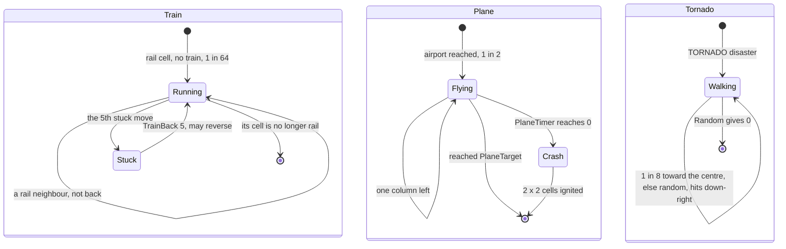

Worked example, `disasters` frames 8 800-9 800:

- TORNADO shows in the sample of frame 8 800 (Advice 26). TornadoOut is 1 and the tornado stands at column 73,
  row 40.
- It drifts to column 74, row 40 (frame 8 850), 73, 37 (9 000), 70, 34 (9 500) and 68, 35 (9 750).
- TornadoOut is 0 in the sample of frame 9 800. Rubble went from 51 to 56 cells in that stretch.
- The AIR CRASH of frame 6 600 does nothing: the city has no airport, LastAirports is 0, and Advice never shows
  message 25.

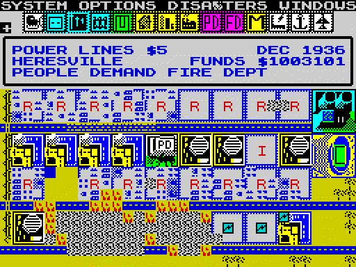

How to read the animation:

- `disasters` frames 8 780-11 000, one picture every 40 frames, the screen as unreal-ng shows it.
- The tornado sprite walks over the blocks; the cells under its lower right corner turn to rubble.
- Command: `python3 ../../kit/screen_anim.py --work work/docs/scC/dis --from 8780 --to 11000 --step 40 --delay 120 --hold 2500 docs/img/play/disasters-tornado.gif`.

**The point**: the movers are sprites with a few bytes of state. The train is decoration, the plane is harmless until
a disaster arms its timer, and the tornado is the one mover that writes the map.

## 7.7 The save format

SaveCity `$9E09` writes two blocks through the ROM's tape routine, both with flag `$FF`: the 31-byte header
`SaveHeader $A930` and the 9216-byte map. Before saving it copies 7 bytes from Funds (Funds 3, FundsSpare, Month,
Year 2) to `SaveFunds $A93C` and 12 bytes of the city name from `CityName $5F68` to `SaveCityName $A944`.

| Offset | Address | Size | Field |
| --- | --- | --- | --- |
| 0 | `$A930` | 12 | file name (typed, padded with spaces) |
| 12 | `$A93C` | 3 | Funds |
| 15 | `$A93F` | 1 | FundsSpare |
| 16 | `$A940` | 1 | Month |
| 17 | `$A941` | 2 | Year |
| 19 | `$A943` | 1 | spare |
| 20 | `$A944` | 11 | city name, the first 11 of its 12 letters |

```asm
SaveCity:
  CALL FileNameWindow
  LD BC,$100C
  LD (InputAt),BC
  LD HL,SaveHeader
  LD (InputBuffer),HL
  CALL InputName             ; the 12-letter file name into SaveHeader
  CALL WaitTapeStart
  LD HL,Funds
  LD DE,SaveFunds
  LD BC,$0007
  LDIR                       ; Funds, FundsSpare, Month, Year
  LD HL,CityName
  LD DE,SaveCityName
  LD BC,$000C
  LDIR                       ; 12 letters, to $A944-$A94F
  DI
  LD IX,SaveHeader
  LD DE,$001F                ; 31 bytes: $A930-$A94E
  LD A,$FF
  SCF
  CALL TapeSave
  LD B,$1E
  CALL TapePause
  LD IX,CityMap
  LD DE,$2400                ; 9216
  LD A,$FF
  SCF
  CALL TapeSave
```

LoadCity `$9E5A` reads headers until the name matches (a blank typed name takes the first), then the map. Only on a
good map does it copy Funds, the date and the name back; a bad map shows the error window and starts a new city.

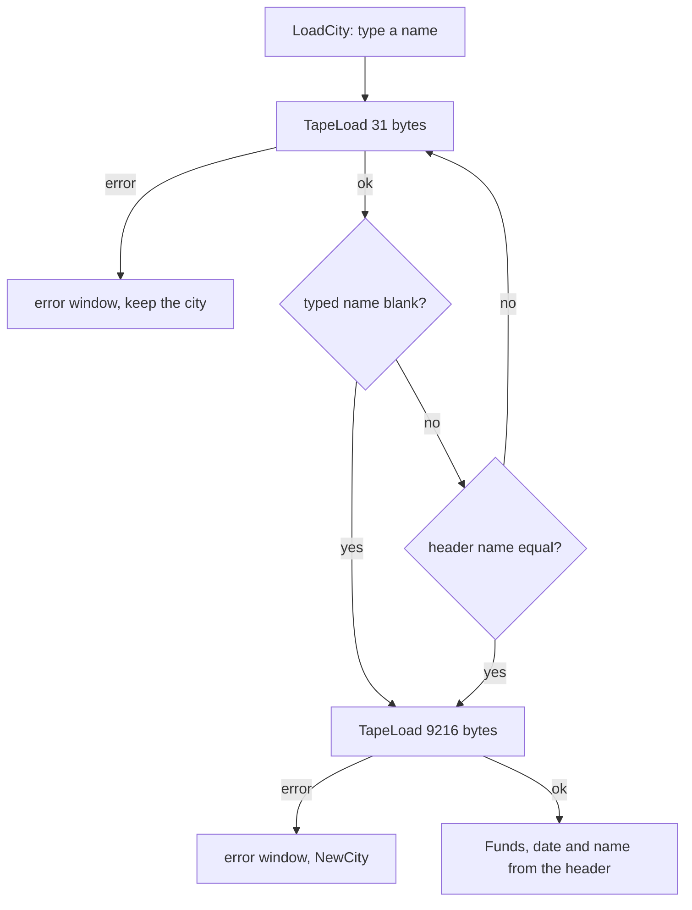

Nothing else is saved: not the tax rate, the options, the speed, the gene, the side arrays or PopLastYear. The
simulation rebuilds power, coverage and the counters within a pass. LoadCity does not touch PopLastYear, PopYearBefore or LastPop.
LastPop keeps the old city's value until the next month end; PopLastYear and PopYearBefore until the next December.
In between, the evaluation's category and migration use the old city's figures, and so does NoGrowthAlone (LastPop).
The taxes do not: MonthEnd copies Population to PopLastYear in December before TaxIncomeOf runs (known only from the
code; no recording loads over a running city).

The name has a quirk of its own. SaveCity copies 12 letters to `$A944-$A94F` but saves only the 31 bytes up to
`$A94E`; LoadCity copies 12 bytes back from `$A944`. So the twelfth letter of the loaded name is whatever SaveSpare
`$A94F` holds in RAM at the time (the last SaveCity's twelfth letter), not anything from the tape.

Worked example, `work/stage1/rec/menus/town.tap`:

- The header is `TOWN` and eight spaces, Funds `$F5 $37 $00` = 14 325, FundsSpare 0, Month `$0A` (NOV), Year
  `$076F` = 1903, spare 0, `HERESVILLE ` (11 letters).
- The map block is 9216 bytes with 3 building top rows.

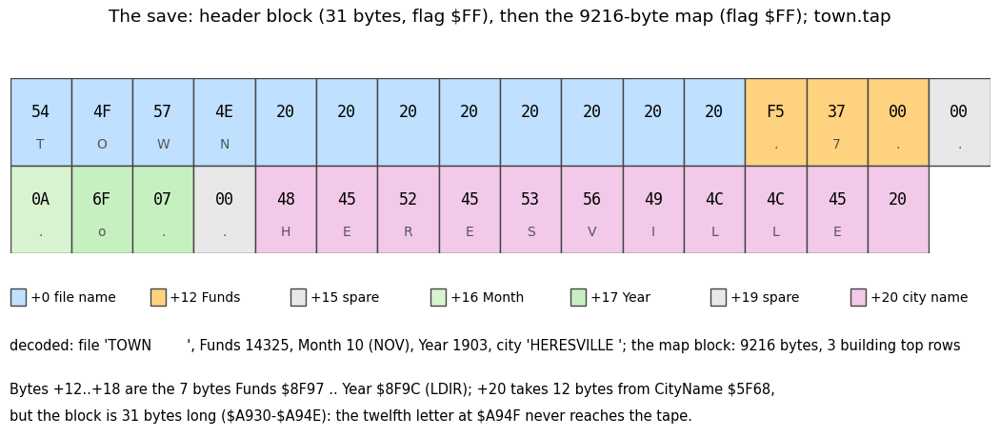

How to read the figure:

- The 31 header bytes in two rows of 16, coloured by field (legend under them), each with its hex value and its
  character.
- Under it the decoded fields and the map block's size.
- Command: `python3 tools/fig_sim.py save --tap work/stage1/rec/menus/town.tap --out docs/img/sim/save.png`.

Witness: the `menus` recording saved this file in frames 20 866-20 896 and loaded it back in frames 23 647-26 017
([the saving screen](img/play/menus-020896-saving.png), [loaded](img/play/menus-026017-loaded.png)).

**The point**: a saved city is its map plus money and date. Everything the simulation can recount is left out, and
so are the tax rate and the year-end population, which it cannot.

## 7.8 Random

`Random $5CC6` is the only random source. It keeps a 16-bit seed in `RandomSeed $5CC4` and returns the new seed's low
byte in A:

```asm
Random:
  PUSH HL
  PUSH DE
  PUSH BC
  LD DE,(RandomSeed)
  LD H,E
  LD L,$FD                   ; HL = 256 x low + 253
  LD A,D
  OR A
  LD B,$00
  SBC HL,DE
  SBC A,B
  SBC HL,DE
  SBC A,B                    ; A:HL = 256 x seed + 253 - 2 x seed
  LD E,A
  LD D,B
  SBC HL,DE                  ; fold the top byte: mod 65537
  JR NC,RandomStore
  INC HL
RandomStore:
  LD (RandomSeed),HL
  LD A,H                     ; overwritten at once
  LD A,(RandomSeed)
  POP BC
  POP DE
  POP HL
  RET
```

In arithmetic: seed' = (254 (seed + 1) - 1) mod 65537. With y = seed + 1 it is y' = 254 y mod 65537, a
multiplicative generator modulo the prime 65537. 254 is a primitive root, so all 65 536 seeds lie on one cycle.
`tools/landscape.py` reimplements it step for step; the figure's check compares both forms over every 97th seed.

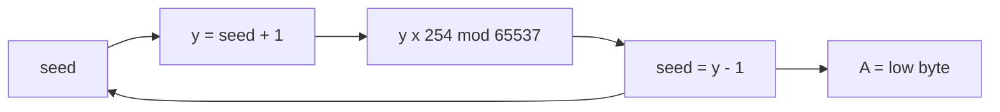

The callers use masks on A: AND 7 (1 in 8), AND `$3F` (1 in 64), AND `$7F` (1 in 128). Two callers test the seed
itself instead: RandomDisaster (seed AND `$07FF` = 0, a gate of 1 in 2048 that hides a fixed outcome, below) and
RadiationCell (seed AND `$0FFF` = 0, 1 in 4096).
Random runs in both tasks. The UI task calls it for NewLandscape (640 calls for gene 3), RandomDisaster, StartFires
(9 216 calls, one per map byte), the tornado's and the train's moves, and ParkTool; the simulation for everything
else. So the sequence each sees depends on where the task switches fall.

RandomDisaster's 1 in 2048 gate is not what it seems. It tests the seed right after a Random call, and the only
seeds with `seed AND $07FF` = 0 are the 32 multiples of `$0800`. From each of them the next Random is fixed: `$0000`
gives A AND 7 = 5 (TORNADO); 15 of the others give 7 (nothing); the 16 that give 6 (MELTDOWN) then fail its extra 1
in 8. So a random disaster is always a tornado, and only after the seed `$0000`: about 1 try in 65 536, one try every
16 UI passes. A task switch between its Random calls could change the draw. Known only from the code, with the generator's
formula run over all 32 seeds.

Worked example: gene 3 seeds Random with 3 for NewLandscape. 640 calls later the map is exactly the one in the
`growth` samples of frames 800 and 1 100: 0 cells differ ([10.11](10-gameplay-logic.md#1011-the-city-generator)).

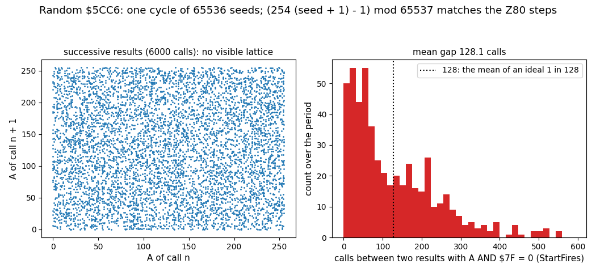

How to read the figure:

- Left: 6 000 successive results as pairs (A of call n, A of call n + 1). The points fill the square evenly.
- Right: over the whole cycle, the gaps between results with A AND `$7F` = 0 (the 1 in 128 of StartFires). The mean
  is 128.1, as an ideal 1 in 128 would give.
- Command: `python3 tools/fig_sim.py random --out docs/img/sim/random.png`.

**The point**: a sound little generator for its size, with the full period of 65 536. The randomness a player sees
comes as much from the task switch timing as from the generator.

## 7.9 Known only from the code

- No code writes `$57` or `$58` to the map; both codes have tiles and road-bridge flags but no placer.
- The coverage stamps have no edge clipping: a police or fire station on map rows 0-7 writes before FireCover.
- After a load, LastPop is the old city's until the next month end, PopLastYear until the next December; the taxes
  are not affected, because December refreshes PopLastYear before TaxIncomeOf.
- The save copies 12 letters of the city name, but the header is 31 bytes: the twelfth letter never reaches the tape,
  and LoadCity takes it from SaveSpare `$A94F` in RAM.
- BuildingCount `$8462` is never counted; SimPaused is never set.
- A random disaster is always a tornado, after the seed `$0000` only (about 1 in 65 536 tries).
- StartTrain's `CP $08` on TransportCost is dead.
- On every fifth stuck move (not necessarily in a row) the train's TrainBack becomes 5 and it may reverse.
- AIR CRASH arms PlaneTimer even when no plane is out; the crash comes 7-22 moves into the next flight.
- A church or hospital reverts to an empty R zone only when unpowered, on the IndChance mask.
- The double count of a C or I zone that falls back mid-scan comes from the code and the samples (IndPop above the
  zone count); no trace shows the moment.
