# 8. HUD and text

What this covers:

- the top third of the screen: the menu bar, the tool palette and the status box, every field with its address,
  format and update routine (8.1);
- the print path: the ROM font made bold by PrintGlyph `$F754`, ScreenAddr and PutAttr (8.2);
- PrintInline `$5DEF`, the inline text with its control codes (8.3), and DrawBox, the window frames (8.4);
- the number printers, 3 to 7 digits, signed, with leading zeros turned into trailing spaces (8.5);
- the text table GameTexts, FindText and PrintPadded (8.6);
- the status panel redrawn, and the palette's greyed icons (8.7); the advice line and the messages (8.8);
- the menu and dialog engine: the description format, DrawMenu, RunMenu and the highlight, and every menu and dialog
  (8.9);
- the budget window and its live recompute (8.10), the evaluation window (8.11);
- the line editor and the city name entry (8.12);
- the data sheet of every text (8.13), and what no recording reached (8.14).

The names are those of `src/game/game.ann` ([Terms](README.md#terms)). The recordings it rests on, all on the 48K,
each opened from its stage-1 TTD session (`work/stage1/rec/NAME/session.ttd`) on the writer's own instance (port base
37080, muted):

- `menus` (from the level menu, 30 136 frames): the ABOUT box at frames 13816-13854, each OPTIONS toggle, the speeds,
  the DISASTERS and WINDOWS menus, the budget window at 19866-20102 (the tax rate field edited), the evaluation at
  20285-20323, save and load, USE OLD LANDSCAPE, ARE YOU SURE.
- `tools` (from the level menu, 19 867 frames): every tool, so every tool name and price in the status box; the
  screenshot of frame 6332 is the HUD figure.
- `levels` (from the level menu, 2319 frames): INPUT NEW CITY NAME at frame 1211, METRO typed over HERESVILLE at
  frames 1249-1359.

The screenshots are the recordings' own (`work/stage1/rec/NAME/screens`). The figures of the image's data are drawn
from `work/mkgame/original.bin` and the 48K ROM by `tools/fig_text.py`. A moment is "frame F T t": an access trace puts
an instruction in the frame in which it ran, t counted from that frame's start; a memory sample of frame F is the
state at the frame's start.

```bash
. work/env.sh
python3 ../../kit/rs.py open --work work/docs/scD/menus --ttd work/stage1/rec/menus/session.ttd --model 48K --port-base 37080
python3 work/docs/scD/probe.py --work work/docs/scD/menus --window 20100:0-20201:0   # which print routine ran when
python3 ../../kit/rs.py stop --work work/docs/scD/menus
python3 tools/fig_text.py all          # docs/img/text/*.png
```

## 8.1 The top third

The game keeps the top third of the screen (character rows 0-7) for its controls and status. The view of the city
fills rows 8-23 ([06](06-rendering.md)), and every menu and dialog opens over the view (8.9). The top third has three
parts:

- **row 0, the menu bar**: SYSTEM OPTIONS DISASTERS WINDOWS, white on black (attribute `$07`). A click on row 0 opens
  the menu under the pointer's column (OpenMenuAt `$640E`, [05](05-controls.md)).
- **rows 1-2, the tool palette**: 14 icons of 2 x 2 tiles at columns 2-29. The current tool is inverted. The tools the
  funds cannot pay are greyed. Row 2, column 0 holds the "+" of the scroll corner.
- **rows 3-7, the status box**: black on white (`$38`), the text blue on white (`$39`): the tool's name and price and
  the date on row 4, the city name and the funds on row 5, the advice on row 6.

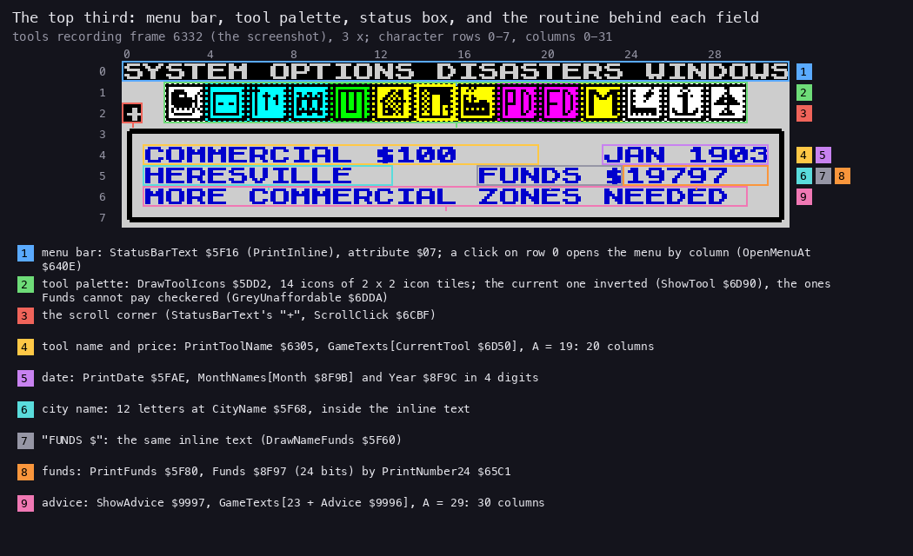

*Drawn by `python3 tools/fig_text.py hud` from the `tools` recording's screenshot of frame 6332, at 3 x, with the
character grid.*

How to read the figure:

- **The numbered boxes** mark each field on its character cells; the list below names the routine and the variable
  behind it.
- **The grid** gives character rows 0-7 and columns 0-31: the addresses in the table below are counted the same way.
- **The point**: every field is a fixed place on the grid, printed by its own routine from one variable. Nothing in
  the top third scrolls or moves.

| Field | Row, column | Width | Variable | Format | Printed by | When |
| --- | --- | --- | --- | --- | --- | --- |
| menu bar | 0, 0 | 32 | StatusBarText `$5F16` | inline text | DrawStatusPanel `$5F13` | after each full-screen window |
| tool palette | 1-2, 2 | 28 | CurrentTool `$6D50`, Funds | 14 icons | DrawToolIcons `$5DD2`, ShowTool `$6D90`, GreyUnaffordable `$6DDA` | a tool change; Funds changed (FundsChanged) |
| tool name | 4, 1 | 20 | GameTexts[CurrentTool] | text, padded | PrintToolName `$6305` | a tool change |
| date | 4, 23 | 8 | Month `$8F9B`, Year `$8F9C` | 3 letters, 4 digits | PrintDate `$5FAE` | pass 1 of every 16 |
| city name | 5, 1 | 12 | CityName `$5F68` | 12 letters inside the inline text | DrawNameFunds `$5F60` | after a window; the name entry |
| `FUNDS $` | 5, 17 | 7 | the same inline text | text | DrawNameFunds | the same |
| funds | 5, 24 | 7 | Funds `$8F97` | 24 bits signed, up to 7 digits | PrintFunds `$5F80` | pass 0 of every 16 |
| advice | 6, 1 | 30 | GameTexts[23 + Advice `$9996`] | text, padded | ShowAdvice `$9997` | every 32 passes |

The fields are refreshed by Periodic in the UI task ([04](04-game-loop.md)). It reads PassCount `$8F9F` and runs one
piece of work per pass:

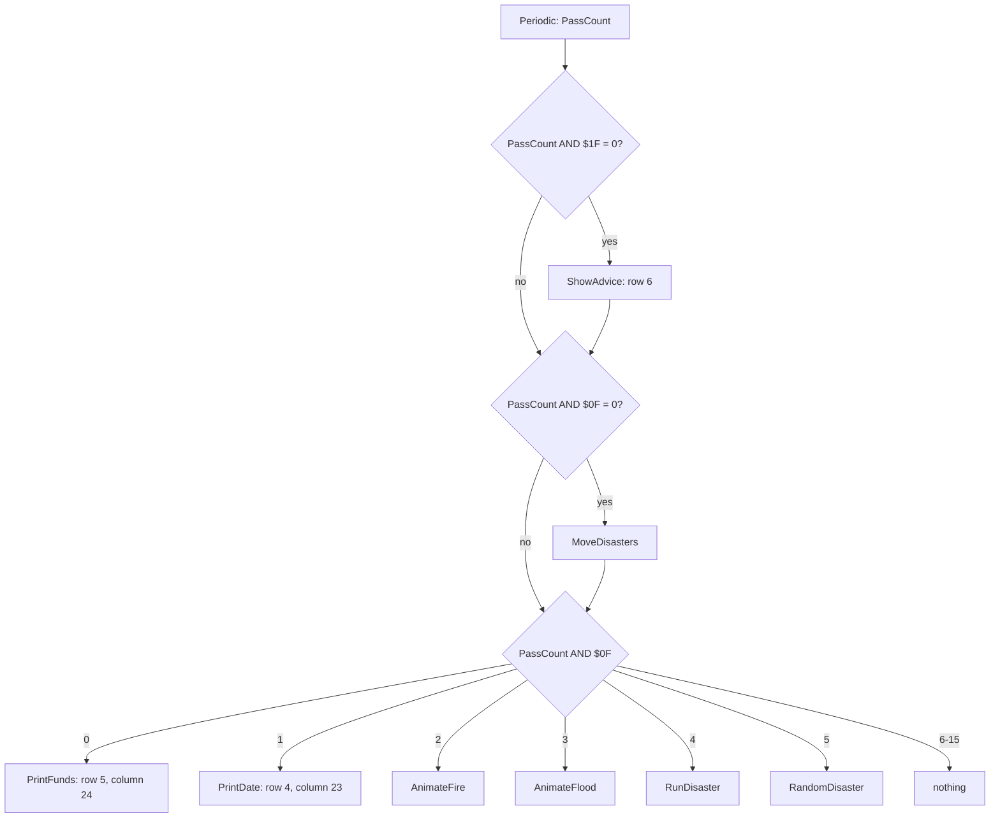

The point: the money and the date are not printed when they change but on a fixed beat, once every 16 passes. A
purchase shows in the funds at the next pass 0; the palette, which depends on the money too, is redrawn at once by
FundsChanged.

## 8.2 The font and PrintGlyph

The game has no font of its own. PrintGlyph `$F754` prints character A from the ROM's font at `$3C00 + 8 x code`. It
makes each line bold on the way: each byte is ORed with itself shifted one pixel right, so every vertical stroke is two
pixels wide. It writes the 8 lines down the character cell at PrintAddr `$F74F`, then the cell's attribute from
PrintAttr `$F753`, unless PrintAttr is `$FF`.

ScreenAddr `$5BFE` turns a character row and column into the display address, and PutAttr `$F774` turns the last pixel
line's address into the attribute address. Neither uses a table.

```text
PrintGlyph(code):
    glyph = $3C00 + 8 * code                 ; the ROM font
    p = PrintAddr
    for line in 0..7:
        b = rom[glyph + line]
        screen[p] = b | (b >> 1)               ; bold
        p += 256                               ; the next pixel line of the cell
    if PrintAttr != $FF:
        attributes[cell of p] = PrintAttr      ; PutAttr

ScreenAddr(row, col):  high = $40 | (row & $18);  low = ((row & 7) << 5) | col
PutAttr(p):            high = $58 | ((p.high - 1) >> 3 & 3); low = p.low
```

```text
F754  6F            LD L,A               ; PrintGlyph
F755  26 00         LD H,$00
F757  29            ADD HL,HL            ; code x 8
F758  29            ADD HL,HL
F759  29            ADD HL,HL
F75A  01 00 3C      LD BC,RomFont
F75D  09            ADD HL,BC
F75E  EB            EX DE,HL
F75F  2A 4F F7      LD HL,(PrintAddr)
F762  06 08         LD B,$08
F764  1A            LD A,(DE)            ; PrintGlyphLine
F765  4F            LD C,A
F766  CB 39         SRL C                ; the line shifted right
F768  B1            OR C                 ; ORed in: bold
F769  77            LD (HL),A
F76A  13            INC DE
F76B  24            INC H                ; next pixel line
F76C  10 F6         DJNZ PrintGlyphLine
F76E  3A 53 F7      LD A,(PrintAttr)     ; PrintGlyphAttr
F771  FE FF         CP $FF               ; $FF: keep the attribute
F773  C8            RET Z
F774  4F            LD C,A               ; PutAttr
F775  25            DEC H                ; back to the cell's last line
F776  7C            LD A,H
F777  0F            RRCA
F778  0F            RRCA
F779  0F            RRCA
F77A  E6 03         AND $03              ; the third
F77C  F6 58         OR $58
F77E  67            LD H,A
F77F  71            LD (HL),C
F780  C9            RET
5BFE  78            LD A,B               ; ScreenAddr: B row, C column
5BFF  E6 18         AND $18              ; the third
5C01  F6 40         OR $40
5C03  67            LD H,A
5C04  78            LD A,B
5C05  E6 07         AND $07              ; the row in the third
5C07  0F            RRCA
5C08  0F            RRCA
5C09  0F            RRCA
5C0A  B1            OR C
5C0B  6F            LD L,A
5C0C  C9            RET
```

The routines have no branch but the attribute test, so no diagram: PrintGlyph is the eight-line loop above.

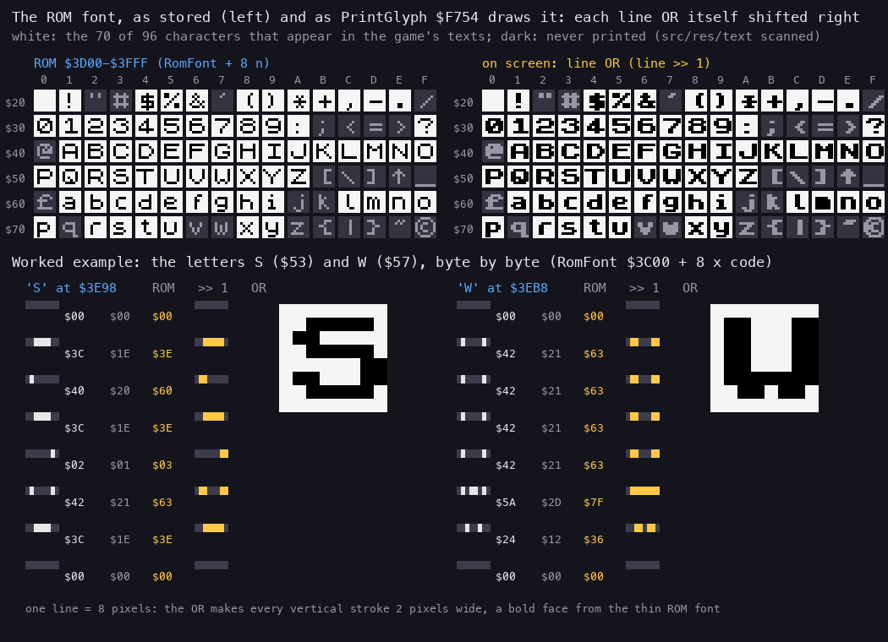

*Drawn by `python3 tools/fig_text.py font` from the 48K ROM (`$3D00-$3FFF`); the used characters from a scan of
`src/res/text`.*

How to read the figure:

- **Top left**: the 96 characters `$20-$7F` as the ROM stores them. **Top right**: as PrintGlyph draws them.
- **White cells** are the 70 characters that appear in the game's texts; **dark cells** are never printed.
- **Bottom**: S and W line by line: the ROM byte, the byte shifted right, and their OR.
- **The point**: the bold face costs one `SRL` and one `OR` a line, and saves the 768 bytes of a font of its own.

Worked example: S is code `$53`, so its glyph is at `$3C00 + 8 x $53 = $3E98`. Its second line `$3C` (`00111100`)
ORed with `$1E` gives `$3E` (`00111110`); its third line `$40` gives `$60`. The S of "SYSTEM" at row 0, column 0 goes
to ScreenAddr(0, 0) = `$4000`. For the funds at row 5, column 24: H = (5 AND `$18`) OR `$40` = `$40`, L = (5 AND 7) x
32 OR 24 = `$B8`: `$40B8`. After eight lines H is `$48`. PutAttr takes `$47`, rotates it three times right to `$E8`,
keeps `$00` and ORs `$58`: the attribute at `$58B8` = `$5800` + 5 x 32 + 24.

Witness: L1 counts 496 214 calls of PrintGlyph and 451 620 of ScreenAddr over the stage-1 recordings (`game.ann`). In
the code-vs-screen figure of 8.7, PrintGlyphLine writes 696 bytes (its `LD (HL),A` at `$F769`) of the status panel in `menus` frames
20111-20117.

Cost: 92 T to find the glyph, 53 T a line (419 for eight), 84 T for the attribute: about 600 T a character, 700 with
NextColumn `$5E12` (69 T and the call). A full advice line of 30 characters is some 21 000 T, a third of a frame.

The point: one routine prints every letter of the game, in one face, always with an attribute. The text and its colour
travel together.

## 8.3 PrintInline: the inline text

Every fixed text, frame and window border is written as a string of codes right after a `CALL PrintInline`.
PrintInline `$5DEF` pops its return address, so HL points at the codes. It prints them one by one and ends with
`JP (HL)` to the byte after the end code, so the caller goes on after its text. Five bytes are codes; any other byte is a
character.

| Code | Bytes | Meaning | Witness |
| --- | --- | --- | --- |
| `$FF` R C | 3 | print at row R, column C (ScreenAddr into PrintAddr) | CityNameAt `$5F63` |
| `$FB` A | 2 | PrintAttr = A | StatusBoxText `$5F43` |
| `$FD` R C W H | 5 | a frame of W x H characters at row R, column C (DrawBox, 8.4) | StatusBoxText, WindowAreaText `$673E` |
| `$FC` N | 2 | N in 3 digits (Print3Digits) | no text uses it |
| `$FE` | 1 | the end: return after it | every text |
| any other | 1 | a character (PrintGlyph, then one column on) | |

```text
PrintInline:                                   ; called as CALL PrintInline, then the codes
    p = return address
    loop:
        c = mem[p]
        if c == $FE: jump to p + 1             ; the caller resumes after its text
        if c == $FB: PrintAttr = mem[p + 1]; p += 2
        elif c == $FF: PrintAddr = ScreenAddr(mem[p + 1], mem[p + 2]); p += 3
        elif c == $FD: DrawBox(mem[p + 1 .. p + 4]); p += 5
        elif c == $FC: Print3Digits(mem[p + 1]); p += 2
        else: PrintGlyph(c); NextColumn(); p += 1
```

```text
5DEF  E1            POP HL               ; PrintInline: HL = the codes
5DF0  7E            LD A,(HL)            ; PrintInlineNext
5DF1  FE FE         CP $FE
5DF3  CA 78 5E      JP Z,PrintInlineEnd
5DF6  FE FB         CP $FB
5DF8  28 24         JR Z,PrintInlineAttr
5DFA  FE FF         CP $FF
5DFC  28 7C         JR Z,PrintInlineAt
5DFE  FE FD         CP $FD
5E00  CA 88 5E      JP Z,PrintInlineBox
5E03  FE FC         CP $FC
5E05  28 1E         JR Z,PrintInlineNumber
5E07  E5            PUSH HL              ; a character
5E08  CD EB 5D      CALL PrintChar
5E0B  CD 12 5E      CALL NextColumn
5E0E  E1            POP HL
5E0F  23            INC HL               ; PrintInlineSkip
5E10  18 DE         JR PrintInlineNext
...
5E78  23            INC HL               ; PrintInlineEnd
5E79  E9            JP (HL)              ; back to the caller, after the codes
5E7A  23            INC HL               ; PrintInlineAt: $FF row column
5E7B  46            LD B,(HL)
5E7C  23            INC HL
5E7D  4E            LD C,(HL)
5E7E  E5            PUSH HL
5E7F  CD FE 5B      CALL ScreenAddr
5E82  22 4F F7      LD (PrintAddr),HL
5E85  E1            POP HL
5E86  18 87         JR PrintInlineSkip
```

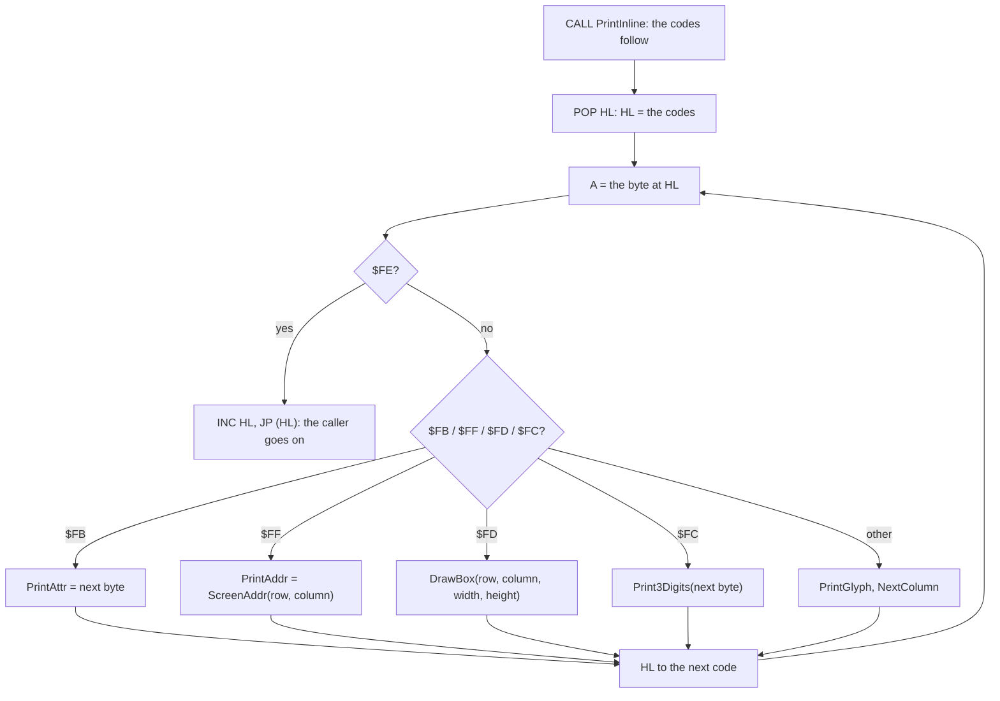

Worked example: the status box, DrawStatusBox `$5F40`. Its ten bytes after the `CALL` are
`FB 38 FD 03 00 20 05 FB 39 FE`. `$FB $38` sets black on white. `$FD 03 00 20 05` draws a frame of 32 x 5 characters at row 3, column 0 (8.4).
`$FB $39` sets blue on white for the text that follows. `$FE` returns to `$5F4D`, the `CALL DrawNameFunds`. The next
inline text, DrawNameFunds `$5F60`, is `FB 39 FF 05 01`, then the twelve letters of CityName, then `FF 05 11` and
`FUNDS $`, then `$FE`. Its letters are printed at row 5, column 1, and `FUNDS $` at row 5, column 17.

Witness: L1 counts 371 calls of PrintInline (`game.ann`). The ABOUT box below (8.9) is drawn by DrawMenu, which uses
PrintInline for its frame (`WindowAreaText`, `$FB $44 $FD $08 $00 $20 $10 $FE`).

The point: a text and its code share the address space. The caller does not pass a pointer; the return address is
the pointer. The city name lives inside such a text, so typing a name rewrites the text itself (8.12).

## 8.4 Window frames: DrawBox

DrawBox `$5E97` draws a frame of W x H characters from eight icon tiles: `$38 $39 $3A` on the top row, `$3F` and `$3B`
on the sides, `$3E $3D $3C` on the bottom row. It leaves the inside alone. DrawBoxRow `$5ED3` draws one row: a left
tile, W - 2 middle tiles and a right tile, then moves down one row. The menus use it for their separators too, with the
tiles `$40 $41 $42`.

DrawBoxRow takes its three tiles as operands it writes into its own code: `LD A,n` at `$5EE8` (left), `$5EF8` (middle)
and `$5F06` (right). A middle tile `$20` is skipped by the `CP $20` after it: that is how the sides leave the inside
untouched. DrawBox writes one more operand: the box's left column, into the `LD (HL),n` at `$5F0E` that resets
PrintCol after each row. The tiles take the current PrintAttr (DrawIconHere `$5C57` jumps to PrintGlyphAttr), not their
own entry of IconAttrs, so a frame has the window's colour.

```text
DrawBox(row, col, width, height):
    PrintCol, PrintRow = col, row; BoxDims = width, height
    DrawBoxRow($38, $39, $3A)                 ; top
    repeat height - 2: DrawBoxRow($3F, $20, $3B)   ; sides, the inside skipped
    DrawBoxRow($3E, $3D, $3C)                 ; bottom

DrawBoxRow(left, middle, right):
    patch the three LD A,n operands
    tile(left)
    repeat width - 2: step one column; if middle != $20: tile(middle)
    step one column; tile(right)
    PrintCol = the box's column; PrintRow += 1
```

```text
5E97  46            LD B,(HL)            ; DrawBox: row
5E98  23            INC HL
5E99  4E            LD C,(HL)            ; column
5E9A  23            INC HL
5E9B  5E            LD E,(HL)            ; width
5E9C  23            INC HL
5E9D  56            LD D,(HL)            ; height
5E9E  ED 43 51 F7   LD (PrintCol),BC
5EA2  ED 53 95 5E   LD (BoxDims),DE
5EA6  3A 51 F7      LD A,(PrintCol)
5EA9  32 0F 5F      LD (BoxRowRight+$0009),A  ; the column to return to
5EAC  3E 38         LD A,$38             ; the top row's tiles
5EAE  06 39         LD B,$39
5EB0  0E 3A         LD C,$3A
5EB2  CD D3 5E      CALL DrawBoxRow
...
5ED3  32 E9 5E      LD (BoxRowLeft+$0001),A   ; DrawBoxRow: patch the three tiles
5ED6  78            LD A,B
5ED7  32 F9 5E      LD (BoxRowFill+$0001),A
5EDA  79            LD A,C
5EDB  32 07 5F      LD (BoxRowRight+$0001),A
...
5EF8  3E 20         LD A,$20             ; BoxRowFill: LD A,middle
5EFA  FE 20         CP $20               ; $20: the inside, skipped
5EFC  C4 57 5C      CALL NZ,DrawIconHere
...
5F0B  21 51 F7      LD HL,PrintCol
5F0E  36 00         LD (HL),$00          ; the box's column, patched by DrawBox
5F10  23            INC HL
5F11  34            INC (HL)             ; PrintRow + 1
5F12  C9            RET
```

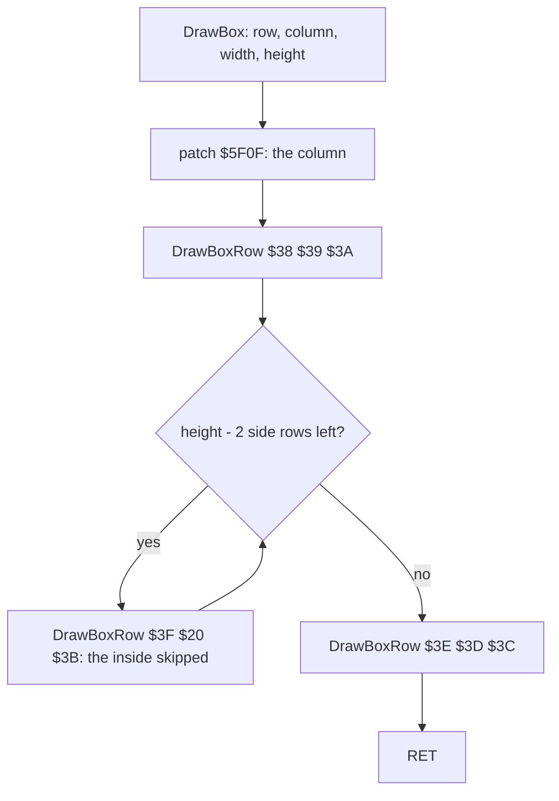

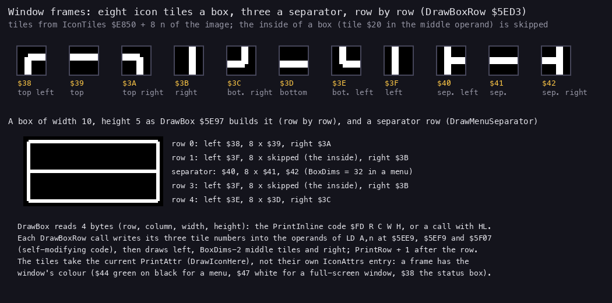

*Drawn by `python3 tools/fig_text.py frames` from IconTiles `$E850` of the image (tiles `$38-$42`).*

How to read the figure:

- **Top**: the eleven tiles, each with its number and its place in a frame.
- **Middle**: a box of 10 x 5 with a separator row, built as DrawBox and DrawMenuSeparator would, row by row.
- **The point**: eleven 8-byte tiles draw every window of the game, at any size. The inside is never touched, so a
  frame can be drawn over text already printed.

Worked example: the status box, `$FD 03 00 20 05`. Row 3 gets `$38`, 30 x `$39`, `$3A` at columns 0-31. Rows 4-6 get
`$3F` at column 0 and `$3B` at column 31; their 30 inside cells are skipped. Row 7 gets `$3E`, 30 x `$3D`, `$3C`. That
is 2 x 32 + 3 x 2 = 70 tiles of 8 bytes, with PrintAttr `$38`.

Witness: in the code-vs-screen figure of 8.7 the frame of the status box is written by DrawIconHereLoop (560
bytes, its `LD (HL),A` at `$5C68`, `menus` frames 20111-20117).

The point: DrawBoxRow is self-modifying: its three tile numbers and DrawBox's column are operands, not variables. The
authors saved the registers the loop would otherwise need.

## 8.5 The number printers

Every money and population figure is printed by PrintNumber24 `$65C1`. It takes a signed 24-bit number in C, H, L. A
negative number gets a minus sign and is negated. Then it counts how many times each power of ten from 1 000 000 down
to 10 goes into the number (Digit24 `$664F`, a loop of 24-bit additions of the negative power). Leading zeros are not
printed but counted, and as many spaces are printed after the last digit. So a figure is left-aligned, and a shorter
number wipes out the tail of a longer one printed there before.

PrintNumberVar `$65B3` prints the 24-bit number at an address at row B, column C. PrintNumberHL prints a 16-bit one.
NumberEnd `$65A3` keeps PrintAddr after the last digit, before the spaces. The smaller printers Print5Digits `$5E41`,
Print4Digits `$5E47` and Print3Digits `$5E4D` print fixed widths with the leading zeros: the gene, the year, the
percentages and the menu fields.

```text
PrintNumber24(value):                          ; C:H:L, signed
    if value < 0: print '-'; value = -value
    lead = 0; started = false
    for power in 1 000 000, 100 000, 10 000, 1000, 100, 10:
        d = 0; while value >= power: value -= power; d += 1
        if d == 0 and not started: lead += 1    ; a leading zero: left out
        else: started = true; print '0' + d
    print '0' + value                           ; the units, always
    NumberEnd = PrintAddr
    print lead spaces                           ; the field keeps its width
```

```text
65C1  AF            XOR A                ; PrintNumber24
65C2  32 4D 66      LD (NumberFlags),A    ; no digit yet
65C5  32 4E 66      LD (NumberFlags+$0001),A  ; leading zeros counted
65C8  CD 2C 66      CALL PrintSign
...
65D0  06 F0         LD B,$F0             ; B:DE = $F0BDC0 = -1 000 000
65D2  11 C0 BD      LD DE,Traffic+$06F0  ; $BDC0, mkgame's label for the constant
65D5  D9            EXX
65D6  CD 4F 66      CALL Digit24
...
660F  45            LD B,L
6610  CD 6F 66      CALL PrintDigitB     ; the units
6613  2A 4F F7      LD HL,(PrintAddr)
6616  22 A3 65      LD (NumberEnd),HL
6619  3A 4E 66      LD A,(NumberFlags+$0001)
661C  A7            AND A
661D  C8            RET Z
661E  47            LD B,A
661F  C5            PUSH BC              ; PrintNumberPad: a space a leading zero
6620  3E 20         LD A,$20
6622  CD 54 F7      CALL PrintGlyph
6625  CD 12 5E      CALL NextColumn
6628  C1            POP BC
6629  10 F4         DJNZ PrintNumberPad
662B  C9            RET
664F  06 00         LD B,$00             ; Digit24
6651  04            INC B                ; Digit24Loop
6652  D9            EXX
6653  19            ADD HL,DE            ; value + (-power), 24 bits
6654  79            LD A,C
6655  88            ADC A,B
6656  4F            LD C,A
6657  D9            EXX
6658  38 F7         JR C,Digit24Loop     ; no borrow: once more
665A  D9            EXX
665B  ED 52         SBC HL,DE            ; one too many: back
665D  79            LD A,C
665E  98            SBC A,B
665F  4F            LD C,A
6660  D9            EXX
6661  05            DEC B
6662  3A 4D 66      LD A,(NumberFlags)
6665  A7            AND A
6666  20 07         JR NZ,PrintDigitB    ; a digit already printed
6668  78            LD A,B
6669  A7            AND A
666A  28 0F         JR Z,LeadingZero     ; a leading zero: count it
```

The listing writes `LD DE,Traffic+$06F0` for `LD DE,$BDC0`: mkgame took the constant for an address. The same holds for `Irradiate+$0002` (`$7960`, with B = `$FE`: -100 000), `CityMap+$14A0`
(`$D8F0`: -10 000) and `UiStack+$045D` (`$FC18`: -1000), also in Print5Digits and Print4Digits.

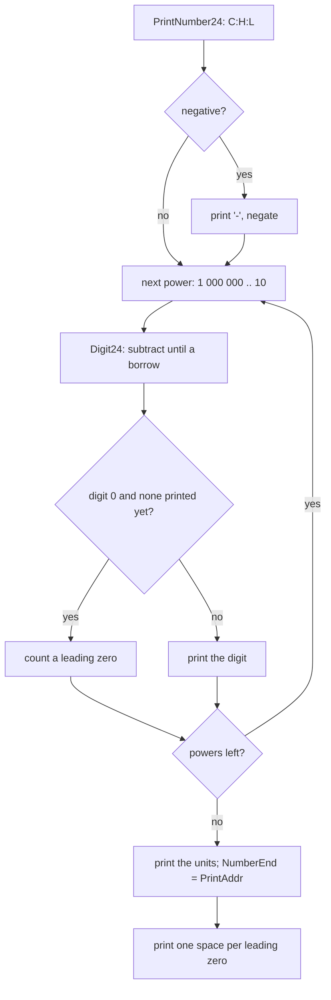

Worked example: the funds of the HUD figure, 19 797 dollars (`FUNDS $19797` on the screen) at `tools` frame 6332,
Funds = `55 4D 00`. 1 000 000 and
100 000 go in 0 times: two leading zeros, counted. 10 000 goes in once: "1", 9797 left. Then 9, 7, 9 and the units 7:
"19797", then 2 spaces. The field at row 5, column 24 takes 7 columns, 24-30, for any positive number. A negative
one takes 8: PrintSign's minus comes before the digits, and the padding counts only the digits.

Witness: PrintFunds `$5F80` runs at `menus` frame 20116 as the budget window closes (8.7); L1 counts 9918 of its calls
and 28 400 of PrintNumber24.

The point: the trailing spaces erase the old figure in the same pass. No field is ever cleared before it is printed.

## 8.6 The texts: GameTexts, FindText and PrintPadded

GameTexts `$5FC6` holds 50 strings in 831 bytes: the 14 tool names with their prices (0-13), the three levels (14-16),
the six city categories (17-22), a space (23) and the 26 advice and disaster messages (24-49). A string has no length
and no terminator byte: bit 7 is set on its last letter. MonthNames `$5F8A` is a second table of the same kind, twelve
strings of three letters.

FindText `$6317` finds string A of a table by walking it byte by byte and counting the bytes with bit 7. PrintPadded
`$632A` prints a string at row B, column C and then spaces, to A + 1 columns in all (A counts the letters before the
last one).

```text
FindText(table, n):
    if n == 0: return table
    ends = 0
    for p from table:
        if mem[p] & $80:
            ends += 1
            if ends == n: return p + 1

PrintPadded(text, row, col, A):
    PrintAddr = ScreenAddr(row, col); c = A
    loop:
        print mem[text] & $7F
        if mem[text] & $80: break
        text += 1; c -= 1
    if c > 0: print c spaces                   ; A + 1 columns in all
```

```text
6317  A7            AND A                ; FindText
6318  C8            RET Z                ; string 0: the table itself
6319  1E 00         LD E,$00
631B  57            LD D,A
631C  CB 7E         BIT 7,(HL)           ; FindTextLoop
631E  28 07         JR Z,FindTextNext
6320  1C            INC E                ; one more end
6321  7A            LD A,D
6322  BB            CP E
6323  20 02         JR NZ,FindTextNext
6325  23            INC HL               ; the string starts after the end
6326  C9            RET
6327  23            INC HL               ; FindTextNext
6328  18 F2         JR FindTextLoop
632A  F5            PUSH AF              ; PrintPadded
...
6335  7E            LD A,(HL)            ; PrintPaddedLoop
6336  E6 7F         AND $7F
...
6342  CB 7E         BIT 7,(HL)
6344  20 04         JR NZ,PrintPaddedPad ; the last letter
6346  23            INC HL
6347  0D            DEC C
6348  18 EB         JR PrintPaddedLoop
634A  79            LD A,C               ; PrintPaddedPad
634B  A7            AND A
634C  C8            RET Z
634D  F8            RET M                ; a text longer than the field: no pad
```

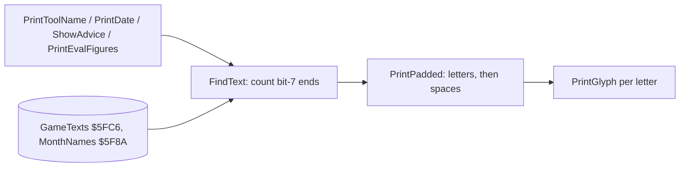

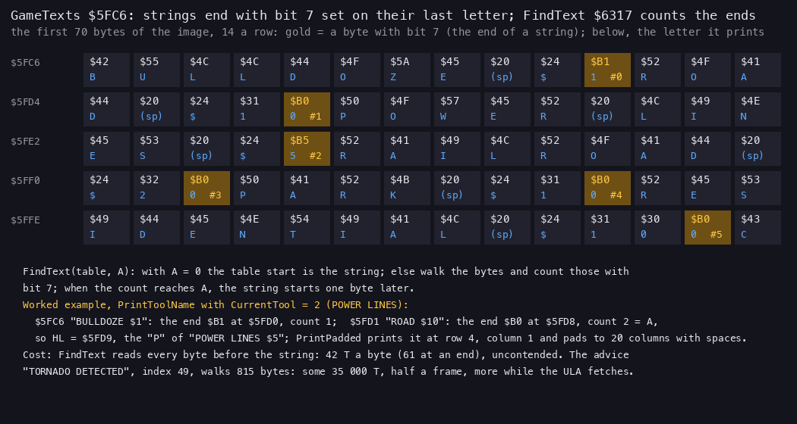

*Drawn by `python3 tools/fig_text.py texts` from the image's bytes at `$5FC6-$600B`.*

How to read the figure:

- **Each cell** is a byte: its value, then the letter it prints. **Gold cells** have bit 7: a string ends there, and
  the label gives the count FindText has reached.
- **The text below** steps through FindText(GameTexts, 2), and gives the cost of the walk.
- **The point**: the table has no index. Every look-up walks from the start, so the late strings cost more.

Worked example: PrintToolName with CurrentTool = 2. FindText walks "BULLDOZE `$1`" to its end `$B1` at `$5FD0` (count
1), then "ROAD `$10`" to `$B0` at `$5FD8` (count 2 = A) and returns `$5FD9`, the P of "POWER LINES `$5`". PrintPadded
prints its 14 letters at row 4, column 1, with C counting down from `$13` = 19 to 6 at the last letter, then 6 spaces:
20 columns, 1-20. The longest message, "TRANSPORT SYSTEM FALLING APART" (30 letters), fills the advice field's 30
columns exactly.

Cost: 42 T a byte walked (61 at an end), uncontended. "TORNADO DETECTED" (string 49) walks 815 bytes: about 35 000 T,
half a frame, before its first letter is printed.

Witness: `tools` frame 6332, the HUD figure: `COMMERCIAL $100` is string 6 at `$600B`, "MORE COMMERCIAL ZONES
NEEDED" is string 25 at `$60DF`. L1 reads every byte of GameTexts (1 602 984 reads in all).

The point: bit 7 as the end mark costs no byte and lets PrintPadded find the end and print in one pass; the price is
the walk from the table's start at every look-up.

## 8.7 The status panel at work

DrawStatusPanel `$5F13` draws the whole top third: the menu bar from its inline text, the status box (8.3), then
DrawNameFunds, DrawToolIcons, ShowTool, PrintToolName, PrintDate and PrintFunds. It runs once at the start and after
every full-screen window (the budget, the evaluation, the maps), which clears the top third first (ClearTopBlack
`$5C70`).

DrawToolIcons `$5DD2` draws the 14 palette icons, each 2 x 2 tiles from IconTiles with their IconAttrs. ShowTool
`$6D90` inverts the current tool's 2 x 2 cells (InvertBox) and calls GreyUnaffordable `$6DDA`. GreyUnaffordable tests
Funds - ToolPrice for each of the 14 tools and greys the icon when it goes negative (GreyIcon). FundsChanged, in the UI
loop, compares Funds with LastFunds and redraws the palette and the highlight when it changed.

```text
DrawStatusPanel:
    PrintInline(menu bar); PrintInline(status box frame, attribute $39)
    DrawNameFunds                              ; the city name, "FUNDS $"
    DrawToolIcons                              ; 14 icons, row 1, columns 2, 4 .. 28
    ShowTool                                   ; invert CurrentTool's icon, GreyUnaffordable
    PrintToolName; PrintDate; PrintFunds

GreyUnaffordable:
    for tool in 0..13:
        if Funds - ToolPrice(tool) < 0: GreyIcon(tool)
```

```text
5F13  CD EF 5D      CALL PrintInline     ; DrawStatusPanel: the menu bar
5F16  ...                                ; StatusBarText, 42 bytes
5F40  CD EF 5D      CALL PrintInline     ; DrawStatusBox
5F43  FB 38 FD 03   DEFB $FB,$38,$FD,$03,$00,$20,$05,$FB,$39,$FE ; StatusBoxText
5F4D  CD 60 5F      CALL DrawNameFunds   ; DrawStatusItems
5F50  CD D2 5D      CALL DrawToolIcons
5F53  CD 90 6D      CALL ShowTool
5F56  CD 05 63      CALL PrintToolName
5F59  CD AE 5F      CALL PrintDate
5F5C  CD 80 5F      CALL PrintFunds
5F5F  C9            RET
```

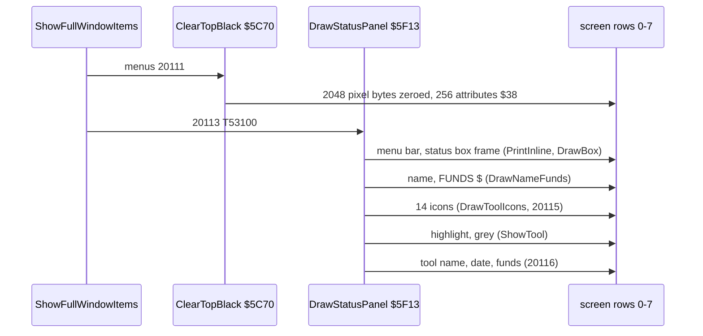

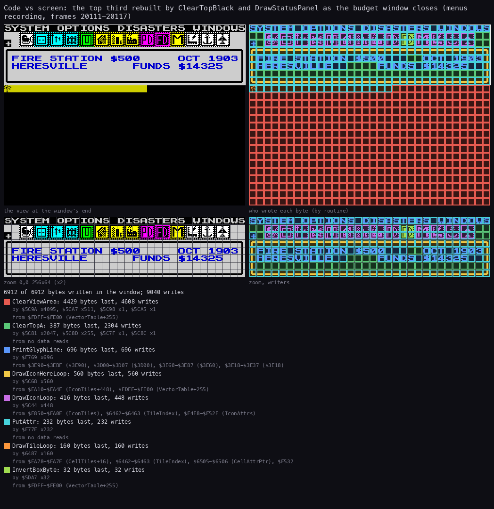

*Drawn by `python3 ../../kit/writers_map.py --work work/docs/scD/menus --window 20111:0-20117:0 --listing
build/game.lst --view screen --sources --zoom 0,0,256,64 --out docs/img/text/writers-status.png` from the `menus`
recording, frames 20111-20117 (GO WITH THESE FIGURES pressed at 20102).*

How to read the figure:

- **Top left**: the screen at the window's end. The top third is rebuilt; the view below is still being cleared (the
  yellow bar on row 8 is the view's attributes, ClearViewArea on its way).
- **Top right**: each byte coloured by the routine that wrote it last; **bottom**: the top third at 2 x.
- **The legend** lists each writer with its write instruction and the data it read: PrintGlyphLine (its write at `$F769`) reads the
  ROM font at `$3D00-$3FFF`; DrawIconLoop (its write at `$5C44`) reads IconTiles and IconAttrs.
- **The point**: the text of the panel (blue, PrintGlyphLine) and its frame (yellow, DrawIconHereLoop) come from two
  writers; the palette (purple, DrawIconLoop) from a third, which writes its icons' attributes itself; PutAttr (cyan) writes
  the text's.

Worked example: the tool palette at `tools` frame 6332 (the HUD figure), Funds 19 797. GreyUnaffordable compares
Funds with ToolPrices `$6E1E` (1, 10, 5, 20, 10, 100, 100, 100, 500, 500, 3000, 4000, 5000, 10 000 dollars). The
dearest tool, the AIRPORT, costs 10 000, so every tool is affordable and no icon is greyed. At `menus` frame 20111
(Funds 14 325) the same holds. Below 10 000 the AIRPORT icon is greyed, below 5000 the SEAPORT, below 4000 the POWER
STATION (its palette text says 5000, 8.13), below 3000 the STADIUM, below 500 the police and fire stations.

Witness: `tools` frame 13 857, Funds 386: the police, fire, stadium, power station, seaport and airport icons are
dotted grey (`work/stage1/rec/tools/screens/013857-shortcut-ss0.png`, below). L1 counts GreyIcon `$6DF5` 92 times in
`bankrupt`, 72 in `tools`, 17 in `ports`, 14 in `menus` and once in `levels`.

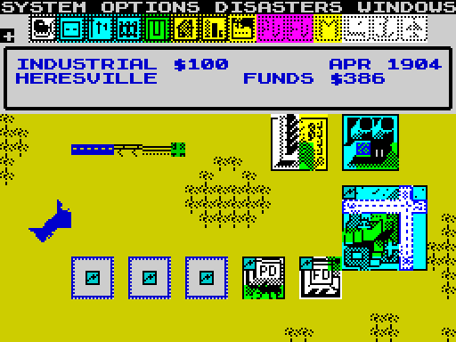

*`tools` frame 13 857, Funds 386 (`FUNDS $386`): the six icons from POLICE to AIRPORT dotted grey, the first eight
in colour. Screenshot of the recording, `work/stage1/rec/tools/screens/013857-shortcut-ss0.png`.*

Witness: `menus` frames 20111-20117 (the probe of `work/docs/scD/probe.py`): ClearTopBlack at 20111, DrawStatusPanel
at 20113 T53100, DrawToolIcons at 20115, PrintFunds at 20116. 6912 bytes written in the window.

The point: the panel is redrawn whole after a full-screen window, about five frames of printing, and refreshed field by
field otherwise. The palette knows the prices: it greys what the player cannot buy before the player tries.

## 8.8 The advice line and the messages

Row 6 of the status box is the game's one message line. Advice `$9996` holds what it shows: 0 for nothing, 1-`$15`
for the advice of the evaluation (GameTexts 24-44), `$16-$1A` and `$12` for the disasters (GameTexts 45-49, 41).
SetAdvice `$9B4A` sets it; ShowAdvice `$9997` prints GameTexts[23 + Advice] padded to 30 columns every 32 passes. So
Advice 0 prints string 23, the single space, and 29 more: an empty line.

```text
SetAdvice(n): Advice = n
ShowAdvice:   PrintPadded(FindText(GameTexts, 23 + Advice), row 6, column 1, A = 29)   ; 30 columns
```

```text
9997  3A 96 99      LD A,(Advice)        ; ShowAdvice
999A  C6 17         ADD A,$17            ; + 23: string 23 is " "
999C  21 C6 5F      LD HL,GameTexts
999F  CD 17 63      CALL FindText
99A2  3E 1D         LD A,$1D             ; 29: 30 columns
99A4  01 01 06      LD BC,$0601          ; row 6, column 1
99A7  C3 2A 63      JP PrintPadded
```

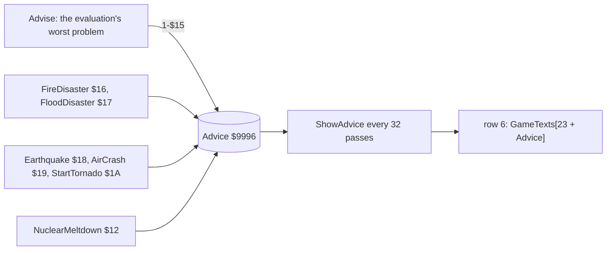

Worked example: FireDisaster `$90A7` runs `LD A,$16`, `CALL SetAdvice`. At the next pass with PassCount AND `$1F` = 0,
ShowAdvice prints GameTexts[23 + 22] = string 45, "FIRES HAVE BEEN DETECTED" (24 letters), then 6 spaces.

Witness: the HUD figure (`tools` frame 6332) shows string 25, "MORE COMMERCIAL ZONES NEEDED"; the OPTIONS figure of 8.9
(`menus` frame 14409) shows string 35, "CITIZENS UPSET,TAXES TOO HIGH". L1 counts 4944 calls of ShowAdvice. The
disaster message comes before its noise ([09](09-sound.md)) but is printed only at the next 32-pass beat.

The point: one byte decides the message line, and the disasters share it with the advice. A disaster's message stays
until the evaluation's next advice replaces it.

## 8.9 Menus and dialogs

Every menu and dialog of the game is a description, a list of items, that DrawMenu `$67C3` draws and RunMenu `$6944`
runs. The description starts with a header byte, the row before the first item. Then each item is a kind byte and its
operands:

| Kind | Operands | Drawn | Selectable | SPACE does |
| --- | --- | --- | --- | --- |
| 0 text | the text | at its row, column 1 | no | |
| 1 toggle | a flag address, the text | the text, ON or OFF at column 24 | yes | flip the flag (XOR 1) |
| 2 action | a routine address, the text | the text | yes | `JP` to the routine |
| 3 separator | none | tiles `$40 $41 $42` across 32 columns | no | |
| 4 end | none | | | |
| 8 number | the text, with a field | the text and its number | yes | edit the field (EditNumber) |

In a text, bit 7 ends it, and four codes are special: `$21` moves to column 24, 7 is an 8-bit field (a flag, the
value, the maximum), 6 a 16-bit field, 5 a 24-bit field. The values live inside the description: the player edits the
bytes of the text itself. A flag byte not 0 records the field's column and address in MenuValues `$677A` for
EditNumber.

ShowWindow `$6706` opens a description. A header of 8 or more makes a window over the view: rows 8-23 cleared and
framed in green on black (`$44`), the items from row header + 1. A header below 8 makes a full-screen window: the
whole screen cleared and framed in white on black (`$47`), and the status panel redrawn when it closes (8.7). ShowMenu
`$66F2`, for the four pull-down menus, does the same and redraws the view after. EXIT MENU and OK are actions to
`$6703`, ShowMenu's own `RET`: the `JP` there returns from RunMenu, and the window closes.

RunMenu collects nothing itself: DrawMenu has put each selectable item's row and address in MenuItems `$674A`.
RunMenu highlights item MenuSelected `$6A7D` by XORing `$46` into the attributes of its row, columns 1-30
(HighlightLine `$6933`). It waits 8 frames with `HALT`, reads Q, A and SPACE, moves the highlight or runs the item.
A routine in MenuHook `$6942` is called once when the menu opens and on every pass of a number edit (8.10).

```text
DrawMenu(desc):
    row = desc.header; count = 0
    for item in desc:
        row += 1
        kind 4: close MenuItems with $FF; return
        kind 3: separator row at row
        kind 1: add (row, item); print text; tab to 24; print ON or OFF by the flag
        kind 2: add (row, item); print text
        kind 8: add (row, item); print text with its field
        kind 0: print text

RunMenu:
    if count == 0: return
    selected = 0; call MenuHook; highlight(selected)
    loop:
        HALT x 8
        Q: highlight off, selected -= 1, highlight on (not past 0)
        A: the same, +1 (not past count - 1)
        SPACE: wait for release; item = MenuItems[selected]
            toggle: flag ^= 1; return      action: jump to it      number: EditNumber
```

```text
67C3  FD 21 4A 67   LD IY,MenuItems      ; DrawMenu
67C7  DD 22 47 67   LD (MenuState),IX
67CB  AF            XOR A
67CC  32 C2 67      LD (MenuCount),A
67CF  DD 7E 00      LD A,(IX+$00)        ; the header: the row before the first item
67D2  32 49 67      LD (MenuLine),A
67D5  DD 23         INC IX
67D7  21 49 67      LD HL,MenuLine       ; DrawMenuItem
67DA  34            INC (HL)             ; one row down per item
67DB  3E 01         LD A,$01
67DD  32 51 F7      LD (PrintCol),A
67E0  DD 7E 00      LD A,(IX+$00)        ; the kind
67E3  FE 04         CP $04
67E5  28 1A         JR Z,DrawMenuEnd
67E7  FE 02         CP $02
67E9  28 34         JR Z,DrawMenuAction
67EB  FE 03         CP $03
67ED  28 40         JR Z,DrawMenuSeparator
67EF  FE 01         CP $01
67F1  28 59         JR Z,DrawMenuToggle
...
6933  0E 01         LD C,$01             ; HighlightLine: row B, columns 1-30
6935  CD 0D 5C      CALL AttrAddr
6938  06 1E         LD B,$1E
693A  7E            LD A,(HL)            ; HighlightLoop
693B  EE 46         XOR $46              ; $44 green on black <-> $02 red on black
693D  77            LD (HL),A
693E  2C            INC L
693F  10 F9         DJNZ HighlightLoop
6941  C9            RET
6944  3A C2 67      LD A,(MenuCount)     ; RunMenu
6947  A7            AND A
6948  C8            RET Z
6949  AF            XOR A
694A  32 7D 6A      LD (MenuSelected),A
694D  CD 2A 6A      CALL CallMenuHook
6950  CD 60 6A      CALL ToggleMenuLine  ; RunMenuShow: the highlight on
6953  06 08         LD B,$08             ; RunMenuWait
6955  76            HALT                 ; RunMenuHalt: 8 frames
6956  10 FD         DJNZ RunMenuHalt
6958  3A 02 5B      LD A,(KeyRowQ)
695B  E6 01         AND $01
695D  CC 54 6A      CALL Z,MenuUp
6960  3A 01 5B      LD A,(KeyRowA)
6963  E6 01         AND $01
6965  CC 6C 6A      CALL Z,MenuDown
6968  3A 07 5B      LD A,(KeyRowSpace)
696B  E6 01         AND $01
696D  28 02         JR Z,RunMenuRelease
696F  18 E2         JR RunMenuWait
```

```mermaid
stateDiagram-v2
    [*] --> Drawn: ShowWindow / ShowMenu: DrawMenu
    Drawn --> Waiting: RunMenu: MenuHook once, highlight item 0
    Waiting --> Waiting: 8 HALTs; Q or A moves the highlight
    Waiting --> Release: SPACE down
    Release --> Toggled: a toggle: flag XOR 1
    Release --> Action: an action: JP to it
    Release --> Editing: a number: EditNumber
    Editing --> Waiting: SPACE: the field printed, highlight back
    Action --> [*]: $6703 (RET): the window closes
    Action --> Waiting: a submenu returns to RunMenuShow
    Toggled --> [*]: RET: the menu closes
```

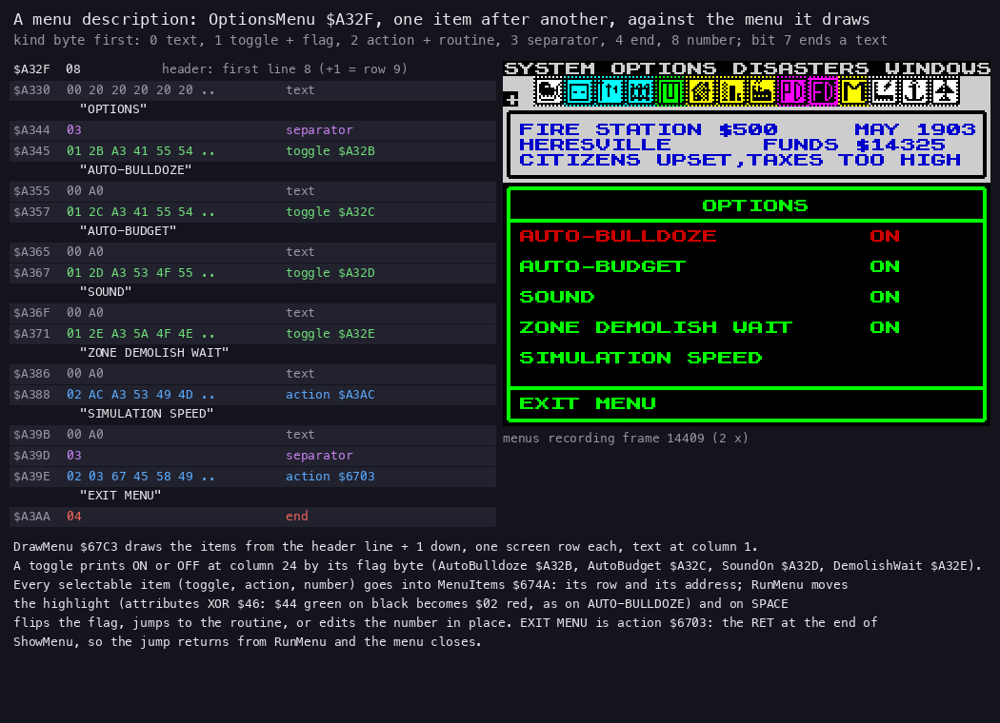

*Drawn by `python3 tools/fig_text.py menufmt` from OptionsMenu `$A32F-$A3AA` of the image, against the `menus`
recording's screenshot of frame 14409.*

How to read the figure:

- **Left**: the description, item by item: the address, the bytes, the kind and its operand; the text below.
- **Right**: the menu on screen, one row an item from row 9 (header 8 + 1).
- **The point**: the description is the menu. Each item's kind and operands decide what it draws and what SPACE does;
  AUTO-BULLDOZE is highlighted in red, `$44` XOR `$46` = `$02`.

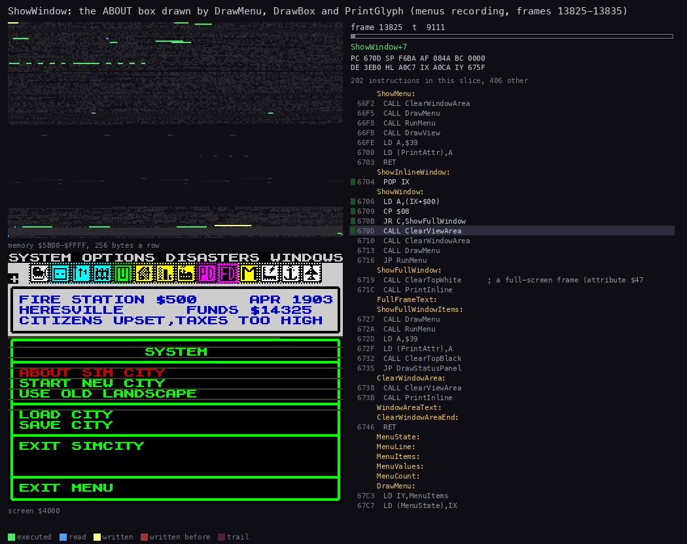

*The routine animation of ShowWindow, DrawMenu, PrintMenuText, DrawBox and PrintGlyph (`$66F2-$6A8D`, `$5DEF-$5F12`,
`$5BFE-$5C27`, `$F754-$F780`) in `menus` from 13825:0 to 13835:30000, after ABOUT SIM CITY is chosen. It has 80
pictures. The view is the screen. Command, from the case folder after `. work/env.sh`: `python3
../../kit/routine_anim.py --work work/docs/scD/menus --listing build/game.lst --window 13825:0-13835:30000 --view
screen --range 5B00-FFFF --pc 5BFE-5C27,5DEF-5F12,66F2-6A8D,F754-F780 --pictures 80 --out
docs/img/routines/ShowWindow.gif`.*

How to read the animation: ClearViewArea empties rows 8-23 (yellow sweep), then WindowAreaText's `$FD` frame appears
row by row. DrawMenu walks AboutText `$A0CA` (blue reads) and PrintGlyph writes each line's letters from the left;
the separators come from DrawBoxRow. Then RunMenu takes over: the highlight lands on OK, and the trace sits in the
`HALT` loop.

Witness: the ABOUT box, chosen at `menus` frame 13816, drawn by frame 13835, on screen at 13854 (the screenshot of
the contact sheet below). L1 counts 54 ShowWindow and 76 ShowMenu calls, 143 DrawMenu.

The game's menus and dialogs, as the recordings opened them:

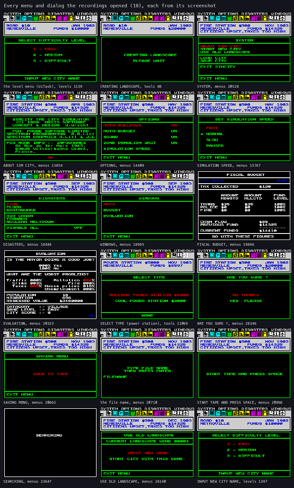

*Drawn by `python3 tools/fig_text.py dialogs` from 18 screenshots of the `levels`, `tools` and `menus` recordings (the
frame under each).*

How to read the figure:

- **Each panel** is a screenshot, with its recording and frame. The red line in each menu is the highlight.
- **Full-screen windows** (FISCAL BUDGET, EVALUATION, SEARCHING) have no menu bar; the others open over the view.
- **The point**: one engine draws all of them. Even the level menu at the start and CREATING LANDSCAPE are
  descriptions.

| Description | Address | Header | Opened by | Witness |
| --- | --- | ---: | --- | --- |
| SELECT DIFFICULTY LEVEL | LevelMenuText `$A51C` | 8 | UiTask at the start | `levels` 1139 |
| CREATING LANDSCAPE | CreatingText `$A6A4` | 13 | NewLandscape `$6A8E` | `tools` 88 |
| SYSTEM | SystemMenu `$A02B` | 8 | OpenMenuAt, column of SYSTEM | `menus` 20528 |
| ABOUT | AboutText `$A0CA` | 8 | AboutWindow `$A0C7` | `menus` 13854 |
| OPTIONS | OptionsMenu `$A32F` | 8 | OpenMenuAt | `menus` 14409 |
| SET SIMULATION SPEED | SpeedMenuText `$A3AF` | 8 | SpeedMenu `$A3AC` | `menus` 15767 |
| DISASTERS | DisasterMenu `$A43E` | 8 | OpenMenuAt | `menus` 18484 |
| WINDOWS | WindowsMenu `$A4C2` | 8 | OpenMenuAt | `menus` 18965 |
| FISCAL BUDGET | BudgetWindowText `$91BC` | 0 | BudgetWindow `$9194` | `menus` 19866 |
| EVALUATION | EvaluationText `$95D7` | 0 | EvaluationWindow `$95B8` | `menus` 20323 |
| SELECT TYPE (power station) | PlantMenu `$9F41` | 8 | PowerPlantTool `$74B4` | `tools` 11069 |
| ARE YOU SURE ? | ConfirmMenu `$9FD3` | 8 | Confirm `$9FD0` | `menus` 28346 |
| SAVING MENU | SaveMenuText `$A24A` | 8 | SaveMenu `$A247` | `menus` 20662 |
| the file name | FileNameText `$A29D` | 12 | FileNameWindow `$A29A` | `menus` 20710 |
| START TAPE AND PRESS SPACE | TapeText `$A30C` | 14 | TapeWindow `$A309` | `menus` 20866 |
| LOADING MENU | LoadMenuText `$A1F6` | 8 | LoadMenu `$A1F3` | `menus` 23443 (not in the sheet) |
| TAPE LOADING ERROR | LoadErrorText `$A2DF` | 14 | LoadErrorWindow `$A2DC` | not reached (8.14) |
| USE OLD LANDSCAPE | OldLandscapeMenu `$A5E5` | 8 | UseOldLandscape `$A5DC` | `menus` 26140 |

SEARCHING (`menus` 23647) is no description: LoadCity prints it with PrintInline (SearchingText `$9E77`).

The point: the menus are data. A new menu is a few dozen bytes of description; a new option is a toggle item and a
flag. The authors wrote the engine once, and every window of the game, from the level choice to the tax rate, is a
description for it.

## 8.10 The budget window

The budget window opens once a year, when the simulation sets BudgetDue `$8E93`, and from WINDOWS, BUDGET. BudgetWindow
`$9194` sets SwitchOff (the simulation stops while it is open), computes the tax income and the figures, puts
BudgetHook `$9346` into MenuHook and opens BudgetWindowText `$91BC`, a full-screen description.

The four numbers the player edits are 8-bit fields inside the description: TaxRate `$91E4` (maximum 20) and the three
funding percentages TransportPercent `$9256`, PolicePercent `$926F` and FirePercent `$9288` (maximum 100). Selecting
one runs EditNumber `$6996`: Q counts it up, A down, SPACE ends. On every pass of the edit loop EditNumber calls the
hook, and BudgetHook reruns BudgetFigures and PrintBudget `$94A4`: every figure of the window is recomputed and
reprinted while the player holds the key.

```text
BudgetWindow:
    SwitchOff = 1
    TaxIncome = PopLastYear / 100 * TaxRate                 ; once, at the opening
    BudgetFigures()
    MenuHook = BudgetHook; ShowWindow(BudgetWindowText); MenuHook = 0
    SwitchOff = 0; BudgetDue = 0

BudgetFigures:
    FundsBefore = Funds
    each of transport, police, fire: Funded = Cost * Percent / 100, capped by FundsBefore + TaxIncome - the ones before
    FundedTotal = the three; CashFlow = TaxIncome - FundedTotal; FundsAfter = Funds - FundedTotal + TaxIncome

EditNumber (field):
    attribute $45
    loop:
        key repeat: no key, delay = 10; a key held, delay -= 1 (to 0)
        print the field; SPACE: done
        Q: value + 1 up to max; A: value - 1 down to 0
        MenuHook()                                          ; BudgetHook: BudgetFigures, PrintBudget
        HALT x delay
```

```text
9346  3E 47         LD A,$47             ; BudgetHook: the figures in white
9348  32 53 F7      LD (PrintAttr),A
934B  CD 58 93      CALL BudgetFigures
934E  CD A4 94      CALL PrintBudget
9351  3E 45         LD A,$45             ; back to the field's colour
...
69DA  CC FA 69      CALL Z,EditDown      ; EditNumberLoop (end)
69DD  CD 2A 6A      CALL CallMenuHook    ; BudgetHook
69E0  3A 95 69      LD A,(EditRepeat)
69E3  A7            AND A
69E4  28 DA         JR Z,EditNumberLoop  ; a key held long: no wait at all
69E6  47            LD B,A
69E7  76            HALT                 ; EditNumberHalt: EditRepeat frames
69E8  10 FD         DJNZ EditNumberHalt
69EA  18 D4         JR EditNumberLoop
69EC  3A 90 69      LD A,(EditMax)       ; EditUp
69EF  3C            INC A
69F0  4F            LD C,A
69F1  2A 91 69      LD HL,(EditPtr)      ; the value byte in the description
69F4  7E            LD A,(HL)
69F5  3C            INC A
69F6  B9            CP C                 ; past the maximum: no change
69F7  C8            RET Z
69F8  77            LD (HL),A
69F9  C9            RET
```

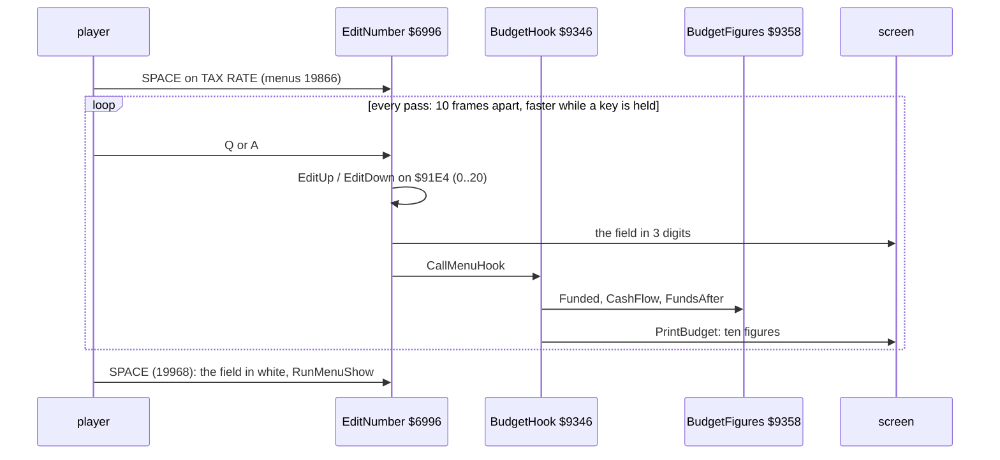

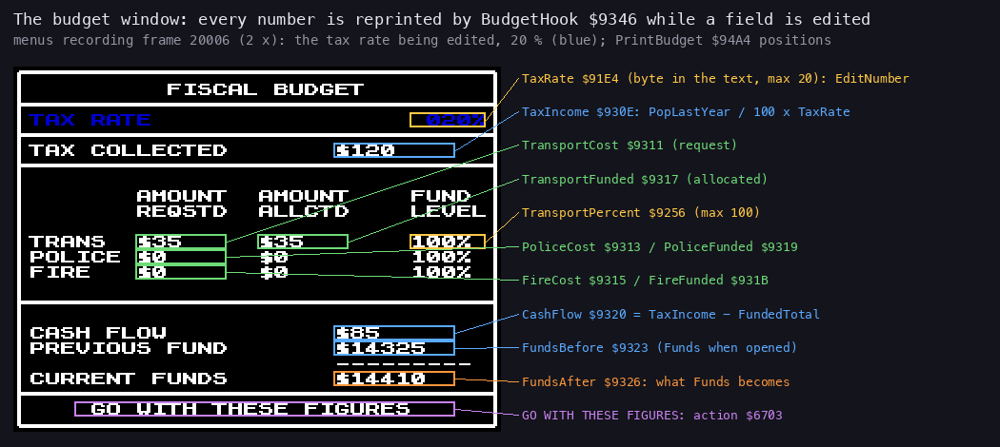

*Drawn by `python3 tools/fig_text.py budget` from the `menus` recording's screenshot of frame 20006, at 2 x.*

How to read the figure:

- **Orange boxes** are the fields the player edits, bytes inside the description; **blue** the figures computed;
  **green** the three requests and grants. Each label gives the variable and how it is computed.
- **The point**: the window is a calculator. Only four bytes are input; the rest is reprinted on every pass of the
  edit.

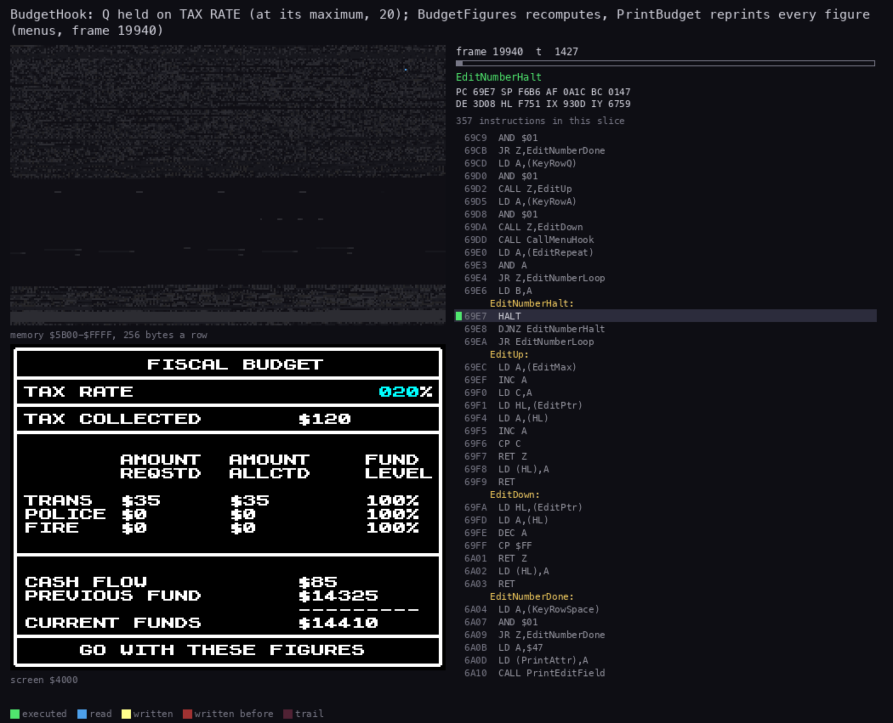

*The routine animation of BudgetHook, BudgetFigures, PrintBudget, the number printers, PrintInline, PrintGlyph and
EditNumber (`$9346-$9353`, `$94A4-$94F3`, `$65C1-$669F`, `$5DEF-$5E96`, `$F754-$F780`, `$6996-$6A7C`,
`$9194-$9345`, `$93FC-$94A3`) in `menus` from 19940:0 to 19941:30000, with Q held on TAX RATE. It has 70 pictures. The
view is the screen. Command, from the case folder after `. work/env.sh`: `python3 ../../kit/routine_anim.py --work
work/docs/scD/menus --listing build/game.lst --window 19940:0-19941:30000 --view screen --range 5B00-FFFF --pc
9346-9353,94A4-94F3,65C1-669F,5DEF-5E96,F754-F780,6996-6A7C,9194-9345,93FC-94A3 --pictures 70 --out
docs/img/routines/BudgetHook.gif`.*

How to read the animation: EditNumber's EditUp reads TaxRate (20, its maximum) and leaves it. The hook runs:
BudgetFigures reads the costs and percentages at `$9256-$931B` and writes the grants and totals (yellow at
`$9317-$9328`). PrintBudget then prints the ten figures one after the other; each one flashes on the screen in the
window's rows 5-20. After the last, EditNumber goes back to its `HALT`s.

Worked example: `menus` frame 19940. PopLastYear is 656, so TaxIncome = 656 / 100 = 6, x 20 = 120 (TAX COLLECTED
120 dollars). TransportCost is 35 at 100 %, so TransportFunded is 35; police and fire request 0. FundedTotal is 35,
CashFlow 120 - 35 = 85, FundsBefore 14 325, FundsAfter 14 325 - 35 + 120 = 14 410 (dollars, decimal).

Witness: `menus` frames 19866-19968. PrintBudget runs at 19940, 19950 and 19961: with no key down the edit loop waits
10 frames a pass. TaxRate reads 20 throughout: Q at its maximum changes nothing.

Known only from the code: BudgetHook reruns BudgetFigures but not TaxIncomeOf. TAX COLLECTED is computed once, when
the window opens, so changing the tax rate in the window does not change it; the new rate counts from the next year.

The point: the player sees the effect of a funding percentage at once, on every line of the window. The tax rate is
the exception: its effect shows only a year later.

## 8.11 The evaluation window

EvaluationWindow `$95B8` opens EvaluationText `$95D7`, a full-screen description of fixed words, with Evaluate
`$9737` as its MenuHook. RunMenu calls the hook once, when the window opens. Evaluate computes the category and prints
the figures; if the city has a population it also computes the problems, the score and the poll
([10](10-gameplay-logic.md) has the model). The window prints:

- the poll, YES and NO in 3 digits: 100 Random draws of 10 bits (0-1023), a YES each time the draw is below CityScore
  `$98FA` (Poll `$9931`);
- seven problems, each 0-100 % in 3 digits, red from 20 (Problems `$9803`);
- POPULATION: LastPop `$8E8A`; MIGRATION: PopLastYear - PopYearBefore; ASSESSED VALUE: CityValueLast `$81E0`
  followed by three zeros;
- CATAGORY (as the text spells it): GameTexts[17 + Category]; GAME LEVEL: GameTexts[14 + Level]; CITY SCORE:
  4 x (250 - 3 x ProblemSum), clamped to 0-1000.

```text
PrintEvalFigures:
    PrintPadded(GameTexts[14 + Level], row 20, column 15)
    PrintPadded(GameTexts[17 + Category], row 19, column 15)
    PrintNumberVar(LastPop, row 15, column 20)
    Migration = PopLastYear - PopYearBefore; PrintNumberVar(Migration, row 16, column 20)
    PrintNumberVar(CityValueLast, row 17, column 20)
    PrintAddr = NumberEnd; print "0"; print "0"; print "0"      ; two CALLs and the fall-through
```

```text
97E3  21 E0 81      LD HL,CityValueLast
97E6  01 14 11      LD BC,$1114          ; row 17, column 20
97E9  CD B3 65      CALL PrintNumberVar
97EC  2A A3 65      LD HL,(NumberEnd)    ; after the digits, before the spaces
97EF  22 4F F7      LD (PrintAddr),HL
97F2  CD F8 97      CALL PrintZero       ; "0"
97F5  CD F8 97      CALL PrintZero       ; "0"
97F8  3E 30         LD A,$30             ; PrintZero: and a third "0" on the way out
97FA  CD EB 5D      CALL PrintChar
97FD  CD 12 5E      CALL NextColumn
9800  C9            RET
```

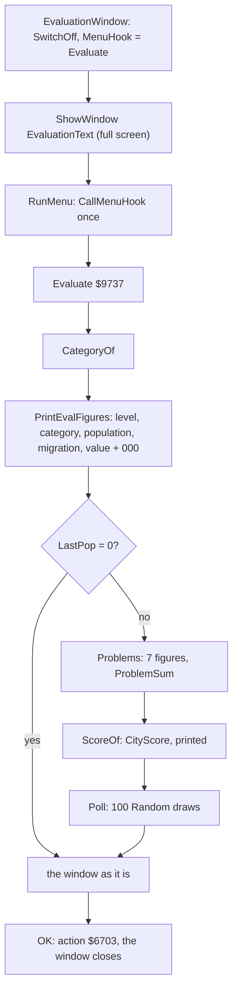

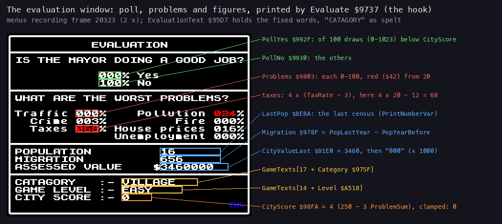

*Drawn by `python3 tools/fig_text.py evaluation` from the `menus` recording's screenshot of frame 20323, at 2 x.*

How to read the figure:

- **Each box** is a printed field; its label gives the variable and the formula.
- **Red figures** are the problems of 20 % or more.
- **The point**: almost every number on the window is computed when it opens; the window shows a snapshot, and it uses
  up 100 random numbers each time.

Worked example: `menus` frame 20323. LastPop is 16, PopLastYear 656, PopYearBefore 0: POPULATION 16, MIGRATION 656.
CityValueLast is 3460, printed "3460" and then "000": the screen reads 3460000 after the dollar sign, 3 460 000
dollars. ProblemSum is 115, so the score is 4 x (250 - 345) = -380, clamped to 0. With CityScore 0 no draw is below
it: 0 % YES, 100 % NO. The category is VILLAGE (GameTexts 17) and the level EASY (GameTexts 14).

Witness: `menus` frame 20323, memory at the frame's start: CityValueLast = 3460, LastPop = 16, PopLastYear = 656,
CityScore = 0, PollYes = 0, PollNo = 100 (`tools/ttdmem.py`).

The point: the window shows three oddities. POPULATION is the last census, not the year's population; the assessed
value is CityValueLast x 1000, the third zero coming from a fall-through; and the level reads EASY, MEDIUM, HARD while
the level menu offers DIFFICULT.

## 8.12 The line editor and the city name

InputLine `$A6FF` edits a text in place: the city name (INPUT NEW CITY NAME on the level menu), the file name of save
and load, and the gene of USE OLD LANDSCAPE (as digits). It does not wait on the interrupt: it calls ReadInput and
KeyToChar `$5BDF` itself, in a loop. A letter, digit or space is written at the cursor and the cursor moves right.
CAPS SHIFT with 8 or 5 moves the cursor right or left; CAPS SHIFT with 0 (InputDelete `$A77D`) blanks the character
at the cursor and the one before it and moves the cursor left. ENTER ends. ShowInput `$A7A3` reprints the whole
line on every pass, the cursor's letter flashing.

The key repeat counts passes, not frames: after a key, the same key is taken again only after InputDelay `$A6EF` =
1000 passes of the loop.

InputCityName `$A5B0` points the editor at CityName `$5F68`, the twelve letters inside DrawNameFunds' inline text
(8.3), at row 5, column 1. It patches ShowInput's two attributes, `LD E,$47` at `$A7B8` and `LD E,$C7` at `$A7C0`, to
`$39` and `$B9`: the name is edited in the status box's own colours, blue on white, the cursor flashing. It restores
them after.

```text
InputLine(buffer, at, length):
    cursor = 0
    loop:
        ReadInput(); key = KeyToChar()
        if none: delay = 0
        elif key == ENTER: return
        elif delay > 0: delay -= 1               ; the same key held
        else:
            if CAPS SHIFT and key in 8, 5, 0: cursor right / left / (blank at cursor, cursor left, blank)
            elif printable (digits only for a number): buffer[cursor] = key; cursor right (to length - 1)
            delay = 1000
        ShowInput()                              ; the line, the cursor's letter flashing
```

```text
A6FF  AF            XOR A                ; InputLine
A700  32 DC A6      LD (InputCursor),A
...
A70A  CD 81 F7      CALL ReadInput       ; InputLoop: the keys read here, not in the interrupt
A70D  CD DF 5B      CALL KeyToChar
A710  38 45         JR C,InputNoKey
A712  FE 08         CP $08               ; ENTER
A714  CA 36 A8      JP Z,InputEnter
A717  47            LD B,A
A718  2A EF A6      LD HL,(InputDelay)   ; the repeat count
A71B  7C            LD A,H
A71C  B5            OR L
A71D  28 06         JR Z,InputKey
A71F  2B            DEC HL
A720  22 EF A6      LD (InputDelay),HL
A723  18 38         JR InputShow
A725  21 62 A7      LD HL,InputRepeat    ; InputKey: return through InputRepeat (delay 1000)
A728  E5            PUSH HL
A729  3A 00 5B      LD A,(KeyRows)       ; CAPS SHIFT?
A72C  E6 01         AND $01
A72E  20 12         JR NZ,InputChar
...
A7B6  C5            PUSH BC              ; ShowInputLoop
A7B7  E5            PUSH HL
A7B8  1E 47         LD E,$47             ; the letters' attribute (patched to $39)
A7BA  3A DC A6      LD A,(InputCursor)
A7BD  B9            CP C
A7BE  20 02         JR NZ,ShowInputChar
A7C0  1E C7         LD E,$C7             ; the cursor's: FLASH (patched to $B9)
```

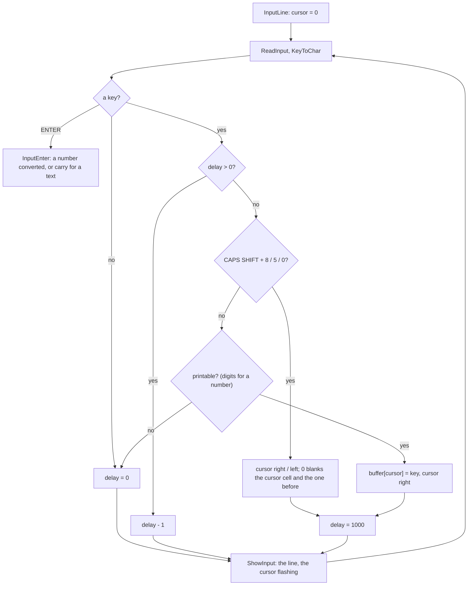

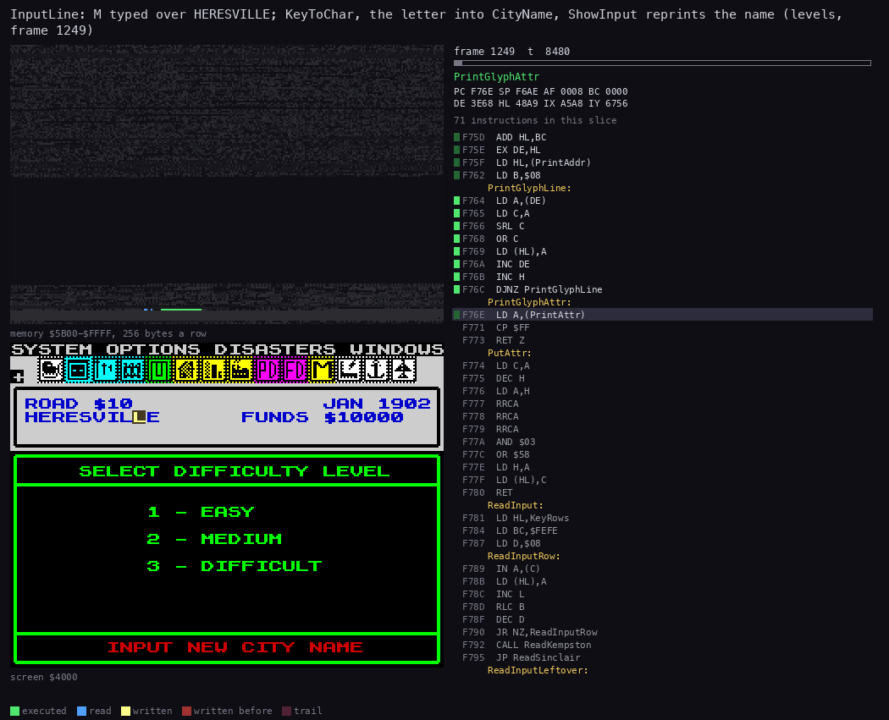

*The routine animation of InputLine, ShowInput, KeyToChar, ReadInput and PrintGlyph (`$A6F9-$A836`, `$5BDF-$5BFD`,
`$F781-$F79E`, `$F754-$F780`) in `levels` from 1249:8000 to 1249:32000. It has 50 pictures, one each 480 T. The view is
the screen. Command, from the case folder after `. work/env.sh`: `python3 ../../kit/routine_anim.py --work
work/docs/scD/levels --listing build/game.lst --window 1249:8000-1249:32000 --view screen --range 5B00-FFFF --pc
A6F9-A836,5BDF-5BFD,F781-F79E,F754-F780 --pictures 50 --out docs/img/routines/InputLine.gif`.*

How to read the animation: the loop reads the key rows (blue at `$5B00-$5B08`) and scans them in KeyToChar. At T12066
the M is written into CityName at `$5F68` (yellow), and the cursor moves to column 2. ShowInput then reprints the
eleven letters of row 5 from the left; the H becomes an M. The status box's other fields stay as they are.

Worked example: `levels`. The level menu's last item, INPUT NEW CITY NAME, is chosen at frame 1211. M at 1249, E at
1271, T at 1293, R at 1315, O at 1337 overwrite H, E, R, E, S: the name reads METROVILLE. ENTER at 1359 ends the edit;
InputCityName restores the attributes, takes the highlight off and redraws the name and funds (DrawNameFunds).

Witness: `levels` frame 1249: InputPut at T12066, CursorRight at T12146, InputRepeat at T12200 (the probe); the
screenshots of frames 1249 and 1397 (the contact sheet of 8.9, last panel).

Known only from the code: InputName sets the length to 11 (`LD HL,$0B00` into InputDigits and InputLength), so the
twelfth letter of CityName can never be typed: a name has at most 11 letters and a space.

The point: the name is edited where it is printed. CityName is part of a text, so once typed, every redraw of the
status panel prints the new name with no copy.

## 8.13 The data sheet of the texts

Every string of the game, with its address. The resources are in `src/res/text` ([src/res/text](../src/res/text/README.md)).

**GameTexts `$5FC6`** (FindText by index; bit 7 on the last letter):

| # | Address | Text | # | Address | Text |
| ---: | --- | --- | ---: | --- | --- |
| 0 | `$5FC6` | `BULLDOZE $1` | 25 | `$60DF` | MORE COMMERCIAL ZONES NEEDED |
| 1 | `$5FD1` | `ROAD $10` | 26 | `$60FB` | MORE INDUSTRIAL ZONES NEEDED |
| 2 | `$5FD9` | `POWER LINES $5` | 27 | `$6117` | NEED BIGGER ROAD NETWORK |
| 3 | `$5FE7` | `RAILROAD $20` | 28 | `$612F` | NEED LARGER RAIL SYSTEM |
| 4 | `$5FF3` | `PARK $10` | 29 | `$6146` | NEED A POWER PLANT |
| 5 | `$5FFB` | `RESIDENTIAL $100` | 30 | `$6158` | THE PEOPLE WANT A STADIUM |
| 6 | `$600B` | `COMMERCIAL $100` | 31 | `$6171` | INDUSTRY NEEDS A SEA PORT |
| 7 | `$601A` | `INDUSTRIAL $100` | 32 | `$618A` | COMMERCE NEEDS AN AIRPORT |
| 8 | `$6029` | `POLICE STATION $500` | 33 | `$61A3` | PEOPLE DEMAND FIRE DEPT |
| 9 | `$603C` | `FIRE STATION $500` | 34 | `$61BA` | PEOPLE DEMAND POLICE DEPT |
| 10 | `$604D` | `STADIUM $3000` | 35 | `$61D3` | CITIZENS UPSET,TAXES TOO HIGH |
| 11 | `$605A` | `POWER STATION $5000` | 36 | `$61F0` | TRANSPORT SYSTEM FALLING APART |
| 12 | `$606D` | `SEAPORT $5000` | 37 | `$620E` | FIRE DEPT NEEDS FUNDS |
| 13 | `$607A` | `AIRPORT $10000` | 38 | `$6223` | THE POLICE NEED FUNDS |
| 14 | `$6088` | EASY | 39 | `$6238` | ZONES NEED POWER |
| 15 | `$608C` | MEDIUM | 40 | `$6248` | BROWNOUTS DETECTED |
| 16 | `$6092` | HARD | 41 | `$625A` | NUCLEAR MELTDOWN |
| 17 | `$6096` | VILLAGE | 42 | `$626A` | TOO MUCH POLLUTION |
| 18 | `$609D` | TOWN | 43 | `$627C` | CRIME TOO HIGH |
| 19 | `$60A1` | CITY | 44 | `$628A` | TRAFFIC JAMS ARE BAD |
| 20 | `$60A5` | CAPITAL | 45 | `$629E` | FIRES HAVE BEEN DETECTED |
| 21 | `$60AC` | METROPOLIS | 46 | `$62B6` | COASTAL FLOODING DETECTED |
| 22 | `$60B6` | MEGALOPOLIS | 47 | `$62CF` | MAJOR EARTHQUAKE DETECTED |
| 23 | `$60C1` | (a space) | 48 | `$62E8` | AIR CRASH !!! |
| 24 | `$60C2` | MORE RESIDENTIAL ZONES NEEDED | 49 | `$62F5` | TORNADO DETECTED |

The prices in the tool names are texts of the image. One differs from what the game charges: POWER STATION says 5000,
but ToolPrices `$6E1E` holds 4000 (the palette greys the icon below 4000, 8.7), and PowerPlantTool charges 3000 for
coal and 5000 for nuclear ([doc 10.13](10-gameplay-logic.md#1013-the-tools-placement-and-refusals)).

**MonthNames `$5F8A`**: JAN `$5F8A`, FEB `$5F8D`, MAR `$5F90`, APR `$5F93`, MAY `$5F96`, JUN `$5F99`, JUL `$5F9C`,
AUG `$5F9F`, SEP `$5FA2`, OCT `$5FA5`, NOV `$5FA8`, DEC `$5FAB` (PrintDate by Month).

**Inline texts** (PrintInline, [src/res/text/inline](../src/res/text/inline/README.md)):

| Text | Address | Bytes | Printed by |
| --- | --- | ---: | --- |
| the menu bar | StatusBarText `$5F16` | 42 | DrawStatusPanel `$5F13` |
| the status box | StatusBoxText `$5F43` | 10 | DrawStatusBox `$5F40` |
| the city name and `FUNDS $` | CityNameAt `$5F63` | 28 | DrawNameFunds `$5F60` |
| a full-screen frame | FullFrameText `$671F` | 8 | ShowFullWindow `$6719` |
| the window area frame | WindowAreaText `$673E` | 8 | ClearWindowArea `$6738` |
| ON, OFF | OnText `$686E`, OffText `$6879` | 3, 4 | DrawMenuToggle `$684C` |
| the maps window frame and keys | MapsFrameText `$7AA4`, MapsKeysText `$7B0C` | 101, 67 | DrawMapsFrame, DrawMapsKeys |
| SEARCHING, LOADING, FOUND | `$9E77`, `$9EC1`, `$9F1D` | 18, 11, 13 | LoadCity, LoadHeader, PrintFound |

**Menu descriptions**: the 18 of the table in 8.9, each in `src/res/text/menus` ([its README](../src/res/text/menus/README.md))
with its header and items.

**The spellings as the image has them**: "CATAGORY" (EvaluationText), "SOFTARE" (AboutText, "PROBE SOFTARE
LIMITED"), "REQSTD" and "ALLCTD" (BudgetWindowText), "SEA PORT" in the advice and "SEAPORT" in the tool name, "AIR
CRASH !!!".

The point: SimCity's whole text is about 2.5 KB, in three formats: the bit-7 tables for the strings that change, the
inline codes for the fixed screens, and the menu descriptions for everything the player chooses from.

## 8.14 Not reached and known only from the code

- **The `$FC` inline code** (a number in 3 digits) is handled by PrintInline but used by no text of the image.
- **TAPE LOADING ERROR** (LoadErrorWindow `$A2DC`) needs a failed load; the `menus` recording's load succeeded.
- **A greyed palette icon**: reached, not only in the code. `tools` frame 13 857 (Funds 386) shows six icons greyed
  (8.7, `work/stage1/rec/tools/screens/013857-shortcut-ss0.png`); L1 counts GreyIcon `$6DF5` 92 times in
  `bankrupt` and 72 in `tools`.
- **The eleven-letter limit** of the city name (8.12) is known only from the code: METRO did not reach it.
- **TAX COLLECTED not following the rate** (8.10) is known only from the code: the recording's rate stayed at 20.
- **A negative figure**: PrintSign's minus (`$662F`) ran 7 times by L1 (4 in `city2`, 2 in `growth`, 1 in `metro`,
  the budget's negative balances); no frame of it is traced here.
- **Corrected against the `.ann`**: the "00" after the score of PrintEvalFigures is "000" after the assessed value
  (three zeros, the third from a fall-through), sent as a source change.
