# 9. Sound

What this covers:

- the engine: the 48K beeper, two routines of the game's own, three speaker sites, no AY, no tune (9.1);
- NoiseBurst `$5B48`, the disaster noise: 200 loops that send a random bit to the speaker through a gate mask (9.2);
- the four noises that call it, fire, flood, earthquake and meltdown, and the gate schedule of each (9.3);
- ToneBeep `$5B66`, the refusal tone of the tools, and when it plays (9.4);
- what the sounds cost: the noise runs with interrupts off, so the frames' interrupts, the input and the task switch
  are lost while it plays (9.5);
- a bug: with the SOUND option off, a disaster leaves the interrupts off for good (9.6);
- the data sheet (9.7), the rendered sounds (9.8) and what no recording reached (9.9).

The names are those of `src/game/game.ann` ([Terms](README.md#terms)). The recordings it rests on, all on the 48K,
each opened from its stage-1 TTD session (`work/stage1/rec/NAME/session.ttd`) on the writer's own instance (port base
37080, muted):

- `disasters` (start: `city2`'s `end.szx`, 13 050 frames): each item of the DISASTERS menu with 2000 frames after it.
  The fire noise starts at frame 134, the flood at 2236, the earthquake at 4403, the meltdown at 11020. The air crash
  (6586) and the tornado (8808) make no sound in it.
- `tools` (from the level menu, 19 867 frames): every tool once; a road on an occupied cell refused at frame 13434,
  with the beep.

Every sound event of a window was taken from access traces, 40 frames at a time (`tools/sound_events.py`): each `OUT`
to an even port with its value, T-state and PC, each entry of a sound routine with its registers and caller, each
interrupt taken, each `DI` and `EI`. The figures and the audio files are drawn from those events by
`tools/fig_sound.py`. No sound was played aloud while writing this.

A frame is 69 888 T at 3.5 MHz, one interrupt a frame, 20 ms. A moment is "frame F T t": the trace puts an
instruction in the frame in which it ran, and t is counted from that frame's start in the emulator. The IM 2 handler
Interrupt `$F70B` is entered at T 1831-1855 of every frame in these traces, just after the interrupt pulse.

```bash
. work/env.sh
python3 ../../kit/rs.py open --work work/docs/scD/dis --ttd work/stage1/rec/disasters/session.ttd --model 48K --port-base 37080
sh work/docs/scD/run_dis.sh            # tools/sound_events.py over the six disaster windows: work/docs/scD/dis-*.json
python3 ../../kit/rs.py stop --work work/docs/scD/dis
python3 ../../kit/rs.py open --work work/docs/scD/tools --ttd work/stage1/rec/tools/session.ttd --model 48K --port-base 37080
python3 tools/sound_events.py --work work/docs/scD/tools --frames 13430-13460 --chunk 40 --out work/docs/scD/tools-occupied.json
python3 ../../kit/rs.py stop --work work/docs/scD/tools
python3 tools/fig_sound.py all         # docs/img/sound/*.png, docs/audio/*.wav
```

## 9.1 The engine

- **The beeper only.** Every sound is bit 4 of port `$FE`, toggled by a loop of the game's own. No `OUT` goes to the
  AY ports `$FFFD`/`$BFFD`. The ROM's BEEPER is never called.
- **No tune.** The game has no music: not on the level menu, not in play, not at a disaster's message.
- **Two routines, three speaker sites.** NoiseBurst writes at `$5B5D`. ToneBeep writes at `$5B6E` (on) and `$5B74`
  (off). Both sit in `beeper.asm` at `$5B48-$5B7E`, in contended memory.
- **The border stays black.** Every speaker write is `$00` or `$10`. The other `OUT ($FE)` of the game set the border
  to 0: Entry `$5B20` once, and the end of save and load (`$9E56`, `$9EF3`, `$9EFE`, `$9F0E`). TapeLoad `$F7A4`
  writes `$0F` before the ROM's LD-BYTES. The tape tones of save and load are the ROM's SA-BYTES and LD-BYTES, not the
  game's.
- **The interrupt makes no sound.** Interrupt `$F70B` reads the keys (ReadInput `$F781`) and switches the two tasks
  ([04](04-game-loop.md)). It writes no port.

| Site | Routine | Writes a call | Called by | When |
| --- | --- | ---: | --- | --- |
| `$5B5D` | NoiseBurst `$5B48` | 1-200 (by E) | FireNoise `$910F`, FloodNoise `$911E`, Earthquake `$9138`, CrashNoise `$78C2` | a fire, a flood, an earthquake, a meltdown, a plane crash |
| `$5B6E`, `$5B74` | ToneBeep `$5B66` | 1000 | Refuse `$71FC` (`JP`) | a tool refused: MapClick after CheckSite, PlaceNetwork, ParkTool |

The point: SimCity has two sounds, a noise and a beep, both blocking. Each disaster gets its own sound from the way it
moves one parameter, the gate mask E.

## 9.2 NoiseBurst: the disaster noise

NoiseBurst `$5B48` sends 200 loops of noise to the speaker. Each loop counts D up by one. When D AND E is 0, it calls
Random `$5CC6` and sends bit 4 of the result to port `$FE`. When D AND E is not 0, it sends nothing and the speaker
keeps its level. So E, the gate mask in register E, sets how often a new random bit is sent:

- E = 0 sends a new bit every loop, 200 bits, a hiss;
- E = 1 every second loop, 100 bits; E = 3 every fourth, 50 bits; E = 15 every sixteenth, 12 bits;
- an E that is not 2^k - 1 lets D through only where D has no bit of E: E = `$3E` lets D = 1, 64, 65, 128, 129, 192,
  193 through, 7 bits in clusters; E = 254 lets only D = 1 through.

The routine runs `DI` first, then tests the SOUND option (SoundOn `$A32D`). With SOUND on it runs the 200 loops and
ends with `EI`. With SOUND off it returns at `RET Z` with the interrupts still off (9.6). The noise draws on the game's
one random generator, Random, so every bit sent advances the city's random sequence.

```text
NoiseBurst(gate E):
    disable interrupts
    if SoundOn == 0: return                  ; interrupts stay off: the bug of 9.6
    D = 0
    repeat 200 times:
        D = (D + 1) & 255
        if D & E == 0:
            speaker = Random() & $10           ; bit 4 of the seed's low byte
            OUT ($FE), speaker                 ; border 0
    enable interrupts
```

```text
5B48  F3            DI                   ; NoiseBurst
5B49  3A 2D A3      LD A,(SoundOn)
5B4C  A7            AND A
5B4D  C8            RET Z                ; SOUND off: returns with DI
5B4E  01 C8 00      LD BC,$00C8          ; 200 loops
5B51  16 00         LD D,$00
5B53  14            INC D                ; NoiseLoop
5B54  7A            LD A,D
5B55  A3            AND E                ; the gate
5B56  20 07         JR NZ,NoiseNext
5B58  CD C6 5C      CALL Random
5B5B  E6 10         AND $10              ; the speaker bit only
5B5D  D3 FE         OUT ($FE),A
5B5F  0B            DEC BC               ; NoiseNext
5B60  78            LD A,B
5B61  B1            OR C
5B62  20 EF         JR NZ,NoiseLoop
5B64  FB            EI
5B65  C9            RET
```

Random `$5CC6` saves HL, DE and BC and steps RandomSeed `$5CC4` ([07](07-objects.md)). It returns the new seed's low
byte in A (its `LD A,H` at `$5CE4` is overwritten at once by `LD A,(RandomSeed)`).

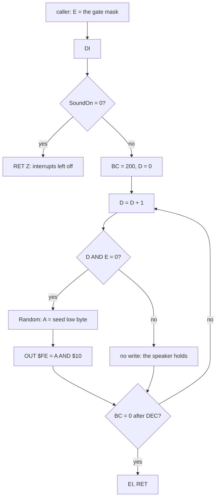

Worked example: a loop that sends a bit costs `INC D` 4, `LD A,D` 4, `AND E` 4, `JR NZ` not taken 7, `CALL` 17,
Random 225, `AND` 7, `OUT` 11, `DEC BC` 6, `LD A,B` 4, `OR C` 4, `JR NZ` 12: 305 T, a sample rate of 11.5 kHz. A loop
that sends nothing costs 50 T. A burst with n bits sent therefore takes 10 000 + 255 n T uncontended: E = 0 is
61 000 T, almost a frame; E = 15 (12 bits) is 13 060 T. The bits a burst sends are the D in 1..200 with D AND E = 0.
Summed over each disaster's E schedule (9.3), that count predicts the speaker writes exactly: 4542 for the fire, 3764
for the flood, 16 276 for the earthquake, 5824 for the meltdown, each equal to the writes traced.

Witness: `disasters` frame 155 T 10209, the fire's 64th burst (E = 0): 200 writes, a median 400 T apart in the
display period and 305 T apart in the border. The quake's last burst (frame 4522 T 45382, E = 15) sends 12 writes,
1520 T apart. Both are drawn below.

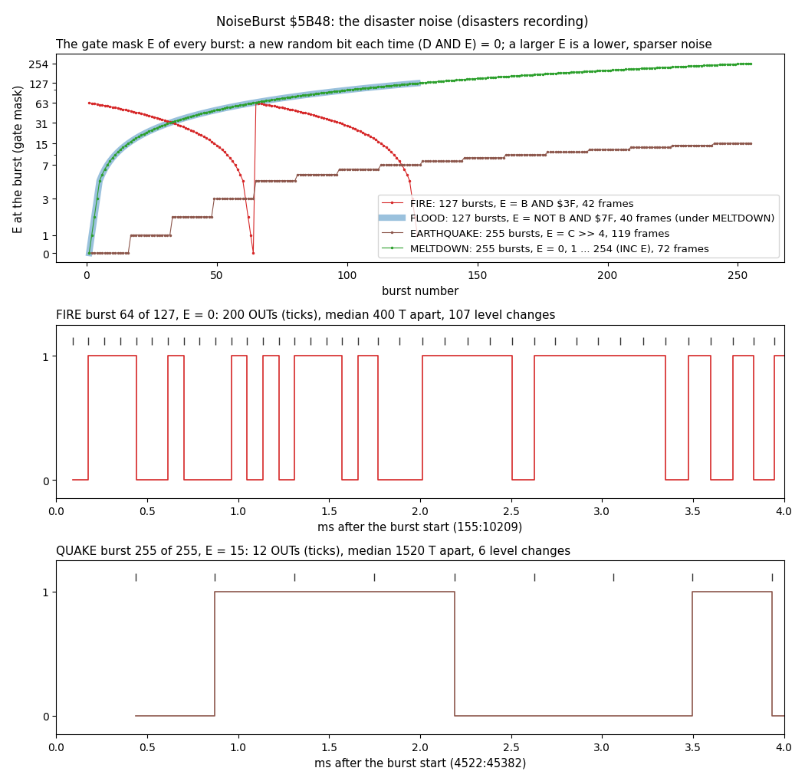

*Drawn by `python3 tools/fig_sound.py noise` from `work/docs/scD/dis-{fire,flood,quake,meltdown}.json` (the
`disasters` recording, frames 134-11091).*

How to read the figure:

- **Top**: E at each burst, against the burst's number, on a log scale. FLOOD is drawn wide under MELTDOWN: their
  first 127 values are the same.
- **Middle**: 4 ms of a fire burst with E = 0. The ticks are the `OUT` writes, the line the speaker level. Two writes
  of the same bit make no edge, so 200 writes give 107 level changes.
- **Bottom**: 4 ms of a quake burst with E = 15. One write each sixteen loops, a lower, rougher noise.
- **The point**: the routine has one parameter, and the four noises are four ways of moving it. A small E is a hiss;
  a large E is a sparse crackle.

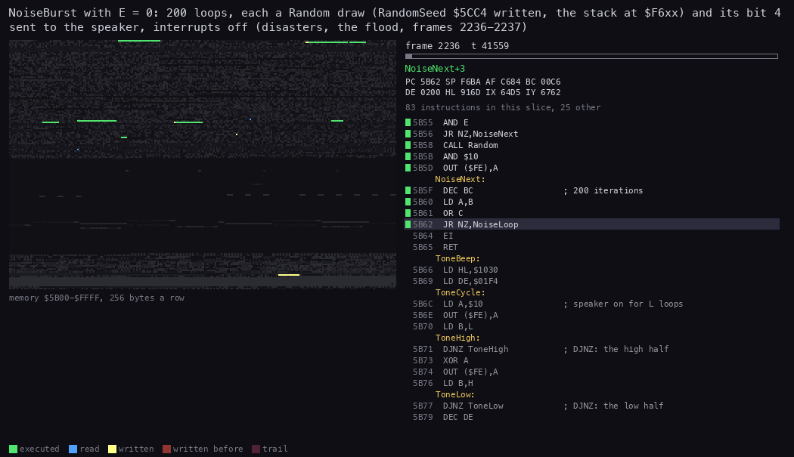

*The routine animation of FloodNoise, NoiseBurst and Random (`$9116-$9124`, `$5B48-$5B65`, `$5CC6-$5CEB`) in
`disasters` from 2236:40400 to 2237:40000, the flood's first burst (E = 0). It has 60 pictures. The view is left out:
the noise draws nothing. Command, from the case folder after `. work/env.sh`: `python3 ../../kit/routine_anim.py
--work work/docs/scD/dis --listing build/game.lst --window 2236:40400-2237:40000 --view none --range 5B00-FFFF --pc
5B48-5B65,5CC6-5CEB,9116-9124 --pictures 60 --out docs/img/routines/NoiseBurst.gif`.*

How to read the animation: FloodNoise computes E = 0 and calls NoiseBurst. The highlight then cycles through the loop
`$5B53-$5B62` and Random. RandomSeed `$5CC4` turns yellow on every loop: each loop writes it. The stack at
`$F6xx` flashes with Random's three pushes. The frame boundary passes without the handler at `$F70B` lighting up:
the interrupt is lost.

The point: a loud burst is also 200 steps of the city's random generator. The noise uses up random numbers that the
simulation would otherwise draw (9.6).

## 9.3 The four noises

RunDisaster `$916E` runs the item of DisasterDue `$916D` once every 16 UI passes ([10](10-gameplay-logic.md)). The
DISASTERS menu sets it, and RandomDisaster draws it. Four of its paths make a noise. Each calls NoiseBurst in a loop of
its own and moves E from burst to burst.

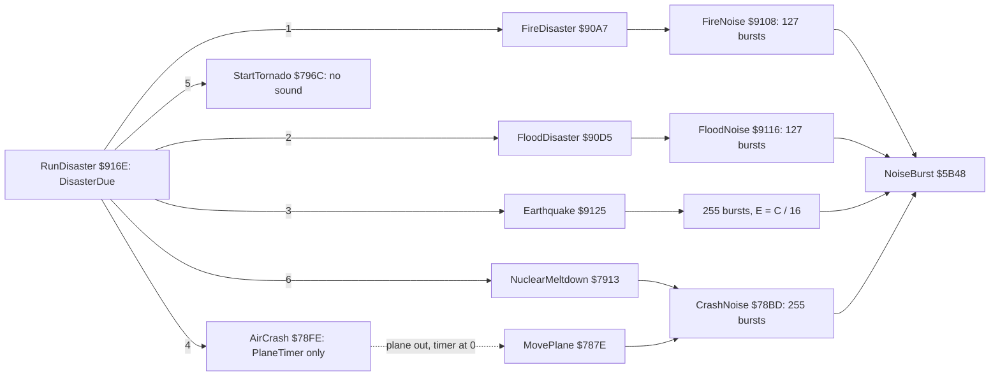

```text
FireNoise:   for B = 127 down to 1:  NoiseBurst(E = B AND $3F)        ; 63..0, then 63..1: two falls
FloodNoise:  for B = 127 down to 1:  NoiseBurst(E = NOT B AND $7F)    ; 0..126: a rise
Earthquake:  for C = 0 to 254:       NoiseBurst(E = C >> 4)           ; 0..15, a step each 16 bursts
CrashNoise:  E = 0; repeat 255:      NoiseBurst(E); E = E + 1          ; 0..254: a rise
```

```text
9108  06 7F         LD B,$7F             ; FireNoise
910A  C5            PUSH BC              ; FireNoiseLoop
910B  78            LD A,B
910C  E6 3F         AND $3F              ; E = B AND $3F
910E  5F            LD E,A
910F  CD 48 5B      CALL NoiseBurst
9112  C1            POP BC
9113  10 F5         DJNZ FireNoiseLoop
9115  C9            RET
9116  06 7F         LD B,$7F             ; FloodNoise
9118  C5            PUSH BC              ; FloodNoiseLoop
9119  78            LD A,B
911A  2F            CPL                  ; E = NOT B AND $7F
911B  E6 7F         AND $7F
911D  5F            LD E,A
911E  CD 48 5B      CALL NoiseBurst
...
912E  C5            PUSH BC              ; EarthquakeNoise (B = 255, C = 0)
912F  59            LD E,C
9130  CB 3B         SRL E                ; E = C >> 4
9132  CB 3B         SRL E
9134  CB 3B         SRL E
9136  CB 3B         SRL E
9138  CD 48 5B      CALL NoiseBurst
913B  C1            POP BC
913C  0C            INC C
913D  10 EF         DJNZ EarthquakeNoise
...
78BD  06 FF         LD B,$FF             ; CrashNoise
78BF  1E 00         LD E,$00
78C1  C5            PUSH BC              ; CrashNoiseLoop
78C2  CD 48 5B      CALL NoiseBurst      ; NoiseBurst keeps E
78C5  C1            POP BC
78C6  1C            INC E
78C7  10 F8         DJNZ CrashNoiseLoop
78C9  C9            RET
```

Worked example: the fire. B starts at 127 = `$7F`, so the first E is `$3F` = 63 (3 bits a burst). E falls by one a
burst to 0 at B = 64 (200 bits, the loudest hiss), jumps back to 63 at B = 63 and falls again to 1. The player hears
two swelling hisses. The flood is the reverse: E rises from 0 to 126, a hiss that thins out to a crackle. The meltdown
starts the same way and goes on to E = 254 (one bit a burst), so it ends in single clicks.

Witness, the `disasters` recording, each from the menu's DisasterDue:

| Noise | Called at | First write | Last write | Bursts | Writes | Length |
| --- | --- | --- | --- | ---: | ---: | --- |
| fire | RunDisaster 134 T17070, FireNoise `$910F` | 134 T17237 | 177 T6743 | 127 | 4542 | 42.8 frames, 0.86 s |
| flood | 2236 T40493, FloodNoise `$911E` | 2236 T40681 | 2276 | 127 | 3764 | 40.4 frames, 0.81 s |
| earthquake | 4403 T35078, Earthquake `$9138` | 4403 T35292 | 4522 T62311 | 255 | 16 276 | 119.4 frames, 2.39 s |
| meltdown | 11020 T20902, CrashNoise `$78C2` | 11020 T21239 | 11091 | 255 | 5824 | 71.5 frames, 1.43 s |

The point: the earthquake is the longest sound, 2.4 s, because its E stays small: most of its bursts send 12 or more
bits. The meltdown has as many bursts but is shorter, because its E soon passes 31 and its bursts thin out to a few
bits.

## 9.4 ToneBeep: the refusal

ToneBeep `$5B66` is a square wave of 500 cycles. Each cycle sets the speaker for 48 `DJNZ` loops (L = `$30`) and
clears it for 16 (H = `$10`). It is not gated by SOUND, and it leaves the interrupts as they are (on).

Refuse `$71E4` is its one caller, by `JP` at `$71FC`. Refuse beeps only when no direction key is held: A, Q, P and O
are read from KeyRows `$5B00`, and any of them held returns at once. So a road dragged across a building with a key
held is silent. Three places call Refuse:

- MapClick `$7012`, when CheckSite `$7103` refuses the tool's box (a cell that may not be built on);
- PlaceNetwork `$71BC`, when a road, rail or power line lands on anything but land or water;
- ParkTool `$73D4`, when the map column is 2 (a bug, 9.9).

```text
Refuse:
    if A, Q, P or O is held: return          ; dragging: no beep
    ToneBeep()

ToneBeep:
    repeat 500 times:
        speaker = 1; wait 48 DJNZ loops
        speaker = 0; wait 16 DJNZ loops
```

```text
71E4  3A 01 5B      LD A,(KeyRowA)       ; Refuse
71E7  E6 01         AND $01              ; A held?
71E9  C8            RET Z
71EA  3A 02 5B      LD A,(KeyRowQ)
71ED  E6 01         AND $01              ; Q held?
71EF  C8            RET Z
71F0  3A 05 5B      LD A,(KeyRowP)
71F3  E6 01         AND $01              ; P held?
71F5  C8            RET Z
71F6  3A 05 5B      LD A,(KeyRowP)
71F9  E6 02         AND $02              ; O held?
71FB  C8            RET Z
71FC  C3 66 5B      JP ToneBeep
5B66  21 30 10      LD HL,$1030          ; ToneBeep: H = 16, L = 48
5B69  11 F4 01      LD DE,$01F4          ; 500 cycles
5B6C  3E 10         LD A,$10             ; ToneCycle
5B6E  D3 FE         OUT ($FE),A          ; speaker on
5B70  45            LD B,L
5B71  10 FE         DJNZ ToneHigh        ; ToneHigh
5B73  AF            XOR A
5B74  D3 FE         OUT ($FE),A          ; speaker off
5B76  44            LD B,H
5B77  10 FE         DJNZ ToneLow         ; ToneLow
5B79  1B            DEC DE
5B7A  7A            LD A,D
5B7B  B3            OR E
5B7C  20 EE         JR NZ,ToneCycle
5B7E  C9            RET
```

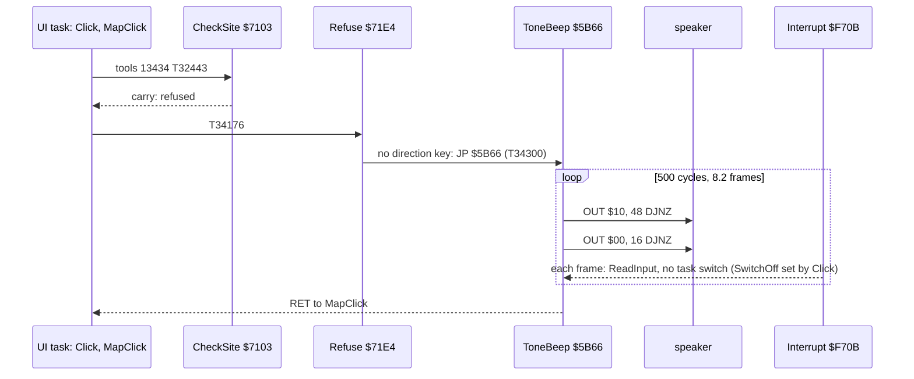

Worked example: from one "on" write to the next, uncontended. The high half is `LD B,L` 4, 47 x 13 + 8 = 619 for the
`DJNZ` loops, `XOR A` 4 and `OUT` 11: 638 T. The low half is `LD B,H` 4, 15 x 13 + 8 = 203, `DEC DE` 6, `LD A,D` 4,
`OR E` 4, `JR NZ` 12, `LD A,$10` 7 and `OUT` 11: 251 T. The period is 889 T, 3937 Hz, with the speaker on 72 % of
the time. 500 cycles are 444 500 T, 127 ms. In the display period the code fetches from `$5B66` are contended: the
halves measure 966 and 378 T, a period of 1344 T, 2604 Hz.

Witness: `tools` frame 13434. A road on an occupied cell: CheckSite at T32443, Refuse at T34176, ToneBeep at T34300.
The 1000 writes run from 13434 T34381 to 13442 T50120: 8.2 frames, 164 ms. The interrupt is taken in every frame of
it. The cycle it falls in measures about 1980 T: 889 plus the handler's 1090 T, with no task switch, because Click
`$63CD` sets SwitchOff `$F705` around MapClick.

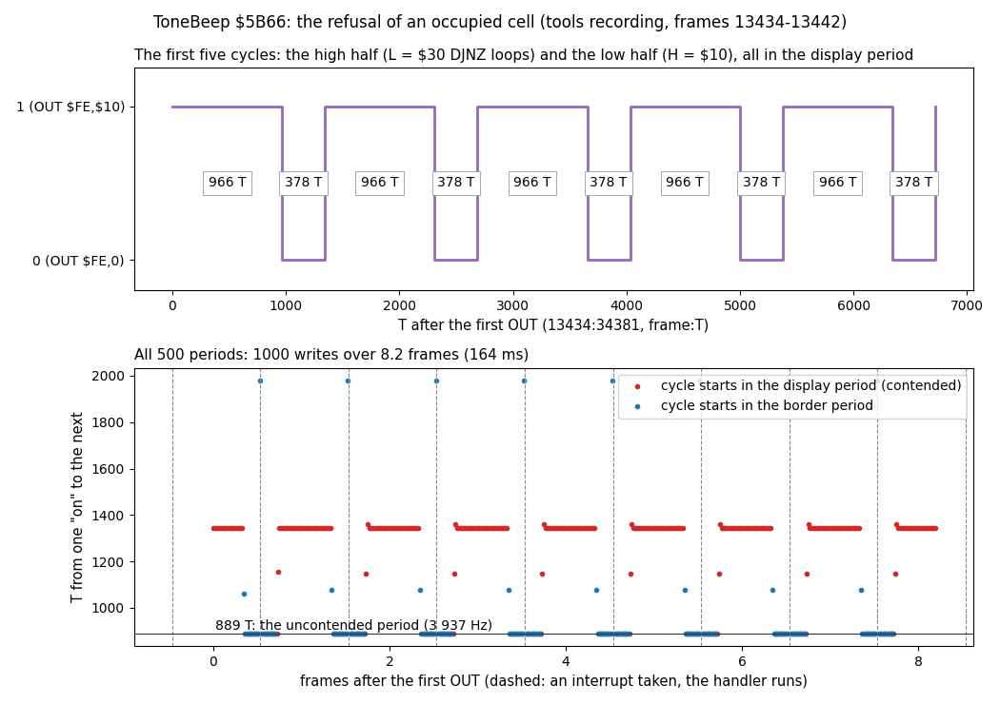

*Drawn by `python3 tools/fig_sound.py tone` from `work/docs/scD/tools-occupied.json` (the `tools` recording, frames
13430-13460).*

How to read the figure:

- **Top**: the first five cycles as the speaker level, each half labelled with its measured T. They fall in the
  display period.
- **Bottom**: each of the 500 periods, from one "on" to the next, against the time in frames. Red points start in
  the display period (1344 T), blue in the border (889 T, the line). Dashed lines are the interrupts taken.
- **The point**: the tone changes pitch with the beam, 3.9 kHz in the border and 2.6 kHz in the display, 50 times a
  second. The one long period at each dashed line is the interrupt handler running inside the tone.

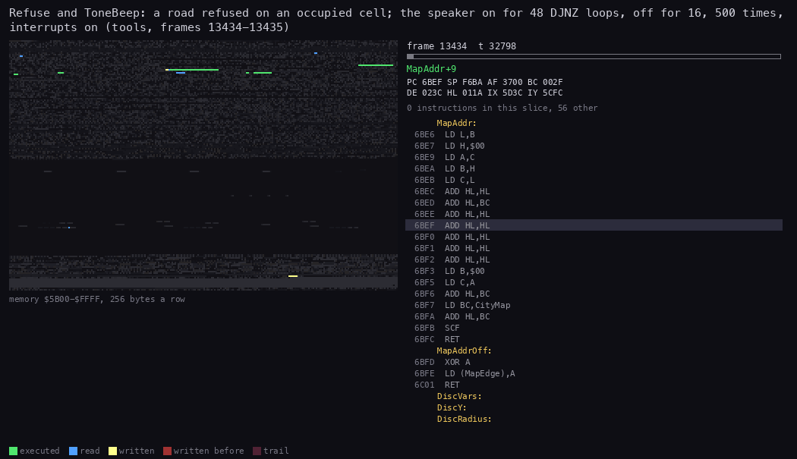

*The routine animation of Refuse and ToneBeep (`$71E4-$71FE`, `$5B66-$5B7E`) in `tools` from 13434:32000 to
13435:10000. It has 60 pictures. The view is left out. Command, from the case folder after `. work/env.sh`:
`python3 ../../kit/routine_anim.py --work work/docs/scD/tools --listing build/game.lst --window
13434:32000-13435:10000 --view none --range 5B00-FFFF --pc 5B66-5B7E,71E4-71FE --pictures 60 --out
docs/img/routines/ToneBeep.gif`.*

How to read the animation: Refuse reads the key rows at `$5B01-$5B05` (blue). Then the highlight sits on
`$5B6C-$5B7C`, mostly on the high half's `DJNZ`. Nothing is written but the stack: the tone has no state in memory.
At the frame boundary the handler's code at `$F70B` and ReadInput light up, and the key rows are written again.

The point: the beep is a fixed tone of 164 ms that the player hears each time a tool is refused. It never touches the
city: no random number, no variable.

## 9.5 What the sounds cost

NoiseBurst holds the interrupts off for all its 200 loops. Between two bursts the caller runs `EI`, `RET`, `POP BC`,
its E computation, `DJNZ`, `PUSH BC` and `CALL NoiseBurst`. The window from the end of the `RET` to the next `DI` is
55 T in CrashNoise, 66 T in FireNoise and FloodNoise and 91 T in the earthquake. An interrupt is taken only when that
window meets the interrupt pulse at a frame's start. So while a noise plays, almost every frame's interrupt is lost.
With it go the key read (ReadInput) and the switch to the simulation task: the city stands still and the keys are not
seen.

ToneBeep keeps the interrupts on. The handler runs in every frame of it, and the tone pays for it with one longer
period.

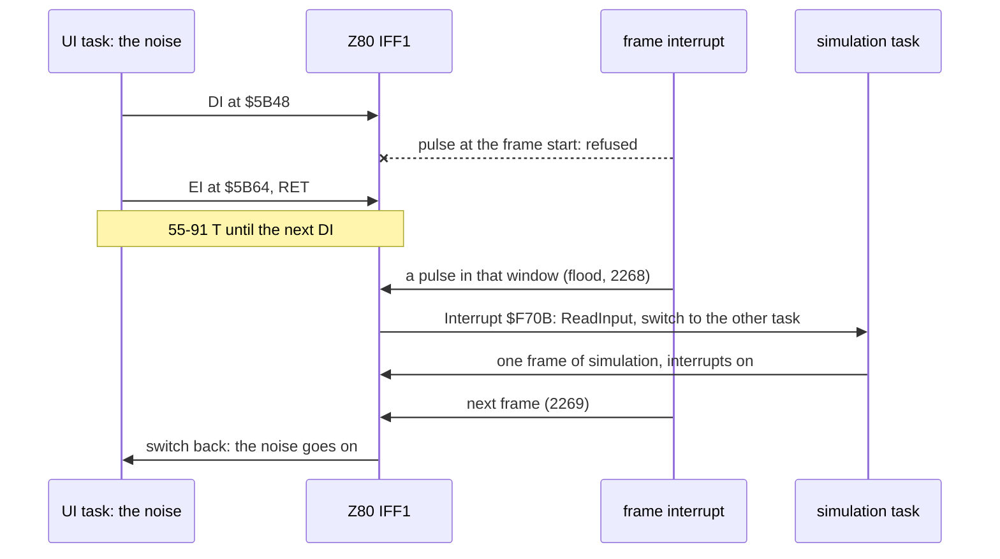

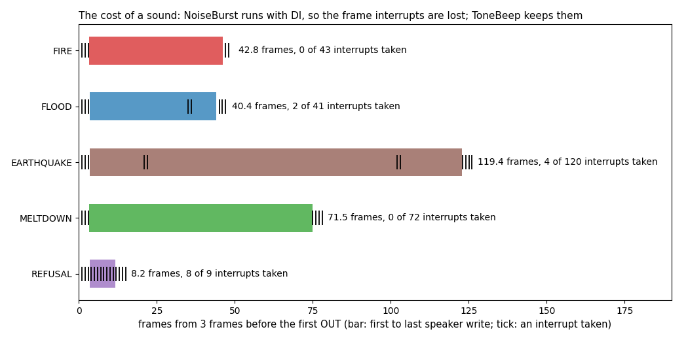

*Drawn by `python3 tools/fig_sound.py cost` from `work/docs/scD/dis-*.json` and `tools-occupied.json` (`disasters`
frames 131-11094, `tools` frames 13431-13446).*

How to read the figure:

- **Each bar** runs from a sound's first speaker write to its last, in frames, from 3 frames before it.
- **Each tick** is an interrupt taken. Left of the bars the interrupts come every frame; inside a noise bar they stop.
- **The text** gives the length and how many of the frames' interrupts were taken.
- **The point**: during a fire or a meltdown no interrupt is taken at all, 43 and 72 frames. The flood and the
  earthquake let pairs through (one to switch away, one to switch back), the earthquake with its widest window most.
  The refusal tone keeps all of them.

Worked example: the flood's pair. At frame 2268 the burst's `EI` at `$5B64` runs at T1822 and its `RET` ends at
T1836, inside the pulse. The interrupt is taken and the handler entered at T1855. The handler switches to the
simulation task, which runs the rest of the frame. The next interrupt (2269 T1831) switches back. The speaker is
silent from 2267 T69786 to 2269 T3381, 1.05 frames: the gap at 0.63 s in the flood's WAV (9.8). The earthquake's
pairs are at 4421-4422 and 4502-4503.

| Sound | Length | Interrupts taken | What stops |
| --- | --- | --- | --- |
| fire | 42.8 frames | 0 of 43 | the keys, the simulation, the date |
| flood | 40.4 frames | 2 of 41 | the same, but for one frame |
| earthquake | 119.4 frames | 4 of 120 | the same, but for two frames |
| meltdown | 71.5 frames | 0 of 72 | the same |
| refusal | 8.2 frames | 8 of 9 (all: the ninth frame's pulse came after the tone) | the UI task only, busy with the tone |

The point: a disaster freezes the game for the length of its noise, up to 2.4 s for an earthquake. Nothing is lost
for good: the date and the city simply resume, but a key pressed in the meantime is never seen.

## 9.6 SOUND off: the interrupts never come back

NoiseBurst's first instruction is `DI`, and the SOUND test comes after it. When SoundOn `$A32D` is 0 (OPTIONS, SOUND
toggled off) the routine returns at `RET Z`, before its `EI`. Nothing in the UI task enables the interrupts again: the
handler's own `EI` at `$F74C` is never reached, because no interrupt is taken. So the first disaster noise with SOUND
off leaves the game without interrupts:

- ReadInput is never called again: no key is read, the pointer and the menus are dead;
- the task switch never happens: the simulation task stops, and the date stops with it;
- the UI loop goes on, alone and blind.

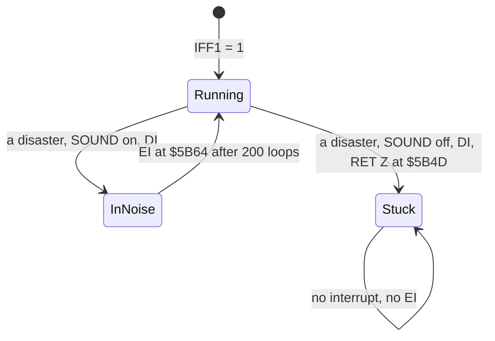

Witness (an experiment on a clone, `work/docs/scD/exp_soundoff.py`): the instance on port base 37080 loads
`work/stage1/rec/city2/end.szx`, runs 2 frames, writes SoundOn and DisasterDue `$916D` = 1 (FIRE, as the menu does),
then runs 400 frames in steps of 100 and holds P for 10 frames. The state is read after each step.

| | SOUND on (control) | SOUND off |
| --- | --- | --- |
| IFF1 after 100, 200, 300, 400 frames | 1, 1, 1, 1 | 0, 0, 0, 0 |
| the date | DEC 1935, then JAN 1936 from frame 100 | DEC 1935 to the end |
| UI passes in 410 frames | 116 | 228 (the UI task alone, never switched out) |
| KeyRowP `$5B05` with P held | `$BE` (P seen) | `$BF` (not seen) |

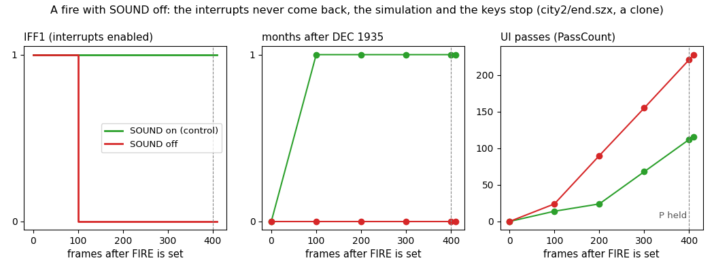

*Drawn by `python3 tools/fig_sound.py soundoff` from `work/docs/scD/exp-soundoff.json`; the experiment from
`city2`'s `end.szx` on a clone, 410 frames a run.*

How to read the figure:

- **Left**: IFF1 read after each step. With SOUND off it drops to 0 at the fire and stays there.
- **Middle**: months after DEC 1935. With SOUND on the year turns; with SOUND off the date never moves.
- **Right**: the UI passes, from PassCount `$8F9F`. With SOUND off the UI task gets the whole CPU, so it runs about
  twice as many passes.
- **The point**: switching the sound off turns the next disaster into a hang. The game looks alive (the UI loop still
  runs) but reads no key and runs no simulation.

Known only from the code: a `HALT` reached in this state would never return. The menus and the number fields wait
with `HALT` (RunMenu `$6944`, EditNumber `$6996`, [8.9](08-hud-and-text.md#89-menus-and-dialogs)). The keys are dead
before a menu can be opened, so no recording can reach it.

The second effect of SOUND, also known only from the code: the noise draws Random once for each bit it sends (4542
draws for a fire). With SOUND off those draws are skipped, so the same game played with and without sound takes a
different random sequence after its first disaster: other fires, other zone growth.

The point: the authors put the `DI` first to protect the noise loop, and the gate after it. With the gate first, or an
`EI` before the `RET Z`, the option would work as meant.

## 9.7 The data sheet

Pitches from the opcode model, uncontended. Brackets give what was measured.

| Routine | Address | Writes a call | Period or sample, T | Pitch | Length a call | Interrupts | Callers |
| --- | --- | ---: | --- | --- | --- | --- | --- |
| NoiseBurst | `$5B48` | the D in 1..200 with D AND E = 0 | 305 a bit sent, 50 a loop without | noise at 11.5 kHz / (E + 1) for E = 2^k - 1 | 10 000 + 255 x bits T (E = 0: 61 000; 73 000-74 400 measured) | `DI` ... `EI`; off for good with SOUND off | the four below |
| FireNoise | `$9108` | 4542 | E = B AND `$3F`, B 127..1 | two swelling hisses | 42.8 frames | off | FireDisaster `$90AC` |
| FloodNoise | `$9116` | 3764 | E = NOT B AND `$7F` | a hiss thinning out | 40.4 frames | off | FloodDisaster `$90DA` |
| the earthquake's loop | `$912E` | 16 276 | E = C >> 4, C 0..254 | a long hiss, lowering | 119.4 frames | off | Earthquake `$9125` |
| CrashNoise | `$78BD` | 5824 | E = 0..254 | a hiss to single clicks | 71.5 frames | off | NuclearMeltdown `$7913` (`JR`), MovePlane `$787E` |
| ToneBeep | `$5B66` | 1000 | 638 + 251 = 889 (966 + 378 in the display) | 3937 Hz (2604 Hz) | 444 500 T, 127 ms (164 ms) | on | Refuse `$71FC` (`JP`) |

Variables: SoundOn `$A32D` (1 at load; the OPTIONS toggle), RandomSeed `$5CC4` (stepped by every noise bit), KeyRows
`$5B00` (read by Refuse), DisasterDue `$916D` (which disaster, hence which noise).

The point: the whole sound system is two loops and one byte of state. Everything else is in the callers' choice of E.

## 9.8 The sounds rendered

The audio files in `docs/audio` are rendered from the traced speaker writes, edge by edge. The speaker bit is held
between writes at 44.1 kHz, 16-bit mono, through a soft high-pass (a real speaker passes no DC), with 30 ms of silence
after. No emulator audio was recorded and none was played.

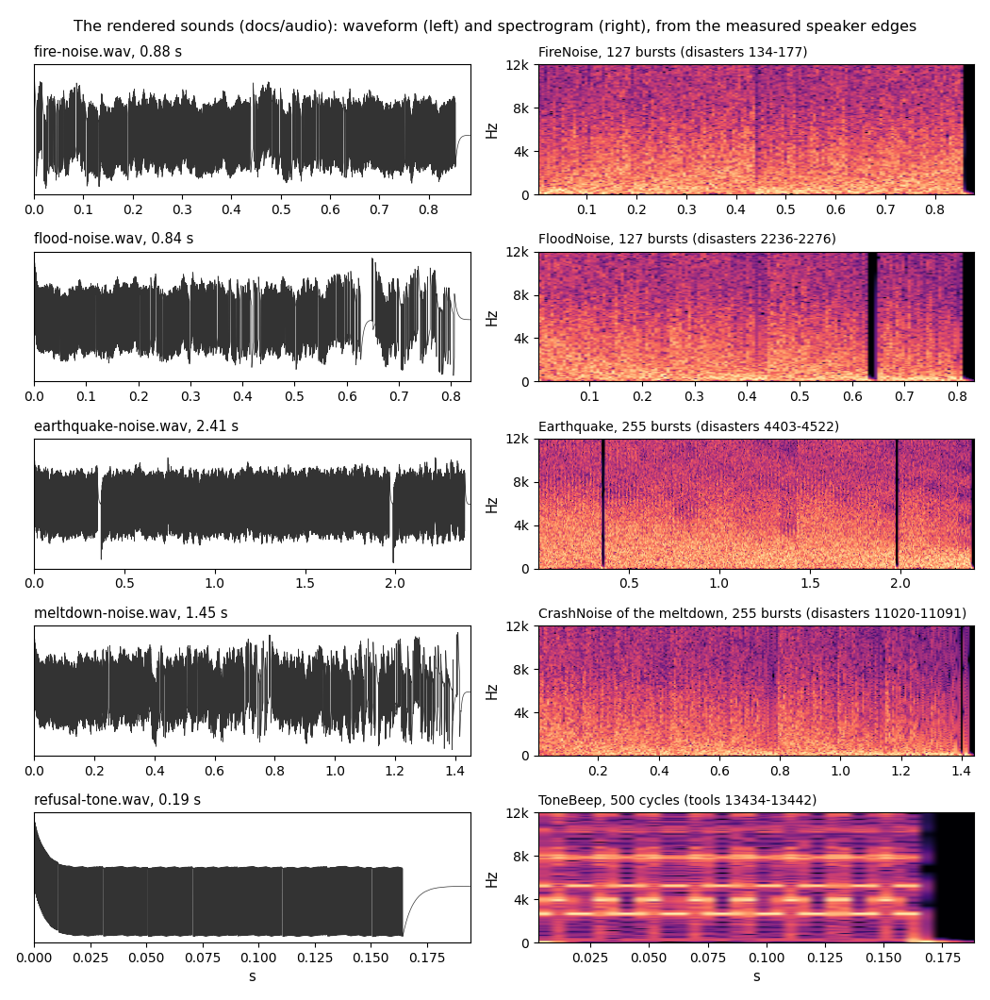

*Drawn by `python3 tools/fig_sound.py waves` from the WAVs of `python3 tools/fig_sound.py wav` (the `disasters` and
`tools` events above).*

How to read the figure:

- **Left**: each WAV as written, after the high-pass, against seconds.
- **Right**: its spectrogram, 0-12 kHz, bright where the energy is.
- **The black stripes** in the flood (0.63 s) and the earthquake (0.35 s, 1.98 s) are the frames in which an
  interrupt got in and the noise paused (9.5).
- **The point**: the noises fill the whole band and thin out as E grows: fewer bits, a sparser noise. The refusal
  tone is a set of lines, its 2.6 kHz fundamental and their harmonics, broken 50 times a second by the 3.9 kHz border
  stretches.

| File | Recording, frames | What |
| --- | --- | --- |
| [fire-noise.wav](audio/fire-noise.wav) | `disasters` 134-177 | FireNoise, 127 bursts |
| [flood-noise.wav](audio/flood-noise.wav) | `disasters` 2236-2276 | FloodNoise, 127 bursts, one pause |
| [earthquake-noise.wav](audio/earthquake-noise.wav) | `disasters` 4403-4522 | the earthquake, 255 bursts, two pauses |
| [meltdown-noise.wav](audio/meltdown-noise.wav) | `disasters` 11020-11091 | CrashNoise of the meltdown, 255 bursts |
| [refusal-tone.wav](audio/refusal-tone.wav) | `tools` 13434-13442 | ToneBeep, a road refused on an occupied cell |

The point: the five files are every sound the game makes; the plane crash would sound like the meltdown.

## 9.9 Not reached and known only from the code

- **The plane crash noise.** AirCrash `$78FE` only sets PlaneTimer; the crash and its CrashNoise come from MovePlane
  when a plane is out and the timer runs out. In `disasters` AirCrash ran at frame 6586 with no plane out, and no
  noise came in frames 6560-7500. The sound would be the meltdown's: the same CrashNoise.
- **The tornado** makes no sound: StartTornado `$796C` calls no sound routine, and frames 8800-8900 of `disasters`
  have no speaker write.
- **The other refusals.** L1 counts 3 ToneBeep calls in `tools`. One (13434) was traced. The seaport refusal the
  WALKTHROUGH names was not found in frames 12496-12530 and 12628-12668. ParkTool's refusal on map column 2 (it tests
  the column left in A by ClickMapAddr, not the cell) is known only from the code.
- **SOUND off** (9.6): the hang was shown on a clone; no stage-1 recording turns SOUND off before a disaster. The
  effect on the random sequence is known only from the code.
- **A HALT with interrupts off** (9.6) is known only from the code.
- **The tape tones** of save and load are the ROM's (SA-BYTES, LD-BYTES) and are not rendered here.
