# 10. Gameplay logic

What this covers: the rules of SimCity as the simulation task enforces them (profile: a simulation, AGENTS.md 4.0).
One pass of `SimTask $835F` counts the city, floods power from the plants, steps every zone and building, decays
pollution and traffic, and computes demand; at a month end it closes the month and, in December, the budget. The
sections follow the pass: power, the zone score, the growth rules, demand, trips and traffic, the stamps and
coverage, funding and taxes, the special buildings, the category and the growth ceiling. Then the generator from the
seed, every disaster, the tools' placement rules, the notable features and what is known only from the code. The data
these rules work on (cells, buildings, arrays, variables) is in [doc 07](07-objects.md); the two tasks and the speed
table are in [doc 04](04-game-loop.md).

The recordings and states it rests on (WALKTHROUGH 6.0), opened on own instances (port base 37070) after
`source work/env.sh`:

- `growth`: a village with a coal plant, 51 985 frames, at NORMAL speed until about frame 11 000 (simulation pass
  36) and FAST after (the speed bytes `$8F67`: `04 03 1F 03 01` until the sample of frame 11 000, `08 01 0F 01 00`
  from 11 100), in `work/docs/scC/growth`. Map and variables every
  100 frames (`work/docs/scC/growth-vars.jsonl`), arrays every 1 000 (`growth-arrays.jsonl`). Traces: frames
  4528-4531 (a zone step), 19242-19266 (the power flood), and memory over frames 19232-19532 (pass 65, a month).
- `city`: 17 R, 8 C, 8 I zones (the bot laid 18 R; the one centred at row 45, column 35 was refused for a water cell
  in its box, [doc 07](07-objects.md)), a nuclear plant, police, fire and a stadium, 77 592 frames, in
  `work/docs/scC/city`; every 250 frames (`city-vars.jsonl`), with the budget variables.
- `disasters`: city2's town and each DISASTERS item with 2 000 frames after it, 13 050 frames, in
  `work/docs/scC/dis`; every 50 frames (`dis-vars.jsonl`).
- The stage 2 ceiling run (`work/stage2/ceiling.log`, `ceiling-end.szx`): metro's end at tax 0 for 80 000 frames.
- The stage-1 screenshots of the `tools`, `menus` and `disasters` recordings, named by their frame.

The samples were taken with `work/docs/scC/sample.py`; a sample of frame N is the memory at the start of frame N.

## 10.1 The simulation pass

The simulation is a task of its own, sharing the CPU with the UI task ([doc 04](04-game-loop.md)); it never waits
for a frame. A pass is one turn of this loop:

```asm
SimTask:
  CALL InitSimulation
SimTaskPass:
  CALL ClearCounters         ; $8443-$847F = 0
  CALL SetSpeed              ; GrowTries, IndChance, ComChance, MonthMask
  CALL PowerFlood            ; PowerMap from the plants
  CALL ScanCity              ; every byte: power bits, zones, buildings, cells
  CALL CoverStations         ; every 4th pass: fire and police cover
  CALL DecayPollution        ; every 2nd pass
  CALL DecayTraffic
  CALL DemandOf              ; R, C, I demand from the zone counts
  CALL Averages2             ; crime, land value
  CALL AssessCity            ; the city's value
  CALL PopBalanceOf
  CALL ServiceNeeds          ; hospital, church
  CALL Advise                ; the advice line
  CALL Averages              ; centre, last counts, pollution average
  LD A,(SimPass)
  LD HL,MonthMask
  AND (HL)
  JR NZ,SimTaskNext
  CALL MonthEnd              ; LastPop; December: the year end
  CALL NextMonth
SimTaskNext:
  LD HL,SimPass
  INC (HL)
  JR SimTaskPass
```

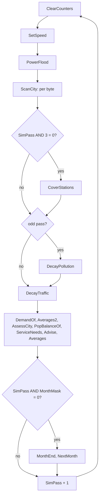

ScanCity `$86C9` is the body of the pass. For every byte of the map it:

1. sends a building top row byte (AND `$E0` = `$A0`) to BuildingPower and a zone centre (`$51-$56`) to ZonePower,
   which rewrite the power bit or the centre code from the PowerMap;
2. calls ZoneStep for a zone or building (CountPowered, WidenExtent, then the kind's routine), unless SimPaused;
3. calls CellStep for every cell below `$80`: fire, flood, radiation, roads and rails.

A month ends when SimPass AND MonthMask is 0: every pass at FAST, every 2nd at NORMAL, every 4th at SLOW
([doc 04](04-game-loop.md)). At FAST a month is one pass.

Worked example, `growth` pass 65 (FAST, so one month). The pass starts in frame 19 232, and doc 04 measures a
`growth` pass at about 299 wall frames. PowerFlood's FloodFill runs in frames 19 242-19 266 (the trace of 10.2), and
ScanCity takes most of the rest. At the pass's start the memory already holds Month 11 (December 1905), while the
screen still shows NOV 1905 until the UI task's next date print.

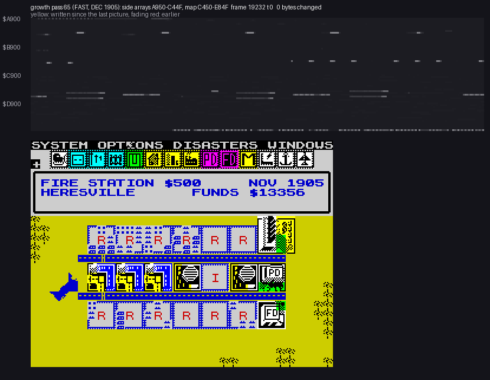

How to read the animation (the pass of the worked example; doc 04 shows a pass of the bigger `city2` in
[4.6](04-game-loop.md#46-the-simulation-tasks-pass)):

- `growth` frames 19 232-19 532, one picture every 5 frames, 61 pictures. On top the memory `$A900-$E8FF` at 3
  pixels a byte, one row a 256-byte page: the side arrays (`$A950-$C44F`), then the map (`$C450-$E84F`). The screen
  is below.
- Each picture colours the bytes written since the previous one, yellow fading through red. Only bytes whose value
  changed show, so a byte rewritten with the same value stays grey.
- Frames 19 242-19 267: PowerFlood rewrites the PowerMap (`$BFD0-$C44F`), 69 bytes in all.
- Frames 19 272-19 347: nothing is written while ScanCity walks the empty rows above the town.
- Frames 19 352-19 402: the town's zones step. They stamp Pollution and Traffic and change 17 map bytes, among them
  the I zone at rows 42-44, columns 48-50, which becomes an I building (top byte `$B3`) in frame 19 387.
- About frame 19 512: DecayPollution (pass 65 is odd) changes 74 Pollution bytes, then DecayTraffic 9 Traffic bytes.
- By frame 19 527 SimPass is 66 and Month 0 (JAN 1906). The screen's date turns from NOV to DEC 1905 meanwhile.
- Command: `python3 ../../kit/memanim.py --work work/docs/scC/growth --from 19232:0 --to 19532:0 --step 349440
  --from-address 0xA900 --to-address 0xE8FF --screen --cell 3 --delay 120 --hold 2500 --width 1050 --label 'growth
  pass 65 (FAST, DEC 1905): side arrays A950-C44F, map C450-E84F' docs/img/routines/SimTask-growth.gif`. The counts
  above are from `work/review/fixC/simtask_diff.py`.

**The point**: the simulation is a sweep, not an event system. Every rule is applied once per pass to every byte, in
map order, and a month is a whole number of passes, so a bigger city has longer months in wall time.

## 10.2 Power

PowerFlood `$7FCD` rebuilds the PowerMap from nothing each pass. FindPlants lists the plants (CPIR for a top row byte
`$B4` with type 6 or 8). Each plant floods from its top-left cell with a budget of cells: 1350 (`$0546`) for nuclear,
450 (`$01C2`) for coal. FloodFill `$811D` is a scan-line fill: it pops a cell, runs left to the first non-conductive
cell, then right, powering each cell and marking the rows above and below for a push.

A cell conducts (IsConductive) when it is on the map, not powered yet, and either a building byte or a cell with
CellFlags bit 3 (power lines, crossings with power, zone cells). Roads and rails do not carry power.

```asm
PowerCell:
  PUSH BC
  CALL PowerBit              ; HL, E = the cell's bit in PowerMap
  LD A,(HL)
  OR E
  LD (HL),A
  POP BC
  LD HL,(FloodBudget)
  DEC HL
  LD (FloodBudget),HL
  LD A,H
  OR L
  RET NZ
  LD SP,(FloodSP)            ; budget spent: drop the whole flood at once
  LD HL,Brownout
  INC (HL)
  RET                        ; returns from FloodFill itself
```

The exit is a stack trick: FloodSP holds SP as it was at FloodFill's start, so the RET after `LD SP,(FloodSP)`
returns from FloodFill, however deep the fill was. FloodPush silently drops a span when CellStack (128 pairs) is full,
and a plant whose top cell an earlier plant's flood already reached floods nothing (FloodFill's first IsConductive
fails), so its budget is lost.

The plant list has no bound either. PowerPlants `$7F78` is 16 words: 15 plants and the terminator word 0.
FindPlants stores every plant it finds and then the 0, without counting:

```asm
FindPlants:
  LD IX,PowerPlants          ; $7F98: DD 21 78 7F
  LD HL,CityMap
  LD BC,$2400
FindPlantsLoop:
  LD A,$B4
  CPIR                       ; the next top byte $B4
  ...                        ; type 6 or 8: FindPlantsFound
  LD (IX+$00),$00            ; the end: the terminator, wherever IX is
  LD (IX+$01),$00
  RET
FindPlantsFound:
  DEC HL
  LD (IX+$00),L
  INC IX
  LD (IX+$00),H              ; no test of IX against the list's end
  INC IX
  INC HL
  JR FindPlantsLoop
```

With 16 plants the 16th takes the terminator's slot `$7F96` and the 0 lands on `$7F98-$7F99`, the `DD 21` of
FindPlants' own `LD IX,PowerPlants`. That pass still floods correctly (the list ends at `$7F98`). From the next
pass FindPlants starts with `NOP`, `NOP`, `LD A,B`, `LD A,A` instead of the load, so IX keeps whatever the
last routine that used it left there, and the list is written at that address, over other memory. The money is
there: 16 coal plants cost 48 000, and the city recording had Funds near 1 000 000. The overflow is read from the
code; what the stale IX then destroys was not run.

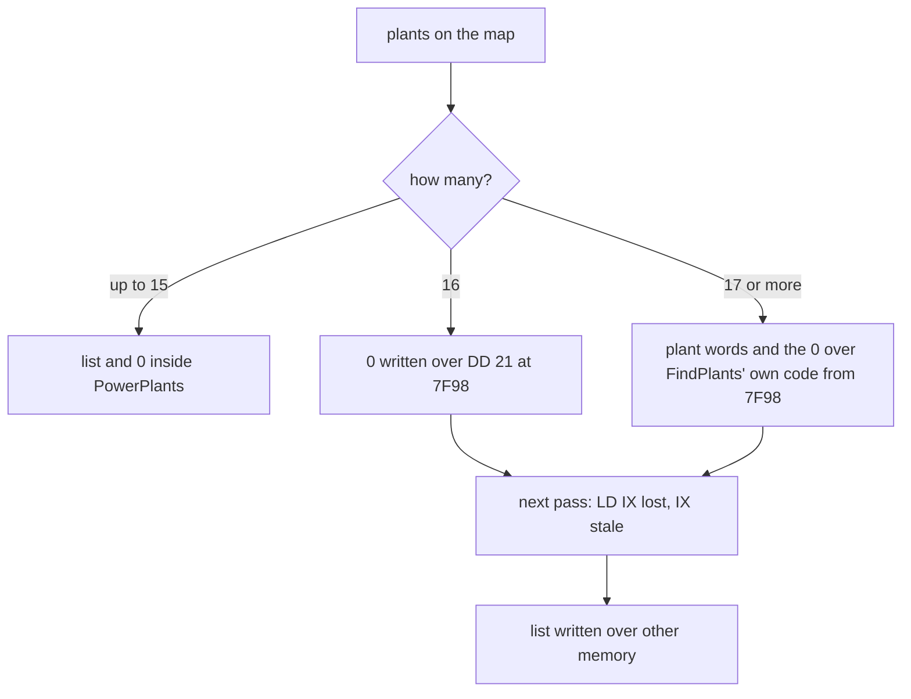

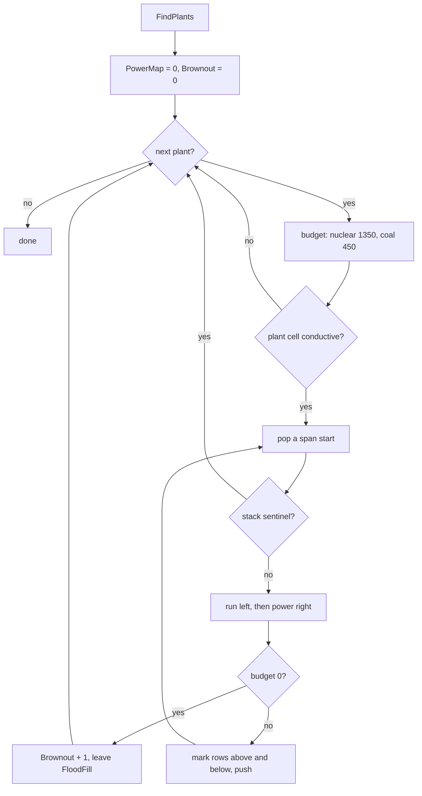

Then ScanCity's ZonePower turns `$54-$56` into `$51-$53` where the bit is set, and back where it is not; the
centre tile shows the difference on screen ([doc 06](06-rendering.md)).

Worked example, `growth` frames 19 243-19 265: one coal plant, budget 450. The PowerMap popcount goes from 0 to 198
cells: the plant, the line and the 12 zones, with 252 cells of budget left, so no brownout (Brownout stays 0 in
every sample of the recording).

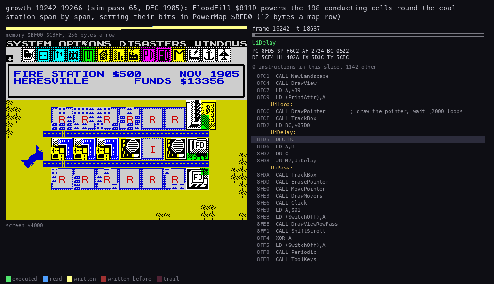

How to read the animation:

- `growth` frames 19 242:0-19 266:0, 90 pictures; the grid is `$BF00-$C3FF`, which holds the PowerMap `$BFD0-$C44F`
  (12 bytes a map row).
- Highlighted: the bytes FloodFill and PowerBit (`$75F1-$7635`) touch in each slice; the bits fill row by row along
  the zones and the line.
- Command: `python3 ../../kit/routine_anim.py --work work/docs/scC/growth --window 19242:0-19266:0 --listing build/game.lst --range BF00-C3FF --pc 811D-81DD,75F1-7635 --out docs/img/routines/FloodFill.gif`.

**The point**: power is a reachability question asked again every pass, with a cell budget per plant. A coal plant
powers 450 cells, at most 50 zones' worth; past that the far end of the city goes dark, and the order of the plants
in memory decides which end.

## 10.3 The ring, the land value and the zone score

Every zone step starts with ScanRing `$7D34` round the 3 x 3 (ScanRingSize for 4 x 4 and 6 x 6 buildings). It reads
the 12 cells that touch the zone's sides (no corners) and the 9 inside:

| Ring cell | Counter | Amenity |
| --- | --- | --- |
| road or rail (flags AND 6) | RingTransport +1; RouteStart: the first, then each next 1 in 2 | +12 |
| park `$38`/`$39` | RingParks | +14 |
| water `$00` | RingWater | +16 |
| trees `$06` | RingTrees | +16 |

RingAmenity is capped at `$7F`. The inside cells add (cell - `$3B`) to Density for each developed cell
(ScanInsideCell). Buildings in the ring count nothing.

Then ZoneScoreOf `$7EC4` combines four terms:

- **Land value** (LandValueOf `$7E1D`): 0 unless the zone is powered, has transport in its ring, and either made a
  trip this pass (TripMade) or has traffic of 50 or more (ZoneTraffic, the highest Traffic byte of its 2 x 2). Else
  LV = (127 - the distance to CityCentre, at least 0) + RingAmenity. The distance is |dx| + |dy| in cells. CityCentre is the middle of the bounding box of all zones and buildings
  seen in the last pass (WidenExtent / MinMax in ZoneStep, Averages `$84A4` at the pass end); it starts at 32, 32 and
  becomes 127, 127 (off the map) after a pass with no zones, so the first zone built after that scores as if the
  centre were beyond the bottom right corner.
- **Crime** (CrimeOf `$7E6A`): (255 - LV) >> 4 minus the police cover at the zone, at least 0.
- **Tax penalty** (TaxPenaltyOf `$7E9B`): 8 x TaxRate on easy, 10 x on medium, 9 x on difficult.
- **Pollution**: ZonePollutionMax, the highest Pollution byte under the zone (0 for industry).

```asm
ZoneScoreOf:
  CALL LandValueOf
  CALL CrimeOf
  CALL TaxPenaltyOf
  LD A,(ZonePollutionMax)
  CP $1C
  JR NC,ZoneScoreZero        ; pollution 28 or more: score 0
  LD A,(LandValue)
  AND A
  JR Z,ZoneScoreZero         ; no land value: score 0
  LD HL,ZonePollutionMax
  SUB (HL)
  JR NC,ZoneScoreCrime
  XOR A
ZoneScoreCrime:
  LD HL,Crime
  SUB (HL)
  JR NC,ZoneScoreTax
  XOR A
ZoneScoreTax:
  LD HL,TaxPenalty
  SUB (HL)
  JR NC,ZoneScoreDemand
  XOR A
ZoneScoreDemand:
  LD L,A
  LD H,$00
  LD DE,(ZoneDemand)         ; signed 16 bits
  ADD HL,DE
  CALL Clamp8                ; 0-255
  LD A,L
  LD (ZoneScore),A
  RET
```

TaxPenaltyOf adds the rate once more for any level above easy, then once more unless the level is 2:

```asm
TaxPenaltyOf:
  LD A,(TaxRate)
  LD B,A
  ADD A,A
  ADD A,A
  ADD A,A
  LD (TaxPenalty),A          ; 8 T
  LD A,(Level)
  AND A
  RET Z                      ; easy: 8 T
  LD A,(TaxPenalty)
  ADD A,B
  LD (TaxPenalty),A          ; 9 T
  LD A,(Level)
  CP $02
  RET Z                      ; difficult: 9 T
  LD A,(TaxPenalty)
  ADD A,B
  LD (TaxPenalty),A          ; medium: 10 T
  RET
```

So medium punishes taxes harder than difficult.

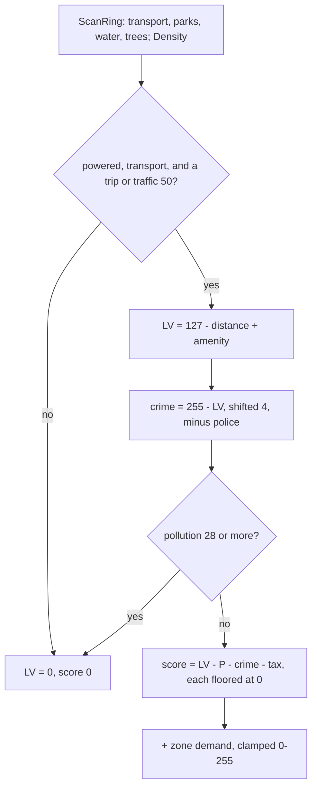

Worked example, `growth` frame 9 000 (the sample's variables belong to the last zone ScanCity stepped before the
frame started): LV 151, pollution 9, crime (255 - 151) >> 4 = 6 with no police there, tax 8 x 7 = 56 (easy),
demand -26. Score = 151 - 9 - 6 - 56 - 26 = 54, the stored ZoneScore, and ResTile = 27. The other two zones of the
figure work the same way: `city` frame 15 750 gives 150 - 7 - 6 - 56 - 34 = 47, and `growth` frame 8 100 gives
191 - 0 - 4 - 56 - 22 = 109. That one is an I zone, whose step zeroes the pollution term. ResTile is 0, so it is not
an R zone, and IndLevel was rewritten in frame 8 097 as the scan stepped the I zones centred on row 43. ComDemand and
IndDemand are both -22 there, so the demand alone cannot tell C from I.

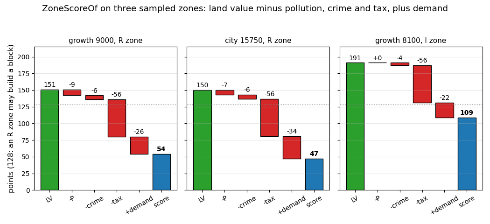

How to read the figure:

- Three sampled zones: `growth` frame 9 000 (R), `city` frame 15 750 (R), `growth` frame 8 100 (I).
- Green bars add, red bars subtract, blue is the score that ZoneScoreOf stored in the same sample.
- The dotted line at 128 is where an R zone's ResLevel stops being `$0F` ([10.4](#104-the-growth-rules-of-r-c-and-i)).
- Command: `python3 tools/fig_sim.py score --out docs/img/sim/score.png` (the terms read from the samples
  `work/docs/scC/growth-vars.jsonl` and `city-vars.jsonl`, range `$7E17-$7F11`).

**The point**: land value is distance from the centre plus scenery, and only a connected, powered zone has any. The
tax term is large: at the default 7 % it is 56 points, a third of a good zone's land value.

## 10.4 The growth rules of R, C and I

Each kind turns its score into a target and moves one step toward it per pass.

**Residential** (ResidentialStep `$8AA3`, centre `$51` or `$54`):

1. ScanRing; ResPop + 1; Population += 16 x Density.
2. TripMade = RingTransport. If (Random AND 63) < Density, MakeTrip toward C or I (targets 10, 11).
3. ZonePollution; ZoneDemand = ResDemand; ResidentialScore: ResTile = score / 2, ResLevel = `$0F` below 128, else
   (score - 128) >> 4 with ResTile = 16 ResLevel + `$50`.
4. Density 63 or more: ResidentialBuild (a hospital if HospitalNeed, else a church if ChurchNeed, else an R block of
   level 0). Else Density < ResTile: GrowZone, else DeclineZone.

```asm
ResidentialScoreIt:
  CALL ZonePollution
  LD HL,(ResDemand)
  LD (ZoneDemand),HL
  CALL ResidentialScore
  LD A,(Density)
  CP $10
  JR C,ResidentialGrow       ; jumps to the next instruction: a no-op
ResidentialGrow:
  LD A,(Density)
  CP $3F
  JR NC,ResidentialBuild     ; 63 or more: a building
  LD HL,ResTile
  CP (HL)
  JP C,GrowZone              ; below the target: one house up
  JP DeclineZone             ; else one house down
```

ResidentialStep never tests power. An unpowered zone has LV 0, so score 0 and ResTile 0, and it declines house by
house.

**R block** (ResBuildingStep `$8B37`, types `$11-$14`): Density is the kind's 96-192, so 1536-3072 people. It
scores like a zone, then with the IndChance mask: ResLevel 8 or more (a score below 128) puts the houses back
(ResRevertZone, Density 56); else the block of level ResLevel / 2. It copies only the low byte of ResDemand into
ZoneDemand (`LD A,(ResDemand)`), so the high byte left by the previous zone decides the demand's sign.

**Commercial** (CommercialStep `$8BC4`, ComBuildingStep `$8BE0`): ComPop + 1; an empty zone returns if unpowered (a
C building steps without a power test).
A trip if (Random AND 31) < Density, toward I or R (targets 11, 9). Score with ComDemand; ComLevel = score / 25
(0-10). On the ComChance mask: level 0, or LastPop 0 (NoGrowthAlone), puts the empty zone back (ComRevert);
else the building variant ComBuildings[level - 1] (0-3).

**Industrial** (IndustrialStep `$8C5B`, IndBuildingStep `$8C77`): IndPop + 1; an empty zone returns if unpowered (an
I building steps without a power test). A trip if (Random AND 63) < Density, toward R only (targets 9, 9). Pollution
does not count (ZonePollutionMax = 0). IndLevel = score / 31 (0-8). On the IndChance mask: level 0 or LastPop 0
reverts (IndRevert ends in `JP PutBuildingSize`, no stamp), else the building (IndLevel - 1) / 2 and a pollution stamp
of strength 4 x IndLevel. Off the mask it only stamps. So every pass but a revert stamps.

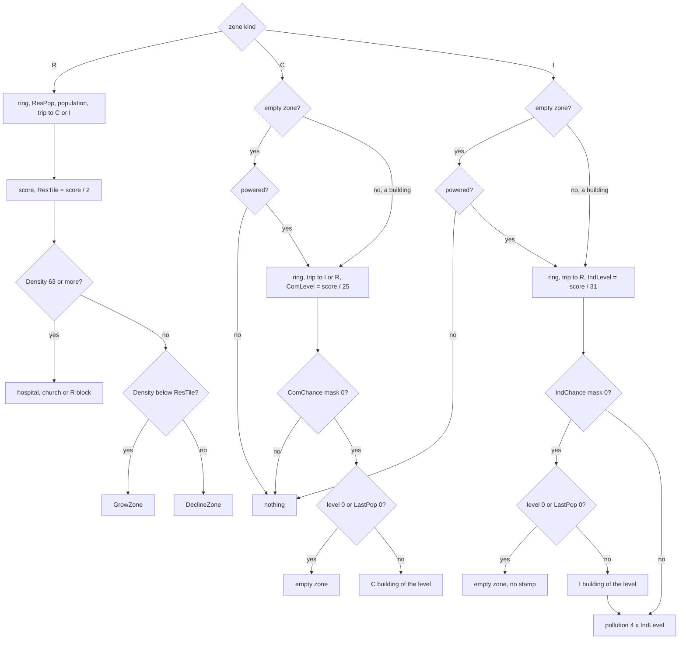

The chance masks are the speed's ([doc 04](04-game-loop.md)): at FAST industry acts 1 time in 2, commerce 1 in 16.
The residential zones move every pass by GrowTries attempts.

Worked example, the city district of the animation below (the `city` samples, one every 250 frames). The R centres
appear unpowered (`$54`) from frame 9 250 and are all powered (`$51`) by frame 16 000; ResPop counts 17 of them.
Population is 1 344 at frame 16 000, 4 976 at 25 000 and 5 600-5 800 at 72 500-75 000. That is 16 x the sum of
densities, so the 17 zones average a density of about 21, a target ResTile of about 21 and a score of about 42. The C
zones become buildings of types `$15`/`$16` (variants 0 and 1) and the I zones `$1A`/`$1B`. ComBuildings maps
ComLevel 1-2 to variant 0 and 3-5 to variant 1, so `$16` means a score of 75-149 when the chance mask fired; for I
the variant is (IndLevel - 1) / 2, so `$1B` means IndLevel 3-4, a score of 93-154. No higher variant appears in any
sample, so at those moments C scores stayed below 150 and I scores below 155.

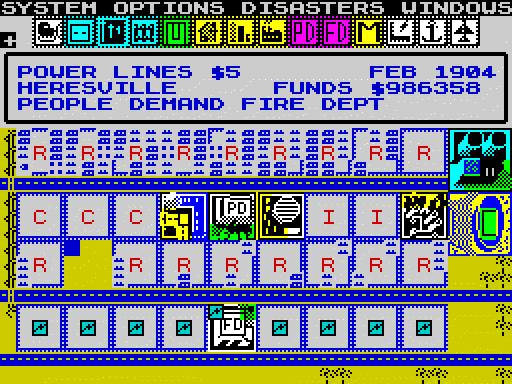

How to read the animation:

- `city` frames 16 400-46 400, one picture every 600 frames, the screen as unreal-ng shows it.
- The R zones fill with house tiles; the C and I zones turn into buildings and change their pictures with their level.
- Command: `python3 ../../kit/screen_anim.py --work work/docs/scC/city --from 16400 --to 46400 --step 600 --delay 150 --hold 2500 docs/img/play/city-district-growth.gif`.

One zone of it, step by step, is the figure of [doc 07.3](07-objects.md#73-zones-the-map-is-the-record).

**The point**: R grows a house at a time toward half its score, C and I jump between levels on a dice roll. The R
target is half the score, so a zone only reaches the block stage (Density 63) when its score is about 128: a rich,
untaxed, central zone.

## 10.5 Population and demand

Population (`$8443`, 24 bits) is the pass's sum of 16 x Density over R zones and R blocks: 16 x the sum of the R
densities. ResPop, ComPop and IndPop count zones, not people. DemandOf `$8282` turns the zone counts into three
signed demands:

- ResDemand = 8 (C + I - R) + 4 x Stadiums - 26
- ComDemand = 8 ((R + I) / 2 - C) + 4 x Airports - 30
- IndDemand = 8 ((R + C) / 2 - I) + 4 x Seaports - 30

```asm
DemandOf:
  LD DE,(ComPop)
  LD HL,(IndPop)
  ADD HL,DE
  LD DE,(ResPop)
  AND A
  SBC HL,DE                  ; C + I - R
  ADD HL,HL
  ADD HL,HL
  ADD HL,HL                  ; x 8
  EX DE,HL
  LD HL,(StadiumCount)
  ADD HL,HL
  ADD HL,HL                  ; 4 x stadiums
  EX DE,HL
  ADD HL,DE
  LD DE,$FFE6                ; - 26
  ADD HL,DE
  LD (ResDemand),HL
  ...                        ; C and I the same way, - 30 each
```

PopBalanceOf stores 4 (R - C - I). The demand goes into the zone score unweighted, so a balanced city (R = C + I)
still has -26 for every R zone; only stadiums lift it.

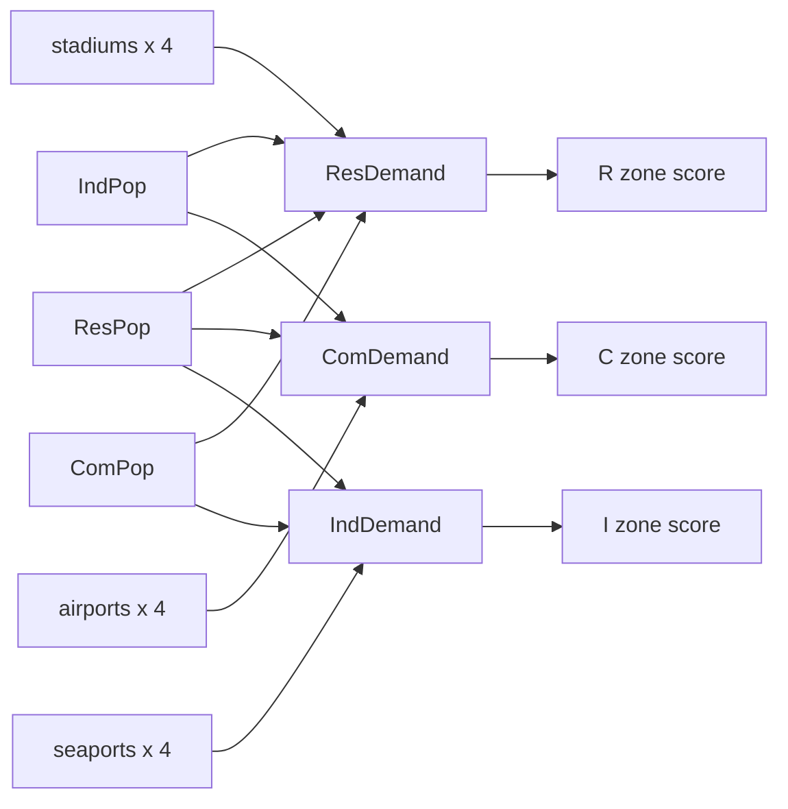

Worked example, `growth` frame 9 100: R = 12, C + I = 6, no stadium: ResDemand = 8 x (-6) - 26 = -74, the value
in the sample. In `city` from frame 16 000: R 17, C 8, I 8-10, so C + I - R is -1 to 1 and ResDemand takes only
-34, -26 and -18 in the full samples. ComDemand and IndDemand are near 0 (8 x (12 - 8) - 30 = 2).

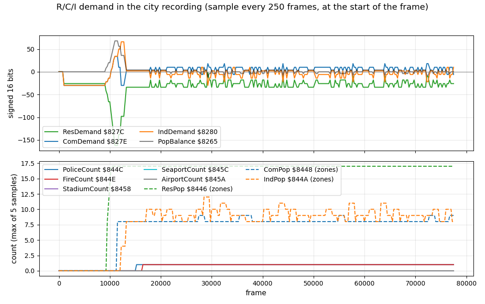

How to read the figure:

- Top: the three demands and PopBalance in each sample. The spike near frame 10 000 is the bot laying zones: R first
  (ResDemand falls to -170), then C and I.
- Bottom: the counts, each the highest of five neighbouring samples (a sample mid-pass holds a partial count).
- Command: `python3 tools/fig_sim.py demand --samples work/docs/scC/city-vars.jsonl --out docs/img/sim/demand.png`.

**The point**: demand only balances the three kinds against each other. It never says "more people": with C + I = R
the residential score loses 26 points, and the cure in the code is a stadium, worth 4 points each.

## 10.6 Trips and traffic

A zone with transport in its ring tries a trip on a random draw (10.4). MakeTrip `$856A` walks from RouteStart, the
transport cell ScanRing picked, along cells of the same network:

1. TripMask = the start cell's flags AND 6: a road trip stays on roads, a rail trip on rails. A start on a road and
   rail crossing (`$2E`/`$2F`, flags `%10000111`) gives TripMask 6, and that trip may use both networks.
2. TripWalk `$85D6`: up to 30 steps. TripStep `$8609` tries the four directions from a random one, never back,
   never onto a building, only onto a cell with TripMask. Every second step pushes the cell.
3. After each step TripArrived `$8660` looks at the four neighbours: a building or a house whose BuildingValue is one
   of the two TripTargets ends the trip. BuildingValue: houses 9 (R), and by building routine (BuildingValues
   `$7682`): R blocks and stadiums 9, C buildings and the airport 10, I buildings, the plants and the seaport 11.
4. A dead end: TripStep fails, one pushed cell is dropped, and the walk tries again from the same place without
   counting a step. With no way but back, it fails each time until the pushed cells run out: the trip is lost.
5. Success sets TripMade; a road trip then adds traffic: AddTripTraffic `$8599` gives each pushed cell +20 Traffic
   (capped at `$F0`) and a pollution stamp of strength 5 through TrafficKernel.

```asm
TripStepTry:
  LD A,(TripTurn)
  AND $03
  LD (TripDir),A
  LD HL,TripBack
  CP (HL)
  JR Z,TripStepNext          ; not back
  LD A,(TripDir)
  CALL NeighbourAddr
  LD A,(HL)
  BIT 7,A
  JR NZ,TripStepNext         ; not onto a building
  CALL CellFlagsOf
  LD HL,TripMask
  AND (HL)
  JR NZ,TripStepGo           ; same network
TripStepNext:
  LD HL,TripTurn
  INC (HL)
  LD HL,TripTries
  DEC (HL)
  JR NZ,TripStepTry
  SCF                        ; no way on
  RET
```

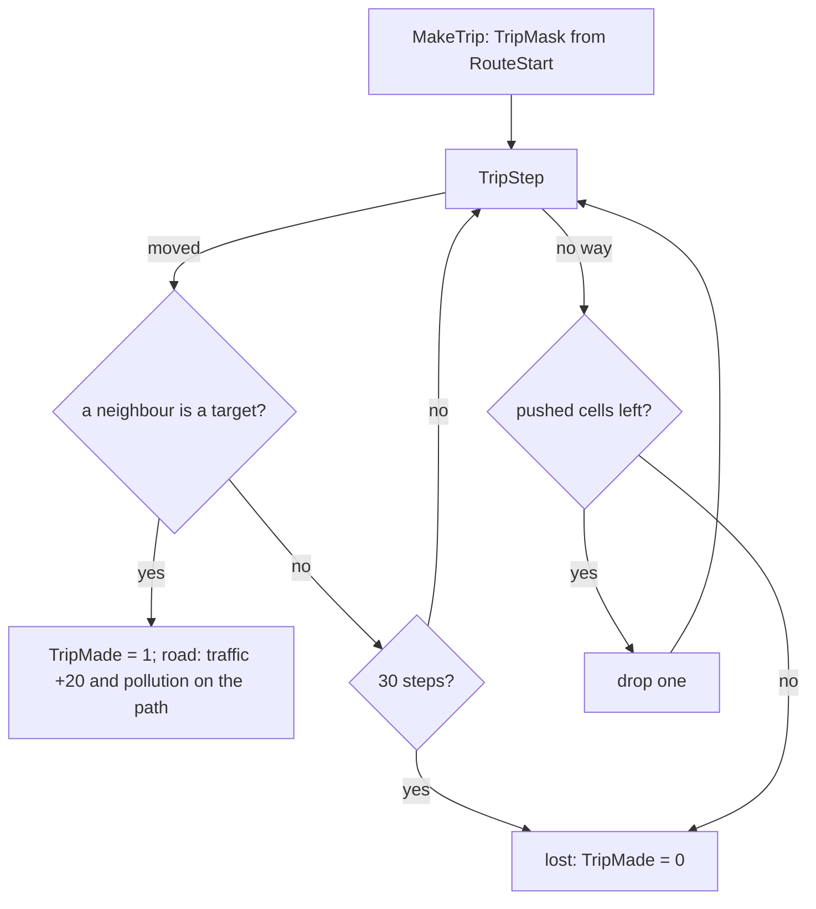

A lost trip matters: TripMade is one of the two ways to land value (10.3), and the other is traffic 50 or more. A
zone whose trips fail and whose roads are empty has LV 0 and declines.

The draw scales with Density, which has two consequences. An empty C or I zone has Density 0 (its nine bytes hold
no houses), so (Random AND 31) or (Random AND 63) < 0 never holds: an empty C or I zone never tries a trip, never
loses one (TripMade stays RingTransport) and never makes traffic; only the C and I buildings do. At the other end,
an R block's trip test in ResBuildingStep is (Random AND `$7F`) < Density with the block's 96-192: level 0 tries in
3 passes of 4, levels 1-3 in every pass.

DecayTraffic `$851B` then lowers every Traffic byte each pass: below 24 to 0, 200 or more by 34, else by 24.
Before each byte's decay it adds the nonzero ones into TrafficSum and TrafficCount, so AvgTraffic is the mean of the
nonzero cells only, / 4 (a sum past 65 535 stops adding). A trip path therefore keeps its traffic only while trips keep using it.

A road and rail crossing (`$2E`, `$2F`) counts as road in the network pass: CellStep tests bit 2 (road) first at
`$88BA` and goes to RoadCell, so a crossing never starts a train (StartTrain is called from RailCell), pays the road
upkeep of 1 instead of the rail upkeep of 4, and may crumble with the road decay. Trains still run over it, because
MoveTrain tests only bit 1.

Worked example, `metro` end: the Traffic panel of the [doc 07.4](07-objects.md#74-the-side-arrays) figure shows
where road trips ran in the last passes; rail cells hold no traffic, because AddTripTraffic runs for road trips
only.

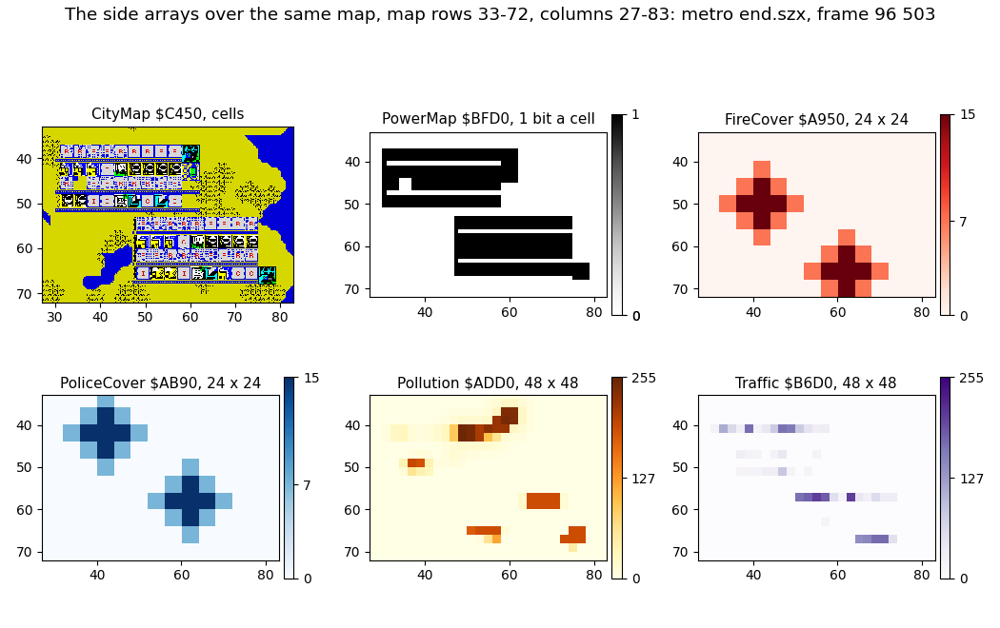

How to read the figure: the bottom right panel is Traffic, the bottom middle Pollution, where the trips' strength 5
stamps add to the industry's. Command: as in [doc 07.4](07-objects.md#74-the-side-arrays).

**The point**: a trip is a random walk of 30 steps along one network, looking for the right neighbour. Roads and
rails both serve the land value; only roads fill with traffic and smog, and a dead end kills every trip that enters
it.

## 10.7 Pollution, the stamps and the coverage

Three things are stamped into the side arrays through kernels of shifts k: the value added at a kernel cell is
strength >> (k - 1), and k = 9 adds nothing.

| Stamp | Kernel | Grid | Origin | Strengths |
| --- | --- | --- | --- | --- |
| StampPollution `$7CC0` | PollutionKernel `$7C77`, 6 x 6 | Grid48 | grid cell - `$62` (2 grid rows and 2 grid cells up-left) | coal `$FF`, nuclear `$30`, seaport `$60`, radiation `$40`, industry 4 x IndLevel, a trip cell 5 (TrafficKernel) |
| StampFire `$7C09` | CoverKernel `$7BEF`, 5 x 5 | Grid24 | grid cell - 50 (2 rows, 2 cells) | FireStrength 0-15 |
| StampPolice `$7C32` | CoverKernel | Grid24 | grid cell - 50 (2 rows, 2 cells) | PoliceStrength 0-15 |

Pollution adds up to `$FF`; coverage adds up to 15. CoverStations `$8680` runs every 4th pass (SimPass AND 3 = 0):
it clears both covers, then stamps for every top row byte AND `$F0` = `$B0` (a powered top row, any width) of type
0 (police) or 1 (fire). An unpowered station covers nothing. DecayPollution `$84DE` (odd passes) takes 64 from every
Pollution byte, at least 0.

AvgPollution has two writers, and neither averages the array. Both divide PollutionSum by PollutionCount, the sum
and count of ZonePollutionMax over the R zones, R blocks and C zones stepped this pass (ZonePollution adds them;
the I zones skip it). DecayPollution, on odd passes, stores that mean / 4;
Averages, the last step of every pass, stores it unscaled. Advise runs between the two, so it sees the / 4 value on
odd passes and the previous pass's unscaled value on even ones.

```asm
AddCover:
  LD B,(IX+$00)              ; the kernel's shift k
  DEC B
  JR Z,AddCoverAdd           ; k = 1: the full strength
AddCoverShift:
  SRL A
  DJNZ AddCoverShift         ; strength >> (k - 1)
AddCoverAdd:
  LD B,A
  LD A,(HL)
  ADD A,B
  CP $10
  ...                        ; clamped to 15
```

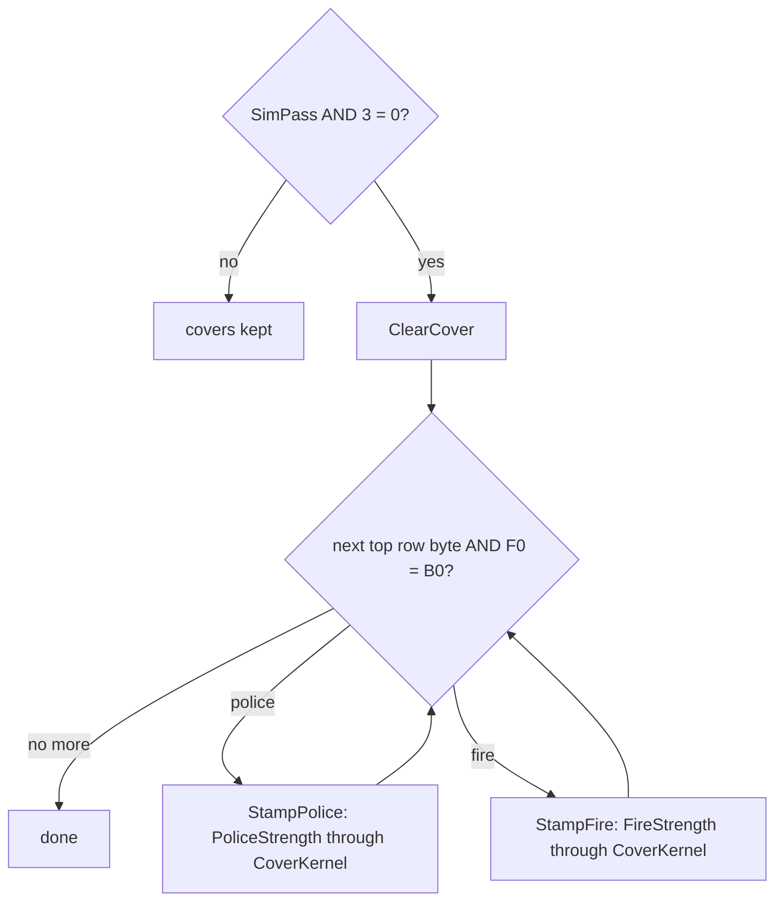

Coverage is used in two places: CrimeOf subtracts the police cover from a zone's crime (10.3), and FireCell's
chance to go out is (FireAt + 1) / 16 (10.12).

Worked example, the CoverKernel at FireStrength 15: the centre and its four neighbours get 15 (k = 1), the next
diamond of 8 cells 7 (k = 2), the corners nothing. A Grid24 cell is 4 x 4 map cells, so one station covers a diamond
about 20 map cells across. A coal plant's 6 x 6 pollution square (Grid48, 2 x 2 map cells a cell) adds 255 in its
centre 2 x 2, 127 or 63 in the next ring and 31 at the rim, the corners nothing. The plant stamps every pass and the
decay takes 64 every second pass. The inner 4 x 4 gains at least 126 between decays, so it saturates at 255 (191 just
after a decay). The rim gains only 62 between decays, less than the 64 taken, so it cycles 0, 31, 62 and never builds
up. The `growth` samples show exactly this round its coal plant: the core at 255 (191 at frame 50 000, sampled just
after a decay) and the rim at 62 (frames 48 000, 51 000) or 31 (49 000).

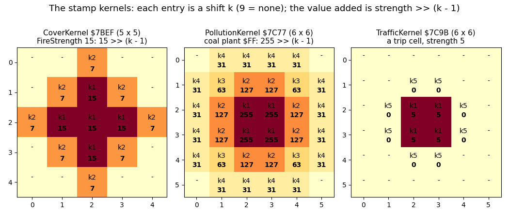

How to read the figure:

- Each grid is a kernel from src/res/tables: "kN" is the shift stored, the bold number the value added at the given
  strength.
- Left: CoverKernel at strength 15; middle: PollutionKernel at the coal plant's 255; right: TrafficKernel at a trip
  cell's 5 (only the 2 x 2 centre adds anything).
- Command: `python3 tools/fig_sim.py kernels --out docs/img/sim/kernels.png`.

**The point**: pollution and coverage are the same mechanism with different kernels. A coal plant zeroes the score
of every zone in the 8 x 8 map cells of its saturated core (pollution 28 or more) and, in the passes when its rim
holds 31 or 62, of the 12 x 12 round it. Traffic's own smog barely registers.

## 10.8 Funding, the budget and taxes

At the end of December MonthEnd `$8E94` copies the year's figures:

1. PopYearBefore = PopLastYear, PopLastYear = Population.
2. TransportCost = TransportUpkeep, PoliceCost = PoliceUpkeep, FireCost = FireUpkeep: the counters of that one pass
   (road 1, rail 4, bridges more; 100 per police or fire station, powered or not).
3. With AutoBudget, the figures are computed at once; else BudgetDue = 1: the UI task shows the budget window
   ([doc 08](08-hud-and-text.md)), and the simulation task waits at MonthEndWait `$8EE1` until the window clears
   BudgetDue. The UI task is not blocked.
4. TaxIncome = PopLastYear / 100 x TaxRate (TaxIncomeOf `$9329`). Each request is funded at its percentage
   (`$9256`, `$926F`, `$9288`, 100 at the start) and capped by the money (CapTransport, CapPolice, CapFire).
5. Funds = FundsAfter; ApplyFunding `$952A`.

ApplyFunding turns each funded share into the year's strength. The share is funded / (cost / 8), 8 when fully
funded; a cost below 20 counts as fully funded. Funding `$950A` holds the table: DecayMasks for roads and rails
(`$0F` at share 0 up to `$FF` from 7), StrengthLevels for police and fire (0, 3, 6, 7, 8, 10, 12, 15, 15 ...).

The fire branch tests the wrong cost:

```asm
ApplyFire:
  LD (PoliceStrength),A
  LD A,$0F
  LD HL,(TransportCost)      ; should be FireCost
  LD DE,$0014
  AND A
  SBC HL,DE
  JR C,ApplyFireStore        ; transport below 20: fire at 15
  LD HL,(FireCost)
  SRL H
  RR L
  SRL H
  RR L
  SRL H
  RR L                       ; FireCost / 8
  EX DE,HL
  LD HL,(FireFunded)
  CALL Div16                 ; by 0 when FireCost is 0: HL = 0
  LD C,L
  LD B,$00
  LD HL,StrengthLevels
  ADD HL,BC
  LD A,(HL)
ApplyFireStore:
  LD (FireStrength),A
  RET
```

So with a road network costing less than 20, the fire stations get full strength whatever their funding. With roads
costing 20 or more and no fire station, FireCost / 8 is 0, Div16 by zero returns 0, and FireStrength becomes
StrengthLevels[0] = 0, harmless while there is no station to stamp.

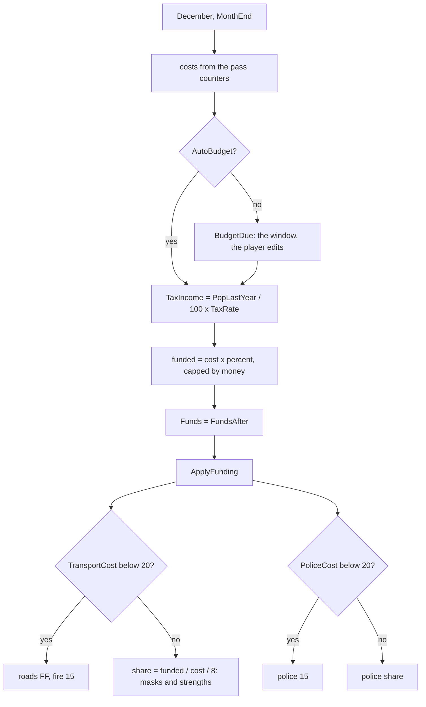

Roads and rails crumble with the decay mask: RoadCell turns a road to rubble when (Random AND RoadDecay) = 0, unless
the mask is `$FF`. A fully funded network never crumbles; at a share of 0 (mask `$0F`) each road cell crumbles with 1
in 16 a pass.

Worked example, `city` recording, the year ends:

- JAN 1903 (the sample of frame 8 500): roads only, TransportCost 92, no stations. FireCost 0, so the fire branch
  divides by zero: FireStrength is 0 in the sample, PoliceStrength 15 (PoliceCost 0 is below 20).
- JAN 1906 (frame 25 250): PopLastYear 4976, TaxIncome 49 x 7 = 343; costs 92 + 100 + 100 = 292, all funded at
  100 %; cash flow +51, Funds 999 952 to 1 000 003. FireStrength and PoliceStrength 15.

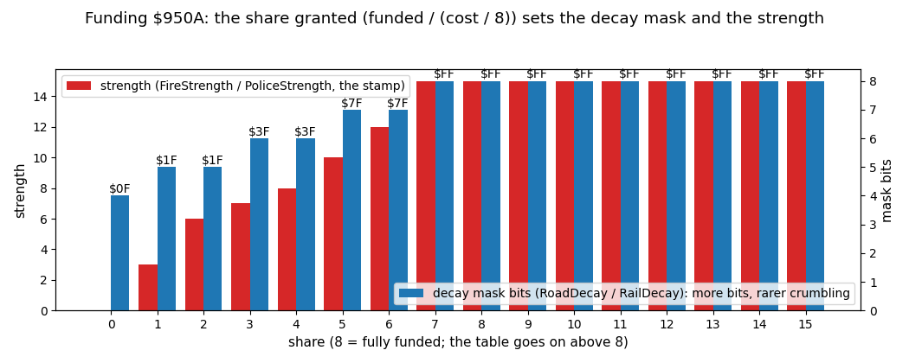

How to read the figure:

- Per share 0-15 (8 = fully funded), red: the police or fire strength; blue: the number of bits in the decay mask
  (more bits, rarer crumbling), labelled with the mask.
- Command: `python3 tools/fig_sim.py funding --out docs/img/sim/funding.png` (src/res/tables/Funding.csv).

The budget window itself: 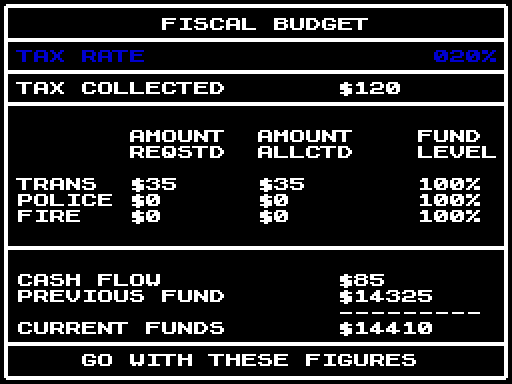
(`menus` frame 20 006).

**The point**: money in is people last December times the tax rate; money out is what the city cost in one pass of
December. Underfunding weakens services through a table, and the fire table is read through the transport cost's
test.

## 10.9 Services, the stadium, the ports and the city's value

The special buildings work through BuildingKinds' routines:

| Building | Step | What it does |
| --- | --- | --- |
| Police, fire | PoliceStep, FireStep | upkeep +100 (PoliceUpkeep `$8466` / FireUpkeep `$8468`), powered: PoliceCount / FireCount + 1; the cover comes from CoverStations |
| Coal plant | CoalStep | CoalCount + 1, pollution `$FF` |
| Nuclear plant | NuclearStep | NuclearCount + 1, the meltdown check (10.12), pollution `$30` |
| Church, hospital | ChurchStep, HospitalStep | count; unpowered, on the IndChance mask, back to an empty R zone |
| Stadium | StadiumStep | powered and transport in its 4 x 4 ring: trips to R (1 in 32), StadiumCount + 1 unless a trip failed |
| Seaport | SeaportStep | powered, transport and water in its ring: trips to I, SeaportCount + 1, pollution `$60` |
| Airport | AirportStep | powered, transport in its 6 x 6 ring: trips to C, AirportCount + 1, StartPlane |

The counts feed demand (10.5): each stadium +4 to ResDemand, each airport +4 to ComDemand, each seaport +4 to
IndDemand. ServiceNeeds `$8F31` asks for a hospital per 18 R zones (HospitalNeed = ResPop / 18 - HospitalCount) and a
church per 20; the next R zone to reach Density 63 becomes that building instead of a block. Witness: the stage 2
ceiling run (`work/stage2/ceiling-end.szx`) has a hospital (type 3) at row 53, column 48 and a church (type 2) at row
53, column 51, so ServiceNeeds and ResidentialBuild placed them and HospitalStep and ChurchStep ran there; the end
state of no bot recording holds one.

The power plants also feed two city averages. CoalStep and NuclearStep call ZoneScoreOf with ZonePowered 0
(BuildingPower skips the plants, [doc 07.2](07-objects.md#72-buildings-runs-of-bytes-in-the-map)): LandValueOf gives
0 and still counts the plant in LandValueCount, and CrimeOf gives (255 - 0) >> 4 = 15 minus the police cover into
CrimeSum and CrimeCount. So each plant lowers AvgLandValue and raises AvgCrime, which Advise rule 20 reads.

```asm
AirportStep:
  LD A,(ZonePowered)
  AND A
  RET Z
  LD BC,(CurCell)
  LD HL,$0606
  CALL ScanRingSize          ; the ring of a 6 x 6
  LD A,(RingTransport)
  AND A
  RET Z                      ; no transport: not counted
  LD (TripMade),A
  LD HL,$0A0A                ; trips to C
  LD (TripTargets),HL
  CALL Random
  AND $1F
  CALL Z,MakeTrip            ; 1 in 32
  LD A,(TripMade)
  AND A
  RET Z                      ; a trip tried and lost: not counted
  LD HL,(AirportCount)
  INC HL
  ...
  JP StartPlane
```

AssessCity `$81E3` sums the city's value: rails x 5 + roads x 10 + police x 1000 + fire x 1000 + hospitals x 400 +
stadiums x 3000 + seaports x 5000 + airports x 10 000 + coal x 3000 + nuclear x 6000 (the evaluation shows it).

Advise `$99AD` clears Advice to 0 each pass, then tests its rules in order. Most return on the first hit (`JP
...,SetAdvice`); rules 4, 5 and 19-21 use `CALL NC,SetAdvice` and go on, so a later rule overrides them, and among
19-21 the last that fires wins. The rules, with all zones Z = ResPop + ComPop + IndPop:

- R at most a quarter of Z (1; with no zones at all, 0 - 0 gives advice 1), C at most an eighth (2), I at most an
  eighth (3).
- Then only with people (LastPop not 0): with 10 or more zones, roads not more than Z (4, goes on); with 50 or more
  zones, rails not more than Z (5, goes on); with 10 or more zones, no plant (6).
- No stadium with 20 R zones (7), no seaport with 30 I (8), no airport with 30 C (9), no fire station with 30 zones
  (10), no police with 25 (11), tax 12 % or more (12).
- With any road or rail, RoadDecay not `$FF`, the transport underfunded (13); with a fire station, FireStrength
  below 15 (14); with a police station, PoliceStrength below 15 (15).
- 10 or more unpowered zones (16; every power plant counts as one, [doc 07.2](07-objects.md#72-buildings-runs-of-bytes-in-the-map)), a brownout (17).
- AvgPollution 60 or more (19), AvgCrime 20 or more (20), AvgTraffic 60 or more (21), each going on.

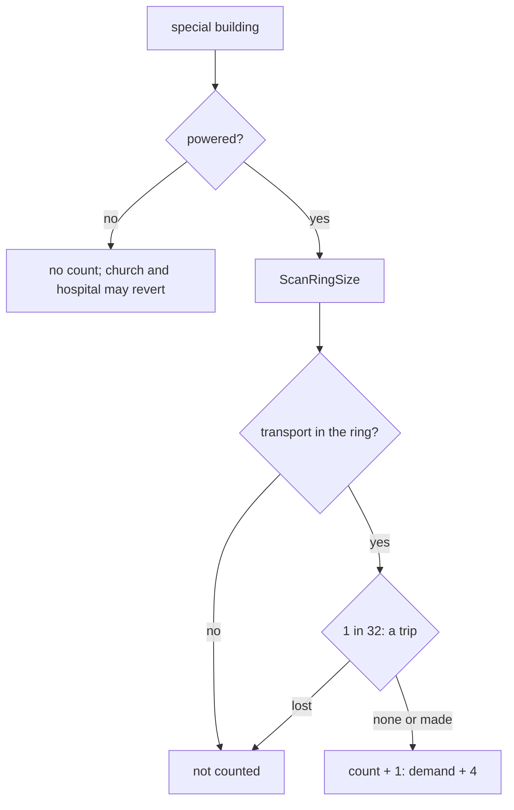

Worked example, `city` recording: the stadium (type 4) stands on the map from frame 16 000, but StadiumCount is 0
in all 311 samples. ResDemand only takes values 8k - 26, so the stadium never adds its 4 points. The transport test
fails. The stadium's top row at row 41, column 58 is `$B4`, powered, at frames 17 500, 37 500 and 77 500. Its ring
holds no road or rail:

- row 40, columns 58-61: the nuclear plant's bottom row;
- column 57, rows 41-44: an I building and a house;
- column 62: land; row 45: land and trees.

The road on row 40 ends at column 57, the ring's corner, which the ring skips.
AirportCount and SeaportCount stay 0 too. Advise never asks for ports, because ComPop and IndPop stay below 30.


How to read the figure: the bottom panel's solid lines are PoliceCount, FireCount, StadiumCount, SeaportCount and
AirportCount (the highest of five neighbouring samples). Command as in 10.5.

**The point**: services are bought, then counted only while they work. A stadium or port is worth 4 demand points
and only if it is powered and reached; a police or fire station costs 100 a year even unpowered.

## 10.10 The category and the growth ceiling

CategoryOf `$9760` counts the CategoryLimits `$9750` that PopLastYear exceeds: above 2000 TOWN, above 10 000 CITY,
above 50 000 CAPITAL, above 100 000 METROPOLIS, above 500 000 MEGALOPOLIS, else VILLAGE. A limit counts only when
limit - PopLastYear is negative (`RET P` on 0), so exactly 2000 is still VILLAGE. It runs only when the evaluation opens, and only the evaluation window
reads Category (to print the title): the title changes no rule.

What holds a city back is the R score. A zone settles at Density = ResTile = score / 2. The bot cities' scores are
about 40-60: LV about 150, tax 56 (7 % on easy), demand -26 to -34, crime and pollution a few points. So zones sit at
densities of about 20-30, 320-480 people each. A CITY needs 16 x the sum of densities = 10 000, a sum of 625: 21-31
such zones, all connected and powered. The metro city has 35 R zones, but 9 of them are empty and many far from the
centre: PopLastYear is 9 248 at its end.

At tax 0 the score rises by 56, so the target of a good zone rises by 28 density steps, and R blocks become
possible.

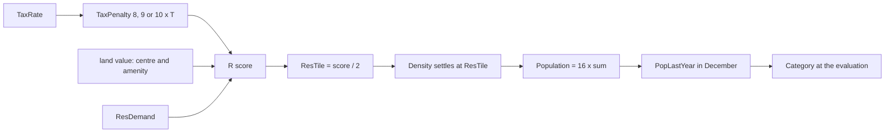

Worked example, the stage 2 ceiling run (work/stage2/ceiling.log): metro's end state with TaxRate written to 0 and
Funds to 999 999, FAST, 80 000 frames. PopLastYear 8256 (AUG 1935), 9728 (JUN 1936), 10 624 (APR 1937): CITY by the
numbers within two game years. It went on to between 11 376 and 14 384 until OCT 1947. The median density of the
occupied zones rose from 24 to 38, the top zone reached 61 (first at frame 50 000, again at 75 000), and the last line counts one R block
([doc 07.2](07-objects.md#72-buildings-runs-of-bytes-in-the-map)). Category stayed 1 in memory, because the
evaluation was never opened.

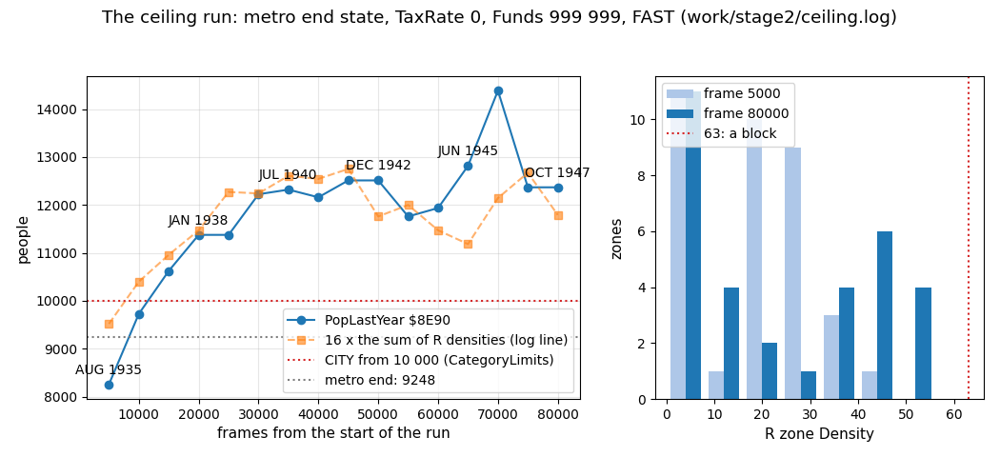

How to read the figure:

- Left: PopLastYear in each log line (every 5 000 frames) with the date, and 16 x the sum of the R densities of the
  same moment. The red line is CITY's 10 000, the grey line metro's end at tax 7.
- Right: the densities of the R zones at the first and the last log line.
- Command: `python3 tools/fig_sim.py ceiling --log work/stage2/ceiling.log --out docs/img/sim/ceiling.png`.

**The point**: the ceiling is the tax. At 7 % on easy a zone's target is half of a score that the tax cuts by 56, and
a bot city of 35 zones stops below 10 000; at 0 % the same city becomes a CITY in two game years.

## 10.11 The city generator

START NEW CITY copies RandomSeed to Gene; NewLandscape `$6A8E` calls StartSimulation, seeds Random with the gene and builds the map in
four stages:

1. The whole map water (`$00`).
2. Discs `$6ADB`, 128 land discs: radius Random AND 7 (at least 2), centre (Random AND 63) + 16 in each axis, shape
   Random AND 3 from DiscShapes. Disc `$6C09` draws 49 steps of a turning vector in 8.8 fixed point (x -= (y >> s1)
   + 1, y += (x >> s2) + 1), filling a run of 2 |x| cells each step.
3. MakeCoast `$6BA5`: from row 96 down to 1 and column 96 down to 1, each water cell takes a coast code from Coast by
   the mask of its eight land neighbours (rows and columns 0 are skipped).
4. 32 tree discs, radius Random AND 3 (the mask self-modified at `$6AE8`), drawn only over land.

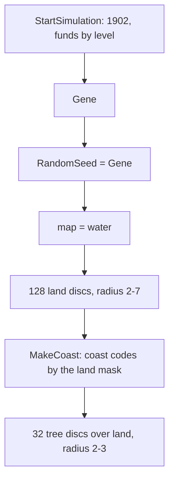

The map depends only on the gene: 640 calls of Random for gene 3. StartSimulation, called first, sets the date to
January 1902 and Funds to 20 000, 10 000 or 5 000 by Level.

Worked example, gene 3: `tools/landscape.py 3 --compare work/docs/scC/map-1100.bin` prints "gene 00003: md5
add9a3e6d8f1126618a6ac92524c4477, 640 random calls; water 4559, land 3703, trees 791, coast 163" and 0 cells differ
from the map of the `growth` samples of frames 800 and 1 100.

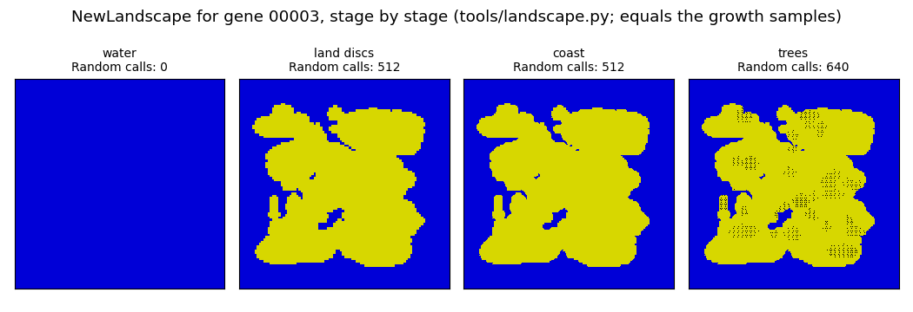

How to read the figure:

- Four maps of 96 x 96 drawn with the game's tiles, after each stage, with the Random calls used so far.
- Command: `python3 tools/fig_sim.py landscape --gene 3 --out docs/img/sim/landscape.png`.

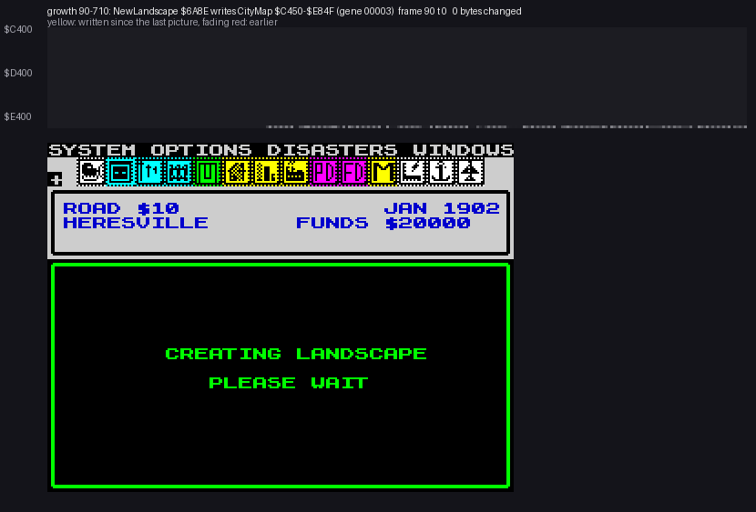

How to read the animation:

- `growth` frames 90-710, one picture every 20 frames (1 397 760 T-states), 32 pictures; memory `$C400-$E8FF` (the
  map) beside the screen.
- The discs appear one by one as land, then the coast codes along the edges, then the tree discs.
- Command: `python3 ../../kit/memanim.py --work work/docs/scC/growth --from 90 --to 710 --step $((20*69888)) --from-address C400 --to-address E8FF --screen --cell 3 docs/img/routines/NewLandscape.gif`.

**The point**: a city's land is five digits. The generator uses only Random, so the same gene always gives the same
island, and the reimplementation reproduces it cell for cell.

## 10.12 Disasters

A disaster starts from the DISASTERS menu or, in principle, at random. RandomDisaster `$9144` runs from the UI task
(every 16 of its passes). Unless DisastersOff `$A43D`, it draws Random and goes on only when the new seed AND `$07FF`
is 0 (1 in 2048). Then Random AND 7 picks one: 1 fire, 2 flood, 3 earthquake, 4 air crash, 5 tornado, 6 meltdown (6
only on a further 1 in 8); 0 and 7 give nothing. RunDisaster `$916E` starts it.

```asm
RandomDisaster:
  LD A,(DisastersOff)
  AND A
  RET NZ
  CALL Random
  LD HL,(RandomSeed)
  LD A,H
  AND $07
  OR L
  RET NZ                     ; seed AND $07FF not 0
  CALL Random                ; the next draw is fixed by the seed
  AND $07
  RET Z
  CP $07
  RET Z
  CP $06
  JR NZ,RandomDisasterSet
  CALL Random
  AND $07
  RET NZ                     ; meltdown: a further 1 in 8
  LD A,$06
RandomDisasterSet:
  LD (DisasterDue),A
  RET
```

The draws are not independent: Random is a fixed map of the seed ([doc 07.8](07-objects.md#78-random)). The gate
passes only on the 32 seeds `$0000`, `$0800`, ... `$F800`. From `$0000` the next draw gives 5, a tornado. From the
other 31 it gives 7 (nothing) or 6, and every 6 then fails the meltdown's 1 in 8. So the random disaster is always a
TORNADO, after the seed `$0000` only: about 1 try in 65 536. A task switch between the draws could change that.
Known only from the code, with the generator's formula run over all 32 seeds.

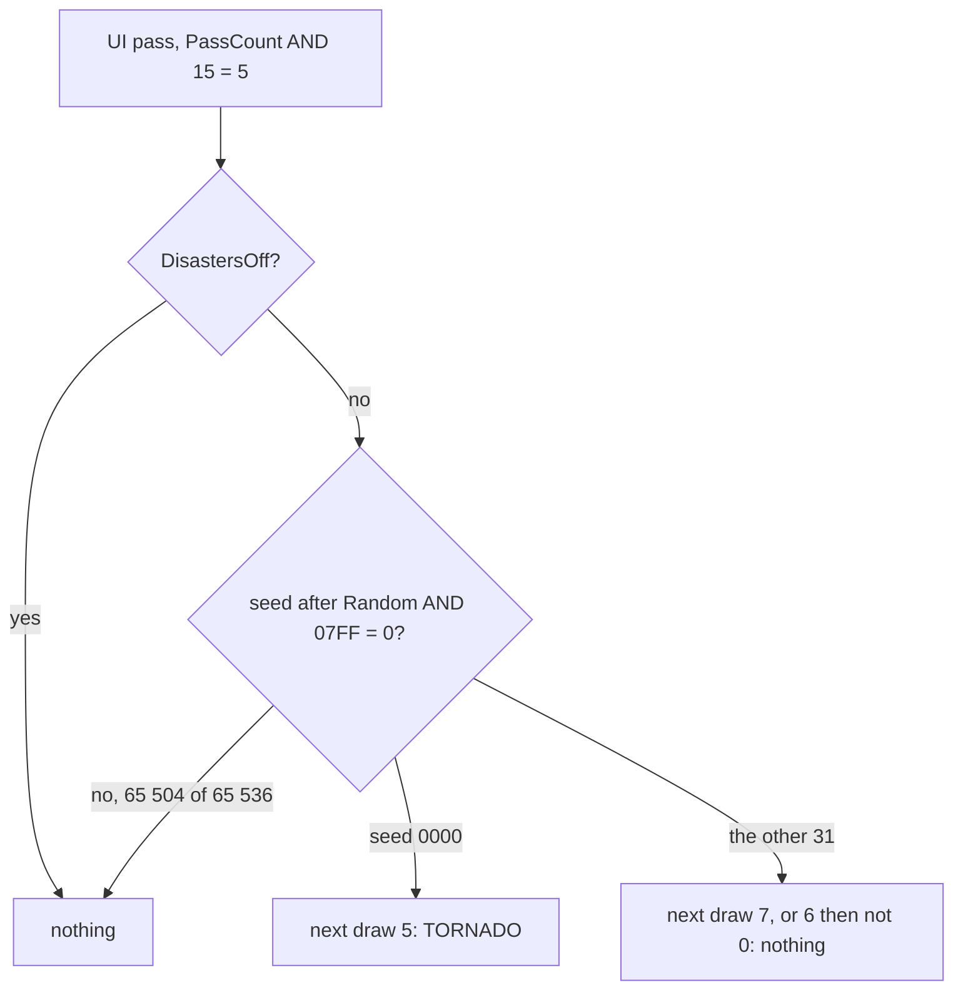

| Disaster | Start | Spread | Damage |
| --- | --- | --- | --- |
| Fire | StartFires: each map byte 1 in 128 Ignite: flammable cells below `$80`, not trees | FireCell each pass | burnt cells to rubble |
| Flood | StartFlood: coast cells (`$01`, `$03-$05`; land `$02` is skipped at `$90EB`) 1 in 32 to `$44`, FloodLeft = 50 | FloodCell while FloodLeft lasts | buildings filled with water, then land |
| Earthquake | noise, then StartFires and StartFlood | both | both |
| Air crash | only when the last pass counted a working airport (LastAirports `$849E`: powered, transport in its ring, no trip lost): PlaneTimer 7-22 | the plane's 2 x 2 ignite | fire |
| Tornado | a random land cell in rows and columns 16-79 | MoveTornado | rubble, buildings burnt whole |
| Meltdown | only with a nuclear plant: MeltdownPending | at the next NuclearStep | the plant on fire, radiation in a 45 x 45 square |

The spread is one routine, Spread `$899B`, for fire and flood. FireCell `$8962` counts FireCells, then the fire goes
out (rubble `$3A`) if (Random AND 15) < FireAt + 1: with no fire station 1 in 16 a pass, with full cover always. Else
Spread looks at the four neighbours: fire counts flammable cells and buildings, a flood counts everything; each
counted neighbour catches with 1 in 8 (SpreadTo). A building catches whole: FillBuilding writes the spread code (fire
or flood) into every byte of it. The cells in BulldozeKeep never catch. A fire with no flammable neighbour also dies
with 1 in 4. FloodCell spreads while FloodLeft lasts, taking 1 off FloodLeft per flood cell per pass; at 0 every
flood cell becomes land.

Spread does not stop at the map edge. It calls MapAddr and then `JR NC,SpreadNext`, but MapAddr always ends with
`SCF`, so the jump is dead. A neighbour off the map is an address outside the row:

| Fire or flood on | Step | Address the neighbour gets |
| --- | --- | --- |
| row 0 | up | `$23F0` + column, in the ROM: the write is lost, and the ROM byte read decides whether it counts |
| row 95 | down | `$E850` + column, IconTiles: a catch writes `$45` or `$44` into the icon graphics |
| column 95 | right | column 0 of the next row (wraps) |
| column 0 | left | column 63 two rows down (C = `$FF` adds 255 = 2 x 96 + 63) |

A ROM or IconTiles byte of `$80` or more counts as a building, and a catch sends FillBuilding to it. Known only from
the code.

```asm
FireCell:
  LD HL,(FireCells)
  INC HL
  ...                        ; FireCells + 1
  CALL FireAt                ; the fire cover at the cell, 0-15
  INC A
  LD B,A
  CALL Random
  AND $0F
  CP B
  JR C,ToRubble              ; out: rubble
  LD A,$45
  LD (SpreadCode),A
  XOR A
  LD (SpreadFlood),A
  JR Spread
```

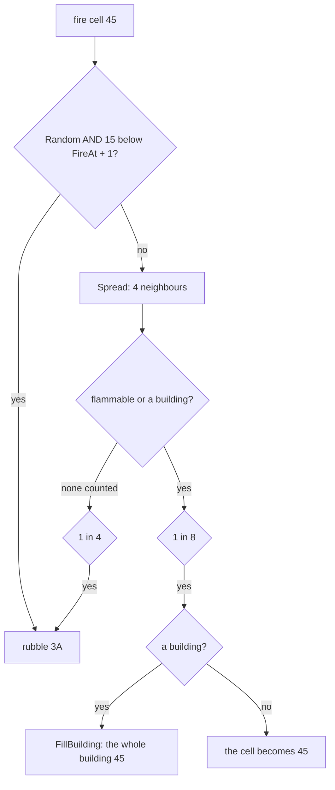

The meltdown: NuclearMeltdown sets MeltdownPending; Meltdown `$7925`, called from NuclearStep, fills the plant with
fire and walks the 45 x 45 cells from 20 up-left of the plant's corner. Each is irradiated with 1 in 16: a cell below
`$80` that is not water becomes `$59`. RadiationCell `$8942` then stamps pollution `$40` each pass and turns to
rubble only when the seed AND `$0FFF` is 0, 1 in 4096 a pass.

Worked example, the disasters recording (one item about every 2 000 frames, the figure below):

- FIRE (Advice 22 in the sample of frame 150): city2 has only 266 cells StartFires can ignite (buildings are
  skipped), so about 2 fires are expected (266 / 128); one starts.
- FLOOD (Advice 23, frame 2 250): FloodLeft falls from 50 to 0 over frames 2 300-3 400, with at most 26 flood cells
  (`$44`) on the map; then they all turn to land.
- EARTHQUAKE (Advice 24, frame 4 450): StartFires and StartFlood together; up to 43 fire cells and 16 flood cells, as
  fires enter buildings (FillBuilding sets a whole building at once).
- AIR CRASH (frame 6 600): nothing, because AirCrash returns when LastAirports is 0.
- TORNADO (Advice 26, frame 8 800): from (73, 40) to (68, 35), off at frame 9 800. It walks on bare land east of the
  town and hits nothing that burns; rubble goes from 51 to 56 through the fires still burning in the town
  ([doc 07.6](07-objects.md#76-the-movers-train-plane-tornado), with the animation of its walk).
- MELTDOWN (Advice 18, frame 11 050): 97 radiation cells (`$59`), and rubble reaches 102.

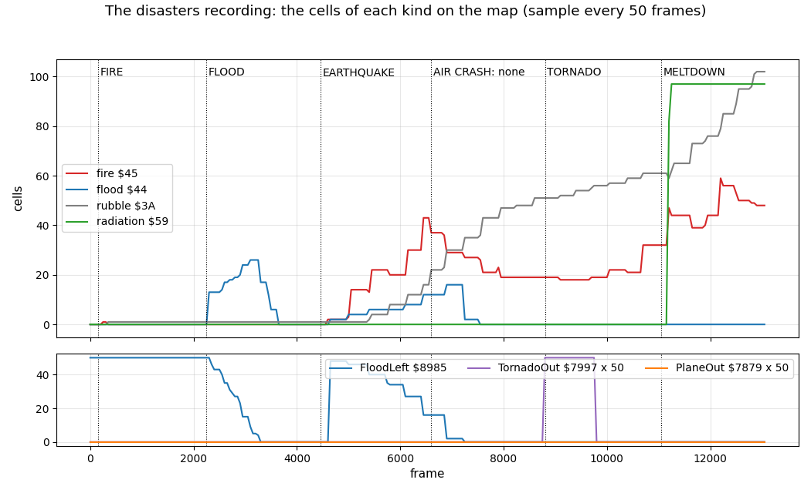

How to read the figure:

- Top: the count of fire, flood, rubble and radiation cells on the sampled map (every 50 frames), with the moments
  each disaster's message appeared.
- Bottom: FloodLeft, TornadoOut x 50 and PlaneOut x 50.
- Command: `python3 tools/fig_sim.py disasters --samples work/docs/scC/dis-vars.jsonl --out docs/img/sim/disasters.png`.

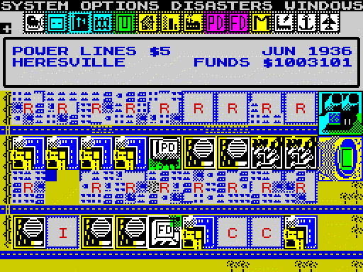

How to read the animation:

- `disasters` frames 4 400-8 780, one picture every 80 frames: the earthquake's fires creep along the lower blocks,
  whole buildings flip to fire, then to rubble. The last two pictures (from about frame 8640) are the DISASTERS menu
  of the next choice, not the earthquake.
- Command: `python3 ../../kit/screen_anim.py --work work/docs/scC/dis --from 4400 --to 8780 --step 80 --delay 120 --hold 2500 docs/img/play/disasters-earthquake-spread.gif`.

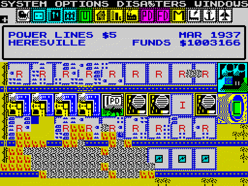

How to read the animation:

- `disasters` frames 11 000-13 040: the plant burns, the radiation tiles appear over a large square round it, and the
  fires spread into the blocks.
- Command: `python3 ../../kit/screen_anim.py --work work/docs/scC/dis --from 11000 --to 13040 --step 40 --delay 120 --hold 2500 docs/img/play/disasters-meltdown.gif`.

**The point**: one spread rule serves fire and flood. Fire stations act only by putting fires out (at full cover a
fire dies in its first pass); a flood is the quiet killer, since it fills buildings and leaves land behind.

## 10.13 The tools: placement and refusals

Every click on the map goes through MapClick `$7012`: CrossNetwork first (a road, rail or line laid across another
network), then CheckSite `$7103`, then the tool's handler from ToolHandlers `$6FF6`. A refusal (Refuse `$71E4`)
beeps with ToneBeep `$5B66` ([doc 09](09-sound.md)).

- **Choosing a tool**: SelectTool `$6D6D` refuses a tool whose palette price (ToolPrices `$6E1E`: 1, 10, 5, 20, 10,
  100 x 3, 500 x 2, 3000, 4000, 5000, 10 000) would take Funds below 0; GreyUnaffordable greys those icons.
- **The site**: CheckSite takes the box of ToolSizes. With AutoBulldoze on, or when the clicked cell is water, every
  box cell must be one of SiteCells (`$70FC`: land, coast, trees, and water only for road, power line and rail).
  Each cell that is not one of FreeCells costs 1 and is cleared to land; if the 1 cannot be paid, the cell is left as
  it is and the site still passes. With AutoBulldoze off and a clicked cell that is not water, every cell must be land
  (StrictSite `$7173`). That jump at `$7110` comes before the bulldozer's test at `$7118`, so with AUTO-BULLDOZE off
  the bulldozer is refused on everything but a water click (and land has nothing to clear): the player must switch
  AUTO-BULLDOZE on to bulldoze. With AutoBulldoze on, or on a water click, the bulldozer always passes. Known only
  from the code.
- **Payment**: Spend `$6E46` refuses if Funds would go below 0 (24-bit).

```asm
MapClick:
  LD A,(ClickCell+$0001)
  CP $08
  RET C                      ; not on the map rows
  LD A,(BoxShown)
  AND A
  RET Z
  CALL CrossNetwork
  RET C                      ; a crossing was made
  CALL CheckSite
  JP NC,MapClickTool
  CALL Refuse                ; the beep
  JP MapClickWait
```

Two tool quirks:

- **The power station** has three prices: the palette's name text says `$5000`, SelectTool tests ToolPrices' 4000,
  and PowerPlantTool `$74B4` asks coal (3000) or nuclear (5000) after testing Funds against 3000. With Funds of
  3000-3999 the palette refuses it, so the coal plant cannot be built although it is affordable. PowerPlantTool's
  own test reads only Funds' low 16 bits (`LD HL,(Funds)`), so with more than 65 535 the menu may silently not open
  (for example at 66 000, whose low word is 464).
- **The park** refuses map column 2: ParkTool `$73D4` calls ClickMapAddr and then `CP $02`, meant to test the cell
  but testing A, which MapAddr leaves holding the column. CheckSite has already checked the cell.

```asm
ParkTool:
  CALL ClickMapAddr          ; HL = the cell, A = its column
  CP $02
  JP Z,Refuse                ; column 2 refused
  LD DE,$000A
  CALL Spend
  RET C
  LD C,$38
  CALL Random
  AND $07
  JR NZ,ParkPut
  INC C                      ; 1 in 8 the other park tile
ParkPut:
  LD (HL),C
  JP DrawView
```

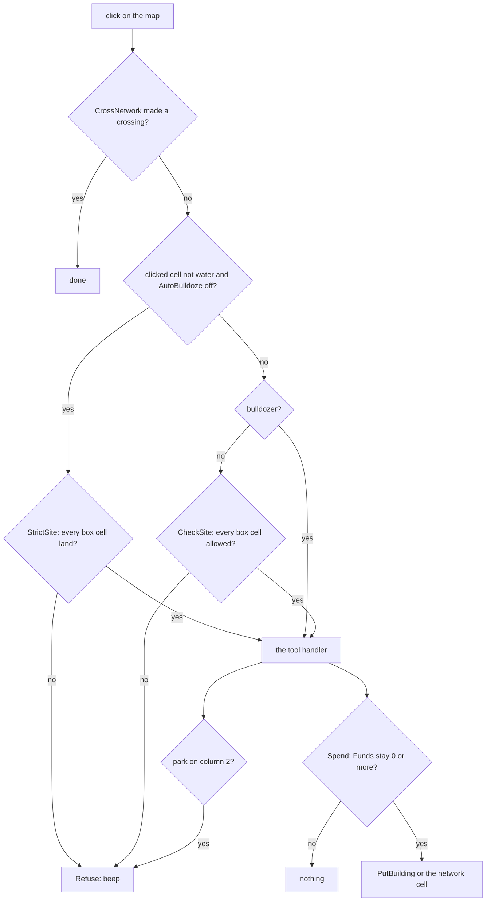

Worked example, the `tools` recording: the occupied site beeps (frame 13 457), the seaport is refused for money
(frame 12 666), and the power station asks coal or nuclear (frame 11 069).

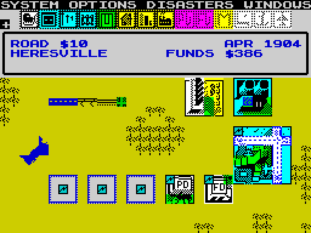

How to read the screenshot: the pointer's box over a built cell; Refuse beeped and nothing was built. The other two moments: [the seaport without funds](img/play/tools-012666-seaport-no-funds.png),
[the power type menu](img/play/tools-011069-select-power-type.png).

**The point**: the tools are strict about the site and loose about money in odd places. Three prices for one tool
and a column test standing in for a cell test show a program assembled under time pressure.

## 10.14 Notable features

- **The map is the database.** Zones and buildings have no records: a zone is nine bytes, a building a run of bytes
  whose type is its tile number / 8 (doc 07). Population, counts and demand are recounted every pass.
- **A stack exit from a flood fill.** PowerCell leaves the whole scan-line fill with `LD SP,(FloodSP)` and RET when
  a plant's budget runs out (10.2).
- **The tax is the growth ceiling.** A zone aims at half its score, and the default 7 % costs 56 points: the bot
  cities stop below 6 000 and 9 300 people, while the same metro at 0 % becomes a CITY in two game years (10.10).
- **The fire funding is read through the transport cost.** ApplyFunding's fire branch tests TransportCost, and divides
  by zero to 0 when there is no fire station (10.8, witnessed in the city recording's 1903).
- **Medium is harsher than difficult on taxes**: 10 x the rate against 9 x (10.3).
- **One spread rule for fire and flood**, and a flood fills a building and leaves land (10.12).
- **Trips are random walks** of 30 steps; a dead end loses every trip that enters it (10.6).
- **The category is decoration**: computed and read only by the evaluation window (10.10).
- **A stadium can stand uncounted.** The city recording's stadium never adds its demand points: its ring misses
  the road end by one corner cell (10.9).
- **A random disaster is always a tornado.** The 1 in 2048 gate and the 1 in 8 pick are draws from one generator,
  so only the seed `$0000` passes both, to a tornado (10.12).
- **A power plant is found only by its powered top byte.** FindPlants looks for `$B4` (top row, powered, width 4),
  the byte the plant prefabs carry from the start: BuildingPower never rewrites a plant's top byte (10.2,
  [doc 07.2](07-objects.md#72-buildings-runs-of-bytes-in-the-map)).

## 10.15 Known only from the code

- TaxPenaltyOf: 8 x the rate on easy, 10 x on medium, 9 x on difficult.
- The `CP $10` / `JR C,ResidentialGrow` at `$8AE9-$8AEB` jumps to the next instruction: a no-op.
- ResBuildingStep `$8B37` copies only the low byte of ResDemand into ZoneDemand (the `LD A,(ResDemand)` at `$8B6F`).
- ResBuildingStep, ChurchStep and HospitalStep act on the IndChance mask, not their own.
- FloodPush drops spans silently when CellStack is full; a plant whose cell an earlier flood reached adds no budget.
- PowerPlantTool tests only the low 16 bits of Funds.
- The power station's three prices (text `$5000`, palette 4000, actual 3000 / 5000).
- BuildingValue returns from its table search without popping BC when a type is missing; every type the game places
  is in the table, so the path is never taken.
- A fire with full cover (15) always goes out in its first pass: (Random AND 15) < 16.
- At pause the MonthMask is `$FF`, so a month would end every 256 passes ([doc 04](04-game-loop.md)).
- The random disaster is always a tornado, about 1 in 65 536 tries (10.12).
- When CheckSite cannot pay 1 for clearing a cell, it leaves the cell and passes the site.
- No recording placed a seaport or an airport with a working ring, so the port and airport counts and StartPlane's
  flights are known from the code.
- With AUTO-BULLDOZE off the bulldozer is refused except on land and on a water click: StrictSite's jump comes
  before the bulldozer's test (10.13).
- PowerPlants holds at most 15 plants plus the 0 terminator, and FindPlants does not check the count. A 16th plant
  puts the terminator over the opcode bytes `DD 21` of FindPlants' own `LD IX,PowerPlants` (`$7F98`); from the
  next pass FindPlants runs with a stale IX and writes over memory (the overflow from the code; what follows is
  not run) (10.2).
- Spread and MoveTornado do not clip at the map edge: Spread's `JR NC,SpreadNext` after MapAddr is dead, a fire or
  flood on row 0 reaches into the ROM, on row 95 into IconTiles `$E850`, and at a column edge it wraps (10.12); the
  tornado's step uses MapAddr too.
- Road and rail crossings (`$2E`, `$2F`) count as road only: CellStep tests bit 2 (road) first at `$88BA`, so a
  crossing never starts a train, pays the road upkeep of 1 instead of the rail upkeep of 4, and may crumble to
  rubble with the road decay (10.6).
