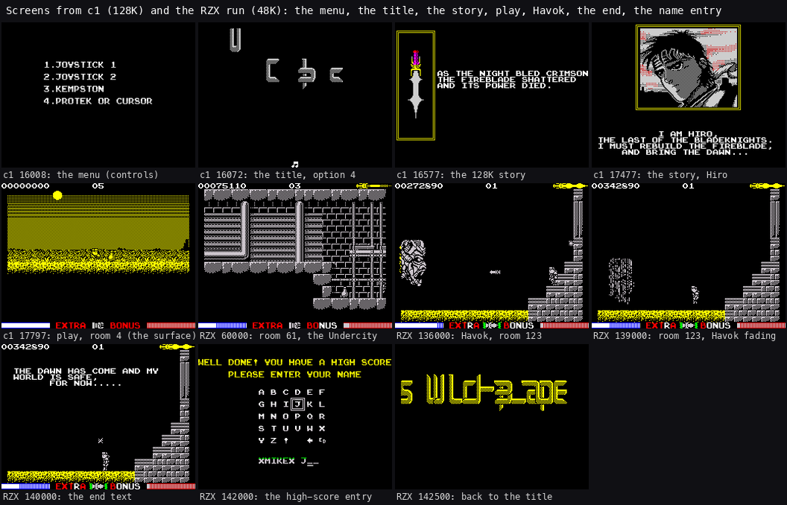
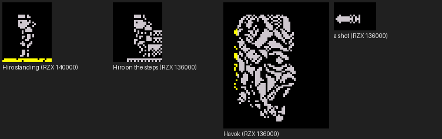

# Switchblade: walkthrough

How the reverse was done, step by step, and which unreal-ng call answered each question. Terms:
[docs/README.md](docs/README.md). Recipes: `../recipes/`.

Every recording is named with its load (ROM speed or the fast LD-BYTES trap) beside every frame number. The
recordings made from the tape load it at signal speed (fast and turbo tape off; the game's loader at `$FF00` is a
copy of LD-BYTES, not the ROM's, so the trap would not catch it). The menu and gameover recordings start from
`work/stage1/explore/loaded.szx`, the menu after c1's load (128K, frame 15 700 of a signal-speed load,
`work/stage1/explore1.py`). The rzx recordings play the RZX Archive run (48K) and load no tape.

## 0. The medium

### 0.1 The files

`orig/Switchblade.tzx.zip` is ZXDB download 31610, copied unchanged; its hashes and the member's are in the
[README](README.md). The member is unpacked in `work/stage1/media/switchblade.tzx`; the other copies sit in
`work/candidates/<source>/` (`x/` holds the unzipped ones). The instructions are
`work/candidates/docs/Switchblade.txt` (ZXDB's text, md5 as ZXDB gives it).

### 0.2 The release check

ZXDB 5089 (`zxdb.sqlite` v1.0.242: `entries`, `releases`, `downloads`, `authors`, `contents`) gives the authors
(Jeff Calder; John Smyth, graphics; Ben Daglish, music), Gremlin Graphics 1991 at £9.99 (tape) and £14.99 (disk), the
GBH re-release at £3.99, the machine "ZX-Spectrum 48K/128K", and the compilations that carry the demo (Your
Sinclair 63, MicroHobby 210). Each copy's blocks were listed with `python3 tools/tzxblocks.py list FILE` and compared
byte for byte with the original's (`work/stage1/bdiff.py`, `work/stage1/blocks.py`); the table is in the README:

- **The original**: the Gremlin TZX (ZXDB 31610 = WoS = TOSEC 45124, the same file).
- **GBH**: the same six blocks; the TZX files differ in 7 bytes, all pause lengths.
- **The TAP** (ZXDB 31611, TOSEC 45129): the loader patched to the ROM's edge loop (`JP $0562`), the data blocks
  unchanged.
- **TOSEC `(128K)[a]`**: 26 bytes of the 37 537-byte block differ, `$8127-$816D`: the names of high-score entries 1-4
  (JOSE LUIS, RUI, CARLOS, FC PORTO for JEFF C, LINDA, SIMES, DANGERSTU; corrected by docs, see doc 3.5).
- **TOSEC `(48K-128K)[a]`**: `$C9` for `$3A` at offset 10 958 of the same block (`$962A`, the first byte of LoseLife: losing all energy costs
  no life; corrected by docs, see doc 3.5), a cheat.
- **The hacks** (Ramsoft's trainer, Sorokin, Sukin, Nikitin, the Pokes trainer) re-save the original blocks with
  headers; Saposoftware and Atossoft re-pack them; the YS demo is another program (a 24 964-byte block).

A name search of the NAS (`WDC14Tb-3/Consoles/ZX Spectrum`, 300 s, `work/stage1/nas-find.txt`) found nothing.

### 0.3 The load

c1 loads the tape on a 128K with the 128K menu's Tape Loader at signal speed: the BASIC's code runs at frame 710,
stage 2 at 1345, the jump into the game (`JP $4000`) at frame 15 503, the menu is on screen by frame 16 008. The
blocks, the loader, the paging test and the bootstrap: [doc 3, 3.1](docs/03-build-and-load.md#31-the-tape-block-by-block).

### 0.4 The machine: 48K and 128K

One tape for both. Stage 2's `$618E` tests the paging; a 128K gets block 6 in bank 4, the bootstrap's hooks
(`$5CFD`, `$A6EF`, `$A76F`, `$A75C`, `$5C9A`) and the 162-byte music glue at `$853F` ([doc 3.3](docs/03-build-and-load.md#33-the-bootstrap-4000-and-the-128k-set-up)). What bank 4 holds
(`work/mkgame/bank4.bin`): the AY music player (`LD BC,$FFFD` at `$D3C7`, `$DB27`, `$DC2D`, `$DD53`, `$DEC2`,
`$DF7C`; `OUT (C),A` at `$D3CD`) and its tunes, and the intro story's pages ("...THE NIGHT BLED CRIMSON",
"I AM HIRO, THE LAST OF THE BLADEKNIGHTS. I MUST REBUILD THE FIREBLADE, AND BRING THE DAWN...", `$D514-$D862`).

The RZX run is a 48K recording: its start snapshot (the menu, PC `$6A91`) equals c1's 128K memory at the menu except
322 bytes (`work/stage1/rzxprobe.py`), nearly all of them `$853F-$85E0` (the music glue: absent on the 48K), the
five hook sites (`$5CFD` 48K `CD 4F 5D` / 128K `00 00 00`, `$5C9A` `00 00 00` / `CD C5 85`, `$A6EF` and `$A76F`
`CD 29 85` / `CD 9E 85`, `$A75C` `00 00 00` / `CD B3 85`; stage 1's probe named only the last three), `$5B00` and the
stack areas (re-read in the review from `work/stage2/rzx/snap-000000.z80` and `work/stage1/explore/loaded.szx`). The game program is the same on both.

## 1. Interrupts and timing

**The mode.** The bootstrap ([doc 3.3](docs/03-build-and-load.md#33-the-bootstrap-4000-and-the-128k-set-up)) sets `I` = `$FE`, fills `$FE00-$FF00` (257 bytes) with `$FD`, puts `JP $8456` at `$FDFD`
and selects `IM 2`: every vector reads `$FDFD`. c1's play state (`work/stage1/c1/end.szx`, `snapinfo.py`) has IM 2,
`I` = `$FE`, interrupts on, `SP` = `$5BF6`.

**The handler** `$8456` (`sna2skool.py -H` over `c1/end.szx`, `work/stage1/dis/end.skool`):

| Address | What it does |
| --- | --- |
| `$8456` | `PUSH HL, DE, BC, AF, IX, IY` |
| `$845E` | `LD A,n` / `OR A` / `CALL Z,$8472`: the operand `$845F` is a flag; 0 in play (`$5CF4`), 1 on the title (`$A747`, TitleSequence) and the name entry (`$A842`) (corrected by docs, see doc 4.2) |
| `$8464` | `CALL $853F`: the music (on a 128K the glue to bank 4) |
| `$8467` | `POP` the registers, `EI`, `RETI` |
| `$8472` | the game tick: a frame counter at `$8473`; for the ten actors (one 256-byte page each, `$5D00-$66FF`, `H` = `$5D` to `$66`) whose byte +`$02` has bit 0 set: the timer at +`$1D` counted down, and the 16-bit timer at +`$1E` counted down unless paused, setting bit 5 of +`$10` when it reaches 0; the P key (`IN` from `$DFFE`, bit 0) sets the pause flag `$664C` bit 7; then the input read `$8529` |

`python3 $RS interrupts --work work/stage1/c1` over c1's L1 (18 627 frames, most of them the load, under `DI`):
1075 + 1539 entries through `$FDFD` (two tails), 6680 and 5981 T an entry, 0.5 % and 0.7 % of the CPU; `$853F` on
all 2614 entries from frame 16 013 (the menu) on, `$8472` on 975 entries, every frame of play (frames 17 652 to
18 626).

**The main loop** `$8DFE` (entered by `JP $8DFE` at `$5CF7`):

| Address | What it does |
| --- | --- |
| `$8DFE` | `LD SP,$5C00`: the stack is reset on every pass |
| `$8E01` | for the nine actors `$5D00`-`$6500` (`B` = 9, `INC H`): if byte +`$02` bit 0 is set, `CALL $8E2B` (the actor's update) |
| `$8E0E` | `$6652` bit 7 (the end after Havok; game over goes through LoseLife `$9651`, `JP M,$5C42`): `JP $5C45` |
| `$8E15` | `$664C` bit 7 (the pause): `CALL $6682` |
| `$8E1C` | `$79FF` non-zero: `CALL $66B6` |
| `$8E23` | `CALL $FF01`, `CALL $FF64` (the code copied over the loader), `JR $8DFE` |

There is no `HALT` in the loop: it runs free. c1's L1 counts 25 068 passes (block `$8DFE`) and 28 339 actor updates
(`$8E2B`) in the 975 frames of play (17 652-18 626): about 26 passes a frame. An actor's work in `$8E2B` waits on its
own state (`BIT 0,(IY+$20)` at `$8E30`), so most passes do little; the per-frame count over a long window of the RZX
run is measured by `tools/rzx_passes.py` (below).

`PYTHONPATH=$SKOOLKIT_VENV/lib/python3.12/site-packages python3 tools/rzx_passes.py work/candidates/rzxarchive/switchblade.rzx work/stage1/passes.tsv --stop 30000`
 counts the fetches of `$8DFE` in
every frame of the RZX run (48K; frames as the RZX counts them, one per interrupt). Over frames 1500-30 000 (play from
frame 1473): 362 027 passes in 28 500 frames, 12.7 a frame on average, from 0 to 49 in one frame. 8232 frames start
no pass: a pass then runs longer than a frame. Of the runs of frames with no pass, 3065 last one frame, 809 two, 258
three, and 44 last 10 frames or more, from 10 to 72: 31 of those 44 begin within 3 frames of a room change (the room
variable `$6BDD` in `work/stage1/rzxtrace/trace.tsv`): the room is built while the loop waits. **The heaviest frames**
are those room builds: 72 frames without a pass from frame 17 393 (the entry into room 31) and from 22 203. The other
13 stalls of 10 frames or more (10 to 27) start away from a room change: not explained in stage 1. Stage 2's trace
supersedes these counts (`work/stage2/stalls/stalls.json`): 43 stalls, 31 at a room change (27-72 frames, median 45;
the room build itself 25-71, median 43, `tools/rzx_room_stalls.py`) and 12 zone reveals (10-27), doc 4.5.

## 2. Static pass over the medium

Stage 2.

## 3. The stages and the packers

No packer: the stages are the BASIC's code, stage 2 and the bootstrap ([doc 3.2](docs/03-build-and-load.md#32-the-loader) for the first two, [doc 3.3](docs/03-build-and-load.md#33-the-bootstrap-4000-and-the-128k-set-up) for the bootstrap).

## 4. The medium from source

Stage 4.

## 5. Tool gaps found and fixed in unreal-ng

| Gap | Fix | unreal-ng commit |
| --- | --- | --- |
| `analysis build` of a session recorded during `rzx_playback` fails: "the recording did not load on the analysis instance: this machine cannot take the session: device rzxplayback" (rzx-a, rzx-b, rzx-c have a TTD but no L1) | open; worked around: the rzx recordings are read with `time_travel` and SkoolKit's rzxplay (`tools/rzx_trace.py`, `tools/rzx_passes.py`), the L1s come from the keyed recordings | |
| An `analysis build` call with `wait` 30000 on a 72 000-frame session outlived the HTTP timeout (120 s); `tools/rec_rzx.py` then closed the instance and the TTD of the first rzx-a was lost | the case's tools now dump the TTD before the build and poll the status | |
| `rzx_playback seek` to frame 130 000 timed out | unrecorded `run_frames` from the start instead | |

## 6. The game

### 6.0 The recordings

Every recording keeps `session.ttd`, `record.json` (its plan, moments, POKEs), `end.szx` and `screens/`; the keyed
ones (`tools/record.py PLAN`, input scripts `tests/inputs/NAME.txt`) also `l1.json`. The rzx ones (`tools/rec_rzx.py`,
`tests/inputs/rzx-*.txt`) have no L1 (section 5); they are read with `tools/rzx_trace.py` (rooms, lives, energy per
frame, `work/stage1/rzxtrace/trace.tsv`) and `tools/rzx_passes.py`. All are in `work/stage1/rec/` unless named.

| Name | Machine, start | Frames | POKEs | What it reaches |
| --- | --- | ---: | --- | --- |
| c1 (`work/stage1/c1/`) | 128K, power-on | 18 627 | none | the tape menu, a real load of the original (doc 3.1), the title and menu (16 008), the intro, play from 17 651 in room 4; `$8472` x 975 |
| c48 | 48K, power-on | 23 151 | none | the 48K load, the game entered at 13 278, the title and intro loop with the 48K effect player; play is not entered (the RZX covers 48K play) |
| menu | 128K, c1's menu | 18 060 | none | option 1 (keys), the title's music / FX toggle (left: the note, right: FX), play, pause (P), the quit, the high-score table and the title cycle; `$8472` x 3406 |
| opt2 | 128K, c1's menu | 2 435 | none | option 2 (Sinclair 1, 2, 4, 5), the intro, play: right, left, up, fire, the quit back to the title |
| opt3 | 128K, c1's menu | 2 435 | none | option 3 (Kempston), the same moves and the quit |
| opt4 | 128K, c1's menu | 2 435 | none | option 4 (Protek / cursor 5, 8, 7, 0), the same moves and the quit |
| deaths | 128K, c1's menu | 7 829 | two, fell into the intro and were reset by the game start | play with enemies and hazards: lives 05 to 04, 03, 01 on the status line (screens 2309, 2869, 3429, 3989); `$9615` x 39 |
| gameover | 128K, c1's menu | 9 849 | `$664D` = 0, `$6642` = 1 at frame 1869 | a death with no life left: GAME OVER (about frame 2429, `$5C42` x 1), the title, the high-score table without an entry, fire restarts the intro |
| rooms | 128K, `probe/play0.szx` (play, room 4) | 3 650 | 16: the map row, column and room (`$69DF`, `$69E0`, `$6BDD`) | walked left through rooms 3 and 2 into room 1; written into rooms 11, 14 and 18; the chain stopped at room 0 (a failed lookup) |
| rzx-a | 48K, the RZX Archive run, frames 0-48 000 | 48 000 | none | the run's first part: 35 rooms first entered (to RZX 47 000), lives 5 to 3 |
| rzx-b | 48K, RZX frames 47 000-95 000 | 48 000 | none | 36 more rooms (to 94 000), lives 3 to 2, the score (RZX 72 000: 00092060) |
| rzx-c | 48K, RZX frames 94 000-142 989 | 48 989 | none | 37 more rooms, EXTRA (lives 1 to 2 at 128 606), Havok in room 123 (135 605), the end text (about 140 000), the high-score entry (142 000), the title (142 500); finished with no desync |

Together the RZX run enters 107 rooms in play, and room 122 in its end sequence (Room = 122 from RZX frame 141 007,
not an edge crossing; the three parts' 35 + 36 + 37 = 108 count it); the rooms recording adds 1, 2, 3, 11, 14 and 18:
113 of 127 entered in play. Not entered in stage 1: 12, 13, 19, 21, 36, 47-50, 52, 55, 91, 92; stage 2's POKE probes
entered those 13 (doc 1.4, 2.4). Sound: no audio was played; every 128K recording runs bank 4's
AY player (`OUT (C),A` at `$D3CD`: 165 607 times in menu, 86 052 in deaths, 108 268 in gameover, 40 150 in rooms,
26 714 in opt2, from the L1s) through the glue at `$853F`, called once a frame (`$853F` x 18 055 in menu's 18 060
frames); the title's toggle picks music or effects (menu). The 48K effect player at `$853F` runs in c48 and the RZX run.

**How frames are counted.** A recording's frame N is the N-th frame from its own start (its `start` snapshot or
power-on is frame 0); `record.json` moments, `screens/NNNNNN-*.png`, the L1 and every "frame N" in the documents use
it. A screen named frame N is the screen at the start of frame N. In a replay segment `rFFFFFF` or `eFFFFFF`, our
frame N is the RZX run's frame FFFFFF + N - 1 (`record.json` `diverged`: frame 100 of r062000 is RZX 62 099; the
start is the snapshot `snap-FFFFFF.z80`); the segments drift from the RZX after a while. A moment inside a frame is "frame F T t", t from the frame's start.

The menu recording's keys, for replaying doc 5's figures: SoundMode 1 (effects) at frame 112, pause held at frames
1931-2047 (P tapped 1931-1934, the PAUSE GAME banner 1932-2031, P again 2035-2038), fire held from 2099, fire and P
2109-2114 (the quit), the GAME OVER banner from 2110 (held from 2156), the title at 2367.

**The witness recordings made at integration** (`tools/record.py`, plans `bossgate`, `throw`, `hiscore`, `havok`; each
POKE is in `record.json`, on the machine only):

- `bossgate` (48K, RZX state at 62 000, room 58): replays r062000's RZX keys, and the giant's hit points `$5F13` are
  POKEd to 1 at frame 420; the next strike kills it at frame 435: KillActor's boss branch `$97B9`, the gate search,
  OpenGate `$97E2`, sound 3, KillScore, the score 00075130 to 00080130 (screens 420, 492). It also throws 10 times.
- `throw` (128K, from c1's menu): Weapon `$664B` = 4 and WeaponCount `$6649` = 16 at 1869, Weapon = 1 at 2575; eight
  throws from the keys, frames 1893-3039 (HiroAttack 8, the throw `$92C7` 8, WeaponControl 268).
- `hiscore` (128K, from c1's menu): the score 00500000, lives 0 and energy 1 POKEd at 1869; the life lost at 2260,
  GameOver, InsertHighScore at 2514 (place 1), EnterName at 2517, ZX typed (MoveNameBox 10 runs from 2769), END at
  3229, the table with NO.1 ZX at 3871.
- `havok` (48K, RZX state at 136 000, room 123): r136000's keys to frame 2000, Havok's hit points `$5E13` POKEd to 1
  at 20; killed at 29: no gate, the win `$97CA`, the life bonus, GameWonSound, the score 00272890 to 00342890 (the RZX
  run's own); InsertHighScore at 1816, EnterName at 1819, END at 1928, the title from 2217. Its screens are from the
  TTD (`work/docs/integrate/tt-havok/shots/`).

#### Stage 1 and stage 2, every recording with its command

The RZX recordings rzx-a/b/c: `python3 tools/rec_rzx.py --work work/stage1/rec/NAME --from F --frames N` (no L1).
`menu-old` is menu's first take (15 500 frames, superseded); `rzx-a-lost` is rzx-a's first run, whose TTD was not
written (its `end.szx` gave the score in 6.3). The writers made no recording: their `work/docs/zs*/` folders are
viewer instances (`kit/re_session.py`) over the TTDs below.

| Recording | Command | `session.ttd` | Frames | POKEs |
| --- | --- | --- | ---: | --- |
| c1 | `python3 tools/record.py c1 --work work/stage1/c1 --port-base 37470` | `work/stage1/c1/session.ttd` | 18 627 | none |
| c48 | `python3 tools/record.py c48 --work work/stage1/rec/c48 --model 48K --port-base 37470` | `work/stage1/rec/c48/session.ttd` | 23 151 | none |
| menu | `python3 tools/record.py menu --work work/stage1/rec/menu --start work/stage1/explore/loaded.szx --port-base 37470` | `work/stage1/rec/menu/session.ttd` | 18 060 | none |
| menu-old | `python3 tools/record.py menu --work work/stage1/rec/menu-old --start work/stage1/explore/loaded.szx --port-base 37470` | `work/stage1/rec/menu-old/session.ttd` | 15 500 | none |
| opt2 | `python3 tools/record.py opt2 --work work/stage1/rec/opt2 --start work/stage1/explore/loaded.szx --port-base 37470` | `work/stage1/rec/opt2/session.ttd` | 2 435 | none |
| opt3 | `python3 tools/record.py opt3 --work work/stage1/rec/opt3 --start work/stage1/explore/loaded.szx --port-base 37470` | `work/stage1/rec/opt3/session.ttd` | 2 435 | none |
| opt4 | `python3 tools/record.py opt4 --work work/stage1/rec/opt4 --start work/stage1/explore/loaded.szx --port-base 37470` | `work/stage1/rec/opt4/session.ttd` | 2 435 | none |
| deaths | `python3 tools/record.py gameover --work work/stage1/rec/deaths --start work/stage1/explore/loaded.szx --port-base 37470` | `work/stage1/rec/deaths/session.ttd` | 7 829 | 2 |
| gameover | `python3 tools/record.py gameover --work work/stage1/rec/gameover --start work/stage1/explore/loaded.szx --port-base 37470` | `work/stage1/rec/gameover/session.ttd` | 9 849 | 2 |
| rooms | `python3 tools/record.py rooms --work work/stage1/rec/rooms --start work/stage1/probe/play0.szx --port-base 37470` | `work/stage1/rec/rooms/session.ttd` | 3 650 | 16 |
| rzx-a | `python3 tools/rec_rzx.py --work work/stage1/rec/rzx-a --from 0 --frames 48000` | `work/stage1/rec/rzx-a/session.ttd` | 48 000 | none |
| rzx-b | `python3 tools/rec_rzx.py --work work/stage1/rec/rzx-b --from 47000 --frames 48000` | `work/stage1/rec/rzx-b/session.ttd` | 48 000 | none |
| rzx-c | `python3 tools/rec_rzx.py --work work/stage1/rec/rzx-c --from 94000 --frames 48989` | `work/stage1/rec/rzx-c/session.ttd` | 48 989 | none |
| rzx-a-lost | as rzx-a, first run | none | 72 000 | none |
| play48 | `python3 tools/record.py play48 --work work/stage2/rec/play48 --model 48K --start work/stage1/rec/c48/end.szx --port-base 37475` | `work/stage2/rec/play48/session.ttd` | 3 769 | none |
| rzx-probe | `python3 tools/rec_rzx.py --work work/stage2/rec/rzx-probe --from 0 --frames 300` | `work/stage2/rec/rzx-probe/session.ttd` | 300 | none |
| poke-room012 | `python3 tools/poke_rooms.py --only 12` | none (L1 only) | 141 | `$69DF` = 2, `$69E0` = 18 |
| poke-room013 | `python3 tools/poke_rooms.py --only 13` | none (L1 only) | 141 | `$69DF` = 2, `$69E0` = 19 |
| poke-room019 | `python3 tools/poke_rooms.py --only 19` | none (L1 only) | 141 | `$69DF` = 3, `$69E0` = 20 |
| poke-room021 | `python3 tools/poke_rooms.py --only 21` | none (L1 only) | 141 | `$69DF` = 4, `$69E0` = 9 |
| poke-room036 | `python3 tools/poke_rooms.py --only 36` | none (L1 only) | 141 | `$69DF` = 6, `$69E0` = 6 |
| poke-room047 | `python3 tools/poke_rooms.py --only 47` | none (L1 only) | 141 | `$69DF` = 7, `$69E0` = 6 |
| poke-room048 | `python3 tools/poke_rooms.py --only 48` | none (L1 only) | 141 | `$69DF` = 7, `$69E0` = 7 |
| poke-room049 | `python3 tools/poke_rooms.py --only 49` | none (L1 only) | 141 | `$69DF` = 7, `$69E0` = 8 |
| poke-room050 | `python3 tools/poke_rooms.py --only 50` | none (L1 only) | 141 | `$69DF` = 7, `$69E0` = 9 |
| poke-room052 | `python3 tools/poke_rooms.py --only 52` | none (L1 only) | 141 | `$69DF` = 7, `$69E0` = 17 |
| poke-room054 | `python3 tools/poke_rooms.py --only 54` | none (L1 only) | 141 | `$69DF` = 7, `$69E0` = 21 |
| poke-room055 | `python3 tools/poke_rooms.py --only 55` | none (L1 only) | 141 | `$69DF` = 7, `$69E0` = 22 |
| poke-room091 | `python3 tools/poke_rooms.py --only 91` | none (L1 only) | 141 | `$69DF` = 12, `$69E0` = 23 |
| poke-room092 | `python3 tools/poke_rooms.py --only 92` | none (L1 only) | 141 | `$69DF` = 12, `$69E0` = 24 |
| poke-room109 | `python3 tools/poke_rooms.py --only 109` | none (L1 only) | 141 | `$69DF` = 14, `$69E0` = 19 |
| bossgate | `python3 tools/record.py bossgate --work work/stage2/rec/bossgate --model 48K --start work/stage2/rzx/snap-062000.z80 --port-base 37470` | `work/stage2/rec/bossgate/session.ttd` | 2 300 | 420: `$5F13` = 01 (the giant's hit points: kind `$27`, page `$5F`) |
| throw | `python3 tools/record.py throw --work work/stage2/rec/throw --start work/stage1/explore/loaded.szx --port-base 37470` | `work/stage2/rec/throw/session.ttd` | 3 155 | 1869: `$664B` = 04 (Weapon 4); 1869: `$6649` = 10 (WeaponCount 16); 2575: `$664B` = 01 (Weapon 1) |
| hiscore | `python3 tools/record.py hiscore --work work/stage2/rec/hiscore --start work/stage1/explore/loaded.szx --port-base 37470` | `work/stage2/rec/hiscore/session.ttd` | 4 871 | 1869: `$6653` = 00 50 00 00 (score 00500000 (BCD)); 1869: `$665B` = 30 30 35 30 30 30 30 30 (the score digits "00500000"); 1869: `$664D` = 00 (lives 0); 1869: `$6642` = 01 (energy 1) |
| havok | `python3 tools/record.py havok --work work/stage2/rec/havok --model 48K --start work/stage2/rzx/snap-136000.z80 --port-base 37470` | `work/stage2/rec/havok/session.ttd` | 5 900 | 20: `$5E13` = 01 (Havok's hit points: kind `$25`, page `$5E`) |
| r000000 | `python3 tools/rzx_capture.py --port-base 37470 --only 0` | `work/stage2/rzx/r000000/session.ttd` | 2 000 | none |
| r002000 | `python3 tools/rzx_capture.py --port-base 37470 --only 2000` | `work/stage2/rzx/r002000/session.ttd` | 2 000 | none |
| r004000 | `python3 tools/rzx_capture.py --port-base 37470 --only 4000` | `work/stage2/rzx/r004000/session.ttd` | 2 000 | none |
| r006000 | `python3 tools/rzx_capture.py --port-base 37470 --only 6000` | `work/stage2/rzx/r006000/session.ttd` | 2 000 | none |
| r008000 | `python3 tools/rzx_capture.py --port-base 37470 --only 8000` | `work/stage2/rzx/r008000/session.ttd` | 2 000 | none |
| r010000 | `python3 tools/rzx_capture.py --port-base 37470 --only 10000` | `work/stage2/rzx/r010000/session.ttd` | 2 000 | none |
| r012000 | `python3 tools/rzx_capture.py --port-base 37470 --only 12000` | `work/stage2/rzx/r012000/session.ttd` | 2 000 | none |
| r014000 | `python3 tools/rzx_capture.py --port-base 37470 --only 14000` | `work/stage2/rzx/r014000/session.ttd` | 2 000 | none |
| r016000 | `python3 tools/rzx_capture.py --port-base 37470 --only 16000` | `work/stage2/rzx/r016000/session.ttd` | 2 000 | none |
| r018000 | `python3 tools/rzx_capture.py --port-base 37470 --only 18000` | `work/stage2/rzx/r018000/session.ttd` | 2 000 | none |
| r020000 | `python3 tools/rzx_capture.py --port-base 37470 --only 20000` | `work/stage2/rzx/r020000/session.ttd` | 2 000 | none |
| r022000 | `python3 tools/rzx_capture.py --port-base 37470 --only 22000` | `work/stage2/rzx/r022000/session.ttd` | 2 000 | none |
| r024000 | `python3 tools/rzx_capture.py --port-base 37470 --only 24000` | `work/stage2/rzx/r024000/session.ttd` | 2 000 | none |
| r026000 | `python3 tools/rzx_capture.py --port-base 37470 --only 26000` | `work/stage2/rzx/r026000/session.ttd` | 2 000 | none |
| r028000 | `python3 tools/rzx_capture.py --port-base 37470 --only 28000` | `work/stage2/rzx/r028000/session.ttd` | 2 000 | none |
| r030000 | `python3 tools/rzx_capture.py --port-base 37470 --only 30000` | `work/stage2/rzx/r030000/session.ttd` | 2 000 | none |
| r032000 | `python3 tools/rzx_capture.py --port-base 37470 --only 32000` | `work/stage2/rzx/r032000/session.ttd` | 2 000 | none |
| r034000 | `python3 tools/rzx_capture.py --port-base 37470 --only 34000` | `work/stage2/rzx/r034000/session.ttd` | 2 000 | none |
| r036000 | `python3 tools/rzx_capture.py --port-base 37470 --only 36000` | `work/stage2/rzx/r036000/session.ttd` | 2 000 | none |
| r038000 | `python3 tools/rzx_capture.py --port-base 37470 --only 38000` | `work/stage2/rzx/r038000/session.ttd` | 2 000 | none |
| r040000 | `python3 tools/rzx_capture.py --port-base 37470 --only 40000` | `work/stage2/rzx/r040000/session.ttd` | 2 000 | none |
| r042000 | `python3 tools/rzx_capture.py --port-base 37470 --only 42000` | `work/stage2/rzx/r042000/session.ttd` | 2 000 | none |
| r044000 | `python3 tools/rzx_capture.py --port-base 37470 --only 44000` | `work/stage2/rzx/r044000/session.ttd` | 2 000 | none |
| r046000 | `python3 tools/rzx_capture.py --port-base 37470 --only 46000` | `work/stage2/rzx/r046000/session.ttd` | 2 000 | none |
| r048000 | `python3 tools/rzx_capture.py --port-base 37470 --only 48000` | `work/stage2/rzx/r048000/session.ttd` | 2 000 | none |
| r050000 | `python3 tools/rzx_capture.py --port-base 37470 --only 50000` | `work/stage2/rzx/r050000/session.ttd` | 2 000 | none |
| r052000 | `python3 tools/rzx_capture.py --port-base 37470 --only 52000` | `work/stage2/rzx/r052000/session.ttd` | 2 000 | none |
| r054000 | `python3 tools/rzx_capture.py --port-base 37470 --only 54000` | `work/stage2/rzx/r054000/session.ttd` | 2 000 | none |
| r056000 | `python3 tools/rzx_capture.py --port-base 37470 --only 56000` | `work/stage2/rzx/r056000/session.ttd` | 2 000 | none |
| r058000 | `python3 tools/rzx_capture.py --port-base 37470 --only 58000` | `work/stage2/rzx/r058000/session.ttd` | 2 000 | none |
| r060000 | `python3 tools/rzx_capture.py --port-base 37470 --only 60000` | `work/stage2/rzx/r060000/session.ttd` | 2 000 | none |
| r062000 | `python3 tools/rzx_capture.py --port-base 37470 --only 62000` | `work/stage2/rzx/r062000/session.ttd` | 2 000 | none |
| r064000 | `python3 tools/rzx_capture.py --port-base 37470 --only 64000` | `work/stage2/rzx/r064000/session.ttd` | 2 000 | none |
| r066000 | `python3 tools/rzx_capture.py --port-base 37470 --only 66000` | `work/stage2/rzx/r066000/session.ttd` | 2 000 | none |
| r068000 | `python3 tools/rzx_capture.py --port-base 37470 --only 68000` | `work/stage2/rzx/r068000/session.ttd` | 2 000 | none |
| r070000 | `python3 tools/rzx_capture.py --port-base 37470 --only 70000` | `work/stage2/rzx/r070000/session.ttd` | 2 000 | none |
| r072000 | `python3 tools/rzx_capture.py --port-base 37470 --only 72000` | `work/stage2/rzx/r072000/session.ttd` | 2 000 | none |
| r074000 | `python3 tools/rzx_capture.py --port-base 37470 --only 74000` | `work/stage2/rzx/r074000/session.ttd` | 2 000 | none |
| r076000 | `python3 tools/rzx_capture.py --port-base 37470 --only 76000` | `work/stage2/rzx/r076000/session.ttd` | 2 000 | none |
| r078000 | `python3 tools/rzx_capture.py --port-base 37470 --only 78000` | `work/stage2/rzx/r078000/session.ttd` | 2 000 | none |
| r080000 | `python3 tools/rzx_capture.py --port-base 37470 --only 80000` | `work/stage2/rzx/r080000/session.ttd` | 2 000 | none |
| r082000 | `python3 tools/rzx_capture.py --port-base 37470 --only 82000` | `work/stage2/rzx/r082000/session.ttd` | 2 000 | none |
| r084000 | `python3 tools/rzx_capture.py --port-base 37470 --only 84000` | `work/stage2/rzx/r084000/session.ttd` | 2 000 | none |
| r086000 | `python3 tools/rzx_capture.py --port-base 37470 --only 86000` | `work/stage2/rzx/r086000/session.ttd` | 2 000 | none |
| r088000 | `python3 tools/rzx_capture.py --port-base 37470 --only 88000` | `work/stage2/rzx/r088000/session.ttd` | 2 000 | none |
| r090000 | `python3 tools/rzx_capture.py --port-base 37470 --only 90000` | `work/stage2/rzx/r090000/session.ttd` | 2 000 | none |
| r092000 | `python3 tools/rzx_capture.py --port-base 37470 --only 92000` | `work/stage2/rzx/r092000/session.ttd` | 2 000 | none |
| r094000 | `python3 tools/rzx_capture.py --port-base 37470 --only 94000` | `work/stage2/rzx/r094000/session.ttd` | 2 000 | none |
| r096000 | `python3 tools/rzx_capture.py --port-base 37470 --only 96000` | `work/stage2/rzx/r096000/session.ttd` | 2 000 | none |
| r098000 | `python3 tools/rzx_capture.py --port-base 37470 --only 98000` | `work/stage2/rzx/r098000/session.ttd` | 2 000 | none |
| r100000 | `python3 tools/rzx_capture.py --port-base 37470 --only 100000` | `work/stage2/rzx/r100000/session.ttd` | 2 000 | none |
| r102000 | `python3 tools/rzx_capture.py --port-base 37470 --only 102000` | `work/stage2/rzx/r102000/session.ttd` | 2 000 | none |
| r104000 | `python3 tools/rzx_capture.py --port-base 37470 --only 104000` | `work/stage2/rzx/r104000/session.ttd` | 2 000 | none |
| r106000 | `python3 tools/rzx_capture.py --port-base 37470 --only 106000` | `work/stage2/rzx/r106000/session.ttd` | 2 000 | none |
| r108000 | `python3 tools/rzx_capture.py --port-base 37470 --only 108000` | `work/stage2/rzx/r108000/session.ttd` | 2 000 | none |
| r110000 | `python3 tools/rzx_capture.py --port-base 37470 --only 110000` | `work/stage2/rzx/r110000/session.ttd` | 2 000 | none |
| r112000 | `python3 tools/rzx_capture.py --port-base 37470 --only 112000` | `work/stage2/rzx/r112000/session.ttd` | 2 000 | none |
| r114000 | `python3 tools/rzx_capture.py --port-base 37470 --only 114000` | `work/stage2/rzx/r114000/session.ttd` | 2 000 | none |
| r116000 | `python3 tools/rzx_capture.py --port-base 37470 --only 116000` | `work/stage2/rzx/r116000/session.ttd` | 2 000 | none |
| r118000 | `python3 tools/rzx_capture.py --port-base 37470 --only 118000` | `work/stage2/rzx/r118000/session.ttd` | 2 000 | none |
| r120000 | `python3 tools/rzx_capture.py --port-base 37470 --only 120000` | `work/stage2/rzx/r120000/session.ttd` | 2 000 | none |
| r122000 | `python3 tools/rzx_capture.py --port-base 37470 --only 122000` | `work/stage2/rzx/r122000/session.ttd` | 2 000 | none |
| r124000 | `python3 tools/rzx_capture.py --port-base 37470 --only 124000` | `work/stage2/rzx/r124000/session.ttd` | 2 000 | none |
| r126000 | `python3 tools/rzx_capture.py --port-base 37470 --only 126000` | `work/stage2/rzx/r126000/session.ttd` | 2 000 | none |
| r128000 | `python3 tools/rzx_capture.py --port-base 37470 --only 128000` | `work/stage2/rzx/r128000/session.ttd` | 2 000 | none |
| r130000 | `python3 tools/rzx_capture.py --port-base 37470 --only 130000` | `work/stage2/rzx/r130000/session.ttd` | 2 000 | none |
| r132000 | `python3 tools/rzx_capture.py --port-base 37470 --only 132000` | `work/stage2/rzx/r132000/session.ttd` | 2 000 | none |
| r134000 | `python3 tools/rzx_capture.py --port-base 37470 --only 134000` | `work/stage2/rzx/r134000/session.ttd` | 2 000 | none |
| r136000 | `python3 tools/rzx_capture.py --port-base 37470 --only 136000` | `work/stage2/rzx/r136000/session.ttd` | 2 000 | none |
| r138000 | `python3 tools/rzx_capture.py --port-base 37470 --only 138000` | `work/stage2/rzx/r138000/session.ttd` | 2 000 | none |
| r140000 | `python3 tools/rzx_capture.py --port-base 37470 --only 140000` | `work/stage2/rzx/r140000/session.ttd` | 2 000 | none |
| r142000 | `python3 tools/rzx_capture.py --port-base 37470 --only 142000` | `work/stage2/rzx/r142000/session.ttd` | 957 | none |
| e001039 | `python3 tools/rzx_capture.py --rooms --port-base 37470 --only 1039` | `work/stage2/rzx/rooms/e001039/session.ttd` | 300 | none |
| e001461 | `python3 tools/rzx_capture.py --rooms --port-base 37470 --only 1461` | `work/stage2/rzx/rooms/e001461/session.ttd` | 300 | none |
| e002015 | `python3 tools/rzx_capture.py --rooms --port-base 37470 --only 2015` | `work/stage2/rzx/rooms/e002015/session.ttd` | 300 | none |
| e002439 | `python3 tools/rzx_capture.py --rooms --port-base 37470 --only 2439` | `work/stage2/rzx/rooms/e002439/session.ttd` | 300 | none |
| e003090 | `python3 tools/rzx_capture.py --rooms --port-base 37470 --only 3090` | `work/stage2/rzx/rooms/e003090/session.ttd` | 300 | none |
| e003484 | `python3 tools/rzx_capture.py --rooms --port-base 37470 --only 3484` | `work/stage2/rzx/rooms/e003484/session.ttd` | 300 | none |
| e003902 | `python3 tools/rzx_capture.py --rooms --port-base 37470 --only 3902` | `work/stage2/rzx/rooms/e003902/session.ttd` | 300 | none |
| e030712 | `python3 tools/rzx_capture.py --rooms --port-base 37470 --only 30712` | `work/stage2/rzx/rooms/e030712/session.ttd` | 300 | none |
| e038301 | `python3 tools/rzx_capture.py --rooms --port-base 37470 --only 38301` | `work/stage2/rzx/rooms/e038301/session.ttd` | 300 | none |
| e043193 | `python3 tools/rzx_capture.py --rooms --port-base 37470 --only 43193` | `work/stage2/rzx/rooms/e043193/session.ttd` | 300 | none |
| e043478 | `python3 tools/rzx_capture.py --rooms --port-base 37470 --only 43478` | `work/stage2/rzx/rooms/e043478/session.ttd` | 300 | none |
| e049944 | `python3 tools/rzx_capture.py --rooms --port-base 37470 --only 49944` | `work/stage2/rzx/rooms/e049944/session.ttd` | 300 | none |
| e065164 | `python3 tools/rzx_capture.py --rooms --port-base 37470 --only 65164` | `work/stage2/rzx/rooms/e065164/session.ttd` | 300 | none |
| e076138 | `python3 tools/rzx_capture.py --rooms --port-base 37470 --only 76138` | `work/stage2/rzx/rooms/e076138/session.ttd` | 300 | none |
| e102685 | `python3 tools/rzx_capture.py --rooms --port-base 37470 --only 102685` | `work/stage2/rzx/rooms/e102685/session.ttd` | 300 | none |
| e110673 | `python3 tools/rzx_capture.py --rooms --port-base 37470 --only 110673` | `work/stage2/rzx/rooms/e110673/session.ttd` | 300 | none |
| e129398 | `python3 tools/rzx_capture.py --rooms --port-base 37470 --only 129398` | `work/stage2/rzx/rooms/e129398/session.ttd` | 300 | none |
| e131414 | `python3 tools/rzx_capture.py --rooms --port-base 37470 --only 131414` | `work/stage2/rzx/rooms/e131414/session.ttd` | 300 | none |
| e133252 | `python3 tools/rzx_capture.py --rooms --port-base 37470 --only 133252` | `work/stage2/rzx/rooms/e133252/session.ttd` | 300 | none |

### 6.1 Screens

[docs/img/play/screens.png](docs/img/play/screens.png) (now `python3 tools/fig_screens.py docs/img/play/screens.png
--set main`, the same eleven screens): c1's menu, title, intro and the first
room in play; from the RZX run (SkoolKit's `rzxplay.py --stop N`, `work/stage1/rzx/`) a room of the Undercity,
Havok in room 123, the end text "THE DAWN HAS COME AND MY WORLD IS SAFE, FOR NOW.....", the high-score entry and the
title after it. Every recording's own screens are in its `screens/` folder.

The first map, [docs/img/maps/map-rzx.png](docs/img/maps/map-rzx.png), is drawn from the image's room tables, each
room as the RZX run last left it ([doc 2.4](docs/02-architecture.md#24-the-map)). The first sprite sheet,
[docs/img/sprites/from-screens.png](docs/img/sprites/from-screens.png), is cut from RZX screens (Hiro, Havok, a
shot): the graphics are not plain bitmaps in memory (the rooms are 3-bit codes, NOTES), so the sheet from the data
waits for stage 2.

Every screenshot and still figure the documents show, with the recording and frames its caption's command names
(empty where the figure is drawn from the data, by a tool, or from several recordings; the caption has the command):

| Image | Document | What it shows | Recording | Frames |
| --- | --- | --- | --- | --- |
| [screens.png](docs/img/play/screens.png) | [01](docs/01-game-design.md) | Eleven screens from c1 and the RZX run: the menu, the title, the story, play, Havok, the end, the name entry |  |  |
| [screens-more.png](docs/img/play/screens-more.png) | [01](docs/01-game-design.md) | More screens from our recordings: the load, the title, the 128K sound sign, the 48K story, a fight, GAME OVER |  |  |
| [screens-moments.png](docs/img/play/screens-moments.png) | [01](docs/01-game-design.md) | Moments of play: room 5's patroller, a life lost, the pause, the four giants, a giant beaten, a thrown spinblade |  |  |
| [panel-writers.png](docs/img/text/panel-writers.png) | [01](docs/01-game-design.md) | Who drew the panel as a game starts |  |  |
| [rooms-sheet.png](docs/img/maps/rooms-sheet.png) | [01](docs/01-game-design.md) | The 127 rooms from src/res: number, map row:column, the RZX run's first entry |  |  |
| [route-rzx.png](docs/img/maps/route-rzx.png) | [01](docs/01-game-design.md) | The RZX run's route over the map: 107 rooms, 195 room entries, room 4 to Havok's room 123 |  |  |
| [modules.png](docs/img/arch/modules.png) | [02](docs/02-architecture.md) | The module map: each byte of the game, `5C00`-`FFFF` hex, by its source module; R1-R7 what the regions hold at run time |  |  |
| [memory-load-play.png](docs/img/arch/memory-load-play.png) | [02](docs/02-architecture.md) | The memory at the load and in play side by side | c1 | 18627 |
| [map-west.png](docs/img/maps/map-west.png) | [02](docs/02-architecture.md) | The map's western half, columns 0-14, outlined by the recording that entered each room |  |  |
| [map-east.png](docs/img/maps/map-east.png) | [02](docs/02-architecture.md) | The map's eastern half, columns 15-29, outlined by the recording that entered each room |  |  |
| [memory-heatmap-a.png](docs/img/arch/memory-heatmap-a.png) | [02](docs/02-architecture.md) | Executed and read bytes of 4000-FFFF hex over seven recordings, log2 scale, with the screen insets |  |  |
| [memory-heatmap-b.png](docs/img/arch/memory-heatmap-b.png) | [02](docs/02-architecture.md) | Written bytes and the composite, with the region labels |  |  |
| [budget-modules.png](docs/img/arch/budget-modules.png) | [02](docs/02-architecture.md) | Where the CPU time goes, by module: the loop polling the actors and the drawing take 70-90 % |  |  |
| [tape.png](docs/img/load/tape.png) | [03](docs/03-build-and-load.md) | The tape: one ROM header, five headerless blocks at ROM speed, 336 s; where each block goes |  |  |
| [budget-routines.png](docs/img/arch/budget-routines.png) | [04](docs/04-game-loop.md) | Play on the 48K, routine by routine: a third of the time is the loop asking actors whether they are due |  |  |
| [reveal-room9.png](docs/img/loop/reveal-room9.png) | [04](docs/04-game-loop.md) | Room 9 before and after the reveal of zone 80 hex | r004000 |  |
| [beam-build-play48.png](docs/img/loop/beam-build-play48.png) | [04](docs/04-game-loop.md) | A room build against the beam: play48 frames 2389-2393 | play48 | 2389-2428 |
| [beam-reveal-r004000.png](docs/img/loop/beam-reveal-r004000.png) | [04](docs/04-game-loop.md) | The reveal pass against the beam: frames 552-564 of r004000 | r004000 | 552-568 |
| [beam-typical-r004000.png](docs/img/loop/beam-typical-r004000.png) | [04](docs/04-game-loop.md) | Frames 543-545 of r004000: ten light passes, then two passes that redraw an actor | r004000 | 543-546 |
| [beam-c1-128k.png](docs/img/loop/beam-c1-128k.png) | [04](docs/04-game-loop.md) | Frames 17700-17701 of c1 on the 128K: 43 light passes a frame, the AY player in bank 4 at the INT | c1 | 17700-17702 |
| [keys.png](docs/img/controls/keys.png) | [05](docs/05-controls.md) | The four controls |  |  |
| [control-menu.png](docs/img/controls/control-menu.png) | [05](docs/05-controls.md) | The control menu | c1 |  |
| [records.png](docs/img/controls/records.png) | [05](docs/05-controls.md) | The four control records and the code they become |  |  |
| [pause-quit.png](docs/img/controls/pause-quit.png) | [05](docs/05-controls.md) | The pause and the quit | menu |  |
| [title-sound.png](docs/img/controls/title-sound.png) | [05](docs/05-controls.md) | The title's sound choice | menu |  |
| [layout.png](docs/img/render/layout.png) | [06](docs/06-rendering.md) | The play screen | c1 |  |
| [format.png](docs/img/render/format.png) | [06](docs/06-rendering.md) | The picture format |  | 41 |
| [sheets.png](docs/img/render/sheets.png) | [06](docs/06-rendering.md) | Every picture set |  |  |
| [layers-room46.png](docs/img/render/layers-room46.png) | [06](docs/06-rendering.md) | Room 46 layer by layer |  |  |
| [outline.png](docs/img/render/outline.png) | [06](docs/06-rendering.md) | OutlineMask |  |  |
| [packer.png](docs/img/render/packer.png) | [06](docs/06-rendering.md) | PackerPhases |  |  |
| [stages.png](docs/img/render/stages.png) | [06](docs/06-rendering.md) | The window composed, then blitted | c1 | 17829-17830 |
| [beam-c1.png](docs/img/render/beam-c1.png) | [06](docs/06-rendering.md) | Hiro's redraw against the beam | c1 | 17829-17831 |
| [reveal.png](docs/img/render/reveal.png) | [06](docs/06-rendering.md) | Room 8 before and after the reveal | deaths |  |
| [surface.png](docs/img/render/surface.png) | [06](docs/06-rendering.md) | The surface noise |  |  |
| [writers-c1.png](docs/img/render/writers-c1.png) | [06](docs/06-rendering.md) | Code against the screen | c1 | 17829-17830 |
| [planes.png](docs/img/objects/planes.png) | [07](docs/07-objects.md) | Room 8's six cell planes as 20 x 11 grids of hex bytes, one grid a plane |  |  |
| [record.png](docs/img/objects/record.png) | [07](docs/07-objects.md) | Room 8's record at AA17: 46 bytes, each box a byte, coloured by part |  |  |
| [decode.png](docs/img/objects/decode.png) | [07](docs/07-objects.md) | Room 8 built command by command in eight panels, from the empty planes to the finished room |  |  |
| [map.png](docs/img/objects/map.png) | [07](docs/07-objects.md) | The map: 127 rooms in 20 rows, numbered row by row, with the fragment rooms and the boss rooms marked |  |  |
| [placed.png](docs/img/objects/placed.png) | [07](docs/07-objects.md) | Every object on the map: 655 enemy records and 225 hidden items, one square a record, coloured by behaviour |  |  |
| [page.png](docs/img/objects/page.png) | [07](docs/07-objects.md) | Hiro's actor page at play48 frame 1104, mid-jump: 66 bytes, coloured by their use |  |  |
| [kinds.png](docs/img/objects/kinds.png) | [07](docs/07-objects.md) | The 73 kinds coloured by the state handler their template puts in +03 |  |  |
| [slots.png](docs/img/gameplay/slots.png) | [07](docs/07-objects.md) | Hiro's sequence slots over play48: which slot was busy at each frame |  |  |
| [collision.png](docs/img/objects/collision.png) | [07](docs/07-objects.md) | The strike at play48 frame 2219: the sweep's one-row box meets the patroller's box |  |  |
| [random.png](docs/img/objects/random.png) | [07](docs/07-objects.md) | Random's values: one call against the counter, and the values used by 4000 chained calls |  |  |
| [vars.png](docs/img/objects/vars.png) | [07](docs/07-objects.md) | The game variables over play48: Room, Vitality, Charge, Lives and Score per frame |  |  |
| [font.png](docs/img/text/font.png) | [08](docs/08-hud-and-text.md) | The font, codes 20-86 |  |  |
| [tall.png](docs/img/text/tall.png) | [08](docs/08-hud-and-text.md) | PrintString and PrintStringTall on an aligned and a straddling Y |  |  |
| [panel.png](docs/img/text/panel.png) | [08](docs/08-hud-and-text.md) | The panel's two rows, menu frame 2050 |  |  |
| [panel-writers.png](docs/img/text/panel-writers.png) | [08](docs/08-hud-and-text.md) | Who drew the panel as a game starts, c1 frames 17650-17652 |  |  |
| [meter.png](docs/img/text/meter.png) | [08](docs/08-hud-and-text.md) | DrawMeter for nine values |  |  |
| [weapon.png](docs/img/text/weapon.png) | [08](docs/08-hud-and-text.md) | The weapon bar for eight counts |  |  |
| [blade.png](docs/img/text/blade.png) | [08](docs/08-hud-and-text.md) | The Fireblade on the panel for 1 to 16 fragments |  |  |
| [screens.png](docs/img/text/screens.png) | [08](docs/08-hud-and-text.md) | Six screens with text and banners |  |  |
| [cost.png](docs/img/sound/cost.png) | [09](docs/09-sound.md) | AyGlue's T-states a frame over tune 0, from the model |  |  |
| [effects48.png](docs/img/sound/effects48.png) | [09](docs/09-sound.md) | The 14 beeper effects: the level and the burst a frame |  |  |
| [tune2.png](docs/img/sound/tune2.png) | [09](docs/09-sound.md) | The jingle, tune 2, as the AY plays it |  |  |
| [instruments.png](docs/img/sound/instruments.png) | [09](docs/09-sound.md) | The 14 instruments' volume a frame |  |  |
| [registers.png](docs/img/sound/registers.png) | [09](docs/09-sound.md) | The registers AyUpdate writes, tune 0, frames 0-199 |  |  |
| [tune0.png](docs/img/sound/tune0.png) | [09](docs/09-sound.md) | Tune 0, the title |  |  |
| [tune1.png](docs/img/sound/tune1.png) | [09](docs/09-sound.md) | Tune 1, the in-game music |  |  |
| [effects128.png](docs/img/sound/effects128.png) | [09](docs/09-sound.md) | The 14 AY effects on channel A |  |  |
| [slots.png](docs/img/gameplay/slots.png) | [10](docs/10-gameplay-logic.md) | Hiro's slots over play48: when each slot was busy, frame by frame |  |  |
| [jumps.png](docs/img/gameplay/jumps.png) | [10](docs/10-gameplay-logic.md) | The three jump scripts against Hiro's measured jumps in play48 |  |  |
| [fall.png](docs/img/gameplay/fall.png) | [10](docs/10-gameplay-logic.md) | Fall damage against the fall steps |  |  |
| [points.png](docs/img/gameplay/points.png) | [10](docs/10-gameplay-logic.md) | Where the points come from |  |  |
| [witness-recordings.png](docs/img/play/witness-recordings.png) | [10](docs/10-gameplay-logic.md) | The four witness recordings: a giant killed, a throw, Havok killed, a name entered |  |  |

### 6.2 The images

`tools/image.py` gives the image as loaded (`work/mkgame/original.bin`, `bank4.bin`, at the `JP $4000`); c1's menu
(`work/stage1/explore/loaded.szx`, frame 15 700) and c1's end in play (`work/stage1/c1/end.szx`, frame 18 627) were
read with SkoolKit's `Snapshot` (banks 5, 2, 0 as the 64 K view):

| From, to | `$5B00-$FFFF` | Where | Screen | Bank 4 |
| --- | ---: | --- | ---: | ---: |
| as loaded, the menu | 4621 bytes | `$5B00-$5BA6` (the stack), `$5BCB-$6B4C` (the copy from `$4146`), `$83C6-$83C7`, `$853F-$85E0` (the music glue), the hooks `$A6F0`, `$A75C-$A75E`, `$A770`, `$FDFD-$FFFF` (the vectors, the code from `$5093`) | 4307 | 260 |
| the menu, play | 4564 bytes | `$5B01-$5BFF` (the stack), `$5D00-$7047` (the actor pages, the globals, the map buffers), self-modified operands (`$83C6`, `$8453-$845F`, `$8473-$8474`, `$850D-$853A`, `$88AE`, `$8C13`, `$8D27-$8D2E`, `$95B4`, `$9BA3`, `$A74B`, `$A7B5` and others) | 3780 | 181 |

Bank 4 changes a little in both (the AY player's variables). The levels: the map tables at `$7048-$70EE`, the rooms'
3-bit maps read from `$D5B4-$FB21` (`$8BC8`); the objects and the state variables in 6.3.

### 6.3 The state variables and the POKEs

| Variable | Address | Witness |
| --- | --- | --- |
| map row, column | `$69DF`, `$69E0` | `$9560-$95B0`: Hiro's Y (`$5D00`) at `$A0` or `$EC` steps the row, his X (`$5D01`) at `$9E` or `$FA` the column; walking right from `work/stage1/probe/play0.szx` takes `$69E0` from 3 to 4 |
| room | `$6BDD` (1-127) | written at `$95D8` from the lookup `$95F9`; play0 room 4, after the walk 5; the RZX trace (`tools/rzx_trace.py`) passes 107 rooms in play and room 122 in the end sequence |
| Hiro | actor page `$5D00`: Y +0, X +1, flags +2 (bit 0: active), kind/state +`$1C`, timers +`$1D`, +`$1E` | the handler `$8472`, the main loop `$8E01`; the other actors at `$5E00`-`$6500` |
| energy | `$6642` (`$20` at the start) | `$9615`: `SUB C`; at zero or below, a life |
| lives | `$664D`, BCD | `$9649-$9651`: `SUB $01` / `DAA` / `JP M,$5C42`; the RZX trace: 5 at frame 1473, 4 at 20 649, 3 at 32 490, 2 at 65 132, 1 at 119 128, 2 at 128 606 (EXTRA), 1 at 132 358 |
| score | `$6653-$6656` BCD, `$665B-$6662` the digits as text | the RZX at frame 72 000 (`work/stage1/rec/rzx-a-lost/end.szx`): `00 09 20 60`, "00092060", on screen 00092060 |
| pause | `$664C` bit 7 | the handler reads P (`$84B1`) and sets it; the main loop calls `$6682` while it is set |
| end | `$6652` bit 7 | the main loop's `JP $5C45` (`$8E0E`) |

The POKE files (decimal addresses; two full files, `work/candidates/pokes/Switchblade (1991)(Gremlin Graphics).pok` and `work/candidates/zxdb-entry/*.pok`, and ZXDB 5089's one-line file), each checked against this release's code:

| Cheat (file) | POKE | At that address | Result |
| --- | --- | --- | --- |
| Invincibility (both full files) | 38421 (`$9615`) = 201 | the first instruction (`LD C,A`) of the energy loss | `RET`: no energy lost (from the code) |
| No interactions (both) | 38913 (`$9801`) = 201 / 46 | the first instruction (`LD L,$1C`) of a routine called from `$96F7`, `$96FC`, `$9856` | `RET` (on) or `LD L,n` back (off) |
| Infinite Lives (both) | 41501 (`$A21D`) = 0 | the operand of `LD A,($6BE1)` (`$A21C`) | does not fit this release |
| Infinite Energy (both) | 41469 (`$A1FD`) = 201 | the operand of `LD A,($6AE9)` (`$A1FB`) | does not fit |
| Infinite Lives (ZXDB 5089 `.pok`) | 38475 (`$964B`) = 0 | the high byte of `LD HL,$664D` (`$9649`) | does not fit; in this release `$964E` (the `$01` of `SUB $01`) = 0 does it (from the code) |

The gameover recording sets the variables instead (`$664D` = 0, `$6642` = 1), noted in its `record.json`. The deaths
recording witnesses the loss of lives without POKEs (6.0), the rooms recording the room variables: writing `$69DF`,
`$69E0` and `$6BDD` and walking out of the room builds the room named.

### 6.4 The animations

Every GIF the documents link, with the recording its caption's command plays (`--work`: the writers' viewer
instance over that recording's TTD, 6.0) and the frames (a routine animation's frame, or the range of a screen
animation). The commands are in the captions.

| Animation | Document | Recording | Frames |
| --- | --- | --- | --- |
| [load-c1.gif](docs/img/load/load-c1.gif) | [03](docs/03-build-and-load.md) | c1 | 700-15520 |
| [MainLoop.gif](docs/img/routines/MainLoop.gif) | [04](docs/04-game-loop.md) | r004000 | 543-545 |
| [InterruptHandler.gif](docs/img/routines/InterruptHandler.gif) | [04](docs/04-game-loop.md) | c1 | 17700 |
| [RedrawCellsMasked.gif](docs/img/routines/RedrawCellsMasked.gif) | [04](docs/04-game-loop.md) | r004000 | 552-564 |
| [TickInput.gif](docs/img/routines/TickInput.gif) | [05](docs/05-controls.md) (Animation 5.1) | c1 | 17707 |
| [keys.gif](docs/img/play/keys.gif) | [05](docs/05-controls.md) (Animation 5.2) | c1 | 17670-18440 |
| [HiroControl.gif](docs/img/routines/HiroControl.gif) | [05](docs/05-controls.md) (Animation 5.3) | c1 | 18144 |
| [PauseGame.gif](docs/img/routines/PauseGame.gif) | [05](docs/05-controls.md) (Animation 5.4) | menu | 1931-1936 |
| [EnterRoom.gif](docs/img/routines/EnterRoom.gif) | [06](docs/06-rendering.md) (Animation 6.1) | c1 | 17612-17652 |
| [DrawActor.gif](docs/img/routines/DrawActor.gif) | [06](docs/06-rendering.md) (Animation 6.2) | c1 | 17829 |
| [ActorUpdate.gif](docs/img/routines/ActorUpdate.gif) | [06](docs/06-rendering.md) (Animation 6.3) | c1 | 17829-17830 |
| [RedrawCellsMasked-zone.gif](docs/img/routines/RedrawCellsMasked-zone.gif) | [06](docs/06-rendering.md) (Animation 6.4) | deaths | 3780-3790 |
| [BuildRoomPlanes.gif](docs/img/routines/BuildRoomPlanes.gif) | [07](docs/07-objects.md) (Animation 7.1) | play48 | 2389-2391 |
| [SpawnRoomEnemies.gif](docs/img/routines/SpawnRoomEnemies.gif) | [07](docs/07-objects.md) (Animation 7.2) | play48 | 2427-2428 |
| [play48-room5-enemies.gif](docs/img/play/play48-room5-enemies.gif) | [07](docs/07-objects.md) (Animation 7.3) | play48 | 646-742 |
| [r034000-room57-fight.gif](docs/img/play/r034000-room57-fight.gif) | [07](docs/07-objects.md) (Animation 7.4) | r034000 | 780-1000 |
| [KillActor.gif](docs/img/routines/KillActor.gif) | [07](docs/07-objects.md) (Animation 7.5) | play48 | 2219-2220 |
| [play48-kill.gif](docs/img/play/play48-kill.gif) | [07](docs/07-objects.md) (Animation 7.6) | play48 | 2210-2240 |
| [PrintString.gif](docs/img/routines/PrintString.gif) | [08](docs/08-hud-and-text.md) | c1 | 15508-15509 |
| [DrawMeter.gif](docs/img/routines/DrawMeter.gif) | [08](docs/08-hud-and-text.md) | deaths | 1999 |
| [AddScore.gif](docs/img/routines/AddScore.gif) | [08](docs/08-hud-and-text.md) | deaths | 3536-3537 |
| [MoveNameBox.gif](docs/img/routines/MoveNameBox.gif) | [08](docs/08-hud-and-text.md) | r140000 | 1187 |
| [name-entry.gif](docs/img/play/name-entry.gif) | [08](docs/08-hud-and-text.md) | r140000 | 1005-2000 |
| [EffectSound.gif](docs/img/routines/EffectSound.gif) | [09](docs/09-sound.md) | play48 | 755 |
| [AyGlue.gif](docs/img/routines/AyGlue.gif) | [09](docs/09-sound.md) | c1 | 16020 |
| [AyUpdate-frames.gif](docs/img/routines/AyUpdate-frames.gif) | [09](docs/09-sound.md) | c1 | 16013-16063 |
| [play48-jump.gif](docs/img/play/play48-jump.gif) | [10](docs/10-gameplay-logic.md) (Animation 10.1) | play48 | 1096-1126 |
| [play48-running-jump.gif](docs/img/play/play48-running-jump.gif) | [10](docs/10-gameplay-logic.md) (Animation 10.2) | play48 | 1549-1590 |
| [JumpStep.gif](docs/img/routines/JumpStep.gif) | [10](docs/10-gameplay-logic.md) (Animation 10.3) | play48 | 1098-1112 |
| [r014000-ladder.gif](docs/img/play/r014000-ladder.gif) | [10](docs/10-gameplay-logic.md) (Animation 10.4) | r014000 | 1200-1340 |
| [ClimbMove.gif](docs/img/routines/ClimbMove.gif) | [10](docs/10-gameplay-logic.md) (Animation 10.5) | r014000 | 1215-1227 |
| [play48-hard-landing.gif](docs/img/play/play48-hard-landing.gif) | [10](docs/10-gameplay-logic.md) (Animation 10.6) | play48 | 2976-3056 |
| [FallDamageStep.gif](docs/img/routines/FallDamageStep.gif) | [10](docs/10-gameplay-logic.md) (Animation 10.7) | play48 | 3014-3048 |
| [play48-strike.gif](docs/img/play/play48-strike.gif) | [10](docs/10-gameplay-logic.md) (Animation 10.8) | play48 | 746-776 |
| [HiroMelee.gif](docs/img/routines/HiroMelee.gif) | [10](docs/10-gameplay-logic.md) (Animation 10.9) | play48 | 748-760 |
| [play48-hurt.gif](docs/img/play/play48-hurt.gif) | [10](docs/10-gameplay-logic.md) (Animation 10.10) | play48 | 938-962 |
| [HurtHiro.gif](docs/img/routines/HurtHiro.gif) | [10](docs/10-gameplay-logic.md) (Animation 10.11) | play48 | 942-943 |
| [play48-life-lost.gif](docs/img/play/play48-life-lost.gif) | [10](docs/10-gameplay-logic.md) (Animation 10.12) | play48 | 1300-1340 |
| [LoseLife.gif](docs/img/routines/LoseLife.gif) | [10](docs/10-gameplay-logic.md) (Animation 10.13) | play48 | 1313-1314 |
| [r034000-fragment.gif](docs/img/play/r034000-fragment.gif) | [10](docs/10-gameplay-logic.md) (Animation 10.14) | r034000 | 500-580 |
| [CollectFragment.gif](docs/img/routines/CollectFragment.gif) | [10](docs/10-gameplay-logic.md) (Animation 10.15) | r034000 | 529-530 |
| [r138000-ending.gif](docs/img/play/r138000-ending.gif) | [10](docs/10-gameplay-logic.md) (Animation 10.16) | r138000 | 0-1995 |

## 7. Review

Stage 1 ends here; the review comes with the documents.

