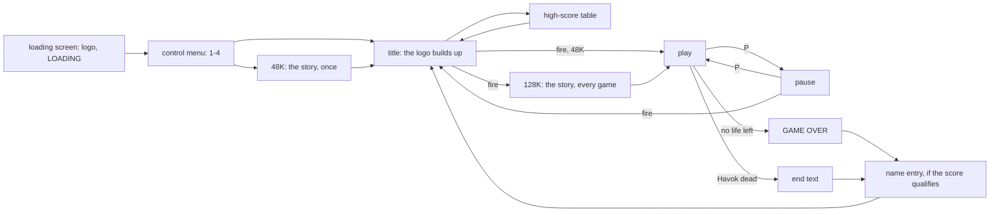
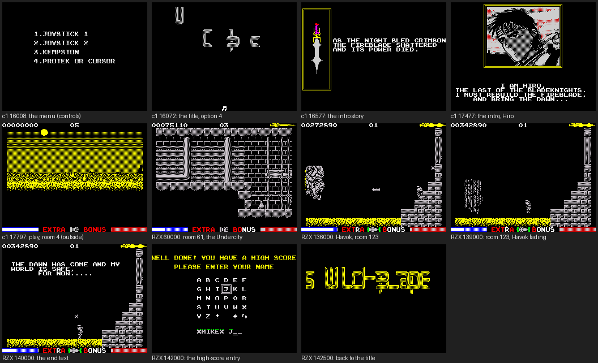
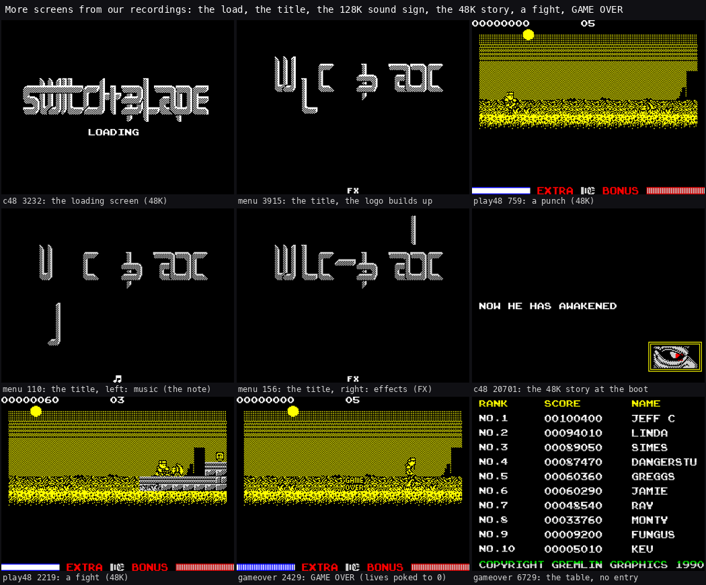
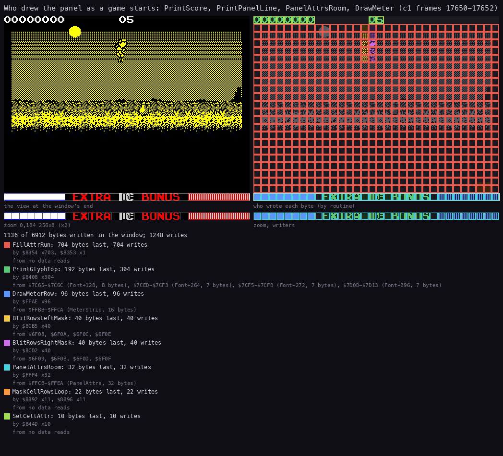
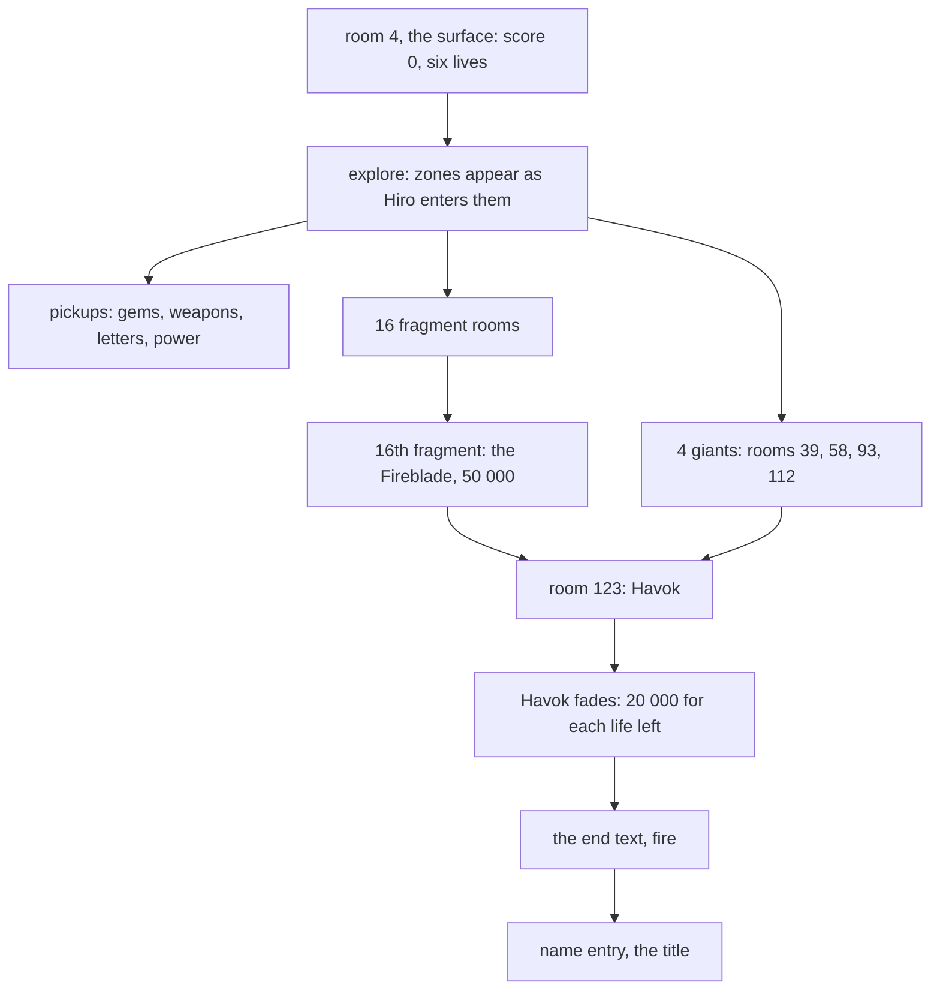
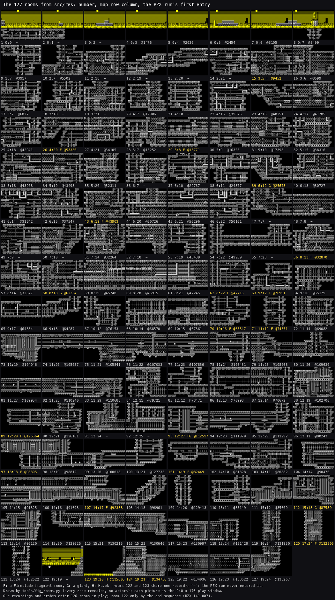
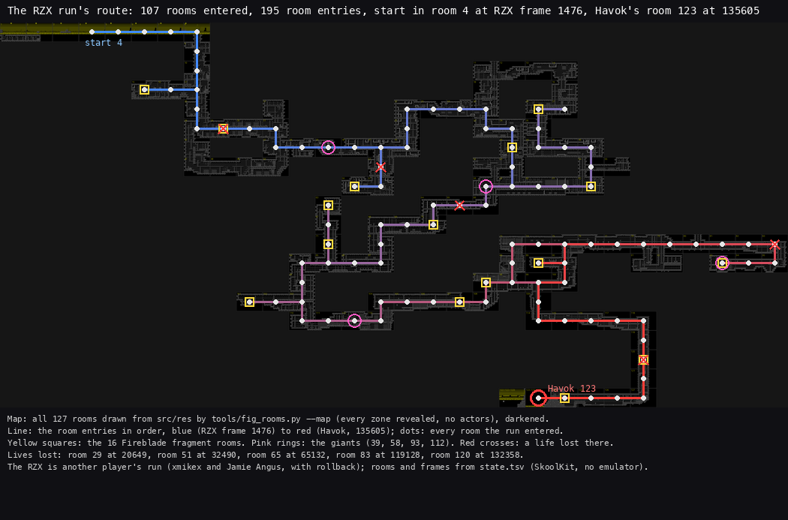

# 1. Game design

What this covers: the game as a player meets it.

- every screen: the loading screen, the control menu, the title and the 128K sound switch, the story, play and the
  panel, game over, the high scores and the name entry, the ending with Havok;
- the story and the goal: Fireblade's sixteen fragments and Havok;
- the rules as the game plays them: energy, lives, the score, the pickups;
- the 127 rooms as a contact sheet;
- a route through the whole game, from the RZX run.

The recordings it rests on ([WALKTHROUGH 6.0](../WALKTHROUGH.md#60-the-recordings)):

| Recording | Machine, start | Used for |
| --- | --- | --- |
| `c1` | 128K, power-on, the original tape at signal speed | the control menu (frame 16 008), the title (16 072), the 128K story (16 577, 17 477), room 4 at the start (17 797) |
| `c48` | 48K, power-on, the same tape | the loading screen (3 232), the 48K story (20 701) |
| `menu` | 128K, from c1's menu | the title's music and effects signs (110, 156), the title cycle (3 915) |
| `play48` | 48K, from c48's end | play from the keyboard: walks, jumps, punches, fights (759, 2 219) |
| `gameover` | 128K, from c1's menu; lives `$664D` = 0 and energy `$6642` = 1 poked at frame 1869 (a POKE) | GAME OVER (2 429), the high-score table without an entry (6 729) |
| `deaths` | 128K, from c1's menu | lives lost to enemies and a fall |
| the RZX run | 48K, RZX Archive, 142 989 frames, "recorded by xmikex and Jamie Angus (with rollback)" | another player's complete game: the rooms in order, the lives, Havok (RZX frame 135 605), the end text (about 140 000), the name entry (142 000). Read in SkoolKit (`work/stage2/rzx/state.tsv`); the screens are from stage 1's playback (`work/stage1/rzx/`) |
| the POKE probes | 48K, RZX state at 2015, the map row and column poked | the 15 rooms no play reached (`work/stage2/rec/poke-roomNNN/`) |
| `bossgate`, `havok` | 48K, from the RZX snapshots at 62 000 and 136 000; the boss's hit points POKEd to 1 | a giant killed and its gate opened (435), Havok killed and the game won (29), doc 10.17 |
| `throw`, `hiscore` | 128K, from stage 1's loaded state; the weapon, or the score and the last life, POKEd at 1869 | weapons thrown (1893-3039); a name entered in the table (2517-3229), doc 10.17 |

Frames are each recording's own, from its start. A screen named "frame N" is the screen at the start of frame N.

## 1.1 The screens

Switchblade is a flip-screen platform game: one room fills the play area, and walking off an edge replaces it with the
next. Around play there are only a few screens.

*Twelve screens from our 128K recording c1 and from the RZX run (48K, another player's game, stage 1's playback). Each
caption gives the recording and the frame. Assembled in stage 1 from `work/stage1/c1/screens/` and `work/stage1/rzx/`.*

*Nine more screens, each with its recording and frame. Made with `python3 tools/fig_screens.py
docs/img/play/screens-more.png` from the recordings' `screens/` folders.*

How to read them:

- Each picture is the whole 256 x 192 screen at the start of the frame named, without the border.
- In play the top line is the score (8 digits) and the lives (2 digits); the bottom line is the panel (below).
- The title's logo is built up letter by letter, then shown whole, then the high-score table follows.
- A black area in a room is a zone Hiro has not entered yet.

| Screen | When | What the player does | Witness |
| --- | --- | --- | --- |
| loading screen | stage 2 of the load: the SWITCHBLADE logo, "COPYRIGHT GREMLIN GRAPHICS 1991" scrolls out, LOADING in | waits | c48 3 232 |
| control menu | once per load: 1.JOYSTICK 1, 2.JOYSTICK 2, 3.KEMPSTON, 4.PROTEK OR CURSOR | presses 1-4 | c1 16 008 |
| the 48K story | at the boot, once: the same texts as the 128K's, from "FOR 10000 YEARS HE SLEPT" | waits | c48 20 701 |
| title | the logo builds up and holds 200 frames; on a 128K a note (music) or FX (effects) at the bottom | fire starts; on a 128K left picks music, right effects | c1 16 072; menu 110, 156 |
| high-score table | 200 frames, between titles; "COPYRIGHT GREMLIN GRAPHICS 1990" under it | fire starts | gameover 6 729 |
| the 128K story | before every game: "AS THE NIGHT BLED CRIMSON ...", Hiro's portrait, "I AM HIRO ..." | waits | c1 16 577, 17 477 |
| play | the room, the score and lives above, the panel below | plays | c1 17 797, play48 |
| pause | P | P resumes; fire quits to the title | menu 2 035 |
| GAME OVER | the banner over the room, 200 frames or fire | waits | gameover 2 429 |
| the ending | Havok fades away; "THE DAWN HAS COME AND MY WORLD IS SAFE, FOR NOW....." | fire ends the game | RZX 136 000-140 000 |
| name entry | "WELL DONE! YOU HAVE A HIGH SCORE / PLEASE ENTER YOUR NAME", a letter grid | picks letters with the controls | RZX 142 000 |

The 48K and the 128K show the same screens with two differences: the 48K tells its story once, at the boot, and the
128K before every game; and only the 128K's title has the music/effects switch (doc 3.3).

### The panel

*The panel as play begins in c1 (128K, frames 17 650-17 652), each byte coloured by the routine that wrote it last.
Drawn for doc 8 by `kit/writers_map.py`; doc 8 gives the command.*

How to read it:

- Top left: the score, eight digits. Top middle: the lives, two BCD digits. Top right, later in a game: the
  Fireblade's fragments.
- Bottom left: the energy meter (Vitality `$6642`, a white bar). Bottom right: the charge meter (Charge `$6645`, the
  red bar), which fills while fire is held.
- Between them: the letters EXTRA, the weapon bar (the shots left), and the letters BONUS. A letter lights when its
  pickup is taken.

**The point**: the game has almost no screens of its own. Everything the player needs in play is on two text lines,
and the rest is the room.

## 1.2 The story and the goal

The story, from the texts in `src/res/texts/story.txt` (the 128K pages in bank 4, the 48K pages in the actor pages):

> FOR 10000 YEARS HE SLEPT. HIS MIND FEEDING... ON THE NIGHTMARES OF THE WEAK. NOW HE HAS AWAKENED.
> AS THE NIGHT BLED CRIMSON THE FIREBLADE SHATTERED AND ITS POWER DIED. THEN THE SLAUGHTER BEGAN.
> THEY NEVER THOUGHT HE WOULD RETURN. NOW HAVOK REIGNS THE UNDERCITY.
> I AM HIRO, THE LAST OF THE BLADEKNIGHTS. I MUST REBUILD THE FIREBLADE, AND BRING THE DAWN...

The goal follows:

1. Explore the Undercity of Thraxx, 127 rooms on a 30 x 20 grid, from the surface (rooms 1-8) down to Havok's room
   (123, row 19).
2. Find the sixteen fragments of the Fireblade. One lies in each of the rooms 15, 26, 29, 43, 56, 62, 63, 70, 71, 89,
   93, 97, 101, 107, 120 and 124. Each is worth 10 000; the sixteenth is worth 50 000 and makes the Fireblade Hiro's
   weapon (weapon 7).
3. Beat the four giants on the way: rooms 39, 58, 93 and 112 (kinds `$26`, `$27`, `$29`, `$28`).
4. Kill Havok in room 123 with a weapon. He fades away; the end text follows; fire ends the game and goes to the name
   entry.

Havok is killed with a weapon (doc 10). The RZX run enters all sixteen fragment rooms before it reaches him (1.5).

**The point**: it is an exploration game first. The fragments are spread over the whole map, and the world is drawn
only where Hiro has been, so finding the way is the game.

## 1.3 The rules

### Energy and lives

Hiro has an energy meter of `$20` (32 units, Vitality `$6642`) and starts with lives `$05` on the panel: six lives in
all, because the game ends only when the count goes below 0.

| What happens | Energy | Where |
| --- | ---: | --- |
| touched by an enemy, a trap or a giant | -4 | TouchHiro `$9801`, HurtHiro `$9860` |
| touched by a giant's shot | -8 | the same |
| the stalactite falls on him | -4 | TouchKind36 `$986C` |
| a fall of 20 steps (80 pixels) or more | -6 to -28 | FallDamageStep `$920A` |
| the vitality pickup | back to `$20` | CollectPickup `$98B6` |
| energy at 0 | a life: the energy ball for 170 frames, energy `$20`, back to the fist | LoseLife `$962A` |
| lives below 0 | game over | `JP M,GameOver` at `$9651` |

No tile hurts: only actors and falls. While the energy ball is on (after a lost life, or for 853 frames from the
invulnerability pickup) nothing hurts Hiro.

Worked example, the RZX run (48K, another player): the lives on the panel are 5 at RZX frame 1 473, 4 at 20 649, 3 at
32 490, 2 at 65 132, 1 at 119 128. EXTRA, completed at 128 606, brings 2; the last loss at 132 358 leaves 1, and Havok
dies with that one life. Five lives were lost in the whole game, in rooms 29, 51, 65, 83 and 120 (1.5).

### The score

The score is eight BCD digits (Score `$6653-$6656`, AddScore `$99E7`).

| Source | Points |
| --- | ---: |
| an enemy killed | its own value (+`$0B` of its record) |
| a block broken | 10 |
| a gem, kinds 1-5 | 50, 100, 200, 400, 700 |
| the flask | 7 000 (the manual says 700) |
| an orb, small to large | 1 000, 2 000, 5 000 |
| a power reset or speed reset shield | 400 |
| bullets, taken with the fist | 50 |
| BONUS, all five letters | 10 000 |
| a Fireblade fragment | 10 000; the sixteenth 50 000 |
| Havok killed | 20 000 for each life left |

Worked example: at RZX frame 72 000 the run's score is 00092060. At the end it has 1 life left, so Havok adds 20 000.

### The pickups

| Pickup | Effect |
| --- | --- |
| E, X, T, R, A | all five lit: an extra life (message EXTRA LIFE) |
| B, O, N, U, S | all five lit: 10 000 (message BONUS POINTS) |
| weapon shields | weapons 1-6 with 16 shots: blade, scorchball, dart, spinblade, needle bolts, trispike |
| bullets | 16 more shots |
| power-up, speed-up | a stronger or faster charge of the strike |
| power reset, speed reset | back to the start values, 400 |
| vitality | energy `$20` |
| invulnerability | the energy ball for 853 frames (17 s; the manual says 16) |

Many pickups are hidden in blocks that break when struck. Pickups spawned with a lifetime (kind bit 7) last 255 frames. Doc 10 gives
each kind, each weapon and each enemy.

### Fighting

Fire attacks. A tap gives strike 1, holding fire longer charges the meter and gives strike 2 or 3 (doc 4.4). With the
fist the three strikes are a punch, a high kick and a sweep; with a weapon, fire throws one shot at a time, and each
throw costs one shot. The fist cannot hurt the giants.

**The point**: the rules are generous with lives and strict with falls. Six lives, an extra life in the letters and a
170-frame shield after each loss make the game long; a single fall from a height can cost most of the meter.

## 1.4 The 127 rooms

*Every room as the game builds it from the resources, in number order. Made with `python3 tools/fig_route.py --map
work/stage2/fig/rooms/map.png --state work/stage2/rzx/state.tsv --out docs/img/maps`, from the room pictures of
`python3 tools/fig_rooms.py --map` (every zone revealed, no actors) and the RZX run's room per frame (`state.tsv`).*

How to read it:

- Each picture is a room's play window, 240 x 176 pixels, with all its zones revealed.
- The label is the room number, its map row and column, a letter (F a fragment, G a giant, H Havok) and the RZX
  frame at which the run first entered it; "-" means the run never entered it.
- Rooms 1-8 are the surface: the yellow sky and the noise of the ground. The rest is the Undercity's brick, pipes and
  ladders.
- Room 122 has the surface's colours at the bottom of the map: the open air under Havok's room; it shares its record
  with 123.

The RZX run enters 107 rooms in play. The 20 it never enters are 1, 2, 3, 11, 12, 13, 14, 18, 19, 21, 36, 47-50, 52,
55, 91, 92 and 122. Our recordings enter all 127: stage 1's rooms recording walked into rooms 1-3 and wrote its way
into 11, 14 and 18; the POKE probes entered the other 13 by writing MapRow `$69DF` and MapColumn `$69E0`
(WALKTHROUGH 6.0, stage 2). The map with each room in its grid place is in [doc 2.4](02-architecture.md#24-the-map).

**The point**: the rooms share one look. They are built from one tile set by one builder, so the player navigates by
shape, not by landmarks; the self-mapping (a zone appears only when entered) is what keeps that hard.

## 1.5 A route through the game

The RZX Archive run is another player's complete game ("recorded by xmikex and Jamie Angus (with rollback)", 48K,
142 989 frames). `tools/rzx_snap.py` played it in SkoolKit and wrote the room, the map position, the lives and the
energy for every frame (`work/stage2/rzx/state.tsv`).

*The run's room entries in order over the map drawn from the resources. Made with `python3 tools/fig_route.py --map
work/stage2/fig/rooms/map.png --state work/stage2/rzx/state.tsv --out docs/img/maps`.*

How to read it:

- The map is every room in its grid place, darkened. The line joins the rooms in the order the run entered them, from
  blue (RZX frame 1 476, room 4) to red (Havok, 135 605).
- Yellow squares: the sixteen fragment rooms. Pink rings: the four giants. Red crosses: a life lost there.
- A line drawn twice is a corridor walked there and back.

The route in stages (RZX frames of the first entry into each room):

| Stage | Frames | Rooms | What happens |
| --- | --- | --- | --- |
| 1, down the shaft | 1 476-12 906 | 4-8 on the surface, then 9, 10, 17, 16, 15, 20 | down the shaft in column 7; fragment 1 in room 15 (9 452) |
| 2, the first giant | 15 252-32 677 | 28-31, 37-41, 51, 57 | fragment in 29 (15 771); the first giant in 39 (25 678); lives 4 (20 649, room 29), 3 (32 490, room 51) |
| 3, the middle rows | 32 870-54 105 | 56, 42, 32, 22-25, 33-35, 43, 53, 59-62, 54, 44-46, 26, 27 | fragments in 56, 43, 62, 26 |
| 4, the giant of room 58 | 62 254-76 991 | 58, 64-72, 85-87, 63 | the second giant (62 254); fragments in 70, 71, 63; lives 2 (65 132, room 65) |
| 5, the giant of room 112 | 79 721-96 961 | 84, 96, 101-113 | fragments in 101, 107; the giant of room 112 (87 539) |
| 6, the giant of room 93 | 98 305-112 597 | 97-99, 88, 73-83, 95, 94, 93 | fragment in 97; the giant and fragment of room 93 (112 597); lives 1 (119 128, room 83) |
| 7, to Havok | 126 161-135 605 | 90, 89, 100, 109, 114-121, 127-124, 123 | fragments in 89, 120, 124; EXTRA (128 606); lives 1 (132 358, room 120); Havok's room 123 |
| 8, the end | 135 605-142 989 | 123 | Havok fades (136 000-139 000), the end text (about 140 000), the name entry "XMIKEX J" (142 000), the title (142 500) |

Worked example, the first fragment: the run starts in room 4 at RZX frame 1 476 and walks right along the surface to
room 8 (3 499). It climbs down the shaft in column 7 through rooms 9 (3 917) and 10 (5 502) to room 17 (6 827), turns
left into 16 (8 699) and reaches the fragment room 15 (9 452): about 160 s of play for the first of sixteen.

Our replays of the run (the `r` segments of stage 2) drift from the RZX within a few hundred frames, because the main
loop runs free and unreal-ng's timing differs from SPIN's (doc 4.1). The route above is the RZX's own, read without an
emulator.

**The point**: the route is long and winding: 195 room entries for 107 rooms, and the fragments are spread so that the
whole map must be crossed. The recorded game runs 45 minutes (135 605 frames to Havok), with rollback.

## 1.6 Controls and options

The control menu offers Sinclair 1, Sinclair 2, Kempston and Protek or cursor keys; there is no key redefinition. P
pauses, and fire in the pause quits. On a 128K the title's left and right choose music or sound effects. Doc 5 has the
details, and the SLOPPY cheat that picks a start room.

## 1.7 Known only from the code

- The BONUS completion, the sixteenth fragment's 50 000 and the Fireblade weapon: no recording of ours takes them.
- The flask's 7 000, the invulnerability pickup's 853 frames, the power-up and speed-up shields.
- The SLOPPY cheat (doc 5).
