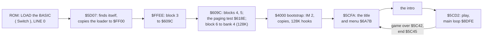

# 2. Architecture

What this covers: the machine, the memory map, the stages from the tape to play, the frame, the map. The recordings
it rests on: c1 (128K, power-on, signal-speed load), c48 (48K, the same), menu and gameover (128K, from c1's menu),
rzx-a, rzx-b, rzx-c (the RZX Archive run, 48K, played by `rzx_playback`); the list is WALKTHROUGH 6.0.

<!-- Figures this document needs (GUIDE.md 4.2), remove each line when it is in: -->
<!-- - the main loop's call graph -->

## 2.1 The machine

One program for the 48K and the 128K. The 128K adds bank 4 (the AY music player, its tunes and a copy of the intro
story) and five patched call sites in the main program; the main program, the screens and the map are the same
([WALKTHROUGH 0.4](../WALKTHROUGH.md#04-the-machine-48k-and-128k)). On both machines the game runs with banks 5, 2, 0
at `$4000`, `$8000`, `$C000` (`$7FFD` = `$10`); bank 4 holds the 128K music, reached through the glue at `$853F` (doc 9).

## 2.2 The memory map

The image at the jump into the game (`work/mkgame/original.bin`, doc 3.1) after the bootstrap's copies, as the menu
and play use it (c1 `explore/loaded.szx` and `c1/end.szx` read with SkoolKit's `Snapshot`; the code addresses from
`sna2skool.py -H` over them):

| Range | Bytes | What | Witness |
| --- | ---: | --- | --- |
| `$4000-$5AFF` | 6912 | the screen; at the load the bootstrap (block 5, `$4000-$5190`) | doc 3.1 |
| `$5B00-$5BFF` | 256 | a text buffer `$5B01-$5B18` (`$A461`), the room unpacker's 3-bit codes `$5B50-$5B7F` (written by `$8BC5`, read back with `POP` after `LD SP,$5B50` at `$8C1D`), the stack: `SP` = `$5C00`, reset on every pass of the main loop (`$8DFE`), low mark `$5BBA` (2.5) | `$8DFE`, `c1/end.szx` (`SP` = `$5BF6`), the L1 byte counts |
| `$5C00-$5CFF` | 256 | code copied from `$4146`: the game over `$5C42`, the end `$5C45`, the start of play `$5CD2-$5CF7`, the entry `$5CFA` | bootstrap copy `$4146` -> `$5C00`, `$0F4D` bytes |
| `$5D00-$65FF` | 2304 | nine actor records of 256 bytes, Hiro at `$5D00` (Y +0, X +1, flags +2, kind +`$1C`, timers +`$1D`, +`$1E`); at the menu the same pages hold the intro's texts (`$5E6C` "FOR 10000 YEARS HE SLEPT", `$6170` "I AM HIRO") | the handler `$8472`, the loop `$8E01`; `explore/loaded.szx` |
| `$6600-$66FF` | 256 | the tenth page: the globals (energy `$6642`, pause `$664C`, lives `$664D`, end flags `$6651`, `$6652`, score `$6653-$6656` and `$665B-$6662`) and code (`$6682` pause, `$66B6`, `$66C8`) | WALKTHROUGH 6.3 |
| `$6700-$6B4C` | 1101 | work buffers of the room (`$684F-$6877`, `$69DF` / `$69E0` the map row and column), the title `$6A7B` | the walk diff (WALKTHROUGH 6.3), `$95C3` |
| `$6B5C-$7047` | 1260 | block 4 begins: the room numbers `$6BDC`, `$6BDD` and code | `$95CF`, `$95D8` |
| `$7048-$70EE` | 167 | the map tables: the column list `$7048`, the counts `$70C7`, the starts `$70DB` | `$95F9` |
| `$70EF-$FDFC` | 36 110 | the main program and its data: the handler `$8456`, the effect player `$853F` (48K; the music glue on a 128K), the main loop `$8DFE`, the actor update `$8E2B`, the room lookup `$95C3`, the energy loss `$9615`, the room unpacker `$8BC8` and the packed rooms (read from `$D5B4-$FB21`) | L1 of c1 |
| `$FDFD-$FDFF` | 3 | `JP $8456` | bootstrap |
| `$FE00-$FEFD` | 254 | the IM 2 vector table, all `$FD` | bootstrap |
| `$FF01-$FFFE` | 254 | code copied from `$5093`, called on every pass (`$FF01`, `$FF64`) | bootstrap, `$8E23` |
| bank 4 `$C000-$E0F8` | 8441 | 128K only: the AY player (`OUT (C),A` at `$D3CD`), the tunes, the intro story (`$D514-$D862`) | doc 3.1, WALKTHROUGH 0.4 |

## 2.3 The stages

## 2.4 The map

The Undercity is a grid of 30 columns by 20 rows holding 127 rooms. For map row R, `$70C7+R` is the number of rooms in
the row and `$70DB+R` where its columns start in the list at `$7048`; `$95F9` searches the list for Hiro's column
with `CPIR` and the room number is the position found plus one (`$6BDD`; `$6BDC` the room above). Hiro crosses to the
next row when his Y (`$5D00`) reaches `$A0` (down) or `$EC` (up), and to the next column when his X (`$5D01`) passes
`$9E` or `$FA` (`$9560-$95B0`). The game starts in room 4 (row 0, column 3; `work/stage1/probe/play0.szx`); Havok is
in room 123 (row 19, column 20; the RZX run enters it at frame 135 605).

`python3 tools/fig_map.py work/mkgame/original.bin work/stage1/rzxtrace docs/img/maps/map-rzx.png work/stage1/roomshots`
draws every room of the tables in its grid cell, filled with the screen the RZX run left on its last frame in that room
(`tools/rzx_trace.py`, blue outline). The rooms recording (WALKTHROUGH 6.0) adds rooms 1, 11, 14 and 18 (green
outline: walked into room 1 from the start, rooms 11, 14 and 18 entered by writing the map row, column and room).
Grey cells are the 15 rooms no recording shows: 2, 3, 12, 13, 19, 21, 36, 47-50, 52, 55, 91, 92 (rooms 2 and 3 were
walked through on the way to room 1 but not captured). The rooms are revealed block by block as Hiro walks, so a room
left early shows black where its blocks were never uncovered (rooms 1 and 4-7 are the yellow surface).

## 2.5 Memory use

`python3 tools/merge_l1.py work/stage1/l1-all.json` over the L1 builds of the seven recordings that start from the
menu (menu, opt2, opt3, opt4, deaths, gameover, rooms: 46 693 frames; c1 and c48 are left out, their tape loads touch
every byte and their loader loops would dominate), drawn by `kit/heatmap.py` with `work/stage1/regions.txt`:

What it shows (counts from `l1-all.json`):

- **Execution**: 71.5 % of the instructions run in `$8000-$8FFF`, 21.5 % in `$9000-$9FFF`, 3.1 % in `$A000-$AFFF`,
  3.7 % in `$F000-$FFFF` (the code at `$FF01`, called on every pass) and almost nothing in the actor pages' code or
  `$5C00`. Nothing runs in `$B000-$FDFC`.
- **Data**: `$C000-$FDFC` is read only (5231 bytes read, one written), the packed rooms among it (`$D5B4-$FB21`, 2.2). `$B000-$BFFF`
  is neither read nor written in these recordings. The actor pages, the globals and the room buffers
  (`$5D00-$6FFF`) are both read and written; above `$7000` only 103 bytes are written.
- **The stack**: the lowest write above the 3-bit buffer is `$5BBA` (the rooms recording; `$5BC4` deaths, `$5BCA`
  gameover, `$5BCE` menu, `$5BD0` opt2-4), so the game needs at most 70 bytes of the 256 below `$5C00`. c1 and c48
  write down to `$5B00` during the tape load, before the game runs.
