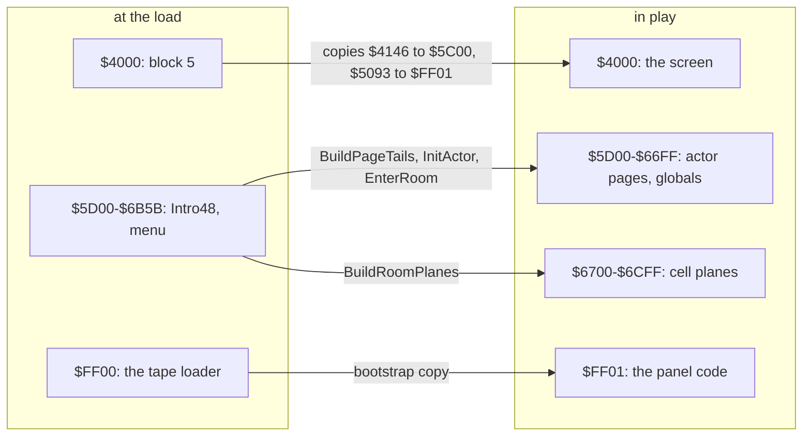
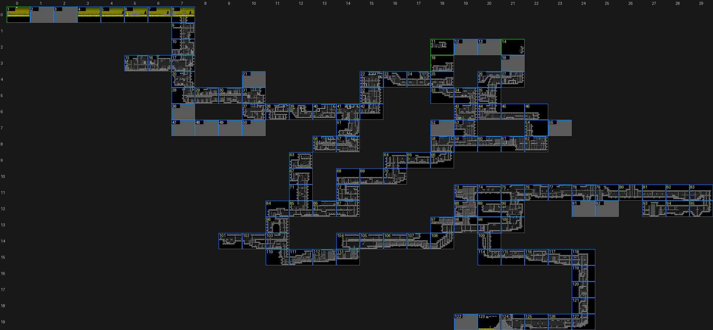
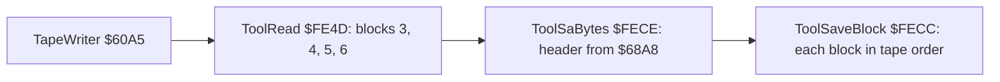
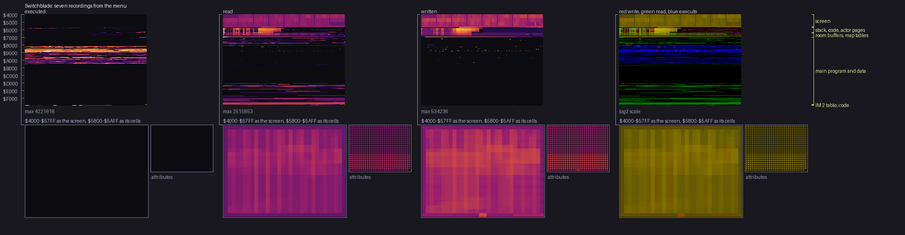
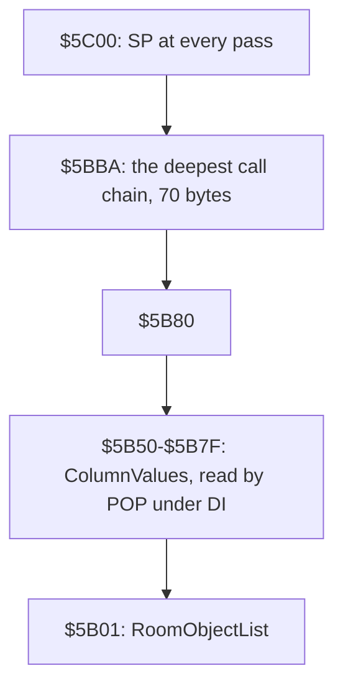
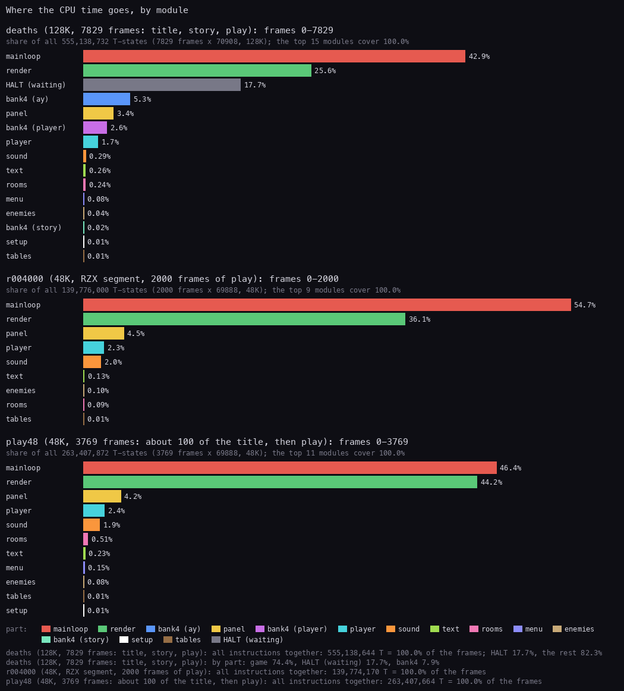

# 2. Architecture

What this covers:

- the machine: one program for the 48K and the 128K;
- the module map: the five `.ann` sources and the sixteen modules of the game;
- the memory map, as the game runs, on both machines, with bank 4;
- the map of the Undercity in memory;
- the leftovers: the tape writer and the other mastering remains;
- the memory use: the heatmap and the stack;
- the frame budget: IM 2, no `HALT` in play, 13 to 26 passes a frame.

The recordings it rests on ([WALKTHROUGH 6.0](../WALKTHROUGH.md#60-the-recordings)):

| Recording | Machine | Used for |
| --- | --- | --- |
| `c1` | 128K, power-on, signal-speed load | the image at the jump into the game (frame 15 503), the play state, the pass count in room 4 |
| `c48` | 48K, power-on, the same tape | the 48K image and the 48K entry |
| `menu`, `opt2`-`opt4`, `deaths`, `gameover`, `rooms` | 128K, from c1's menu | the heatmap (46 693 frames together), the stack's low mark, the CPU budget (deaths) |
| `play48` | 48K, from c48's end | the 48K CPU budget from the menu through play |
| `r004000` | 48K, the RZX run's state at RZX frame 4000, its keys replayed | the 48K play budget |
| the RZX run | 48K, RZX Archive (another player's complete game) | the passes a frame over 28 500 frames, the rooms in order |

A value read with `time_travel memory_at` frame N is the memory at the start of frame N. L1 counts are whole-recording
counts.

## 2.1 The machine

One program runs on both machines ([WALKTHROUGH 0.4](../WALKTHROUGH.md#04-the-machine-48k-and-128k)).

- The main program, the screens, the rooms and the map are the same bytes on the 48K and the 128K.
- The 128K adds bank 4: Ben Daglish's AY player, three tunes and the story pages. It also gets five patched call sites
  and a 162-byte glue at `$853F` in place of the 48K beeper player ([doc 3.3](03-build-and-load.md#33-the-bootstrap-4000-and-the-128k-set-up)).
- On both machines play runs with banks 5, 2, 0 at `$4000`, `$8000`, `$C000` (`$7FFD` = `$10`). The glue pages bank 4
  in for one call each frame and pages bank 0 back.
- The CPU runs IM 2 with I = `$FE`. The main loop runs free, without `HALT` (doc 4).

## 2.2 The modules

The source is five parts, each built from one `.ann` by `kit/mkgame.py` (doc 3.6):

| Part | Source | Where it runs | Bytes | Modules |
| --- | --- | --- | ---: | --- |
| game | `src/game/game.ann` | `$5C00-$FFFF` | 41 984 | 16, below |
| bank 4 | `src/bank4/bank4.ann` | bank 4 `$C000-$E0F8`, 128K only | 8 441 | player `$C000-$C03E` and `$C0D7-$C4B7`; state `$C03F-$C0D6`; tunes `$C4B8-$D0D9`; ay `$D0DA-$D3CF`; story `$D3D0-$E0F8` |
| boot | `src/boot/boot.ann` | `$4000-$4145`, during the boot | 326 | boot `$4000-$40A3`; glue (run at `$853F-$85E0`) |
| stage 2 | `src/stage2/stage2.ann` | `$609C-$68A7`, during the load | 2 060 | stage2 |
| tape | `src/tape/basic.ann` | `$5CCB-$5D36`, then `$FF00-$FFFC` | 361 | basic; loader |

The game's sixteen modules, from `src/game/game.ann` (340 code entries, 236 data entries, 4 word tables, 2 texts):

| Module | Bytes | Code / data entries | Ranges | What |
| --- | ---: | ---: | --- | --- |
| setup | 335 | 6 / 4 | `$5C00-$5D4E` | GlobalsInit, GameOver, EndOfGame, NewGame, GameEntry, BuildPageTails |
| menu | 4 169 | 30 / 9 | `$5D4F-$6B5B`, `$A6EC-$A927` | Intro48, the control menu `$6A7B`, the title, the high scores, the name entry |
| vars | 1 260 | 0 / 12 | `$6B5C-$7047` | the page tails' template, room variables, the kept room states |
| rooms | 2 520 | 68 / 7 | `$7048-$72FD`, `$955A-$9614`, `$9F34-$A59A` | the map lookup, CheckRoomExit, EnterRoom, BuildRoomPlanes, the room objects and zones |
| leftovers | 13 | 0 / 2 | `$72FE-$72FF`, `$D0F9-$D103` | bytes no code reads (2.5) |
| tables | 2 638 | 0 / 29 | `$7300-$7BE4`, `$FD98-$FF00` | the build tables, actor scripts, gates, the IM 2 table |
| graphics | 12 698 | 0 / 27 | `$7BE5-$80EA`, `$D104-$FD97` | tiles, sprites, the giants, icons, pictures |
| text | 794 | 9 / 16 | `$80EB-$8319`, `$8365-$844F` | the printers, the font, the strings, the high-score table |
| mainloop | 855 | 36 / 1 | `$831A-$8338`, `$8456-$853E`, `$8DFE-$8F00`, `$9A4B-$9AFC`, `$A652-$A6EB` | the handler, GameTick, ReadInput, MainLoop, ActorUpdate, RunActorSteps, InitActor |
| render | 1 807 | 58 / 3 | `$8339-$8364`, `$8803-$8DFD`, `$8F3B-$9022` | the cell composer, the masked redraw, the sprites, BlitWindow |
| sound | 498 | 13 / 3 | `$8450-$8455`, `$853F-$872A` | the sound variables, the 48K effect player (the glue on a 128K) |
| ending | 216 | 3 / 0 | `$872B-$8802` | HavokFade and the end |
| player | 2 903 | 91 / 0 | `$8F01-$8F3A`, `$9023-$9347`, `$9514-$9528`, `$965F-$99E6`, `$9A27-$9A4A`, `$9AFD-$9F33` | Hiro and the actors: move, jump, fall, fight, pickups, weapons |
| enemies | 692 | 16 / 0 | `$9348-$9513`, `$9529-$9559`, `$A59B-$A651` | enemy logic, the spawns |
| panel | 393 | 10 / 3 | `$9615-$965E`, `$99E7-$9A26`, `$FF01-$FFFF` | energy, lives, score, the panel code copied over the loader |
| roomdata | 10 193 | 0 / 126 | `$A928-$D0F8` | the 126 room records |

*Every byte of `$5B00-$FFFF`, 256 bytes a row, coloured by the module of its `.ann` entry. Made with `python3
tools/fig_modules.py src/game/game.ann docs/img/arch/modules.png`.*

How to read it:

- A row is one 256-byte page; `$5C00` at the top, `$FFFF` at the bottom. A colour is a module (the key below).
- The code is the band `$7BE5-$A927`: text, mainloop, render, player, enemies, rooms and panel interleaved. Their
  interleaving is the original's order; the modules are a reading of it.
- `$A928-$FD97` is data: the room records (dark green), then the graphics (orange).
- R1-R7 on the right mark regions whose bytes at load time are not what they hold in play (2.3).

**The point**: the rooms and the pictures are more than half of the game (22 891 of 41 984 bytes). The code modules
with their own small tables are about 15 000 bytes, and a quarter of those (the start-up code and the menu) is
overwritten by play.

## 2.3 The memory map

The image as it runs, after the bootstrap's copies (`work/mkgame/original.bin` at c1's `JP $4000`, frame 15 503), with
what each region holds in play. Stage 2 corrected the stage-1 draft: the room records are at `$A928-$D0F8`, the graphics
at `$D104-$FD97`, and `$6651` is Invulnerable, not an end flag.

| Range | Bytes | At the load | In play | Witness |
| --- | ---: | --- | --- | --- |
| `$4000-$5AFF` | 6 912 | block 5: the bootstrap and the copies' sources | the screen | doc 3.3 |
| `$5B00-$5BFF` | 256 | | RoomObjectList `$5B01` (the room's item and enemy records, 2 bytes each); ColumnValues `$5B50-$5B7F` (one picture column as 3-bit values, read back with `POP` after `LD SP,$5B50`); the stack, `SP` = `$5C00` at every pass, low mark `$5BBA` | SetupRoomObjects `$A41E`, MaskedColumn `$8C0F`, 2.6 |
| `$5C00-$5D06` | 263 | setup: GlobalsInit `$5C00` (56 bytes), GameOver `$5C42`, EndOfGame `$5C45`, NewGame `$5C4D`, GameEntry `$5CFA` | the same: the code stays | copied from `$4146` |
| `$5D00-$65FF` | 2 304 | Intro48, its texts (`$5E6C` "FOR 10000 YEARS HE SLEPT", `$6170` "I AM HIRO"), the menu code | nine actor pages of 256 bytes, Hiro at `$5D00`; +`$82-$FF` of each page holds a table tail (BuildPageTails) | GameTick `$8472`, MainLoop `$8DFE` |
| `$6600-$66FF` | 256 | menu code and data; PauseGame and PendingMessage, which stay | the weapon page `$6600` (WeaponActor); the globals `$6642-$667F`: Vitality `$6642`, ChargeStep `$6644`, Charge `$6645`, PauseFlag `$664C`, Lives `$664D`, FireRequest `$6650`, Invulnerable `$6651`, EndFlags `$6652`, the score; code: PauseGame `$6682`, PendingMessage `$66B6` | WALKTHROUGH 6.3 |
| `$6700-$6CFF` | 1 536 | menu code, ControlMenu `$6A7B`; the vars template from `$6B5C` | the six cell planes `$67-$6C` (220 cells each: flags and zones, layers, colours) and the room variables after them: RoomAbove `$6BDC`, Room `$6BDD`, MapRow `$69DF`, MapColumn `$69E0`, EnemyCount `$6ADD` | BuildRoomPlanes `$9F34` |
| `$6D00-$6EFF` | 512 | vars templates | the kept room states: HavokStashB `$6D00`, TakenItems `$6DFE`, RevealedZones `$6DFF`, HavokStashA `$6E00`, GoneEnemies `$6EFE` | SaveRoomState `$A58A` |
| `$6F00-$7047` | 328 | templates | OutlineMask `$6F00`, RowBase `$7000`, NameBoxPlaces `$700C`, built by GameEntry | BuildPageTails `$5D07` |
| `$7048-$72FD` | 694 | rooms | the map tables: columns `$7048`, counts `$70C7`, starts `$70DB`; RoomTable `$7100` | FindRoom `$95F9` |
| `$7300-$7BE4` | 2 277 | tables | the room build tables, gates (GateClosed `$76D8`), actor scripts, MessageRequest `$79FF` | |
| `$7BE5-$A927` | 11 587 | code, the font, the strings, sprites | the same | L1 of every recording |
| `$A928-$D0F8` | 10 193 | the 126 room records | read by BuildRoomPlanes | doc 7 |
| `$D0F9-$D103` | 11 | zeros | not read (2.5) | |
| `$D104-$FD97` | 11 412 | tiles `$D104`, enemies `$E154`, giants `$E5BC`, the other sprites and pictures | read by the render | doc 6 |
| `$FD98-$FDFC` | 101 | tables | the same | |
| `$FDFD-$FDFF` | 3 | | Im2Jump: `JP $8456` | the bootstrap |
| `$FE00-$FF00` | 257 | | Im2Table: 257 bytes `$FD` | the bootstrap |
| `$FF01-$FFFE` | 254 | the tape loader `$FF00-$FFFC` | PanelWeapon `$FF01`, PanelMeters `$FF64`, DrawMeterRow `$FFA8`, copied from `$5093` | doc 3.3 |
| `$FFFF` | 1 | | 0, no reader | |

Bank 4, on a 128K only (block 6, `$C000-$E0F8`, 8 441 bytes):

| Range | Module | What |
| --- | --- | --- |
| `$C000-$C03E`, `$C0D7-$C4B7` | player | the entries (PlayEffect `$C011`, StartTune `$C0D7`, PlayFrame `$C17D`) and the sequencer |
| `$C03F-$C0D6` | state | the channel records, the instrument slots, the drum |
| `$C4B8-$D0D9` | tunes | patterns, order lists, instruments, the note table; AyChannelA `$D09D` |
| `$D0DA-$D3CF` | ay | note start, envelopes, vibrato, the AY writes (`OUT (C),A` at `$D3CD`); Silence `$D182` |
| `$D3D0-$E0F8` | story | StoryPages `$D3D0`, the story's texts and pictures |
| `$E0F9-$FFFF` | | not loaded; bank 4's vector table at `$FE00-$FF00` and `$FDFD` (doc 3.3) |

The 48K and the 128K differ only where the 128K writes: the five hook sites, `$853F-$85E0` (the glue over the 48K
player) and bank 4. At the menu the two memories differ in 322 bytes.

**The point**: the low memory is used twice. The code that starts the game and shows the menu lives exactly where
play later keeps its actors and cell planes, so nothing of it survives the first room.

## 2.4 The map

The Undercity is a grid of 30 columns by 20 rows holding 127 rooms. For map row R, `$70C7`+R is the number of rooms in
the row and `$70DB`+R where its columns start in the list at `$7048`. FindRoom `$95F9` searches the list for Hiro's
column with `CPIR`; the room number is the position found plus one (Room `$6BDD`; RoomAbove `$6BDC` the room above).
Hiro crosses to the next row when his Y (`$5D00`) reaches `$A0` (down) or `$EC` (up), and to the next column when his X
(`$5D01`, corrected by the animation offset) reaches `$9E` or `$FA` (CheckRoomExit `$955A`, doc 4.5). The game starts
in room 4 (row 0, column 3); Havok is in room 123 (row 19, column 20). Rooms 122 and 123 share one record.

*Every room of the map tables in its grid cell, filled with the screen the RZX run (48K, another player's game) left on
its last frame in that room. Made with `python3 tools/fig_map.py work/mkgame/original.bin work/stage1/rzxtrace
docs/img/maps/map-rzx.png work/stage1/roomshots` (stage 1).*

How to read it:

- Blue outlines: rooms the RZX run entered. Green: rooms the stage-1 rooms recording added (1, 11, 14, 18).
- Grey cells: the 13 rooms no stage-1 recording showed. Stage 2 entered all of them by POKE probes and drew them from
  the resources ([doc 1.4](01-game-design.md#14-the-127-rooms)).
- Black inside a room is a zone never revealed: the run left before walking there.

**The point**: the map is a sparse grid, a list of columns per row. A room has no exits of its own; walking off an
edge simply looks up the neighbour cell of the grid.

## 2.5 The leftovers

Code and data that the game carries but never uses, mostly from the mastering:

| What | Where | Why it is a leftover |
| --- | --- | --- |
| TapeWriter | `$60A5-$612E` (stage 2) | reads blocks 3-6 and saves the whole tape with a header; not executed in any recording; nothing on the tape calls it |
| ToolInit, ToolRead, ToolSaveBlock, ToolSaBytes, ToolStep | `$FE00`, `$FE4D`, `$FECC`, `$FECE`, `$5FA9` | TapeWriter's helpers; their code is on no block of the tape, so what they do is a guess from the calls |
| HeaderTemplate | `$68A8` | a 17-byte tape header just past stage 2's block |
| the 48K effect player's tail on a 128K | `$85E1-$872A`, EffectTable `$8683` | the glue replaces the player's entry; the tail is not executed in any 128K recording |
| HiroBusyNoJump | `$8E81` | not executed in any recording; no reference to it |
| a loop at `$9895` | player | not executed in any recording |
| SoundSpare | `$8451` | no reader |
| Leftover72FE | `$72FE-$72FF` | two zero bytes between code and the room tables; no recording reads them |
| RoomDataPad | `$D0F9-$D103` | eleven zero bytes after the last room record; no recording reads them |
| `$FFFF` | | outside the bootstrap's copy; no reader |

The tape writer reads the same addresses and lengths as LoadGame (`$6B5C`/`$92A1`, `$4000`/`$1191`, `$8000`/`$20F9`
through two SwapBank calls) and writes them in tape order. This is how the tape was made: the tool was assembled with
stage 2 and left in the block.

**The point**: the tape carries the remains of its own mastering. The leftovers are small (TapeWriter 138 bytes, the 48K
player's tail 330 bytes on a 128K, 13 bytes of padding) and none of them is reached.

## 2.6 Memory use: the heatmap and the stack

`python3 tools/merge_l1.py work/stage1/l1-all.json` over the L1 builds of the seven recordings that start from the
menu (menu, opt2, opt3, opt4, deaths, gameover, rooms: 46 693 frames; c1 and c48 are left out, their tape loads touch
every byte), drawn by `kit/heatmap.py` with `work/stage1/regions.txt`:

*Executed, read and written counts for each byte of `$4000-$FFFF`, log2 scale, over the seven 128K recordings that
start at the menu (46 693 frames). Made with `python3 ../../kit/heatmap.py` over `work/stage1/l1-all.json` (stage 1).*

How to read it:

- Three panels: executed, read, written. Brightness is the log2 of the count.
- **Execution**: 71.5 % of the instructions run in `$8000-$8FFF` (the handler, the loop, the render), 21.5 % in
  `$9000-$9FFF` (the player), 3.1 % in `$A000-$AFFF`, 3.7 % in `$F000-$FFFF` (the panel code at `$FF01`, called on
  every pass). Above `$A927` only Im2Jump `$FDFD` (every interrupt) and the panel code run.
- **Data**: `$C000-$FDFC` is read only (5 231 bytes read, one written): the room records' tail and the graphics.
- The actor pages, the globals and the cell planes (`$5D00-$6FFF`) are both read and written; above `$7000` only 103
  bytes are written.

**The stack.** MainLoop sets `SP` = `$5C00` on every pass. The lowest write above ColumnValues is `$5BBA` (rooms;
`$5BC4` deaths, `$5BCA` gameover, `$5BCE` menu, `$5BD0` opt2-4): the game needs at most 70 bytes of stack. The stack
must stay above `$5B80`: MaskedColumn points `SP` at ColumnValues `$5B50` to read the 3-bit stream with `POP`, inside
`DI` / `EI`. c1 and c48 write down to `$5B00` during the tape load, before the game runs.

**The point**: a stack reset on every pass and a 70-byte depth let the game park two buffers in the printer buffer
just below it.

## 2.7 The frame budget

Play runs on IM 2 with no `HALT`: the main loop starts its next pass as soon as one ends (doc 4.1). The passes a frame
therefore vary with what is due:

- c1, room 4 at the start (128K): 25 068 passes in 975 frames, 26 a frame; 43 a frame at frames 17 700-17 701.
- The RZX run (48K, RZX frames 1 500-30 000, `tools/rzx_passes.py`): 12.7 a frame on average, from 0 to 49; 8 232
  frames start no pass. A zone reveal stalls 10-27 frames, a room build 60-72 (doc 4.5).

*The share of all CPU T-states by module in three recordings. Made with `python3 ../../kit/fig_budget.py
work/stage1/rec/deaths/l1.json docs/img/arch/budget-modules.png --ann src/game/game.ann,page=0/2/5 --ann
src/bank4/bank4.ann,page=4,label=bank4 --by module --label "deaths (128K, 7829 frames: title, story, play)" --state
"r004000 (48K, RZX segment, 2000 frames of play)=work/stage2/rzx/r004000/l1.json" --state "play48 (48K, 3769 frames:
menu, intro, play)=work/stage2/rec/play48/l1.json" --title "..."`.*

How to read it:

- One block of bars a recording; each bar is a module's share of all the T-states in the recording's frames.
- deaths (128K): mainloop 42.9 %, render 25.6 %, `HALT` 17.7 % (the title, the story and the game-over screens), the
  AY player in bank 4 7.9 % (ay 5.3 %, player 2.6 %).
- r004000 (48K, play only): mainloop 54.7 %, render 36.1 %, panel 4.5 %, player 2.3 %, sound 2.0 %. No `HALT`.
- play48 (48K, menu, intro and play): mainloop 46.4 %, render 44.2 %; `HALT` 0 %: the 48K menu and intro poll too.

Worked example, one 48K frame of r004000 (69 888 T): the interrupt takes about 2 960 T (4 %); the rest is passes. In a
quiet stretch that is about 15 light passes of 4 200-4 500 T; when Hiro is due, one redraw pass of 45 000-90 000 T takes
the frame (doc 4.3).

**The point**: the CPU is never idle in play. What looks like spare time is spent polling; the budget is set by how
often something is due and how much a redraw costs, not by the frame.

## 2.8 Known only from the code

- TapeWriter and its helpers, and LoadError `$FFBB` (doc 3.7).
- `$6602` bit 7, which stops RunActorSteps: no writer found.
- SoundSpare `$8451` and `$FFFF`: no reader.
