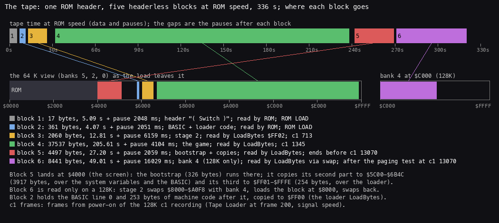
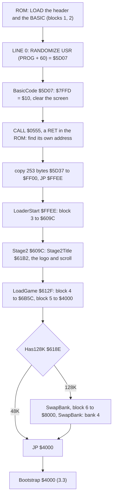
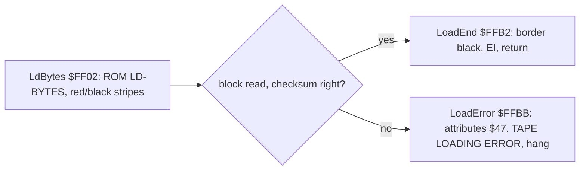
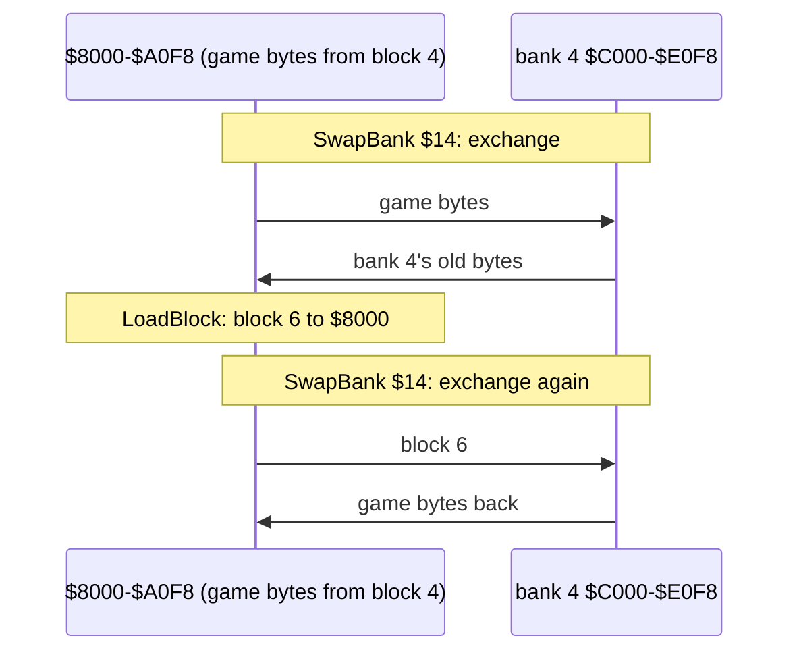
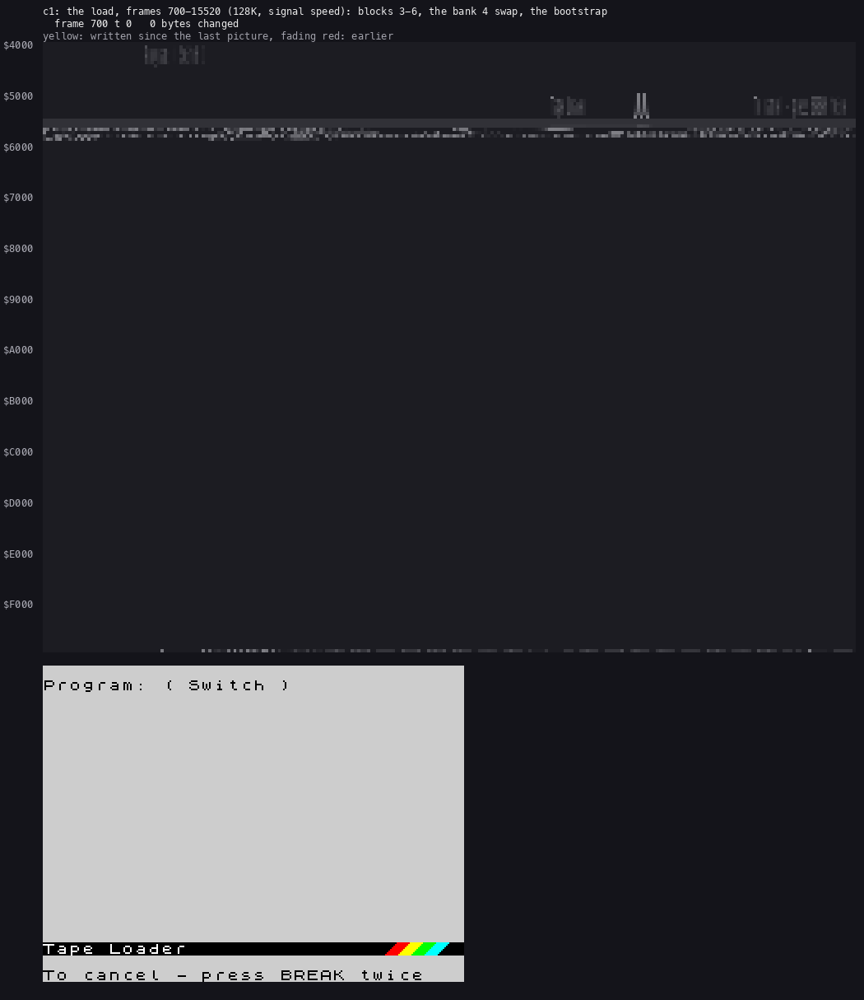
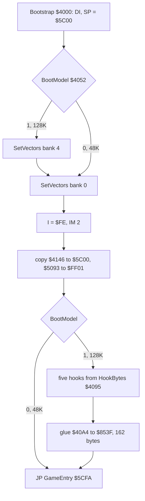
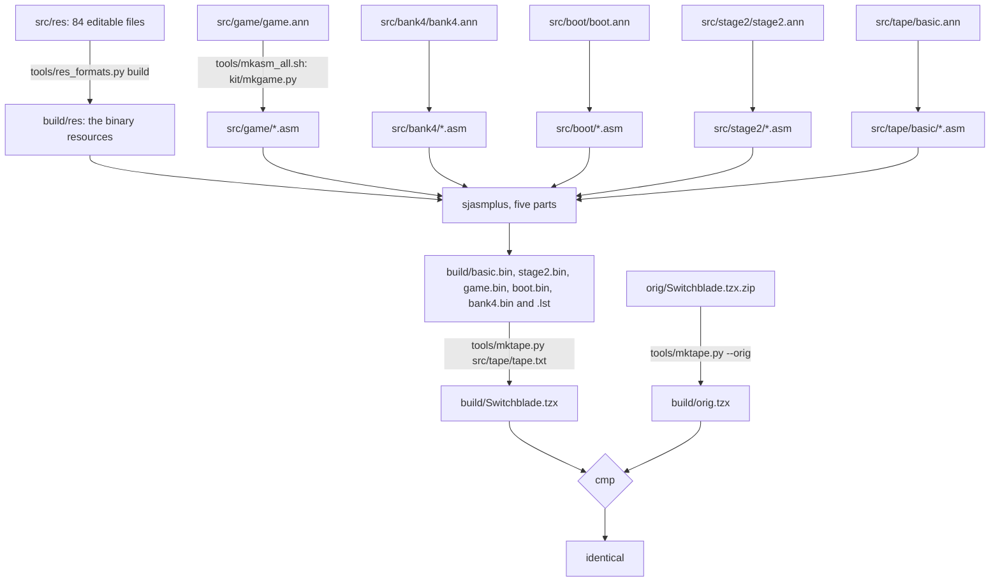

# 3. Build and load

What this covers:

- the tape block by block, as a picture;
- the loader: the BASIC line, the code that finds itself, the tape loader at `$FF00`, the second stage at `$609C` and
  its loading screen;
- the bootstrap at `$4000`, the 128K set-up and the five patched call sites;
- the 48K path;
- the other releases and the hacks, and what differs in each;
- the build from `src/` to a TZX identical to the original.

The recordings it rests on ([WALKTHROUGH 6.0](../WALKTHROUGH.md#60-the-recordings)):

| Recording | Machine, load | Used for |
| --- | --- | --- |
| `c1` | 128K, power-on, the 128K menu's Tape Loader at frame 200, the tape at signal speed (fast and turbo tape off) | the whole 128K load: the BASIC's code at frame 710, block 3 at 713, stage 2 at 1345, the paging test at 13 070, `JP $4000` at 15 503. Animated over frames 700-15 520 |
| `c48` | 48K, power-on, the same tape at signal speed | the 48K load: the game entered at frame 13 278, Intro48 at the boot, no bank 4 |

Frames in this document are c1's or c48's, counted from power-on. A value read with `time_travel memory_at` frame N is
the memory at the start of frame N.

## 3.1 The tape block by block

`orig/Switchblade.tzx.zip` holds `Switch Blade.tzx`. `python3 tools/tzxblocks.py list work/stage1/media/switchblade.tzx`
lists seven blocks: a text block, then six data blocks at the ROM's standard timing (TZX id `$10`: pilot 2168, sync
667/735, zero 855, one 1710 T).

| Block | Kind | Bytes | Pause | Time | Read by | Where it goes |
| ---: | --- | ---: | ---: | ---: | --- | --- |
| 0 | text "Created with Ramsoft MakeTZX" | | | | | |
| 1 | header: Program "( Switch )", LINE 0 | 17 | 2048 ms | 5.09 s | the ROM's LOAD "" | |
| 2 | the BASIC, its code, the tape loader | 361 | 2051 ms | 4.07 s | the ROM | PROG `$5CCB` |
| 3 | headerless: stage 2 | 2060 | 6159 ms | 12.81 s | LoadBytes `$FF02`, from LoaderStart `$FFEE` | `$609C-$68A7` |
| 4 | headerless: the game | 37 537 | 4104 ms | 205.61 s | LoadBlock `$FF00`, from LoadGame `$612F` | `$6B5C-$FDFC` |
| 5 | headerless: the bootstrap and two copies | 4497 | 2059 ms | 27.20 s | the same | `$4000-$5190` |
| 6 | headerless: bank 4 | 8441 | 16 029 ms | 49.01 s | the same, on a 128K only | bank 4 `$C000-$E0F8`, through `$8000` |

The tape runs 336.2 s with its pauses: 16 812 frames.



*The tape against time and against memory. Made with `python3 tools/fig_tape.py work/stage1/media/switchblade.tzx
docs/img/load/tape.png`; the c1 frames from c1's trace (128K, signal speed, the Tape Loader at frame 200).*

How to read it:

- The top lane is the tape at ROM speed. Each coloured bar is a block's data; the gaps are its pause.
- The middle lane is the 64 K the CPU sees after the load (banks 5, 2, 0); the right lane is bank 4. A line joins
  each block to where it lands.
- Block 4, the game, is 61 % of the tape. Block 5 lands in the screen.

There is no protection: no cipher, no packer, no timing check, no turbo. Every byte on the tape is the byte that runs,
in plain ROM-speed blocks; the only trick is that blocks 3-6 have no headers.

**The point**: the tape is the program as it runs, in five pieces. Everything else in this chapter is about where the
pieces go and in what order.

## 3.2 The loader



### The BASIC line

Block 2 is one BASIC line, number 0, with machine code behind it. The ROM lists it as:

```text
0 LET X=PEEK 66666+770*PEEK 60877: LET x=x+87: RANDOMIZE USR x
```

Every number is a decoy. A BASIC number is stored twice: the digits that LIST shows, then `$0E` and five bytes that
the interpreter actually uses. Here the digits and the values differ:

```asm
BasicLine0:
  DEFB $00,$00            ; the line number, 0 (high byte first)
  DEFB $39,$00            ; the line's length, 57: to $5D07, the first byte of the code
  DEFB $F1,$58,$3D,$BE    ; LET X = PEEK
  DEFB $36,$36,$36,$36,$36,$0E,$00,$00 ; "66666", $0E and 23635 = $5C53 (PROG)
  DEFB $53,$5C,$00
  DEFB $2B,$37,$37,$30,$0E,$00,$00,$00 ; "+" "770", $0E and 256
  DEFB $01,$00
  DEFB $2A,$BE,$36,$30,$38,$37,$37,$0E ; "*" PEEK "60877", $0E and 23636 = $5C54
  DEFB $00,$00,$54,$5C,$00
  DEFB $3A,$F1,$78,$3D,$78,$2B ; ":" LET x = x "+"
  DEFB $38,$37,$0E,$00,$00,$3C,$00,$00 ; "87", $0E and 60
  DEFB $3A,$F9,$C0,$78    ; ":" RANDOMIZE USR x; no ENTER: the line goes on into the code
```

| Shown | Used | Meaning |
| ---: | ---: | --- |
| 66666 | 23635 | PROG, the low byte |
| 770 | 256 | |
| 60877 | 23636 | PROG, the high byte |
| 87 | 60 | the offset of the code from PROG |

So X = PROG + 60 = `$5CCB` + `$3C` = `$5D07`. BASIC variables ignore case, so `X` and `x` are one variable. The line
has no ENTER at its end. Its length field (57) runs to `$5D07`, whose first byte, `$F3`, is `DI` and lists as the token
NEXT: the listing shows `RANDOMIZE USR x` followed by the code as garbage.

### BasicCode `$5D07`: the code that finds itself

```asm
BasicCode:                      ; $5D07
  DI
  LD A,$10                      ; the 48K BASIC ROM, bank 0
  LD BC,$7FFD
  OUT (C),A
  XOR A                         ; border black, the screen and attributes cleared
  OUT ($FE),A
  LD HL,Screen
  LD DE,Screen+1
  LD BC,$1AFF
  LD (HL),A
  LDIR
  LD SP,$0000                   ; the return address of a CALL to a RET: this code's address
  CALL RomRet                   ; $0555: a RET in the 48K ROM
  DEC SP
  DEC SP
  POP HL                        ; HL = $5D24, where the CALL returned
  LD DE,$0013                   ; + $13: the loader's bytes
  ADD HL,DE
  LD SP,HL
  LD DE,$FF00                   ; copy the loader to $FF00 and run it
  LD BC,$00FD
  LDIR
  JP $FFEE
```

The code does not trust PROG. It calls a `RET` in the ROM with the stack at `$0000`: the return address is written to
`$FFFE-$FFFF` and stays there after the `RET`. Two `DEC SP` and a `POP` read it back. The loader's 253 bytes start
`$13` bytes after the return address; they are copied to `$FF00-$FFFC`, and `JP $FFEE` starts them.

### The tape loader at `$FF00`

LoaderStart `$FFEE` loads block 3:

```asm
LoaderStart:                    ; $FFEE
  LD A,$FF
  LD IX,$609C
  LD DE,$080C                   ; 2060 bytes
  CALL LdBytes                  ; $FF02
  JP $609C
```

LdBytes `$FF02` is a copy of the ROM's LD-BYTES (`$0556`), with three changes:

1. It pushes its own return, LoadEnd `$FFB2`, instead of the ROM's SA/LD-RET.
2. The border is red (`LD A,$0A`) and the stripes come from `AND $02`: red and black, where the ROM shows red and
   cyan for the pilot and blue and yellow for the data.
3. A failed block goes to LoadError `$FFBB`: border red, every attribute `$47`, "TAPE LOADING ERROR" printed with
   `RST $10`, and a hang. There is no retry.



LoadError is known only from the code: no recording loads a damaged tape.

### Stage 2 `$609C`: the loading screen and the game's blocks

```asm
Stage2:                         ; $609C
  CALL Stage2Title              ; $61B2: the logo and the scroll
  CALL LoadGame                 ; $612F
  JP Bootstrap                  ; $4000
LoadGame:
  LD IX,Block4                  ; $6B5C
  LD DE,$92A1                   ; 37 537 bytes
  CALL LoadBlock
  LD HL,Attributes              ; black attributes: block 5 loads into a hidden screen
  LD DE,Attributes+1
  LD BC,$02FF
  LD (HL),$00
  LDIR
  LD IX,Bootstrap               ; $4000
  LD DE,$1191                   ; 4497 bytes
  CALL LoadBlock
  CALL Has128K                  ; $618E: a 128K: block 6 through $8000 into bank 4
  JR Z,LoadGameEnd
  LD A,$14
  CALL SwapBank                 ; $616A
  LD IX,Block6Buffer            ; $8000
  LD DE,$20F9                   ; 8441 bytes
  CALL LoadBlock
  LD A,$14
  CALL SwapBank
LoadGameEnd:
  RET
```

Stage2Title `$61B2` sets every attribute to `$47`, draws the SWITCHBLADE logo (`$622B`, 26 bytes by 48 rows) at
`$4803`, and scrolls "COPYRIGHT GREMLIN GRAPHICS 1991" out and "LOADING" in, 4 pixels a step for 80 steps. Then the
three blocks load under that screen; block 5 is loaded with black attributes, so the bootstrap's bytes in the screen
are never seen.

Has128K `$618E` is the paging test:

```text
b = (HL = $C000)
page bank 4 ($14 to $7FFD); write NOT b to $C000
page bank 0 ($10);           compare $C000 with NOT b
equal  -> one memory: a 48K (the port did nothing), E = 0
differ -> bank 4 is other memory: a 128K, E = 1
put b back; store E at $4052 (the bootstrap's BootModel operand); Z on a 48K
```

Bank 4 cannot be loaded directly. Paging it in at `$C000` would page out the loader at `$FF00` and the stack. SwapBank
exchanges `$8000-$A0F8` with bank 4's `$C000-$E0F8` byte by byte (SwapBlock `$617B`); the block loads to `$8000`; a
second swap puts block 6 into bank 4 and the game's own bytes back at `$8000`.



`$60A5-$612E`, TapeWriter, is not executed in any recording. Nothing on the tape calls it. It reads the same blocks
with the same addresses and lengths as LoadGame and then saves them with a header (ToolSaBytes `$FECE`, HeaderTemplate
`$68A8`): a leftover of the mastering tool that wrote this tape ([doc 2.5](02-architecture.md#25-the-leftovers)).

### Worked example: c1's load



*c1 (128K, signal speed), frames 700-15 520, one picture every 150 frames (10 636 200 T): memory `$4000-$FFFF` lit by
age (executed, read, written) beside the screen. Made with `python3 ../../kit/memanim.py --work work/docs/zsA/c1 --from
700 --to 15520 --step 10636200 --from-address 4000 --to-address FFFF --screen --cell fit --label '...' --delay 120
--hold 2500 docs/img/load/load-c1.gif`.*

How to read it:

- Left: the 48 K above the ROM, a row a 256-byte page; a cell lights when it is written, read or executed in that
  slice and fades after. Right: the screen.
- First `$609C-$68A7` fills (block 3), then the long sweep of `$6B5C-$FDFC` (block 4) with the scroll on the screen.
- Block 5 writes into `$4000-$5190`: the screen area, with black attributes.
- Near the end `$8000-$A0F8` lights twice: the two swaps with bank 4 around the load of block 6 to `$8000`.
- The last pictures are the bootstrap's copies to `$5C00` and `$FF01`, then the game.

| Frame | T | Event |
| ---: | ---: | --- |
| 200 | | the 128K menu's Tape Loader |
| 710 | | BasicCode `$5D07` runs |
| 713 | | LoaderStart `$FFEE`: block 3 |
| 1 345 | | Stage2 `$609C`: the logo, then block 4 |
| 13 070 | | Has128K `$618E`, after block 5 |
| 15 503 | 66 911 | `JP $4000` |
| 15 505 | | GameEntry `$5CFA` |
| 16 008 | | the control menu on the screen |

The image cut from the blocks (`tools/image.py`) matches c1's memory at frame 15 503, T 66 911: bank 4 byte for byte;
the 64 K view differs only where the image leaves zeros or the loader rewrites its own data (the system variables, the
BASIC's stack area `$5D0D-$5D36`, `$5E34-$5E5C`, `$620B`, `$670B-$68A7` and `$FFFD-$FFFF`).

**The point**: the loader is the ROM's, copied high so that the game can load over everything below `$FF00`. The only
clever parts are the BASIC that hides its numbers and the swap that loads a block into a bank the loader cannot see.

## 3.3 The bootstrap `$4000` and the 128K set-up

Block 5 lands in the screen. Its first `$146` bytes are the bootstrap and the 128K glue; the rest are two copies for
places the loader still occupies while it runs.

```asm
Bootstrap:                      ; $4000
  DI
  LD SP,GlobalsInit             ; $5C00
  XOR A
  OUT ($FE),A
  LD A,(BootModel+$0001)        ; stage 2's answer: 1 on a 128K
  OR A
  JR Z,BootVectors0
  LD A,$14
  CALL SetVectors               ; bank 4 at $C000: its vector table
BootVectors0:
  LD A,$10                      ; bank 0 at $C000: its vector table
  CALL SetVectors
  LD A,$FE                      ; I = $FE, IM 2
  LD I,A
  IM 2
  JR BootCopy
SetVectors:                     ; $401F
  LD BC,$7FFD
  OUT (C),A
  LD A,$C3
  LD (Im2Jump),A                ; $FDFD: JP InterruptHandler
  LD HL,InterruptHandler
  LD (Im2Jump+1),HL
  LD HL,Im2Table                ; $FE00: 257 bytes $FD
  LD BC,$00FD
SetVectorsLoop:
  LD (HL),C
  INC HL
  DJNZ SetVectorsLoop
  LD (HL),C
  RET
BootCopy:                       ; $403B
  LD HL,ResidentSource          ; $4146: the game's start code to $5C00
  LD DE,GlobalsInit
  LD BC,$0F4D
  LDIR
  LD HL,PanelSource             ; $5093: the panel code to $FF01
  LD DE,PanelWeapon
  LD BC,$00FE
  LDIR
BootModel:                      ; $4051
  LD A,$01                      ; $4052: written by stage 2 (0 on a 48K)
  OR A
  JP Z,GameEntry                ; 48K: straight in
  LD HL,HookBytes               ; 128K: the five hook sites
  LD DE,GameEntryIntro          ; site 1
  LDI
  LDI
  LDI
  ...                           ; sites 2-5 the same
  LD HL,$40A4                   ; the glue to $853F
  LD DE,AyGlue
  LD BC,$00A2
  LDIR
  JP GameEntry                  ; $5CFA
```

On a 128K the table is written twice: once with bank 4 at `$C000`, once with bank 0. The glue pages bank 4 in for the
AY player; an interrupt that arrives then must still find `$FE00-$FF00` and `$FDFD` in the bank that is paged. Both
banks therefore carry the same 257 bytes of `$FD` and the same `JP $8456`.

The two copies:

| From | To | Bytes | What | Why it is not loaded there |
| --- | --- | ---: | --- | --- |
| `$4146` | `$5C00-$6B4C` | 3917 | GlobalsInit, GameEntry, NewGame, the intro, the page tails' template neighbourhood | the system variables, the BASIC and stage 2 live there during the load |
| `$5093` | `$FF01-$FFFE` | 254 | PanelWeapon `$FF01`, PanelMeters `$FF64`, DrawMeterRow `$FFA8` | the tape loader lives there |

### The five patched call sites

The main program is the 48K game. On a 128K the bootstrap writes three bytes at five places (HookBytes `$4095`) and
overwrites the 48K effect player's first 162 bytes at `$853F` with the glue (`$40A4`). Read from c1's end state and
c48's:

| # | Site | 48K bytes | 128K bytes | Effect on a 128K |
| ---: | --- | --- | --- | --- |
| 1 | `$5CFD` GameEntryIntro | `CD 4F 5D` (`CALL Intro48`) | `00 00 00` | no story at the boot |
| 2 | `$A6EF` in ShowHighScores | `CD 29 85` (`CALL ReadInput`) | `CD 9E 85` | GlueMenuInput `$859E`: fire, and left / right pick music or effects |
| 3 | `$A76F` in TitleSequence | `CD 29 85` | `CD 9E 85` | the same on the title |
| 4 | `$A75C` in TitleSequence | `00 00 00` | `CD B3 85` | GlueSoundIcon `$85B3`: the note or "FX" sign |
| 5 | `$5C9A` in NewGame | `00 00 00` | `CD C5 85` | GlueIntro `$85C5`: bank 4's story pages before every game |

The glue at `$853F-$85E0`:

| Address | Name | What it does |
| --- | --- | --- |
| `$853F` | AyGlue | called by the interrupt every frame: pages bank 4 (`$14`), runs the AY player, restores Last7FFD `$8450` |
| `$8558` | GlueRequests | turns the game's TuneRequest `$8452` and EffectRequest `$8454` into bank 4's StartTune / PlayEffect |
| `$859E` | GlueMenuInput | ReadInput, plus left (SoundMode `$8455` = 0, music) and right (1, effects) |
| `$85B3` | GlueSoundIcon | prints MusicIconText `$821E` or EffectsIconText `$8225` |
| `$85C5` | GlueIntro | pages bank 4 and runs StoryPages `$D3D0` |

On a 128K the rest of the 48K player, `$85E1-$872A` with EffectTable `$8683`, stays in memory and is not executed in
any 128K recording.



Witness: the bootstrap's routines have L1 count 2 (c1 and c48); SwapBank, the hooks and the glue copy ran only in c1.
The glue runs on every frame of every 128K recording from the menu on (`$853F` x 18 055 in menu's 18 060 frames).

**The point**: one program serves both machines. The 128K version is the 48K game with fifteen bytes changed and the
beeper player replaced by a 162-byte bridge to bank 4; the code at the five sites does not know which machine it is on.

## 3.4 The 48K path

On a 48K every 128K step falls away:

1. Has128K finds the byte at `$C000` changed by its own write (the port `$7FFD` does nothing), stores 0 at `$4052` and
   returns Z. Block 6 is not read; the tape runs on with nothing listening.
2. The bootstrap writes the vector table once, copies the two parts and jumps to GameEntry at once. No hook is written.
3. GameEntryIntro keeps `CALL Intro48 $5D4F`: the story is shown once, at the boot. Its texts live in the actor pages
   (`$5E6C` "FOR 10000 YEARS HE SLEPT", `$6170` "I AM HIRO"), which play then overwrites.
4. The sound is EffectPlayer `$853F`, the 48K beeper effects. The title has no music/effects switch.

c48 (48K, power-on, signal speed) enters the game at frame 13 278, c1 (128K) at 15 505: the 48K does not wait for
block 6. The 48K and 128K memories at the menu differ in 322 bytes: the hooks, the glue and the bank-4-only state
([WALKTHROUGH 0.4](../WALKTHROUGH.md#04-the-machine-48k-and-128k)).

**The point**: the 48K is the base game, not a cut-down port. Everything the 128K adds is laid over it at the last
moment by the bootstrap.

## 3.5 The releases and the hacks

Every copy found was compared block by block with the original (C/README, Other releases). What differs:

| Copy | What it is | What differs, and where it lands |
| --- | --- | --- |
| ZXDB 31610, WoS, TOSEC 45124 | the Gremlin tape | the original (`orig/`) |
| ZXDB 31612, TOSEC 45123 | the GBH budget re-release | the same six blocks; the TZX differs in 7 bytes, pause lengths only |
| ZXDB 31611 `SWITCHBL.TAP`, TOSEC 45129 | a TAP with a patched loader | header "SW.BLADE"; `JP $0562` in the BASIC block at offset 123, which is LdBytes' `IN A,($FE) / RRA` at `$FF0F`. The loader jumps into the ROM's own edge loop, so an emulator's ROM trap reads the blocks |
| TOSEC `(128K)[a]` 45125 | a dump of a played tape | block 4 differs in 26 bytes, `$8127-$816D`: the high-score names JEFF C, LINDA, SIMES, DANGERSTU replaced by JOSE LUIS, RUI, CARLOS, FC PORTO (the scores are the original's) |
| TOSEC `(48K-128K)[a]` 45130 | a cheat | header "Sw.Blade+"; one byte of block 4 at offset 10 958, `$962A`: `$C9` (`RET`) for `$3A`, the first byte of LoseLife `$962A`. Losing all energy then costs no life |
| NVG `SWITCBLD.TAP`, TOSEC 45127-45128 | Ramsoft's "Switchblade & Trainer" | headers "SWITCH", "BladeIntro", "BladeCode" (38 750 bytes), "BladePage4" (the original's block 6) |
| TOSEC `[h Alexey Sorokin]`, `[h Sukin And Son Corp.]` | 48K hacks | blocks 3, 4, 5 are the original's; no block 6; own BASIC |
| TOSEC `[h Pavel Nikitin]`, `[t Pokes]` | re-saved, a trainer | the four data blocks, each behind a standard header; own BASIC |
| TOSEC `[h Saposoftware]`, `[h Atossoft]` | re-packed | four blocks of 182, 1288, 6710, 36 236 bytes; one 42 367-byte turbo block |
| the Your Sinclair 63 demo | another program | a 24 964-byte block |

The POKE files: 38421,201 (`$9615`, the energy loss returns at once) and 38913 (`$9801`) are instruction starts in
this release. 41501 (`$A21D`), 41469 (`$A1FD`) and ZXDB's infinite lives 38475 (`$964B`) fall inside instructions
here: they belong to another release. In this release the infinite lives are 38478,0: the `$01` of `SUB $01` at
`$964D` ([WALKTHROUGH 6.3](../WALKTHROUGH.md#63-the-state-variables-and-the-pokes)).
None of the POKEs ran in a recording.

**The point**: every release carries the same game bytes. The differences are loaders, headers, one cheat byte and a
saved high-score table, so this source describes them all.

## 3.6 The build

`tools/build.sh` builds the tape from `src/` and compares it with the original:



```text
. work/env.sh
sh tools/build.sh $SJASMPLUS
build: Switchblade.tzx identical to orig/Switchblade.tzx.zip's Switch Blade.tzx
```

The steps:

1. `tools/res_formats.py build` converts the editable resources (room text, map, PNG tiles and sprites, texts,
   tables, tunes) back to bytes in `build/res`.
2. sjasmplus assembles the five parts. game.asm builds the whole `$5C00-$FFFF` as it runs.
3. `tools/mktape.py` writes the TZX from `src/tape/tape.txt`: the text block, the header, and the data blocks with
   their pauses. Block 4 is cut from game.bin at `$6B5C-$FDFC`. Block 5 is boot.bin followed by game.bin's
   `$5C00-$6B4C` and `$FF01-$FFFE`, the two parts the bootstrap copies back.
4. `cmp` with the original, extracted from the zip.

`tools/mkasm_all.sh` regenerates every `.asm` from its `.ann` (`kit/mkgame.py`); `--fix-witness` refreshes the witness
counts from the recordings. `tools/parts.py` makes each part's reference image from `orig/` alone, so each part is also
checked on its own (`assembled: identical`).

**The point**: the source is the tape. A change to a resource or to an `.ann` goes through the same five assemblies and
the same block cutter, so a modified game loads on a real machine exactly as the original does.

## 3.7 Known only from the code

- LoadError `$FFBB`: no recording loads a damaged block.
- TapeWriter `$60A5` and its helpers `$FE00`, `$FE4D`, `$5FA9`: not on the tape's call paths; their roles are guesses.
- The 48K effect player's tail `$85E1-$872A` on a 128K: overwritten in role, never called.
- The cheat release's `RET` at `$962A` and the POKEs: not run.
