# 4. Game loop

What this covers:

- the game cycle: GameEntry `$5CFA`, the control menu, NewGame and the title, the start of play, and the three ways
  out of play (game over, the end after Havok, the quit);
- one pass of the main loop `$8DFE`, step by step, and what each step costs;
- ActorUpdate `$8E2B` and RunActorSteps `$9A4B`: why most passes do almost nothing;
- the IM 2 handler `$8456` and its tick GameTick `$8472`, with the fire charge;
- the stalls: the room build and the zone reveal (CheckRoomExit `$955A`, RevealZone `$A569`, RedrawCellsMasked `$8855`
  over 220 cells, SpawnZoneEnemies `$A59E`);
- passes against the beam, on the 48K and the 128K;
- every delay and timer.

The recordings it rests on ([WALKTHROUGH 6.0](../WALKTHROUGH.md#60-the-recordings)):

| Recording | Machine | Used for |
| --- | --- | --- |
| `c1` | 128K, power-on, the original tape at signal speed | the bootstrap's jump to GameEntry at frame 15 505, the control menu at 16 008, the title at 16 072, the story, play from 17 651 in room 4. Frames 17 700-17 701 traced for the 128K pass and interrupt |
| `menu` | 128K, from c1's menu | the pause, the quit, the high-score table and the title cycle |
| `gameover` | 128K, from c1's menu, lives `$664D` = 0 and energy `$6642` = 1 poked at frame 1869 (a POKE) | the last death: GAME OVER at about frame 2429, GameOver `$5C42` once, the title without a high-score entry |
| `r004000` | 48K, the RZX run's state at RZX frame 4000, its keys replayed for 2000 frames | the 48K passes in room 9 (frames 530-568 traced), the reveal of zone `$80` at frame 553 |
| the RZX run | 48K, RZX Archive, 142 989 frames | another player's complete game (xmikex and Jamie Angus, with rollback), read in SkoolKit (`work/stage2/rzx/state.tsv`); its passes counted by `tools/rzx_passes.py`; its stalls by `tools/rzx_stalls.py` and `tools/rzx_reveals.py` |

`r004000` is our own replay of the RZX's keys from the RZX's own snapshot (`work/stage2/rzx/r004000/`). It drifts from
the RZX after a while (the timing differs), so a fact taken from it is witnessed by our recording, not by the RZX.

Conventions:

- **A frame** is 1/50 s: 69 888 T on the 48K, 70 908 T on the 128K.
- **A pass** is one turn of the main loop, from the fetch of `$8DFE` to the next one.
- A trace puts an instruction in the frame where it ran, at its frame T (0 at the frame's start). `frame:t` names
  one point, for example 552:68563.
- A value read with `time_travel memory_at` frame N is the memory at the start of frame N.
- The traces were taken on our own instance (port base 37400) and kept in `work/docs/zsA/<recording>/traces/`.
  `tools/pass_stats.py` cuts a trace into passes; `tools/irq_cost.py` measures each interrupt.

## 4.1 The shape of the program

Switchblade has no frame lock in play.

- **The main loop** never waits for the interrupt. It has no `HALT`. When a pass ends, the next starts at once.
- **A pass** offers each active actor page one call of ActorUpdate. Each call runs at most one actor's logic step, and
  only when that actor's frame delay has run out. A pass that finds nothing due costs about 1 400 T (128K, room 4) to
  4 500 T (48K, five active pages).
- **The interrupt** (IM 2, every frame) is the game's clock. GameTick counts each actor's delay down, reads the
  controls and the P key, and builds the fire charge. Then the sound runs: the 48K beeper effects, or the AY player
  in bank 4 on a 128K.

So the loop polls and the interrupt paces. Hiro's step delay +`$1A` is 3: he moves once every three frames,
however many passes run in between (c1: 260 Hiro steps in 975 frames of play).

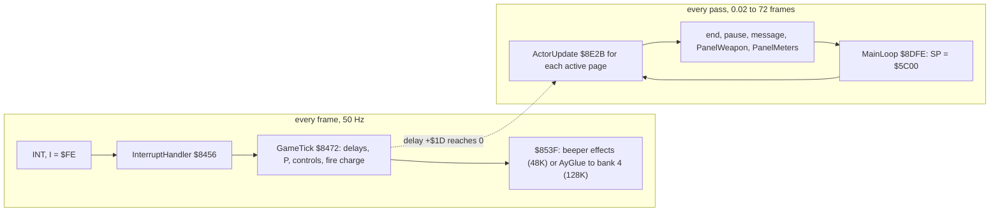

**The point**: the speed of the game is set by the interrupt, not by the loop. The loop spins between steps; a heavy
pass only delays the steps that are due, it does not change the rate at which they fall due.

## 4.2 The states of the program

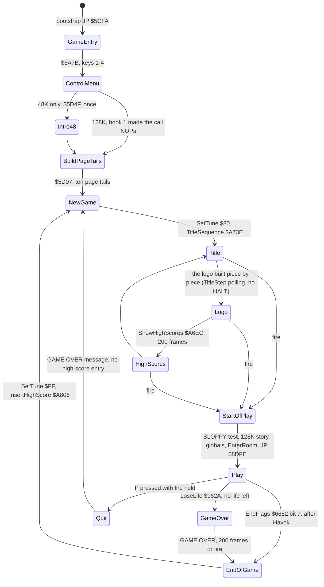

The states are routines, not a state variable. Each arrow is a `CALL`, a `JP` or a fall-through. The control menu
runs once per load; the title loop runs once per game.

### GameEntry `$5CFA` and the boot-time work

The bootstrap at `$4000` ends with `JP $5CFA` ([doc 3.3](03-build-and-load.md#33-the-bootstrap-4000-and-the-128k-set-up)).
GameEntry does the work that is done once per load:

1. ControlMenu `$6A7B` prints the four control methods and waits for keys 1-4 (doc 5). The record chosen is copied
   into the input reader.
2. GameEntryIntro `$5CFD` is `CALL Intro48` (`$5D4F`) on the 48K: the story pages, shown once at the boot. On a 128K
   hook 1 wrote `00 00 00` over it, because bank 4 shows the story before every game instead (hook 5, doc 3.3).
3. BuildPageTails `$5D07` copies ten blocks of `$7E` bytes from PageTailTemplate `$6B5C` to offset `$82` of the pages
   `$5D-$66`, then fills the tables OutlineMask `$6F00`, RowBase `$7000` and NameBoxPlaces `$700C`.
4. ClearRoomCells `$70EF` (`LD BC,$24DC` at `$5D46`) clears cells `$DC-$FF` of the six planes; then `JP NewGame`
   `$5D4C` (`$5C4D`).

Witness: c1 (128K): the bootstrap jumps at frame 15 505; the control menu is on the screen at 16 008. GameEntry and
ControlMenu have L1 count 2 (c1 and c48); Intro48 runs only in c48.

### NewGame `$5C4D`: the title, the cheat, the start of play

```asm
EndOfGame:                      ; $5C45
  LD A,$FF                      ; from $8E12 too (EndFlags bit 7, after Havok)
  CALL SetTune                  ; $5FC0
  CALL InsertHighScore
NewGame:                        ; $5C4D
  LD A,$80                      ; the title tune
  CALL SetTune
  CALL TitleSequence            ; $A73E: returns on fire
TitleFired:
  LD HL,HiScoreEntries+$0009    ; the ten high-score names: is one of them SLOPPY?
  LD BC,$0A0A
NewGameNameLoop:
  PUSH BC
  CALL MatchCheatName           ; $5C68
  ADD HL,BC
  LD C,$0B
  ADD HL,BC
  POP BC
  DJNZ NewGameNameLoop
  JR NewGameStart               ; no name matched: the normal start
...
NewGameStart:                   ; $5C93
  LD BC,$0300                   ; row 0, column 3: room 4
NewGameSetStart:
  LD (MapRow),BC                ; MapRow $69DF, MapColumn $69E0
  NOP                           ; $5C9A: the 128K hook writes CALL $85C5 (the story) here
  NOP
  NOP
  LD HL,HavokStashB             ; clear $6D00-$6EFF
```

In steps:

```text
NewGame:
    SetTune($80)                       ; the title tune
    TitleSequence()                    ; title, logo 200 frames, high scores 200 frames, until fire
    for each of the ten high-score names:
        if name == "SLOPPY": start = the room picked by keys 1-4 held (MatchCheatName)
    start = row 0, column 3            ; room 4, unless the cheat matched
    [128K] GlueIntro $85C5             ; bank 4's story pages, before every game
    clear $6D00-$6EFF                  ; the kept room states
    copy GlobalsInit $5C00 to $6642, 56 bytes   ; energy, lives, score, weapon
    GateClosed $76D8 x 6 = 1
    InitActor(Hiro, kind $24, HiroTemplate $65CA)
    TuneRequest = 2
    EnterRoom $95C3                    ; build and draw the first room
    print the score; fill the play attributes
    $845F = 0                          ; GameTick on
    JP MainLoop $8DFE
```

The SLOPPY start rooms (40, 66, 113, 114) are doc 5's subject. No recording has SLOPPY in the table: they are known only
from the code.

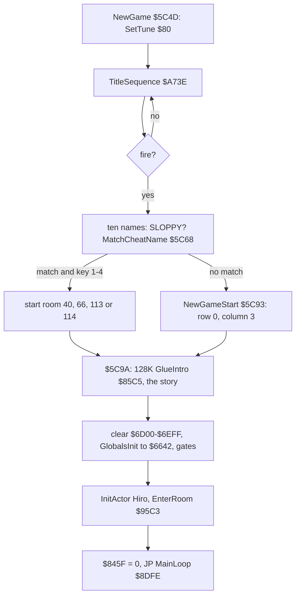

The handler's flag `$845F` is the `LD A,n` operand at `$845E` (4.4). NewGame clears it at `$5CF4` just before the
`JP`. TitleSequence sets it to 1 at `$A747`, and the name entry sets it to 1 at `$A842`. GameTick therefore runs only
in play.

Worked example, c1 (128K, control option 4): the title is on the screen at frame 16 072. Fire starts the game; bank 4's
story is on the screen at 16 577 ("AS THE NIGHT BLED CRIMSON ...") and Hiro's page at 17 477 ("I AM HIRO ..."). The
first GameTick runs at frame 17 652, and the screen at 17 797 shows room 4 with score 00000000 and lives 05
([doc 1.1](01-game-design.md#11-the-screens)). On a 128K the story is part of NewGame: it runs between the title's fire
and the first pass.

### The three ways out of play

```asm
GameOver:                       ; $5C42, from LoseLife $962A
  CALL ShowGameOverWait         ; $831A: message 4, 200 frames or fire
EndOfGame:                      ; $5C45
  LD A,$FF
  CALL SetTune
  CALL InsertHighScore          ; $A806: EnterName $A861 when the score qualifies
NewGame:                        ; $5C4D
```

| Way out | Where it is decided | Path | High-score entry |
| --- | --- | --- | --- |
| no life left | LoseLife `$962A` (doc 10) | `JP GameOver $5C42`, GAME OVER, EndOfGame, NewGame | yes, when the score qualifies |
| the end after Havok | EndFlags `$6652` bit 7, tested at `$8E0E` on every pass | `JP EndOfGame $5C45` | yes |
| the quit | P pressed while fire is held, PauseGame `$6682` (`$6FCA` in PageTail66) | ShowGameOverWait `$831A`, then `JP NewGame` | no |

EndFlags bit 7 is set by GameTick, not by the loop. After Havok's fade the end text sets bit 6. While bit 6 is set, a
press of fire in GameTick sets bit 7 (4.4). The next pass sees bit 7 at `$8E0E` and jumps to EndOfGame.

Witnesses:

- `gameover` (128K): GAME OVER at about frame 2429; GameOver runs once; the title and the high-score table follow with
  no entry (the score is too low).
- `menu` (128K): P (1931), P to resume (2035), then fire held from 2099 and fire and P 2109-2114: GAME OVER, then the
  title (2367), no entry.
- The RZX run (48K, another player): the end text at about RZX frame 140 000, the name entry ("XMIKEX J") at 142 000,
  the title at 142 500. GameOver and EndOfGame have L1 count 6 each (gameover, hiscore, four RZX segments);
  InsertHighScore 8 (the listing's Witness lines).

**The point**: the program is a ring of four routines with no state variable. Losing and winning share EndOfGame; only
the quit bypasses it, so a quit never enters the high-score table.

## 4.3 One pass of the main loop

```asm
MainLoop:                       ; $8DFE
  LD SP,$5C00                   ; the stack is reset on every pass
  LD B,$09                      ; nine pages, $5D-$65
  LD HL,Hiro+$0002              ; +$02 (the flags) of the first
MainLoopActors:                 ; $8E06
  LD A,(HL)                     ; +$02 bit 0: the actor is active
  RRA
  CALL C,ActorUpdate            ; $8E2B
  INC H                         ; the next page
  DJNZ MainLoopActors
  LD A,(EndFlags)               ; $6652 bit 7: the end after Havok
  RLA
  JP C,EndOfGame
  LD A,(PauseFlag)              ; $664C bit 7: the pause
  RLA
  CALL C,PauseGame              ; $6682
  LD A,(MessageRequest)         ; $79FF set: $66B6
  OR A
  CALL NZ,PendingMessage
  CALL PanelWeapon              ; $FF01, copied over the loader
  CALL PanelMeters              ; $FF64
  JR MainLoop
```

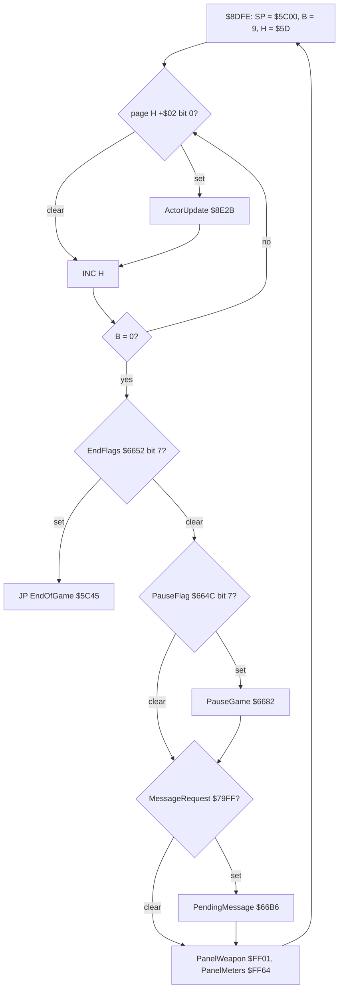

`LD SP,$5C00` on every pass is a design decision. Any routine deep in a pass may drop its stack and jump back to the
loop, and the next pass starts clean. StepIfDue `$9A8E` relies on it in a milder way: it pops its caller's return
address, so the step it starts ends the whole RunActorSteps call. The stack never goes below `$5BBA` in our recordings
([doc 2.6](02-architecture.md#26-memory-use-the-heatmap-and-the-stack)).

### ActorUpdate `$8E2B` and RunActorSteps `$9A4B`

ActorUpdate is called for each active page. It does two things:

1. RunActorSteps `$9A4B` picks one actor whose frame delay +`$1D` is 0, reloads the delay from +`$1A` and runs one
   logic step (a script step or the state handler, doc 10). IY is then that actor.
2. When that actor's +`$20` bit 0 (moved) is set, it is redrawn: ActorBoxStore `$8F3B`, then the cell composer `$8907`
   with the back layer, DrawActorsAll `$8A76`, the front layer, DrawFrontActors `$8A73`, and BlitWindow `$8C68`
   (doc 6). Havok, kind `$25`, goes to HavokFade `$872B` instead.

```asm
RunActorSteps:                  ; $9A4B
  LD L,$00
  PUSH HL
  POP IY
  LD A,$AA                      ; LD A,n: n rotates $AA, one call in two
  RLCA
  LD (RunActorSteps+$0006),A
  JR C,StepBulletPage
  LD A,$00                      ; LD A,n: the boss kind, 0 when no boss fight
  OR A
  JR Z,StepHiroFirst
  LD D,$60                      ; the boss shot in page $60
  CALL StepIfActive
  JR StepHiroFirst
StepBulletPage:
  LD D,$66                      ; Hiro's weapon or the message banner (page $66)
  CALL StepIfActive
StepHiroFirst:
  LD DE,WeaponActor+$0002       ; $6602 bit 7 (a banner, set by ShowMessage $66C8): no more
  LD A,(DE)
  RLA
  RET C
  LD D,$5D                      ; Hiro
  CALL StepIfDue
  INC D
  LD B,$08                      ; the eight others that are falling
StepFallersLoop:
  LD E,$02
  LD A,(DE)
  AND $04
  CALL NZ,StepIfDue
  INC D
  DJNZ StepFallersLoop
  XOR A                         ; actor H itself, when due
  LD L,$1D
  OR (HL)
  RET NZ
  JR StepActor
...
StepIfDue:                      ; $9A8E
  LD E,$1D
  LD A,(DE)
  OR A
  RET NZ                        ; not due: try the next
  POP BC                        ; due: drop the caller's return, this step ends the call
```

The operand at `$9A51` starts as `$AA` (`10101010`). Each call rotates it one bit left, so the carry alternates: one
call in two offers the weapon page `$6600` first. On the other calls, the boss shot page `$6000` goes first when a giant
fights (the operand at `$9A59` holds the boss kind).

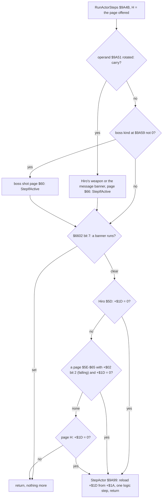

The order matters. Hiro is offered first on every call, then any falling actor, then the page the loop is visiting.
A pass with six active pages offers Hiro six times, but he takes at most one step per due delay. Most calls find no
delay at 0: in c1, 398 of 28 339 calls ran logic (1.4 %) and 308 redrew (1.1 %); in deaths, 4 222 of 225 247 ran logic
and 2 980 redrew.

Witness: MainLoopActors L1 18 327 840, ActorUpdate 3 898 690 and RunActorSteps 3 898 691, in every play recording
(bossgate, deaths, gameover, havok, hiscore, menu, play48, rooms, throw, c1, opt2-4, the 15 POKE probes, 71 RZX
segments, 18 room-entry segments; the listing's Witness lines).

### The steps and their cost

`tools/pass_stats.py --steps` cuts a trace into passes and sums the T of each step on the loop's call level. The
interrupt's T are counted apart from the steps, wherever it fell; the pass's length, from one MainLoop fetch to the
next, holds them.

| Step | Routine | c1, 128K, room 4, frames 17 700-17 701 | r004000, 48K, room 9, frames 531-552 |
| --- | --- | ---: | ---: |
| the loop's own work | `$8DFE-$8E2A` | 518 T a pass | 556 T a pass |
| the actors | ActorUpdate `$8E2B` | 746 T a pass | 32 319 T a pass (93.8 %) |
| the weapon icon | PanelWeapon `$FF01` | 86 T a pass | 84 T a pass |
| the meters | PanelMeters `$FF64` | 130 T a pass | 89 T a pass |
| the four steps | | 1 480 T a pass | 33 048 T a pass |
| the interrupts inside the passes | InterruptHandler `$8456` | 13 606 T (2 x 6 803), 158 T a pass | 61 024 T (about 2 960 each), 1 419 T a pass |
| **the pass, with its share of the interrupts** | | **1 637 T (86 passes, 43 a frame)** | **34 467 T on average (43 passes)** |

The averages hide two kinds of pass:

- **The light pass** offers the actors and finds nothing due. It costs 1 350-1 500 T in c1 and 4 185-4 512 T in
  r004000 (five active pages instead of one or two).
- **The redraw pass** steps an actor that moved and redraws it. r004000's redraw passes cost 45 139 to 321 523 T; each
  BlitWindow `$8C68` with its composing costs about 40 000-65 000 T. Pass 537:47120 redrew five times in 321 523 T
  (4.6 frames).

Over a long run the RZX counts 12.7 passes a frame on average (RZX frames 1 500-30 000, `tools/rzx_passes.py`), from 0
to 49 in one frame; 8 232 frames start no pass at all. c1 in room 4 has 25 068 passes in 975 frames, 26 a frame.

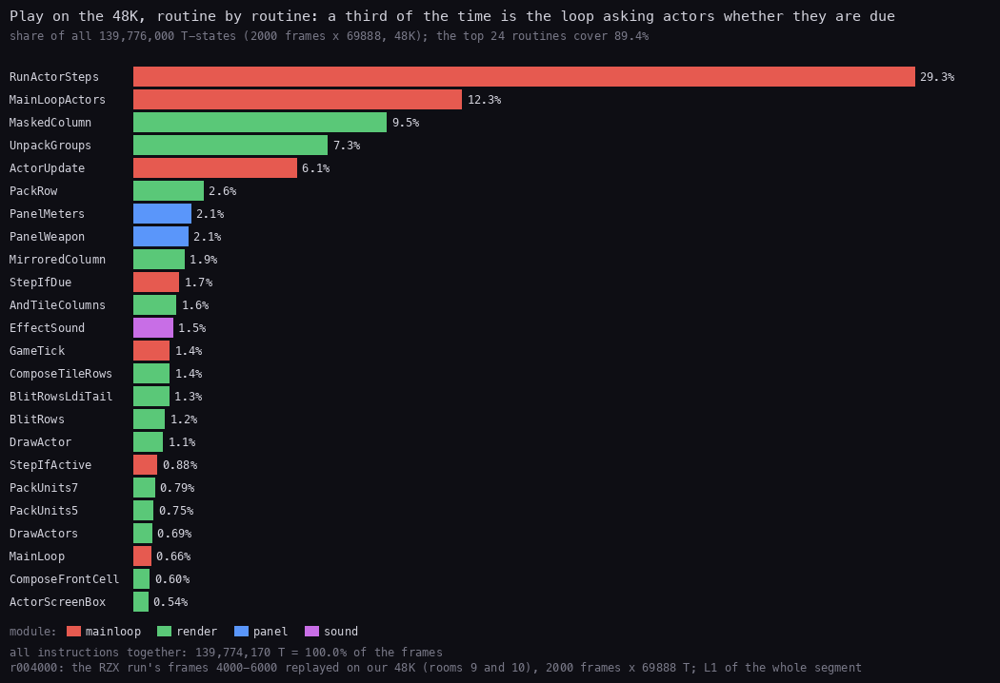

*Where the CPU goes in r004000 (48K, the RZX run replayed from RZX frame 4000, 2000 frames of play), routine by routine,
from its L1. Made with `python3 ../../kit/fig_budget.py work/stage2/rzx/r004000/l1.json
docs/img/arch/budget-routines.png --top 24 --title "..."`.*

How to read it:

- Each bar is one routine's share of all CPU T-states in the recording.
- RunActorSteps (29.3 %), MainLoopActors (12.3 %) and ActorUpdate (6.1 %) are the polling: almost half of the time.
- MaskedColumn, UnpackGroups, PackRow, MirroredColumn and AndTileColumns are the redraw (doc 6).
- PanelMeters and PanelWeapon (2.2 % and 2.1 %) run on every pass, due or not.

**The point**: the game does not spend most of its time on logic or even on drawing. Close to half of the 48K CPU goes
to asking the actors, pass after pass, whether a delay has reached 0.

### One pass at work

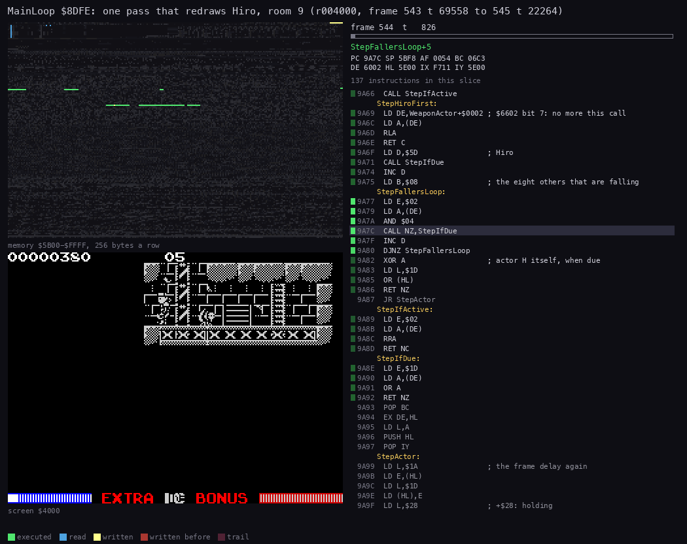

*One pass of r004000 (48K, the RZX run replayed) in room 9, from frame 543 t 69558 to frame 545 t 22264: 92 482 T,
1.32 frames, one BlitWindow. 80 pictures of 1156 T, 13 005 instructions. Made with `python3 ../../kit/routine_anim.py
--work work/docs/zsA/r004000 --window 543:69558-545:22264 --listing build/game.lst --view screen --range 5B00-FFFF --pc
8DFE-8F00,9A4B-9A98,8803-8DFD --pictures 80 --title '...' --out docs/img/routines/MainLoop.gif`.*

How to read it:

- Left: memory `$5B00-$FFFF`, lit by age when executed, read or written. Right: the listing at the PC.
- The first pictures run in `$8DFE-$8F00` and `$9A4B`: the loop offers the pages; Hiro is due.
- Most of the pass is the redraw in the render code `$8803-$8DFD`: the cell composer, then MaskedColumn and the
  packer.
- The screen rows light up only near the end, when BlitWindow writes the window.

Worked example, the same pass (r004000, the trace `543_69558-545_22264.uatr`):

1. 543:69558: `LD SP,$5C00`. Page `$5D` (Hiro) is active.
2. ActorUpdate offers Hiro; his +`$1D` is 0, so StepActor reloads it with 3 and runs his move. His +`$20` bit 0 is set.
3. The redraw: the composer builds the cells around Hiro's old and new boxes, BlitWindow writes them to the screen.
   This is most of the 92 482 T.
4. The other active pages find their delays above 0.
5. PanelWeapon, PanelMeters, `JR MainLoop` at 545:22264. One interrupt fell inside the pass.

## 4.4 The interrupt

### The set-up

The bootstrap (doc 3.3) sets I = `$FE` and fills Im2Table `$FE00-$FF00` with `$FD`. Whatever byte the bus holds, the
vector is `$FDFD`, where Im2Jump holds `JP InterruptHandler`. It selects IM 2 (`$401B`) and leaves interrupts off: the
first `EI` is the game's own. On a 48K it is WaitFireFrames `$8324`, in the 48K story's waits (Intro48 runs before the
title). On a 128K hook 1 skips the story and the control menu runs with interrupts off, so the first is GlueMenuInput
`$85A1` on the title (hook 3 at `$A76F` calls it). On the title the first `EI` is TitleStep's fire test `$A772` (48K) or
`$85A1` (128K), before ShowHighScoresHold `$A6F2`. The game never changes the mode again. c1's play state has IM 2, I =
`$FE`, interrupts on, SP = `$5BF6` ([WALKTHROUGH 1](../WALKTHROUGH.md#1-interrupts-and-timing)).

### Where interrupts are off

| Code | Where | Why |
| --- | --- | --- |
| BasicCode | `$5D07` (`DI`), until LoadEnd `$FFB2` (`EI` at `$FFB8`) | the tape loader times the signal's edges in T; an interrupt would break the count |
| LdBytes | `$FF06`, inside the loader | the ROM's LD-BYTES does the same `DI` |
| SwapBank | `$616A` (stage 2, 128K) | `$7FFD` is switched and `$8000-$A0F8` swapped with bank 4; no interrupt may run while the code is moved |
| Bootstrap | `$4000`, until the game's first `EI` (`$8324` in the 48K story; `$85A1` on a 128K's title) | I, IM 2 and Im2Table are set and the copies made; the vector table is not ready before |
| GlueIntro | `$85C5-$85D0`, `$85D4-$85DF` (128K) | bank 4 is paged and Last7FFD written as one step, so that AyGlue in the interrupt pages back the right bank |
| MaskedColumn | `$8C20-$8C23`, `$8C32-$8C35`: `DI` / `POP BC` / `DEC SP` / `EI` | SP points into ColumnValues `$5B50`, read two values a `POP` and then one back (`DEC SP`), so each value is read twice. Between the `POP` and the `DEC SP` the value v(k+1) lies just below SP, and an interrupt's push would overwrite it; after `DEC SP` the push lands only on values already used |
| InterruptHandler | the whole handler; `EI` / `RETI` at `$846F` | IM 2 entry disables interrupts until the handler ends |

### InterruptHandler `$8456`

```asm
InterruptHandler:               ; $8456
  PUSH HL
  PUSH DE
  PUSH BC
  PUSH AF
  PUSH IX
  PUSH IY
  LD A,$01                      ; $845F: 0 in play, 1 elsewhere
  OR A
  CALL Z,GameTick               ; $8472
  CALL EffectPlayer             ; $853F: 48K effects, or AyGlue on a 128K
  POP IY
  POP IX
  POP AF
  POP BC
  POP DE
  POP HL
  EI
  RETI
```

### GameTick `$8472`

```asm
GameTick:                       ; $8472
  LD HL,$0000                   ; $8473: the 16-bit frame counter
  INC HL
  LD (GameTick+$0001),HL
  LD H,$5D
  LD B,$0A                      ; ten pages, $5D-$66
TickActorLoop:
  LD L,$02
  LD A,(HL)
  RRA
  JR NC,TickNextActor           ; inactive
  LD L,$1D
  XOR A
  OR (HL)
  JR Z,TickActorTimer
  DEC (HL)                      ; the step delay
TickActorTimer:
  LD A,(PauseFlag)              ; the 16-bit timer, not while paused
  RLA
  JR C,TickNextActor
  LD L,$1E
  ...                           ; DEC the word +$1E/+$1F; at 0: SET 5,(+$10)
  LD A,H
  CP $65
  JR NZ,TickNextActor
  XOR A
  LD (Invulnerable),A           ; page $65's timer ends the invulnerability
TickNextActor:
  INC H
  DJNZ TickActorLoop
  LD BC,$DFFE                   ; the P key: port $DFFE bit 0
  IN A,(C)
  AND $01
  JR NZ,TickInput
  LD A,$80
  LD (PauseFlag),A
TickInput:
  LD A,(FirePrevious)
  LD E,A
  CALL ReadInput                ; $8529, patched by the control menu
  LD (ReadDirection+$0001),A    ; latched in $850D for HiroControl
  AND $01                       ; bit 0: 0 while fire is held
  LD (FirePrevious),A
  JR NZ,TickFireReleased
  LD HL,EndFlags
  BIT 6,(HL)
  JR Z,TickChargeFire
  SET 7,(HL)                    ; fire on the end text: the end
  RET
TickChargeFire:                 ; $84DA
  LD L,$44                      ; HL = ChargeStep $6644
  LD A,(HL)
  INC L
  ADD A,(HL)                    ; + Charge $6645
  CP $21
  JR C,TickChargeStore
  LD A,$20
TickChargeStore:
  LD (HL),A
  RET
```

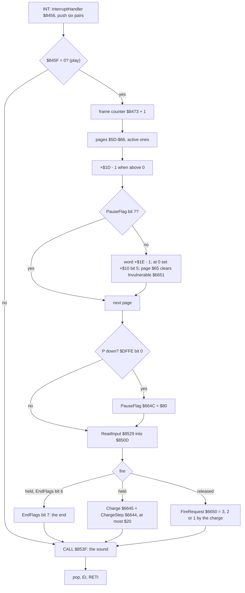

The fire charge, from TickChargeFire `$84DA` and TickFireReleased `$84E7`:

```text
if fire held:
    if EndFlags bit 6: EndFlags bit 7 = 1; return      ; the end text: fire ends the game
    Charge = min(Charge + ChargeStep, $20)
else if fire was held last frame:                     ; the release
    c = Charge; Charge = ChargeReset
    if HiroBusy $8E77 says busy, or the weapon page $6602 bit 0 is set: return
    FireHeld $69E3 = c
    FireRequest $6650 = 3 if c >= $19, 2 if c >= $09, else 1
```

Worked example, with the start values ChargeStep = 1 and ChargeReset = 0 (GlobalsInit): fire held for 12 frames gives
Charge = 12 = `$0C`. On the release, `$0C` is below `$19` and not below `$09`, so FireRequest = 2. Held for 40 frames,
the charge stops at `$20` and FireRequest = 3; a tap of 5 frames gives 1. Doc 10 turns the request into a strike.
TickChargeFire runs in 80 frames of c1 (fire held), and the request at `$84FA` is reached twice there; in the RZX
segments the counts are 1 377 and 17 (stage 2 notes).

The pause works the same way. GameTick sees P and sets PauseFlag bit 7. The next pass of the loop calls PauseGame
`$6682`, which shows "PAUSE GAME" and polls the keys itself (doc 5). While PauseFlag is set, GameTick still counts the
step delays but not the long timers +`$1E`, so a pickup's lifetime or the invulnerability does not run out in the
pause.

### What an interrupt costs

`tools/irq_cost.py` measures each interrupt in a trace from `$8456` to the instruction after `RETI`.

| Machine, trace | Interrupts | Mean T | GameTick | The sound | Max T | Share of a frame |
| --- | ---: | ---: | ---: | ---: | ---: | ---: |
| 48K, r004000 frames 530-553 | 23 | 2 960 | 1 258 | 1 461 (EffectPlayer `$853F`) | 4 907 | 4.2 % |
| 128K, c1 frames 17 700-17 701 | 2 | 6 803 | 821 | 5 696 (AyGlue, the AY player in bank 4) | 7 073 | 9.6 % |

GameTick is cheaper in c1 because fewer pages are active in room 4 at the start. The 128K's sound is four times the
48K's: AyGlue pages bank 4 in, runs the sequencer and writes the AY registers (doc 9). The 48K effect player is cheap
between effects.

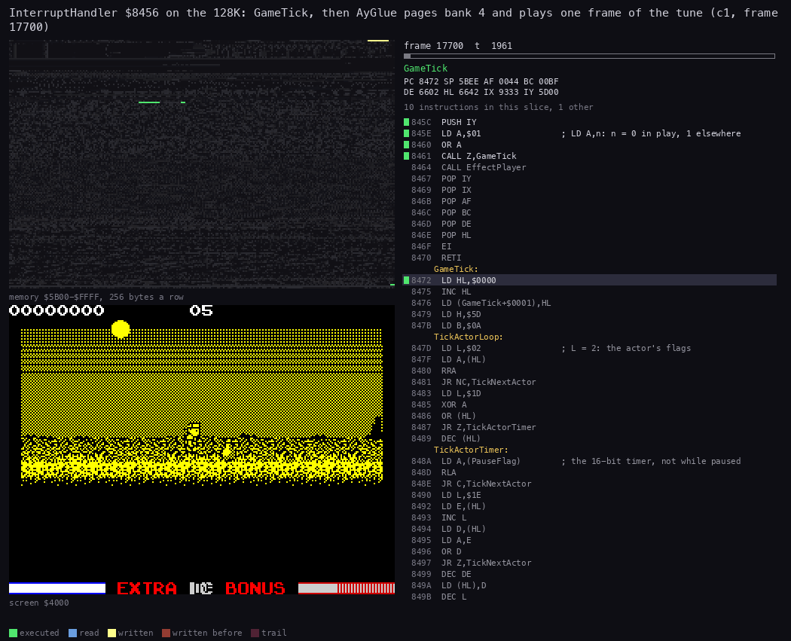

*One interrupt of c1 (128K, room 4), frame 17 700 from t 1840 to t 9100: 60 pictures of 121 T, 658 instructions.
Made with `python3 ../../kit/routine_anim.py --work work/docs/zsA/c1 --window 17700:1840-17700:9100 --listing
build/game.lst --page 4=build/bank4.lst --page-name '4=bank 4: the AY player' --range 5B00-FFFF --pc
8456-8528,853F-85E0,4:C000-E0F8 --pictures 60 --title '...' --out docs/img/routines/InterruptHandler.gif`; bank 4's
code is named from its listing with "bank 4: the AY player" after each name.*

How to read it:

- Right: the routine at the PC, named from the game's listing or, while bank 4 is paged in, from bank 4's ("WriteAy
  (bank 4: the AY player)"). The bar is the time inside the window.
- The first eighth is GameTick: the ten pages' delays, the P key, ReadInput.
- Then AyGlue `$853F` writes `$14` to `$7FFD`, and the PC moves into bank 4: the sequencer, then AyPrepare and
  WriteAyRegister for each register. The memory rows of `$C000-$D3FF` light up while the screen stays still.
- At the end AyGlue writes Last7FFD back, and the handler pops and returns.

Witness: InterruptHandler L1 222 542 and GameTick L1 177 113 over every recording with play (the listing's Witness
lines); `$853F` runs on all 2 614 entries of c1 from the first `EI` on (the title, frame 16 013), GameTick on 975
(frames 17 652 to 18 626, every frame of play).

**The point**: the interrupt is small and steady: 3-10 % of a frame. It holds the game's time (the delays) and the
player's input, so a stalled pass never loses a key press or a frame of delay; it only postpones the step.

## 4.5 The stalls

A pass usually lasts a few hundred T to a few frames. Two things stop it for much longer: building a room, and
revealing a zone. Both run inside Hiro's move: StepActor runs his handler, ApplyMove `$9B56` moves him, and
CheckRoomExit `$955A` looks at where he now stands.

### CheckRoomExit `$955A`

```asm
CheckRoomExit:                  ; $955A
  LD L,$3D                      ; C = -(+$3D): the animation's X offset
  LD A,(HL)
  NEG
  LD C,A
  LD HL,MapRow
  LD A,(Hiro+$0002)             ; on a ladder: always test the rows
  AND $08
  JR NZ,RoomExitTestY
  LD A,(Hiro+$0020)            ; $5D20: top above the room (bit 5)
  BIT 5,A
  JR NZ,RoomExitTestX
RoomExitTestY:
  LD A,(Hiro)
  LD E,$F0
  CP $A0                        ; Y = $A0: the bottom edge
  JR Z,RoomExitDown
  LD E,$9C
  CP $EC                        ; Y = $EC (-20): the top edge
  JR Z,RoomExitUp
RoomExitTestX:
  INC L                         ; HL = the map column
  LD A,(Hiro+$0001)
  ADD A,C
  LD E,$FC
  CP $9E                        ; X = $9E: the right edge
  JR Z,RoomExitRight
  LD E,$9C
  CP $FA                        ; X = $FA (-6): the left edge
  JR Z,RoomExitLeft
  CALL ActorScreenBox           ; $8F75: no edge, the box and clip bits again
  CALL RevealZone               ; $A569: a zone not yet seen? Z
  LD A,D
  RET NZ
  PUSH AF
  CALL RedrawCellsMasked        ; $8855: all 220 cells
  POP AF
  JP SpawnZoneEnemies           ; $A59E
```

The operand `Hiro+$0020` is the address `$5D20`, Hiro's +`$20`. The stage-2 source printed it with the label of the
set-up code that sits at `$5D20` before play overwrites the page (`BuildOutlineMaskLoop+$000C`); an `@isub` names it
now.

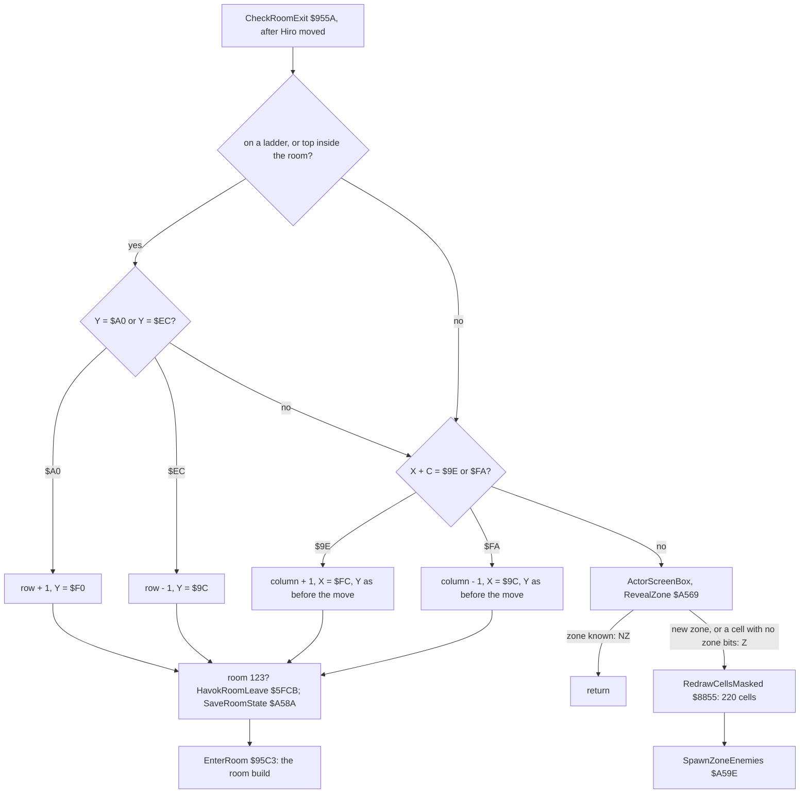

### The room build: EnterRoom `$95C3`

When Hiro crosses an edge, CheckRoomExit moves him to the opposite edge and changes MapRow `$69DF` or MapColumn
`$69E0`. A column crossing also puts his Y back to its value before the move (`$95B3 LD A,n`, the operand written by
ApplyMove). SaveRoomState `$A58A` keeps the old room's reveal and item bytes. EnterRoom then finds the new room and
builds it:

1. FindRoom `$95F9` searches the row's list of columns (`$70C7` counts, `$70DB` starts, `$7048` columns) with `CPIR`:
   RoomAbove `$6BDC` and Room `$6BDD` (doc 7).
2. Room 123 calls HavokRoomEnter `$5FD4`.
3. BuildRoomPlanes `$9F34` unpacks the room record into the cell planes `$67-$6C` (doc 6).
4. SetupRoomObjects `$A41E`, RedrawRoomMasked `$8852` (the 220 cells with the room's kept reveal mask),
   SpawnRoomEnemies `$A59B`, RestoreShield `$995C`.

How long it takes, split by `tools/rzx_room_stalls.py` over the 31 room changes of the RZX run in RZX frames
1 500-28 500 (48K; `work/stage2/stalls/room-stalls.tsv`, beside `stalls.json`):

| Part | Frames | Median |
| --- | ---: | ---: |
| BuildRoomPlanes (and the room above's bottom row) | 0-17 | 13 |
| SetupRoomObjects | under 1 | 0 |
| RedrawRoomMasked: the 220 cells, drawing the zones already revealed | 12-53 | 35 |
| **the room build**, EnterRoom `$95C3` to its `RET` | **25-71** | **43** |
| **the stall at a room change**, frames with no MainLoop fetch | **27-72** | **45** |

The stall is the build plus 0-4 frames of the rest of the pass (Hiro's redraw, the other steps). No room change in
that range is followed by a zone reveal within 120 frames. The length follows what RedrawRoomMasked draws: the 17
first visits take 25-71 frames (median 38), the 14 returns, with more zones kept revealed, 38-71 (median 59.5). The
longest stalls, 72 frames, are both entries into room 31 (RZX frame 17 393, the first, and 22 203); the shortest build
is the first entry into room 9 at 3 917, 25 frames. The same split for the doc 6 and doc 7 builds: `c1` room 4 at the
start, 40 frames (17 612-17 652, 128K); `play48` room 7 to room 8, 38 frames (2 389-2 427, 48K).

```text
EnterRoom:                                   ; one pass, 25-71 frames
    RoomAbove = FindRoom(MapRow - 1) or 0; Room = FindRoom(MapRow)
    if Room = 123: HavokRoomEnter
    BuildRoomPlanes()                        ; 0-17 frames: the record into planes $67-$6C
    SetupRoomObjects()                       ; items and enemy records into RoomObjectList $5B01
    RedrawRoomMasked()                       ; 12-53 frames: RedrawCellsMasked with RevealedZones,
                                             ; every cell of a kept zone drawn, the others masked
    SpawnRoomEnemies(); if Invulnerable: RestoreShield
```

```mermaid
flowchart LR
    A["edge crossed: CheckRoomExit"] --> B["SaveRoomState $A58A"]
    B --> C["FindRoom x2: under 1 frame"]
    C --> D["BuildRoomPlanes $9F34: 0-17 frames"]
    D --> E["SetupRoomObjects $A41E"]
    E --> F["RedrawRoomMasked $8852: 12-53 frames"]
    F --> G["SpawnRoomEnemies $A59B"]
    G --> H["the rest of the pass: 0-4 frames"]
    H --> I["MainLoop $8DFE: the stall ends, 27-72 frames after the crossing"]
```

#### Worked example: room 8 in play48, against the beam

`play48` (48K) walks from room 7 into room 8 at frame 2 389; SpawnRoomEnemies runs in 2 427 (doc 7.6). Our trace of
frames 2 389-2 427 (`work/stage2/traces/play48-2389_0-2428_0.uatr`, 386 041 instructions) holds 7 632 screen writes:

| Writer | Writes | Before the beam | After it |
| --- | ---: | ---: | ---: |
| MaskCellRowsLoop (a cell masked to its half-character) | 2 560 | 1 750 | 810 |
| BlitRowsLeftMask | 2 240 | 919 | 1 321 |
| BlitRowsRightMask | 2 240 | 920 | 1 320 |
| DrawCellLayers | 560 | 224 | 336 |
| BlitColumnMask | 32 | 0 | 32 |

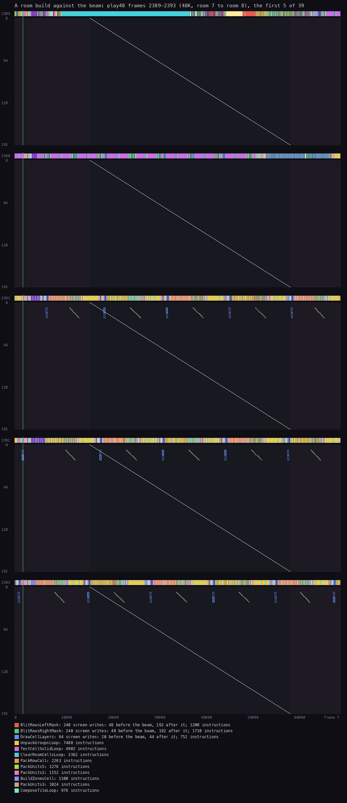

*The first five of the build's 38 frames (48K; the trace runs one frame on, to 2 428). Made with `python3
../../kit/beam_timeline.py --trace work/stage2/traces/play48-2389_0-2428_0.uatr --listing build/game.lst --machine 48k
--frames 2389-2393 --title '...' --out docs/img/loop/beam-build-play48.png` (`--frames A-B` picks any window of the
whole build's trace); the trace was taken with `--work` on play48's recording (port base 37400) over `--window
2389:0-2428:0`.*

How to read it:

- Frames 2 389-2 390: no screen write. The bar above is BuildRoomPlanes' loops (ClearRoomCellsLoop, TestCellSolidLoop,
  UnpackGroupsLoop): the room is decoded into the planes first.
- From 2 391: the redraw. Each cell is a short slanted run of writes (BlitRows, eight lines of one cell) and a pair of
  DrawCellLayers marks; five cells a frame, all near the top rows, independent of where the beam is.
- The rest of the 38 frames go on the same way down the room. A quarter to a half of the writes fall ahead of the beam,
  so a build shows the room growing cell by cell over most of a second.

Witness: EnterRoom L1 206 in every play recording (the listing's Witness line). The build itself is animated in
[doc 6, 6.3](06-rendering.md#63-the-cell-planes-and-the-room-build) (EnterRoom, room 4) and
[doc 7, 7.6](07-objects.md#76-a-room-decoded-room-8-command-by-command) (Animation 7.1, BuildRoomPlanes, room 8).

### The zone reveal

A room is drawn only where Hiro has been. Each cell's flag byte in plane `$67` carries a zone in its top six bits;
RevealedZones `$6DFF` holds the zones seen in this room. RevealZone tests the zone under Hiro's feet:

```asm
RevealZone:                     ; $A569
  LD A,(RevealedZones)          ; $6DFF
  LD C,A
  LD HL,$0000                   ; $A56D: two cells, written by $8FCF for the actor just placed
  LD A,(Hiro+$001B)             ; $5D1B: bit 7 picks L or H
  RLA
  JR C,RevealZoneTest
  LD L,H
RevealZoneTest:
  LD A,L
  ADD A,$14                     ; the cell one row down (20 cells a row)
  LD L,A
  LD H,$67
  LD A,(HL)
  AND $FC                       ; its zone bits
  LD D,A
  AND C
  RET NZ                        ; known: NZ
  LD A,D
  OR C
  LD (RevealedZones),A          ; new: add it, Z
  XOR A
  RET
```

```asm
RedrawCellsMasked:              ; $8855
  AND $FC
  LD C,A                        ; C = the new zone
  LD B,$DC                      ; 220 cells, 20 x 11
  LD L,$00
RedrawCellsLoop:
  PUSH HL
  PUSH BC
  CALL RedrawCell               ; $8867: draw the cell when it is in zone C
  POP BC
  POP HL
  INC L
  DJNZ RedrawCellsLoop
  RET
```

RedrawCell `$8867` and RedrawCellMask `$8868` decide each cell. A cell of the new zone is drawn with its layers
(DrawCellLayers `$889C`). A cell of a zone already seen is left alone. A cell of no revealed zone is erased or masked
to its half-character (EraseCell `$8873`, MaskCellRows `$888D`). SpawnZoneEnemies `$A59E` then starts the enemies
whose cells lie in the new zone (doc 10).

A cell with no zone bits under Hiro's feet also returns Z: D = 0, so `AND C` is 0, and RevealedZones is left as it
was. CheckRoomExit then runs RedrawCellsMasked with zone 0 (the 220-cell walk, drawing nothing new) and
SpawnZoneEnemies on every move Hiro makes over such a cell. Whether any of the 127 rooms has such a cell where Hiro can
stand is not checked (doc 6.7); each of the RZX run's 12 long stalls away from a room change begins with a new
zone, so none of them is such a walk.

```text
RevealZone:
    cell = (Hiro+$1B bit 7 ? L : H of the operand at $A56D) + 20
    zone = plane $67[cell] AND $FC
    if zone AND RevealedZones: return NZ
    RevealedZones |= zone; return Z
on Z, CheckRoomExit:
    for cell in 0 .. 219:
        if plane $67[cell] AND zone: draw its layers        ; the new part of the room appears
        elif plane $67[cell] AND RevealedZones: keep it     ; already on the screen
        else: erase or mask the cell                        ; still dark
    SpawnZoneEnemies(zone)
```

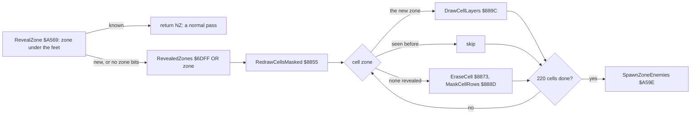

#### Worked example: room 9, frame 553 of r004000

`work/docs/zsA/scan.py` read the memory at the start of every frame of r004000. Up to frame 553 RevealedZones is `$40`
and Hiro walks left at Y `$10`. At the start of frame 554 it is `$C0`: zone `$80` was added during frame 553. Hiro's X
then stays at `$3E` until frame 564: the pass that revealed the zone is still running.

The pass, cut by `work/docs/zsA/reveal_split.py` over the trace `552_0-568_0.uatr`:

| Part | Starts at | T | Of which interrupts |
| --- | --- | ---: | ---: |
| the pass up to CheckRoomExit (the offers, Hiro's step) | 552:68563 | 10 776 | 2 879 |
| CheckRoomExit to RevealZone | 553:9451 | 983 | 0 |
| RevealZone (finds zone `$80` new) | 553:10434 | 177 | 0 |
| RedrawCellsMasked: 220 RedrawCell calls | 553:10611 | 720 472 | 16 718 |
| SpawnZoneEnemies, then Hiro's redraw and the rest of the pass | 563:32203 | 76 456 | 1 671 |
| **the whole pass** | 552:68563 | **808 864 (11.6 frames, 12 interrupts)** | 21 268 |

The cell loop alone takes 10.3 frames. The test, RevealZone, is 177 T: it runs every time Hiro moves.

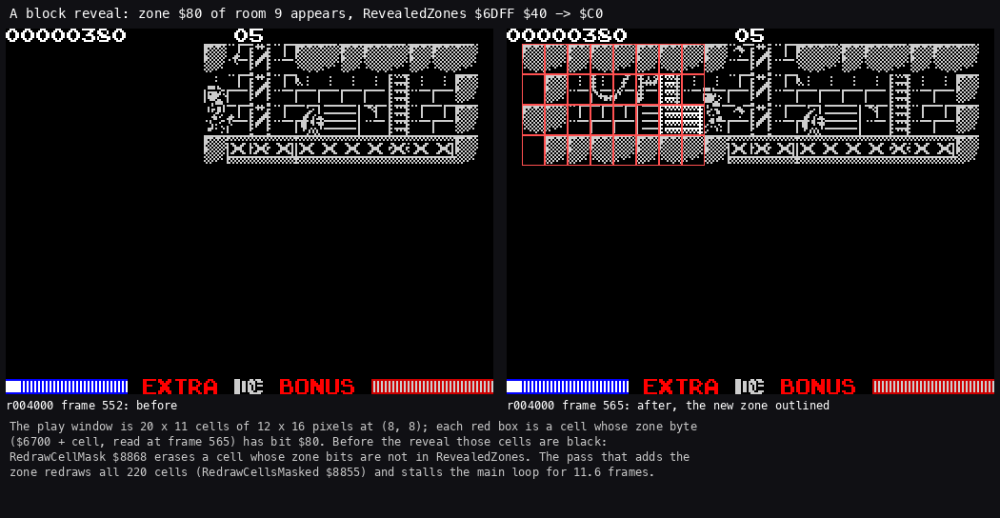

*Room 9 in r004000 (48K, the RZX run replayed): the screen at the start of frame 552 (RevealedZones `$40`) and of frame
565 (`$C0`); the cells of zone `$80` outlined in red, from plane `$67` and `$6DFF`. Made with `python3
tools/fig_reveal.py --work work/docs/zsA/r004000 --before 552 --after 565 --out docs/img/loop/reveal-room9.png`.*

How to read it:

- Left: the room before. Only the zone `$40` is drawn; the rest is black.
- Right: the room after. The red outlines are the cells whose flag byte has bit 7 (zone `$80`).
- Every outlined cell was black before and is drawn after; the other differences are Hiro's own cells.

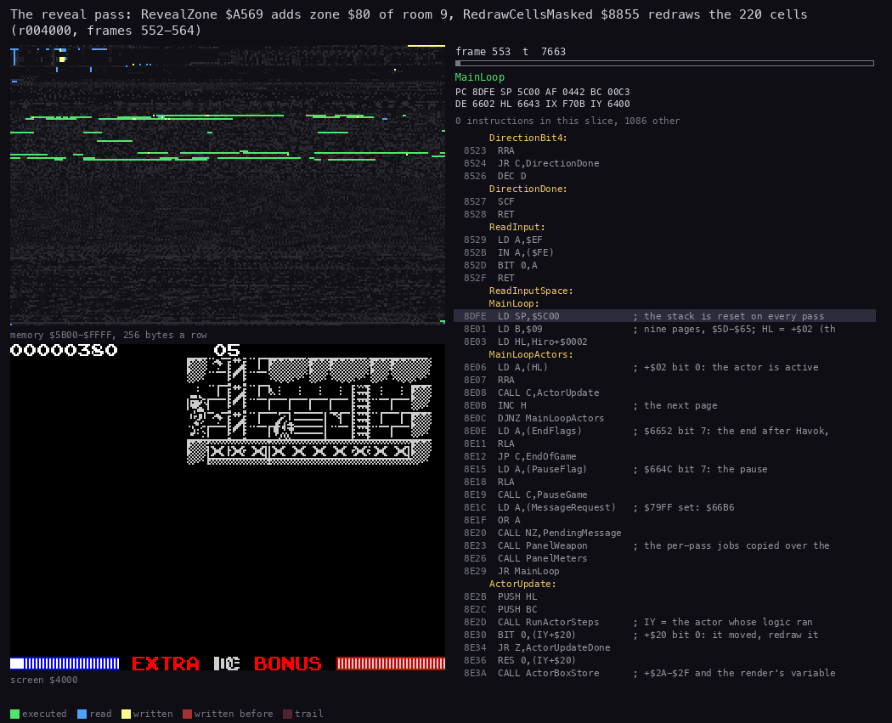

*The reveal pass of r004000 (48K, the RZX run replayed), from frame 552 t 68563 to frame 564 t 38771: 90 pictures of
8 988 T, 115 671 instructions. Made with `python3 ../../kit/routine_anim.py --work work/docs/zsA/r004000 --window
552:68563-564:38771 --listing build/game.lst --view screen --range 5B00-FFFF --pc 8803-8DFD,955A-95C2,A569-A5FF
--pictures 90 --title '...' --out docs/img/routines/RedrawCellsMasked.gif`.*

How to read it:

- Right: the screen as it is in each picture. The cells appear in reading order, row by row, left to right, from the
  top.
- Left: memory lit by age. The plane `$67` at `$6700` is read on every cell; the screen is written only where a cell
  belongs to the new zone or must be masked.
- The PC sits in the cell composer and MaskCellRowsLoop `$8890` for most of the GIF. RevealZone and SpawnZoneEnemies
  are a few pictures at the two ends.

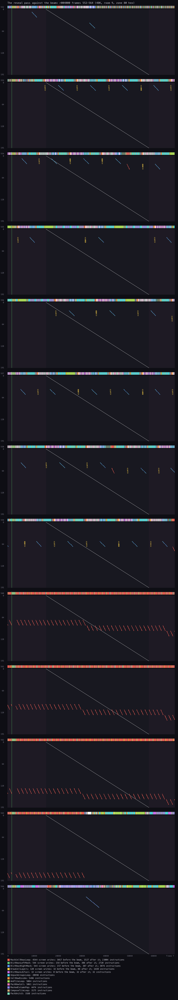

*Frames 552-564 of r004000 (48K): every screen write of the reveal pass (552:68563 to 564:38771) at its line and
frame T. Made with `python3 ../../kit/beam_timeline.py --trace work/docs/zsA/r004000/traces/552_0-568_0.uatr --listing
build/game.lst --machine 48k --frames 13 --title '...' --out docs/img/loop/beam-reveal-r004000.png`.*

How to read it:

- Each band is one frame; the diagonal is the beam drawing the paper; the vertical line is the INT.
- The coloured points are screen writes by routine: MaskCellRowsLoop (4 544 writes: the cells still dark masked to
  their half-character), BlitRowsLeftMask and BlitRowsRightMask (544 each: the cells of the new zone), DrawCellLayers
  (120), BlitRowsLdiTail (32).
- The cells appear row by row over ten frames (553-563), in reading order. Of the new zone's writes about three in ten
  fall before the beam reaches their line (158 of 544 for BlitRowsLeftMask); the masking writes, mostly ahead of it
  (3 017 of 4 544), change nothing on the screen that was not already dark.

The twelve long stalls of the RZX run that are not room builds are all reveals. Each begins within one frame of a frame
where RevealedZones gains a bit in the same room (`tools/rzx_reveals.py`, `work/stage2/stalls/reveals.tsv`):

| RZX frame | 4 555 | 5 094 | 6 741 | 7 594 | 7 825 | 9 249 | 10 767 | 13 653 | 15 407 | 24 151 | 25 415 | 27 133 |
| --- | ---: | ---: | ---: | ---: | ---: | ---: | ---: | ---: | ---: | ---: | ---: | ---: |
| frames without a pass | 13 | 22 | 10 | 18 | 27 | 14 | 14 | 21 | 16 | 11 | 16 | 19 |

The length follows the number of cells drawn. At 7 594 the 48K beeper burst of the reveal's sound (BeeperDelay
`$8662`) adds to it.

Witness: RevealZone L1 42 139 and CheckRoomExit 42 125 (it runs on nearly every move); RedrawCellsMasked 313, in every
play recording.

**The point**: the self-mapping costs a stall each time a zone opens. The test is 177 T; the redraw walks all 220
cells, not only the new zone's: ten frames in which Hiro and every enemy stand still while the interrupt keeps
counting their delays.

## 4.6 Passes against the beam

The loop does not wait for the beam. A pass draws whenever an actor is due, so its screen writes fall at any line.

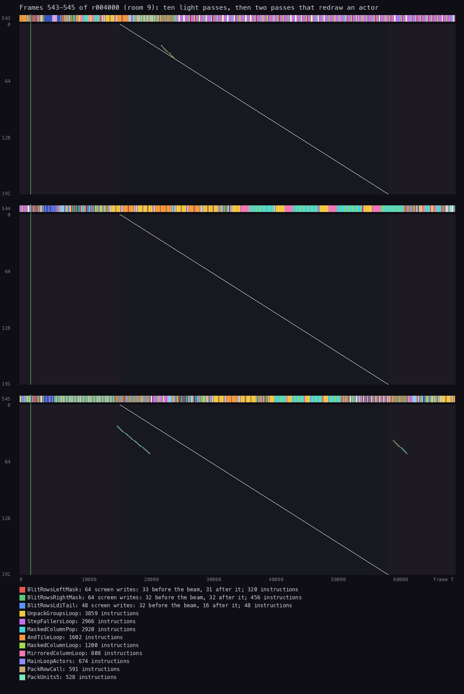

*Frames 543-545 of r004000 (48K, room 9, the RZX run replayed). Made with `python3 ../../kit/beam_timeline.py --work
work/docs/zsA/r004000 --window 543:0-546:0 --listing build/game.lst --machine 48k --title '...' --out
docs/img/loop/beam-typical-r004000.png`.*

How to read it:

- The bar above each frame is the CPU, coloured by routine. The light passes are the narrow repeating stripes of
  MainLoopActors and RunActorSteps.
- In frame 545 BlitRows writes Hiro's window at about T 15 000-20 000 and again near T 60 000: two redraw passes.
- The writes near T 15 000 are just ahead of the beam at those lines; the late ones land behind it.

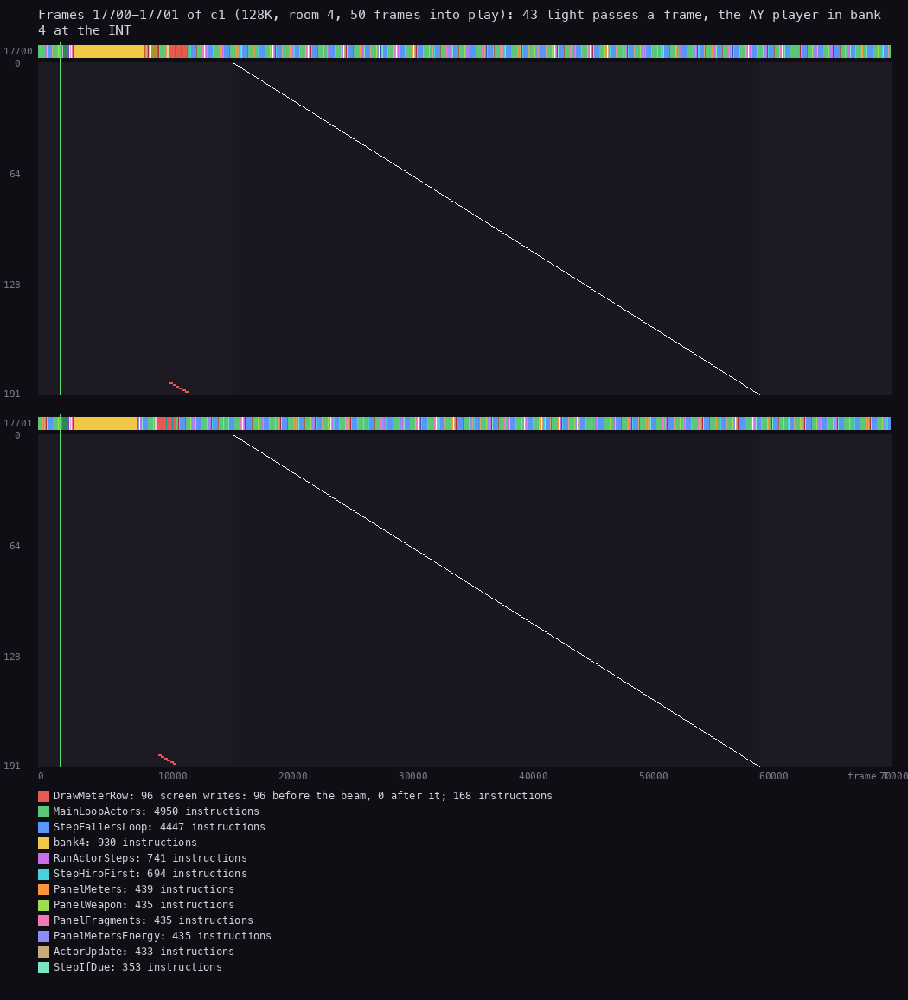

*Frames 17 700-17 701 of c1 (128K, room 4, 50 frames into play). Made with `python3 ../../kit/beam_timeline.py --work
work/docs/zsA/c1 --window 17700:0-17702:0 --listing build/game.lst --page 4=build/bank4.lst --page-name 4=bank4
--machine 128k --title '...' --out docs/img/loop/beam-c1-128k.png`.*

How to read it:

- The yellow block after the INT is bank 4: the AY player, about 5 700 T.
- The rest of each frame is light passes, 86 in the two frames: no actor was due for a redraw.
- The only screen writes are DrawMeterRow's (96): PanelMeters drawing the meters in the panel at the bottom, at about
  T 9 000-11 000, long before the beam reaches those lines.

**The point**: with no frame lock the screen is written whenever a step is due. Most redraws are small windows, so the
tearing is a few rows of one actor; only the reveal writes across the whole play area.

## 4.7 Delays and timers

| Timer | Where | Length | Counted by |
| --- | --- | --- | --- |
| an actor's step delay | +`$1D`, reloaded from +`$1A` by StepActor | Hiro 3 frames | GameTick, every frame |
| an actor's long timer | +`$1E/$1F`; at 0 sets +`$10` bit 5 | per actor | GameTick, not in the pause |
| a pickup's lifetime | StartLifetime `$9987`, kind bit 7 | 255 frames | the long timer |
| the energy ball after a lost life | SpawnShield `$9962`, `$00AA` | 170 frames | the long timer |
| the invulnerability | page `$65`'s long timer, `$355` | 853 frames (17 s; the manual says 16 s) | the long timer; GameTick clears Invulnerable `$6651` |
| the game over message | ShowGameOverWait `$831A` | 200 frames or fire | `HALT` x 5 a step (WaitFireFrames `$8321`) |
| the title's logo | TitleSequence `$A73E`, TitleStep `$A766` | the pieces' own timers (+`$3F`); fire ends it from the fourth piece | a polling loop, no `HALT` (play48 frames 0-101) |
| the high-score table | ShowHighScores `$A6EC` | 200 frames, fire ends it | a `HALT` loop (`EI` at `$A6F2`) |
| the pause | PauseGame `$6682` | until P again | polls P every 5 `HALT`s, then a `$4000` loop delay |
| PauseLong `$8330` | | a `$6000` loop delay | a counted loop |
| the name entry | EnterName `$A861` | ten delays first, about 2 s | `HALT` loops |
| Havok's fade | HavokFade `$872B` | 255 passes, then DelayBC 65 536 | passes |

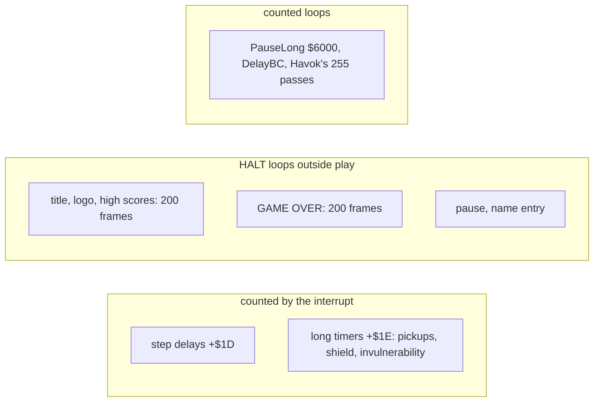

**The point**: in play every timer lives in an actor page and is counted by the interrupt, so play time is real time.
The `HALT` loops belong to the screens around play; the only pass-counted timer is Havok's fade at the very end.

## 4.8 Known only from the code

- The SLOPPY start (MatchCheatName `$5C68`): no recording has SLOPPY in the table.
- HiroBusyNoJump `$8E81` is not executed in any recording; nothing refers to it.
- The long-timer path for page `$65` (Invulnerable cleared by GameTick): the invulnerability pickup is not taken in
  any keyed recording.
- The pass counts of the 128K under heavy play were not measured; c1's 43 passes a frame are for a quiet room 4.
