# 5. Controls

What this covers:

- the input devices and every port the game reads in play, in the menus and in the pause;
- the control menu after the load: four options, one 14-byte record each, patched into the input code;
- the four readers (Sinclair 1, Sinclair 2, Kempston, Protek or cursor) and what each makes of the keys;
- DecodeDirection, the one decoder all four share, and what it does with opposite directions;
- the fire button: the charge while it is held, the strike's power when it is let go;
- the path from the input byte to Hiro: walk, turn, jump, ladder, stand;
- the pause, the quit, and the 128K title's choice between the music and the effects;
- the SLOPPY cheat in the high-score table (known only from the code).

The recordings it rests on (WALKTHROUGH 6.0; all on the 128K):

| Recording | Load | Used for |
| --- | --- | --- |
| `c1` | power-on, the original tape by its own loader at signal speed | the control menu (frame 16008), option 4 (Protek) chosen, play from frame 17651 in room 4: fire held 17687-17707 and 17717-17777, then 8 (right) 17797-18047, 7 (up) 18047-18087, 6 (down) 18087-18127, 5 (left) 18127-18427 |
| `menu` | `work/stage1/explore/loaded.szx` (the menu after the load) | option 1; the title's left (6, frames 64-110) and right (7, 110-156); in play a pause (P at 1931, P again at 2035) and the quit (fire from 2100, P at 2110) |
| `opt2`, `opt3`, `opt4` | the same state | options 2, 3 and 4, each with right, left, up, fire and the quit; `opt3` runs the Kempston reader |
| `deaths`, `gameover` | the same state | option 4 again |

Conventions:

- **A frame** is 1/50 s of the 128K, 70 908 T. **A pass** is one turn of the main loop `$8DFE` ([doc 4](04-game-loop.md)).
- A value read with `time_travel memory_at` is the memory at the start (T 0) of the frame named. So a sample of frame
  N shows what the code did before frame N began.
- A trace puts an instruction in the frame where it ran, with its T-state in that frame ("frame 17707 T 2904").
- The keys of an input script are held from their frame on.
- "Option 1" to "option 4" are the lines of the control menu. The menu calls them "JOYSTICK 1", "JOYSTICK 2",
  "KEMPSTON" and "PROTEK OR CURSOR". This document says Sinclair 1, Sinclair 2, Kempston and Protek.
- Counts of runs ("L1 642609") are the witness counts of the `.ann` files, summed over our recordings.

## 5.1 The devices and the ports

The game reads four ports, and nothing else:

| Port | What | Read by | When |
| --- | --- | --- | --- |
| `$F7FE` (keys 1-5) | the menu's keys 1-4; option 2's reader; option 4's key 5; the SLOPPY start keys 1-4 | ControlMenu, ReadInput (options 2, 4), MatchCheatName | once after the load; every frame; once a game |
| `$EFFE` (keys 0, 9, 8, 7, 6) | option 1's reader; option 4's keys 0, 9, 8, 7, 6 | ReadInput (options 1, 4) | every frame |
| `$1F` (Kempston) | option 3's reader | ReadInput (option 3) | every frame |
| `$DFFE` bit 0 (P) | the pause key, for every control | GameTick, PauseGame | every frame; every 5 frames in the pause |

There is no key redefinition. The controls are fixed by the four records the menu chooses from.

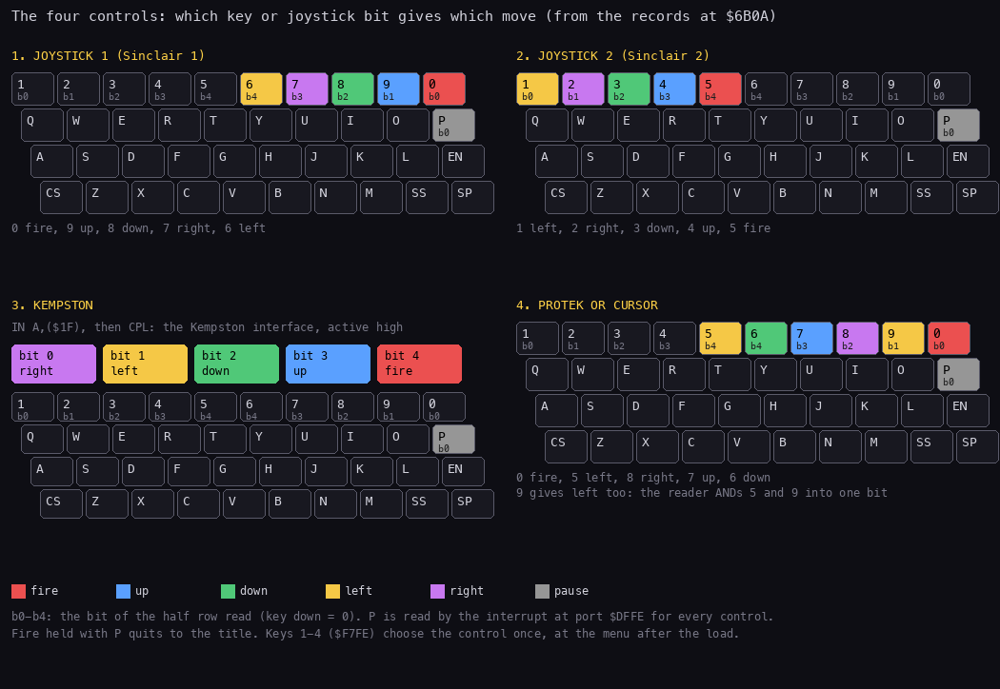

*Figure 5.1: which key or port bit gives which move, for each of the four options. Drawn from the control records
at `$6B0A` in `build/game.bin` and the readers of 5.3: `python3 tools/fig_controls.py keys --out
docs/img/controls/keys.png`. No recording: the figure is the code's data.*

How to read:

- One keyboard per option, in the menu's order. A coloured key is read by that option; the colour is its move.
- The small `b0`-`b4` under a key is the bit of its half row that reads 0 while the key is down.
- Option 3 reads no key: its five bits come from the Kempston port, shown as boxes.
- P (grey) is read for every option, by the interrupt.
- Option 4 colours 9 as well as 5: both give left (5.3).

The point: the four options give the game the same five bits in the same sense (0 = pressed). Option 1 is the
Sinclair layout on keys 6-0. Option 2 is the Sinclair layout on keys 1-5. Option 4 is the cursor keys 5-8 with 0.

### Every `IN` of the game

Every `IN` instruction of `build/game.lst` and `build/boot.lst`:

| Address | Code | Port | Reads |
| --- | --- | --- | --- |
| `$5C79` | `IN A,(C)` | `$F7FE` | MatchCheatName: keys 1-4 pick the cheat's start (5.10) |
| `$6A8A` | `IN A,($FE)` | `$F7FE` | ControlMenu: keys 1-4 (5.2) |
| `$84B4` | `IN A,(C)` | `$DFFE` | GameTick: P sets PauseFlag `$664C` (5.7) |
| `$852B` | `IN A,($FE)` | `$EFFE` as loaded | ReadInput, rewritten by the menu (5.3) |
| `$669F` | `IN A,(C)` | `$DFFE` | PauseGame (run-time code): P again ends the pause (5.7) |

The three readers in the records (`$6B11`, `$6B1F`, `$6B2D`) run only after the copy to `$8529`. Every other input
goes through ReadInput `$8529`: the tick, the title, the high-score entry and the waits for fire.

## 5.2 The control menu

After the load, GameEntry calls ControlMenu `$6A7B` once. It clears the screen and prints ControlMenuText `$6ACB` in
the tall font: "1.JOYSTICK 1", "2.JOYSTICK 2", "3.KEMPSTON", "4.PROTEK OR CURSOR".

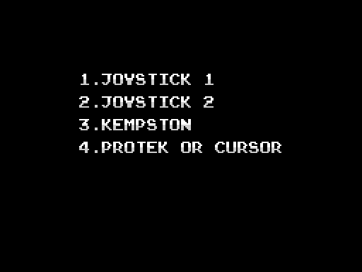

*Figure 5.2: the control menu in `c1`, frame 16008 T 0, just before 4 is pressed. `python3 kit/screen_shot.py --work
work/docs/zsB/c1 --out-dir docs/img/controls control-menu=16008:0`, the instance opened on
`work/stage1/c1/session.ttd` with `re_session.py open --model 128K`.*

ControlMenu then reads the half row `$F7FE` until one of the keys 1-4 is down. It walks the four bits with `RRA`,
key 1 first, and steps HL through ControlRecords `$6B0A` by 14 bytes a key. If two keys are down, the lower number
wins.

The chosen record is copied into the input code:

| Record byte | Goes to | Meaning |
| --- | --- | --- |
| +0 | `$84CA` (TickInput's `AND n`) and GlobalsInit+6 `$5C06` | the fire bit's mask; GlobalsInit+6 becomes FirePrevious `$6648` at each new game, so a game starts with fire "up" |
| +1 | `$850F` and `$8511` (DecodeDirection's `AND n` / `CP n`) | the mask of the four direction bits |
| +2 | `$8513` | `RRA` when fire is bit 0 (it drops the fire bit), `NOP` when fire is bit 4 |
| +3 to +6 | `$851A`, `$851E`, `$8522`, `$8526` | one opcode per direction bit, lowest first: `DEC E` (up), `INC E` (down), `INC D` (right) or `DEC D` (left) |
| +7 on | ReadInput `$8529`, 18 bytes by `LDIR` | the reader itself |

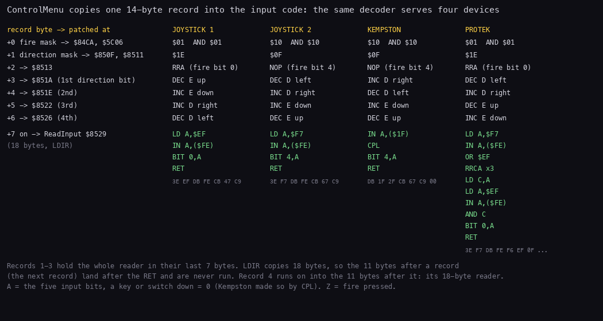

*Figure 5.3: the four records at `$6B0A` and where ControlMenuPatch `$6A99` puts each byte. Drawn from
`build/game.bin`: `python3 tools/fig_controls.py records --out docs/img/controls/records.png`. No recording.*

How to read:

- One column per option. Each row is a record byte, with the address it is written to on the left.
- The green lines are the reader each option leaves at `$8529`. The grey hex under them is the record's last 7 bytes.
- Option 4's reader is longer than 7 bytes: the copy runs on past the end of the table (5.3).

The point: the menu does not choose between four routines. It rewrites one routine, byte by byte, so the rest of the
game never asks which device is in use.

Pseudocode:

```text
ControlMenu:                                   ; $6A7B
    ClearScreen(0)
    PrintStringTall(ControlMenuText)           ; "1.JOYSTICK 1" ... "4.PROTEK OR CURSOR"
    loop:
        a = IN($F7FE)                          ; keys 1-5, 0 = down
        hl = ControlRecords                    ; $6B0A
        for b = 4 downto 1:
            carry = a bit 0; a >>= 1
            if carry == 0: goto patch          ; this key is down
            hl += 14
patch:
    fire = (hl)
    (TickInput+$0B) = fire; (GlobalsInit+6) = fire
    (DecodeDirection+1) = (DecodeDirection+3) = (hl+1)
    (DecodeDirection+5) = (hl+2)               ; RRA or NOP
    ($851A), ($851E), ($8522), ($8526) = (hl+3) .. (hl+6)
    copy 18 bytes from hl+7 to ReadInput $8529
```

The key loop and the patches, from `build/game.lst`:

```text
6A85 11 0E 00     LD DE,$000E                ; 14 bytes a record
6A88 3E F7        LD A,$F7                   ; ControlMenuWait
6A8A DB FE        IN A,($FE)                 ; keys 1-5
6A8C 21 0A 6B     LD HL,ControlRecords
6A8F 06 04        LD B,$04
6A91 1F           RRA                        ; ControlMenuKey: the next key's bit
6A92 30 05        JR NC,ControlMenuPatch
6A94 19           ADD HL,DE
6A95 10 FA        DJNZ ControlMenuKey
6A97 18 EF        JR ControlMenuWait
6A99 7E           LD A,(HL)                  ; ControlMenuPatch: HL = the chosen record
6A9A 23           INC HL
6A9B 32 CA 84     LD (TickInput+$000B),A     ; the fire mask
6A9E 32 06 5C     LD (GlobalsInit+$0006),A   ; FirePrevious at a new game
6AA1 7E           LD A,(HL)
6AA2 32 0F 85     LD (DecodeDirection+$0001),A
6AA5 32 11 85     LD (DecodeDirection+$0003),A
6AA8 23           INC HL
6AA9 7E           LD A,(HL)
6AAA 32 13 85     LD (DecodeDirection+$0005),A
6AAD 23           INC HL
6AAE 7E           LD A,(HL)
6AAF 32 1A 85     LD (DecodeDirection+$000C),A
6AB2 23           INC HL
6AB3 7E           LD A,(HL)
6AB4 32 1E 85     LD (DirectionBit2+$0003),A
6AB7 23           INC HL
6AB8 7E           LD A,(HL)
6AB9 32 22 85     LD (DirectionBit3+$0003),A
6ABC 23           INC HL
6ABD 7E           LD A,(HL)
6ABE 32 26 85     LD (DirectionBit4+$0003),A
6AC1 23           INC HL
6AC2 11 29 85     LD DE,ReadInput
6AC5 01 12 00     LD BC,$0012                ; 18 bytes
6AC8 ED B0        LDIR
```

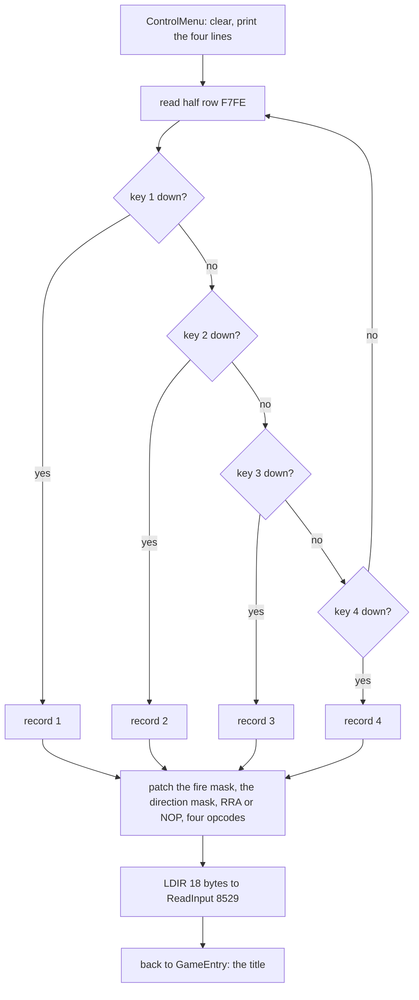

Worked example (`c1`): the menu is on the screen at frame 16008 and 4 is pressed. Bits 0-2 of `$F7FE` read 1, bit 3
reads 0. HL steps three times to `$6B0A` + 42 = `$6B34`, record 4: `01 1E 1F 15 14 1D 1C`. So `$84CA` = `$01`, the
direction mask is `$1E`, `$8513` = `RRA`, and the opcodes `DEC D`, `INC D`, `DEC E`, `INC E` go to `$851A`-`$8526`.

Witness: ControlMenu L1 2 (`c1` and `c48`, one run each). The other recordings start from a state taken after the
menu (`loaded.szx`), where the menu is waiting: they run ControlMenuKey (L1 9 813 576) and the patch, but not the
menu's first lines.

The menu is shown once per load. GameEntry calls it before the first title, and NewGame `$5C4D` never returns to it.
So the control cannot be changed without loading again. The `menu` recording's later rounds press 2, 3 and 4 at the
title; they change nothing but the title's sound choice (5.8).

## 5.3 ReadInput `$8529` and the four readers

ReadInput returns the five input bits in A, a pressed key or switch as 0, and Z set when fire is down. It is the only
code that reads a control. Its 18 bytes are rewritten by the menu (5.2).

1. **Sinclair 1** (option 1, the code as loaded): `LD A,$EF` / `IN A,($FE)` / `BIT 0,A` / `RET`. The half row of 0,
   9, 8, 7, 6: bit 0 = 0 fire, bit 1 = 9 up, bit 2 = 8 down, bit 3 = 7 right, bit 4 = 6 left.
2. **Sinclair 2** (option 2): `LD A,$F7` / `IN A,($FE)` / `BIT 4,A` / `RET`. The half row of 1-5: bit 0 = 1 left,
   bit 1 = 2 right, bit 2 = 3 down, bit 3 = 4 up, bit 4 = 5 fire.
3. **Kempston** (option 3): `IN A,($1F)` / `CPL` / `BIT 4,A` / `RET`. The interface answers 1 for pressed; `CPL`
   turns that into the keyboard's sense. Bit 0 right, bit 1 left, bit 2 down, bit 3 up, bit 4 fire.
4. **Protek** (option 4), 18 bytes: two half rows merged into one byte, so that 5 (left), 6 (down), 7 (up), 8
   (right) and 0 (fire) land in the Sinclair 1 bit positions.

Pseudocode of the Protek reader:

```text
ReadInput (option 4):                          ; $8529
    c = IN($F7FE) OR $EF                       ; keep bit 4 (key 5), set the rest
    c = c rotated right 3 times                ; key 5 now in bit 1; every other bit 1
    a = IN($EFFE) AND c                        ; 0 fire, 9 or 5 left, 8 right, 7 up, 6 down
    Z = (a bit 0 == 0)                         ; fire = key 0
    return a
```

The 18 bytes as they stand at `$8529` after option 4: record 4's last 7 bytes (`$6B3B`-`$6B41`) and the 11 bytes
after the table (`$6B42`-`$6B4C`):

```text
8529 3E F7        LD A,$F7
852B DB FE        IN A,($FE)                 ; keys 1-5
852D F6 EF        OR $EF                     ; only key 5 (bit 4) is kept
852F 0F           RRCA
8530 0F           RRCA
8531 0F           RRCA                       ; key 5 into bit 1
8532 4F           LD C,A
8533 3E EF        LD A,$EF
8535 DB FE        IN A,($FE)                 ; keys 0, 9, 8, 7, 6
8537 A1           AND C                      ; bit 1 = 9 AND 5
8538 CB 47        BIT 0,A                    ; fire: key 0
853A C9           RET
```

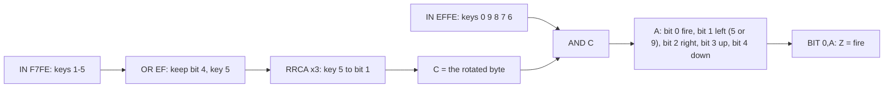

Worked example (option 4, `c1`, key 5 held from frame 18127):

1. The half row `$F7FE` reads `$AF`: bit 4 (key 5) is 0. Bit 6, the EAR line, reads 0 in our recordings, as the
   latch `$BE` in frame 17700 shows.
2. `OR $EF` gives `$EF`.
3. Three `RRCA` give `$F7`, `$FB`, then `$FD`: only bit 1 is 0.
4. The half row `$EFFE` reads `$BF` (no key). `$BF AND $FD` = `$BD`: bit 1 is 0, the left bit.
5. `BIT 0,A` sees 1: no fire, NZ.

Witness of key 5 in `c1`: from frame 18127 to 18427 only 5 is held. Hiro turns left, then walks. His X (`$5D01`) goes
from `$32` at frame 18144 to `$30` at 18145, and on down; he leaves room 4 by its left edge (5.6).

What the code does that the menu does not say:

- **Key 9 gives left too.** Bit 1 of the result is the AND of key 5 and key 9, so either key moves Hiro left. On
  Sinclair 1, 9 is up; on option 4 it is a second left key. Known only from the code: no recording holds 9 on option
  4.
- **Option 4's fire is key 0 only.** The stage-2 notes said key 5's bit was lost. It is not lost: it is the left bit,
  and `c1` moves Hiro left with 5.
- **The copy of 18 bytes.** Records 1-3 hold their whole reader in their last 7 bytes. The copy brings 11 bytes of
  the next record after their `RET`; those are never run. Record 4 is the last, and its reader runs on into the 11
  bytes that follow the table: that is where its second half lives.

The point: the Protek reader is the only one that needs two ports, and the merge makes key 9 a left key. The cursor
keys 5-8 are the keys the Protek and other "cursor" interfaces press, so their owners and the keyboard players get
the same reader.

### Option 3: the Kempston

`opt3`'s L1 holds `IN A,($1F)` at `$8529`: the Kempston reader ran every frame from the menu on. The game does not
test for an interface. On a machine without one, the port floats and reads `$FF` on most machines; `CPL` turns that
into `$00`, every bit "pressed". Known only from the code: we have no recording on a machine without the interface.

## 5.4 DecodeDirection `$850E`: one decoder for four bit orders

GameTick keeps the input byte at `$850D`, the operand of ReadDirection's `LD A,n` (5.5). ReadDirection `$850C` falls
into DecodeDirection, which turns the byte into two signed steps:

- D: +1 right, -1 left, 0 neither;
- E: -1 up, +1 down, 0 neither;
- carry set when at least one direction bit is 0; Z and no carry when none is.

The masks and the opcodes are the record's (5.2). For option 1: `AND $1E` / `CP $1E`, `RRA` drops the fire bit, then
bit 1 `DEC E`, bit 2 `INC E`, bit 3 `INC D`, bit 4 `DEC D`.

Pseudocode:

```text
DecodeDirection(a):                            ; $850E
    a = a AND mask                             ; $850F
    if a == mask: return Z, NC                 ; $8511: no direction
    if record+2 is RRA: a >>= 1                ; drop fire (bit 0)
    d = 0; e = 0
    for k = 0 to 3:                            ; the four direction bits, lowest first
        carry = a bit 0; a >>= 1
        if carry == 0: run opcode[k]           ; $851A, $851E, $8522, $8526
    return carry set
```

The code as option 1 leaves it (`build/game.lst` holds the loaded state):

```text
850C 3E 00        LD A,$00                   ; ReadDirection: the input latched by GameTick
850E E6 1E        AND $1E                    ; DecodeDirection: the mask (record +1)
8510 FE 1E        CP $1E
8512 C8           RET Z                      ; nothing pressed: Z, NC
8513 1F           RRA                        ; record +2: drop fire (or NOP)
8514 11 00 00     LD DE,$0000
8517 1F           RRA
8518 38 01        JR C,DirectionBit2
851A 1D           DEC E                      ; record +3
851B 1F           RRA                        ; DirectionBit2
851C 38 01        JR C,DirectionBit3
851E 1C           INC E                      ; record +4
851F 1F           RRA                        ; DirectionBit3
8520 38 01        JR C,DirectionBit4
8522 14           INC D                      ; record +5
8523 1F           RRA                        ; DirectionBit4
8524 38 01        JR C,DirectionDone
8526 15           DEC D                      ; record +6
8527 37           SCF                        ; DirectionDone
8528 C9           RET
```

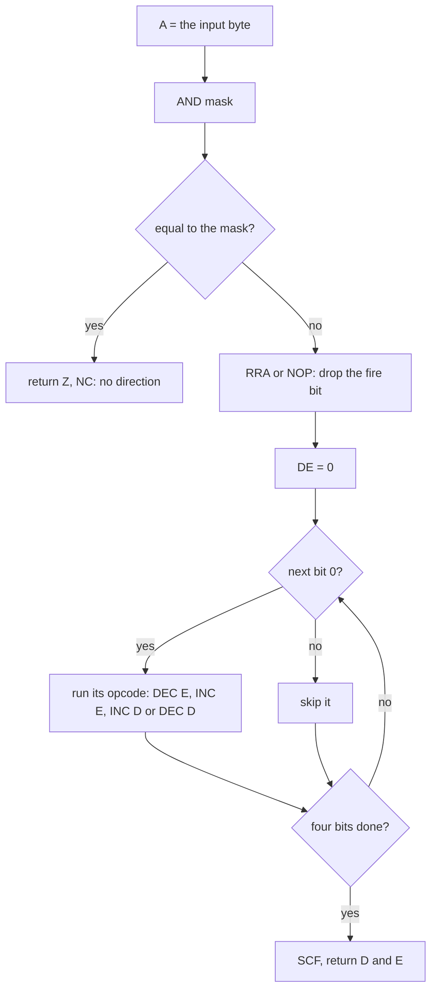

**Opposite directions cancel.** Each bit runs its own opcode, so left and right together run `INC D` and `DEC D`: D
ends at 0. Up and down together leave E at 0. The carry is still set, so the caller sees "a direction" with D = E =
0. For Hiro that is a stand (5.6). The stage-2 notes said the opposites were not cancelled; the code cancels them.

Worked example (option 1, 7 and 9 held: right and up):

1. The half row `$EFFE` reads `$B5`: bit 1 (9) and bit 3 (7) are 0; bit 6 (EAR) is 0.
2. `AND $1E` = `$14`, not `$1E`: go on.
3. `RRA` at `$8513` drops bit 0 (fire). The next `RRA` takes the old bit 1 (key 9) = 0: `DEC E`, E = -1.
4. The old bit 2 (8) = 1: skip. The old bit 3 (7) = 0: `INC D`, D = +1. The old bit 4 (6) = 1: skip.
5. `SCF`: D = +1, E = -1, a running jump to the right (5.6).

Witness: DecodeDirection L1 498 658, in every play recording. Its other two callers are the name entry `$A861`
([doc 8](08-hud-and-text.md)) and the 128K title's toggle `$85A3` (5.8).

The point: the record's opcodes put each device's bit order through one decoder. A new device would need only a new
record.

## 5.5 GameTick's input: the latch, the charge and the strike

The interrupt handler `$8456` calls GameTick `$8472` every frame while the operand at `$845F` is 0, that is in play
([doc 4](04-game-loop.md)). After the frame counter and the actor timers, GameTick reads P (5.7) and then the control,
in TickInput `$84BF`:

1. E = FirePrevious `$6648`, the fire bit of the last frame.
2. A = ReadInput. A is stored at `$850D`: the byte ReadDirection decodes in the next passes.
3. A AND the fire mask (`$84CA`) goes to FirePrevious.
4. **Fire down:** if EndFlags `$6652` bit 6 is set (the end text is up), set bit 7 (the main loop leaves for the end)
   and return. Else Charge `$6645` += ChargeStep `$6644`, at most `$20`.
5. **Fire up:** if it was up last frame too, return. It was let go this frame: C = Charge, Charge = ChargeReset
   `$6647`. If HiroBusy `$8E77` returns NZ (Hiro cannot strike now), or WeaponActor `$6602` bit 0 is set (a weapon is
   in the air), return. Else FireHeld `$69E3` = C, and FireRequest `$6650` = 3 when C is `$19` or more, 2 for
   `$09`-`$18`, 1 below.

Pseudocode:

```text
TickInput:                                     ; $84BF, in the interrupt
    e = FirePrevious
    a = ReadInput()
    ReadDirection.operand = a                  ; $850D
    a = a AND firemask                         ; $84CA
    FirePrevious = a
    if a == 0:                                 ; fire down
        if EndFlags bit 6: EndFlags bit 7 = 1; return
        Charge = min(Charge + ChargeStep, $20)
        return
    if a == e: return                          ; up, and up before
    c = Charge; Charge = ChargeReset           ; let go this frame
    if HiroBusy() != Z: return
    if WeaponActor+2 bit 0: return
    FireHeld = c
    FireRequest = 3 if c >= $19 else 2 if c >= $09 else 1
```

The code, from `build/game.lst`:

```text
84BF 3A 48 66     LD A,(FirePrevious)        ; TickInput
84C2 5F           LD E,A
84C3 CD 29 85     CALL ReadInput
84C6 32 0D 85     LD (ReadDirection+$0001),A ; the latch
84C9 E6 01        AND $01                    ; the fire mask (record +0)
84CB 32 48 66     LD (FirePrevious),A
84CE 20 17        JR NZ,TickFireReleased
84D0 21 52 66     LD HL,EndFlags
84D3 CB 76        BIT 6,(HL)
84D5 28 03        JR Z,TickChargeFire
84D7 CB FE        SET 7,(HL)                 ; fire on the end text: leave
84D9 C9           RET
84DA 2E 44        LD L,$44                   ; TickChargeFire: ChargeStep
84DC 7E           LD A,(HL)
84DD 2C           INC L
84DE 86           ADD A,(HL)                 ; + Charge
84DF FE 21        CP $21
84E1 38 02        JR C,TickChargeStore
84E3 3E 20        LD A,$20                   ; the cap
84E5 77           LD (HL),A                  ; TickChargeStore
84E6 C9           RET
84E7 AB           XOR E                      ; TickFireReleased: up last frame too?
84E8 C8           RET Z
84E9 3A 47 66     LD A,(ChargeReset)
84EC 21 45 66     LD HL,Charge
84EF 4E           LD C,(HL)
84F0 77           LD (HL),A
84F1 CD 77 8E     CALL HiroBusy
84F4 C0           RET NZ
84F5 3A 02 66     LD A,(WeaponActor+$0002)
84F8 1F           RRA
84F9 D8           RET C
84FA 79           LD A,C
84FB 32 E3 69     LD (FireHeld),A
84FE 21 50 66     LD HL,FireRequest
8501 36 03        LD (HL),$03
8503 FE 19        CP $19
8505 D0           RET NC
8506 35           DEC (HL)
8507 FE 09        CP $09
8509 D0           RET NC
850A 35           DEC (HL)
850B C9           RET
```

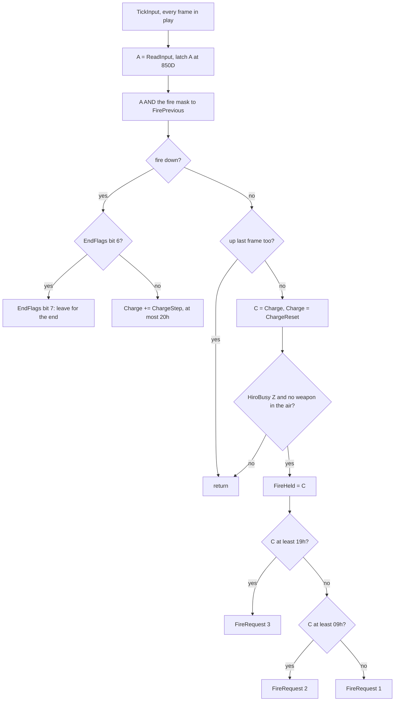

Worked example (`c1`, option 4, fire held from frame 17687 to 17707):

| Sample (T 0 of frame) | Charge `$6645` | FirePrevious `$6648` | FireRequest `$6650` |
| --- | --- | --- | --- |
| 17706 | `$13` | 0 | 0 |
| 17707 | `$14` | 0 | 0 |
| 17708 | `$00` | 1 | 2 |

ChargeStep is 1 and ChargeReset 0 (GlobalsInit), so the charge counts the frames fire was down: 20. In frame 17707
the tick finds fire up while FirePrevious is 0: a release. `$14` lies between `$09` and `$18`: FireRequest 2.
HiroAttack `$926E` takes it on Hiro's next step ([doc 10](10-gameplay-logic.md) has the strikes).

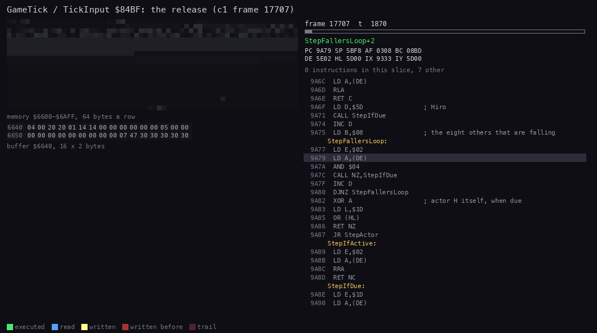

*Animation 5.1: GameTick in frame 17707 of `c1`, T 1800 to T 4600: the actor timers, P, ReadInput, the release and
FireRequest written. `python3 kit/routine_anim.py --work work/docs/zsB/c1 --window 17707:1800-17707:4600 --listing
build/game.lst --view buffer:6640:16x2:hex --range 6600-6AFF --pc 8456-8540 --pictures 40 --out
docs/img/routines/TickInput.gif`.*

How to read:

- Top left: memory `$6600`-`$6AFF`; a byte flashes yellow when written, blue when read.
- Below it, the bytes `$6640`-`$665F` in hex: Charge at `$6645`, FirePrevious at `$6648`, FireRequest at `$6650`.
- Right: the listing round the instruction last run, the registers, the frame and T.
- `$6645` drops from `$14` to `$00`, and `$6650` becomes `$02`, near the end.

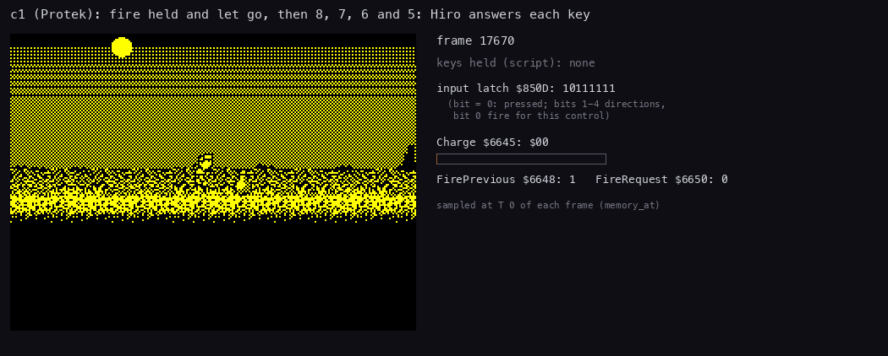

*Animation 5.2: `c1` frames 17670-18440, one picture every 6 frames: fire held twice (a punch, a kick), then 8, 7, 6
and 5. Left: the play window at 2 x. Right: the keys the script holds, the latch `$850D`, the charge and the fire
variables, all sampled at T 0 of the frame. `python3 tools/fig_controls.py play --work work/docs/zsB/c1 --from 17670
--to 18440 --step 6 --crop 8,8,240,176 --key 17687-17707="0 (fire)" --key 17717-17777="0 (fire)" --key
17797-18047="8 (right)" --key 18047-18087="7 (up)" --key 18087-18127="6 (down)" --key 18127-18427="5 (left)" --out
docs/img/play/keys.gif`.*

How to read:

- The latch is the byte DecodeDirection reads: a 0 bit is a key down. Bit 0 is fire for this control.
- The red bar is the charge, full at `$20`. It grows one step a frame while fire is down and empties at the release.
- Hiro's answer follows the latch by up to three frames: his logic runs every third frame (5.6).

The point: fire is an edge, not a level. Nothing happens while it is held but the charge. The strike starts when it
is let go, with a power set by how long it was held: 25 frames (`$19`) or more give the strongest.

What the code does that the recordings do not show:

- **The tick runs in the pause.** The pause waits with `HALT` (5.7), and the interrupt still runs GameTick. So fire
  held in the pause charges, and the first release after the pause can strike. Known only from the code.
- **A strike is lost when Hiro is busy.** The charge is reset at the release whether or not FireRequest is set.

## 5.6 From the input byte to Hiro

Hiro's logic runs once every three frames (his delay +`$1A` is 3; [doc 4](04-game-loop.md) has the step). His
handler is HiroControl `$9333`:

1. If EndFlags `$6652` is not 0, the end walk HiroEndWalk `$9321` takes over: no keys.
2. ReadDirection. No direction (NC): StopActor `$9C39`.
3. HiroScriptMove `$933F`: D x 2 (an X step of 2, 3 pixels), E x 4, then HiroMove `$9AFD`.
4. HiroMove: on a ladder (+2 bit 3) ClimbMove `$9C4A`. Else MoveActor `$9B05`:
   - D against the facing (+`$1B`): StartTurn. The turn takes the step.
   - E < 0 (up): ActorJump `$9023`. With D it is a running jump; without D, a ladder above is grabbed.
   - E > 0 (down) with D: walk. Without D: a ladder below is grabbed (GrabLadder `$906C`), else Hiro stands.
   - E = 0: walk if D, stand if not.
5. The walk: ProbeVertical (the floor), ProbeWalls (the walls ahead), the walk counters +`$24`/+`$25`, then ApplyMove
   `$9B56`: the room's barriers, the actors met, the move added, the animation, and CheckRoomExit
   ([doc 6](06-rendering.md), section 6.7; [doc 7](07-objects.md)).

Pseudocode:

```text
HiroControl:                                   ; $9333, Hiro's handler
    if EndFlags != 0: goto HiroEndWalk
    d, e, carry = ReadDirection()              ; the latch of the last tick
    if not carry: StopActor(); return
    d *= 2; e *= 4                             ; HiroScriptMove $933F
HiroMove:                                      ; $9AFD
    if Hiro+2 bit 3: ClimbMove(d, e); return   ; on a ladder
MoveActor:                                     ; $9B05
    if d != 0 and sign(d) != facing: StartTurn(); return
    if e < 0: ActorJump(d); return             ; up
    if e > 0:
        if d == 0:
            if LadderBelow(): GrabLadder(); return
            stand
        e = 0
    walk(d)                                    ; ProbeVertical, ProbeWalls, the counters
    ApplyMove(d, e)                            ; $9B56
```

The entry and the branches of MoveActor:

```text
9333 3A 52 66     LD A,(EndFlags)            ; HiroControl
9336 B7           OR A
9337 20 E8        JR NZ,HiroEndWalk
9339 CD 0C 85     CALL ReadDirection
933C D2 39 9C     JP NC,StopActor
933F CB 22        SLA D                      ; HiroScriptMove: X step x 2, Y step x 4
9341 CB 23        SLA E
9343 CB 23        SLA E
9345 C3 FD 9A     JP HiroMove
9AFD AF           XOR A                      ; HiroMove
9AFE 2E 02        LD L,$02
9B00 CB 5E        BIT 3,(HL)
9B02 C2 4A 9C     JP NZ,ClimbMove
9B05 7A           LD A,D                     ; MoveActor
9B06 B7           OR A
9B07 28 06        JR Z,MoveActorY
9B09 2E 1B        LD L,$1B                   ; against the facing: turn
9B0B AE           XOR (HL)
9B0C FA B1 90     JP M,StartTurn
9B0F 7B           LD A,E                     ; MoveActorY: up, the jump
9B10 B7           OR A
9B11 FA 23 90     JP M,ActorJump
9B14 28 0F        JR Z,MoveWalk
9B16 7A           LD A,D                     ; down: with a D, just walk
9B17 B7           OR A
9B18 20 09        JR NZ,MoveDownWalk
9B1A CD A1 9C     CALL LadderBelow           ; no D: a ladder below?
9B1D C2 6C 90     JP NZ,GrabLadder
9B20 5A           LD E,D                     ; no: stand
9B21 18 27        JR MoveStand
```

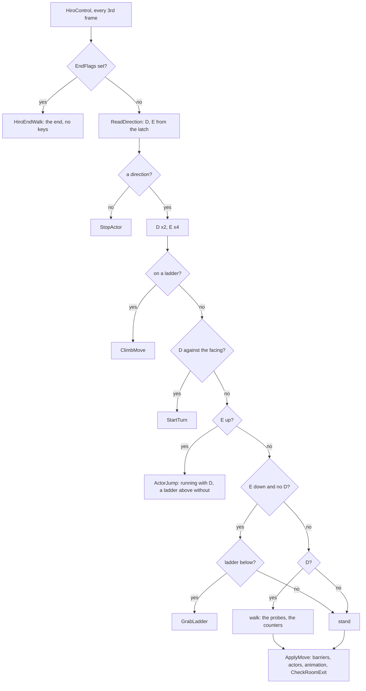

Worked example (`c1`, key 5 with Hiro facing right):

1. The tick's latch is `$BD` from frame 18127 (5.3).
2. Hiro's step in frame 18135 runs TurnStep: D = -1 against the facing, so StartTurn ran on the step before.
3. By frame 18144 the facing byte `$5D1B` is `$FF` (left).
4. In frame 18144, T 9592, HiroControl runs. ReadDirection gives D = -1, E = 0, carry. HiroScriptMove makes D = -2.
5. MoveActor walks. X `$5D01` goes from `$32` (sample 18144) to `$30` (sample 18145): two X units, 3 pixels.

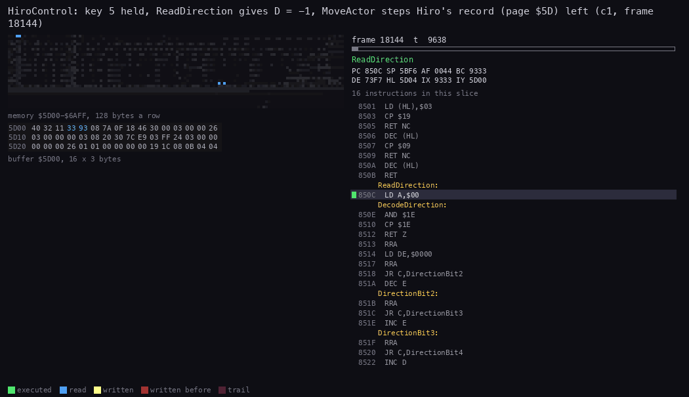

*Animation 5.3: HiroControl in frame 18144 of `c1`, T 9500-16400: ReadDirection, MoveActor, the probes and ApplyMove,
with Hiro's actor page `$5D00` in hex. `python3 kit/routine_anim.py --work work/docs/zsB/c1 --window
18144:9500-18144:16400 --listing build/game.lst --view buffer:5D00:16x3:hex --range 5D00-6AFF --pc
9321-9C80,850C-853A --pictures 50 --out docs/img/routines/HiroControl.gif`.*

How to read:

- The hex lines are Hiro's record: +`$01` is X, +`$1B` the facing (`$FF` left), +`$24`/+`$25` the walk counters.
- The code panel follows the move from HiroControl through ReadDirection and DecodeDirection to MoveActor and
  ApplyMove.
- X at `$5D01` changes from `$32` to `$30` when ApplyMove adds the move.

The point: a key reaches the screen in three stages, and each one waits. The tick latches the key every frame; Hiro's
step reads the latch every third frame; the redraw shows the move when his window is drawn again, which can take more
than a frame ([doc 6](06-rendering.md), section 6.6). So Hiro answers a key 1-3 frames late, and a tap shorter than
three frames can be lost.

## 5.7 The pause and the quit

**P** is read by GameTick every frame, for every control: `$DFFE` bit 0 at 0 sets PauseFlag `$664C` to `$80`. The
main loop, after the actors, calls PauseGame `$6682` when PauseFlag bit 7 is set ([doc 4](04-game-loop.md)).

PauseGame is code kept as data. Its 52 bytes are in PageTail66 `$6FCA`, the template of row 9 of the page tails,
copied to `$6682` at run time. It:

1. If EndFlags is not 0 (the end), clears PauseFlag and returns: no pause in the end sequence.
2. Calls ReadInput. **Fire down: the quit.** ShowGameOverWait `$831A` shows message 4, GAME OVER, and waits up to 200
   frames for fire. Then `JP NewGame` `$5C4D`: the title, with no high-score entry.
3. Else it shows message 3, PAUSE GAME (ShowMessage `$66C8`), and the banner (RunBanner `$66BD`).
4. It polls P every 5 frames (`HALT` x 5) until P is down again.
5. It waits in DelayBC with BC = `$4000`, a few frames, so that the same press does not pause again at once.
6. It clears PauseFlag.

Pseudocode:

```text
PauseGame:                                     ; $6682 (run-time copy of $6FCA)
    if EndFlags != 0: goto done
    if ReadInput() == Z:                       ; fire down with P: quit
        ShowGameOverWait()                     ; GAME OVER, wait for fire (at most 40 x 5 frames)
        goto NewGame                           ; $5C4D: the title again
    ShowMessage(3)                             ; PAUSE GAME
    RunBanner()
    repeat:
        p = IN($DFFE) AND 1
        HALT x 5
    until p == 0                               ; P down again
    DelayBC($4000)
done:
    PauseFlag = 0
```

The run-time code (the bytes of PageTail66, decoded at their run-time addresses):

```text
6682 3A 52 66     LD A,(EndFlags)            ; PauseGame
6685 B7           OR A
6686 20 29        JR NZ,$66B1                ; the end: no pause
6688 CD 29 85     CALL ReadInput
668B FB           EI
668C 20 06        JR NZ,$6694                ; no fire: pause
668E CD 1A 83     CALL ShowGameOverWait      ; fire: the quit
6691 C3 4D 5C     JP NewGame
6694 3E 03        LD A,$03                   ; PAUSE GAME
6696 CD C8 66     CALL ShowMessage
6699 CD BD 66     CALL RunBanner
669C 01 FE DF     LD BC,$DFFE                ; P again?
669F ED 78        IN A,(C)
66A1 E6 01        AND $01
66A3 FB           EI
66A4 06 05        LD B,$05
66A6 76           HALT                       ; five frames
66A7 10 FD        DJNZ $66A6
66A9 20 F1        JR NZ,$669C
66AB 01 00 40     LD BC,$4000
66AE CD 33 83     CALL DelayBC
66B1 AF           XOR A
66B2 32 4C 66     LD (PauseFlag),A
66B5 C9           RET
```

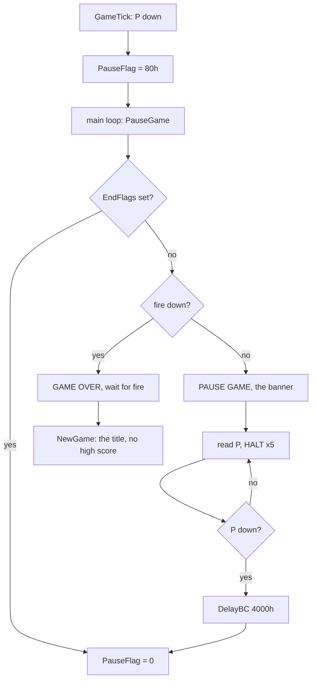

Worked example (`menu`, option 1):

1. P is pressed at frame 1931. The sample of frame 1932 shows PauseFlag `$80`.
2. The screen of frame 1990 shows PAUSE GAME.
3. P again at 2035: the poll sees it within 5 frames, the delay follows, and the sample of frame 2048 shows
   PauseFlag 0.
4. Fire is held from 2100 and P pressed at 2110. The sample of 2110 shows PauseFlag `$80` and the latch `$BE` (fire,
   bit 0, down).
5. PauseGame takes the quit: GAME OVER on the screen at frame 2130.

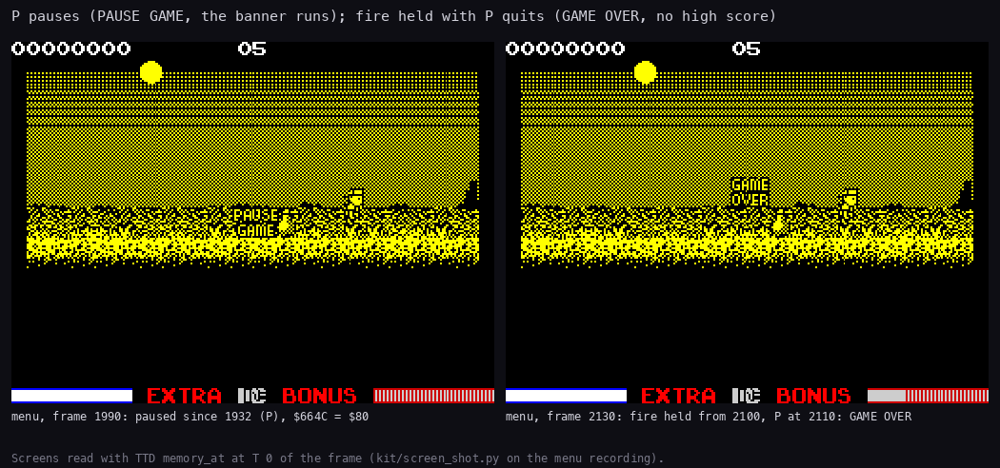

*Figure 5.4: the pause and the quit in `menu`: frame 1990 (paused) and frame 2130 (after fire and P). The shots by
`python3 kit/screen_shot.py --work work/docs/zsB/menu --out-dir work/docs/zsB/out p1990=1990:0 q2130=2130:0`, the
instance opened on `work/stage1/rec/menu/session.ttd`; the figure by `python3 tools/fig_controls.py shots --shot
work/docs/zsB/out/p1990.png=... --shot work/docs/zsB/out/q2130.png=... --out docs/img/controls/pause-quit.png`.*

How to read:

- Left: the play window with the PAUSE GAME box over it; nothing moves.
- Right: GAME OVER over the same room. The quit shows the message of a game lost, then the title follows.

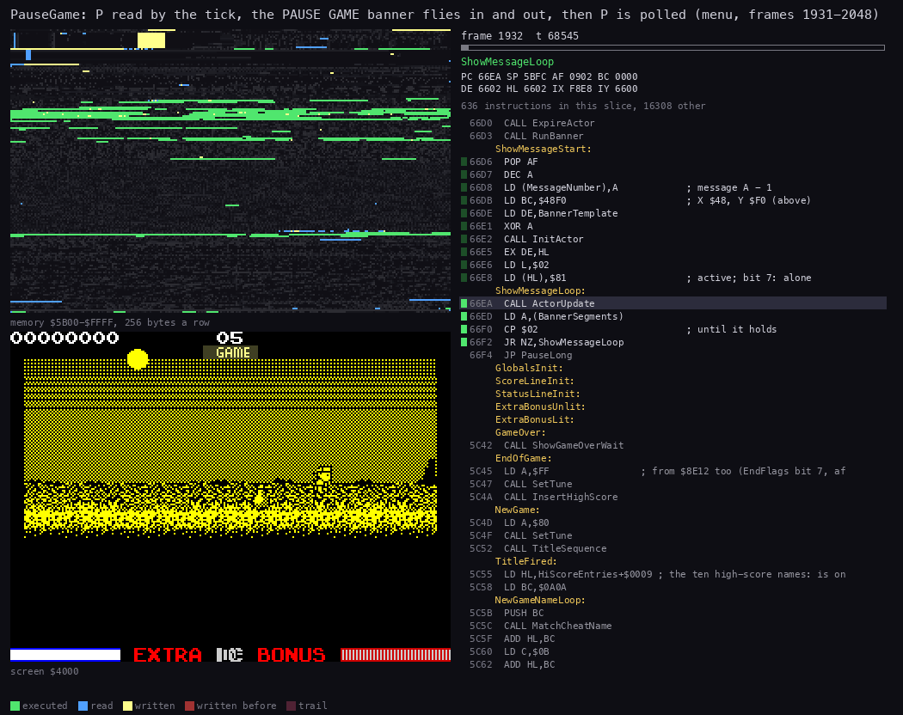

*Animation 5.4: `menu` frames 1931-1935: the tick sets PauseFlag, the main loop calls PauseGame, the message is drawn
and the poll begins. `python3 kit/routine_anim.py --work work/docs/zsB/menu --window 1931:0-1936:0 --listing
build/game.lst --view screen --range 5B00-FFFF --pc 6682-66FF,66C8-6700,831A-8340 --pictures 50 --out
docs/img/routines/PauseGame.gif`.*

How to read:

- The screen panel shows the message drawn into the play window.
- Once the message is up, the code panel stays in the `HALT` loop: each picture is a frame or two of waiting.

The point: the pause is a loop inside the main loop, not a state. The interrupt goes on: the frame counter, the
actors' short timers (+`$1D`) and the fire charge keep counting. Only the actors' long timers (+`$1E`, held by
PauseFlag bit 7) stop. The quit is a pause entered with fire down: it needs both hands.

Known only from the code:

- Holding P past the pause's delay pauses again: the tick sets PauseFlag on the next frame.
- The quit skips the high-score entry, whatever the score.

## 5.8 The 128K title: music or effects

On the 128K, the title and the high-score table call GlueMenuInput `$859E` (in `build/boot.lst`) instead of
ReadInput. The 128K bootstrap patches the hook sites `$A6EF` (ShowHighScores) and `$A76F` (TitleSequence) from
`CALL $8529` to `CALL $859E` ([doc 3](03-build-and-load.md)). GlueMenuInput:

1. Calls ReadInput. Fire down: returns Z, and the title starts the game as on the 48K.
2. Calls DecodeDirection. No direction, or no D: returns NZ.
3. D = +1 (right): SoundMode `$8455` = 1, the effects. D = -1 (left): SoundMode = 0, the music.
4. GlueSoundIcon `$85B3` prints the icon at the bottom of the title: EffectsIconText `$8225` ("FX") or MusicIconText
   `$821E` (a note). The hook at `$A75C` prints it too when the title is drawn.

The sound side is [doc 9](09-sound.md)'s: after the start jingle, the title tune is asked for only when SoundMode is
0, and while the music plays the effects are not started.

Pseudocode:

```text
GlueMenuInput:                                 ; $859E, 128K only
    if ReadInput() == Z: return Z              ; fire
    d, e, carry = DecodeDirection(a)
    if carry and d != 0:
        SoundMode = 1 if d > 0 else 0          ; $8455
        print(EffectsIconText if SoundMode else MusicIconText)
    return NZ
```

From `build/boot.lst`:

```text
859E CD 29 85     CALL ReadInput             ; GlueMenuInput
85A1 FB           EI
85A2 C8           RET Z                      ; fire: Z, as ReadInput
85A3 CD 0E 85     CALL DecodeDirection
85A6 30 1B        JR NC,GlueNoFire           ; no direction
85A8 7A           LD A,D
85A9 B7           OR A
85AA 28 17        JR Z,GlueNoFire            ; up or down only
85AC F2 B0 85     JP P,GlueSetMode           ; right: A = 1
85AF AF           XOR A                      ; left: A = 0
85B0 32 55 84     LD (SoundMode),A           ; GlueSetMode
85B3 21 25 82     LD HL,EffectsIconText      ; GlueSoundIcon
85B6 3A 55 84     LD A,(SoundMode)
85B9 1F           RRA
85BA 38 03        JR C,GlueSoundIconPrint
85BC 21 1E 82     LD HL,MusicIconText
85BF CD 7B 83     CALL PrintString           ; GlueSoundIconPrint
85C2 AF           XOR A
85C3 3C           INC A                      ; GlueNoFire: NZ
85C4 C9           RET
```

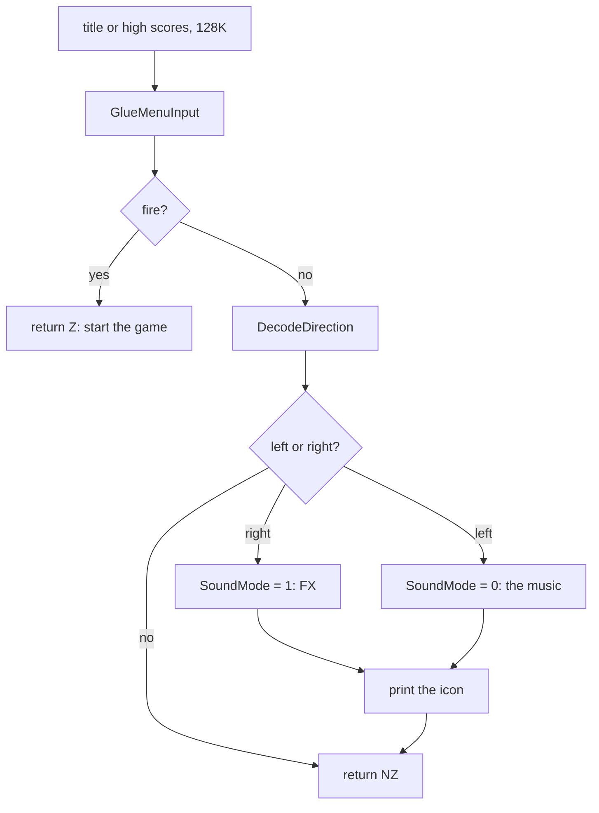

Worked example (`menu`, option 1): 6 (left on Sinclair 1) is held from frame 64 to 110: SoundMode stays 0, the note.
7 (right) is held from 110: the sample of frame 112 shows SoundMode 1, and the screen of frame 150 shows FX.

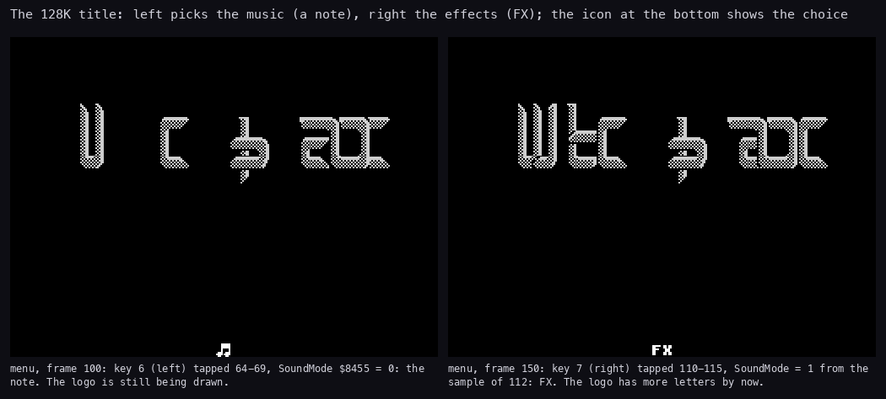

*Figure 5.5: the 128K title in `menu` at frame 100 (the note) and frame 150 (FX). The shots by `python3
kit/screen_shot.py --work work/docs/zsB/menu --out-dir work/docs/zsB/out t100=100:0 t150=150:0`; the figure by
`python3 tools/fig_controls.py shots --shot work/docs/zsB/out/t100.png=... --shot work/docs/zsB/out/t150.png=...
--out docs/img/controls/title-sound.png`.*

How to read:

- The title is the same picture in both; only the icon at the bottom centre changes.
- The icon is printed by GlueSoundIcon each time the choice changes, and when the title is drawn.

The point: the choice uses the control's left and right, whichever device was chosen. It is the 128K glue's own code.
On the 48K there is no music to choose: the hook sites keep `CALL ReadInput`, and left and right do nothing at the
title.

## 5.9 The other readers of fire

ReadInput's Z (fire) is read in four more places. All of them wait; none of them charges.

| Routine | Address | What fire does |
| --- | --- | --- |
| WaitFireFrames / WaitFireLong | `$8321` / `$831F` | waits H x 5 frames (WaitFireLong: H = `$28`, 200 frames) for fire; Z if pressed |
| TitleSequence (hook `$A76F`) | `$A76F` | leaves the title: NewGame goes on |
| ShowHighScores (hook `$A6EF`) | `$A6EF` | leaves the table for the title |
| EnterName | `$A861` | takes a letter of the name; DecodeDirection moves the box ([doc 8](08-hud-and-text.md)) |

Pseudocode:

```text
WaitFireFrames(h):                             ; $8321
    repeat:
        z = (ReadInput() == Z)
        HALT x 5
        if z: return Z
        h -= 1
    until h == 0
    return NZ
```

```text
831F 26 28        LD H,$28                   ; WaitFireLong: 40 x 5 frames
8321 CD 29 85     CALL ReadInput             ; WaitFireFrames
8324 FB           EI
8325 06 05        LD B,$05
8327 76           HALT                       ; WaitFireHalt: five frames
8328 10 FD        DJNZ WaitFireHalt
832A C8           RET Z                      ; fire was down before the five frames
832B 25           DEC H
832C 20 F3        JR NZ,WaitFireFrames
832E 25           DEC H                      ; H = $FF: NZ, timed out
832F C9           RET
```

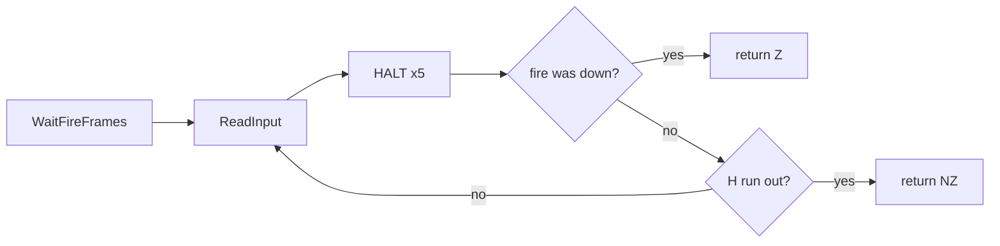

Worked example: ShowGameOverWait in the quit of 5.7 calls WaitFireLong. With no fire it reads the control 40 times,
once every 5 frames: 200 frames of GAME OVER, then the title.

The point: the waits test fire once every five frames, before the five `HALT`s. A tap shorter than five frames can be
missed. The `menu` script's note that a fire press late in the title cycle "did not" start the game fits this.

## 5.10 The SLOPPY cheat (known only from the code)

NewGame `$5C4D` plays the title (TitleSequence `$A73E`). Then, before the room is built, it compares each of the ten
names of the high-score table with "SLOPPY    " (10 bytes at `$8214`). The names live in HiScoreEntries `$811D`, 21
bytes a record, the name at +9. If one matches, the keys 1-4 held at that moment choose where the game starts:

| Key held | BC | Map row, column | Room |
| --- | --- | --- | --- |
| 1 | `$0D06` | 6, 13 | 40 |
| 2 | `$1209` | 9, 18 | 66 |
| 3 | `$0E0F` | 15, 14 | 113 |
| 4 | `$140F` | 15, 20 | 114 |
| none, or no match | `$0300` (NewGameStart `$5C93`) | 0, 3 | 4 |

C is the map row and B the column. NewGameSetStart `$5C96` stores BC at MapRow `$69DF`, and the room comes from the
map ([doc 7](07-objects.md)).

Pseudocode:

```text
NewGame:                                       ; $5C4D
    SetTune($80); TitleSequence()
    hl = HiScoreEntries + 9                    ; the first name
    for n = 1 to 10:
        MatchCheatName(hl)                     ; does not return on a match
        hl = the next name (21 bytes on)
NewGameStart:
    bc = $0300                                 ; row 0, column 3: room 4
NewGameSetStart:
    (MapRow) = bc

MatchCheatName(hl):                            ; $5C68
    compare 10 bytes at hl with "SLOPPY    " ($8214) by CPI
    if one differs: return NZ
    a = IN($F7FE)
    bc = $0D06 if key 1, $1209 if key 2, $0E0F if key 3, $140F if key 4, else $0300
    jump to NewGameSetStart                    ; the name loop's BC stays on the stack
```

From `build/game.lst`:

```text
5C55 21 26 81     LD HL,HiScoreEntries+$0009 ; TitleFired: the ten names
5C58 01 0A 0A     LD BC,$0A0A                ; B = 10 names, C = 10 bytes
5C5B C5           PUSH BC                    ; NewGameNameLoop
5C5C CD 68 5C     CALL MatchCheatName
5C5F 09           ADD HL,BC                  ; HL to the end of the name
5C60 0E 0B        LD C,$0B
5C62 09           ADD HL,BC                  ; and 11 more: the next record
5C63 C1           POP BC
5C64 10 F5        DJNZ NewGameNameLoop
5C66 18 2B        JR NewGameStart            ; no name matched
5C68 11 13 82     LD DE,CopyrightText+$0023  ; MatchCheatName: DE = $8213, pre-incremented
5C6B 06 00        LD B,$00
5C6D 13           INC DE                     ; MatchCheatNameLoop
5C6E 1A           LD A,(DE)
5C6F ED A1        CPI                        ; A - (HL), HL+1, BC-1
5C71 C0           RET NZ                     ; a byte differs
5C72 AF           XOR A
5C73 B1           OR C
5C74 20 F7        JR NZ,MatchCheatNameLoop
5C76 01 FE F7     LD BC,$F7FE                ; a match: the key held picks the start
5C79 ED 78        IN A,(C)
5C7B 1F           RRA
5C7C 01 06 0D     LD BC,$0D06                ; key 1
5C7F 30 15        JR NC,NewGameSetStart
5C81 1F           RRA
5C82 01 09 12     LD BC,$1209                ; key 2
5C85 30 0F        JR NC,NewGameSetStart
5C87 1F           RRA
5C88 01 0F 0E     LD BC,$0E0F                ; key 3
5C8B 30 09        JR NC,NewGameSetStart
5C8D 1F           RRA
5C8E 01 0F 14     LD BC,$140F                ; key 4
5C91 30 03        JR NC,NewGameSetStart
5C93 01 00 03     LD BC,$0300                ; NewGameStart: row 0, column 3
5C96 ED 43 DF 69  LD (MapRow),BC             ; NewGameSetStart
```

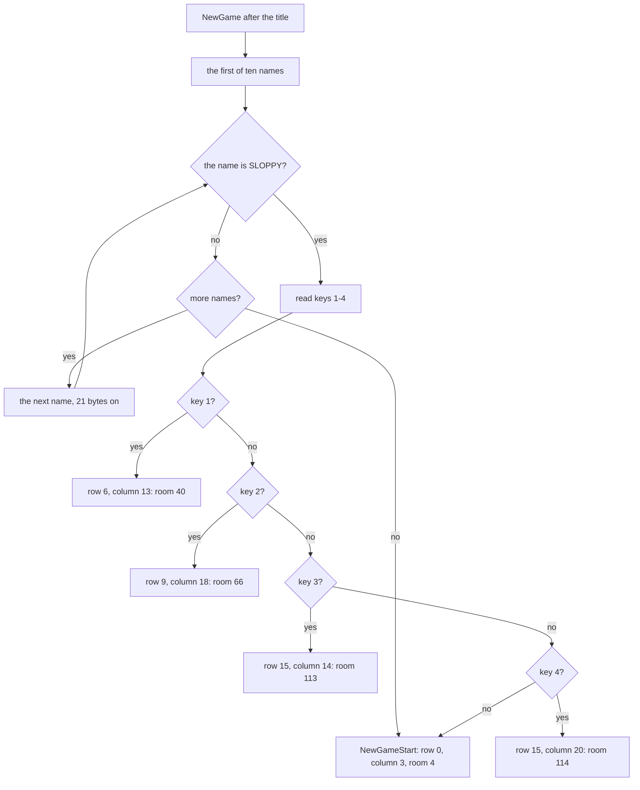

Worked example (from the code): a player whose name SLOPPY is in the table presses fire at the title with 2 held.
MatchCheatName finds ten equal bytes and reads `$F7FE` = `xxx11101`. The first `RRA` gives carry 1 (no key 1), the
second carry 0 (key 2). BC = `$1209`: row 9, column 18. The game starts in room 66.

So the cheat has two steps: get into the table with the name SLOPPY, then hold one of 1-4 while the title is left with
fire. On options 1, 3 and 4, the keys 1-4 are no control keys, so they can be held without moving anything. On
option 2 they are the controls.

Witness: the compare runs at every new game; its `RET NZ` is in every recording that starts a game. No recording has
SLOPPY in the table, so the match and the key branch are known only from the code. A cheap witness would be a POKE of
"SLOPPY    " into HiScoreEntries+9 before the title, then fire with 2 held.

The point: the cheat hides in a compare that runs at every game. The name has ten bytes with four spaces at the end,
so it must be exactly SLOPPY in the table.

A side effect, harmless: the match jumps into NewGame without returning, so the name loop's pushed BC stays on the
stack. NewGame never returns, and the stack is reset at the next game.

## 5.11 Where the readings differed

The stage-2 notes and `.ann` said these things; both now say what the code says, each line marked "corrected by
docs".

| Stage-2 claim (corrected) | Where | What the code says |
| --- | --- | --- |
| Option 4: "only bit 0 (key 0) is tested... key 5's bit is lost" | stage-2 notes; the `.ann` of ControlRecords | key 5 is rotated into bit 1 and is left; key 9 is left too (5.3) |
| "Opposite directions are not cancelled" | stage-2 notes | both opcodes run, and D or E ends at 0 (5.4) |
| "The 18-byte copy runs 4 bytes into the next record" | stage-2 notes | 18 - 7 = 11 bytes (5.3) |
| "Fire in the pause quits" | stage-2 notes | fire must be down when PauseGame starts, that is together with P; fire later in the pause only charges (5.7) |
| each option tried in the `menu` recording | its script's note | ControlMenu runs once per load; the later rounds only press the title's left and right (5.2) |
| DrawCellLayers' comment "the high nibble of `$6900` + L" | `.ann` of render.asm | the colour comes from plane `$6C` (doc 6, 6.3) |

## 5.12 Known only from the code

- Key 9 moves Hiro left on option 4.
- On a machine without a Kempston interface, option 3 reads every direction and fire as held.
- Fire held in the pause charges the strike.
- Holding P past the pause's delay pauses again.
- The quit skips the high-score entry.
- The SLOPPY start keys 1-4 and the rooms 40, 66, 113 and 114.
