# 6. Rendering

What this covers:

- the play screen: a window of 20 x 11 cells of 12 x 16 pixels, cut into units of 3 pixels, and the panel rows;
- the picture format of every tile and sprite: 3-bit values, eight to three bytes, one column of a unit at a time;
- the cell planes `$67`-`$6C` and the room build: EnterRoom, the layers, the shade, the colour;
- MaskedColumn: the 3-bit values read back through the stack (`LD SP,$5B50`, `POP BC`), with a black outline made
  on the fly from the table at `$6F00`;
- the chunk buffer (pages `$5D`-`$66`) and the blit: PackRow's unrolled packer with a planted `RET`, BlitRows' `LDI`
  chain;
- the actors drawn: one window recomposed from the cells, the actors and the front cells, then blitted; no erase pass;
- the zones revealed: RevealZone and the 220-cell walk of RedrawCellsMasked;
- the panel;
- the surface noise: the ground tiles chosen by bytes of the 48K ROM;
- the code against the screen and the beam in one real frame.

The recordings it rests on (WALKTHROUGH 6.0; all on the 128K):

| Recording | Load | Used for |
| --- | --- | --- |
| `c1` | power-on, the original tape by its own loader at signal speed | room 4 built (frames 17612-17652); Hiro redrawn in frames 17829-17830 (the stages, the writers, the beam); the walk of 18127-18427 |
| `deaths` | `work/stage1/explore/loaded.szx`, option 4, POKEs of lives and energy | zone `$40` of room 8 revealed in frames 3780-3789 |
| `rooms` and the POKE probes | `work/stage1/probe/play0.szx` | every room drawn (`tools/fig_rooms.py`) |

Conventions:

- **A frame** is 1/50 s of the 128K, 70 908 T. **A pass** is one turn of the main loop `$8DFE` ([doc 4](04-game-loop.md)).
- A value read with `time_travel memory_at` is the memory at the start (T 0) of the frame named. A trace puts an
  instruction in the frame where it ran, with its T-state in that frame ("frame 17829 T 26518").
- **A unit** is 3 pixels across: a cell is 4 units, the play window 80. Actor X counts half units (1.5 pixels).
- **A cell** is 12 x 16 pixels, numbered 0-219 (20 a row, 11 rows).
- **A value** is 3 bits: one line of one unit, bit 2 the left pixel.
- Counts of runs ("L1 1440") are the witness counts of the `.ann` files, summed over our recordings.

## 6.1 The play screen

The play window is 240 x 176 pixels at (8, 8): 20 columns and 11 rows of cells. Character row 0 holds the score and
the lives. Character row 23 holds the energy, EXTRA, the weapon and BONUS. The column of 8 pixels on each side and the
rest of the border rows stay black.

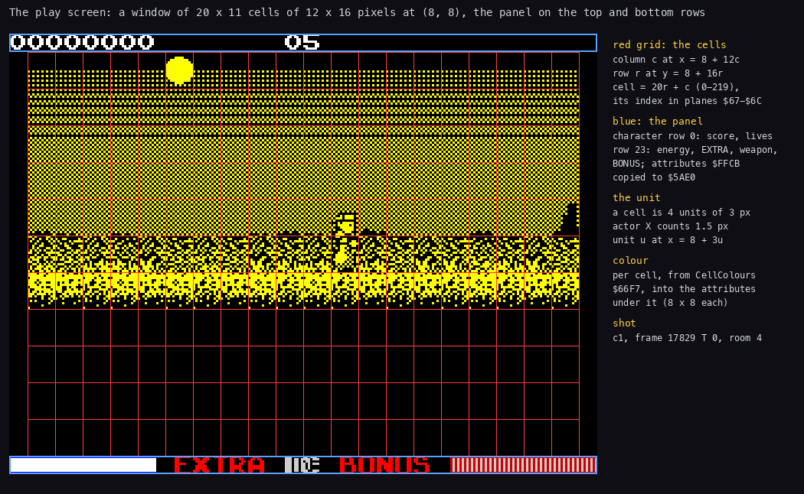

*Figure 6.1: the screen of `c1` at frame 17829 T 0 (room 4, Hiro walking right), with the cell grid. The shot by
`python3 kit/screen_shot.py --work work/docs/zsB/c1 --out-dir work/docs/zsB/out play-room4=17829:0`; the grid by
`python3 tools/fig_render.py layout --shot work/docs/zsB/out/play-room4.png --caption "c1, frame 17829 T 0, room 4"
--out docs/img/render/layout.png`.*

How to read:

- The red grid is the 220 cells. A cell is 12 pixels wide, so every second column starts in the middle of a
  character (4 pixels in).
- The blue boxes are the two panel rows (6.8).
- The empty rows 7-10 are cells of room 4 that are drawn black: their zone is not revealed (6.7).

The point: the game's grid is not the Spectrum's. Its cells are 1.5 characters wide and its sprites move in 3-pixel
units, so every drawing routine must shift and pack; nothing is drawn by copying whole screen bytes.

### CellScreenAddress `$8803`

CellScreenAddress gives the screen address of cell A: the row is A / 20, the column A mod 20. The character row is 2
x row + 1, the character column column x 1.5 + 1, and an odd column sets the half-character flag at `$8879` (its
first 4 pixels are the right half of a character). DrawColumnPos `$732A` gets column x 4: the cell's first unit.

Pseudocode:

```text
CellScreenAddress(cell):                       ; $8803
    row = cell / 20; col = cell mod 20
    DrawColumnPos = col * 4                    ; units
    half = col AND 1                           ; to EraseCell's operand $8879
    return the screen byte of character row 2*row + 1, column col + col/2 + 1
```

```text
8803 7B           LD A,E                     ; CellScreenAddress: A = the cell
8804 11 00 14     LD DE,$1400                ; D = 20
8807 18 01        JR CellRowDivide
8809 1C           INC E                      ; CellRowCount
880A 92           SUB D                      ; CellRowDivide
880B 30 FC        JR NC,CellRowCount
880D 82           ADD A,D                    ; A = the column, E = the row
880E CB 23        SLA E                      ; 2 character rows a cell
8810 F5           PUSH AF
8811 87           ADD A,A
8812 87           ADD A,A
8813 32 2A 73     LD (DrawColumnPos),A       ; the first unit
8816 F1           POP AF
8817 43           LD B,E
8818 5F           LD E,A
8819 CB 3F        SRL A
881B 83           ADD A,E                    ; column x 1.5
881C 4F           LD C,A
881D 3E 01        LD A,$01
881F A3           AND E
8820 32 79 88     LD (EraseCell+$0006),A     ; the half-character flag
8823 CD E6 83     CALL CharCellAddress       ; one character row and column in
8826 1C           INC E
8827 C9           RET
```

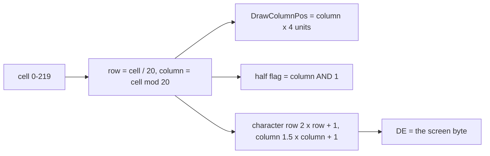

Worked example: cell 37 is row 1, column 17. DrawColumnPos = 68 (unit 68, x = 8 + 3 x 68 = 212). The half flag is 1.
The character row is 3 (y = 24) and the character column 17 + 8 + 1 = 26 (x = 208): the cell starts 4 pixels into
that character, at x = 212.

## 6.2 The picture format

Every picture of the game (tiles, sprites, the title letters, the messages) is stored the same way:

- one column of a unit at a time, top to bottom: a column of N lines is N values of 3 bits;
- eight values in three bytes, most significant bits first (UnpackGroups `$8BC8`);
- a frame is its columns one after the other; frame n of a set is at base + n x (bytes a frame) (Multiply8 `$8EDD`).

So a 12 x 32 sprite is 4 columns of 32 values: 4 x 12 = 48 bytes. The size and the address of each set are in
SizeClasses `$6082` (at run time; the table is moved there from `$6CD6`) and in each actor's record (+`$16` rows, +`$17` bytes a frame,
+`$18`/+`$19` the set, +`$23` the frame).

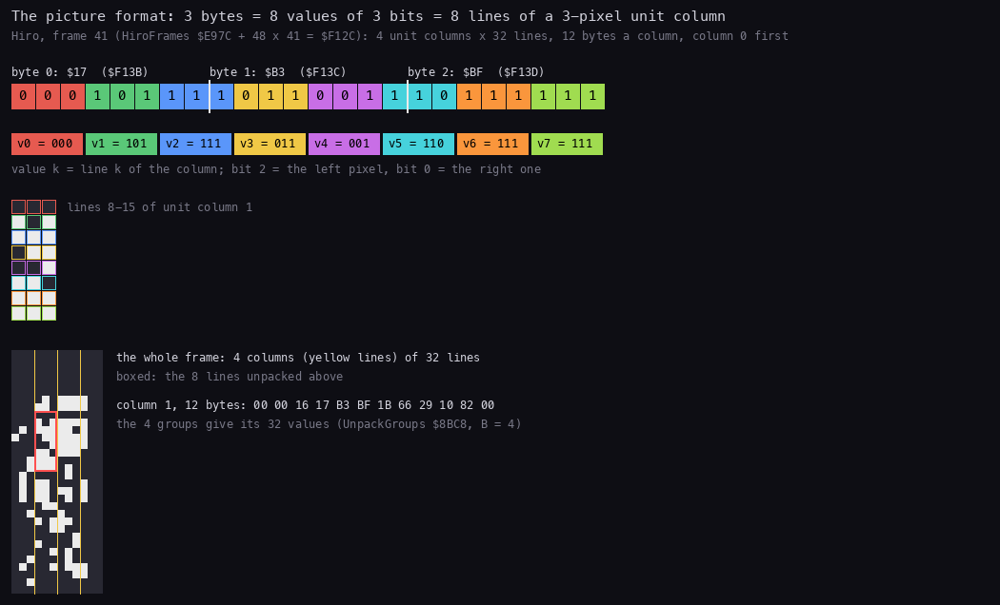

*Figure 6.2: one group of Hiro's frame 41 (HiroFrames `$E97C` + 48 x 41 = `$F12C`), column 1, lines 8-15: three
bytes, eight values, eight lines of three pixels. Drawn from `build/game.bin`: `python3 tools/fig_render.py format
--frame 41 --out docs/img/render/format.png`. No recording.*

How to read:

- Top: the three bytes as 24 bits, coloured by the value each bit belongs to.
- Middle: the eight values, then the eight lines of 3 pixels they make (bit 2 the left pixel).
- Bottom: the whole frame, 4 columns (yellow lines) of 32 lines; the red box is the group above.

Worked example: the bytes at `$F13B` are `$17 $B3 $BF`, that is `000 101 11|1 011 001 1|10 111 111`. The values are
0, 5, 7, 3, 1, 6, 7, 7. Line 9 of column 1 (value 5 = `101`) has its left and right pixels set.

Pseudocode:

```text
UnpackGroups(hl = packed, de = out, b = groups):    ; $8BC8
    repeat b times:
        x = (hl) << 16 | (hl+1) << 8 | (hl+2); hl += 3
        for k = 0 to 7:
            (de) = (x >> (21 - 3k)) AND 7; e += 1   ; no page crossing
```

The first three values, from `build/game.lst`:

```text
8BC8 C5           PUSH BC                    ; UnpackGroups
8BC9 06 07        LD B,$07                   ; B = the mask of a value
8BCB 7E           LD A,(HL)                  ; UnpackGroupsLoop: value 0, bits 7-5
8BCC 07           RLCA
8BCD 07           RLCA
8BCE 07           RLCA
8BCF A0           AND B
8BD0 12           LD (DE),A
8BD1 1C           INC E
8BD2 7E           LD A,(HL)                  ; value 1, bits 4-2
8BD3 0F           RRCA
8BD4 0F           RRCA
8BD5 A0           AND B
8BD6 12           LD (DE),A
8BD7 1C           INC E
8BD8 7E           LD A,(HL)                  ; value 2: across bytes 0 and 1
8BD9 23           INC HL
8BDA 4E           LD C,(HL)
8BDB CB 11        RL C
8BDD 17           RLA
8BDE A0           AND B
8BDF 12           LD (DE),A
8BE0 1C           INC E
```

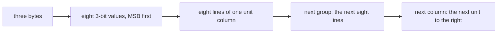

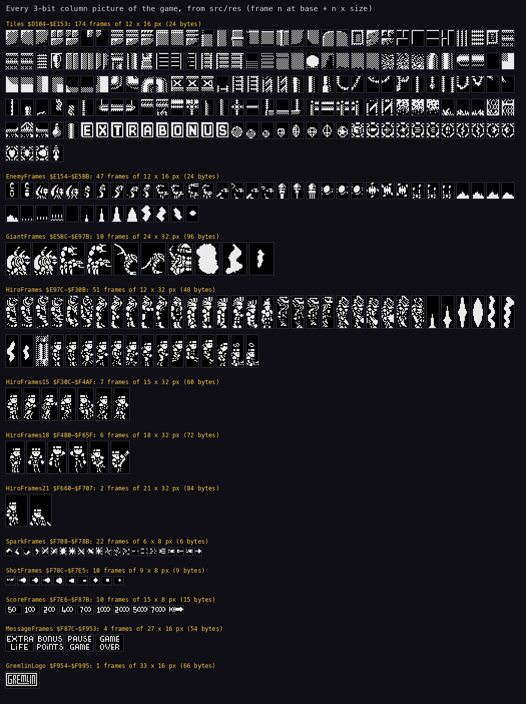

*Figure 6.3: every set of pictures, unpacked with the same rule. Drawn from `build/game.bin` with the sizes of
SizeClasses: `python3 tools/fig_render.py sheets --out docs/img/render/sheets.png`. No recording.*

How to read:

- One row of frames per set, with its address range, its frame count and its size.
- Tiles `$D104`: 174 of 12 x 16. EnemyFrames `$E154`: 47. GiantFrames `$E5BC`: 10 of 24 x 32. HiroFrames `$E97C`: 51
  of 12 x 32, with the wider sets at `$F30C`, `$F4B0` and `$F660`. Sparks, shots, scores, the messages and the
  Gremlin logo follow.
- Each frame is drawn unmirrored; the game mirrors at draw time (below).

**Mirroring.** A sprite facing left (+`$1B` bit 7) is drawn by MirroredColumn `$8C51`: the columns are taken from the
right, and each value goes through ReverseCodes `$7A00` (`0 4 2 6 1 5 3 7`, the three pixels reversed). There are no
mirrored copies in memory.

The point: 3 bits a line pack a 12-pixel-wide sprite into 4.5 bytes a line instead of 1.5 bytes of pixels and 1.5 of
mask. The format carries no mask: the outline is computed when drawing (6.4).

## 6.3 The cell planes and the room build

A room is held as six planes of 220 bytes, one byte per cell, at `$6700`-`$6CDB`:

| Plane | Holds |
| --- | --- |
| `$67` | the zone bits (bits 2-7: which zone the cell belongs to) and two flags (bits 0-1) |
| `$68` | the back tile (walls, sky, ground) |
| `$69` | a second back tile, drawn over `$68` |
| `$6A` | the front tile, drawn over the actors |
| `$6B` | a second front tile (solid tiles `$81`-`$86` of the floor) |
| `$6C` | low nibble: the shade (tile `$43` + n ANDed over the cell); high nibble: the colour index into CellColours `$66F7` |

EnterRoom `$95C3` builds and draws a room:

1. FindRoom on MapRow `$69DF` and MapColumn `$69E0`: the room above, then the room. Room 123 calls HavokRoomEnter.
2. BuildRoomPlanes `$9F34`: DecodeRoom fills the planes from the room's records; the room above is decoded too (A =
   `$FF`), and its bottom row is kept at the cells `$EC`-`$FF`. Surface rooms add BuildSurface (6.9).
3. SetupRoomObjects `$A41E`.
4. RedrawRoomMasked `$8852`: RedrawCellsMasked with A = RevealedZones `$6DFF` (6.7).
5. SpawnRoomEnemies `$A59B`, and the shield is put back.

[Doc 7](07-objects.md) decodes the room records; this section draws what they leave in the planes.

### RedrawCellMask `$8868` and DrawCellLayers

For one cell L with the zone mask A:

1. If plane `$67` AND A is not 0, the cell is in a zone being drawn: DrawCellLayers.
2. Else if plane `$67` AND RevealedZones is not 0, the cell was drawn before: leave it.
3. Else EraseCell: the cell's 16 lines are cleared, under the half-character masks `$F000` / `$000F`.

DrawCellLayers: if all four tile planes are 0, EraseCell. Else ComposeCell `$88DB` composes the back layers, then the
front layers, into the chunk buffer (6.5). If the colour flag (the operand at `$88AE`) is not 0, the colour
CellColours[plane `$6C` high nibble] goes to the 2 x 2 attributes at the cell's address. Then `JP BlitWindowAt`
`$8C72`: the cell to the screen.

Each tile is composed by ComposeTile:

- tiles `$4B` and up (things that stand in front: ladders, pipes, crates) through MaskedColumns `$8C0A`, with their
  outline (6.4);
- tiles below `$4B` plain, through the unpacker straight into the buffer;
- tiles `$1B` and up with a shade nibble n: the tile, then the shade tile `$43` + n ANDed over it (ComposeOverlay
  `$8A06`, AndTileColumns `$8A2F`): a dot pattern that darkens the wall.

Pseudocode:

```text
EnterRoom:                                     ; $95C3
    RoomAbove = FindRoom(MapRow - 1, MapColumn); Room = FindRoom(MapRow, MapColumn)
    if Room == 123: HavokRoomEnter()
    BuildRoomPlanes()                          ; planes $67-$6C
    SetupRoomObjects()
    RedrawCellsMasked(RevealedZones)           ; RedrawRoomMasked $8852
    SpawnRoomEnemies(); if Invulnerable: RestoreShield()

RedrawCellMask(L, a):                          ; $8868
    if plane67[L] AND a: DrawCellLayers(L)
    elif plane67[L] AND RevealedZones: return  ; drawn before
    else: EraseCell(L)

DrawCellLayers(L):
    if plane68[L] | plane69[L] | plane6A[L] | plane6B[L] == 0: EraseCell(L); return
    ComposeCell(L)                             ; back ($68, $69), then front ($6A, $6B), shade
    if colour flag: attributes(2 x 2) = CellColours[plane6C[L] >> 4]
    BlitWindowAt(cell's screen address)        ; $8C72
```

The decision and the colour, from `build/game.lst`:

```text
8868 26 67        LD H,$67                   ; RedrawCellMask: the zone plane
886A 5D           LD E,L
886B A6           AND (HL)
886C 20 2E        JR NZ,DrawCellLayers       ; in a zone being drawn
886E 3A FF 6D     LD A,(RevealedZones)
8871 A6           AND (HL)
8872 C0           RET NZ                     ; drawn before: leave it
8873 5D           LD E,L                     ; EraseCell
...
889C 26 68        LD H,$68                   ; DrawCellLayers: the four tile planes
889E AF           XOR A
889F B6           OR (HL)
88A0 24           INC H
88A1 B6           OR (HL)
88A2 24           INC H
88A3 B6           OR (HL)
88A4 24           INC H
88A5 B6           OR (HL)
88A6 28 CB        JR Z,EraseCell             ; all empty
88A8 E5           PUSH HL
88A9 CD DB 88     CALL ComposeCell
88AC E1           POP HL                     ; H = $6B
88AD 3E 00        LD A,$00                   ; the colour flag at $88AE
88AF B7           OR A
88B0 28 26        JR Z,DrawCellDone
88B2 24           INC H                      ; plane $6C
88B3 7E           LD A,(HL)
88B4 0F           RRCA
88B5 0F           RRCA
88B6 0F           RRCA
88B7 0F           RRCA
88B8 E6 0F        AND $0F                    ; the high nibble
...
88D8 C3 72 8C     JP BlitWindowAt            ; DrawCellDone: the composed cell to the screen
```

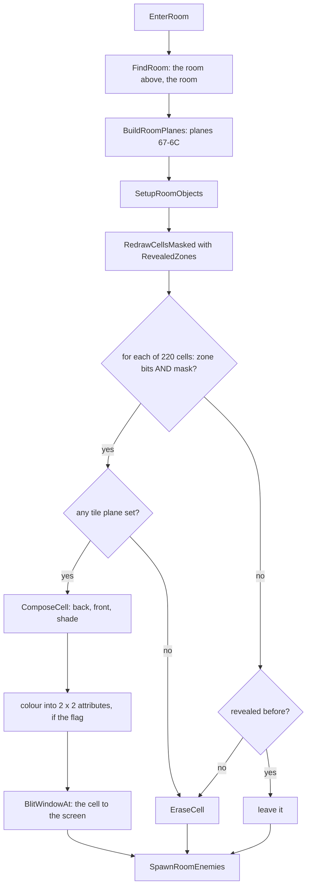

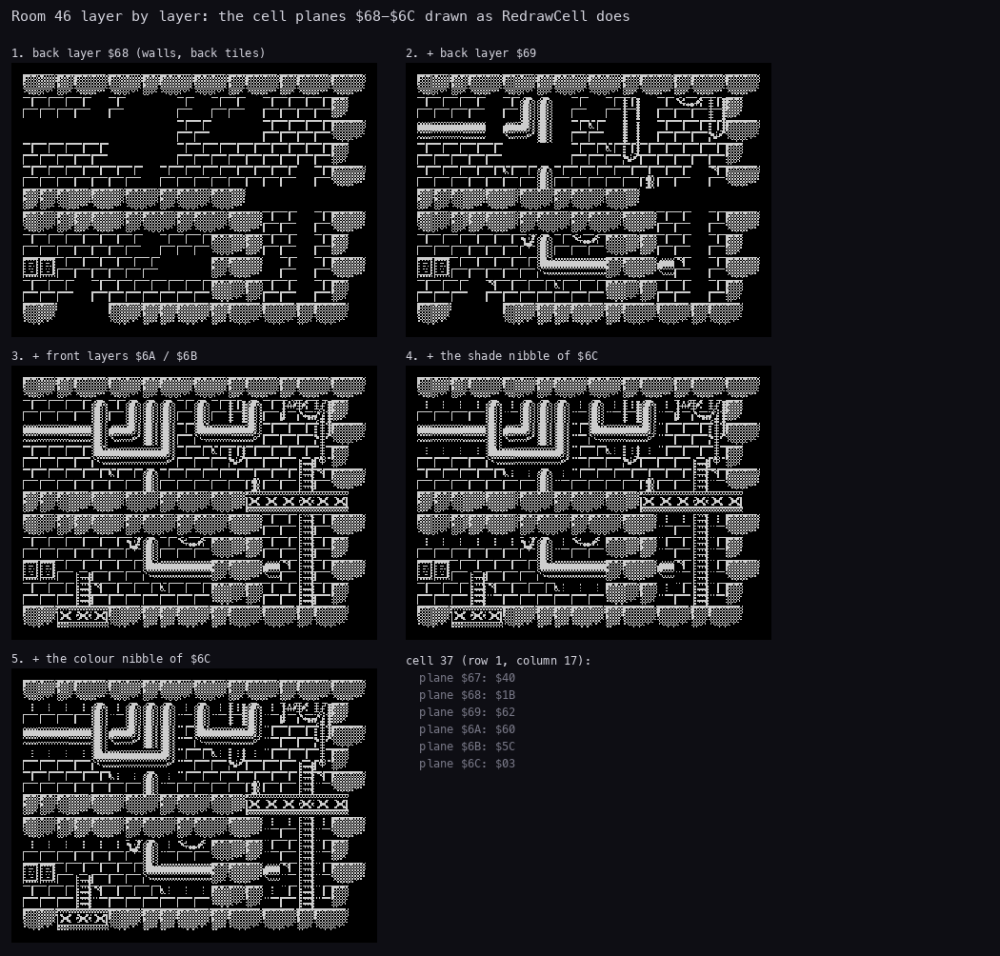

*Figure 6.4: room 46 drawn from its planes, one layer more in each picture. Drawn from `src/res` and the 48K ROM with
the rules above: `python3 tools/fig_render.py layers --room 46 --cell 37 --out docs/img/render/layers-room46.png` (the
planes by `tools/fig_rooms.py`, the composer by `tools/swroom.py`). No recording; the `rooms` and POKE recordings show
every room so.*

How to read:

- 1: the back layer `$68` alone: bricks, the stone arches.
- 2: `$69` adds the pipes and the hooks behind.
- 3: `$6A`/`$6B` add the ladders, the crates and the bars in front, each with its black outline.
- 4: the shade nibble darkens the walls with a dot grid.
- 5: the colour nibble; in room 46 every index gives white.
- Right: the six plane bytes of cell 37.

Worked example (cell 37 of room 46, row 1, column 17): plane `$67` = `$40` (zone `$40`), `$68` = `$1B` (a wall), `$69`
= `$62`, `$6A` = `$60`, `$6B` = `$5C` (three tiles of `$4B` and up: drawn with an outline), `$6C` = `$03` (shade 3,
colour 0). ComposeCell draws `$1B`, then `$62`, the shade tile `$46` ANDed over the wall, then `$60` and `$5C` in
front.

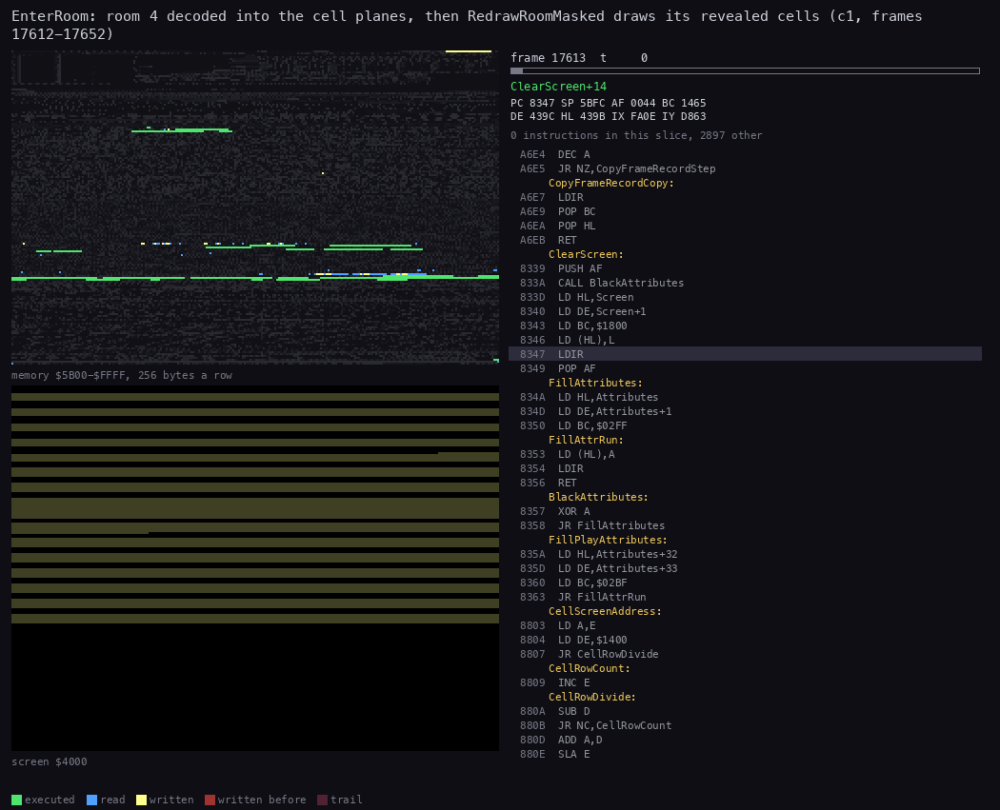

*Animation 6.1: EnterRoom in `c1`, frames 17612-17652: the screen cleared, room 4 decoded into the planes, then its
revealed cells drawn one by one. `python3 kit/routine_anim.py --work work/docs/zsB/c1 --window 17612:0-17652:0
--listing build/game.lst --view screen --pc 9F34-A6FF,8803-8DFD,95C3-9612 --range 5B00-FFFF --pictures 40 --title
"..." --out docs/img/routines/EnterRoom.gif`, the instance opened on `work/stage1/c1/session.ttd` with `re_session.py
open --model 128K`.*

How to read:

- Top left: memory `$5B00`-`$FFFF`; the planes `$67`-`$6C` fill first (the decode), then the chunk buffer pages
  `$5D`-`$66` flash as each cell is composed.
- Bottom left: the screen. The cells appear row by row, left to right, from cell 0.
- Right: the code, the frame and T.

The point: a room is never drawn as a picture. Each cell is composed from up to four tiles, shaded and coloured, then
blitted alone; drawing room 4's 140 revealed cells takes 36 frames (17615-17651). The player waits on a black screen
that fills in.

**The colour flag.** NewGame `$5CD2` sets the operand at `$88AE` to 0, then calls EnterRoom. Only after the first
room is drawn does it call PanelAttrsRoom (6.8), which stores the room number there; nothing else writes it. So the
first room of a game is drawn without cell colours, and FillPlayAttributes then paints the whole window `$46` (room 4)
or 7. Every room entered later colours each cell it draws.

## 6.4 MaskedColumn `$8C0F`: the values through the stack

A sprite and a front tile are drawn one unit column at a time:

1. UnpackColumn `$8BC5` unpacks the column's values into ColumnValues `$5B50` (one byte a value).
2. MaskedColumn reads them back with the stack pointer: `LD SP,$5B50 + n`, then `POP BC` gives two values at once (C
   = v(k), B = v(k + 1)); `DEC SP` slides the stream back one byte, so the next `POP` gives v(k + 1) and v(k + 2).
3. Each line k of the chunk buffer becomes: buffer AND M[v(k - 1)] AND M[v(k)] AND M[v(k + 1)] OR v(k). M is
   OutlineMask `$6F00`: `FF FC F8 F8 F1 F0 F0 F0`.

M[v] clears the pixels of v and the ones beside them inside the unit. ANDing the masks of the line above and below too
clears a one-pixel rim round the sprite, above, below and between its pixels. Then v is ORed in. The result is a
sprite with a black outline over any background, with no mask stored.

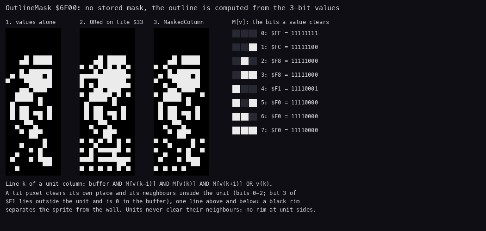

*Figure 6.5: Hiro's frame 41 over the sky tile `$33`: the values alone, ORed without masks, and drawn by MaskedColumn.
Drawn from `build/game.bin`: `python3 tools/fig_render.py outline --out docs/img/render/outline.png`. No recording.*

How to read:

- 1: the values as pixels. 2: ORed over the tile: the sprite melts into the dither. 3: MaskedColumn: the rim keeps the
  sprite apart.
- Right: the mask M[v] of each value: the three boxes are the unit's pixels; a dark box is a pixel the mask clears.

**Why `DI` round each `POP`.** While SP points into ColumnValues, an interrupt would push its return address at SP - 2
and SP - 1. Between `POP BC` and `DEC SP` those two bytes are v(k) and v(k + 1), and v(k + 1) is read again by the next
`POP`. After `DEC SP` they are bytes already read. So the code disables the interrupts for exactly those two
instructions. The IM 2 handler's own pushes (six registers, 14 bytes in all) land on values already used.

Pseudocode:

```text
MaskedColumn(de = the buffer line, n = lines):  ; $8C0F
    keep SP in the operand $8C4D
    SP = ColumnValues + first                 ; $8C1D, set by SetColumnClip
    a = $FF
    DI; c, b = POP; SP -= 1; EI               ; c = v(0), b = v(1)
    (de) = (de) AND M[b] AND a OR c ... (line 0 leaves M[v(-1)] out)
    repeat n times:                           ; $8C2D
        a = M[b] AND M[c]                     ; M[v(k)] AND M[v(k-1)]
        DI; c, b = POP; SP -= 1; EI           ; the next pair
        (de) = (de) AND M[b] AND a OR c; e += 1
    the last line: no v(k+1)
    SP = the kept SP
```

```text
8C17 26 6F        LD H,$6F                   ; H = $6F: the outline masks
8C19 ED 73 4D 8C  LD (MaskedColumnSP+$0001),SP ; keep SP
8C1D 31 50 5B     LD SP,ColumnValues         ; MaskedColumnStart: the first value
8C20 F3           DI
8C21 C1           POP BC                     ; C = v(0), B = v(1)
8C22 3B           DEC SP
8C23 FB           EI
8C24 68           LD L,B
8C25 A6           AND (HL)
8C26 EB           EX DE,HL
8C27 A6           AND (HL)                   ; the buffer line
8C28 B1           OR C
8C29 77           LD (HL),A
8C2A 2C           INC L
8C2B EB           EX DE,HL
8C2C 08           EX AF,AF'
8C2D 08           EX AF,AF'                  ; MaskedColumnLoop
8C2E 68           LD L,B
8C2F 7E           LD A,(HL)                  ; M[v(k)]
8C30 69           LD L,C
8C31 A6           AND (HL)                   ; AND M[v(k-1)]
8C32 F3           DI
8C33 C1           POP BC                     ; MaskedColumnPop: the next two values
8C34 3B           DEC SP
8C35 FB           EI
8C36 68           LD L,B
8C37 A6           AND (HL)                   ; AND M[v(k+1)]
8C38 EB           EX DE,HL
8C39 A6           AND (HL)                   ; AND the buffer
8C3A B1           OR C                       ; OR v(k)
8C3B 77           LD (HL),A
8C3C 2C           INC L
8C3D EB           EX DE,HL
8C3E 08           EX AF,AF'
8C3F 3D           DEC A
8C40 20 EB        JR NZ,MaskedColumnLoop
...
8C4C 31 00 00     LD SP,$0000                ; MaskedColumnSP: the caller's SP
8C4F E1           POP HL
8C50 C9           RET
```

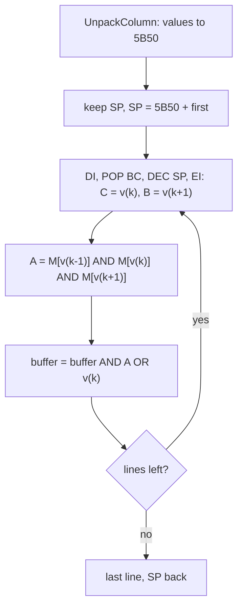

Worked example (Hiro's column 1, lines 9-11 of figure 6.2: values 5, 7, 3 over a buffer byte of 5, the sky's `101`):
line 10 has v(9) = 5, v(10) = 7, v(11) = 3. M[5] = `$F0`, M[7] = `$F0`, M[3] = `$F8`. The AND is `$F0`: the three
pixels cleared. `$05 AND $F0` = 0, OR 7 = 7: three lit pixels. A line with value 0 between lit lines above and below
is cleared to 0: the black rim.

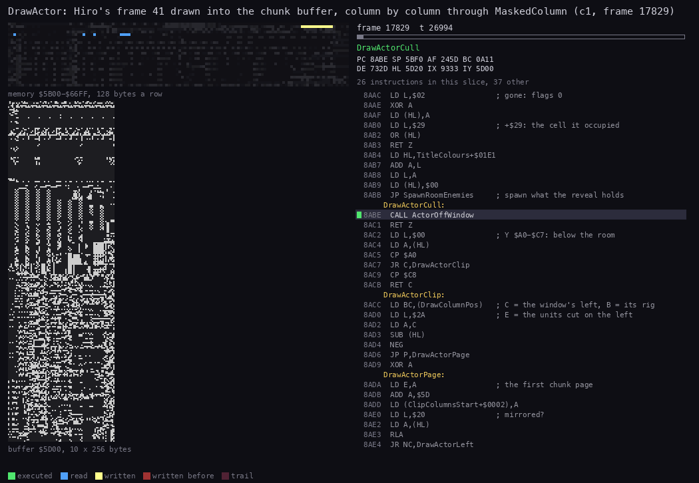

*Animation 6.2: DrawActor in `c1` frame 17829, T 26500-51200: Hiro's frame 41 drawn into the chunk buffer, column by
column. `python3 kit/routine_anim.py --work work/docs/zsB/c1 --window 17829:26500-17829:51200 --listing build/game.lst
--view buffer:5D00:10x256:columns --range 5B00-66FF --pc 8A73-8C67,8EDD-8EFF --pictures 50 --out
docs/img/routines/DrawActor.gif`.*

How to read:

- Top left: memory `$5B00`-`$66FF`. ColumnValues at `$5B50` flash yellow (UnpackColumn writes) then blue (the `POP`s
  read them); the chunk pages `$5D`-`$66` flash as the lines are written.
- Below: the chunk buffer, one page a column of bytes; the low 3 bits of each byte are a unit's pixels.
- Right: the code. Most pictures stop in UnpackGroupsLoop or MaskedColumnPop: the two loops are the cost.

The point: the stack is the fastest way the Z80 has to read two bytes and step on (`POP` is 10 T for two bytes). The
outline costs three table lookups a line and no memory at all.

Witness: DrawActor L1 1440 in `c1`, 132 818 over the stage-1 recordings: every visible actor, every frame it moves.

## 6.5 The chunk buffer and the blit

The game draws nothing straight on the screen except the panel and the messages. It composes a window of whole cells
in the **chunk buffer** and copies the window to the screen:

- page `$5D` + n holds unit column n of the window (`$5D`-`$66`: up to 10 units; a cell is 4);
- byte `$4A` + y of the page is line y (ComposeDest `$74BA` = `$5D4A`, or `$5D42` when the window's first 8-pixel row
  is odd: then the window starts 8 lines into its first cell);
- each byte holds one value, 0-7: the unit's three pixels.

The pages are the actor pages: an actor's record is the first `$4A` bytes of its page, the buffer the bytes after.

BlitWindow `$8C68` copies the window:

1. SpriteScreenAddress `$8828`: the screen byte of the window's top-left unit.
2. PackRow `$8CE5` packs every line of the window into screen bytes at `$6F08`:
   - p = the window's first unit AND 7: its place in a group of 8 units = 3 bytes;
   - PackerPhases `$FD98` record p gives the packer entry PackUnitsN and the left edge mask;
   - record p + B + 7 (B = the width in units) gives the address after the last unit's code, and the right mask;
   - PackRow plants a `RET` (`$C9`) at that address, calls the unrolled packer once a line, and puts the byte back.
3. BlitRows `$8CAD` copies 8 lines a character row: the first byte under the left mask, the middle bytes by a chain
   of `LDI` entered through a patched `JR`, the last byte under the right mask. A window one byte wide uses
   BlitColumn `$8CD9`, both masks at once.

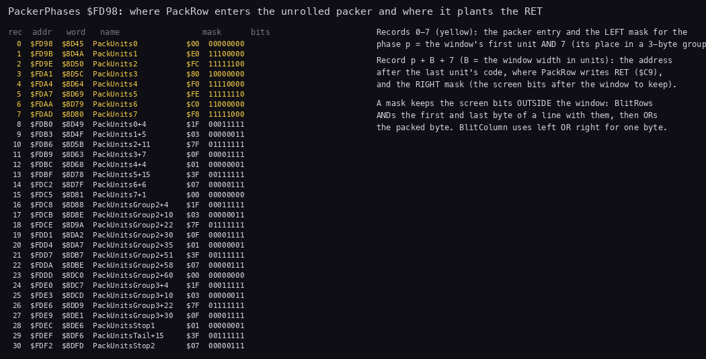

*Figure 6.6: the 31 records of PackerPhases: the packer entry, the stop address and the mask each phase gives.
Drawn from `build/game.bin`: `python3 tools/fig_render.py packer --out docs/img/render/packer.png`. No recording.*

How to read:

- Records 0-7 (yellow): where a line starts. Entry PackUnitsN starts at unit N of a group; the mask keeps the screen
  bits left of the window.
- Records 8-30: where a line stops. The address is where the `RET` goes; the mask keeps the screen bits right of the
  window.

Pseudocode:

```text
BlitWindow():                                  ; $8C68
    de = SpriteScreenAddress(DrawColumnPos, DrawRowPos)
    p = DrawColumnPos AND 7
    entry, leftmask = PackerPhases[p]
    stop, rightmask = PackerPhases[p + width + 7]
    saved = (stop); (stop) = RET               ; plant the stop
    for each line of the window:               ; PackRow $8CE5
        a = 0; call entry                      ; packs units across the pages (INC H a unit)
        (bc) = a; bc += 1                      ; the partial last byte
    (stop) = saved
    bytes = bytes a line
    for each character row:
        for 8 lines:                           ; BlitRows $8CAD
            first = screen AND leftmask OR packed
            middle bytes by LDI
            last = screen AND rightmask OR packed
```

The unrolled packer's first units and the planted stop:

```text
8D45 7E           LD A,(HL)                  ; PackUnits0: unit 0 to bits 7-5
8D46 0F           RRCA
8D47 0F           RRCA
8D48 0F           RRCA
8D49 24           INC H                      ; the next unit's page
8D4A 5F           LD E,A                     ; PackUnits1: unit 1 to bits 4-2
8D4B 7E           LD A,(HL)
8D4C 07           RLCA
8D4D 07           RLCA
8D4E B3           OR E
8D4F 24           INC H
...
8D1C 7E           LD A,(HL)                  ; PackRow: plant the RET, keep the byte
8D1D 36 C9        LD (HL),$C9
8D1F 32 42 8D     LD (PackRowByte+$0001),A
```

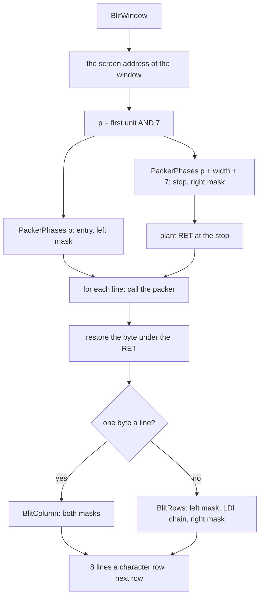

Worked example (`c1`, Hiro's redraw in frame 17829): the window is units `$2C`-`$30` (44-48: 5 units, 15 pixels) and
8-pixel rows 8-11 (32 lines). p = `$2C AND 7` = 4: entry PackUnits4 `$8D64`, left mask `$F0`. Record 4 + 5 + 7 = 16:
stop `$8D88`, right mask `$1F`. PackRow plants `RET` at `$8D88` over the byte `$24` (`INC H`). Units 44-48 fill bits
3-0 of the first byte, all of the second and bits 7-5 of the third: 3 bytes a line. BlitWindowOffset sets the `JR`
to `$12`: one `LDI` for the middle byte. 32 lines of 3 bytes: 96 screen bytes at x = 136-159, y = 72-103.

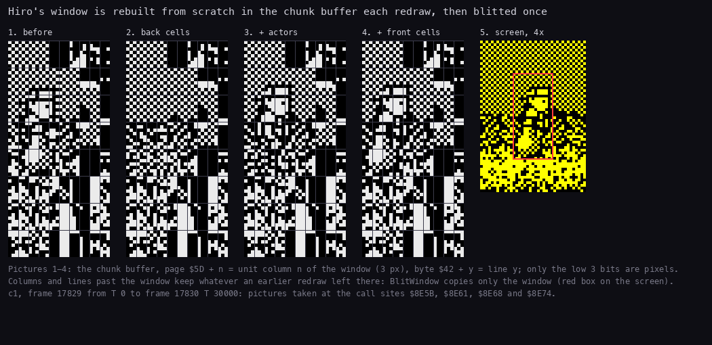

*Figure 6.7: the chunk buffer at the four stages of Hiro's redraw, and the screen after the blit. `c1` frame 17829 T 0
to frame 17830 T 30000: `python3 tools/fig_render.py stages --work work/docs/zsB/c1 --window 17829:0-17830:30000
--out docs/img/render/stages.png`.*

How to read:

- Pictures 1-4: the chunk buffer, one unit column a page, 64 lines. The left five columns are Hiro's window; the
  others hold what an earlier window left there.
- 1, before: the last redraw's picture. 2: the back cells composed over it. 3: Hiro drawn with his outline. 4: the
  front cells (here nothing in front).
- 5: the screen after BlitWindow, at 4 x; the red box is the window.

The point: the screen is written once per redraw, by `LDI` and two masked bytes a line. Everything else (cells,
sprites, outlines) happens in a buffer where a unit is a byte, so no drawing routine ever shifts pixels across screen
bytes; only the packer does.

## 6.6 The actors drawn

ActorUpdate `$8E2B` runs once per actor per pass ([doc 4](04-game-loop.md)). After the actor's logic, if it moved (+`$20`
bit 0), its window is redrawn:

1. ActorBoxStore `$8F3B`: the box of the actor, its last move included (ActorScreenBox `$8F75`), goes to the window
   variables: units `$732A`-`$732B`, rows `$732C`-`$732D`, the width `$8C76`, the lines `$8D27`, the cells
   `$A56E`/`$A56F`.
2. Havok (kind `$25`) goes to HavokFade `$872B`, drawn by its own code. A box wholly off the window, or a Y of
   `$A8`-`$C7` (below the room), is not drawn.
3. ComposeActorCells with ComposeBackCell `$898C`: the back layers of the cells under the window, into the buffer.
4. DrawActorsAll `$8A76` with DE = `$A001`: every active actor whose box meets the window, not only the one that
   moved.
5. ComposeActorCells with ComposeFrontCell `$8943`: the front layers over the actors.
6. DrawFrontActors `$8A73`, when an actor has +2 bit 7 (drawn in front of everything).
7. BlitWindow.

There is no erase pass and no back screen. The window covers the actor's old place and its new one, so recomposing it
from the cells erases the old picture and draws the new one in one blit.

DrawActor `$8A90`, for one actor:

- skips it when a flag of D is set, when its box does not meet the window (BoxesOverlap `$9A27`), or for kind `$25`;
- handles a removal (+`$20` bit 1): the actor's cell in plane `$68` is emptied;
- clips it to the window: columns on the left and right (ClipColumns `$8B6A`), lines above (ClipTop `$8BB7`) and
  below (SetColumnClip `$8B94`);
- finds the frame: IX = the set + frame x bytes a frame;
- draws its columns with MaskedColumns, or from the right with MirroredColumn when it faces left.

Pseudocode:

```text
ActorUpdate(actor):                            ; $8E2B
    RunActorSteps()
    if not actor.moved: return
    actor.moved = 0
    ActorBoxStore(actor)                       ; the window: old and new place
    if actor.kind == $25: HavokFade(); return
    if the box is off the window or Y in $A8-$C7: return
    ComposeActorCells(ComposeBackCell)         ; $8E5B
    c = DrawActorsAll(skip = $A0, select = 1)  ; $8E61
    ComposeActorCells(ComposeFrontCell)        ; $8E68
    if c bit 7: DrawFrontActors()              ; $8E6E
    BlitWindow()                               ; $8E71
```

```text
8E2D CD 4B 9A     CALL RunActorSteps         ; IY = the actor whose logic ran
8E30 FD CB 20 46  BIT 0,(IY+$20)             ; +$20 bit 0: it moved, redraw it
8E34 28 3E        JR Z,ActorUpdateDone
8E36 FD CB 20 86  RES 0,(IY+$20)
8E3A CD 3B 8F     CALL ActorBoxStore         ; +$2A-$2F and the render's variables
8E3D 2E 1C        LD L,$1C
8E3F 7E           LD A,(HL)
8E40 FE 25        CP $25                     ; kind $25 is Havok: $872B
8E42 CA 2B 87     JP Z,HavokFade
8E45 3A DD 69     LD A,(BoxClip)             ; wholly off the window?
8E48 CD 98 8E     CALL ClipFlagsOff
8E4B 28 27        JR Z,ActorUpdateDone
8E4D 2E 00        LD L,$00
8E4F 7E           LD A,(HL)                  ; Y $A8-$C7: below the window
8E50 FE A8        CP $A8
8E52 38 04        JR C,ActorUpdateDraw
8E54 FE C8        CP $C8
8E56 38 1C        JR C,ActorUpdateDone
8E58 01 8C 89     LD BC,ComposeBackCell      ; ActorUpdateDraw
8E5B CD 07 89     CALL ComposeActorCells
8E5E 11 01 A0     LD DE,$A001
8E61 CD 76 8A     CALL DrawActorsAll
8E64 C5           PUSH BC
8E65 01 43 89     LD BC,ComposeFrontCell
8E68 CD 07 89     CALL ComposeActorCells
8E6B C1           POP BC
8E6C CB 11        RL C                       ; bit 7 of the OR of every +$02
8E6E DC 73 8A     CALL C,DrawFrontActors
8E71 CD 68 8C     CALL BlitWindow
```

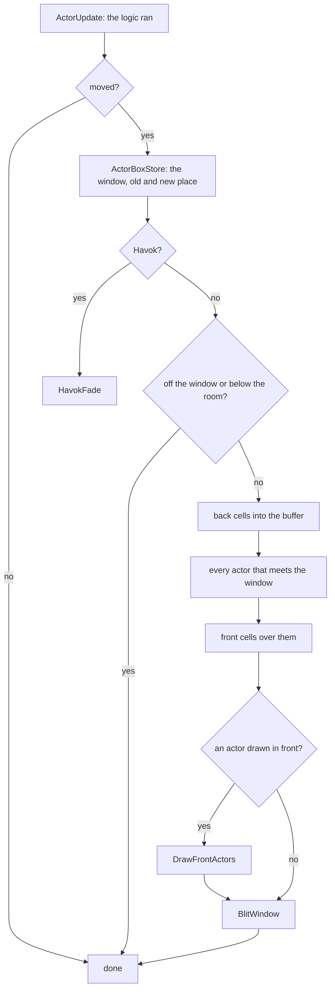

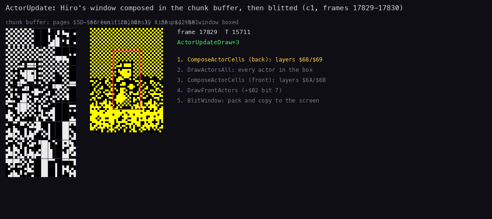

*Animation 6.3: Hiro's redraw in `c1`, frame 17829 T 0 to frame 17830 T 30000: the chunk buffer (left), the screen
round the window (middle) and the stage (right). `python3 tools/fig_render.py compose --work work/docs/zsB/c1
--window 17829:0-17830:30000 --out docs/img/routines/ActorUpdate.gif`. A case tool: it draws the buffer's 3-bit
values as pixels, which the kit's byte views cannot.*

How to read:

- Left: the chunk buffer as pixels, one unit a column, 64 lines.
- Middle: the screen round the window, the window boxed. It changes only at the last stage.
- Right: the five stages; the yellow one is running.

Worked example (`c1`, frame 17829): Hiro walks right in room 4 (X `$5A`, Y `$40`, frame 41). The redraw's stages, from
the trace:

| Stage | From (frame, T) | T |
| --- | --- | --- |
| ActorUpdate, the logic, ActorBoxStore | 17829, 8014 | 7 700 |
| back cells (ComposeActorCells) | 17829, 15711 | 10 800 |
| the actors (DrawActorsAll, Hiro alone) | 17829, 26518 | 24 600 |
| front cells | 17829, 51158 | 16 000 |
| BlitWindow, with the interrupt of frame 17830 | 17829, 67215 to 17830, 17544 | 21 200 |

One redraw of Hiro costs about 80 000 T, more than a frame. The passes that follow, with no actor moving, take about
700 T each. So the game's speed is set by how many actors move and how big their windows are.

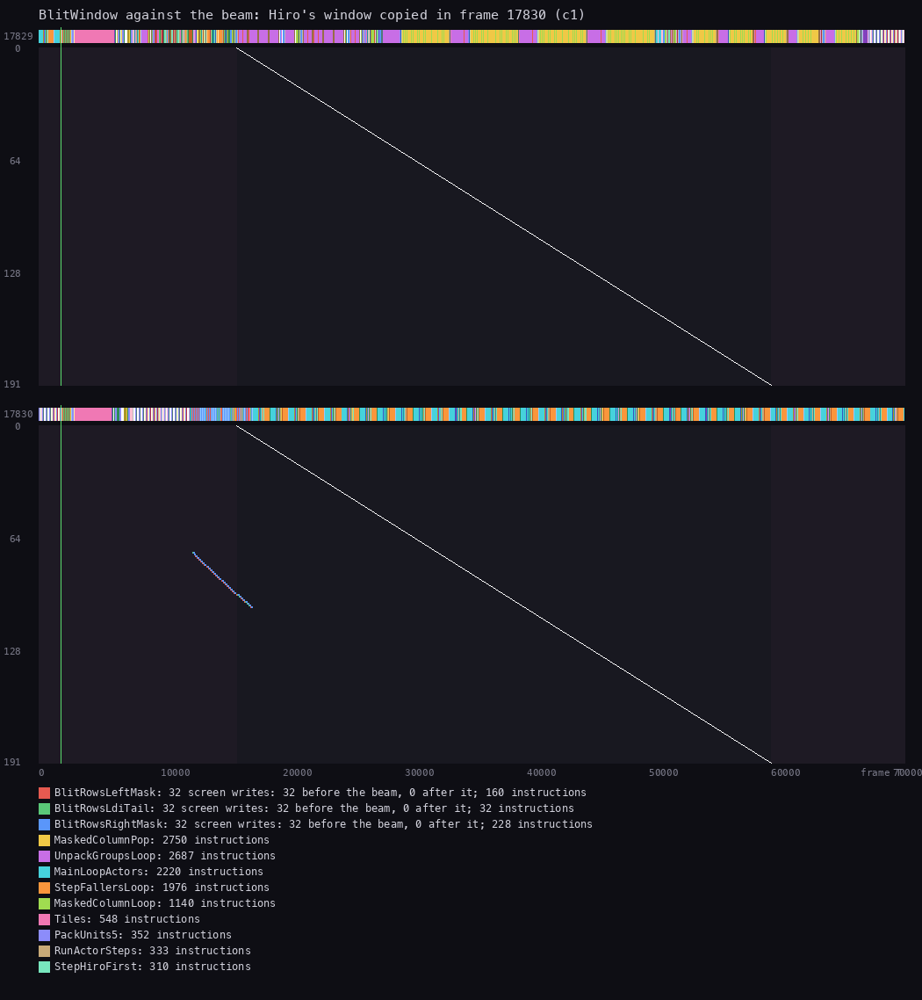

*Figure 6.8: frames 17829-17830 of `c1` against the beam. `python3 kit/beam_timeline.py --work work/docs/zsB/c1
--window 17829:0-17831:0 --listing build/game.lst --machine 128k --frames 2 --out docs/img/render/beam-c1.png`.*

How to read:

- One panel a frame; across is T in the frame, down the 192 paper lines. The diagonal is the beam.
- The strip above each panel is the routine running: purple UnpackGroupsLoop and yellow MaskedColumnPop fill most of
  frame 17829.
- The dots in frame 17830 are the 96 screen writes of BlitRows, lines 64-95 of the paper, at T 11 500-16 200.

The point: the game does not wait for the beam. Here all 96 writes land before the beam reaches their lines (the
paper starts at T 16 212), so the frame shows the new picture whole. That is luck of the timing: a blit that ran later
would show its top and bottom from different frames. No recording was checked for a torn window; the code has no
guard against it.

## 6.7 Zones revealed

Each room's cells belong to zones (plane `$67` bits 2-7). A zone is drawn only once Hiro has stood in it; until then
its cells stay black. RevealedZones `$6DFF` holds the zones seen in this room. SaveRoomState `$A58A` keeps it, with
`$6DFE`, in the two bytes at `$6D00` + 2(room - 1), so a zone stays revealed when Hiro comes back.

CheckRoomExit `$955A` runs at the end of every move of Hiro (ApplyMove). When he is not at an edge:

1. ActorScreenBox: the box and the cells again.
2. RevealZone `$A569`: the cell below the box's first row, at his front edge (the first cell when he faces left, the
   last when right), is tested. D = its zone bits (AND `$FC`). If D AND RevealedZones is not 0, nothing new: NZ.
   Else RevealedZones |= D, Z.
3. On Z: RedrawCellsMasked `$8855` with A = D walks all 220 cells and draws those of the new zone; then
   SpawnZoneEnemies `$A59E` places the zone's enemies.

Pseudocode:

```text
CheckRoomExit:                                 ; $955A, after Hiro's move
    if Hiro at an edge: change room; return
    ActorScreenBox(Hiro)
    cell = (facing left ? first cell : last cell) + 20
    d = plane67[cell] AND $FC                  ; RevealZone $A569
    if d AND RevealedZones: return
    RevealedZones |= d
    RedrawCellsMasked(d)                       ; 220 cells, those of zone d drawn
    SpawnZoneEnemies(d)
```

```text
A569 3A FF 6D     LD A,(RevealedZones)       ; RevealZone
A56C 4F           LD C,A
A56D 21 00 00     LD HL,$0000                ; L = the first cell, H = the last ($A56E/$A56F)
A570 3A 1B 5D     LD A,($5D1B)               ; Hiro's facing
A573 17           RLA
A574 38 01        JR C,RevealZoneTest        ; left: the first cell
A576 6C           LD L,H                     ; right: the last
A577 7D           LD A,L                     ; RevealZoneTest
A578 C6 14        ADD A,$14                  ; one row down
A57A 6F           LD L,A
A57B 26 67        LD H,$67
A57D 7E           LD A,(HL)
A57E E6 FC        AND $FC                    ; the zone bits
A580 57           LD D,A
A581 A1           AND C
A582 C0           RET NZ                     ; seen: NZ
A583 7A           LD A,D
A584 B1           OR C
A585 32 FF 6D     LD (RevealedZones),A       ; new: add it
A588 AF           XOR A
A589 C9           RET                        ; Z
...
9594 CD 69 A5     CALL RevealZone            ; in CheckRoomExit
9597 7A           LD A,D
9598 C0           RET NZ
9599 F5           PUSH AF
959A CD 55 88     CALL RedrawCellsMasked
959D F1           POP AF
959E C3 9E A5     JP SpawnZoneEnemies
```

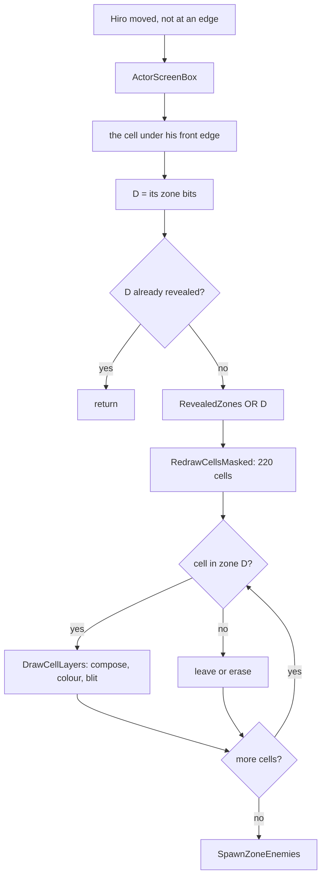

Worked example (`deaths`, room 8): the sample of frame 3780 shows RevealedZones `$80`, Hiro at X `$60`. In frame 3780
he steps to X `$64`, over the hole in the ground; the cell under his front edge is in zone `$40`, the underground
(rows 7-10 of the room, 80 cells). The sample of 3781 shows RevealedZones `$C0`. RedrawCellsMasked then draws the 80
cells of zone `$40` one by one; the other 140 are left. Hiro's X stays `$64` from sample 3781 to 3789 and moves again
at 3790: a stall of 9 frames.

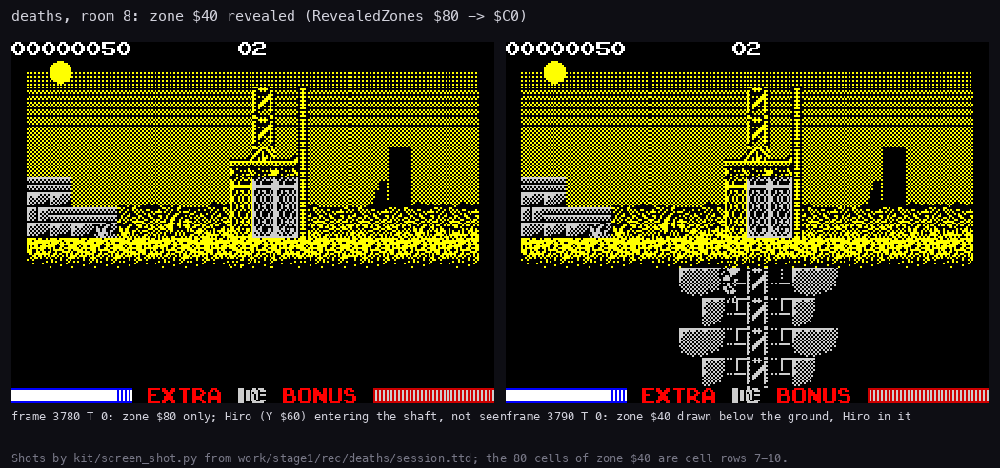

*Figure 6.9: `deaths` room 8 at frame 3780 T 0 (zone `$80` only) and at frame 3790 T 0 (zone `$40` drawn below the
ground). The shots by `python3 kit/screen_shot.py --work work/docs/zsB/deaths --out-dir work/docs/zsB/out
reveal-before=3780:0 reveal-after=3790:0`, the instance opened on `work/stage1/rec/deaths/session.ttd`; the pair by
`python3 tools/fig_controls.py shots --out docs/img/render/reveal.png --shot work/docs/zsB/out/reveal-before.png=...
--shot work/docs/zsB/out/reveal-after.png=...`.*

How to read:

- Left: the surface of room 8 drawn, the rows below the ground black.
- Right: the cells of zone `$40` that hold tiles (the shaft, the stone ledges); its empty cells stay black.
- The panel and the zone `$80` part are the same bytes in both.

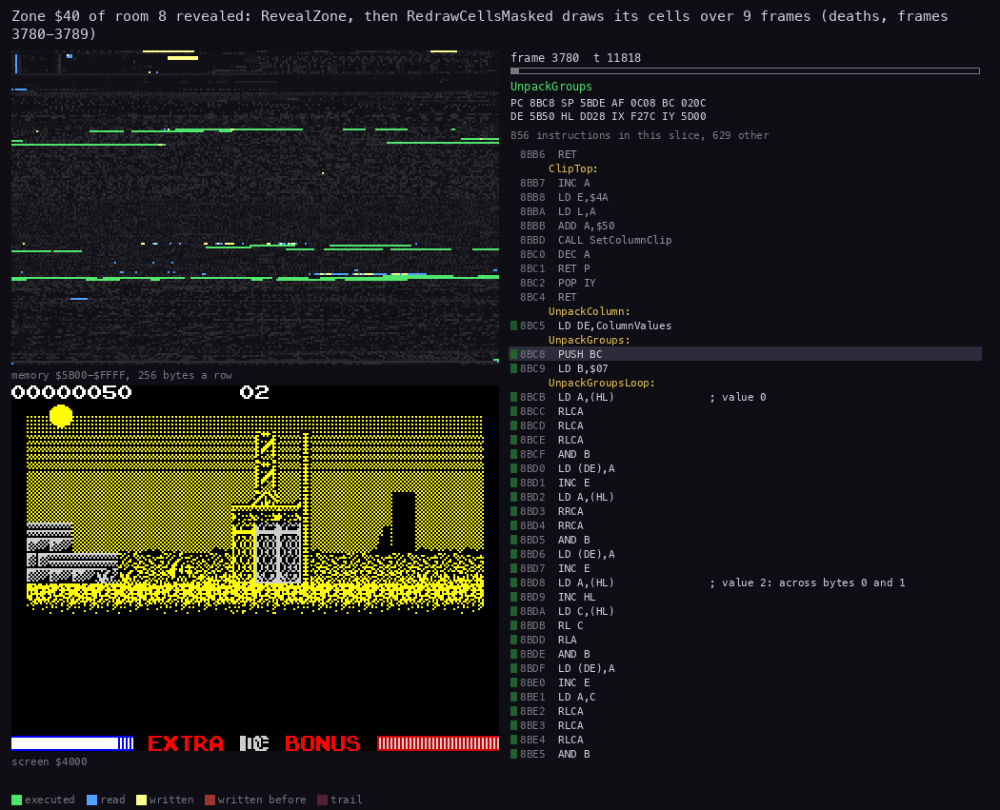

*Animation 6.4: frames 3780-3789 of `deaths`: RevealZone finds zone `$40` new, and RedrawCellsMasked draws its cells.
`python3 kit/routine_anim.py --work work/docs/zsB/deaths --window 3780:0-3790:0 --listing build/game.lst --view screen
--range 5B00-FFFF --pc 955A-95C2,A569-A59D,8803-8DFD --pictures 60 --out docs/img/routines/RedrawCellsMasked-zone.gif`.
[Doc 4](04-game-loop.md) shows another reveal (room 9, zone `$80`) in
`RedrawCellsMasked.gif` with its cost in the pass.*

How to read:

- The screen fills below the ground cell by cell, row by row, left to right.
- The memory map shows the chunk buffer pages working for each cell.
- The code panel stays in the composer (UnpackGroupsLoop, MaskedColumnPop, AndTileLoop) for nearly every picture.

The point: a reveal is the most expensive thing the renderer does after a room change. It draws each cell alone (its
own compose and blit), so a zone of 80 cells costs 9 frames, during which nothing moves. The RZX run has twelve
long stalls that are not room builds, and all twelve are reveals ([doc 4](04-game-loop.md)).

Known only from the code: a cell with no zone bits under Hiro would give D = 0 and Z, and the 220-cell walk would run
with A = 0: it would redraw nothing and erase again every cell not in a revealed zone (already black), on every
move: a stall for nothing. In the rooms we dumped (4, 8, 46)
every cell has a zone bit.

## 6.8 The panel

The panel is the two character rows outside the play window:

- row 0: the score (8 digits) and the lives (2 digits);
- row 23: the energy meter, EXTRA, the weapon, BONUS and the second meter.

The renderer of the play window never touches them: the window ends at y = 183. The panel's pixels are drawn by the
per-pass jobs PanelWeapon and PanelMeters and by the score code ([doc 8](08-hud-and-text.md)). Its colours are a fixed
row: PanelAttrsRoom copies PanelAttrs `$FFCB` (32 bytes, `res/graphics/panel-attrs.bin`) to `$5AE0` at every new
game, after the first room is drawn, and stores the room number in the colour flag of 6.3. NewGame is its only
caller.

```text
FFEB 21 CB FF     LD HL,PanelAttrs           ; PanelAttrsRoom: the 32 attributes of row 23
FFEE 11 E0 5A     LD DE,Attributes+736       ; $5AE0
FFF1 01 20 00     LD BC,$0020
FFF4 ED B0        LDIR
FFF6 3A DD 6B     LD A,(Room)
FFF9 32 AE 88     LD (DrawCellLayers+$0012),A ; the colour flag ($88AE)
FFFC FE 04        CP $04                     ; Z in room 4
FFFE C9           RET
...
5CE7 CD EB FF     CALL PanelAttrsRoom        ; in NewGame, after EnterRoom
5CEA 3E 46        LD A,$46
5CEC 28 02        JR Z,NewGameColour
5CEE 3E 07        LD A,$07
5CF0 CD 5A 83     CALL FillPlayAttributes    ; NewGameColour
```

Pseudocode:

```text
PanelAttrsRoom:
    attributes of row 23 = PanelAttrs
    colour flag = Room
    return Z if Room == 4
NewGame: ... EnterRoom(); PrintScore(); PanelAttrsRoom()
    FillPlayAttributes(Z ? $46 : 7)            ; the play window's colour
```

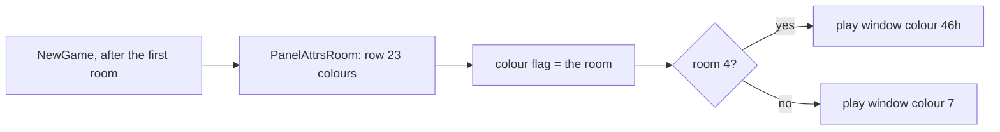

Worked example: in `c1` room 4, row 23 shows a white meter, red EXTRA, the weapon in white and red BONUS (figure
6.1); the play window is yellow on black (`$46`, bright yellow ink), so the sky's dither reads as yellow.

The point: the panel is never redrawn by the window renderer, so no actor's blit can damage it; the per-pass jobs
redraw only what changed ([doc 8](08-hud-and-text.md)).

## 6.9 The surface noise: the ground drawn from the 48K ROM

The surface rooms (the top map row) have no cell data for their ground. BuildSurface `$A039` (in
BuildRoomPlanes) makes it:

1. sky tiles `$33`-`$36` on rows 0-3;
2. the horizon strip on row 4, from `$74F5` + the room;
3. tile `$37` and tile `$43` at places that depend on the room;
4. row 5: 20 ground tiles `$3B` + variant; row 6: 20 floor tiles `$80` + variant (plane `$6B`).

The variant comes from NextGroundVariant: the next byte at (BC), AND 3, 0 made 1, and never the same as the last
(D). BC should point at the room's data: BuildSurface pushes it at its start. But on the way BC is reused: after the
horizon's `LDIR`, B = 0, and `LD C,A` puts 256 - room in C. So the bytes are read from `$0000` + 257 - room on: the
ROM.

```text
A039 C5           PUSH BC                    ; BuildSurface: the room pointer, kept
...
A065 21 F5 74     LD HL,ComposeDest+$003B    ; the horizon strip, moved by the room number
A068 3A DD 6B     LD A,(Room)
A06B F5           PUSH AF
A06C 85           ADD A,L
A06D 6F           LD L,A
A06E 0E 14        LD C,$14
A070 ED B0        LDIR                       ; the horizon: BC ends at 0
A072 F1           POP AF
A073 ED 44        NEG
A075 4F           LD C,A                     ; BC = 256 - room: a ROM address
...
A08A CD AD A0     CALL NextGroundVariant     ; GroundRowLoop
A08D C6 3B        ADD A,$3B
A08F 77           LD (HL),A
A090 23           INC HL
A091 1D           DEC E
A092 20 F6        JR NZ,GroundRowLoop
...
A0AD 03           INC BC                     ; NextGroundVariant
A0AE 0A           LD A,(BC)                  ; a byte of the ROM
A0AF E6 03        AND $03
A0B1 20 01        JR NZ,NextGroundVariantCmp
A0B3 3C           INC A
A0B4 BA           CP D                       ; NextGroundVariantCmp
A0B5 28 F6        JR Z,NextGroundVariant     ; never twice running
A0B7 57           LD D,A
A0B8 C9           RET
```

Pseudocode:

```text
BuildSurface(room):
    sky rows 0-3; horizon row 4
    bc = 256 - room                            ; the bug: BC was the room pointer
    for each of 20 cells of row 5: plane68 = $3B + NextGroundVariant()
    for each of 20 cells of row 6: plane6B = $80 + NextGroundVariant()

NextGroundVariant():
    repeat:
        bc += 1; v = (bc) AND 3
        if v == 0: v = 1
    until v != d
    d = v; return v
```

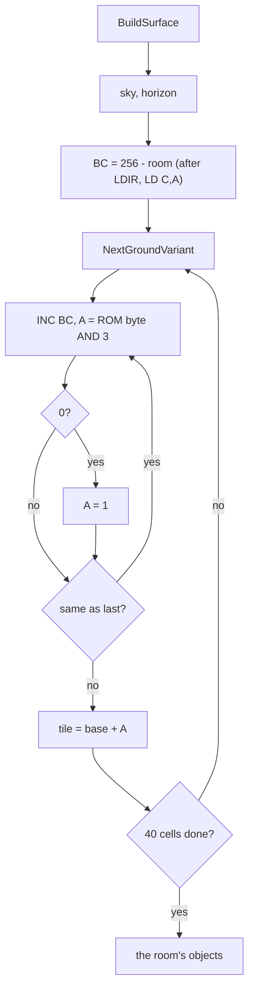

**Why it needs the 48K ROM.** The bytes at `$00FD`-`$0140` of the 48K ROM are the start of the BASIC keyword table
("BIN", "OR", "AND", "<=", ">=", "<>", "LINE", "THEN", "TO", "STEP", "DEF FN", "CAT", "FORMAT", "MOVE", ...). On the
48K they are always there. On the 128K the game runs with `$7FFD` = `$10`: ROM 1, the 48K BASIC, is paged in, and
the 128K's ROM 1 matches the 48K ROM in this range. So the surface is the same on both. With ROM 0 (the 128K
editor) or any other ROM, the ground changes; a ROM of zeros would hang, since every byte gives 1 and 1 = D loops for
ever.

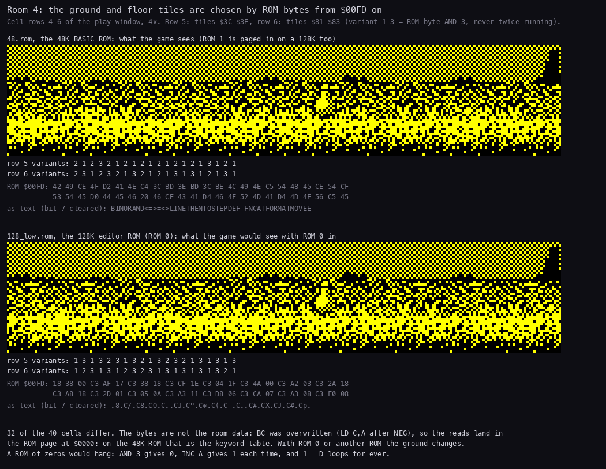

*Figure 6.10: room 4's rows 4-6 built with the 48K ROM and with the 128K editor ROM, with the variants and the ROM
bytes read. Drawn from `src/res` with the two ROM files of unreal-ng (`data/rom/48.rom`, `128_low.rom`): `python3
tools/fig_render.py surface --room 4 --out docs/img/render/surface.png`. The top strip matches `c1`'s screen (figure
6.1).*

How to read:

- Each strip is the play window's cell rows 4-6 at 4 x; the ground tiles `$3C`-`$3E` and the floor tiles `$81`-`$83`
  are three textures each.
- Under it, the variants of rows 5 and 6, then the ROM bytes from `$00FD` as hex and as text.
- 32 of the 40 cells differ between the two ROMs.

Worked example (room 4, 48K ROM): BC starts at `$00FC`; the first read is `$00FD` = `$42` ("B"): AND 3 = 2, D = 2,
tile `$3D`. Next `$49` ("I"): 1, tile `$3C`. Next `$CE` ("N" with bit 7): 2. Next `$4F` ("O"): 3, tile `$3E`. Row 5
of room 4 in `c1` reads `3D 3C 3D 3E ...`, as the figure's first row of variants (2 1 2 3 ...).

The point: the "noise" of the ground is the BASIC keyword table seen through AND 3. It looks random, it is the same
every time, and it is the same on the 48K and the 128K only because both page in the same ROM.

## 6.10 The other drawers

The window renderer draws the play window. A few things are drawn otherwise:

| What | Routine | How |
| --- | --- | --- |
| Havok (kind `$25`) | HavokFade `$872B` | its own code, from ActorUpdate ([doc 10](10-gameplay-logic.md)) |
| the messages (PAUSE GAME, GAME OVER, EXTRA LIFE, BONUS POINTS) | ShowMessage `$66C8` | the message actor, MessageFrames `$F87C` (27 x 16), drawn as an actor in front |
| the title letters | TitleSequence `$A73E` | the pieces `$F996`-`$FD97` through UnpackGroups and DrawActors |
| the panel and the text | the printers | [doc 8](08-hud-and-text.md) |

## 6.11 Code against the screen

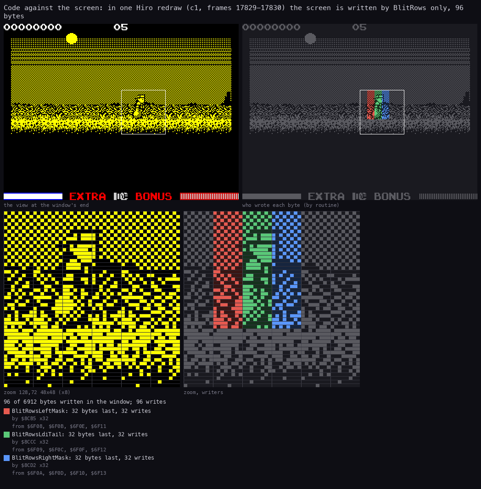

*Figure 6.11: who wrote each screen byte in Hiro's redraw, `c1` frame 17829 T 0 to frame 17830 T 30000. `python3
kit/writers_map.py --work work/docs/zsB/c1 --window 17829:0-17830:30000 --listing build/game.lst --out
docs/img/render/writers-c1.png --sources --zoom 128,72,48,48`.*

How to read:

- Left: the screen at the window's end. Right: each byte coloured by the routine that wrote it last; grey bytes were
  not written.
- The zoom shows the window: three columns of bytes, 32 lines. Red is BlitRows' left byte, green the `LDI` byte,
  blue the right byte.
- The legend lists each writer's bytes and where its values came from: `$6F08`-`$6F13`, the packed lines.

The point: of 6912 screen bytes, 96 change in a redraw, and all of them come from the three stores of BlitRows. The
whole cost of the frame (figure 6.8) goes into the buffer; the screen sees one clean copy.

## 6.12 Where the readings differed

The stage-2 `.ann` said three things the code does not; the `.ann` and the generated sources now say what the code
says.

| Stage-2 claim (corrected) | Where | What the code says |
| --- | --- | --- |
| NextGroundVariant "reads the bytes after the room's own data" | `.ann` of rooms.asm | BC is 256 - room by then: it reads the ROM from `$0000` + 257 - room (6.9) |
| DrawCellLayers: "colour ... from `$66F7` + the high nibble of `$6900` + L" | `.ann` of render.asm | H is `$6C` there (`$68` + 3 + 1): the colour comes from plane `$6C`, as CellColoursTemplate's own comment says |
| BoxColumns / ActorBoxStore: "2-pixel units 0-79" | `.ann` of render.asm | the units are 3 pixels (80 x 3 = 240, the window's width) |

## 6.13 Known only from the code

- A torn window: possible when a blit runs while the beam crosses it; no recording was checked for it.
- A cell with no zone bits under Hiro would trigger a 220-cell walk on every move; no room we dumped has one.
- A surface room built with another ROM paged in would get other ground, and a ROM of zeros would hang.
