# 7. Objects

What this covers: every object of Switchblade and the memory it lives in. A room is a short program. DecodeRoom
`$9F63` runs it into six planes of 220 cells, and its last bytes place the room's hidden items and its enemies. Every
moving thing, Hiro included, is a 66-byte actor record at the start of a memory page, `$5D00-$6600`. This document
gives the room record and the map byte by byte, the actor record, the 73 kinds and their templates, the spawner, the
scheduler, the state machine of each kind, the collision tests, the random numbers and the game variables. How Hiro
walks, jumps, climbs, fights, dies and scores is doc 10. The screen work is doc 6, the pass and the stalls doc 4.

The recordings it rests on ([WALKTHROUGH 6.0](../WALKTHROUGH.md#60-the-recordings)):

- `play48`: the 48K game played from the keyboard on our machine, 3769 frames from the menu
  (`work/stage2/rec/play48`, made by `tools/record.py`). Hiro walks through rooms 4 to 9. He jumps, strikes, breaks a
  block, kills two patrollers, takes two pickups, falls 32 steps and loses four lives. It was opened on an own instance
  after `source work/env.sh`:
  `python3 $RS open --work work/docs/zsC/play48 --ttd work/stage2/rec/play48/session.ttd --model 48K --port-base 37420 --binary $BIN`.
  It was sampled with `work/docs/zsC/sample.py` (TTD `memory_at`):
  - Hiro's page `$5D00` (66 bytes), the game variables `$6642-$6659` and Room `$6BDD`, at every frame 519-3768
    (`work/docs/zsC/play48-hiro.jsonl`);
  - the six planes at frame 2391 (`play48-room8.jsonl`), the spare cells and the room states at frames 2388-2400
    (`play48-room8b.jsonl`);
  - the actor pages `$5D00-$5F42` at frames 2212-2220 (`play48-kill.jsonl`).
- `r034000`: the RZX run's state at RZX frame 34 000, its keys replayed by us for 2000 frames
  (`work/stage2/rzx/r034000`). It was opened the same way into `work/docs/zsC/r034000`. Our replay takes the third
  Fireblade fragment in room 56 and fights two chasers in room 57 (`r034000-frag.jsonl`, `r034000-hiro.jsonl`).
- `r014000`: the RZX run's state at RZX frame 14 000, replayed the same way into `work/docs/zsC/r014000`. Hiro takes a
  ladder from room 20 down into room 28 (`r014000-hiro.jsonl`).
- The L1 execution counts of every build, printed by `python3 tools/l1q.py ADDR` and summed by
  `work/docs/zsC/l1sum.sh`. The builds are the keyed recordings (`c1`, `c48`, `deaths`, `gameover`, `menu`, `rooms`,
  `opt2-4`, `play48`, the 15 POKE probes) and the 71 RZX segments.

The RZX run is another player's complete game. Our replays of its keys drift from it. A fact from a segment is a fact
of our replay, not of the RZX.

A sample of frame N is the memory at the start of frame N. A trace, and so a routine animation, shows an instruction
in the frame where it ran. "The patroller has 2 hit points in frame 2219" means the sample of 2219. The strike that
took them ran during frame 2219 and shows in the sample of 2220.

## 7.1 The six cell planes and the spare cells

A room is 20 cells across and 11 down. A cell is 12 pixels wide and 16 high, so the play area is 240 by 176 pixels.
The game keeps the room as six planes of 256 bytes, one page each, `$6700-$6CFF`. A cell's number is 20 x row +
column, 0-219 (`$00-$DB`), and the same number indexes every plane. A routine reads cell L of plane P with `LD H,P`
and `LD A,(HL)`: the plane is picked by one load.

| Plane | What a cell holds | Written by | Read by |
| --- | --- | --- | --- |
| `$6700` | flags: bits 7-2 the zone mask (one bit a zone), bit 1 a hidden item (a breakable block), bit 0 a tile mark | BuildZones `$A4D1`, SetupRoomObjects `$A41E`, PutTileMarkA, BreakReveal `$9ED7` | RevealZone `$A569`, SpawnEnemy `$A5BF`, the probes |
| `$6800` | the back tiles: the wall outlines of 7.3, the strings of code 0 | DecodeRoom, the commands | the probes, RedrawCell (doc 6) |
| `$6900`, `$6A00`, `$6B00` | three more tile planes: the strings of codes 1-3, the bars, the pieces; the ladders `$53-$55` are in `$6A00` | the commands, SetupRoomObjects | LadderAbove `$9CA7`, ClimbMove `$9C4A`, RedrawCell |
| `$6C00` | the colour: the ink in the high nibble, the shade in the low | the commands | RedrawCell |

Cells `$DC-$FF` of each plane are outside the room. BuildRoomPlanes `$9F34` copies the bottom row of the room above
(cells `$C8-$DB` of its decode) to cells `$EC-$FF` of the four planes `$68-$6B`. Hiro can then stand on the floor
above when he climbs out of the top. The 16 bytes `$DC-$EB` of each plane are free, and the game keeps its room
variables there:

| Address | Name | What it holds |
| --- | --- | --- |
| `$68DC-$68EB` | EnemySlots | one byte for each enemy record of the room: the record's number while its actor lives, 0 when not spawned |
| `$69DC` | HiroFallScript | the low byte of Hiro's hurt animation, `$7A18` or `$7A2F` (doc 10) |
| `$69DF` | MapRow | Hiro's map row, 0-19 |
| `$69E0` | MapColumn | Hiro's map column, 0-29 |
| `$69E1` | Strike | the strike in progress, 1-3 (doc 10) |
| `$69E3` | FireHeld | how long fire was held, for the throw of a weapon (doc 10) |
| `$6ADC` | ItemCount | the room's hidden items |
| `$6ADD` | EnemyCount | the room's enemy records |
| `$6ADE` | EnemyListPtr | where the enemy records start in RoomObjectList `$5B01` |
| `$6AE0` | ZoneCount | the room's zones |
| `$6AE1` | ZoneRecords | a pointer for each zone into the room record; `+$08-+$0A` are DecodeRoom's scratch |
| `$6BDC` | RoomAbove | the room above, 0 for none |
| `$6BDD` | Room | the room, 1-127 |

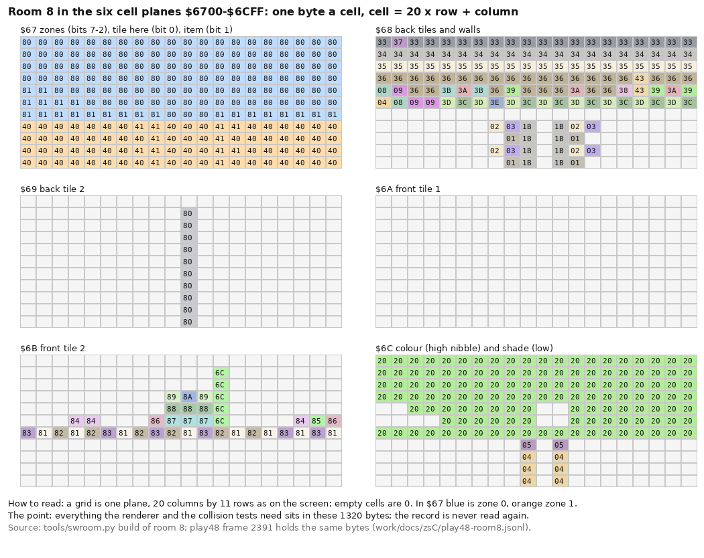

How to read the figure:

- There is one grid a plane, with cell 0 at the top left and 20 cells a row. Each box is the cell's byte in hex,
  blank for 0.
- `$6700` holds the zone bits: the top seven rows read `80` (zone 0), the bottom four `40` (zone 1). `$6800` holds the
  wall tiles of the two outlines. `$6900-$6B00` hold the shaft, the ledges, the pieces and the strings. `$6C00` holds
  the colours.
- The grids are the build of `tools/swroom.py`. The sample of `play48` frame 2391 holds the same 1320 bytes
  (`work/docs/zsC/play48-room8.jsonl`).

**The point**: a room is a set of six parallel arrays indexed by one cell number. Every test in the game (a floor, a
ladder, a block, a zone) is one `LD H,plane` and one read.

```bash
python3 tools/fig_objects.py --only planes
```

Witness: the sample of `play48` frame 2391 equals the swroom build of room 8 in all six planes, cells 0-219. The spare
cells of that sample read `$6ADC` = `00 01 01 5B 02 3C`: no item, one enemy, the enemy list at `$5B01`, two zones
(`play48-room8b.jsonl`).

## 7.2 The room record

Each of the 126 records lives in the room data, Room1 `$A928` to Room127 `$D0F8` (`src/res/rooms/rooms.txt`, the
format in [src/res/rooms/README.md](../src/res/rooms/README.md)). RoomDataAddress `$A3C9` finds a room's record
through the table at `$7100`. Rooms 122 and 123 share one record, Room122And123 `$CF88`: Havok's room is the same
picture twice. A record has five parts, read in order by one pointer BC:

1. The header byte: the number of wall outlines in each of three groups (7.3).
2. The outlines, two bytes each.
3. The commands. A command byte has a code in its low nibble and a repeat in its high nibble, and its operands
   follow (7.4). Code `$F` ends them.
4. The zone records (7.5).
5. The counts byte (enemies in the high nibble, hidden items in the low), then the item records (content, cell) and
   the enemy records (kind, cell), two bytes each.

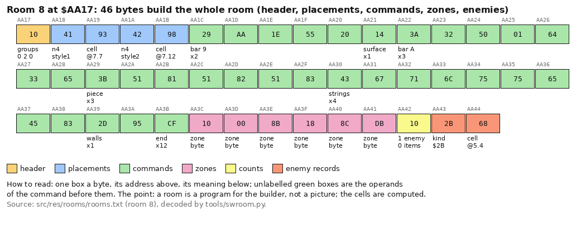

How to read the figure:

- One box is a byte, with its address above and its meaning below; there are three rows of 16.
- Orange is the header, blue the outlines, green the commands with their operands, pink the zone records, yellow the
  counts byte, red the enemy record. The unlabelled green boxes are the operands of the command before them.
- The labels: `n4 style1` and `cell @7.7` are an outline of 4 steps in style 1 from row 7, column 7. `bar 9 x2` is
  code 9 with two operands. `end x12` is the end byte `CF`.

**The point**: a room is a program for the builder, not a picture. 46 bytes build 1320 bytes of planes.

```bash
python3 tools/fig_objects.py --only record
```

Worked example: room 8 is the record at `$AA17`. Its bytes, with the lines of `rooms.txt`:

```text
$AA17  10                          groups 0 2 0: group 1 has two outlines
$AA18  41 93  42 98                place 1 n4 style1 @7.7; place 1 n4 style2 @7.12
$AA1C  29 AA 1E 55 20              bar9 s10 n10 @1.10 ; s5 n5 @1.12
$AA21  14                          surface x1
$AA22  3A 32 50 01 64 33 65        barA s3 n2 @4.0 ; s0 n1 @5.0 ; s3 n3 @5.1
$AA29  3B 51 81 51 82 51 83        piece k5 n1 @6.9 ; k5 n1 @6.10 ; k5 n1 @6.11
$AA30  43 67 71 6C 75 75 65 45 83  strings $6B @5.3=$71 @5.8=$75 @5.17=$65 @3.9=$83
$AA39  2D 95                       walls style1 @7.9
$AA3B  CF                          end x12
$AA3C  10 00 8B                    zone @0.0-6.19
$AA3F  18 8C DB                    zone @7.0-10.19 last
$AA42  10                          one enemy, no hidden item
$AA43  2B 68                       enemy $2B @5.4 (a patroller)
```

Witness: the same 46 bytes are in the `play48` memory at frame 2389. SetupRoomObjects copied `2B 68` to `$5B01`
(the sample of 2391).

## 7.3 The wall outlines: DecodeRoom's first part

DecodeRoom `$9F63` first clears the six planes (ClearRoomCells, `$DC` cells each). The header byte gives three
groups: bits 0-2 are the outlines of group 0, bits 3-5 those of group 1, bits 6-7 those of group 2.

An outline is two bytes. The low nibble of the first is the style. The table RoomPatternStarts `$7300` gives the
style's first shape byte in page `$73`. The high nibble is the number of steps (0 means 256), and the second byte is
the start cell. A shape is a list of step bytes. Each step puts one tile (or the pair 2, 3 when bit 7 is set) into
plane `$68` with PutTileMarkA. It then moves the cell by bits 0-5, and bit 6 sends the shape back to its start. Group
g starts its shape g bytes further, so one shape list serves three looks.

```text
DecodeRoom(BC = record):
    clear the six planes
    header = *BC++
    for group g in 0, 1, 2:
        n = header's field for g                      ; bits 0-2, 3-5, 6-7
        repeat n times:
            p = $7300[*BC & $0F] + g; restart = $7300[*BC & $0F] - 1
            steps = *BC >> 4 (0 = 256); cell = *(BC + 1); BC += 2
            repeat steps times:
                put tile 1 (or tiles 2, 3 when *p bit 7) at cell in plane $68
                cell += *p & $3F
                if *p bit 6: p = restart
                p += 1
    then the commands (7.4)
```

```text
WallRunLoop:
$9F78  PUSH AF
$9F79  PUSH DE
$9F7A  LD A,(BC)              ; the pattern from the table $7300
$9F7B  AND $0F
$9F7D  LD H,$73
$9F7F  LD L,A
$9F80  LD L,(HL)
$9F81  LD A,L
$9F82  DEC A
$9F83  LD (Room+$0001),A      ; its first entry - 1: the restart point
$9F86  LD A,$03               ; the start entry for this group
$9F88  SUB E
$9F89  ADD A,L
$9F8A  LD L,A
$9F8B  CALL OpHighNibble      ; the steps: the high nibble
$9F8E  INC BC
$9F8F  LD A,(BC)              ; the start cell
$9F90  PUSH BC
$9F91  LD B,E
$9F92  LD E,A
$9F93  EX DE,HL
$9F94  LD H,$68               ; plane $68
WallStepLoop:
$9F96  LD A,(DE)              ; bit 7: a pair 2, 3
$9F97  RLA
$9F98  LD A,$01
$9F9A  JR NC,WallTile
$9F9C  INC A
$9F9D  CALL PutTileMarkA
$9FA0  INC L
$9FA1  INC A
WallTile:
$9FA2  CALL PutTileMarkA
$9FA5  LD A,(DE)              ; bits 0-5: the step
$9FA6  AND $3F
$9FA8  ADD A,L
$9FA9  LD L,A
$9FAA  LD A,(DE)              ; bit 6: back to the pattern's start
$9FAB  AND $40
$9FAD  JR Z,WallNextStep
$9FAF  LD A,(Room+$0001)
$9FB2  LD E,A
WallNextStep:
$9FB3  INC E
$9FB4  DJNZ WallStepLoop
```

E counts the groups down from 3, so `3 - E` is the group number g. The restart point is kept in `Room+$0001`
(`$6BDE`), a spare cell used as scratch.

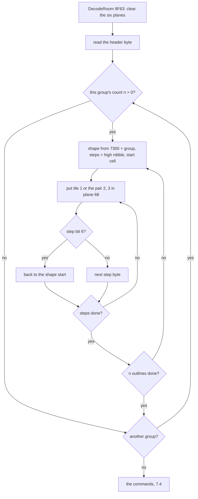

Worked example: room 8's header `10` has bits 3-5 = 2, so group 1 has two outlines and groups 0 and 2 have none.
`41 93` is style 1, 4 steps, from cell `$93` (row 7, column 7). `42 98` is style 2, 4 steps, from cell `$98` (row 7,
column 12). They draw the two stepped stone pillars in the lower half of the room: panel 1 of the figure in 7.6.

Witness: DecodeRoom runs at every room entry, and once more for the room above with the commands cut at code `$D`
(7.4). `play48` ran it for rooms 4-9; the build of room 8 is in frames 2389-2390 (Animation 7.1).

## 7.4 The commands

After the outlines comes a list of commands. NextObjectGroup `$9FD6` takes the code from the low nibble and stores
the high nibble + 1 as the count; for code `$D` the count is (high nibble AND 1) + 2. The loop decrements the count
before each operand, so a command runs its handler "high nibble" times. A command with a high nibble of 0 does
nothing. JumpViaTable `$A00F` finds the handler in RoomCodeHandlers `$73C7`, a word a code. Code `$B` has its own
table, RoomCodeHandlersB `$75EF`, picked by the operand's bits 4-7.

| Code | Operand of one item | What it builds |
| --- | --- | --- |
| 0-3 | 2 bytes: cell, string | a string of tiles from RoomShapes `$7345` into plane `$68` + code |
| 4 | none | the surface: the open-air rows, the sky and the horizon |
| 5-9, `$A`, `$C` | 2 bytes: style << 4 OR length, cell | a bar: a shaft, a beam, a ledge |
| `$B` | 2 bytes: routine << 4 OR length, cell | a piece drawn by a routine of RoomCodeHandlersB |
| `$D` | 1 byte: the cell; the style in the command's bits 7-5 | walls: the back wall filled and shaded from the cell |
| `$E` | 2 bytes | a row of decor tiles |
| `$F` | none | the end: RoomPatch `$72DE`, then the zones |

BuildRoomPlanes decodes the room above with `ZoneRecords+$000A` = `$FF`. Codes `$D` and up then return at once, so
only the codes that paint tiles reach its bottom row.

```text
NextObjectGroup:
$9FD6  LD A,(BC)
$9FD7  AND $0F
$9FD9  LD (ZoneRecords+$0009),A
$9FDC  CP $0D
$9FDE  LD HL,$010F
$9FE1  JR NZ,ObjectGroupCount
$9FE3  LD HL,$0201
ObjectGroupCount:
$9FE6  CALL OpHighNibble
$9FE9  AND L
$9FEA  ADD A,H
$9FEB  LD (ZoneRecords+$0008),A
NextObject:
$9FEE  INC BC
ObjectLoop:
$9FEF  LD HL,ZoneRecords+$0008
$9FF2  DEC (HL)
$9FF3  JR Z,NextObjectGroup
$9FF5  INC L                  ; types from $0D: not for the room above
$9FF6  LD A,(HL)
$9FF7  CP $0D
$9FF9  JR C,DispatchObject
$9FFB  INC L
$9FFC  BIT 7,(HL)
$9FFE  RET NZ
DispatchObject:
$9FFF  LD HL,RoomCodeHandlers ; the table $73C7, a word a type
$A002  LD D,A
$A003  RLCA
$A004  JR JumpViaTable
ObjectTypeB:
$A006  LD HL,RoomCodeHandlersB
$A009  LD A,(BC)
$A00A  RRA
$A00B  RRA
$A00C  RRA
$A00D  AND $1E
JumpViaTable:
$A00F  ADD A,L
$A010  LD L,A
$A011  LD A,(HL)
$A012  INC L
$A013  LD H,(HL)
$A014  LD L,A
$A015  JP (HL)
```

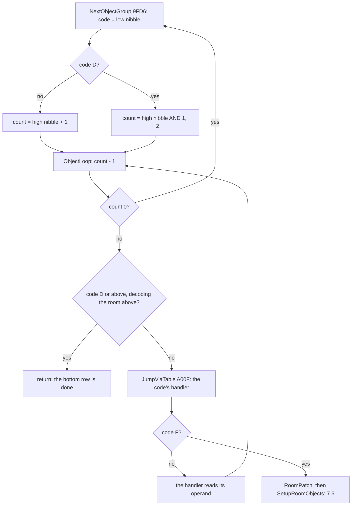

Worked example: `29 AA 1E 55 20` in room 8. Code 9, high nibble 2: the stored count is 3, so the loop runs the
handler twice. The first bar is `AA 1E`: style 10, length 10, cell `$1E` (row 1, column 10). The second is `55 20`:
style 5, length 5, cell `$20` (row 1, column 12). They are the shaft and its rail in panel 2 of the figure in 7.6.
`2D 95` is code `$D` with the high nibble 2, so the count is (2 AND 1) + 2 = 2: one wall, style 1 (bits 7-5 of `$2D`),
at cell `$95` (row 7, column 9).

**The point**: the record is a tiny drawing language. A few generic commands, each with a repeat, draw a whole room.
The room above reuses the same program, stopped before its walls.

Witness: every room entry of every recording runs this loop. The room 8 build of `play48` (frames 2389-2390) is
Animation 7.1.

## 7.5 Zones, hidden items and enemies: SetupRoomObjects

After the end byte, SetupRoomObjects `$A41E` reads the zones, the counts and the object records.

A zone is a part of the room that stays dark until Hiro steps into it (doc 6 draws the reveal, doc 4 times it). A
zone record starts with a byte: n in bits 4-6, "last" in bit 3, m in bits 0-2. The record is 1 + 2n + m bytes long. A
zero byte instead of the records means one default zone, EmptyObjectList `$75FB` (all cells). ZoneRecords `$6AE1`
keeps a pointer to each record. BuildZones `$A4D1` then gives zone k the bit 7 - k. It ORs that bit into the plane
`$67` byte of every cell the record names: n ranges of two cells, then m single cells.

The counts byte follows, enemies in the high nibble and hidden items in the low. The item records (content, cell) are
copied to RoomObjectList `$5B01`, the enemy records (kind, cell) after them. EnemyListPtr `$6ADE` points to the first
enemy. The routine then clears the boss kind at `$9A59`, the active byte (+2) of the nine actor pages `$5E-$66` and
the 16 EnemySlots. Last, each hidden item not yet taken puts its block's tile into its cell and sets bit 1 of the
cell's flags. The content's bits 7-5 pick the block's tile and plane from ObjectTilePlaces `$7BD8`. Its bits 0-4 are
the pickup inside, 0 for none (BreakReveal, 7.11).

```text
SetupRoomObjects(BC = after the end byte):
    if *BC == 0: ZoneRecords[0] = $75FB; BC += 1; zones = 1
    else: for each zone record up to the "last" one: ZoneRecords[k] = BC; BC += 1 + 2n + m
    ZoneCount = zones
    enemies, items = *BC >> 4, *BC & 15
    copy items x 2, then enemies x 2 bytes to RoomObjectList $5B01; EnemyListPtr = the first enemy
    boss kind = 0; actor pages $5E-$66 inactive; EnemySlots = 0
    BuildZones: zone k sets bit 7-k in plane $67 of its cells
    for each item i: if TakenItems $6DFE bit i is clear: draw its block, cell flag bit 1
```

```text
SetupRoomCounts:
$A44D  LD A,D                 ; low nibble items, high nibble enemies
$A44E  LD (ZoneCount),A
$A451  CALL OpHighNibble
$A454  LD D,A
$A455  CALL ReadRun
$A458  LD A,E
$A459  LD (ItemCount),DE
$A45D  LD L,C
$A45E  LD H,B
$A45F  LD B,$00
$A461  LD DE,RoomObjectList   ; copy the item records to RoomObjectList
$A464  OR A
$A465  JR Z,SetupRoomEnemies
$A467  RLCA
$A468  LD C,A
$A469  LDIR
SetupRoomEnemies:
$A46B  LD (EnemyListPtr),DE   ; $6ADE: where the enemy records start
$A46F  LD A,(EnemyCount)
$A472  OR A
$A473  JR Z,SetupRoomClear
$A475  RLCA
$A476  LD C,A
$A477  LDIR
SetupRoomClear:
$A479  XOR A                  ; clear $9A59, the actors' active bytes, the enemy slots
$A47A  LD (RunActorSteps+$000E),A
$A47D  LD B,$09
$A47F  LD HL,IntroBox+$0007
SetupRoomClearActors:
$A482  LD (HL),A
$A483  INC H
$A484  DJNZ SetupRoomClearActors
$A486  LD B,$10
$A488  LD HL,EnemySlots
SetupRoomClearSlots:
$A48B  LD (HL),A
$A48C  INC HL
$A48D  DJNZ SetupRoomClearSlots
$A48F  CALL ActorScreenBox
$A492  CALL BuildZones
```

`IntroBox+$0007` is `$5E02`, the active byte of the first enemy page; the label is the title code that sits there
before play. `RunActorSteps+$000E` is the operand at `$9A59` (7.12).

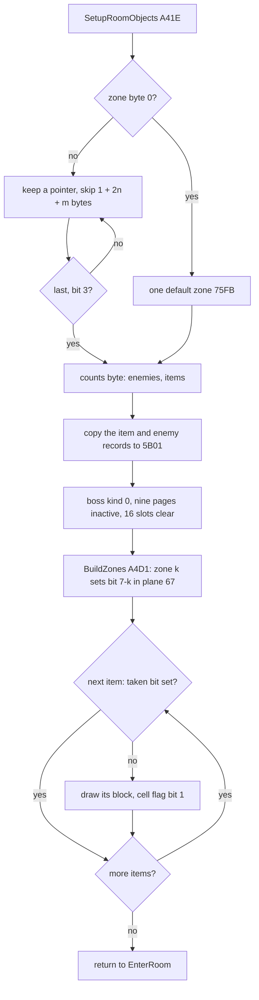

Worked example: room 8. `10 00 8B` is a zone record with n = 1, not last, m = 0: one range, cells `$00-$8B` (rows
0-6). `18 8C DB` has bit 3 set: the last zone, cells `$8C-$DB` (rows 7-10). Zone 0 sets bit 7 and zone 1 bit 6, so
plane `$67` holds `80` in the upper rows and `40` in the lower ones (the figure in 7.1). `10` gives one enemy and no
item, and `2B 68` goes to `$5B01`. The spare cells of the sample of 2391 read ItemCount 0, EnemyCount 1, EnemyListPtr
`$5B01`, ZoneCount 2.

**The point**: the zones are written into the cells once, as bits. Later the reveal (doc 6) and the spawner (7.11)
only AND a cell's flags with a mask. "Is this cell in a zone Hiro has seen?" costs one instruction.

Witness: `play48` frames 2389-2391 (`play48-room8b.jsonl`). The sample of 2389 still holds room 7's counts
`00 02 01 5B 01 FB` (two enemies, the default zone). The sample of 2391 holds room 8's `00 01 01 5B 02 3C`.

## 7.6 A room decoded: room 8, command by command

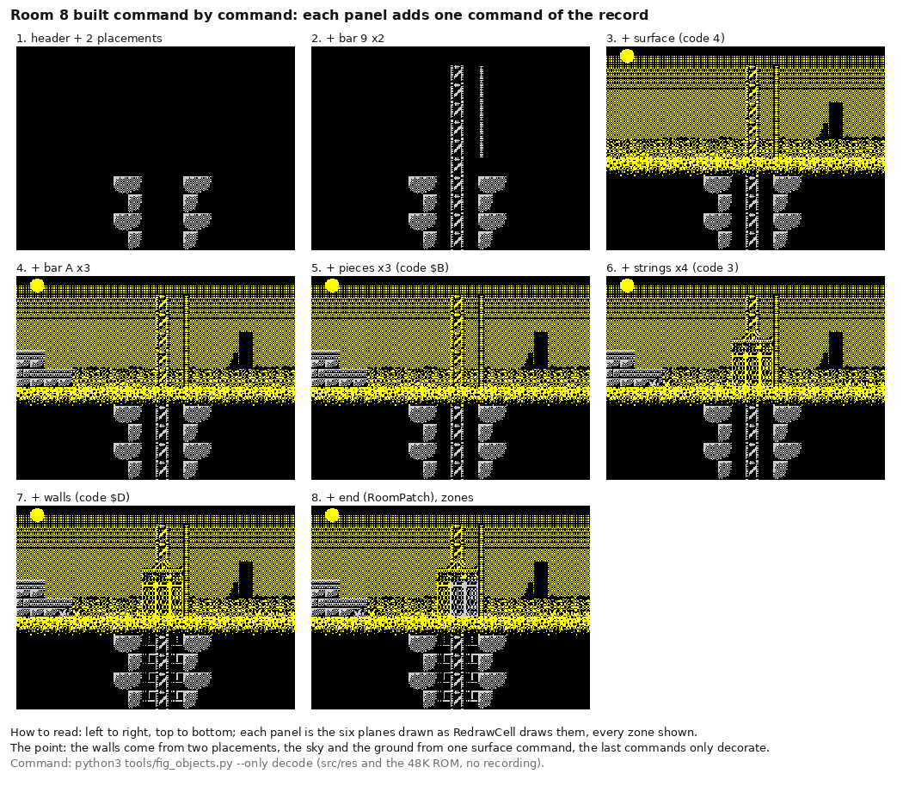

How to read the figure:

- Read it left to right, top to bottom. Each panel is the six planes after one more command of the record, drawn as
  RedrawCell draws them, with every zone shown.
- Panel 1 holds the header and the two outlines, the stone pillars. Panel 2 adds the two bars of code 9, the shaft.
  Panel 3 adds the surface (code 4): the sky, the ground and the sun.
- Panels 4-7 add the bars of code `$A`, the pieces of code `$B`, the strings of code 3 and the walls of code `$D`.
  Panel 8 is the end and the zones.

**The point**: the walls come from two outlines, and the sky and the ground from one command. The last commands only
decorate: the structure of a room costs a few bytes, its look costs the rest.

```bash
python3 tools/fig_objects.py --only decode
```

The build in the game is EnterRoom `$95C3` calling BuildRoomPlanes `$9F34`. BuildRoomPlanes decodes the room above
(with A = `$FF`, cut at code `$D`), copies its bottom row to cells `$EC-$FF`, then decodes the room itself.

```text
BuildRoomPlanes:
$9F34  LD A,(RoomAbove)
$9F37  OR A
$9F38  JR NZ,BuildRoomAbove
$9F3A  LD BC,$14EC            ; no room above: clear the spare row
$9F3D  CALL ClearRoomCells
$9F40  JR BuildRoomCurrent
BuildRoomAbove:
$9F42  CALL RoomDataAddress   ; the room above's data
$9F45  LD A,$FF
$9F47  CALL DecodeRoom
$9F4A  LD H,$68               ; its bottom row to the spare row, four planes
$9F4C  LD A,$04
CopyAboveRowLoop:
$9F4E  LD L,$C8
$9F50  LD E,$EC
$9F52  LD D,H
$9F53  LD BC,$0014
$9F56  LDIR
$9F58  INC H
$9F59  DEC A
$9F5A  JR NZ,CopyAboveRowLoop
BuildRoomCurrent:
$9F5C  LD A,(Room)
$9F5F  CALL RoomDataAddress
$9F62  XOR A                  ; then DecodeRoom $9F63 with A = 0
```

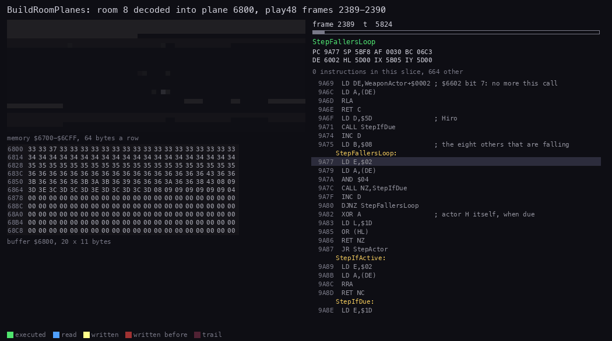

*Animation 7.1. BuildRoomPlanes `$9F34` and DecodeRoom in `play48` frames 2389-2390, 24 pictures of 5824 T. Command:
`python3 ../../kit/routine_anim.py --work work/docs/zsC/play48 --listing build/game.lst --window 2389:0-2391:0 --pc
9F34-A41D --view buffer:6800:20x11:hex --range 6700-6CFF --pictures 24 --out docs/img/routines/BuildRoomPlanes.gif
--title "BuildRoomPlanes: room 8 decoded into plane 6800, play48 frames 2389-2390"`.*

How to read it:

- Left: plane `$6800` as the room's 20 x 11 grid of hex bytes. A byte written in the slice is highlighted.
- Right: the code running in the slice, the current instruction highlighted, and the slice's frame and T-state.
- The run starts with ClearRoomCells (the grid goes blank). It then draws the outlines (the pillars in rows 7-10) and
  runs the commands.

Witness: in `play48` Hiro leaves room 7 for room 8 at frame 2389, and the sample of 2391 equals the swroom build. Hiro
does not move from the sample of 2391 to that of 2427. The build, the masked redraw and the spawn take 38 frames
without a pass; doc 4.5 measures these stalls on the RZX run.

## 7.7 The map and the room change

The map has 127 rooms in 20 rows and 30 columns (`src/res/rooms/map.txt`). It is stored as a list of columns, not a
grid. MapColumns `$7048` gives the column of each room in room order. MapRowCounts `$70C7` gives the number of rooms
in each row, and MapRowStarts `$70DB` the index of each row's first room. FindRoom `$95F9` searches the row's part of
the list for MapColumn with `CPIR`. The room's number is its index + 1, and 0 means no room. The game starts in room
4 (row 0, column 3).

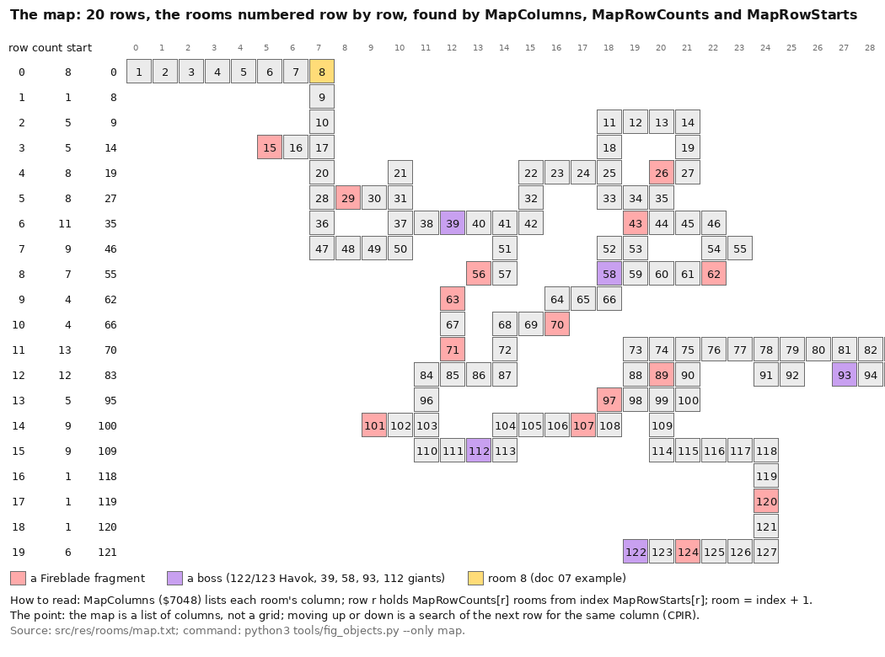

How to read the figure:

- One box is a room at its map row and column; the number is the room's.
- The three columns at the left are the row, MapRowCounts and MapRowStarts.
- Red boxes hold a Fireblade fragment, violet a boss (122/123 Havok, 39, 58, 93 and 112 the giants), yellow room 8,
  the worked example of this document.

**The point**: the map is a list of columns. Moving left or right is a step along the row's list; moving up or down
is a search of the next row for the same column.

```bash
python3 tools/fig_objects.py --only map
```

CheckRoomExit `$955A` runs after each of Hiro's moves. Hiro leaves the room when his Y reaches `$A0` (the bottom) or
`$EC` (the top), or when X plus the animation's offset +`$3D` reaches `$9E` (the right) or `$FA` (the left). The
rows are tested only on a ladder or when Hiro's top is inside the room. Each exit changes MapRow `$69DF` or MapColumn
`$69E0` by one and puts Hiro at the opposite edge:

| Edge | Test | Map change | Hiro's new place |
| --- | --- | --- | --- |
| bottom | Y = `$A0` | row + 1 | Y = `$F0` (-16) |
| top | Y = `$EC` (-20) | row - 1 | Y = `$9C` |
| right | X + offset = `$9E` | column + 1 | X = `$FC` (-4), Y kept |
| left | X + offset = `$FA` (-6) | column - 1 | X = `$9C`, Y kept |

RoomExitEnter then calls HavokRoomLeave when Room is 123 and SaveRoomState `$A58A`. SaveRoomState copies the room's
four state bytes to the room's place in two tables: TakenItems `$6DFE` and RevealedZones `$6DFF` to `$6D00` + 2 x
(room - 1), GoneEnemies `$6EFE-$6EFF` to `$6E00` + 2 x (room - 1). EnterRoom `$95C3` then:

1. finds RoomAbove `$6BDC` (FindRoom on the row above; 0 on row 0) and Room `$6BDD`;
2. calls HavokRoomEnter for room 123 (doc 10);
3. builds the planes (BuildRoomPlanes, 7.6) and the objects (SetupRoomObjects, 7.5). At the end of BuildZones the
   new room's four state bytes are loaded back from `$6D00` and `$6E00`, and RevealZone marks the zone under Hiro;
4. draws the revealed zones (RedrawRoomMasked, doc 6) and spawns the enemies of those zones (SpawnRoomEnemies, 7.11);
5. puts the energy ball back (RestoreShield) when Invulnerable `$6651` is set.

When no edge is crossed, CheckRoomExit calls RevealZone `$A569`. If Hiro stands in a zone not yet seen, its bit joins
RevealedZones, and the new zone's cells are drawn (RedrawCellsMasked) and its enemies spawned (SpawnZoneEnemies).

```text
CheckRoomExit(H = Hiro):
    C = -(+$3D)
    if on a ladder or the top inside the room:
        if Y == $A0: row += 1; Y = $F0; goto enter
        if Y == $EC: row -= 1; Y = $9C; goto enter
    if X + C == $9E: column += 1; X = $FC; Y = the Y before the move; goto enter
    if X + C == $FA: column -= 1; X = $9C; Y = the Y before the move; goto enter
    if RevealZone() finds a new zone D: RedrawCellsMasked; SpawnZoneEnemies(D)
    return
enter:
    if Room == 123: HavokRoomLeave
    SaveRoomState; EnterRoom
```

```text
EnterRoom:
$95C3  LD B,$00               ; B = 0 for the CPIR count
$95C5  LD A,(MapRow)
$95C8  OR A
$95C9  JR Z,EnterRoomAbove
$95CB  DEC A                  ; the row above
$95CC  CALL FindRoom
EnterRoomAbove:
$95CF  LD (RoomAbove),A       ; $6BDC: the room above, 0 none
$95D2  LD A,(MapRow)
$95D5  CALL FindRoom
$95D8  LD (Room),A            ; $6BDD: the room
$95DB  LD A,(Room)
$95DE  CP $7B                 ; room 123: Havok's room hook in page $5F
$95E0  CALL Z,HavokRoomEnter
$95E3  CALL BuildRoomPlanes
$95E6  PUSH AF
$95E7  CALL SetupRoomObjects
$95EA  CALL RedrawRoomMasked
$95ED  CALL SpawnRoomEnemies
$95F0  LD A,(Invulnerable)    ; the energy ball or the death wait on? put it back
$95F3  OR A
$95F4  CALL NZ,RestoreShield
$95F7  POP AF
$95F8  RET
FindRoom:
$95F9  LD H,$70
$95FB  ADD A,$C7
$95FD  LD L,A
$95FE  LD C,(HL)              ; C = the number of rooms in the row
$95FF  ADD A,$14
$9601  LD L,A
$9602  LD A,(HL)              ; L = the row's first entry in the column list
$9603  ADD A,$48
$9605  LD L,A
$9606  LD H,$70
$9608  LD A,(MapColumn)       ; the column
$960B  CPIR
$960D  JR NZ,FindRoomNone
$960F  LD A,L                 ; the room = its place in the list
$9610  SUB $48
$9612  RET
FindRoomNone:
$9613  XOR A                  ; no room there: 0
$9614  RET
```

When MapRow is 0, `JR Z,EnterRoomAbove` stores A = 0, the row number itself, as RoomAbove: "no room above" falls out
of the row being 0.

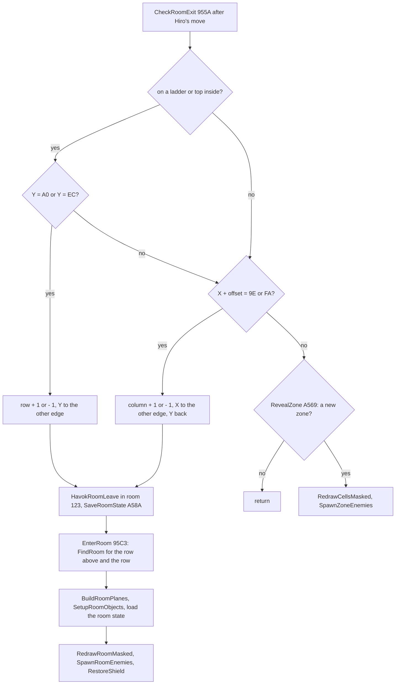

Worked example: `play48` frames 2387-2391. The samples of 2387-2389 show Hiro in room 7 at Y `$20`, X `$9C`, facing
right, offset +`$3D` = 0. His step during frame 2389 takes X to `$9E`. CheckRoomExit sets MapColumn 6 → 7 and X =
`$FC`. SaveRoomState writes room 7's bytes to `$6D0C` (`00 80`: nothing taken, zone 0 seen) and `$6E0C` (`C0 00`: both
enemies gone, the patroller killed at frame 2219 and the gem taken at 2318). The sample of 2390 already reads Room 8.
FindRoom for row 0 (MapRowCounts 8, MapRowStarts 0) finds column 7 at index 7: room 8. RoomAbove is 0, so the spare
row is cleared. The sample of 2391 shows the four state bytes of room 8: TakenItems 0, RevealedZones `$80` (zone 0,
where Hiro stands, by RevealZone) and GoneEnemies `00 00`.

Witness: EnterRoom ran 6 times in `play48` (the start and rooms 5-9), 38 times in the other keyed builds and 136 times
in 56 RZX segments. The bottom exit `$95A1` ran once in `play48`: the fall from room 8 into room 9 at frame 2980 (Y
`$9C` in the sample of 2980, `$F0` in that of 2981). The top exit `$95A4` ran only in 3 RZX segments.

## 7.8 Every object on the map

A room's enemy records name the kinds that appear in it. Kinds below `$23` are pickups shown on the floor. A kind with
bit 7 set is a timed pickup: it waits a random time, appears, and lives 255 frames (7.11). The hidden-item records
sit in blocks: the content byte's bits 0-4 are the pickup inside, 0 for an empty block.

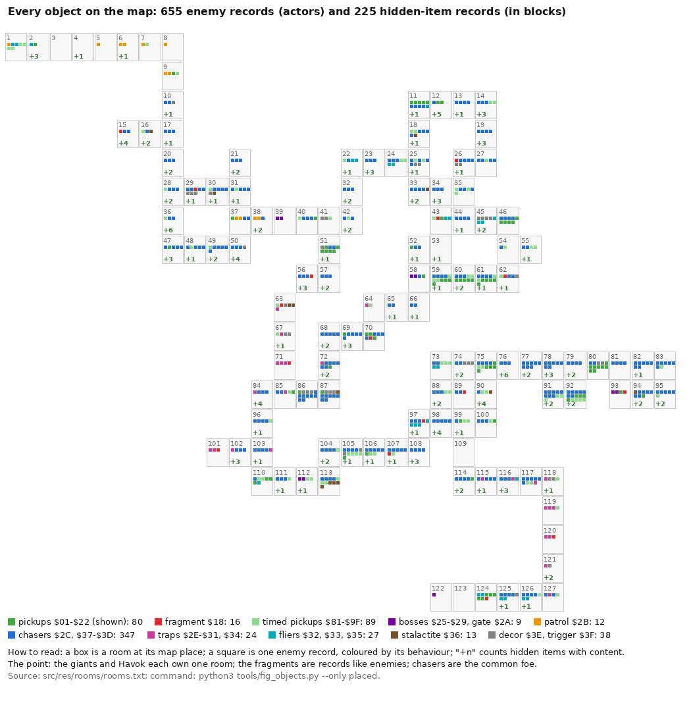

How to read the figure:

- One box is a room at its map place, its number at the top left. One small square is one enemy record, coloured by
  the group of its kind (the legend gives each group's count).
- "+n" in green counts the room's hidden items with a content (not the empty blocks).

**The point**: the giants and Havok each own one room. The fragments are records like the enemies. Chasers are the
common foe: 347 of the 655 records.

```bash
python3 tools/fig_objects.py --only placed
```

The enemy records by kind (from `src/res/rooms/rooms.txt`; a number in brackets counts the records in that room):

| Kinds | Records | What | Rooms |
| --- | ---: | --- | --- |
| `$01`, `$04` | 2 | gems, 50 and 400 | 70, 106 |
| `$07-$0B` | 8 | the letters E X T R A | 12, 86, 100, 94, 47, 114, 52, 93 |
| `$0D`, `$0E`, `$10` | 5 | the letters O N S of BONUS | 110, 51, 85, 37, 105 |
| `$13`, `$14`, `$17` | 5 | weapon shields | 69, 2, 75, 110 (2) |
| `$18` | 16 | the Fireblade fragments | 15, 26, 29, 43, 56, 62, 63, 70, 71, 89, 93, 97, 101, 107, 120, 124 |
| `$1A`, `$1B` | 2 | speed-up, bullets | 12, 43 |
| `$1E` | 2 | vitality | 9, 87 |
| `$1F` | 3 | invulnerability | 40, 72, 99 |
| `$20-$22` | 53 | orbs, 1000, 2000, 5000 | 11 (5), 46 (5), 51 (5), 58-61, 70, 75, 80, 92, 124 |
| `$81-$9F` | 89 | timed pickups: gems `$81-$85` (26), weapons `$92-$96` (6), power-ups `$99` (37), speed-ups `$9A` (13), bullets `$9B`, vitality `$9E` (5: rooms 42, 62, 73, 75, 85), invulnerability `$9F` (room 35) | 55 rooms |
| `$25` | 1 | Havok | 122 and 123 (one record) |
| `$26-$29` | 4 | the giants | 39, 58, 112, 93 |
| `$2A` | 4 | the gates of the giants | 39, 58, 93, 112 |
| `$2B` | 12 | patrollers | 1, 5, 6 (2), 7, 8, 9 (2), 37 (2), 38 (2) |
| `$2C`, `$37-$3D` | 347 | chasers: `$2C` 27, `$37` 28, `$38` 65, `$39` 64, `$3A` 40, `$3B` 12, `$3C` 55, `$3D` 56 | 98 rooms |
| `$2E-$31`, `$34` | 24 | traps | 63, 64, 67, 71, 72, 84, 85, 101, 102, 103, 115-121, 127 |
| `$32`, `$33`, `$35` | 27 | fliers | 1, 2, 11, 22, 24, 43, 45, 73, 97, 110, 116, 124-126 |
| `$36` | 13 | stalactites | 16, 18, 30, 33, 63 (2), 87, 90, 94, 113 (4) |
| `$3E` | 2 | decor | 30, 51 |
| `$3F` | 36 | triggers | 10, 25, 26, 29, 41, 45, 50, 62, 63, 67, 74, 80, 86, 87, 105, 118, 121, 125 |

The 225 hidden items hold: nothing (63); gems and the flask (41); letters (22); weapon shields (28); power-ups (34);
speed-ups (11); bullets (8); the two reset shields (2); vitality (15); invulnerability (1).

Witness: the counts are those of the records; the rooms of `play48` (4-9) hold patrollers, a timed gem `$81` (room 7),
a vitality `$1E` (room 9) and hidden items. In `play48` the patroller of room 8 spawned at frame 2427 (7.11) and the
timed gem of room 7 was taken at frame 2318.

## 7.9 The actor record

An actor is 66 bytes at the start of a page. Hiro is `$5D00`. The seven pages `$5E00-$6400` hold the enemies, pickups
and sparks. `$6500` (ActorPage9) holds the energy ball, and `$6600` (WeaponActor) the thrown weapon or a boss's shot.
The code reaches a field with H = the page and `LD L,field`, so every routine works on any actor. The rest of each
page holds the actor's sprite buffers (doc 6) and, below `$6600`, the templates.

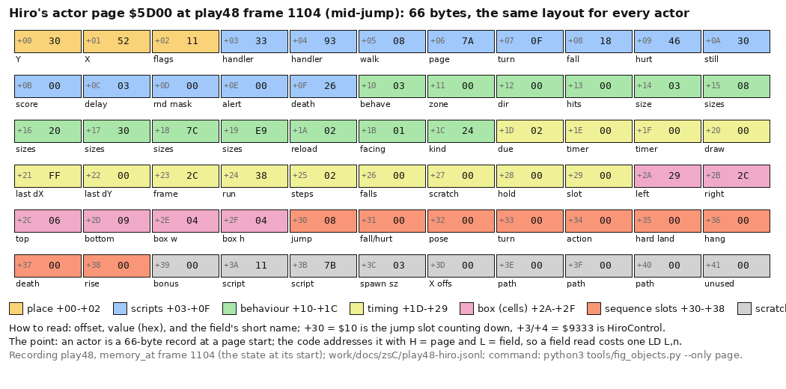

How to read the figure:

- Each box is one field: its offset, its value in hex in the sample of `play48` frame 1104, its short name below.
- The colour gives the group: orange the place, blue the scripts and handlers copied from the template, green the
  behaviour, yellow the timing, pink the box, red the sequence slots, grey the scratch.
- Hiro is in a standing jump: the jump slot +`$30` = 8 steps left, flags `11` (active, strike armed), Y `$30`, X
  `$52`, handler `$9333` (HiroControl).

**The point**: one record serves Hiro, a giant, a gem and a spark. The kind byte +`$1C` and the handler +`$03` decide
what it is; the slots +`$30-$38` decide what it is doing.

```bash
python3 tools/fig_objects.py --only page
```

| Offset | Field | Meaning |
| --- | --- | --- |
| `+$00`, `+$01` | Y, X | Y in pixels (16 a cell), X in units of 1.5 pixels (8 a cell, 160 a room) |
| `+$02` | flags | bit 0 active, bit 1 in the air, bit 2 falling, bit 3 on a ladder, bit 4 a strike armed, bit 5 the last frame shown, bit 7 a bonus rising |
| `+$03`, `+$04` | handler | the state handler, run when no slot is busy |
| `+$05-+$0A` | scripts | the walk list and the script page, then the low bytes of the turn, fall, hurt and still scripts |
| `+$0B` | score | the score index for AddScore `$99E7` when it dies |
| `+$0C` | delay | frames between steps (copied to +`$1A`) |
| `+$0D` | random mask | ANDed with Random for the hold +`$28` |
| `+$0E` | alert | a script run when the hold ends (TurnToHiro) |
| `+$0F` | death | the death script's low byte |
| `+$10` | behaviour | bit 2 crush, bit 3 on an object, bit 4 hurt, bit 5 expired; bits 6-7 come from the template (`$40` the gate and the triggers, `$42` the stalactite), and TriggerControl stops animating while bit 7 is set |
| `+$11` | zone | the touch zone 1-5 for HiroInZone `$9529`, 0 none (a trap clears it while it runs) |
| `+$12` | direction | the template's direction or patrol length |
| `+$13` | hits | hit points; 0 cannot be hurt; also the damage this actor does |
| `+$14-+$19` | size | the size class and the sprite sizes |
| `+$1A` | reload | the step delay |
| `+$1B` | facing | `$01`/`$02` right, `$FF`/`$FE` left |
| `+$1C` | kind | `$00-$48` (7.10) |
| `+$1D` | due | frames to the next step; 0 = due |
| `+$1E`, `+$1F` | timer | a lifetime in frames (the timed pickups, the ball, the sparks) |
| `+$20-+$23` | draw | clip bits, the last move, the frame shown |
| `+$24`, `+$25` | run, steps | the walk counters (a run of 4 steps or more makes a long jump) |
| `+$26` | falls | the fall steps (doc 10) |
| `+$27` | scratch | a chaser's wander count, a trap's zone |
| `+$28` | hold | frames to wait before the first step |
| `+$29` | slot | the enemy record's number, 0 for none |
| `+$2A-+$2D` | box | left, right, top, bottom: X / 2 (3-pixel columns) and Y / 8 (8-pixel rows) |
| `+$30-+$38` | slots | jump, fall or hurt, pose, turn, action, hard landing, hang (ladder), death, rise: steps left, 0 idle |
| `+$3A`, `+$3B` | script | the running script's pointer |
| `+$3E-+$40` | path | the path's step count and the patrol counters |

Witness: `play48-hiro.jsonl` holds Hiro's page at every frame 519-3768; the figure is its frame 1104.

## 7.10 The kinds and their templates

The kind byte +`$1C` picks a template. KindTemplates `$7200` holds a word a kind: the address of an 18-byte template
(PageTail61, `src/res/tables/actor-templates.csv`) or, for the pickups, of an item record. InitActor `$A65D` copies
the template to +`$03-+$14` and clears the rest. The handler in the template decides the behaviour; eleven handlers
drive the 73 kinds.

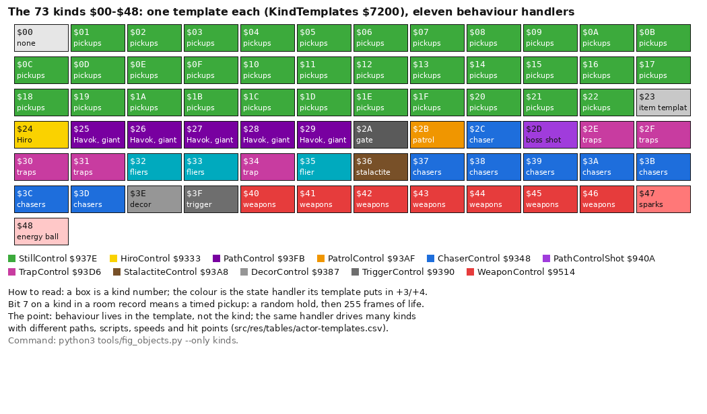

How to read the figure:

- One box is a kind number with its name. The colour is the state handler of its template (the legend names them).
- Green: the pickups `$01-$22` share one template, SharedEnemyTemplate `$65B8` (StillControl), with the frame and the
  score of their item record.

**The point**: the behaviour lives in the template, not in the kind. One handler drives many kinds with their own
paths, scripts, speeds and hit points.

```bash
python3 tools/fig_objects.py --only kinds
```

| Kind | Name | Handler | Score | Hits | Other |
| --- | --- | --- | --- | ---: | --- |
| `$01-$22` | pickups | StillControl `$937E` (SharedEnemyTemplate) | the item's | 0 | 7.8; the effects in doc 10 |
| `$24` | Hiro | HiroControl `$9333` | | 0 | |
| `$25` | Havok | PathControl `$93FB` | 50000 | 42 | step every 5 frames |
| `$26-$29` | the giants | PathControl | 5000 | 18, 36, 30, 54 | |
| `$2A` | a gate | StillControl | | 0 | behaviour `$40` (still) |
| `$2B` | patroller | PatrolControl `$93AF` | 50 | 2 | 16 steps each way, step every 3 frames |
| `$2C` | chaser | ChaserControl `$9348` | 350 | 2 | random hold mask `$1F` |
| `$2D` | a boss's shot | PathControlShot `$940A` | | `$80` | 8 energy on touch |
| `$2E-$31` | traps | TrapControl `$93D6` | 100 | 2 | zone 1 (`$2E`, `$30`) or 2 (`$2F`, `$31`) |
| `$32`, `$33`, `$35` | fliers | PathControl | | 0 | cannot be hurt |
| `$34` | trap | TrapControl | 100 | 6 | zone 3 |
| `$36` | stalactite | StalactiteControl `$93A8` | | 0 | zone 5, behaviour `$42` |
| `$37` | chaser | ChaserControl | 200 | 9 | |
| `$38` | chaser | ChaserControl | 250 | 9 | |
| `$39` | chaser | ChaserControl | 100 | 6 | |
| `$3A`, `$3B` | chasers | ChaserControl | 300 | 12 | |
| `$3C` | chaser | ChaserControl | 300 | 3 | |
| `$3D` | chaser | ChaserControl | 250 | 9 | |
| `$3E` | decor | DecorControl `$9387` | | 0 | |
| `$3F` | trigger | TriggerControl `$9390` | | 0 | zone 4, behaviour `$40` |
| `$40-$46` | Hiro's weapons | WeaponControl `$9514` | | | WeaponTemplate `$64EE`, doc 10 |
| `$47` | a spark | PathControl | | | lives 170 frames |
| `$48` | the energy ball | PathControl, with ShieldFollow `$94E1` | | | Invulnerable while it lives |

The touch zones (`src/res/tables/touch-zones.csv`, at `$5FAC` in play) are four bytes each: Hiro's place relative to
the actor, Y from, Y to, X from, X to.

| Zone | Y range | X range | Used by |
| --- | --- | --- | --- |
| 1 | -16 to 0 | -39 to 40 | traps `$2E`, `$30` |
| 2 | -36 to 35 | -31 to 30 | traps `$2F`, `$31` |
| 3 | -48 to 15 | -48 to 47 | trap `$34` |
| 4 | -1 to 31 | -16 to 15 | trigger `$3F` |
| 5 | -16 to 31 | -16 to 15 | stalactite `$36` |

Witness: the templates are the bytes of `$6182-$65FF` in every play recording; InitActor ran for every spawn
(SpawnEnemy `$A5BF` ran 30 times in `play48`).

## 7.11 The spawner

An enemy record becomes an actor only when three things hold: its cell is in a zone Hiro has seen, its slot in
EnemySlots is free, and an actor page among `$5E-$64` is free. SpawnRoomEnemies `$A59B` tries every record of the
room. It runs at the end of EnterRoom, when a new zone is revealed (SpawnZoneEnemies `$A59E`, with only that zone's
bit), when an actor's death sequence ends (DeathStep `$91D1`), and when an actor leaves the window (`$8ABB`). A
record killed in this room stays dead: its bit in GoneEnemies `$6EFE-$6EFF` is set by MarkSpawnKilled `$9137`, and
SaveRoomState keeps it with the room.

SpawnEnemy `$A5BF` takes a free page (FindFreeActor `$9F2C` looks for active bit 0 clear) and writes the record's
number into its slot. It turns the cell into a pixel place (CellPixel) and finds the template (TemplateForKind
`$A652`). A pickup kind (`$01-$22`) uses SharedEnemyTemplate `$65B8`, patched with its item record's frame and score.
InitActor `$A65D` fills the page, and +`$29` keeps the record's number. A kind with bit 7 (a timed pickup) or a kind
from `$40` gets a hold: +`$28` = Random AND +`$0D`. It waits that many steps before its first move.

```text
SpawnRoomEnemies(C = the zone mask, RevealedZones for a whole room):
    gone = GoneEnemies, read from bit 7 of $6EFE onwards
    for each enemy record r (B = EnemyCount down to 1):
        if gone bit of r: continue
        if (plane $67 at r.cell) AND C == 0: continue    ; zone not seen
        if EnemySlots[B] != 0: continue                  ; already alive
        page = the first of $5E-$64 with +2 bit 0 clear, else stop
        EnemySlots[B] = B
        template = KindTemplates[r.kind AND $7F]; pickups: SharedEnemyTemplate + the item's frame and score
        InitActor(page, template, r.kind, CellPixel(r.cell)); page+$29 = B
        if r.kind bit 7 or r.kind >= $40: page+$28 = Random() AND page+$0D
```

```text
SpawnRoomEnemies:
$A59B  LD A,(RevealedZones)
SpawnZoneEnemies:
$A59E  LD C,A
$A59F  LD A,(EnemyCount)
$A5A2  OR A
$A5A3  RET Z
$A5A4  LD B,A
$A5A5  LD IX,(EnemyListPtr)
$A5A9  LD DE,(GoneEnemies)
SpawnRoomEnemiesLoop:
$A5AD  PUSH BC
$A5AE  RL D
$A5B0  RL E
$A5B2  PUSH DE
$A5B3  CALL NC,SpawnEnemy
$A5B6  INC IX
$A5B8  INC IX
$A5BA  POP DE
$A5BB  POP BC
$A5BC  DJNZ SpawnRoomEnemiesLoop
$A5BE  RET
SpawnEnemy:
$A5BF  LD L,(IX+$01)
$A5C2  LD H,$67
$A5C4  LD A,C
$A5C5  AND (HL)
$A5C6  RET Z
$A5C7  LD HL,TitleColours+$01E1 ; the enemy's slot in $68DC-$68EB
$A5CA  LD A,L
$A5CB  ADD A,B
$A5CC  LD L,A
$A5CD  XOR A
$A5CE  OR (HL)
$A5CF  RET NZ
$A5D0  PUSH BC
$A5D1  EX DE,HL
$A5D2  LD B,$07
$A5D4  LD HL,IntroBox+$0007   ; a free actor page among $5E00-$6400
$A5D7  CALL FindFreeActor
$A5DA  POP BC
$A5DB  RET C
$A5DC  LD A,B
$A5DD  LD (DE),A
...
$A611  LD A,(IX+$00)
$A614  CALL InitActor
$A617  EX AF,AF'
$A618  LD E,$29
$A61A  LD (DE),A
$A61B  LD A,(IX+$00)
$A61E  RLA
$A61F  JR C,SpawnEnemyRandom
$A621  CP $40
$A623  JR C,SpawnEnemyDone
SpawnEnemyRandom:
$A625  CALL Random            ; +$28 = Random AND +$0D
$A628  POP HL
$A629  LD L,$0D
$A62B  AND (HL)
$A62C  LD L,$28
$A62E  LD (HL),A
$A62F  RET
```

`RL D` then `RL E` moves the 16 gone bits through the carry: the carry tested for the first record is bit 7 of
`$6EFE`, for the second bit 6, and so on into `$6EFF`. `TitleColours+$01E1` is `$68DB`: EnemySlots - 1, so slot B is
`$68DB` + B.

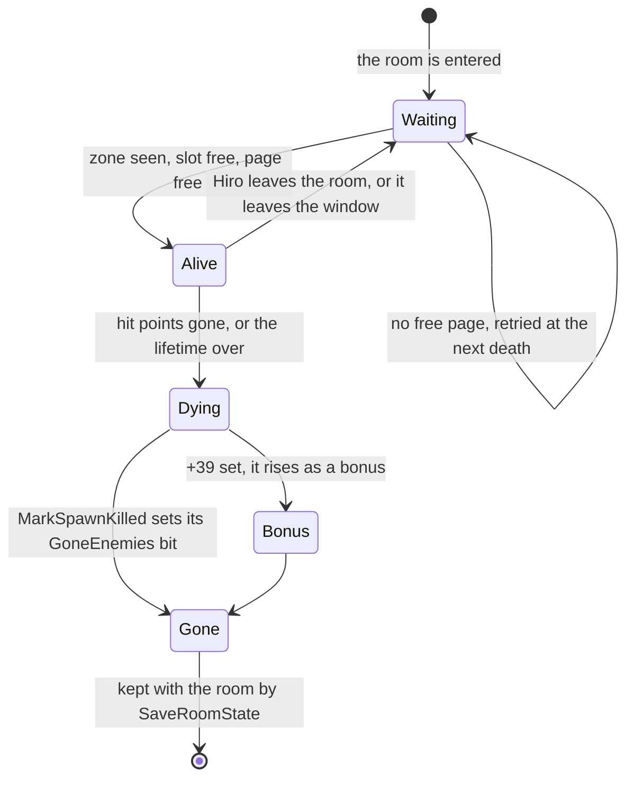

Worked example: room 8 in `play48`. EnterRoom starts in frame 2389. The build and the masked redraw take until frame
2427, and SpawnRoomEnemies runs during frame 2427. RevealedZones is `$80` and GoneEnemies `00 00`. The one record
`2B 68`: cell `$68` has flags `$80`, and `$80 AND $80` is not 0. Slot `$68DC` is 0. Page `$5E` is free. The slot becomes 1,
and CellPixel turns cell `$68` (row 5, column 4) into Y `$50`, X `$20`. The template of kind `$2B` is `$62CA`
(PatrolControl, 2 hit points, 50 points). The sample of 2428 shows page `$5E` at `50 20 01`: Y `$50`, X `$20`,
active; `$68DC` = 1. Kind `$2B` is below `$40` without bit 7, so it has no hold, and in the sample of 2430 it has
already stepped to X `$22`.

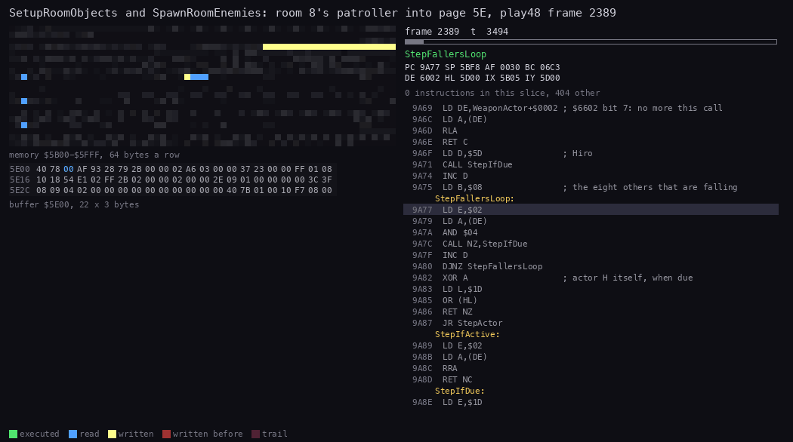

*Animation 7.2. SpawnRoomEnemies `$A59B`, SpawnEnemy, FindFreeActor and InitActor in `play48` frame 2427, 16 pictures
of 4368 T. Command: `python3 ../../kit/routine_anim.py --work work/docs/zsC/play48 --listing build/game.lst --window
2427:0-2428:0 --pc A59B-A6A0,9F2C-9F33 --view buffer:5E00:22x3:hex --range 5B00-6EFF --pictures 16 --out
docs/img/routines/SpawnRoomEnemies.gif --title "SpawnRoomEnemies: room 8's patroller 2B put on page 5E, play48 frame
2427"`.*

How to read it:

- Left: the first 66 bytes of page `$5E00`, 22 a row, the bytes written in the slice highlighted.
- Right: the code of the slice, the current instruction highlighted.
- The page fills in three steps: Y and X (+0, +1), the cleared fields (+`$1C` on), then the template's 18 bytes
  (+3 to +`$14`) and the kind.

**The point**: a record is spawned only where Hiro can see it, and only into a free page. With seven pages and up to
16 records a room, the spawner is called again after each death to fill the freed page.

Witness: SpawnEnemy ran 30 times in `play48`, 551 times in the other keyed builds and 2963 times in 68 RZX segments.
The hold `$A625` ran 7 times in `play48`. The window release `$8ABB` ran only in 3 RZX segments. The spawn of room 8
is in the samples of 2427 (page `$5E` inactive) and 2428 (active).

### The hidden items: BreakReveal

A block is a cell with bit 1 of its flags. When Hiro's strike or a weapon breaks it (ProbeStrikeCell `$9DCA`, doc
10), BreakReveal `$9ED7` clears the bit, finds the item in RoomObjectList by its cell and sets its taken bit in
TakenItems `$6DFE`. Content AND `$1F` = 0 is an empty block. Otherwise the pickup kind goes into the operand at
`$9F1C`, and its frame and score into the shared template. FindFreeActorAtCell `$9F29` gives a page. InitActor makes
kind + `$80`, so StartLifetime gives it 255 frames at its first step, and +2 bits 1 and 2 make it drop to the floor.
The break also gives 10 points and sparks (doc 10).

```text
BreakReveal:
$9ED7  LD H,$67
$9ED9  RES 1,(HL)
$9EDB  LD A,L
$9EDC  LD HL,RoomObjectList   ; the hidden-item list
$9EDF  LD B,$01
FindHiddenLoop:
$9EE1  INC HL
$9EE2  CP (HL)
$9EE3  JR Z,FoundHidden
$9EE5  INC HL
$9EE6  INC B
$9EE7  JR FindHiddenLoop
FoundHidden:
$9EE9  DEC HL                 ; DE = the content byte
$9EEA  EX DE,HL
$9EEB  LD HL,TakenItems       ; the item's taken bit
$9EEE  XOR A
$9EEF  SCF
HiddenBitLoop:
$9EF0  RRA
$9EF1  DJNZ HiddenBitLoop
$9EF3  OR (HL)
$9EF4  LD (HL),A
$9EF5  LD A,(DE)              ; the content: 0 empty
$9EF6  AND $1F
$9EF8  RET Z
...
$9F1B  LD A,$00               ; LD A,n: n = the pickup's kind
$9F1D  OR $80                 ; kind + $80: StartLifetime at its first step
$9F1F  CALL InitActor
$9F22  LD E,$02               ; it drops: in the air, falling
$9F24  LD A,(DE)
$9F25  OR $06
$9F27  LD (DE),A
$9F28  RET
```

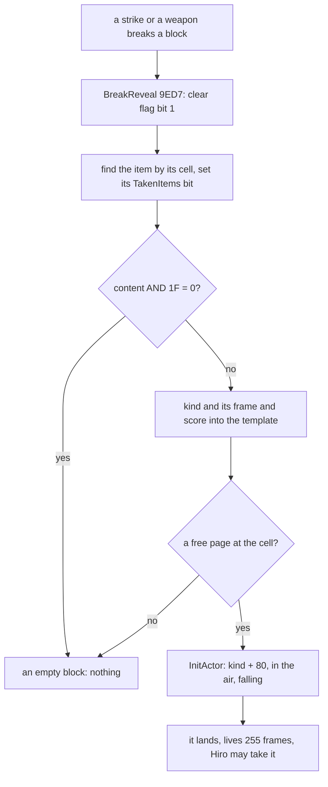

Worked example: `play48` frame 1458 in room 6. Hiro, at X `$10` facing right, strikes the block at cell `@5.3` (`rooms.txt`:
`pickup t1 n30 @5.3`, content 30 = kind `$1E`, vitality). The sample of 1460 shows page `$60` with kind `$9E`
(`$1E` + `$80`) at Y `$50`, X `$18`, flags `07` (active, in the air, falling), and a spark (kind `$47`) in page `$62`.
At 1462 it has landed (flags `01`) and its kind reads `$1E`: StartLifetime ran. Hiro walks onto it, and the sample of
1492 shows flags `21` (its last frame); the page is free at 1494. Hiro had full energy, so the vitality refill
changed nothing.

Witness: BreakReveal ran once in `play48` (frame 1458) and 44 times in 25 RZX segments.

## 7.12 The scheduler: RunActorSteps and StepActor

A pass of the main loop calls ActorUpdate `$8E2B` once for each active page (doc 4). ActorUpdate calls RunActorSteps
`$9A4B` with H = the page. RunActorSteps runs at most one actor's step, picked by priority:

1. On every other call, the shot page `$66` when it is active. On the calls between, the boss in page `$60`, when the
   operand at `$9A59` holds a boss kind (a boss fight).
2. If bit 7 of `$6602` is set, nothing more.
3. Hiro, if his due counter +`$1D` is 0.
4. Each of the eight other pages that is falling (+2 bit 2) and due.
5. The page H itself, if due.

StepIfDue pops its caller's return address. When it finds a due actor, that actor's step returns straight to
ActorUpdate, and the actors after it wait for the next call.

StepActor `$9A99` reloads the due counter from +`$1A`. A hold +`$28` counts down first; when it ends, an alert script
in +`$0E` turns the actor towards Hiro (TurnToHiro `$9087`). StartLifetime starts a timed pickup's 255 frames. Then
the first busy slot of +`$30-$38` runs its step routine from the table `$73E7`. With no slot busy, the flags pick:
in the air → FallStep; hurt → FallSequenceStart; expired → ActorExpired; crush bit → StartHurtSeq. For Hiro, a
pending FireRequest starts HiroAttack. Otherwise the handler +`$03` runs.

```text
StepActor(H):
    H+$1D = H+$1A                                  ; due again in "reload" frames
    if H+$28:                                      ; holding
        H+$28 -= 1
        if H+$28: H+$1D = H+$28; return
        if H+$0E: TurnToHiro; return
    StartLifetime
    for slot in $30..$38: if H+slot: run SlotHandlers[slot]; return
    if H+2 bit 1: FallStep
    elif H+$10 bit 4: FallSequenceStart
    elif H+$10 bit 5: ActorExpired
    elif H+$10 bit 2: StartHurtSeq
    elif H is Hiro and FireRequest: HiroAttack
    else: jump to H+$03
```

```text
StepActor:
$9A99  LD L,$1A               ; the frame delay again
$9A9B  LD E,(HL)
$9A9C  LD L,$1D
$9A9E  LD (HL),E
$9A9F  LD L,$28               ; +$28: holding
$9AA1  OR (HL)
$9AA2  JR Z,StepActorSlots
$9AA4  DEC (HL)
$9AA5  JR Z,HoldExpired
$9AA7  LD A,(HL)
$9AA8  LD L,$1D
$9AAA  LD (HL),A
$9AAB  RET
HoldExpired:
$9AAC  XOR A                  ; a wake animation in +$0E?
$9AAD  LD L,$0E
$9AAF  OR (HL)
$9AB0  JP NZ,TurnToHiro
StepActorSlots:
$9AB3  CALL StartLifetime     ; the kind's bit 7: its lifetime starts
$9AB6  LD (AnimateFrame+$001A),A ; the slow-walk flag off
$9AB9  LD DE,ActorKindHandlers ; the slot table $73E7 (DE + 2 first)
$9ABC  LD L,$2F
$9ABE  LD B,$09
FindSlotLoop:
$9AC0  INC E
$9AC1  INC E
$9AC2  INC L
$9AC3  OR (HL)
$9AC4  JR NZ,RunSlotHandler
$9AC6  DJNZ FindSlotLoop
$9AC8  LD L,$02               ; in the air: fall
$9ACA  BIT 1,(HL)
$9ACC  JP NZ,FallStep
$9ACF  LD L,$10               ; hurt
$9AD1  BIT 4,(HL)
$9AD3  JP NZ,FallSequenceStart
$9AD6  BIT 5,(HL)             ; expired: its end
$9AD8  JP NZ,ActorExpired
$9ADB  BIT 2,(HL)             ; bit 2
$9ADD  JP NZ,StartHurtSeq
$9AE0  LD A,H                 ; Hiro: a combat move pending?
$9AE1  CP $5D
$9AE3  JR NZ,RunHandler
$9AE5  LD A,(FireRequest)
$9AE8  OR A
$9AE9  JP NZ,HiroAttack
RunHandler:
$9AEC  LD L,$03
$9AEE  LD C,(HL)
$9AEF  INC L
$9AF0  LD B,(HL)
JumpToHandler:
$9AF1  PUSH BC
$9AF2  POP IX
$9AF4  JP (IX)
```

The slots are counters: a sequence stores its step count in its slot and its script pointer in +`$3A`, and each step
decrements the slot (the step routines are in doc 10). The nine slots and what fills them:

| Slot | Step routine | Started by |
| --- | --- | --- |
| `+$30` jump | JumpStep `$921C` | ActorJump `$9023` |
| `+$31` fall or hurt | FallScriptStep `$9238` | FallSequenceStart `$904A` |
| `+$32` pose | PoseStep `$91EE` | a landing, a ladder's end, the stalactite's shake, TurnToHiro |
| `+$33` turn | TurnStep `$91E1` | StartTurn `$90B1` (a move against the facing) |
| `+$34` action | ActionStep `$91F4` | a strike or a throw (HiroMelee, HiroAttack), StartHurtSeq |
| `+$35` hard landing | FallDamageStep `$920A` | HiroLanded `$90C3` after 20 fall steps |
| `+$36` hang | HangStep `$9215` | GrabLadder `$906C` (Hiro takes a ladder) |
| `+$37` death | DeathStep `$91A9` | ActorExpired `$9163` |
| `+$38` rise | RiseStep `$91D4` | DeathLeavesBonus `$911A` |

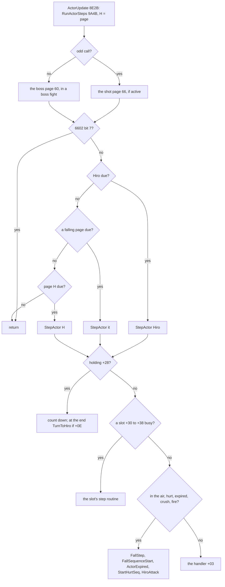

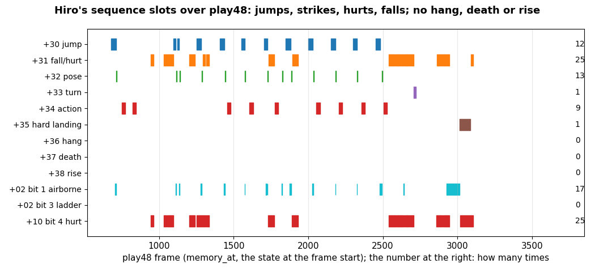

How to read the figure:

- One lane a slot or flag, a bar where it was busy (nonzero) in the sample of that frame; the number at the right
  counts the bars.
- `play48` frames 519-3768 (`play48-hiro.jsonl`). Command: `python3 tools/fig_gameplay.py --only slots`.

**The point**: Hiro is the same machine as any enemy: a jump, a strike, a hurt and a landing are slot counters, and
only the handler +`$03` reads the keys. No hang, death or rise slot was busy for Hiro in `play48`.

Worked example: Hiro at frame 1104 (the figure in 7.9) has +`$30` = 8: StepActor finds the jump slot first and runs
JumpStep, which counts it down; HiroControl does not run until the jump ends.

Witness: the slot counts of the figure. The hold's end `$9AAC` ran once in `play48`, 18 times in the other keyed
builds and 247 times in 54 RZX segments.

## 7.13 The behaviours

Each handler is a short routine that picks a move (D = the X step, E = the Y step) and jumps to MoveActor `$9B05` or
ApplyMove `$9B56`. MoveActor turns the actor when D is against its facing, starts a jump for E < 0, walks, and probes
the floor and the walls; ApplyMove moves it, runs ActorInteractions (7.14) and, for Hiro, CheckRoomExit (7.7). The
death is the same for every kind: ActorExpired `$9163` starts the death script (+`$0F`) in slot +`$37`; DeathStep
`$91A9` counts it down, shows the last frame once more, then frees the page, marks the record gone and calls the
spawner. An actor with a bonus in +`$39` rises instead (DeathLeavesBonus `$911A`, slot +`$38`, 4 pixels a step).

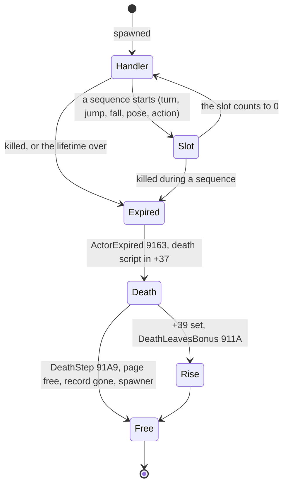

Witness of the common end: ActorExpired ran 21 times in `play48`, DeathStep's free `$91BF` 11 times and the rise
`$911A` once.

### The patroller: PatrolControl `$93AF` (kind `$2B`)

A patroller walks a fixed span back and forth. Its template sets +`$12` = 16. On its first step the handler moves
that into +`$3E` and clears +`$12`. Then +`$3F` counts the steps right and +`$40` the steps left.

```text
PatrolControl:
    if +$12: +$3E = +$12; +$12 = 0; reload
    D = +2                                   ; right
    +$3F -= 1
    if +$3F >= 0: MoveActor(D)
    +$40 -= 1
    if +$40 == 0: reload, then step right again
    else: MoveActor(-2)                       ; left
reload: +$3F = +$3E; +$40 = +$3E + 1
```

```text
PatrolControl:
$93AF  XOR A
$93B0  LD E,A
$93B1  LD L,$12
$93B3  OR (HL)
$93B4  JR Z,PatrolStep
$93B6  LD (HL),E
$93B7  LD L,$3E
$93B9  LD (HL),A
PatrolReload:
$93BA  LD L,$3F
$93BC  LD (HL),A
$93BD  INC A
$93BE  INC L
$93BF  LD (HL),A
PatrolStep:
$93C0  LD D,$02
$93C2  LD L,$3F
$93C4  DEC (HL)
$93C5  JP P,MoveActor
$93C8  INC L
$93C9  DEC (HL)
$93CA  JR Z,PatrolTurnBack
$93CC  LD D,$FE
$93CE  JP MoveActor
PatrolTurnBack:
$93D1  LD L,$3E
$93D3  LD A,(HL)
$93D4  JR PatrolReload
```

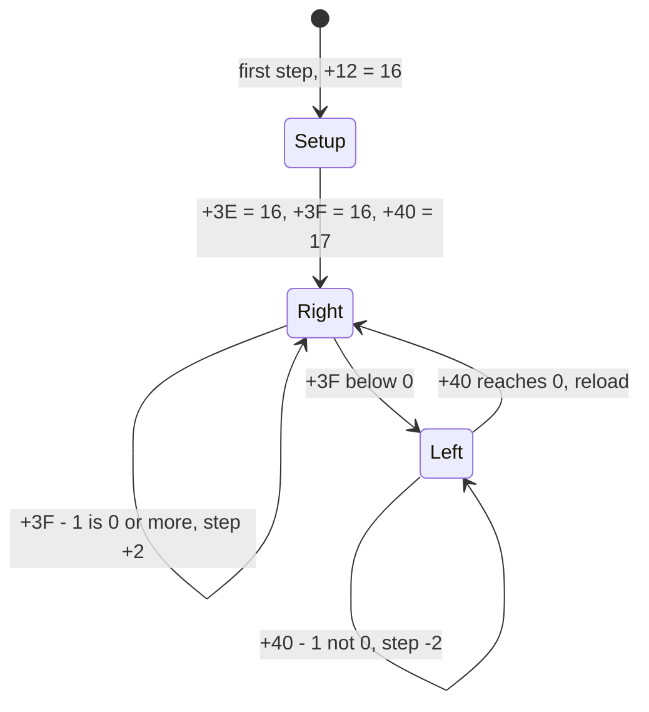

With 16 in +`$3E` the patroller makes 16 steps right (the reload step is one of them) and 16 left, 2 X units a step
(3 pixels), one step every 3 frames (+`$0C` = 3). A turn against its facing runs the turn slot first (StartTurn `$90B1`).

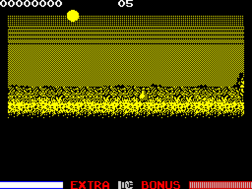

*Animation 7.3. The screen of `play48` frames 646-742, every second frame. Command: `python3
../../kit/screen_anim.py --work work/docs/zsC/play48 --from 646 --to 742 --step 2 --delay 80
docs/img/play/play48-room5-enemies.gif`.*

How to read it: room 5 just after Hiro entered at frame 645; the patroller (`enemy $2B @5.11`) walks its span on
the ground while Hiro stands at the left.

**The point**: the patroller has no sense of Hiro at all: it is a counter. The danger is in standing in its span.

Witness: PatrolControl ran 702 times in `play48`, its turn-back `$93D1` 18 times. The kill at frame 2219 (7.14) is
a patroller.

### The chasers: ChaserControl `$9348` (kinds `$2C`, `$37-$3D`)

A chaser walks towards Hiro's column. When it stands level with him, it picks a direction from the frame counter at `$8473`
(bit 6) and wanders 0 or 4 steps (bit 0, shifted), then looks again. It does not call Random.

```text
ChaserControl:
    if +$27: +$27 -= 1; MoveActor(+$1B)            ; keep wandering
    elif Hiro's column == this X: +$1B = +2 or -2 by the counter's bit 6; +$27 = (counter x 4) AND 7; MoveActor
    else: MoveActor(+2 if Hiro is to the right else -2)
```

```text
ChaserControl:
$9348  LD L,$27
$934A  XOR A
$934B  LD E,A
$934C  OR (HL)
$934D  JR Z,ChaserTowardHiro
$934F  DEC (HL)
$9350  JR ChaserStep
ChaserRandom:
$9352  LD A,(GameTick+$0001)  ; level with Hiro: a random direction and run
$9355  ADD A,A
$9356  ADD A,A
$9357  LD D,$02
$9359  JR C,ChaserSetDir
$935B  LD D,$FE
ChaserSetDir:
$935D  LD L,$1B
$935F  LD (HL),D
$9360  AND $07
$9362  LD L,$27
$9364  LD (HL),A
ChaserStep:
$9365  LD L,$1B
$9367  LD D,(HL)
$9368  JP MoveActor
ChaserTowardHiro:
$936B  LD A,(Hiro+$002A)
$936E  RLA
$936F  LD L,$01
$9371  CP (HL)
$9372  JR Z,ChaserRandom
$9374  LD D,$02
$9376  JP NC,MoveActor
$9379  LD D,$FE
$937B  JP MoveActor
```

`Hiro+$002A` is `$5D2A`, Hiro's box left; doubled it is his X rounded to a column.

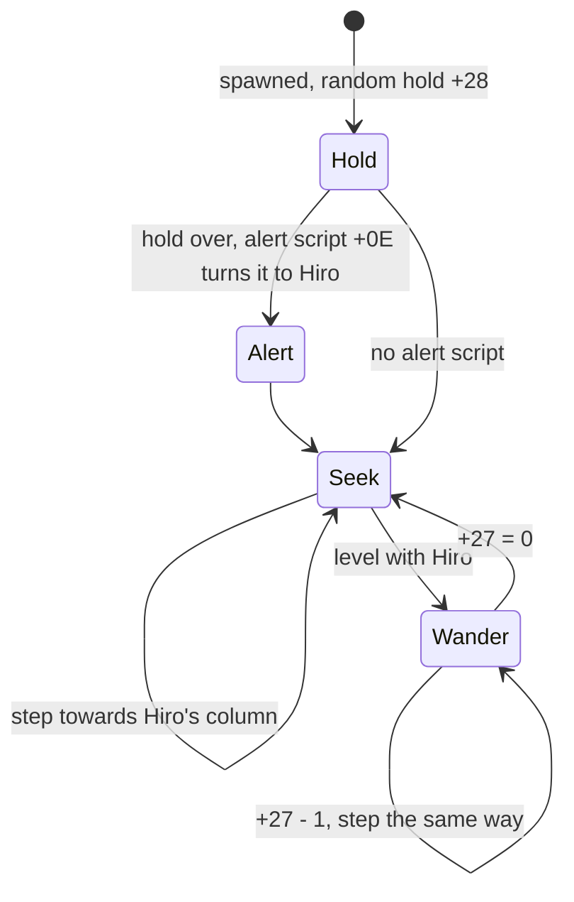

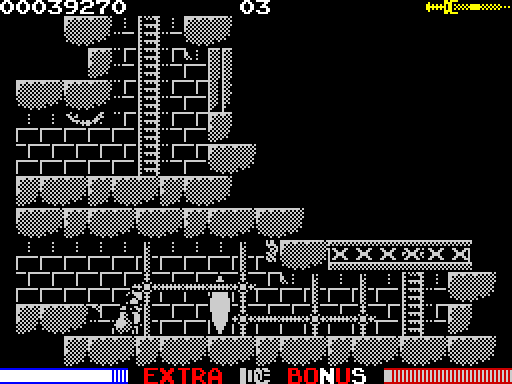

*Animation 7.4. The screen of `r034000` frames 780-1000, every third frame. Command: `python3
../../kit/screen_anim.py --work work/docs/zsC/r034000 --from 780 --to 1000 --step 3 --delay 80
docs/img/play/r034000-room57-fight.gif`.*

How to read it: room 57 of our replay; the chasers `$37` and `$39` close in on Hiro from both sides, turn when they
pass him and come back; Hiro strikes at them.

**The point**: a chaser is a patroller whose span is centred on Hiro. It cannot jump or climb: Hiro on another floor
leaves it pacing under him.

Witness: ChaserControl did not run in `play48` (rooms 4-9 hold no chaser); it ran 147 times in the other keyed builds
and 17 297 times in 55 RZX segments, the wander `$9352` 585 times in 49 segments.

### The traps: TrapControl `$93D6` (kinds `$2E-$31`, `$34`)

A trap sits still until Hiro enters its touch zone. Then it keeps the zone in +`$27`, clears +`$11` and runs its path
once (PathControl, below). At the path's end TrapRearm puts the zone back.

```text
TrapControl:
$93D6  LD L,$12
$93D8  LD A,(HL)
$93D9  LD L,$1B
$93DB  LD (HL),A
$93DC  CALL HiroInZone
$93DF  JR Z,PathControl
$93E1  JR NC,TrapStill
$93E3  LD L,$11
$93E5  LD E,(HL)
$93E6  LD (HL),$00
$93E8  LD L,$27
$93EA  LD (HL),E
TrapStill:
$93EB  JP ApplyNoMove
TrapRearm:
$93EE  LD L,$27               ; the path ended: the zone back
$93F0  LD A,(HL)
$93F1  LD L,$11
$93F3  LD (HL),A
$93F4  JR TrapStill
```

HiroInZone `$9529` returns Z when +`$11` is 0 (the trap is running), carry when Hiro is inside the zone. A zone's
range is a window [from, to) on the signed difference Hiro - actor, tested on unsigned bytes: inside when the
difference is at or above "from" or below "to".

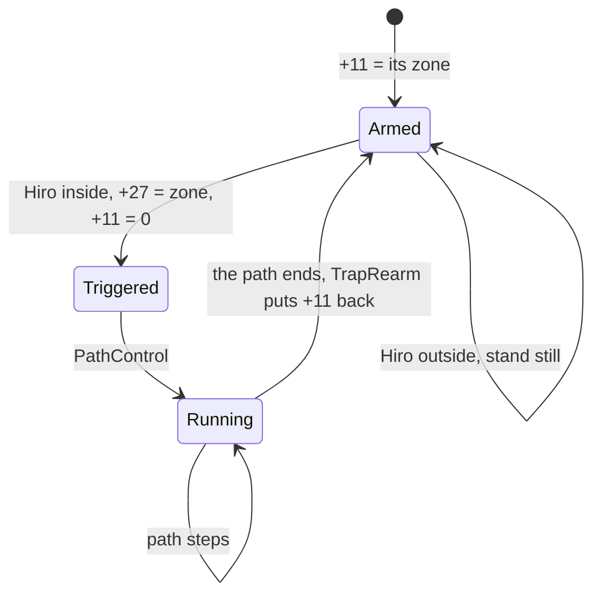

**The point**: a trap is a path with a trigger. It fires once per entry of Hiro into its zone and resets by itself.

Witness: TrapControl ran only in 5 RZX segments (1803 times); it fired (`$93E3`) 24 times and rearmed (`$93EE`) 23
times. No keyed recording reaches a trap room.

### The stalactite: StalactiteControl `$93A8` (kind `$36`)

```text
StalactiteControl:
$93A8  CALL HiroInZone
$93AB  JP C,StalactiteShake
$93AE  RET
StalactiteShake:
$9112  CALL FreezeAnim        ; kind $36 touched: $9D50, the shake $7BB5 in +$32
$9115  LD BC,Script9115
$9118  JR StartPoseSeq
```

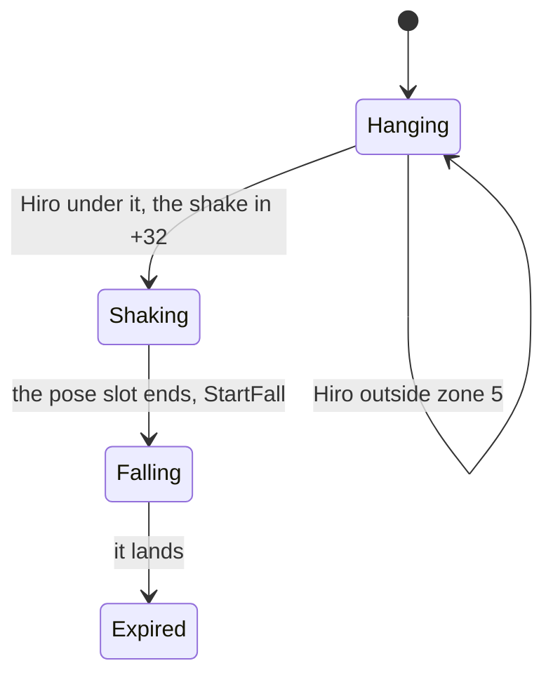

A stalactite hangs until Hiro is within zone 5 (16 pixels above to 31 below, 16 units each side), shakes, then drops
(SequenceEndDrop `$9201` starts the fall). It hurts Hiro only while its pose count +`$32` is `$0D` or more (TouchHiro,
7.14).

Witness: StalactiteControl ran 84 times in the keyed builds and 2609 times in 10 RZX segments; the shake `$9112`
ran 22 times in 8 segments.

### The path movers: PathControl `$93FB` (bosses, fliers, sparks, the energy ball)

A path is a header byte and a list of segments in the template's script page. The header's bits 0-5 count the
segments, bit 6 asks for a random step delay at each segment, bit 7 at each step (RandomSpeed `$9505`: +`$0C` =
Random AND 7). A segment is three bytes: the number of steps, the Y step and the X step. The X step is negated when
+`$12` bit 7 is set, so one path serves both directions. At the end of the last segment the path restarts, except for
traps (TrapRearm) and the boss's shot (it expires).

```text
PathControl:
    +$1B = +$12, or 1 when the walk list +$05 is $46
    if +$3E == 0: restart
    step:
        +$3E -= 1; if 0: next segment
        RandomSpeed(bit 7)
        E, D = the segment's Y step, X step (D negated when +$12 bit 7)
        the energy ball: ShieldFollow overrides D, E to stay on Hiro
        ApplyMove
    next segment: +$40 -= 1; at 0 the path ends; else BC += 2 and BossFire, +$3E = steps + 1, RandomSpeed(bit 6)
```

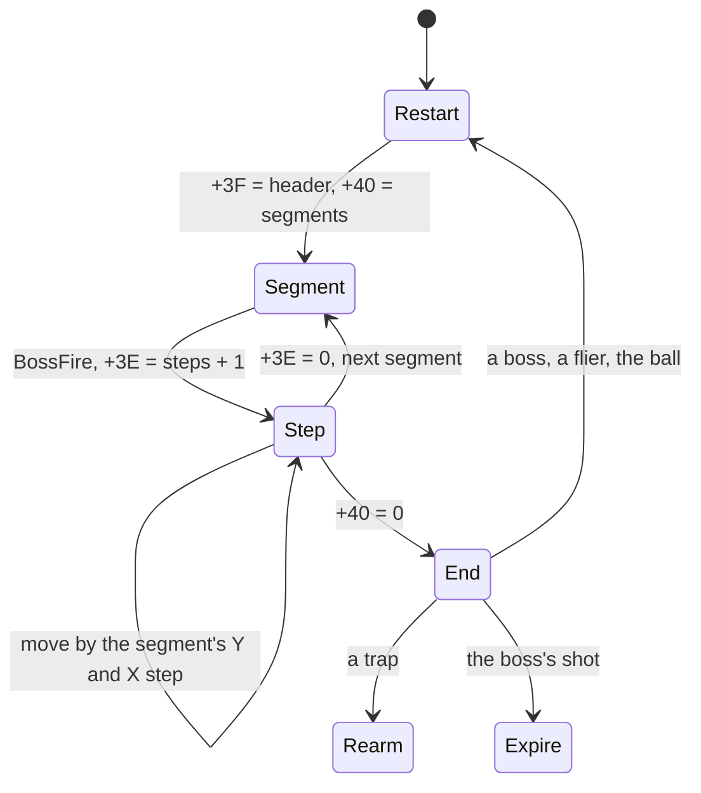

BossFire `$947D` runs at each segment start of kinds `$25-$29`. When the segment's position matches an entry of the
boss's fire table, it expires the old shot in page `$60`, puts a new shot (kind `$2D`, PathControlShot `$940A`)
there with sound 6, and gives it the boss's facing. A boss fight steps page `$60` on every other call of
RunActorSteps (7.12), so the shot moves faster than anything else. If a chaser has taken page `$60` (room 58 holds a
chaser `$3D` after the giant), BossFire expires it to make room: known only from the code.

ShieldFollow `$94E1` steers the energy ball (kind `$48`): 4 pixels up or down while Hiro is more than 16 away in Y,
2 units left or right while he is more than 4 away in X.

Witness: PathControl ran 208 times in `play48`, all of them the energy ball after a lost life (ShieldFollow 123
times). BossFire's spawn `$94BD` ran 104 times in 9 RZX segments, the shot's end `$93F6` 87 times in 8.

### The still kinds: StillControl `$937E`, DecorControl `$9387`, TriggerControl `$9390`

The pickups and the gates use StillControl: no move, only the floor probe, so a pickup dropped from a block falls to
the floor. DecorControl only steps the animation. TriggerControl waits for Hiro in zone 4; then it writes 1 to its
+`$0A` and freezes its animation (FreezeAnim). What a trigger changes beyond its own frame is known only from the
code; no figure of this document shows one.

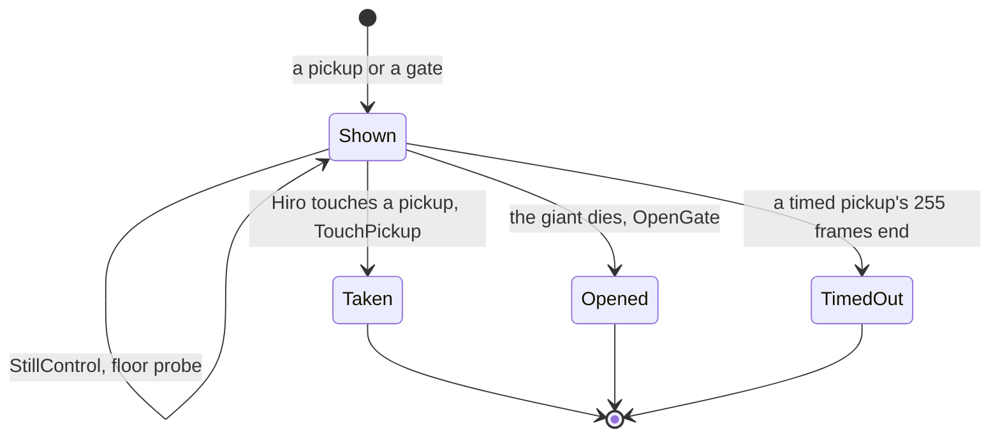

A timed pickup (a record kind with bit 7) first holds a random number of steps (+`$28` = Random AND +`$0D`), then
StartLifetime clears bit 7 of its kind and sets the timer +`$1E` to 255.

Witness: StartLifetime's start `$998C` ran twice in `play48`: the vitality from the block (frame 1460) and the timed
gem `$81` of room 7, taken at frame 2318 for 50 points. TriggerControl ran 1093 times in the keyed builds and 98 482
times in 17 RZX segments; it was touched (`$939D`) 1377 times in 11. DecorControl ran only in 5 RZX segments.

## 7.14 Collisions

Every collision is a test of two boxes. An actor's box +`$2A-$2D` is kept by ActorBoxStore in columns of 3 pixels
(X / 2) and rows of 8 pixels (Y / 8): left, right, top, bottom. BoxesOverlap `$9A27` compares the boxes of pages D
and H. No sprite pixel is looked at.

```text
BoxesOverlap:
$9A27  LD L,$2B
$9A29  LD E,$2A
$9A2B  LD A,(DE)              ; D's left - 1 ...
$9A2C  DEC A
$9A2D  JP M,BoxesOverlapX2
$9A30  CP (HL)                ; ... at or past H's right: apart
$9A31  RET NC
BoxesOverlapX2:
$9A32  LD A,E                 ; D's right below H's left: apart
$9A33  LD E,L
$9A34  LD L,A
$9A35  LD A,(DE)
$9A36  CP (HL)
$9A37  JR C,BoxesOverlapDone
$9A39  LD L,$2D               ; the rows the same way
$9A3B  LD E,$2C
$9A3D  LD A,(DE)
$9A3E  DEC A
$9A3F  JP M,BoxesOverlapY2
$9A42  CP (HL)
$9A43  RET NC
BoxesOverlapY2:
$9A44  LD A,E
$9A45  LD E,L
$9A46  LD L,A
$9A47  LD A,(DE)
$9A48  CP (HL)
BoxesOverlapDone:
$9A49  CCF                    ; carry: they overlap
$9A4A  RET
```

ApplyMove `$9B56` calls ActorInteractions `$9698` after every move. A hurt or expiring actor (+`$10` bits 4, 5) does
nothing. For Hiro, it is the strike: only without a weapon, only while the action slot +`$34` runs and only while
the strike is armed (+2 bit 4). His box is narrowed to the column he faces and the one before it, and to one row:
the top + 1, or the top + 2 for the third strike (the sweep). StrikeAllActors `$96FF` then tries the eight pages
`$5E-$65`. For any other actor, a falling one goes through FallingTouch (it may crush Hiro), and kinds below `$40`
or from `$47` test the touch with Hiro (TouchHiro); the weapons `$40-$46` do their own strikes in WeaponControl (doc
10).

StrikeActor `$970A` (H = the striker, D = the target) skips an inactive target, one in its hold, a pickup just out of
a block (kind bit 7) and a hurt or expiring one, then tests the boxes. Then:

- a pickup: the power-up shield `$19` becomes the power reset `$1C`, the speed-up `$1A` becomes the speed reset
  `$1D` (sound 6); other pickups are not hurt;
- a boss (`$25-$29`): Hiro's own strike does nothing; a weapon's does, with sparks for the giants;
- the damage is the striker's +`$13`, or Strike `$69E1` (1-3) for Hiro; a target with 0 hit points cannot be hurt;
- hit points - damage at 0 or below: KillActor `$97A8`; above 0: sound `$0C` and, with a hurt script, the hurt flag;
- the strike is spent (+2 bit 4 cleared), and the loop over the pages is cut: one hit a swing. The scorchball `$41`
  is the exception: it goes on through.

KillActor scores the target's +`$0B` (AddScore, doc 10) with sound 2, and sets the target's expired bit. A boss
first ends the boss fight and looks for its gate (kind `$2A`) in the ten pages: found, the gate opens (OpenGate
`$97E2`, sound 3); not found, the boss was Havok and the game is won (EndFlags = 1, 20000 a life, sound 4; doc 10).

TouchHiro `$9801` tests Hiro's box with its top lowered by one row. During Hiro's combat move only the boss's shot
`$2D` touches him. A pickup (below `$23`) is taken (TouchPickup `$98AD`). Nothing else hurts while Invulnerable or
while Hiro is hurt. Kinds below `$35` hurt (HurtHiro `$9860`, doc 10); `$35` hurts and `$36` hurts from its pose
count `$0D`; `$37-$3D` can be stood on (+`$10` bit 3 on both), and crush Hiro when his Y offset matches their +`$11`
or +`$12`; `$3E` and up do nothing.

```text
ActorInteractions(H = the actor that moved):
    if H+$10 AND $30: return
    if H is Hiro:
        if Weapon or H+$34 == 0 or H+2 bit 4 clear: return
        narrow Hiro's box to the faced column and the one before, one row (top + 1, + 2 for strike 3)
        for D in $5E..$65: StrikeActor(Hiro, D)           ; stops after the first hit
        restore the box
    elif H+2 bit 2: FallingTouch
    elif H.kind and (H.kind < $40 or H.kind >= $47): TouchHiro(H)

StrikeActor(H striker, D target):
    if not active, holding, kind bit 7, or hurt/expiring: return
    if not BoxesOverlap: return
    if D.kind < $23: shields $19, $1A become $1C, $1D; return after the swing
    if D is a boss: if H is Hiro: return; sparks unless Havok
    damage = H+$13 or Strike
    if D+$13 == 0: return
    D+$13 -= damage
    if D+$13 <= 0: KillActor(D)
    else: sound $0C; if D has a hurt script: D+$10 bit 4
    H+2 bit 4 = 0; unless the scorchball: stop the loop
```

```text
StrikeEnemy:
$9759  CP $25                 ; a boss (kinds $25-$29)?
$975B  JR C,StrikeDamage
$975D  CP $2A
$975F  JR NC,StrikeDamage
$9761  LD (KillActor+$000D),A ; remember the boss kind for KillActor
$9764  LD A,H                 ; Hiro's own strike: a boss takes none
$9765  CP $5D
$9767  RET Z
$9768  LD A,(DE)              ; a boss other than kind $25 sparks
$9769  CP $25
$976B  CALL NZ,SpawnSparks
StrikeDamage:
$976E  LD L,$13               ; the damage: the striker's +$13 ...
$9770  LD A,(HL)
$9771  OR A
$9772  JR NZ,StrikeDamageC
$9774  LD A,(Strike)          ; ... or the combat power 1-3
StrikeDamageC:
$9777  LD C,A
$9778  LD E,$13
$977A  LD A,(DE)              ; no hit points: cannot be hurt
$977B  OR A
$977C  RET Z
$977D  SUB C                  ; hit points - damage
$977E  LD (DE),A
$977F  DEC A
$9780  JP M,KillActor         ; at zero or below: killed
$9783  LD A,$0C               ; sound $0C: a hit
$9785  LD (EffectRequest),A
$9788  LD E,$08               ; a hurt animation? the target flinches
$978A  LD A,(DE)
$978B  OR A
$978C  JR Z,StrikeDone
$978E  LD L,$10               ; +$10 bit 4: hurt
SetTargetFlags:
$9790  LD E,$10               ; the target's +$10 OR L
$9792  LD A,(DE)
$9793  OR L
$9794  LD (DE),A
StrikeDone:
$9795  LD L,$02               ; the strike is spent
$9797  RES 4,(HL)
$9799  LD L,$1C
$979B  LD A,(HL)
$979C  CP $41                 ; the scorchball goes on through the other actors
$979E  RET Z
$979F  POP DE                 ; drop the loop's return: one hit a swing
$97A0  CP $24                 ; Hiro: done; a shot expires
$97A2  RET Z
ExpireActor:
$97A3  LD L,$10
$97A5  SET 5,(HL)
$97A7  RET
```

`DEC A` then `JP M` kills at 0 as well as below: hit points minus damage of 0 leaves 0, and 0 - 1 is negative.

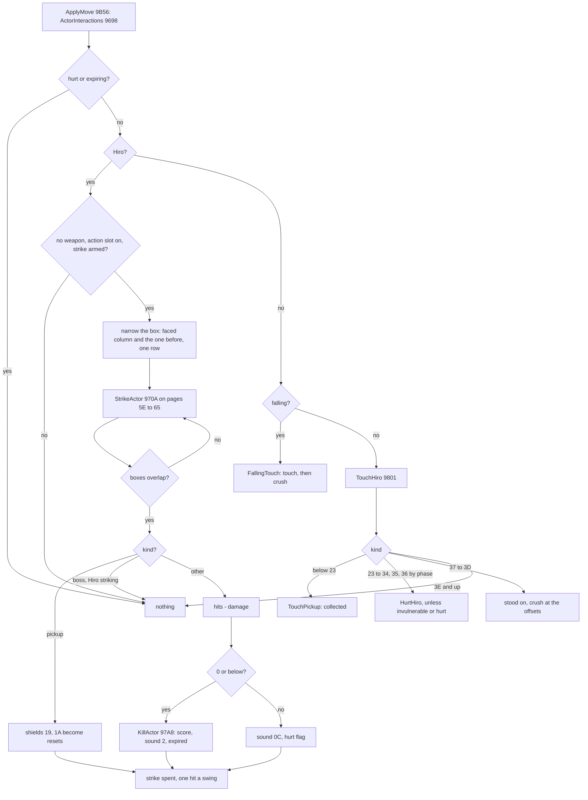

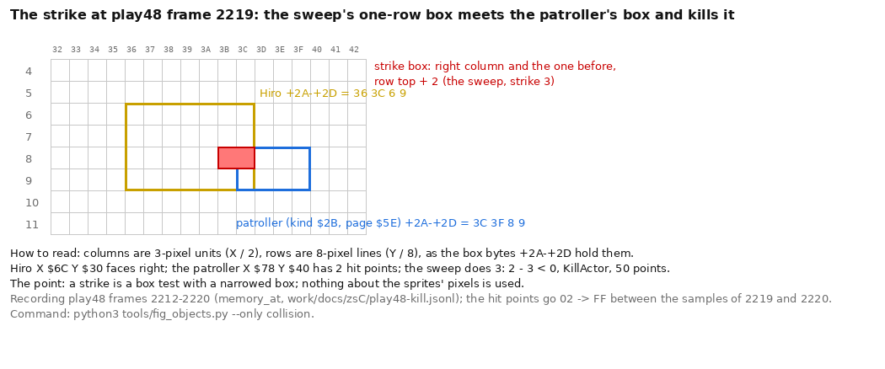

How to read the figure:

- The grid is in box units: columns of 3 pixels (X / 2), rows of 8 pixels (Y / 8), the column numbers in hex above.
- Gold: Hiro's box +`$2A-$2D` = `36 3C 6 9`. Blue: the patroller's (page `$5E`) = `3C 3F 8 9`. Red: the narrowed
  strike box, columns `$3B-$3C`, row 8.
- `play48` frames 2212-2220 (`play48-kill.jsonl`, `memory_at`).

**The point**: a strike is a box test with a narrowed box. The overlap is one cell of 3 x 8 pixels; nothing about
the sprites' pixels is used.

```bash
python3 tools/fig_objects.py --only collision
```

Worked example: the sample of frame 2219 has Hiro at X `$6C`, Y `$30`, facing right, in the sweep (Strike 3), the
strike armed. The patroller in page `$5E` is at X `$78`, Y `$40` with 2 hit points. ActorInteractions narrows Hiro's
box: facing right, left = right - 1 = `$3B`; the row is top + 2 = 8, one row. StrikeActor on page `$5E`: the boxes
share column `$3C`, row 8. Hiro's +`$13` is 0, so the damage is Strike = 3; 2 - 3 = -1 (`$FF`). KillActor adds the
patroller's +`$0B` = `$A6`, 50 points: the score goes from 60 to 110. The sample of 2220 shows the patroller's hit
points `$FF` and +`$10` = `$23` (expired); its death frames run from 2221, and the page is freed after 2230.

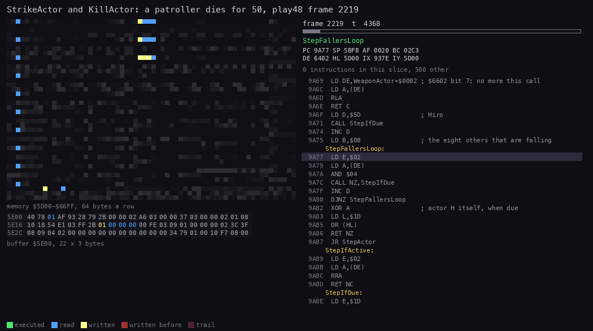

*Animation 7.5. StrikeActor `$970A` and KillActor `$97A8` in `play48` frame 2219, 16 pictures of 4368 T. Command:
`python3 ../../kit/routine_anim.py --work work/docs/zsC/play48 --listing build/game.lst --window 2219:0-2220:0 --pc
970A-97FF --view buffer:5E00:22x3:hex --range 5D00-66FF --pictures 16 --out docs/img/routines/KillActor.gif --title
"StrikeActor and KillActor: a patroller dies for 50, play48 frame 2219"`.*

How to read it:

- Left: page `$5E00`, the patroller, 22 bytes a row; +`$13` (row 0, byte 19) changes from `02` to `FF`, then
  +`$10` (byte 16) gets bit 5.
- Right: the code of the slice. The first call of the loop, on page `$5E`, finds the patroller, and the hit ends
  the loop.

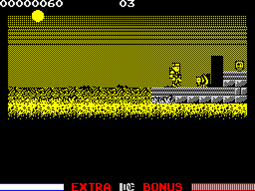

*Animation 7.6. The screen of `play48` frames 2210-2240, one picture a frame. Command: `python3
../../kit/screen_anim.py --work work/docs/zsC/play48 --from 2210 --to 2240 --step 1 --delay 80
docs/img/play/play48-kill.gif`.*

How to read it: Hiro sweeps at frame 2219; the patroller flashes through its death frames from 2221 and is gone after
2230. The score at the bottom reads 110 from frame 2220.

Witness: StrikeActor passed the box test twice in `play48` (`$9723`): the kills at frames 1775 and 2219, both
patrollers, both at once (2 hit points against a strike of 3). KillActor ran twice in `play48` and 49 times in 27
RZX segments. OpenGate `$97E2` ran in `bossgate` at frame 435 and the win `$97CA` in `havok` at frame 29 (each with
the boss's hit points POKEd to 1; the figure in [10.17](10-gameplay-logic.md#1017-what-no-recording-reached)); no RZX segment runs either.
TouchHiro found an overlap (`$981C`) 208 times in `play48`; HurtHiro ran 29 times there.

## 7.15 Random numbers

Random `$A632` mixes the 16-bit frame counter at `$8473` (the operand of GameTick's `LD HL,nn`, counted by the
interrupt) and writes the result back to it. A call runs the mix 15 times and returns the low byte.

```text
Random:
    repeat 15 times:
        hl = counter; de = swap bytes of hl
        hl = hl + de
        de = ((counter.low + hl.high) << 8) | (counter.high + hl.low)
        hl = hl x 4 + de
        hl = hl x 8 + de
        counter = hl
    return counter.low
```

```text
Random:
$A632  LD B,$0F
RandomLoop:
$A634  LD HL,(GameTick+$0001)
$A637  LD E,H
$A638  LD D,L
$A639  ADD HL,DE
$A63A  LD A,(GameTick+$0002)
$A63D  ADD A,L
$A63E  LD E,A
$A63F  LD A,(GameTick+$0001)
$A642  ADD A,H
$A643  LD D,A
$A644  ADD HL,HL
$A645  ADD HL,HL
$A646  ADD HL,DE
$A647  ADD HL,HL
$A648  ADD HL,HL
$A649  ADD HL,HL
$A64A  ADD HL,DE
$A64B  LD (GameTick+$0001),HL
$A64E  LD A,L
$A64F  DJNZ RandomLoop
$A651  RET
```

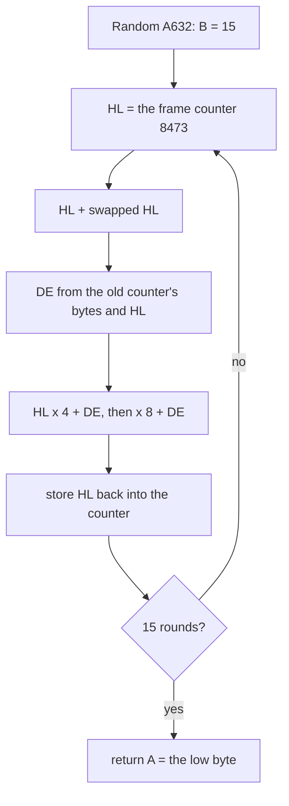

Two routines call it: SpawnEnemy for a hold (Random AND +`$0D`) and RandomSpeed `$9505` for a path's step delay
(Random AND 7). The chasers read the counter directly, without mixing.

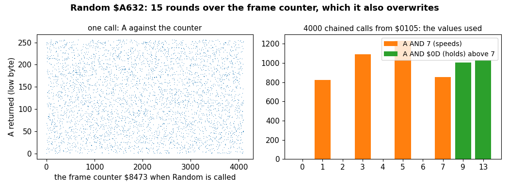

How to read the figure:

- Left: the low byte one call returns for each counter value 0-4095: no pattern is visible.
- Right: 4000 chained calls from `$0105`, as the game uses them: AND 7 for the speeds (orange) and AND `$0D` for the
  holds (green, the values above 7).
- Command: `python3 tools/fig_objects.py --only random` (a port of the routine, `random_seq` in the script).

**The point**: the generator is good enough, but it is the frame counter. Each call moves the counter the interrupt
counts, so anything else that reads the counter (the chasers' wander, GameTick's users) sees a jump after a spawn.

Worked example: the counter `$0105`. Round 1: HL `$0105` + `$0501` = `$0606`; DE = (`$05` + `$06`) << 8 | (`$01` +
`$06`) = `$0B07`; `$0606` x 4 + `$0B07` = `$231F`; `$231F` x 8 + `$0B07` = `$23FF`. Round 2 gives `$98AD`, round 3
`$5B65`; after 15 rounds the counter is `$428B` and A = `$8B`. A hold with mask `$1F` would be `$0B`, 11 steps.

Witness: Random ran 7 times in `play48`, 125 times in the other keyed builds and 2290 times in 55 RZX segments.

## 7.16 The game variables

The game's state outside the actors and the room is 24 bytes at `$6642-$6659` and the spare cells of 7.1.

| Address | Name | What it holds |
| --- | --- | --- |
| `$6642` | Vitality | energy, `$20` (32) full; a touch takes 4 (8 from a boss's shot) |
| `$6643` | VitalityShown | the panel's copy |
| `$6644` | ChargeStep | the power meter's rate, 1-3 (speed-up shields) |
| `$6645` | Charge | the power meter while fire is held; it picks the strike |
| `$6646` | ChargeShown | the panel's copy |
| `$6647` | ChargeReset | the meter's minimum, 0-`$10` (power-up shields) |
| `$6648` | FirePrevious | fire in the last pass |
| `$6649` | WeaponCount | bullets left |
| `$664A` | WeaponCountShown | the panel's copy |
| `$664B` | Weapon | 0 the fist, 1-7 the weapons (7 the Fireblade) |
| `$664C` | PauseFlag | the pause |
| `$664D` | Lives | BCD, 5 at the start |
| `$664E` | Fragments | Fireblade fragments, 0-16 |
| `$664F` | FragmentsShown | the panel's copy |
| `$6650` | FireRequest | the strike asked for, 1-3; 0 none |
| `$6651` | Invulnerable | `$48` while the energy ball lives |
| `$6652` | EndFlags | 1 when Havok dies; the end sequence then sets bit 6 (`$41` in `r138000` from frame 1650) |
| `$6653-$6656` | Score | 8 BCD digits |
| `$69DF`, `$69E0` | MapRow, MapColumn | the map place (7.7) |
| `$6BDD` | Room | the room (7.7) |

LoseLife reloads the first ten bytes from GlobalsInit `$5C00` (`20 1F 01 00 01 00 01 00 01 00`), seven in a boss
fight so that the weapon is kept (doc 10).

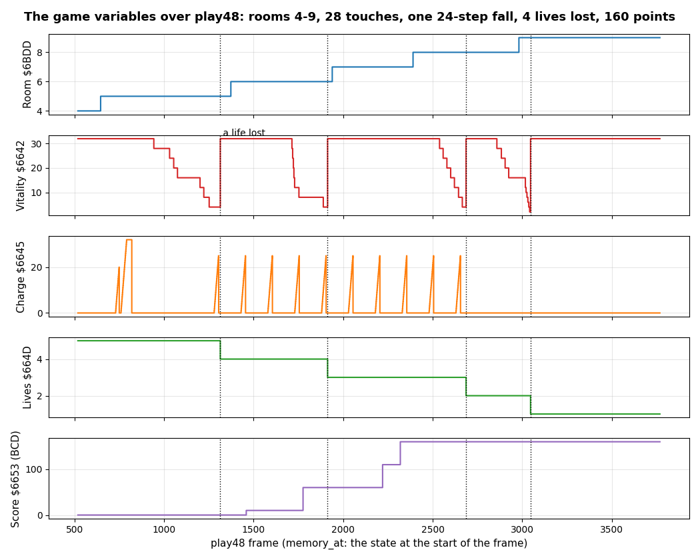

How to read the figure:

- Five lanes over `play48` frames 519-3768, the sample of each frame (`play48-hiro.jsonl`); the dotted lines are the
  four lives lost (frames 1313, 1912, 2685 and 3045, seen in the samples one frame later).
- Room steps 4 → 9. Vitality drops in steps of 4 at each touch and 2 at each step of the hard landing, and comes back
  to 32 with each life. Charge climbs while fire is held and drops when the strike starts. Score rises by 10 (the block,
  frame 1458), 50 (a patroller, 1775), 50 (a patroller, 2219) and 50 (the timed gem, 2318).
- Command: `python3 tools/fig_objects.py --only vars`.

**The point**: all of Hiro's progress is in 24 bytes and the room state tables; a life lost resets the first ten.

Witness: the figure's samples. Fragments, Weapon and WeaponCount stay 0 in `play48`; `r034000` shows Fragments 2 → 3
and the score 29 270 → 39 270 at frame 529.

## 7.17 What no recording reached

- OpenGate `$97E2` and the win in KillActor (`$97CA`): no giant and no Havok dies in a recording without a POKE. With
  the boss's hit points POKEd to 1, `bossgate` (frame 435) and `havok` (frame 29) run both (doc 10.17).
- The power reset `$9943` (CollectPickup) and the reset shields made by a strike: not executed in any recording.
- BossFire's eviction of another actor from page `$60`: known only from the code (room 58 would show it).
- The window release `$8ABB` ran only in 3 RZX segments; the top exit of a room `$95A4` only in 3.
- What a trigger `$3F` does besides freezing its frame (+`$0A` = 1): known only from the code.
- The stand-on and crush of kinds `$37-$3D` (`$983B`, `$984F`) ran only in RZX segments (46-47 segments); no keyed
  recording shows it, and no figure of this document.
