# 8. HUD and text

What this covers:

- the font and the one glyph routine every text goes through, PrintGlyph (8.1);
- PrintString, its record and its codes (8.2), and the tall mode that the panel and the tables use (8.3);
- the picture strings of the intro and the story (8.4), and every text of `src/res/texts` (8.5);
- the panel: its layout and who draws it (8.6), the two meters (8.7), the weapon bar (8.8), the Fireblade count
  (8.9), EXTRA and BONUS (8.10), the score and the lives (8.11);
- the banners, which are sprites, not text (8.12);
- the high-score table (8.13), the insertion of a score and the name entry (8.14);
- what is known only from the code (8.15) and the point (8.16).

The names are those of `src/game/game.ann`; the routines are in `src/game/text.asm`, `src/game/panel.asm` and
`src/game/menu.asm`, the story printer in `src/bank4/story.asm`. The strings are the files of
[src/res/texts](../src/res/texts/README.md), the font is `src/res/graphics/font.png`.

The recordings are those of [WALKTHROUGH 6.0](../WALKTHROUGH.md). Each was opened from its TTD session on the
writer's own instance (port base 37430, muted).

- `c1` (`work/stage1/c1/session.ttd`, 128K): power-on, the load, the control menu (frame 15 508), the title and the
  start of a game (frame 17 650).
- `menu` (`work/stage1/rec/menu/session.ttd`, 128K): the title, play, PAUSE GAME (frame 2000), GAME OVER (frame 2200)
  and the high-score table (frame 3000).
- `deaths` (`work/stage1/rec/deaths/session.ttd`, 48K): play with energy lost (frame 1999) and a score (frame 3536).
- `r140000` (`work/stage2/rzx/r140000/session.ttd`, 48K): a segment of the RZX run replayed as our own recording. It
  is another player's run (the RZX Archive's): the game's end, the score inserted (frame 1007) and a name entered
  (frames 1010-2000).

A 48K frame is 69 888 T, a 128K frame 70 908 T. A moment is written "frame F T t", with t counted from the start of
the emulator's frame. Some figures run the game's own print routines in SkoolKit's simulator on `build/game.bin`
(`tools/fig_text.py`): what they show is what the game's code writes into the screen, not a redrawing of it.

## 8.1 The font and PrintGlyph

The game has one font: 103 glyphs of 8 x 8 pixels at Font `$7BE5`, for the codes `$20-$86`. Glyph n is the 8 bytes
at Font + 8 (n - `$20`). Beyond the letters and digits it holds the game's small pictures:

| Codes | What |
| --- | --- |
| `$20-$5A` | the space, the digits, the letters and the signs |
| `$22-$29` | also the frame of the name-entry box (the corners and the sides) |
| `$2A`, `$26` | the effects sign of the title ("FX", 128K) |
| `$2B` | the END sign of the name grid |
| `$3C` | the delete sign of the name grid |
| `$5B`/`$5C`, `$5D`/`$5E`, `$5F`/`$60`, `$61`/`$62`, `$63`/`$64` | the weapon icons on the panel (WeaponIcon `$6671`), a pair each: weapon 0 the fist, 1 the blade, 2 the scorchball, 3 the dart, 4 the spinblade |
| `$3A`/`$3B`, `$3D`/`$3E`, `$3F`/`$40` | the weapon icons of weapon 5 (needle bolts), 6 (trispike) and 7 (the Fireblade): codes inside the signs' range, used only as icons |
| `$65`, `$66` | the music sign of the title (a note, 128K) |
| `$67-$84` | the pieces of the Fireblade on the panel |
| `$85`, `$86` | the weapon bar's two glyphs: their bytes are rewritten in play (8.8) |

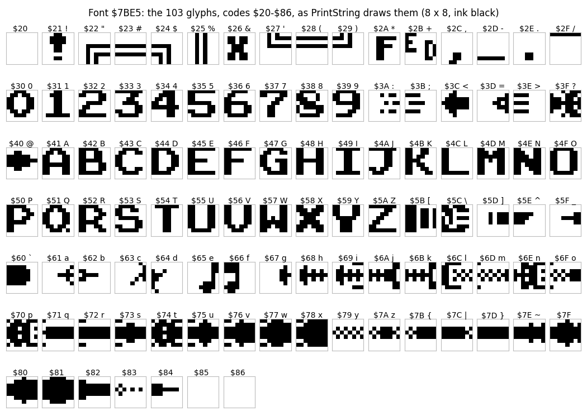

How to read the figure:

- **Each cell** is one glyph, drawn from Font `$7BE5` as the game holds it in `build/game.bin`.
- **The label** above a cell is its code in hex.
- **The last two cells** (`$85`, `$86`) are the weapon bar as GlobalsInit leaves it: their bytes are the bar, so the
  sheet shows them as the game's start shows them.

The point: the panel's icons, the Fireblade and the name grid's signs are glyphs of the same font. Every one of them
is printed by PrintString, through the same code.

Command, from the case folder after `. work/env.sh`: `python3 tools/fig_text.py font docs/img/text/font.png`.

PrintGlyph `$83F9` draws one glyph at any pixel line. A glyph whose Y is not a multiple of 8 straddles two character
cells: the first 8 - (Y AND 7) rows go into the upper cell, the rest into the cell below (DE + 32, or the next third
of the screen). Each cell gets its own attribute: the upper from the operand at `$83FB`, the lower from `$8436`. `$FF`
in an operand leaves that attribute alone.

```text
PrintGlyph(glyph HL, screen DE):
    SetCellAttr(DE, upper attribute)          (FF: kept)
    c = D AND 7                               (the pixel line inside the cell)
    draw 8 - c rows: (DE) = (HL); HL + 1; D + 1
    if c = 0: done
    E = E + 32                                (the next character row)
    if no carry (the same third): D = the saved D AND F8 (the cell's top line)
    else (a third crossed): D kept (the row loop has already moved it into the next third)
    draw c rows
    SetCellAttr(DE, lower attribute)
    DE = the start + 1                        (the next column)
```

```asm
PrintGlyph:                ; $83F9
  PUSH DE
  LD A,$FF                 ; the operand $83FB: the cell's attribute
  CALL SetCellAttr
  LD A,D
  AND $07
  LD C,A                   ; C = the rows in the cell below
  LD A,$08
  SUB C
  LD B,A                   ; B = the rows in this cell
PrintGlyphTop:
  LD A,(HL)
  LD (DE),A
  INC HL
  INC D
  ...                      ; the tall mode's test (8.3)
  DJNZ PrintGlyphTop
```

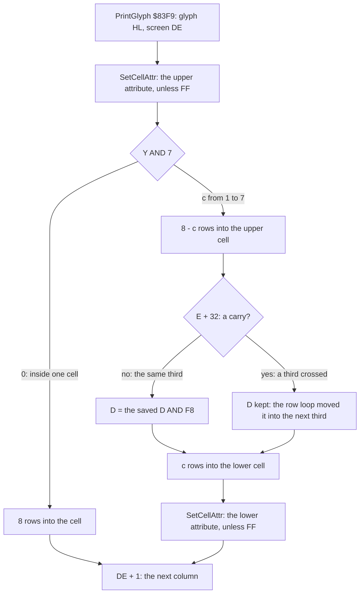

## 8.2 PrintString: the record and the codes

PrintString `$837B` prints a record. Every text of the game is one:

| Byte | Meaning |
| --- | --- |
| +0 | Y, in pixel lines (any line, not only a cell's top) |
| +1 | X, in half columns: column X / 2 |
| +2 | the lower cell's attribute, into the operand `$8436` (`$FF`: kept) |
| +3 | the upper cell's attribute, into the operand `$83FB` (`$FF`: kept) |
| then `$20-$86` | a glyph |
| `$01-$1F` | skip that many columns |
| `$FF` | a new line: Y + 8, X back to the record's X |
| `$00` | the end: the attribute operands and the tall flags go back to `$FF` |

SetPrintPosition `$83CD` turns Y and X into a screen address and keeps the next line's start (Y + 8, X) in the operand
of `LD BC,n` at `$83C6`, which the new-line code reloads. PrintString returns HL past the 0. So several records in a
row print with one CALL each, without reloading HL: the high-score table prints its heading, its rows and its
copyright that way.

```text
PrintString(HL):
    Y, X, lower attribute, upper attribute = the header
    DE = SetPrintPosition(Y, X); next line = (Y + 8, X)
    loop:
        a = next byte
        a = 0:    reset the operands to FF; return HL
        a = FF:   DE = SetPrintPosition(next line); next line Y + 8
        a < 20:   DE += a                            (skip columns)
        else:     PrintGlyph(Font + 8 (a - 20), DE)
```

```asm
PrintStringLoop:
  LD A,(HL)                ; the next code
  INC HL
  OR A
  JR NZ,PrintStringCode
  DEC A                    ; 0: the end; the four operands back to $FF
  ...
  RET
PrintStringCode:
  PUSH BC
  PUSH HL
  LD H,$00
  CP $FF
  JR Z,PrintStringNewline
  CP $20
  JR C,PrintStringSkip
  SUB $20                  ; HL = Font + 8 (code - $20)
  LD L,A
  ADD HL,HL
  ADD HL,HL
  ADD HL,HL
  ADD HL,BC
  CALL PrintGlyph
```

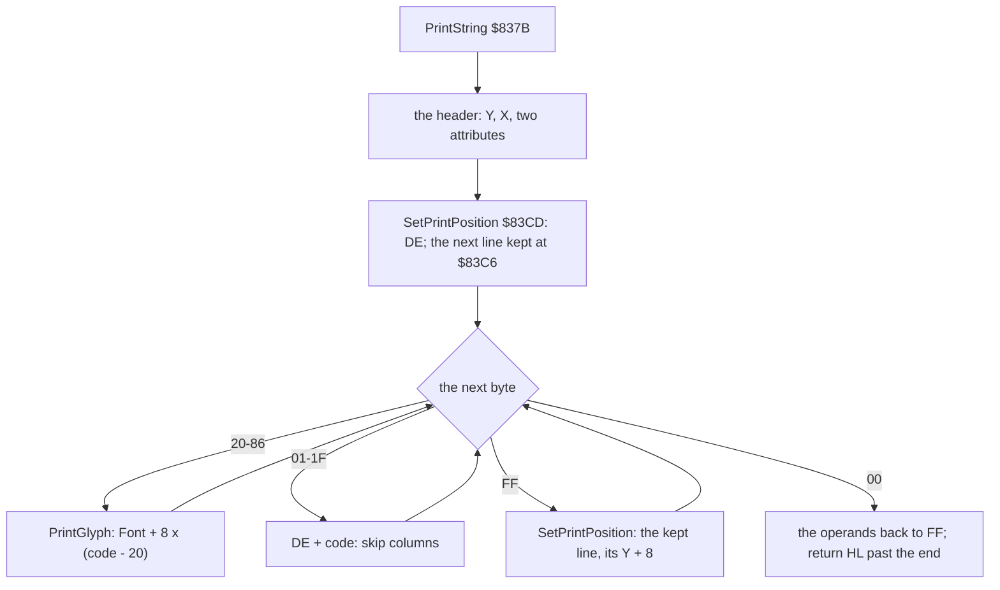

Worked example: the score line, ScoreLine `$6657`, as a game starts. The bytes are `00 00 07 47`, then `30 30 30 30
30 30 30 30 07 30 35`, then 0 (`src/res/texts/panel.txt`):

- Y 0 and X 0: the top line of the screen, column 0. DE = `$4000`.
- The lower attribute `$07` and the upper `$47`: Y is a cell's top, so only `$47` (bright white on black) is used.
- Eight `$30`: eight glyph "0" in columns 0-7 (the score).
- `$07`: DE + 7, so the next glyph goes to column 15.
- `$30 $35`: "05" in columns 15-16 (the lives).
- 0: the end.

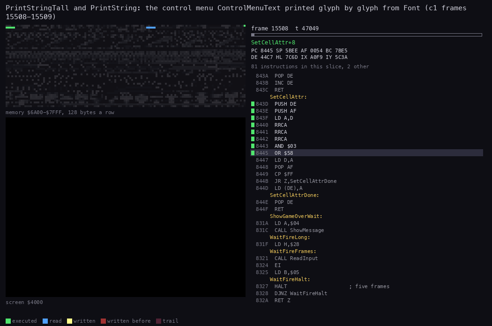

*The routine animation of the print routines (`$836E-$844F`) in `c1` from 15508:46300 to 15509:35300: the control
menu printed tall before the 48K intro ("1.JOYSTICK 1" to "4.PROTEK OR CURSOR"). It has 80 pictures. The view is
the screen; the memory grid is `$6A00-$7FFF`: ControlMenuText at `$6ACB` and the font from `$7BE5`. Command, from the
case folder after `. work/env.sh`: `python3 ../../kit/routine_anim.py --work work/docs/zsD/c1 --window
15508:46300-15509:35300 --listing build/game.lst --view screen --pc 836E-844F --range 6A00-7FFF --pictures 80 --out
docs/img/routines/PrintString.gif`.*

How to read it: the listing's green bar runs PrintGlyph's two loops for each letter; the grid lights the record's
byte being read and the glyph's 8 bytes; the screen grows a letter at a time. The menu's record is 63 bytes, of which
52 are glyphs; at about 1150 T a glyph the whole menu takes the window's 59 908 T: most of a frame (70 908 T).

## 8.3 The tall mode

PrintStringTall `$836E` prints the same record a little taller. It sets one flag, then falls into PrintString:

- **Y a multiple of 8** (the glyph inside one cell): the operand at `$8411` becomes 0. In PrintGlyph's first loop,
  when 4 rows are left, HL steps back one. Glyph row 4 is drawn twice, and row 7 falls off the cell.
- **Y not a multiple of 8** (the glyph across two cells): the operand at `$841D` becomes 0. Before the lower cell,
  HL steps back one and C grows by one. The last row of the upper cell is drawn again, at the top of the lower cell:
  9 rows in all.

PrintString's end sets both operands back to `$FF`, so the mode lasts for one record.

```text
PrintStringTall(HL):
    if Y AND 7 = 0: operand 8411 = 0      (aligned: row 4 twice, row 7 lost; 8 rows)
    else:           operand 841D = 0      (straddling: the boundary row twice; 9 rows)
    PrintString(HL)

in PrintGlyph, the first loop:
    after a row, if B = 4 and operand 8411 = 0: HL - 1
before the lower cell:
    if operand 841D = 0: C + 1; HL - 1
```

```asm
PrintStringTall:           ; $836E
  LD BC,PrintGlyphTop+10   ; $8411
  LD A,(HL)
  AND $07
  JR Z,SetTallMode
  LD BC,PrintGlyphTopNext+$0007 ; $841D
  XOR A
SetTallMode:
  LD (BC),A                ; 0: the flag on
```

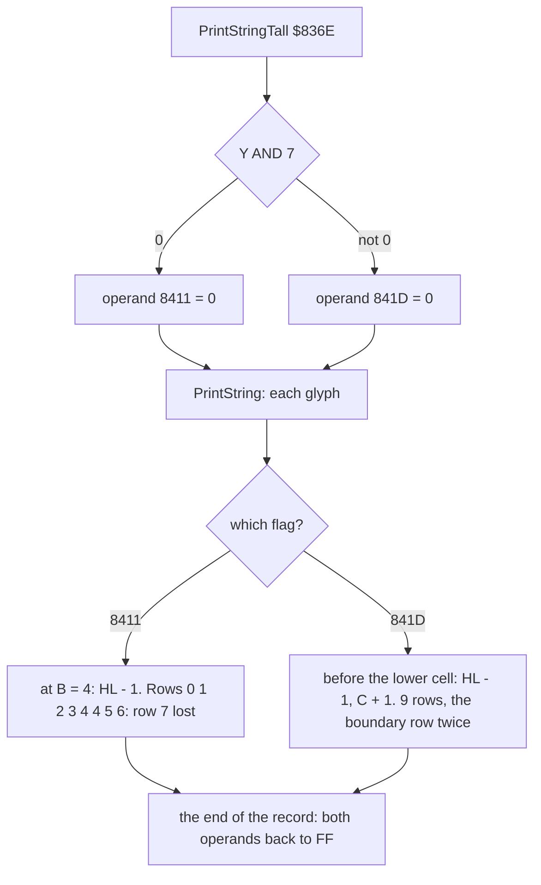

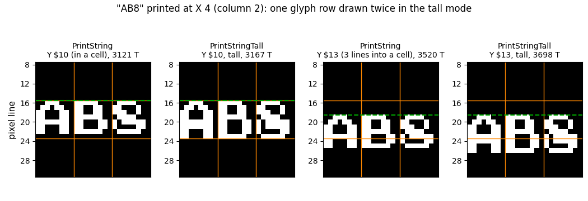

How to read the figure:

- **The four panels** print "AB8" at X 4 with the game's own code in the simulator. The two on the left use Y `$10`
  (a cell's top), the two on the right Y `$13` (three lines into a cell).
- **The orange lines** are the character-cell borders; **the green dashes** mark the record's Y.
- **The title** of each panel gives the T-states the whole record took.

The point:

- At an aligned Y the tall text is no taller. It is the same 8 lines, with its middle row doubled and its bottom row
  lost. The font's bottom row is mostly blank, so the letters only look heavier.
- At a straddling Y the text is one line taller.
- The mode costs little: 3167 T against 3121 for three glyphs.

The panel's status line is printed tall at Y `$B8`, an aligned Y. So its glyphs lose their row 7. That costs the
weapon bar one unit (8.8). The panel is the only aligned tall text. Every other tall record straddles and takes the
9-row branch (the operand `$841D`):

| Record | Y | Y AND 7 |
| --- | --- | --- |
| ControlMenuText `$6ACB` (the control menu) | `$34` | 4 |
| HiScoreTableHead `$8119` (the table) | `$14` | 4 |
| its copyright line `$81F0` | `$B5` | 5 |
| HighScoreMessage `$822C` (the name entry's two lines) | `$14` | 4 |
| NameEntryText `$82BE` (the name being typed) | `$96` | 6 |

Witness: the branch's `INC C` `$8421` ran 52 times in `c1` (the control menu's 52 glyphs), 263 in `c48`, 3376 in
`menu`, 1688 in `gameover`, 506 in `hiscore`, 64 in `havok`, and in six RZX segments (r080000 134, r094000 54,
r122000 64, r134000 74, r140000 144, r142000 231). The aligned branch `$8415` runs in every build that reprints the
status line: `play48` 210, the other keyed and integration recordings 770 and 5390 times in 76 RZX segments; not in
`rooms`, `c48` or the 15 POKE probes, which show the panel but never reprint its status line.

Command: `python3 tools/fig_text.py tall docs/img/text/tall.png`.

## 8.4 The picture strings: PrintGlyphs and PrintStoryString

The intro and the story pages mix two kinds of record. Their texts are PrintString records in the game font. Their
pictures (the eyes, the Fireblade, Havok's portrait) are picture records, drawn by two near copies of PrintString's
loop that take a glyph set in BC instead of the font:

- **PrintGlyphs** `$61E5` (48K, in `menu.asm`): the 48K intro's pictures (IntroScript `$5E4D`), from the intro glyph
  sets. It was called 14 times in c48 and 7 times in r000000, the RZX run's 48K intro (the `CALL` at `$61EA`; c1's
  L1 at `$61E5` is stage 2's code, which occupies these addresses while the tape loads).
- **PrintStoryString** `$D863` (bank 4): the 128K story's pictures, from StoryFont. It ran in c1, deaths, gameover,
  menu and opt2-4.

A picture record is shorter: Y and X, then glyph numbers. Glyph n is the 8 bytes at BC + 8 (n - 1); `$FF` is a new
line, 0 the end. There are no attributes and no skips: the story pages colour the picture with a block of attributes
afterwards. Both routines call SetPrintPosition and PrintGlyph of the main memory.

```text
PrintStoryString(HL, glyph set BC):
    Y, X = the header; DE = SetPrintPosition(Y, X)
    loop:
        n = next byte
        0:  return HL
        FF: DE = SetPrintPosition(the kept next line)
        else: PrintGlyph(BC + 8 (n - 1), DE)
```

```asm
PrintStoryLoop:            ; bank 4
  LD A,(HL)
  INC HL
  OR A
  RET Z                    ; 0: the end
  PUSH BC
  PUSH HL
  INC A
  JR Z,PrintStoryNewLine   ; FF: the next line
  DEC A
  DEC A                    ; n - 1
  LD H,$00
  LD L,A
  ADD HL,HL
  ADD HL,HL
  ADD HL,HL
  ADD HL,BC
  CALL PrintGlyph
```

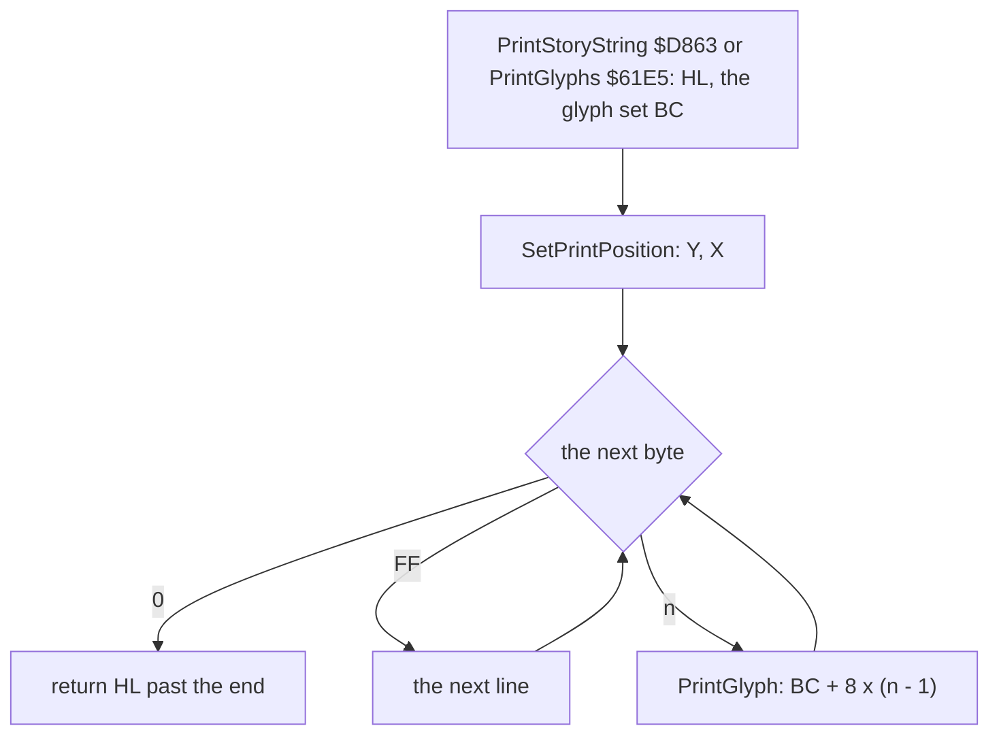

Worked example: the story's first picture, StoryEyesClosed (`src/res/texts/story.txt`):

- The header is Y `$98` and X `$32`: pixel line 152, column 25.
- Three rows of six glyph numbers follow, separated by `$FF`: `CE CF D0 D1 D2 01`, then `D3` to `D8`, then `D9` to `DE`.
- Glyph `$CE` is the 8 bytes at StoryFont + 8 x `$CD`. Glyph 1 is the font's first glyph.
- The page's text, StoryText1, follows as a PrintString record at Y `$60`, X 2: "FOR 10000 YEARS HE SLEPT." in the
  game font.

## 8.5 Every text

The game's strings live in nine files of `src/res/texts`. Each record there carries its address and its reader.

| File | Address | Printed by | What |
| --- | --- | --- | --- |
| `control-menu.txt` | ControlMenuText `$6ACB` | ControlMenu `$6A7B`, tall | "1.JOYSTICK 1", "2.JOYSTICK 2", "3.KEMPSTON", "4.PROTEK OR CURSOR" |
| `intro.txt` | IntroScript `$5E4D` | Intro48 `$5D4F` (PrintGlyphs) | the 48K intro: the eyes, the Fireblade, Havok and the 7 texts |
| `story.txt` | StoryEyesClosed `$D4CB` (bank 4) | StoryPages `$D3D0` (PrintStoryString) | the 128K story: the same pictures and texts |
| `panel.txt` | ScoreLineInit `$5C15`, StatusLineInit `$5C25` | NewGame copies them to ScoreLine `$6657` and StatusLine `$6667` | the score and lives line; EXTRA, the weapon, BONUS |
| `hiscore-texts.txt` | `$80EB-$811C` | ShowHighScores, MoveNameBox | the box eraser, "RANK SCORE NAME", "NO." |
| `hiscores.txt` | HiScoreTableHead `$8119` | ShowHighScores, tall | the ten entries: JEFF C 00100400 to KEV 00005010 |
| `copyright.txt` | CopyrightText `$81F0` | ShowHighScores | "COPYRIGHT GREMLIN GRAPHICS 1990" |
| `strings.txt` | `$821E-$8319` | the title, EnterName, PanelFragments, HavokFade | the music and effects signs, "WELL DONE! YOU HAVE A HIGH SCORE", "PLEASE ENTER YOUR NAME", the letter grid, the box, the name, the underline, the Fireblade, the end text |
| `sloppy.txt` | SpareName `$8214` | the cheat test | "SLOPPY": a name, not a record (doc 05) |
| `tape-error.txt` | TapeErrorText `$FFD8` | the loader, RST `$10` | "TAPE LOADING ERROR" |

The story, in both versions:

> FOR 10000 YEARS HE SLEPT. / HIS MIND FEEDING... / ON THE NIGHTMARES OF THE WEAK. / NOW HE HAS AWAKENED / AS THE
> NIGHT BLED CRIMSON / THE FIREBLADE SHATTERED / AND ITS POWER DIED. / THEN THE SLAUGHTER BEGAN. / THEY NEVER /
> THOUGHT HE WOULD RETURN. / NOW HAVOK REIGNS THE UNDERCITY. / I AM HIRO, / THE LAST OF THE BLADEKNIGHTS. / I MUST
> REBUILD THE FIREBLADE, / AND BRING THE DAWN...

The end text, EndText `$82E0`, printed by HavokFade when Havok's picture has faded: "THE DAWN HAS COME AND MY / WORLD
IS SAFE, / FOR NOW.....". The third line starts with the skip `$06`: it is indented six columns.

Where each text is seen:

| Text | Recording, frame |
| --- | --- |
| the control menu | c1 15 508 (the animation of 8.2) |
| the story (128K) | c1, menu, deaths: before the title |
| the title's effects sign | menu 3300 (8.12) |
| the high-score table | menu 3000 (8.13) |
| the end text | r140000 1000 (8.12) |
| the name entry | r140000 1010-2000 (8.14) |

Nothing on the panel or in the menus is printed by the ROM. The one text the ROM prints is the tape error, through
RST `$10`.

## 8.6 The panel: the layout and who draws it

The panel is two text rows: row 0 at the top of the screen and row 23 at the bottom. The play area lies between
them.

| Row | Columns | What | Printed by |
| --- | --- | --- | --- |
| 0 | 0-7 | the score, 8 digits | PrintScore `$8365` (ScoreLine `$6657`) |
| 0 | 15-16 | the lives, 2 digits | the same record, after a skip of 7 |
| 0 | 26-31 | the Fireblade, 6 glyphs | PanelFragments (FirebladePanelText `$82D5`) |
| 23 | 0-7 | the vitality meter | DrawMeter at `$51E0` |
| 23 | 9-13 | EXTRA | PrintPanelLine `$836B`, tall (StatusLine `$6667`, Y `$B8`, X `$12`) |
| 23 | 14 | the weapon bar's left glyph `$85` | the same record |
| 23 | 15-16 | the weapon icon, a glyph pair (`$5B` / `$5C` for the fist; the pairs in 8.1) | the same record (WeaponIcon `$6671`) |
| 23 | 17 | the weapon bar's right glyph `$86` | the same record |
| 23 | 18-22 | BONUS | the same record |
| 23 | 24-31 | the charge meter | DrawMeter at `$51F8` |

The colours are not in the records. PanelAttrs `$FFCB`, the 32 bytes of the attribute row `$5AE0`, are copied once a
game by PanelAttrsRoom; the letters of EXTRA and BONUS then change one attribute at a time (8.10).

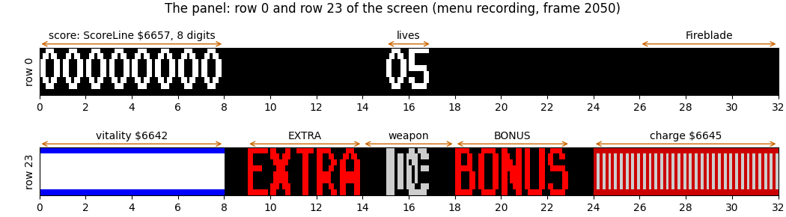

How to read the figure:

- **The two strips** are rows 0 and 23 of a screen shot of `menu`, frame 2050 (128K, play), scaled 4 times.
- **The arrows** name each field and its variable: Lives `$664D` (its two digits at `$6664`), Fragments `$664E` (the
  Fireblade), WeaponIcon `$6671`. EXTRA and BONUS are letters of StatusLine `$6667` itself (8.10).
- **The x axis** counts the character columns.

The point: the score and the lives share one record. The weapon and its bar sit inside the status line between EXTRA
and BONUS. The two meters are not text at all: DrawMeter writes their bytes straight into the screen.

Command: `python3 tools/fig_text.py panel docs/img/text/panel.png --shot work/docs/zsD/shots/s2050.png`. The shot:
`python3 ../../kit/screen_shot.py --work work/docs/zsD/menu --out-dir work/docs/zsD/shots s2050=2050`.

The main loop keeps the panel up to date with two jobs, every pass (doc 04): PanelWeapon `$FF01` and PanelMeters
`$FF64`. Both lie in the page `$FF00-$FFFF`, copied over the tape loader by the bootstrap. Each compares a variable
with its "shown" copy in the next byte, and draws only on a change. The score and the lives are printed by their
writers (8.11).

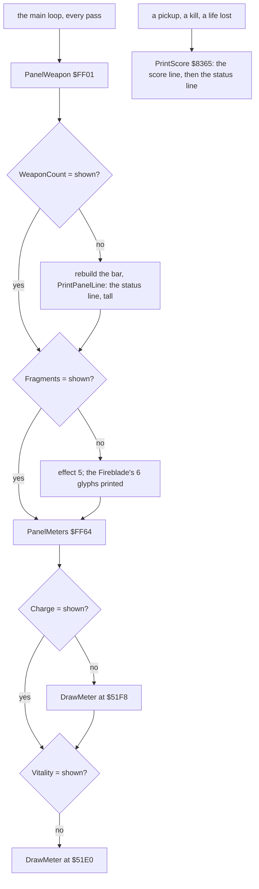

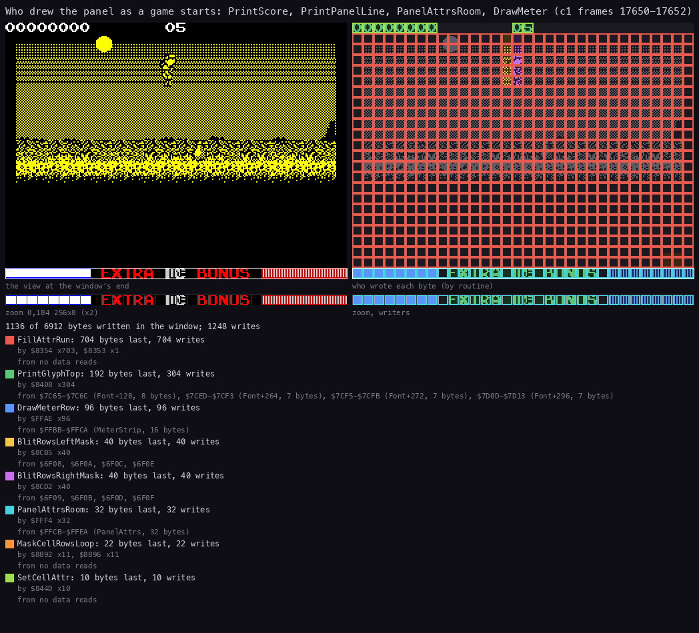

How to read the figure:

- **The two views** are the screen at the window's end (the start of c1 frame 17 653) and the same screen with each
  byte coloured by the routine that last wrote it in the window 17650:65000-17653:0.
- **The zoom** (x4) is columns 9-22 of the bottom row (pixel lines 184-191): EXTRA, the weapon, BONUS.
- **The legend** names the innermost label of the writing instruction: PrintGlyphTop is PrintGlyph's row loop
  (`$8408`), run for PrintPanelLine and PrintScore; DrawMeterRow is DrawMeter's row loop (`$FFAE`); FillAttrRun is the
  attribute fill of FillAttributes `$834A` (ClearScreen, BlackAttributes).

The point: four routines build the panel's bottom row as a game starts. PrintPanelLine draws EXTRA, the weapon and
BONUS; DrawMeter draws the two meters; PanelAttrsRoom colours the row.

Command: `python3 ../../kit/writers_map.py --work work/docs/zsD/c1 --window 17650:65000-17653:0 --listing
build/game.lst --view screen --by routine --sources --zoom 72,184,112,8 --title "Who drew the panel as a game starts:
PrintScore, PrintPanelLine (PrintGlyph's row loop PrintGlyphTop), PanelAttrsRoom, DrawMeter (its row loop
DrawMeterRow); c1 window 17650:65000-17653:0" --out docs/img/text/panel-writers.png`.

## 8.7 The meters: DrawMeter

Vitality `$6642` and Charge `$6645` run from 0 to `$20` (32). DrawMeter `$FF7C` draws either as 8 bytes across 6
pixel rows. It does not compute the bytes: it copies an 8-byte window out of a strip at `$FFB7-$FFCA`.

| Address | Bytes | What |
| --- | --- | --- |
| `$FFB7` | `55 D5 F5 FD` | MeterGradient: the partial byte for 0-3 quarters |
| `$FFBB` | `FF` x 7 | MeterStrip: full bytes |
| `$FFC2` | 1 byte | MeterPartial: set before each draw |
| `$FFC3` | `55` x 8 | MeterEmpty: the dotted empty bytes |

The window's start C picks how many full bytes come first.

```text
DrawMeter(value A, screen DE, shown copy HL):
    (HL) = A
    MeterPartial = FF
    if A = 20:  C = BB                            (8 full)
    elif A = 0: C = C3                            (8 empty)
    else:
        MeterPartial = MeterGradient[A AND 3]     (55, D5, F5, FD)
        C = C2 - A / 4                            (A / 4 full bytes, then the partial)
    6 times: copy 8 bytes from FF00 + C to DE; D + 1
```

```asm
DrawMeterGradient:         ; $FF94
  LD C,A
  LD A,(BC)                ; MeterGradient[A AND 3]
  LD (MeterPartial),A
  LD A,(HL)
  SRL A
  SRL A                    ; A / 4
  LD C,A
  LD A,$C2
  SUB C
  LD C,A                   ; the window starts A / 4 bytes before MeterPartial
DrawMeterWindow:
  LD H,$FF
  LD L,C
  LD B,$06                 ; six pixel rows
DrawMeterRow:
  PUSH HL
  PUSH DE
  PUSH BC
  LD BC,$0008
  LDIR
```

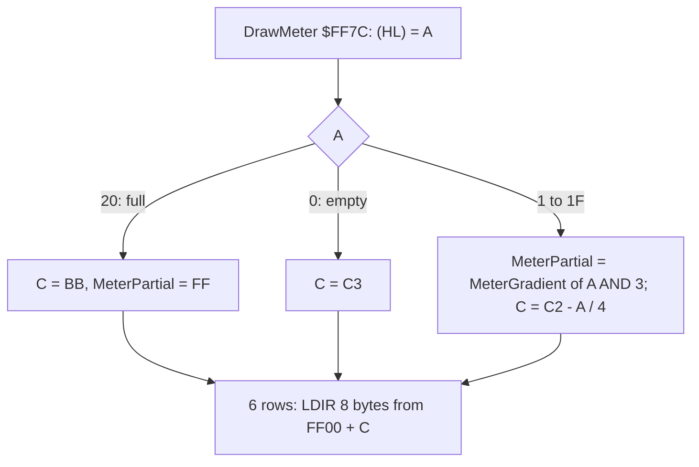

Worked example: Vitality falls from `$20` to `$1D` (29):

- 29 AND 3 = 1, so MeterPartial = `$D5`.
- 29 / 4 = 7, so C = `$C2` - 7 = `$BB`.
- The window `$FFBB-$FFC2` is seven `$FF` and the `$D5`: seven full bytes, then one with three of eight pixels off.
- The same 8 bytes go to each of the 6 rows from `$51E0`.

So a meter has 33 states. Each byte holds 4 units; the partial byte shows the quarter.

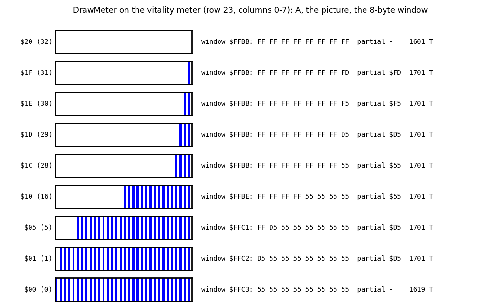

How to read the figure:

- **Each strip** is the meter drawn by the game's DrawMeter in the simulator, for the value on its left.
- **The text on the right** gives the window's start and the T-states of the call.
- **The black frames** mark the 8 bytes.

The point: the cost is the same for every value, about 1700 T. A meter is a window on one strip of 20 bytes: no loop
over bits, no table per value.

Command: `python3 tools/fig_text.py meter docs/img/text/meter.png`.

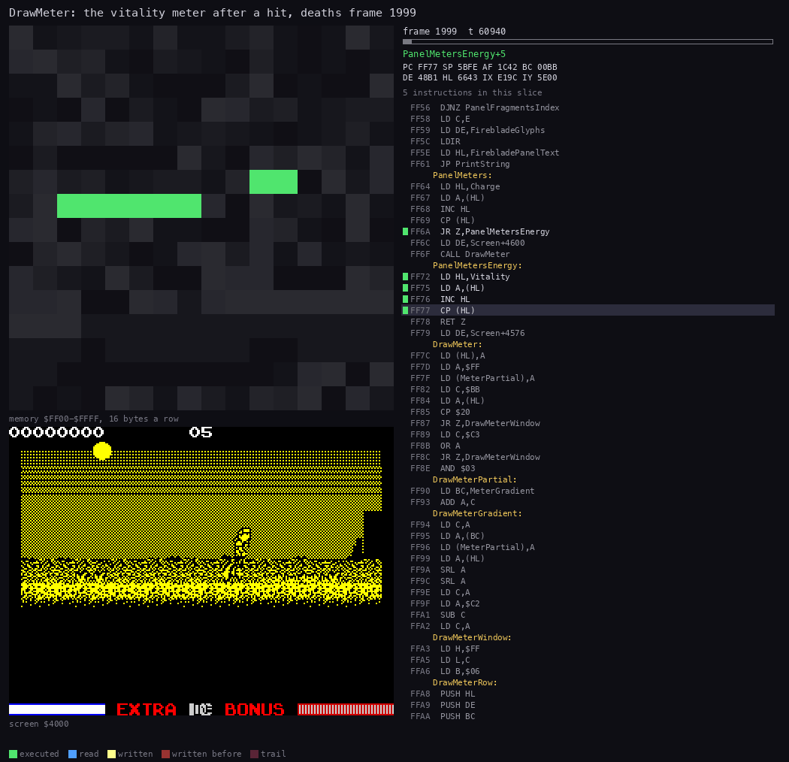

*The routine animation of the meter code (`$FF64-$FFCA`) in `deaths` from 1999:60900 to 1999:62700. LoseEnergy
lowered Vitality at T 24 351 of the same frame; the main loop's PanelMeters sees the change at T 60 906, and DrawMeter
returns at T 62 654. It has 45 pictures. The view is the screen; the memory grid is `$FF00-$FFFF`, 16 bytes a row: the
panel code and the strip. Command, from the case folder after `. work/env.sh`: `python3 ../../kit/routine_anim.py
--work work/docs/zsD/deaths --window 1999:60900-1999:62700 --listing build/game.lst --view screen --pc FF64-FFCA
--range FF00-FFFF --row-bytes 16 --pictures 45 --out docs/img/routines/DrawMeter.gif`.*

How to read it: the grid lights the 8 bytes of the window at the foot of the page six times, once per pixel row,
while the meter's row at the bottom left of the screen is rewritten.

## 8.8 The weapon bar

The weapon icon shows the weapon Hiro holds; the bar beside it shows how many shots are left. WeaponCount `$6649`
runs from 0 to 16. PanelWeapon `$FF01` redraws the bar on a change. It writes the 16 bytes of glyphs `$85` and `$86`
(MeterGlyphs `$7F0D`), then reprints the whole status line, tall.

```text
PanelWeapon():
    if WeaponCount = shown: goto PanelFragments
    shown = WeaponCount
    if WeaponCount = 0: SetWeapon(the default weapon)
    clear the first 16 - n of the 16 bytes
    for b = n down to 1:
        e = 0E if b >= 9 else E0
        if b is even: e shifted right one place
        store e
    PrintPanelLine()                                  (the status line, tall)
```

```asm
PanelWeaponRow:            ; $FF27
  LD E,$0E                 ; units 9-16: the right edge of glyph $85
  LD A,B
  CP $09
  JR NC,PanelWeaponShift
  LD E,$E0                 ; units 1-8: the left edge of glyph $86
PanelWeaponShift:
  RRA
  JR C,PanelWeaponStore
  RR E                     ; even units: one pixel to the right
PanelWeaponStore:
  LD (HL),E
  INC HL
  DJNZ PanelWeaponRow
PanelWeaponPrint:
  CALL PrintPanelLine
```

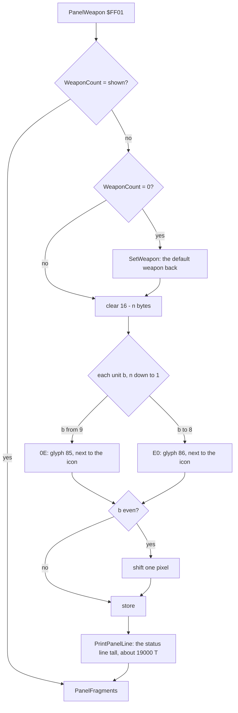

The bar fills from the bottom: units 1-8 are the rows of `$86`, from row 7 up; units 9-16 the rows of `$85`. The
status line is tall at an aligned Y, so row 7 of each glyph is never drawn (8.3). Unit 1 and unit 9 are invisible.

Worked example: WeaponCount 3.

- 13 bytes are cleared; then units 3, 2, 1 go into bytes 13, 14 and 15: `$E0`, `$70`, `$E0`.
- Those are rows 5, 6 and 7 of glyph `$86`.
- The tall print draws rows 0, 1, 2, 3, 4, 4, 5, 6. Two lines of the bar show (`$E0` and `$70`), not three.

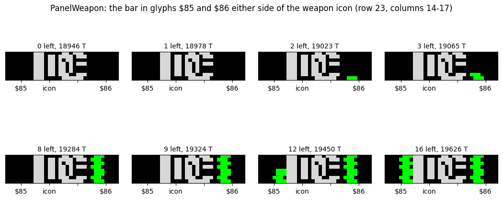

How to read the figure:

- **Each panel** is the bar and the icon (columns 14-17 of row 23), printed by the game's PanelWeapon and PrintPanelLine
  in the simulator, for the count in its title.
- **The bar** is the two glyphs either side of the icon: units 1-8 on the right, 9-16 on the left.

The point: count 1 looks the same as count 0, and count 9 the same as count 8. The bar's 16 units show as 14 steps.

Command: `python3 tools/fig_text.py weapon docs/img/text/weapon.png`.

## 8.9 The Fireblade count

Fragments `$664E` counts the pieces of the Fireblade found, 0 to 16. PanelFragments `$FF3C` runs after PanelWeapon.
On a change it asks effect 5 (doc 09), copies 6 glyph codes for the count from FirebladeIcons into the record
FirebladePanelText `$82D5`, and prints it at row 0, columns 26-31.

```text
PanelFragments():
    if Fragments = shown or Fragments = 0: return (after storing the shown copy)
    EffectRequest = 5
    copy the 6 codes at 7F17 + 6 n to FirebladeGlyphs 82D9
    PrintString(FirebladePanelText)
```

```asm
PanelFragments:            ; $FF3C
  LD HL,Fragments
  LD A,(HL)
  INC HL
  CP (HL)
  RET Z
  LD (HL),A
  OR A
  RET Z
  LD A,(Fragments)
  LD B,A
  LD A,$05                 ; the fragment sound
  LD (EffectRequest),A
  LD HL,MeterGlyphs+$000A  ; HL = $7F17 + 6 n
  LD DE,$0006
PanelFragmentsIndex:
  ADD HL,DE
  DJNZ PanelFragmentsIndex
  LD C,E
  LD DE,FirebladeGlyphs
  LDIR
  LD HL,FirebladePanelText
  JP PrintString
```

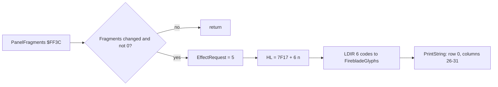

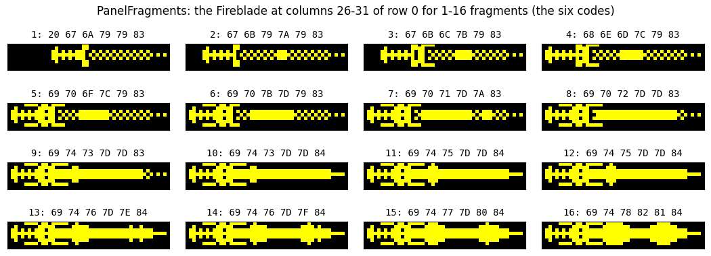

How to read the figure: one strip per count, printed by the game's PanelFragments in the simulator; the glyphs are
`$67-$84` of the font. The point: the blade is assembled from 6 cells, and each fragment adds part of one. At 16 the
blade is whole.

Command: `python3 tools/fig_text.py blade docs/img/text/blade.png`.

## 8.10 EXTRA and BONUS

EXTRA and BONUS are printed once, in the status line. Their letters change by attribute only. A letter pickup
(LetterPickup `$9997`, doc 10) writes `$47` (bright white) into the attribute of its letter, row `$5AE0`. Then it
compares the five attributes of each word with five `$47` (MatchLetters):

- **EXTRA complete:** the five go back to `$42` (red), the lives + 1 (BCD), the lives' digits rewritten, and the
  EXTRA LIFE message asked (`$79FF` = 1).
- **BONUS complete:** the five go back to `$42`, 10 000 points (AddScore with the record `$C2`), and the BONUS message
  asked (`$79FF` = 2).

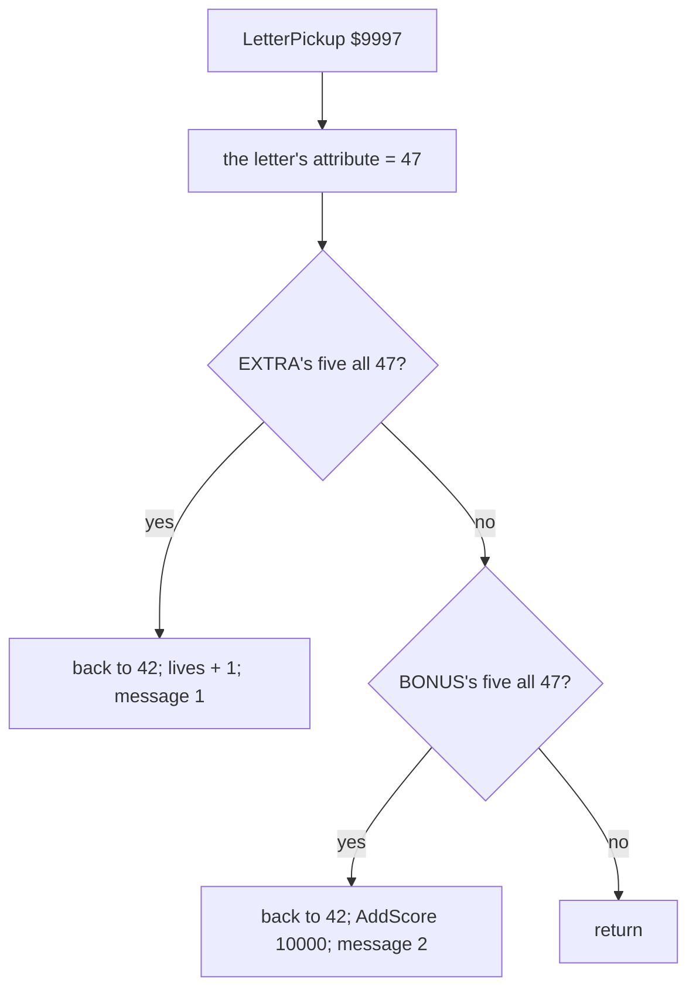

The panel figure of 8.6 shows both words unlit (red). MatchLetters ran only in the RZX segments (rzx x4, rzxroom x1).

## 8.11 The score and the lives

Score `$6653-$6656` is 4 BCD bytes. AddScore `$99E7` adds a score record from Hiro's page (`$5D00` + E, E = `$82` + 4 n: a score sprite
number and 3 BCD bytes) with DAA, then BcdToDigits `$9A11` writes the 8 ASCII digits into ScoreLine at `$665B`. The
caller then calls PrintScore, which prints the score line and falls into PrintPanelLine.

```text
AddScore(E):
    actor's score sprite = record[0]
    Score[1..3] += record[1..3]     (BCD, low byte first, with carry)
    Score[0] += carry
    BcdToDigits(Score, 4 bytes) -> ScoreDigits 665B

the caller:
    PrintScore():  PrintString(ScoreLine)   (score and lives, row 0)
                   PrintStringTall(StatusLine)
```

```asm
AddScoreLoop:              ; $99F9
  LD A,(DE)
  ADC A,(HL)
  DAA
  LD (HL),A
  DEC L
  DEC E
  DJNZ AddScoreLoop
  LD A,B                   ; B = 0: the carry into the top byte
  ADC A,(HL)
  DAA
  LD (HL),A
  LD B,$04                 ; the 8 digits
  LD DE,ScoreDigits
  CALL BcdToDigits
```

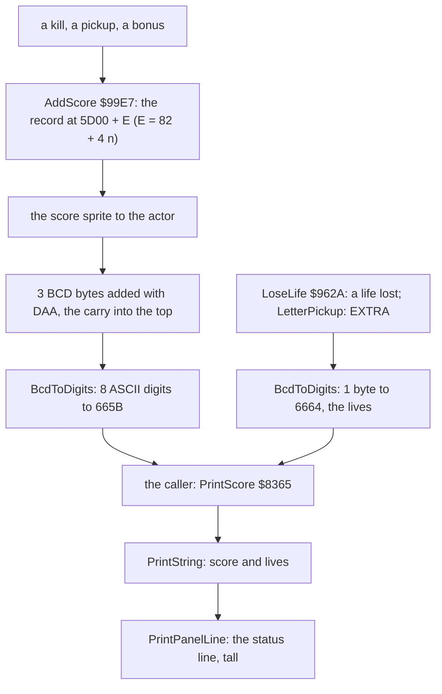

The lives are one BCD byte, Lives `$664D`. LoseLife `$962A` (a life lost, at `$9654`) and LetterPickup write its 2 digits to `$6664` with the same
BcdToDigits, inside the same ScoreLine record. So the score and the lives are always printed together.

Worked example, deaths frame 3536 (48K):

- AddScore runs at T 61 209 with a 50-point record: Score `00 00 00 00` becomes `00 00 00 50`.
- BcdToDigits runs 4 times and writes "00000050".
- PrintScore starts at T 61 964 and prints the 8 digits and the lives "02".
- PrintPanelLine starts at frame 3537 T 665 and reprints EXTRA, the weapon and BONUS, tall.
- The score's print takes about 8600 T, the status line's about 19 000 T: the status line is the dearer half,
  although nothing on it changed.

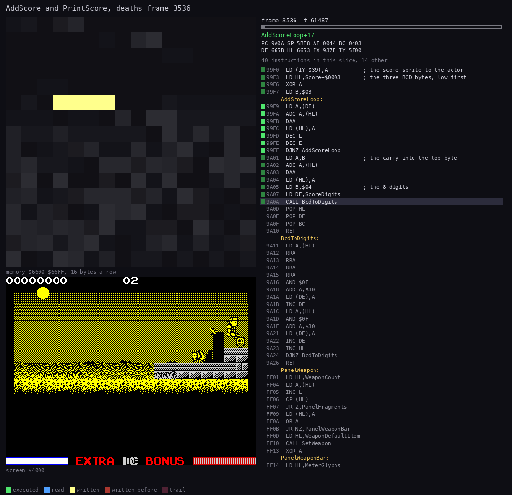

*The routine animation of AddScore, BcdToDigits and the print routines (`$99E7-$9A30`, `$8365-$844F`) in `deaths` from
3536:61100 to 3537:21100. It has 80 pictures. The view is the screen; the memory grid is `$6600-$66FF`, 16 bytes a row:
the globals page with Score `$6653`, ScoreLine `$6657` and StatusLine `$6667`. Command, from the case folder after
`. work/env.sh`: `python3 ../../kit/routine_anim.py --work work/docs/zsD/deaths --window 3536:61100-3537:21100
--listing build/game.lst --view screen --pc 99E7-9A30,8365-844F --range 6600-66FF --row-bytes 16 --pictures 80 --out
docs/img/routines/AddScore.gif`.*

How to read it: first the grid lights Score and the 8 digit bytes as AddScore and BcdToDigits write them; then the
listing moves into PrintString and the score's digits are redrawn at the top left; then the status line is redrawn
at the bottom, glyph by glyph.

## 8.12 The banners are sprites

PAUSE GAME, GAME OVER and EXTRA LIFE are not text. They are sprites (MessageFrames `$F87C`), drawn by ShowMessage,
whose run-time code is at `$66C8` (doc 06). Only EXTRA and BONUS go through a request: the bonus code writes
MessageRequest `$79FF` (1 at `$99B4`, 2 at `$99D2`), and the main loop (`$8E1C`) calls PendingMessage `$66B6`, which
shows it and clears the request. The other two are direct calls:

- PAUSE GAME: PauseGame `$6682` (run-time code of page `$66`) calls ShowMessage with A = 3 (`$6694`).
- GAME OVER: ShowGameOverWait `$831A` calls ShowMessage with A = 4. It is called from GameOver `$5C42` (the last life
  lost) and from the quit (P pressed while fire is held, `$668E`; PauseGame reads fire only then, never during the
  pause). `menu` frame 2200 shows GAME OVER with 5 lives left: the quit (fire held from 2099, fire and P 2109-2114).

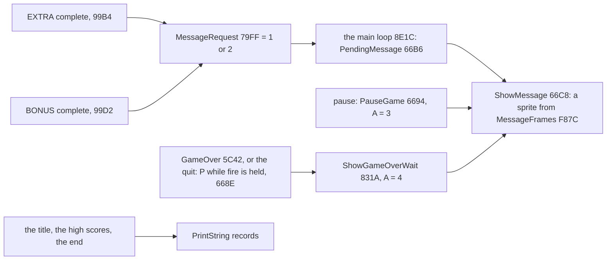

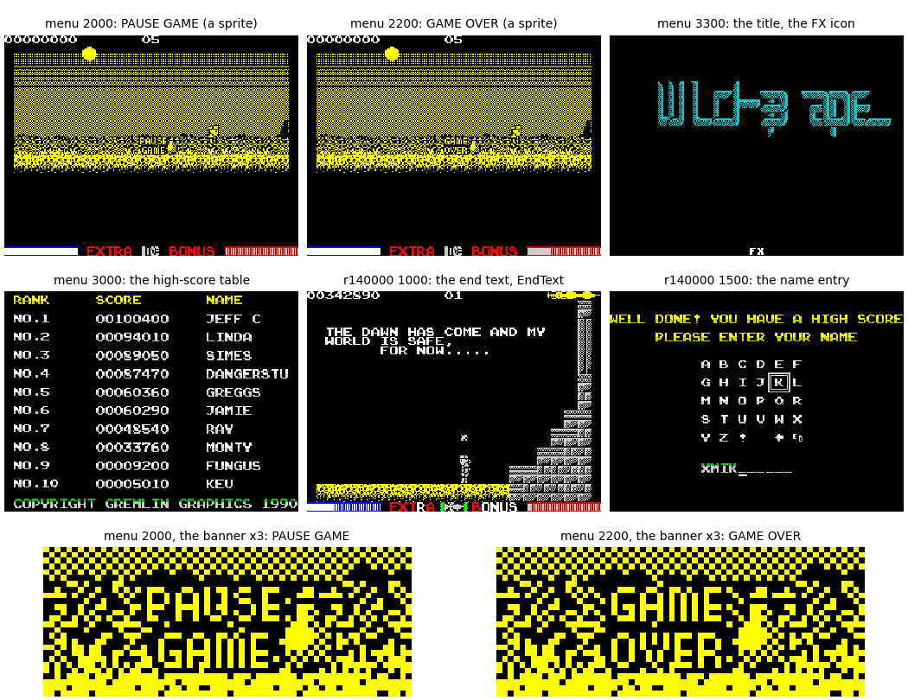

How to read the figure: six screen shots, each titled with its recording and frame, and two banners enlarged.

- **menu 2000:** PAUSE GAME, a sprite.
- **menu 2200:** GAME OVER, a sprite.
- **menu 3300:** the title, with the effects sign "FX" (EffectsIconText `$8225`) at the bottom right.
- **menu 3000:** the high-score table (8.13).
- **r140000 1000:** the end text over the faded picture (EndText, another player's run).
- **r140000 1500:** the name entry (8.14).
- **The last row:** the banner band of the first two shots (pixels 200-327 across, 164-215 down of the 512 x 384
  shot), magnified three times: the banner's letters are a sprite drawn over the landscape, not glyphs of the font.

The point: the font's letters print the menus, the tables and the end; the banners in play are drawn as sprites, with
the play area's own sprite code.

Commands, from the case folder after `. work/env.sh`:

```sh
D=work/docs/zsD/shots
python3 ../../kit/screen_shot.py --work work/docs/zsD/menu --out-dir $D s2000=2000 s2200=2200 s3000=3000 s3300=3300
python3 ../../kit/screen_shot.py --work work/docs/zsD/r140000 --out-dir $D/r140 --scale 1 s1000=1000 s1500=1500
python3 tools/fig_text.py screens docs/img/text/screens.png --shots \
  "$D/s2000.png:menu 2000: PAUSE GAME (a sprite)" "$D/s2200.png:menu 2200: GAME OVER (a sprite)" \
  "$D/s3300.png:menu 3300: the title, the FX icon" "$D/s3000.png:menu 3000: the high-score table" \
  "$D/r140/s1000.png:r140000 1000: the end text, EndText" "$D/r140/s1500.png:r140000 1500: the name entry" \
  --zoom "0=200,164,128,52:menu 2000, the banner x3: PAUSE GAME" \
  --zoom "1=200,164,128,52:menu 2200, the banner x3: GAME OVER"
```

## 8.13 The high-score table

ShowHighScores `$A6EC` follows the title's logo. It holds the logo for 40 x 5 frames (4 s), testing fire; then it
clears the screen black and prints:

- the heading HiScoreHeading `$80FB`: "RANK SCORE NAME", with skips of 5 and 7;
- ten rank lines from one record, HiScoreRankText `$810F`: the code writes its Y (from `$14`, + 16 each) and its two
  digits (" 1" to " 9", then "10") into the record before each print;
- the table, HiScoreTableHead `$8119`, tall: ten entries of 21 bytes;
- the copyright, CopyrightText `$81F0`, with the second PrintStringTall: it follows the table's 0.

Then it waits 200 frames for fire, and falls back into the title.

An entry is 21 bytes: 8 ASCII digits, the skip `$04`, 10 name letters, and two `$FF` (two new lines). So the whole
table is one record of 210 bytes plus its header.

```text
ShowHighScores():
    40 times: fire? return (the game starts); wait 5 frames
    ClearScreen(black)
    PrintString(heading)
    for r = 1 to 10:
        record 810F: Y = 14 + 16 (r - 1), X = 2, digits = r
        PrintString(record)
    PrintStringTall(table)            (HL left past it)
    PrintStringTall(copyright)
    wait 200 frames for fire; fire returns, else the title again
```

```asm
ShowHighScoresRankLoop:    ; $A70D
  LD (HiScoreRankText+$0007),DE ; the two digits into "NO."
  LD (HiScoreRankText),HL  ; Y and X into the record
  PUSH DE
  PUSH HL
  LD HL,HiScoreRankText
  CALL PrintString
  POP HL
  LD DE,$0010              ; 16 lines down
  ADD HL,DE
  POP DE
  LD A,$30                 ; just printed NO.10?
  CP D
  JR Z,ShowHighScoresTable
  INC E
  LD A,$3A
  CP E
  JR NZ,ShowHighScoresRankLoop
  LD D,$30                 ; after 9: "10"
  JR ShowHighScoresRank
```

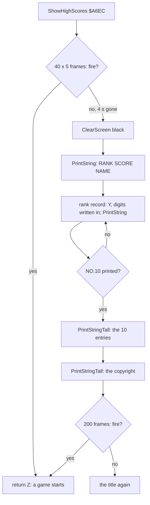

The table as the game ships it (`src/res/texts/hiscores.txt`): JEFF C 00100400, LINDA 00094010, SIMES 00089050,
DANGERSTU 00087470, GREGGS 00060360, JAMIE 00060290, RAY 00048540, MONTY 00033760, FUNGUS 00009200, KEV 00005010.

The witness is menu frame 3000 (the screens figure of 8.12). ShowHighScores ran 26 times in c48, gameover and menu.

## 8.14 Insertion and the name entry

At the game's end InsertHighScore `$A806` compares the score's 8 ASCII digits with each entry's, from the top. The
compare is an 8-byte subtraction with borrow, from the last digit: ASCII digits compare as numbers. The first entry
the score is not below is the place, so a tie goes above. The entries below move down one place (LDDR), the digits go
in, and EnterName asks for the name.

```text
InsertHighScore():
    for i = 0 to 9:
        if ScoreDigits - entry i digits does not borrow: place = i; break
    else return                                    (below the tenth)
    LDDR: entries i to 8 down one place (21 (9 - i) bytes)
    the entry's digits = ScoreDigits
    handler flag 845F = 1; ClearScreen black
    EnterName()
    each '-' of the name becomes a space; the 10 letters into the entry
```

```asm
InsertHighScoreCompare:    ; $A814
  DEC HL                   ; score - entry, digit by digit with borrow
  DEC DE
  LD A,(DE)
  SBC A,(HL)
  DJNZ InsertHighScoreCompare
  JR NC,InsertHighScorePlace
  LD DE,$001D              ; below this entry: the next one
  ADD HL,DE
  LD A,C
  SUB $15                  ; 21 bytes fewer to move
  LD C,A
  CP $EB                   ; past the tenth: no entry
  RET Z
  JR InsertHighScoreEntry
```

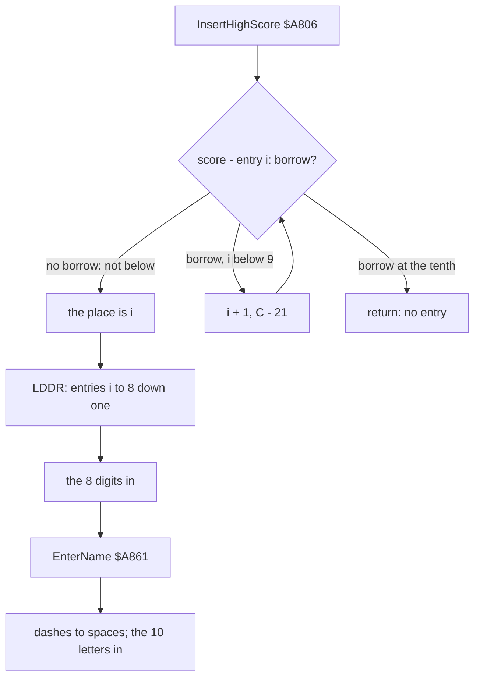

Worked example, r140000 (another player's run). The game ends with the score 00342890, shown above the end text at
frame 1000:

- Entry 0, JEFF C, is 00100400. 00342890 - 00100400 does not borrow, so the place is 1, the top.
- C is still `$BD` = 189: the LDDR moves 9 entries of 21 bytes, and KEV falls off.
- InsertHighScore runs at frame 1007, EnterName at frame 1010.

In `gameover` InsertHighScore ran too: the score there was below KEV's 00005010, and it returned. Our own `hiscore`
recording (128K, the score POKEd to 00500000 before the last life) inserts at place 1 at frame 2514 and enters ZX:
EnterName at 2517, MoveNameBox 10 runs (frames 2769-3183), END at 3229, and the table shows NO.1 ZX at 3871
(the figure in [10.17](10-gameplay-logic.md#1017-what-no-recording-reached)).

EnterName `$A861` fills the name buffer `$82C2-$82CB` with ten '-' (an underscore glyph). It prints "WELL DONE! YOU
HAVE A HIGH SCORE" / "PLEASE ENTER YOUR NAME" (tall), the letter grid NameGridText `$826A` (6 x 5: A-Z, '!', a blank,
'<' delete, '+' END) and the box NameCursorText `$82AE`. The box's row and column are kept in Hiro's Y and X bytes
(`$5D00`, `$5D01`); they start at row 4, column 5: the END sign. Ten delays (about 2 s) keep the fire that ended the
game from typing.

```text
EnterName():
    name = 10 x '-'; box at row 4, column 5 (END); underline at Y A0, X 12
    print the message (tall), the grid, the box; 10 delays
    loop:
        print the name (tall) and the underline
        wait: fire, or a direction -> MoveNameBox(rows E, columns D)
        on fire: k = row x 6 + column
            0-25:  'A' + k, then on (not past the tenth)
            26:    '!', then on
            27:    a space, then on
            28:    '-' at the position, then back (not below 0)
            29:    END: return
```

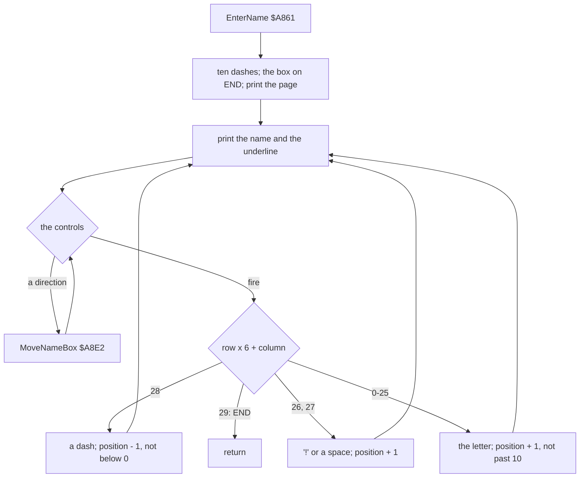

MoveNameBox `$A8E2` adds the step to the row and the column, and ignores a step out of the 6 x 5 grid. It erases the
box at its old place (its Y and X are copied into the blank record CursorEraseText `$80EB`, printed), takes the new Y
and X from the word table `$700C` (one word per sign), prints the box and waits (PauseLong).

```asm
MoveNameBox:               ; $A8E2
  LD HL,Hiro               ; $5D00: the row, $5D01 the column
  LD A,E
  ADD A,(HL)
  RET M                    ; above row 0
  CP $05
  RET Z                    ; below row 4
  LD E,A
  INC L
  LD A,D
  ADD A,(HL)
  RET M
  CP $06
  RET Z
  LD (HL),A
  DEC L
  LD (HL),E
  LD HL,(NameCursorText)   ; erase the box at its old place
  LD (CursorEraseText),HL
  LD HL,CursorEraseText
  CALL PrintString
  CALL NameLetterIndex     ; the new place from the table $700C
  ADD A,A
  ADD A,$0C
  LD L,A
  LD H,$70
```

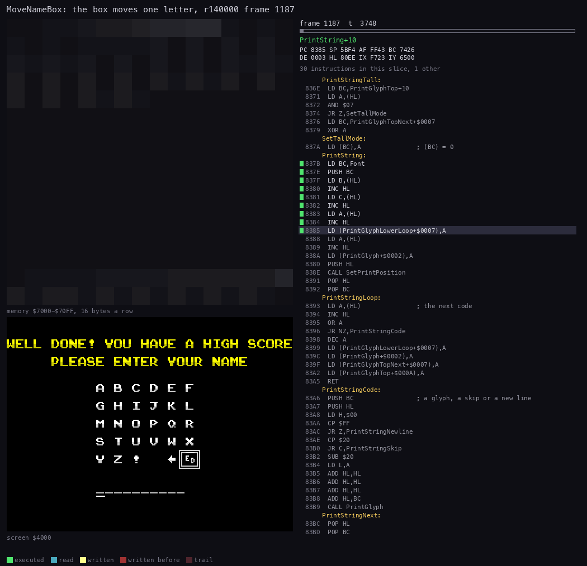

*The routine animation of MoveNameBox and the print routines (`$A861-$A92A`, `$836E-$844F`) in `r140000` from
1187:3500 to 1187:23300 (48K, another player's run): the box erased at its old place and printed at its new one. It
has 80 pictures. The view is the screen; the memory grid is `$7000-$70FF`, 16 bytes a row, with the box's place table
at `$700C`. Command, from the case folder after `. work/env.sh`: `python3 ../../kit/routine_anim.py --work
work/docs/zsD/r140000 --window 1187:3500-1187:23300 --listing build/game.lst --view screen --pc A861-A92A,836E-844F
--range 7000-70FF --row-bytes 16 --pictures 80 --out docs/img/routines/MoveNameBox.gif`.*

How to read it: the grid lights the table word read for the new place; the screen shows the frame of glyphs `$22-$29`
blanked, then redrawn around the next letter.

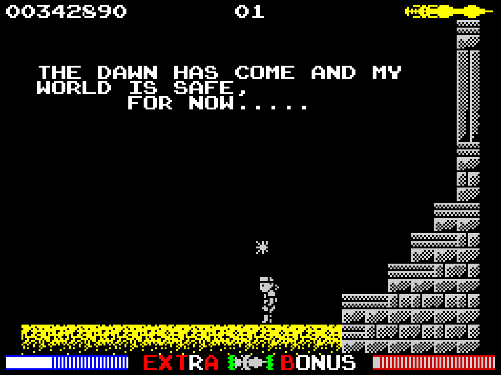

*The screen of `r140000` from frame 1005 to 2000 (48K, another player's run), one picture every 15 frames, 34
pictures, scaled 4 times and padded to 1050 px. Command: `python3 ../../kit/screen_anim.py --work
work/docs/zsD/r140000 --from 1005 --to 2000 --step 15 --scale 4 --delay 150 --hold 2000
docs/img/play/name-entry.gif`.*

How to read it: the page appears at frame 1010; the box moves over the grid, and each fire adds a letter to the name
line under the grid, with the underline one place on. MoveNameBox runs 25 times in this window.

## 8.15 Known only from the code

- **The invisible weapon units** (8.8): units 1 and 9 fall on row 7, which the tall mode drops. Found by running the
  code; no recording was searched for a frame with WeaponCount 1.
- **EXTRA and BONUS complete** (8.10): MatchLetters ran only in the RZX segments; no keyed recording completes a word.
- **The two ties of InsertHighScore** (8.14): a tie goes above. No recording has a tie.
- **Delete and the limits of EnterName**: the tenth letter can be typed over; delete never goes below 0. The RZX
  player's name entry and our `hiscore` show typing, not these edges.

## 8.16 The point

Switchblade prints all its text through one glyph routine and one record format. A record says where (any pixel
line), in which two colours, and what; small codes skip columns and start lines. The same format prints the menu, the
panel, the table and the name grid, and a second, shorter one prints the story's own fonts.

The panel is cheap where it changes often and dear where it rarely does. The meters are a window on a 20-byte strip,
about 1700 T. The score and the weapon reprint the whole status line in the tall mode, about 19 000 T each time,
although only digits or bar rows changed. The tall mode itself is a two-byte patch inside PrintGlyph. At the panel's
aligned Y it only thickens the letters, and it costs the weapon bar its bottom row.
