# 9. Sound

What this covers:

- the two sound engines behind one interface: the 48K beeper player at `$853F` and, on a 128K, a glue at the same
  address that drives Ben Daglish's AY player in bank 4 (9.1);
- the interrupt that runs them, and what a frame of each costs (9.2);
- the 48K player: the effect record, the envelope, the sweep and the beeper burst (9.3-9.5), and its 14 effects,
  rendered and checked against play48 (9.6);
- the 128K glue: the tune and effect requests, the loop, the music / effects switch (9.7);
- the AY player: PlayFrame and the sequencer (9.8), the order lists (9.9), the patterns with one worked by hand
  (9.10), the instruments and the software envelope (9.11), the vibrato, the arpeggio and the slide (9.12), the drums
  (the pattern commands `$FC` / `$FD`) and the hardware envelope (9.13), AyUpdate and the registers it writes each interrupt (9.14);
- the three tunes (9.15) and the 14 AY effects, rendered and checked against menu (9.16);
- the model checked against c1 write for write (9.17), the audio files (9.18), what is known only from the code
  (9.19) and the point (9.20).

The names are those of `src/game/game.ann`, `src/boot/boot.ann` (the glue) and `src/bank4/bank4.ann` (the AY
player and the tunes). The resources are in [src/res/music](../src/res/music/README.md) (the tunes as text, the
instruments, the arpeggios, the notes, the AY effects) and `src/res/tables/effects-48k.csv` (the beeper effects).

The recordings are those of [WALKTHROUGH 6.0](../WALKTHROUGH.md). Each was opened from its TTD session on the
writer's own instance (port base 37430, muted). No audio was played.

- `c1` (`work/stage1/c1/session.ttd`, 128K, frames 0-18 627): power-on, the load, the title and play. StartTune
  starts tune 0 (the title) in frame 16 013, so c1 frame F is tune frame F - 16 013. The traces used are
  16013:0-16063:0 (50 interrupts) and 16020:1990-16020:10700 (one interrupt).
- `menu` (`work/stage1/rec/menu/session.ttd`, 128K, frames 0-18 060): the title's switch set to effects, then play.
  The trace 1840:0-1932:0 holds 8 PlayEffect calls (frames 1846-1917).
- `play48` (`work/stage2/rec/play48/session.ttd`, 48K, frames 0-3769): the 48K game played from the keyboard. The
  trace 700:0-900:0 holds 4 StartEffect calls (frames 717, 750, 822 and 888).
- the RZX segments `rNNNNNN` (`work/stage2/rzx/`): another player's run (the RZX Archive's), replayed on the 48K. They
  are used only for the witnesses of the rarer effects, through their L1.

A 128K frame is 70 908 T and a 48K frame 69 888 T: 50 frames a second. A moment is written "frame F T t", with t
counted from the start of the emulator's frame. The AY clock is 1 773 400 Hz.

Most numbers come from a model. `tools/sound_sim.py` runs the game's own bytes in SkoolKit's Z80 simulator:
`build/game.bin` at `$5C00`; on the 128K also the glue (`build/boot.bin`, 162 bytes, at `$853F`) and
`build/bank4.bin` at `$C000`. It calls `$853F` once a frame, as the interrupt does, and records every `OUT`. Section
9.17 checks it against c1 write for write; 9.6 and 9.16 check the effects against play48 and menu.

## 9.1 Two engines, one interface

The game asks for sound in one way on both machines. It writes a number into SoundVars `$8450`:

| Byte | Name | Values | Written by |
| --- | --- | --- | --- |
| `$8452` | TuneRequest | `$FE` none, `$FF` stop, else the tune (bit 7: loop) | the title, NewGame (the jingle), the game's end (`$FF`) |
| `$8453` | TuneState | the tune playing, with its loop bit | the glue |
| `$8454` | EffectRequest | `$FF` none, else the effect 0-13 | 15 sites in the game code (9.6) |
| `$8455` | SoundMode | 0 music, 1 effects | the title's left / right keys (128K only) |

The IM 2 handler calls `$853F` every frame. What sits at `$853F` decides the sound:

- **A 48K** keeps the game's own EffectPlayer `$853F`. It reads only EffectRequest. It plays one effect at a time
  on the beeper, as one short burst a frame. TuneRequest is written but never read: a 48K has no music.
- **A 128K** gets a different `$853F`. The bootstrap copies 162 bytes from boot.bin (`$40A4`) over
  `$853F-$85E0`: AyGlue. It pages bank 4 in and drives the AY player there. The game's code is the same on both
  machines; only these 162 bytes and the five hook sites of doc 3 differ.

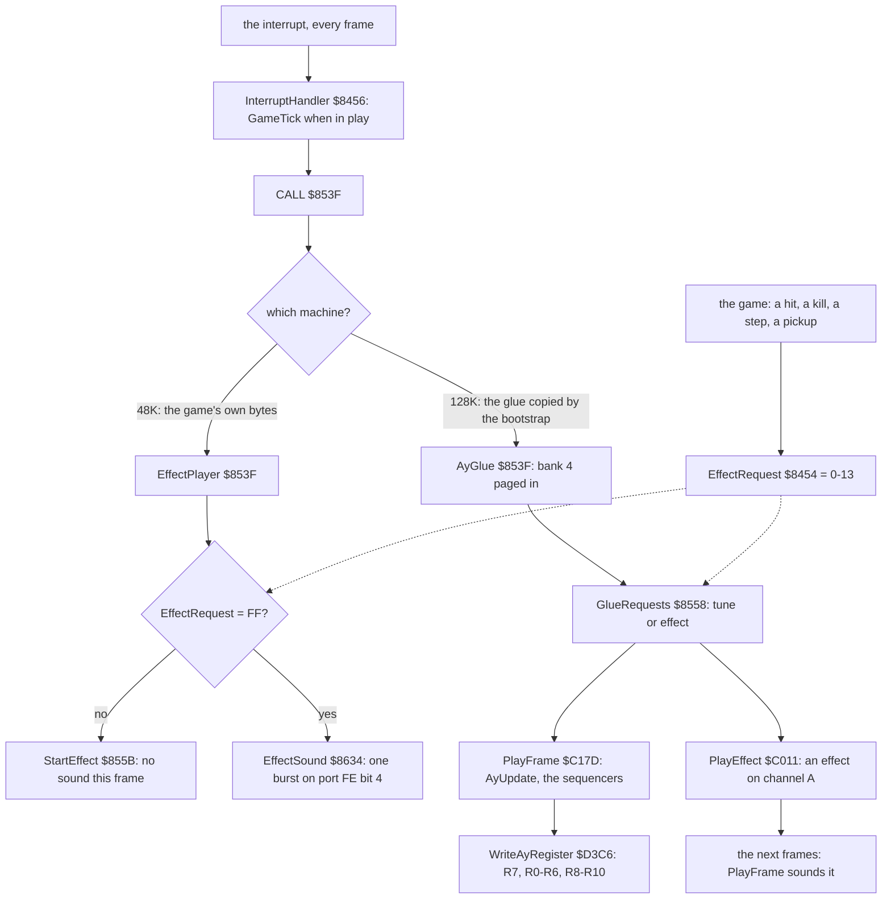

The point of the design: the game never knows which machine it runs on. It writes a number, and the code at `$853F`
interprets it. On the 128K the same 14 numbers become 14 AY effects with their own records (`$CF60`, 9.16), and the
interface gains the tunes.

## 9.2 The interrupt and the cost

InterruptHandler `$8456` saves six register pairs, runs GameTick when the flag `$845F` is 0 (in play), then always
calls `$853F`, then `EI` and `RETI`. The interrupts stay off for the whole handler. So the beeper burst of 9.5 is
never cut, and the AY writes of a frame are never split by the next interrupt.

```asm
InterruptHandler:          ; $8456
  PUSH HL
  ...
  LD A,$01                 ; the operand $845F: 0 in play, 1 on the title and the tables
  OR A
  CALL Z,GameTick
  CALL EffectPlayer        ; $853F: the beeper player, or on a 128K the glue
  POP IY
  ...
  EI
  RETI
```

Where in the frame the sound runs:

- **48K, in play:** EffectPlayer starts at about T 2890 (play48 frames 750, 751, 755: T 2890, 2887, 2892), after
  GameTick. In frame 755, with a 52-toggle burst, it returns at T 10 136.
- **128K, on the title:** AyGlue starts at T 1996 of c1 frame 16020 (no GameTick there). AyUpdate is called at
  T 2146, the 11 register writes run from T 4342 to T 5824, the three SequenceChannel calls at T 6034, 7847 and
  9278, and the glue returns at about T 10 665.

The cost, measured on the machine (L1, inclusive T-states) and in the model:

| Engine | Where measured | Calls | T a frame |
| --- | --- | ---: | --- |
| 48K EffectPlayer | play48, L1 | 3769 | mean 1297 |
| 48K, each effect | model (9.6) | 14 effects | max 8319 (effect 5), 11.9 % of a frame |
| 128K AyGlue | menu, L1 | 18 055 | mean 4687 |
| 128K, tune 0 | model, 8510 frames | | min 2829, mean 5534, max 9671 (13.6 %) |
| 128K, tune 1 | model, 10 105 frames | | mean 5746, max 10 100 |
| 128K, tune 2 | model, 147 frames | | mean 5209, max 9520 |
| 128K, silent | model | | 375 |

The machine's figure for the 128K (4687 T) is lower than the model's tune means because menu spends part of its
frames in effects mode, where the glue runs only AyUpdate (375 T when silent).

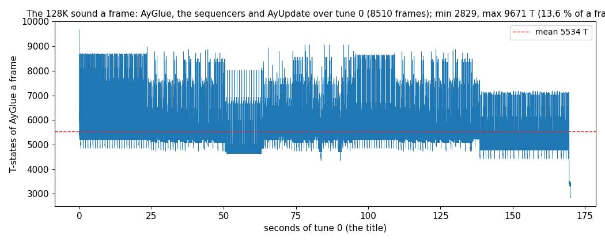

How to read the figure:

- **The x axis** is the time in tune 0, from StartTune, in seconds (50 frames a second).
- **The y axis** is the T-states of one `$853F` call: the glue, PlayFrame, AyUpdate and the three sequencers.
- **The dashed line** is the mean, 5534 T.
- **The bands** follow the arrangement. A frame where a channel reads a new pattern command costs more; the dense
  stretch at 0-23 s is the opening, where all three channels change note every 7 frames.

The point: the AY player costs about 8 % of a frame on average, and 13.6 % at the worst. The game's main loop runs
13-26 passes a frame (doc 4), so the music takes CPU from it every frame, but never more than one interrupt's worth.

Command, from the case folder after `. work/env.sh`: `python3 tools/sound_sim.py fig-cost docs/img/sound/cost.png`.
The recording: none; the model runs `build/` (checked against c1 in 9.17).

## 9.3 The 48K player: EffectPlayer and StartEffect

EffectPlayer `$853F` has three lines. EffectFrame does the work, and the current level is copied into the operand of
`LD A,n` at FootstepSound `$9BA2`. The footstep (effect 7) starts only while that operand, the envelope's level, is
0. So a step never cuts an audible effect, but it does cut a silent one: effects 4, 7, 11, 12 and 13 have sustain 0
(`effects-48k.csv`), so their level is 0 through the whole sustain while EffectTime still runs (effect 13 about 130
of its 152 frames, effect 4 for ever, 9.19), the flat zero tails of `effects48.png`. A footstep there replaces them.
On the 128K the gate is AY channel A's volume (+`$05`, `$D0A2`), copied by the glue: the same rule. No recording
shows such a cut; it is read from the code and the table.

EffectFrame `$8549` takes EffectRequest and sets it back to `$FF` at once. A request goes to StartEffect; none goes
to EffectSound. So the frame of a request is silent: the new effect sounds from the next frame on.

```asm
EffectPlayer:              ; $853F
  CALL EffectFrame
  LD A,(EnvelopeStep+$0004) ; the level, the operand at $85CA
  LD (FootstepSound+$0001),A ; $9BA3: the footstep waits for 0
  RET
EffectFrame:               ; $8549
  LD HL,EffectRequest
  LD A,(HL)
  LD (HL),$FF              ; taken
  INC A
  JP Z,EffectSound         ; none: sound the current effect
  DEC A
  JP StartEffect           ; a new one: set it up, no sound this frame
```

StartEffect `$855B` reads the effect's 12-byte record in EffectTable `$8683` (`src/res/tables/effects-48k.csv`):

| Offset | Field | Effect 10 (the strike) |
| ---: | --- | --- |
| +0 | the time: frames before the release (`$FF` hold) | 7 |
| +1 | the sweep delay (`$FF` never, 0 at once) | 0 |
| +2 | the sweep period: frames of one saw-tooth | 7 |
| +3 | the mixer bits: bit 0 tone, bit 1 noise | `$03` |
| +4, +5 | the sweep step, high byte first | `$001B` |
| +6 | the pitch (bits 5-7 used) | `$46` |
| +7 | the attack step | 127 |
| +8 | the decay step (signed) | -2 |
| +9 | the sustain level | 14 |
| +10 | the release step (signed) | -1 |
| +11 | the peak level | 107 |

```text
StartEffect(n):
    IY = EffectTable + 12 n                  (kept in the LD IY,n operand at $863C)
    EffectTime, SweepDelay, SweepCount = record +0, +1, +2
    EffectMixer = (EffectMixer OR 9), bit 0 cleared if +3 bit 0, bit 3 cleared if +3 bit 1
    sweep offset = 0
    span = step x (+2) / 2                   (shift-and-add over the period's bits 4-0)
    SweepRestart operand = -span             (the saw-tooth's start)
    envelope state = 9                       (the JR offset at $85CC: the attack)
    the level is NOT cleared: a new effect attacks from the level the old one left
```

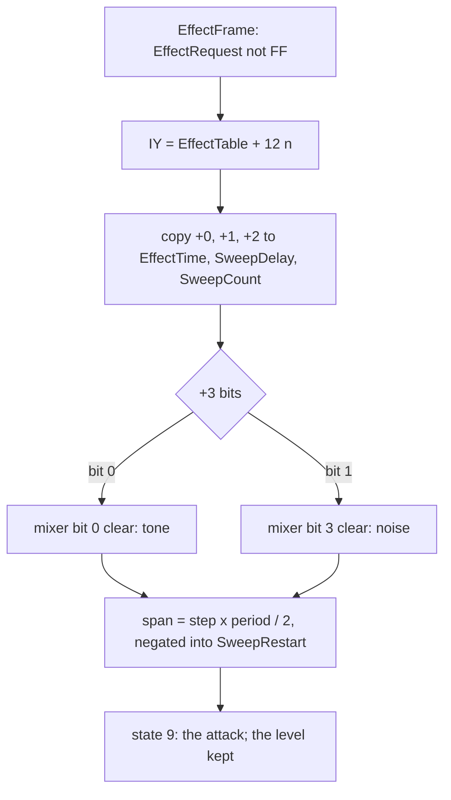

The mixer bits copy the AY's register 7 convention: bit 0 clear means tone on, bit 3 clear noise on, `$3F` idle. The
beeper has no noise: the 48K player uses the bits only to tell an effect from silence.

## 9.4 The 48K envelope and the sweep

EffectEnvelope `$85B6` runs once a frame for a sounding effect. It counts EffectTime down (0 and `$FF` stay), runs
the sweep, and steps the level through four states. The state is the offset of a `JR` at `$85CC`: StartEffect and
the states themselves rewrite it.

```text
EffectEnvelope():
    if EffectMixer has bits 0 and 3 both set: return       (silent)
    if EffectTime not 0 and not FF: EffectTime -= 1
    EffectSweep()
    level = operand $85CA
    switch state (JR offset at $85CC):
      09  attack:  level += +7;  at or above +11 (peak): level = peak, state = decay
      16  decay:   level += +8;  below +9 or negative: level = +9 (sustain), state = sustain
      00  sustain: when EffectTime = 0: state = release
      2B  release: level += +10; negative: level = 0, EffectMixer OR 9 (idle)
```

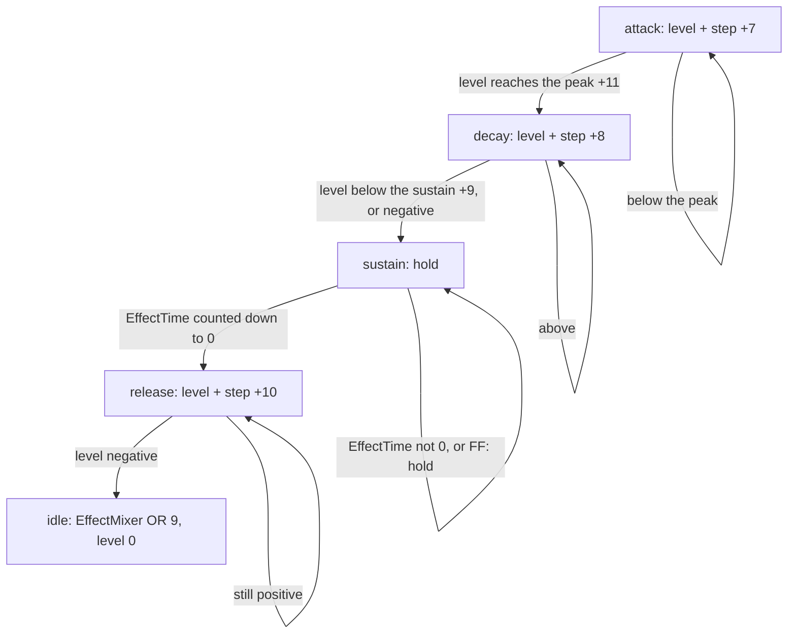

The sweep, EffectSweep `$8609`, moves the pitch in a saw-tooth. After SweepDelay frames it adds the step (+4, +5) to
an offset each frame; every SweepCount frames the offset jumps back to -span. The offset is added to the pitch byte,
and only its low byte is kept.

```text
EffectSweep():
    if SweepDelay = FF: return
    if SweepDelay > 0: SweepDelay -= 1; if not 0 now: return; offset = -span
    offset += step
    SweepCount -= 1
    if SweepCount = 0 and +2 not 0: SweepCount = +2; offset = -span
```

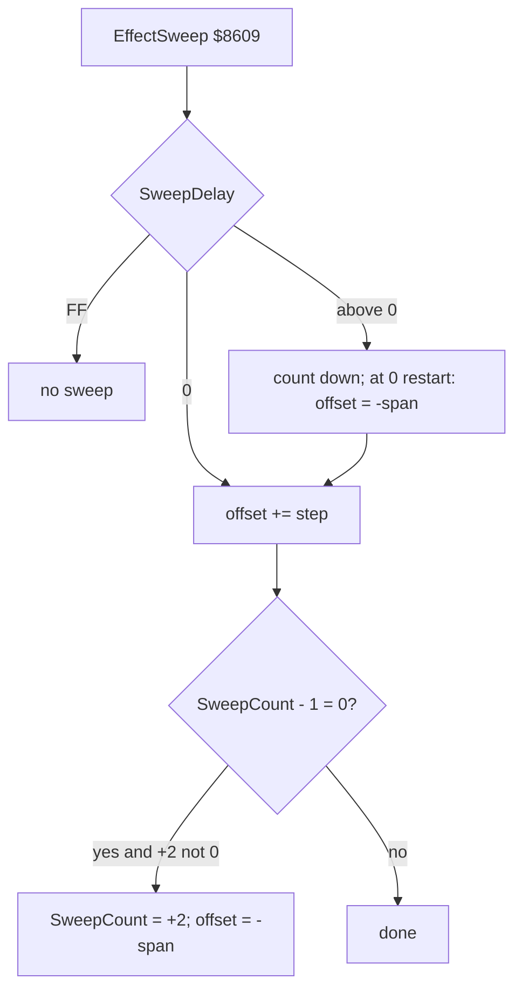

Worked example, effect 10 (the strike), in the model (`tools/sound_sim.py`, `effect48(10)`):

- Frame 0, the request: StartEffect. Time 7, sweep delay 0, period 7, step `$001B`. The span is 27 x 7 / 2 = 94,
  so SweepRestart's operand is -94 (`$FFA2`). No sound.
- Frame 1: the attack adds 127 to the old level 0. 127 is above the peak 107, so the level is 107 and the state is
  decay. The burst: (107 / 2 AND `$7C`) OR 4 = 52 toggles.
- Frames 2-47: the decay, -2 a frame: 105, 103, ... down to the sustain 14. EffectTime ran out at frame 7 meanwhile.
- The sustain sees EffectTime 0 at once and passes to the release.
- The release, -1 a frame, takes the level from 14 below 0 in 15 frames. The effect is idle after 65 frames.

## 9.5 The beeper burst: EffectSound

EffectSound `$8634` makes the frame's sound: one burst of square wave on bit 4 of port `$FE`.

```text
EffectSound():
    if EffectMixer = 3F: return
    EffectEnvelope()
    p = (+6 + sweep offset) low byte
    B = PitchToDelay(p)  = (p bits 5-7) OR 1      -> 1, 3, 5 or 7
    C = LevelToBurst(level) = ((level / 2) AND 7C) OR 4   -> 4, 12, 20 ... 60 toggles
    OUT (FE), 18                               (speaker on, MIC, border 0)
    repeat C times: A XOR 10; OUT (FE), A; DJNZ B loops
    OUT (FE), 08
```

```asm
  LD A,$18                 ; $8656: the speaker on (bit 4), MIC (bit 3), border 0
  OUT ($FE),A
  LD C,$0A                 ; the operand $865B: the burst length (LevelToBurst)
BeeperBurst:               ; $865C
  LD B,$00                 ; the operand $865D: the half-period (PitchToDelay)
  XOR $10
  OUT ($FE),A
BeeperDelay:
  DJNZ BeeperDelay
  DEC C
  JP NZ,BeeperBurst
  LD A,$08
  OUT ($FE),A
  RET
```

One half-cycle is 47 + 13 (B - 1) T: 47, 73, 99 or 125 T. The square wave is then 37.2, 24.0, 18.4 or 14.0 kHz:
ultrasonic. What the ear hears is the burst itself, once a frame: a 50 Hz buzz whose loudness follows the burst's
length. The pitch byte only picks one of four carriers, and the sweep moves it between them. The envelope is the
sound; the "pitch" is almost inaudible.

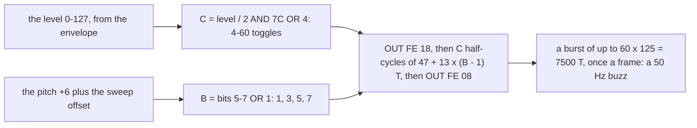

The witness is play48 frame 755, the fifth frame of effect 10 (the strike, requested in frame 750). The frame has 54
`OUT ($FE)`: the opening `$18`, 52 toggles, the closing `$08`. The decay has taken the level from 107 to 99 by then,
still a 52-toggle burst.

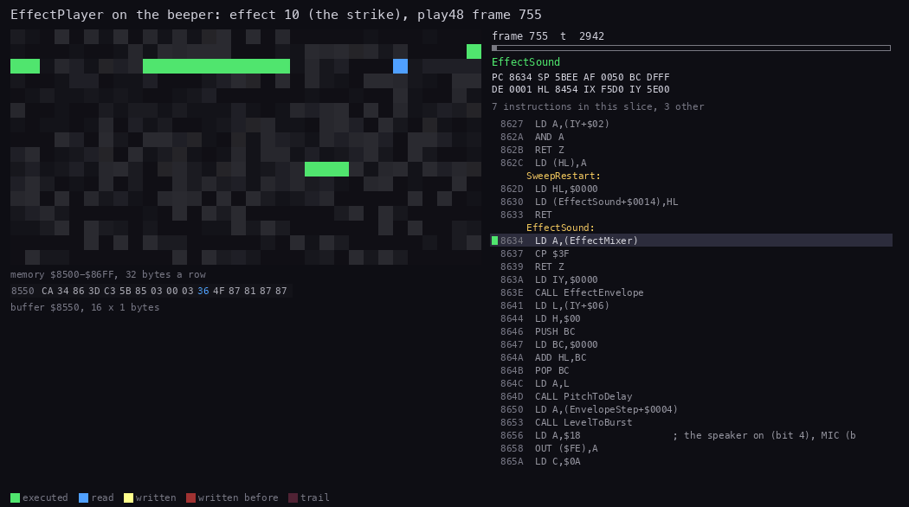

*The routine animation of the 48K player (`$853F-$8682`) in `play48` from 755:2850 to 755:10200. It has 80
pictures, 92 T each, and 708 instructions. The view is `$8550-$855F` as hex: EffectRequest's neighbours, EffectState
`$8557-$855A` and the start of StartEffect. The memory grid is `$8500-$86FF`, 32 bytes a row: the player and
EffectTable. Command, from the case folder after `. work/env.sh`: `python3 ../../kit/routine_anim.py --work
work/docs/zsD/play48 --window 755:2850-755:10200 --listing build/game.lst --view buffer:8550:16x1:hex --pc 853F-8682
--range 8500-86FF --row-bytes 32 --pictures 80 --out docs/img/routines/EffectSound.gif`.*

How to read it: the green bar on the left of the listing marks the lines run in that picture. For most of the 80
pictures it sits on the three lines `BeeperBurst` / `OUT` / `DJNZ`: the burst is almost the whole cost. The listing
shows the operands as assembled (`LD B,$00`, `LD C,$0A`); at run time they hold the values PitchToDelay and
LevelToBurst wrote.

The point: the 48K's effects are an envelope played as burst length. The CPU is busy for up to 7500 T a frame doing
nothing but toggling the speaker, with the interrupts off.

## 9.6 The 14 beeper effects, checked against play48

The game requests the effects from 15 sites. The event of each comes from its site (stage 2, NOTES "Doc 09"):

| # | Event | Request site | Witness (our recordings; RZX segments, of 91) |
| ---: | --- | --- | --- |
| 0 | Hiro hurt | HurtHiroSet `$9878` (`$987D`) | deaths, gameover, hiscore, play48, rooms; 64 |
| 1 | a hard landing | HiroLandedHard `$90D4` (`$90D8`) | deaths, play48; 8 |
| 2 | an enemy killed | KillScore `$97EA` (E = 2, from `$97B7`) | play48; 32 |
| 3 | a boss killed, its gate opens | KillScore (E = 3, OpenGate `$97E8`) | bossgate (1); none |
| 4 | Havok killed; the end picture's fade every 16 steps | KillScore (E = 4, GameWonSound `$97DE`), HavokFadeStep `$8738` (`$8744`) | havok (1 and 16); r138000 (the fade, 16) |
| 5 | a fragment counted | PanelFragments `$FF3C` (`$FF4C`) | c1, c48; 4 |
| 6 | a boss shot; a shield struck | BossFireSpawn `$94BD` (`$94D6`), TransformShield `$973F` (`$9752`) | bossgate (the shot, 2); 9 (the shot). `$9752` ran in no build: the shield's sound is unwitnessed |
| 7 | a footstep, only while the level is 0 | FootstepPlay `$9BB0` | bossgate, c1, deaths, havok, menu, play48; 83 |
| 8 | a pickup taken | CollectPickup `$98B6` (`$98B9`) | bossgate, deaths, play48; 33 |
| 9 | an enemy turns to face Hiro | TurnToHiroSet `$9094` (`$9099`) | bossgate, rooms, 6 POKE probes; 61 |
| 10 | the strike or the throw | StartActionSeq `$9104` (`$910A`) | bossgate, c1, havok, menu, opt2-4, play48, throw, the 15 POKE probes; 76 |
| 11 | a title piece arrives | TitleMovePiece `$A775` (`$A784`) | c1, c48, deaths, gameover, havok, hiscore, menu, opt2-4, play48, throw; 3 |
| 12 | an enemy hit, still alive | StrikeDamageC `$9777` (`$9783`) | none; 43 |
| 13 | a block broken | BreakBlock `$9E78` (`$9E82`) | bossgate, play48, throw; 29 |

The witness column lists the recordings whose L1 runs the request's address (in brackets), over every build of
case.json: the keyed and integration recordings, the POKE probes, and the 72 long and 19 room-entry RZX segments
(`python3 tools/l1q.py ADDR`). HiroMeleeArm `$90FB` also writes 11,
but StartActionSeq overwrites it with 10 four instructions later: 11 is never heard from a strike.

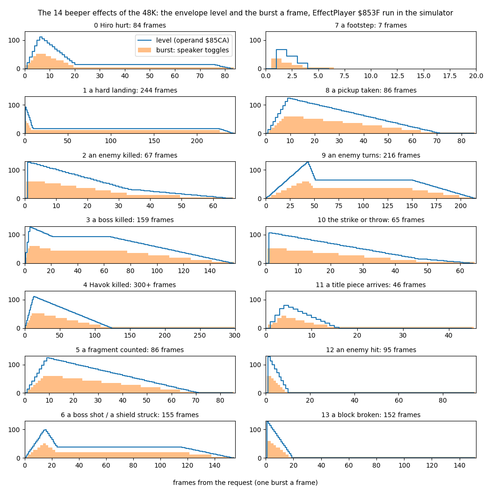

How to read the figure:

- **Each panel** is one effect, played by the real EffectPlayer in the simulator from silence. The title gives the
  number, the event and the length in frames (from the request to idle).
- **The blue line** is the level (the operand at `$85CA`) after each frame's envelope step.
- **The orange bars** are the burst a frame: the number of speaker toggles, 8 more for every 16 of level.
- **Effect 4** never ends: its release step is 0 (9.19). The panel stops at 300 frames.

The point: every effect is the same machine with other numbers. The shapes differ only by the envelope's four
steps and the time; the loudest bursts (60 toggles) need a level of 120 or more.

The lengths and costs, from the model (`python3 tools/sound_sim.py effects48`):

| # | Event | Frames | Peak level | Longest burst | DJNZ count | Carrier | T a frame max |
| ---: | --- | ---: | ---: | ---: | ---: | ---: | ---: |
| 0 | Hiro hurt | 84 | 111 | 52 | 1 | 37.2 kHz | 5923 |
| 1 | a hard landing | 244 | 92 | 44 | 1 | 37.2 kHz | 3382 |
| 2 | an enemy killed | 67 | 127 | 60 | 1 | 37.2 kHz | 7319 |
| 3 | a boss killed | 159 | 127 | 60 | 1 | 37.2 kHz | 8254 |
| 4 | Havok killed | endless | 111 | 52 | 7 | 14.0 kHz | 7302 |
| 5 | a fragment counted | 86 | 124 | 60 | 1 | 37.2 kHz | 8319 |
| 6 | a boss shot / a shield struck | 155 | 99 | 52 | 3 | 24.0 kHz | 5892 |
| 7 | a footstep | 7 | 67 | 36 | 3 | 24.0 kHz | 3403 |
| 8 | a pickup taken | 86 | 124 | 60 | 1 | 37.2 kHz | 8319 |
| 9 | an enemy turns | 216 | 127 | 60 | 3 | 24.0 kHz | 5268 |
| 10 | the strike or throw | 65 | 107 | 52 | 3 | 24.0 kHz | 7254 |
| 11 | a title piece arrives | 46 | 80 | 44 | 1 | 37.2 kHz | 2843 |
| 12 | an enemy hit | 95 | 127 | 60 | 1 | 37.2 kHz | 4550 |
| 13 | a block broken | 152 | 127 | 60 | 3 | 24.0 kHz | 8254 |

The model against the machine. `work/docs/zsD/beepcheck.py` reads the play48 trace 700:0-900:0, finds each
StartEffect call, starts the same effect in a fresh model and compares, frame by frame, every `OUT ($FE)` of
EffectSound: the values and the T-state gaps between them.

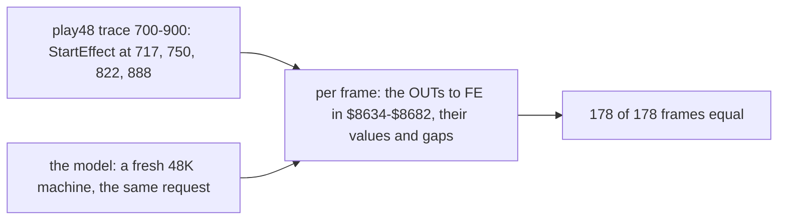

| Request frame | Effect | Frames compared | Equal |
| ---: | --- | ---: | ---: |
| 717 | 7, a footstep | 33 | 33 |
| 750 | 10, the strike | 72 | 72 |
| 822 | 10, the strike | 66 | 66 |
| 888 | 7, a footstep | 7 | 7 |

Every burst of the window matches, to the T-state. The player lies in uncontended memory, so its timing is exact.

## 9.7 The 128K glue: AyGlue and GlueRequests

AyGlue `$853F` (`src/boot/boot/glue.asm`) pages bank 4 in (`$7FFD` = `$14`), runs GlueRequests, copies channel A's
volume into the footstep gate `$9BA3`, and pages back the bank the interrupted code had (Last7FFD `$8450`).

GlueRequests `$8558` decides, every frame, between a tune and an effect:

```text
GlueRequests():
    r = TuneRequest
    if r = FF:                       the game's stop
        if MusicState: Silence()
        goto effect
    if r != FE:                      a new tune
        TuneRequest = FE; TuneState = r; StartTune(r AND 15)
  playing:
    if MusicState: JP PlayFrame      a tune plays: effects wait
    if TuneState bit 7: TuneRequest = TuneState; goto top     (loop)
    if TuneState = 2 and SoundMode = 0: TuneRequest = 81; goto top
  effect:
    e = EffectRequest; EffectRequest = FF
    if e = FF: JP PlayFrame          (the envelopes of a sounding effect)
    JP PlayEffect(e)
```

```asm
GlueTunePlaying:
  LD A,(MusicState)
  OR A
  JP NZ,PlayFrame          ; a tune plays: the effect request is not read
  LD A,(HL)                ; TuneState
  BIT 7,A
  DEC HL
  JR NZ,GlueRequestAgain   ; the loop bit: request it again
  CP $02
  JR NZ,GlueEffect
  LD A,(SoundMode)
  OR A
  JR NZ,GlueEffect         ; effects mode: no music after the jingle
  LD A,$81                 ; music mode: tune 1, looped
```

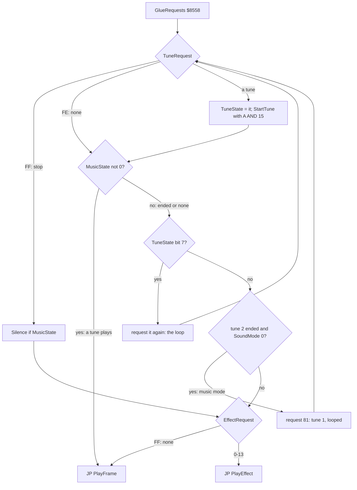

What this means for the player:

- **Music mode** (SoundMode 0, the title's left key): play starts with tune 2, the jingle; then tune 1 loops for ever.
  MusicState is 0 only inside the glue call that restarts the loop, so the effect branch is never reached. The game's
  effect requests are taken by nobody: **in music mode the 128K plays no effects at all**.
- **Effects mode** (SoundMode 1, the right key): the jingle plays, then no tune. From then on every request plays.
- **A request during a tune** stays in EffectRequest (nothing reads it) and is overwritten by the next one. In effects
  mode, the last request made during the jingle plays when the jingle ends.

The menu recording shows effects mode. Its title page sets it (the "FX" icon of doc 8), and its trace 1840-1932 holds
8 PlayEffect calls in play: effect 11 at frame 1846 and effect 7 (the footstep) at 1863, 1869, 1881, 1887, 1899,
1905 and 1917.

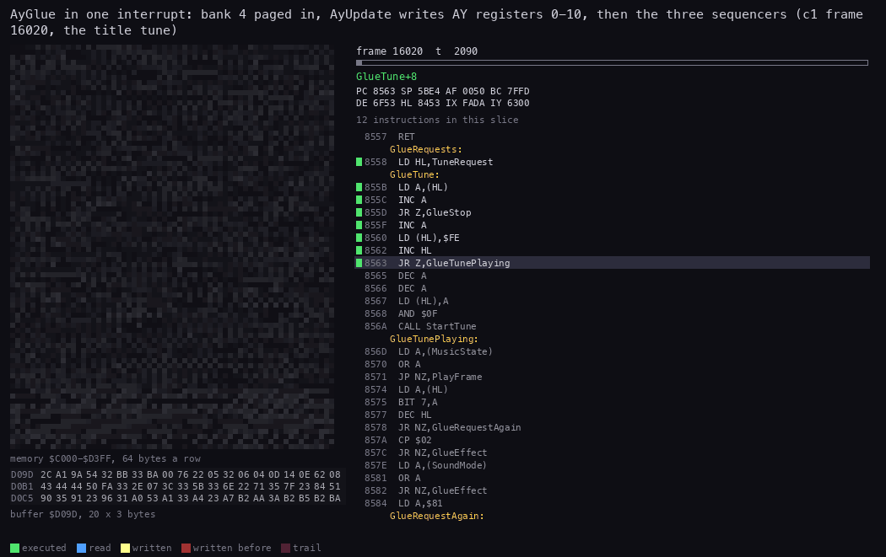

*The routine animation of the glue and the player in `c1` from 16020:1990 to 16020:10700, tune 0's frame 7. It has 88
pictures, 100 T each. The view is the three AY records `$D09D-$D0D8` as hex, 20 bytes a row (channel A, B, C). The
memory grid is `$C000-$D3FF`, 64 bytes a row: the sequencer records, the patterns, the instruments and the player.
The glue's lines come from `work/docs/zsD/game128.lst` (game.lst with the glue's listing over `$853F-$85E0`); bank
4's from `build/bank4.lst`. Command, from the case folder after `. work/env.sh`: `python3 ../../kit/routine_anim.py
--work work/docs/zsD/c1 --window 16020:1990-16020:10700 --listing work/docs/zsD/game128.lst --page 4=build/bank4.lst
--view buffer:D09D:20x3:hex --pc 853F-85E0,4:C000-D3D0 --range C000-D3FF --row-bytes 64 --step 100 --out
docs/img/routines/AyGlue.gif`.*

How to read it: the first pictures run AyGlue and GlueRequests (MusicState not 0: `JP PlayFrame`); then AyUpdate
walks the three AY records and writes the 11 registers (T 4342-5824); then the three SequenceChannel calls read the
sequencer records at the top of the grid.

## 9.8 PlayFrame and the sequencer

PlayFrame `$C17D` is the player's frame. AyUpdate first (9.14): the envelopes and the registers. Then the three
sequencers, unless every order list has ended.

```text
PlayFrame():
    AyUpdate()
    if MusicState = 0: return                       (effects only)
    MusicState = A.+0D OR B.+0D OR C.+0D            (FF while an order list runs)
    if MusicState = 0:
        MusicState = 1 while a channel still sounds (AyMixer), else 0
        return
    SequenceChannel(A); SequenceChannel(B); SequenceChannel(C)

SequenceChannel(ch):
    UpdateArpeggio(); UpdatePortamento()
    if pattern ended (+0B):
        repeats -= 1
        if repeats > 0: restart the pattern
        else: ReadOrderList()                       (9.9)
    event timer +0C -= 1
    while it runs: take one command byte ahead (ReadPatternCommand)
    at 0: read commands up to the next event        (9.10)
```

```asm
PlayFrame:                 ; $C17D
  CALL AyUpdate
  LD A,(MusicState)
  AND A
  RET Z
  LD A,(SeqChannelA+$000D) ; all three order lists ended?
  LD HL,SeqChannelB+$000D
  OR (HL)
  LD HL,SeqChannelC+$000D
  OR (HL)
  LD (MusicState),A
  JR NZ,SequenceChannels
  ...                      ; MusicState 1 while AyMixer has a channel on, else 0
```

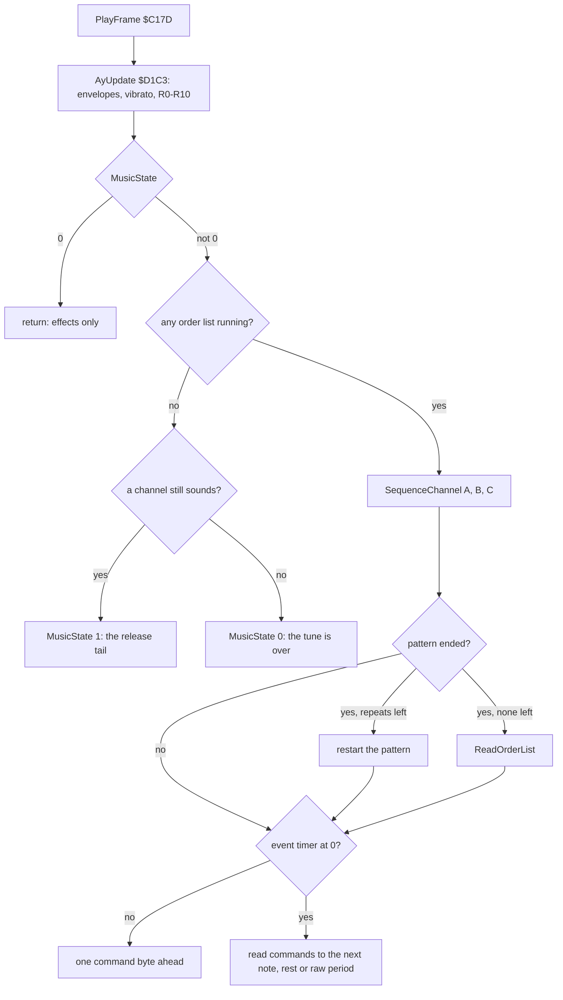

The sequencer record of a channel (SeqChannelA `$C03F`, B and C 33 bytes apart) holds the order-list pointer
(+`$01`), the pattern pointer and its start (+`$03`-+`$06`), the instrument (+`$07`), the repeat count (+`$09`),
the transpose (+`$0A`, written by the order list's `$FE` t at `$C210`), the pattern-end flag (+`$0B`), the event
timer (+`$0C`), the list-running flag (+`$0D`), the note playing (+`$0E` = the pattern's index + the transpose,
`$C2A1`-`$C2A4`), the arpeggio number (+`$0F`) and its pointer, timers and state (+`$10`-+`$14`), the slide (+`$15`
the switch, +`$16`-+`$18` its delay, steps and interval, +`$19`-+`$1F` its state and change) and the drum switch
(+`$20`). The header of `src/bank4/state.asm` lists every byte.

Because the event timer takes one command byte ahead, a pattern's end mark `$FF` is seen on the frame before its last
note ends, and the next pattern's first note starts on time.

The release tail is why a tune outlives its order lists. Tune 0's lists end after 8484 frames; MusicState reaches 0
at 8510, when the last notes have released.

## 9.9 The order lists

Each tune has three order lists, one a channel. TuneTable `$CCF1` gives them, 6 bytes a tune. ReadOrderList
`$C1E9` reads a list until it has a pattern to play:

| Byte | Meaning |
| --- | --- |
| `$00-$7F` | play pattern n (PatternAddrLo / Hi `$CC97` / `$CCC4`) |
| `$80-$BF` | play the next pattern n times (the low five bits) |
| `$C0`+n, m | slot n (low four bits) = instrument m |
| `$FC` | skip one byte |
| `$FD` a, b | skip three bytes |
| `$FE` t | transpose by t semitones (stays) |
| `$FF` | the end: +`$0D` = 0, the channel stops reading |

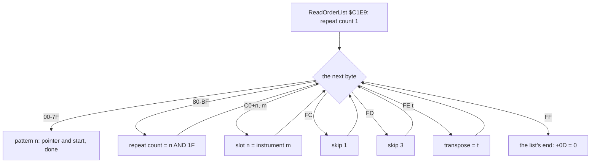

The bytes of tune 2, the jingle (TuneTable + 12 = `7E CE 81 CE 88 CE`):

| Channel | Address | Bytes | As text (`tunes.txt`) |
| --- | --- | --- | --- |
| A | `$CE7E` | `28 28 FF` | P40 P40 |
| B | `$CE81` | `FE 11 C4 02 28 28 FF` | tr+17 slot4=ins2 P40 P40 |
| C | `$CE88` | `C0 0D 29 FF` | slot0=ins13 P41 |

The order-list codes `$FC` and `$FD` are in no tune's order list (the same bytes as pattern commands are the drums,
9.13, which tune 0 uses). The code that skips them in an order list (`$C1FC`, `$C206`) ran in no recording.

## 9.10 The patterns, and the jingle worked by hand

A pattern is a run of commands and events. ReadPatternCommand `$C31F` takes the commands; ReadEvent `$C27E` takes the
event that ends the run.

| Byte | Kind | Meaning |
| --- | --- | --- |
| `$00-$7D`, len | event | a note: NoteTable index (+ the transpose), then its length in frames |
| `$7E` lo hi, len | event | a raw tone period, then the length |
| `$7F` len | event | a rest: the playing note runs on to its release |
| `$80-$8B` | command | the instrument of slot n |
| `$8C-$BF` | command | the arpeggio (low four bits; the tunes use `$90`+n) |
| `$C0` a b c | command | the slide on: after a frames, over b frames, c semitones |
| `$C1` | command | the slide off |
| `$FC` | command | the drum off |
| `$FD` a b | command | the drum on: a noise burst of a frames at noise period b, on every note from now on |
| `$FF` | command | the pattern's end |

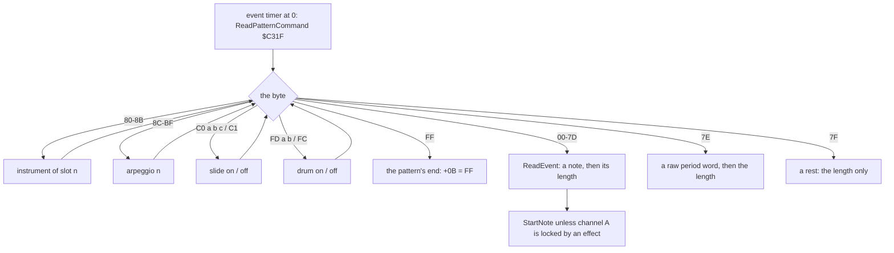

The note's period comes from NoteTable `$D016`: 67 periods, index n is MIDI note 40 + n (E2 for 0) on channels B and
C. Channel A's period is doubled in AyUpdate (9.14), so channel A plays an octave lower.

**The jingle worked by hand.** Tune 2 is the shortest tune: 120 frames of order lists, 147 with the release. It
plays at the start of every game.

Pattern 40 at `$CC68`, played by channels A and B:

| Bytes | Read as | Effect |
| --- | --- | --- |
| `84` | slot 4 | the instrument of the channel's slot 4 (A: ins 4; B: ins 2 from its order list) |
| `06 0C` | note 6, 12 frames | A: A#2 (index 6), doubled: A#1. B: 6 + 17 = 23, D#4 |
| `06 04` | note 6, 4 frames | |
| `06 04` | note 6, 4 frames | |
| `06 04` | note 6, 4 frames | |
| `06 0C` | note 6, 12 frames | |
| `06 0C` | note 6, 12 frames | 48 frames in all |
| `FF` | the end | twice in the order list: 96 frames |

Pattern 41 at `$CC76`, channel C:

| Bytes | Read as | Effect |
| --- | --- | --- |
| `80` | slot 0 | ins 13 (the order list's `C0 0D`) |
| `95` | arpeggio 5 | a major chord, one frame a note: 0, +4, +7 |
| `21 0C`, `21 04` x3, `21 0C` x2 | note 33 (C#5) | 12 + 4 + 4 + 4 + 12 + 12 = 48 frames |
| `23 0C`, `23 04` x3, `23 0C` | note 35 (D#5) | 12 + 4 + 4 + 4 + 12 = 36 frames |
| `93` | arpeggio 3 | 0, +4, +9 |
| `21 22` | note 33, 34 frames | the last chord |
| `7F 02` | a rest of 2 frames | 48 + 36 + 36 = 120 frames |
| `FF` | the end | |

Channel C in the model, frame by frame (`python3 tools/sound_sim.py pattern --tune 2 --channel C`): frame 1 period
`$00CB` volume 14 (C#5), frame 3 `$009D` (F5), frame 4 `$0082` (G#5), frame 5 `$00C7` (C#5 again, the vibrato
moving it), and so on: the chord C#-F-G# cycles one frame a note. At frame 13 the second note starts and the volume
jumps back to 14. Channel A in the same frames: `$07C4`, `$07B8`, `$07AC`, `$07A0` and back: the doubled period
`$07B8` (2 x `$03DC`) with the vibrato of ins 4 (±6, doubled ±12), the volume 8 then 15 (ins 4's attack 67 takes two
frames to the peak 127).

So the jingle is a C# major arpeggio over a pulsing A# bass (A#m7), then a D# major bar, then the A# minor chord
(arpeggio 3 on C#: C#, F, A#). NoteTable's entry 6, the bass note, is one of three off the scale: `$03DC` sounds 112
Hz, 66 cents below A#2 (9.19).

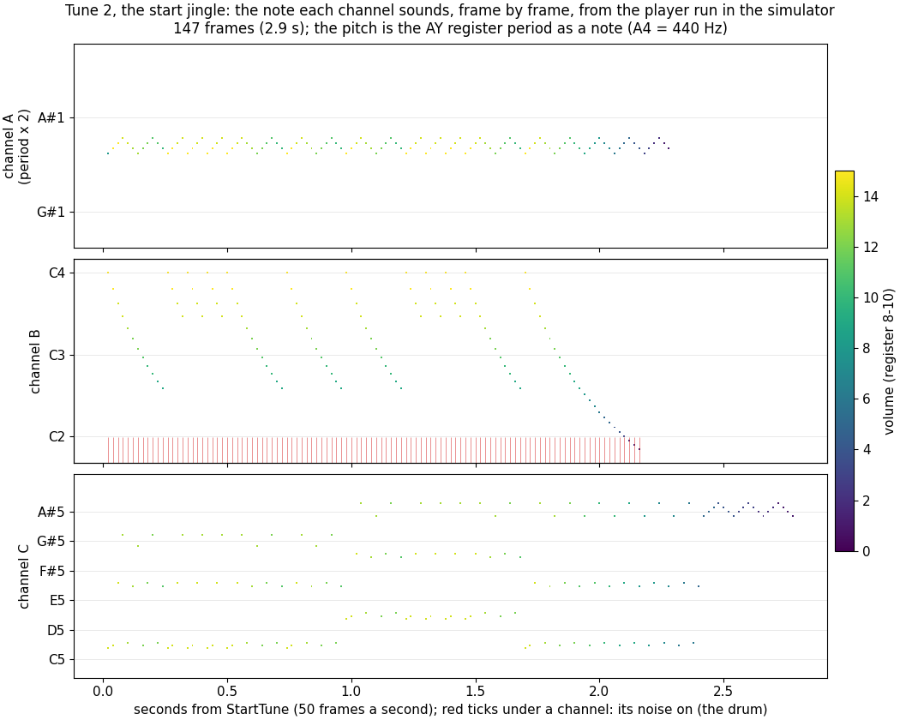

How to read the figure: one panel a channel; each dot is the note the channel's period sounds in that frame, coloured
by its volume register. Channel A is drawn at the pitch it sounds (the doubled period). The red ticks at the foot
of a channel mark the frames its noise is on. The point: the arpeggio's one-frame chord notes are the three-line
stripes of channel C; the bass is the single repeated note of A; channel B's D#4 carries noise (ins 2).

Command: `python3 tools/sound_sim.py fig-tune docs/img/sound/tune2.png --tune 2`. The recording: none (the model);
NewGame requests tune 2 before every game (c1: StartTune's second run).

## 9.11 The instruments and the software envelope

An instrument is 10 bytes in Instruments `$CED4` (`src/res/music/instruments.csv`): the attack, decay, sustain,
release and peak of a software envelope, the vibrato's delay, width and step, and the flags (bit 0 tone, bit 1 noise,
bit 2 the hardware envelope). The 14 AY effects (9.16) use the same 10-byte form, plus a period and a gate.

StartNote `$D0DA` starts a note on a channel's AY record (AyChannelA `$D09D`, B and C 20 bytes apart): the
instrument, the period, the gate timer, the vibrato from 0, the mixer from the flags, and the phase EnvAttack. It does
**not** clear the volume (+`$05`): a note attacks from the volume the channel had (9.19).

UpdateChannel `$D2D6` steps the envelope once a frame through the phase routine at +`$0D`/+`$0E` (`JP (HL)`):

```text
UpdateChannel(ch):
    if the channel is off in AyMixer: return
    IY = its instrument; gate timer +06 -= 1 (0 and FF stay)
    UpdateVibrato()
    if flags bit 2: HardEnvelopeWait; return
    phase:
      EnvAttack:  vol += +0; at or above the peak +4: vol = peak, phase = EnvDecay
      EnvDecay:   vol += +1; negative or below the sustain +2: vol = sustain, phase = EnvSustain
      EnvSustain: when the gate is 0: phase = EnvRelease
      EnvRelease: vol += +3; at 0: the channel off in AyMixer, the effect lock (+11 bit 7) cleared
```

```asm
EnvAttack:                 ; $D308
  LD A,(IX+$05)            ; the volume
  ADD A,(IY+$00)           ; + the attack step
  CP (IY+$04)              ; the peak?
  JR NC,EnvAttackPeak
  LD (IX+$05),A
  RET
EnvAttackPeak:
  LD A,(IY+$04)
  LD (IX+$05),A
  LD HL,EnvDecay           ; the next phase
  LD (IX+$0D),L
  LD (IX+$0E),H
  RET
```

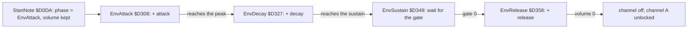

The volume is 0-127 in the record; AyUpdate writes it divided by 8 (0-15) to registers 8-10.

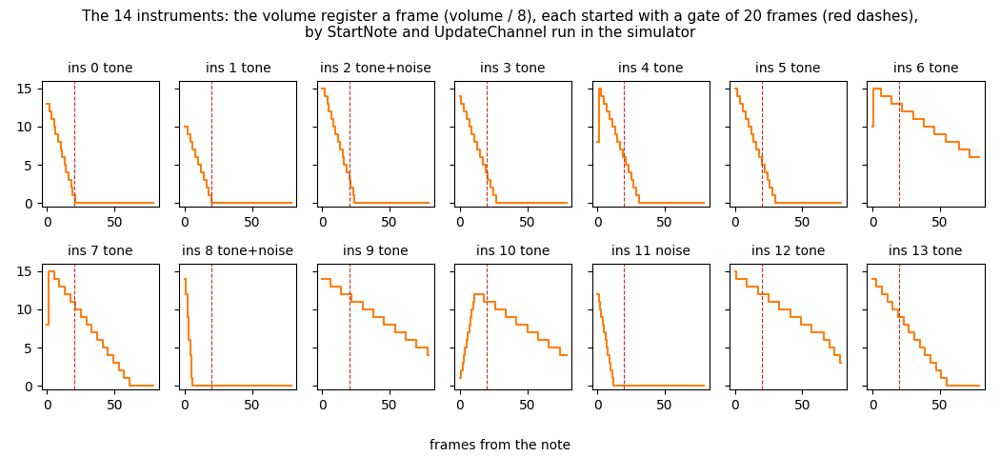

How to read the figure:

- **Each panel** is one instrument, started by the real StartNote on channel B after Silence, with a gate of 20
  frames (the red dashes); the glue then runs 80 frames of AyUpdate.
- **The orange line** is register 9, the volume as the AY gets it (0-15).
- **The title** says tone, noise or both (flags bits 0 and 1).

The point: the tunes' sound is mostly the envelope. Ins 0-5 are plucks (attack 127: the peak at once, then a decay
of 4-5 a frame); ins 6, 9 and 12 hold (decay -1, a high sustain or a slow fall); ins 8 and 11 are the drums' noise,
gone in a few frames.

Command: `python3 tools/sound_sim.py fig-instruments docs/img/sound/instruments.png`.

## 9.12 The vibrato, the arpeggio and the slide

Three effects move a note's pitch. Each adds to the period AyUpdate writes.

- **The vibrato** (UpdateVibrato `$D37E`, per channel, in the AY record): after the delay (+5 of the instrument, `$FF`
  never), an offset (+`$09`/+`$0A`) grows by the step each frame; after the width's frames the step is negated. A
  triangle of ±(width x step / 2) around the note. Width 0 makes it an endless slide: ins 3 (width 0, step `$3B`)
  moves by `$3B` a frame for as long as it sounds, a falling tom.
- **The arpeggio** (UpdateArpeggio `$C390`, in the sequencer): a list at Arpeggios `$CE8C` (`arpeggios.csv`). The
  header gives the loop (bit 7), the note's own frames (bits 3-5) and the steps (bits 0-2, + 1); each step is
  semitones (bits 3-7) and frames (bits 0-2). Every arpeggio of the tunes is a three-note chord, one frame a note
  (header `$8A`). The step writes the period of note + offset (NoteTable) into the AY record.
- **The slide** (UpdatePortamento `$C420`, command `$C0` a b c): after a frames, over b frames, c semitones from the
  note; the whole change is spread over the steps into +`$1E`/+`$1F` and added each frame. `$C1` stops it.

```text
UpdateVibrato(ch):
    if delay = FF: return; if delay > 0: delay -= 1; return
    offset += step
    sweep -= 1
    if sweep = 0:
        if width = 0: go on for ever             (an endless slide)
        if width negative: delay = FF            (stop)
        else: sweep = width; step = -step
```

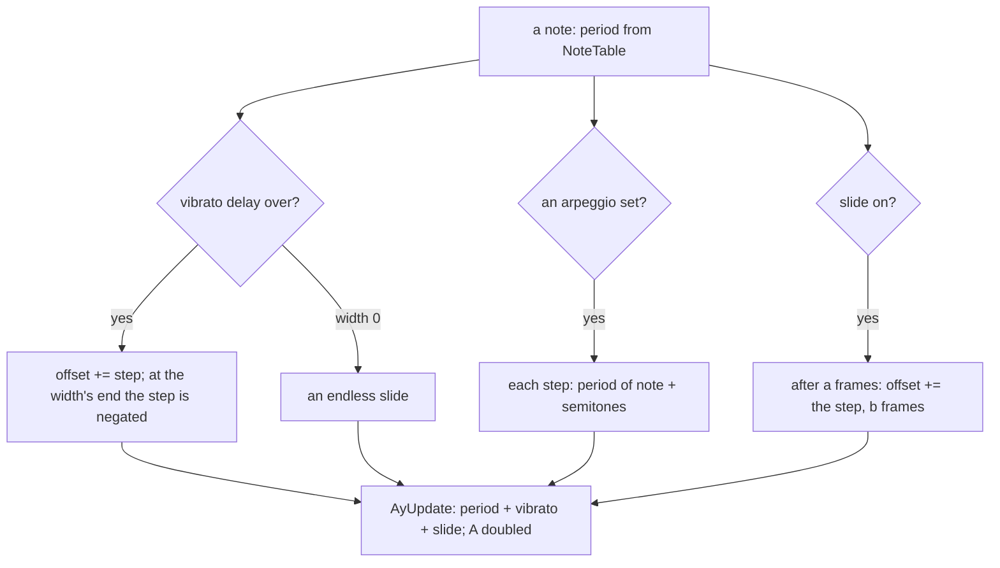

The worked example is tune 0's first frames (the registers figure of 9.14). Channel A plays arpeggio 1 on A#4: a
minor chord A#-C#-F, one frame a note, the comb at 160-250 of R0-R1. Channel B plays ins 3 on A#4 with its endless
slide: the saw-tooth rising from about 300 to 700 in each note's frames, until the next note restarts it.

## 9.13 The drums: the pattern commands `$FC` / `$FD`, and the hardware envelope

**The drums.** Pattern command `$FD` a b turns the drum on for the channel: every following note sets DrumPending
`$C0D2`, and StartNote then opens the channel's noise for a burst. DrumLength `$C0D3` = a frames; DrumNoise `$C0D5`
= b, the noise period. AyUpdate counts DrumTimer `$C0D4` down and, at its end, turns the noise off again in AyMixer.
`$FC` turns the drum off. While a burst runs, register 6 is DrumNoise; else it is NoisePeriod `$D0D9`, the low byte
of the last noise channel's period. Either is rotated right three times before the write.

```text
StartNote(...):
    mixer: this channel off; tone on if flags bit 0
    if DrumPending: DrumPending = 0; DrumChannel = the channel; DrumTimer = DrumLength; noise on
    else: noise on if flags bit 1
AyUpdate():
    if DrumTimer != FF: DrumTimer -= 1; when negative: the DrumChannel's noise off
    R6 = (DrumTimer != FF ? DrumNoise : NoisePeriod) rotated right 3
```

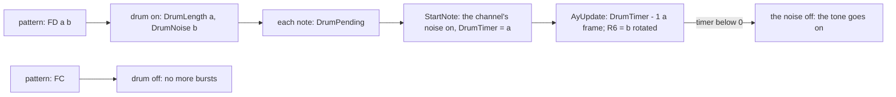

Worked example: tune 0's pattern 00 starts `drum(2,100)`: `FD 02 64`. Each note of channel A then has a burst of noise
at period `$64` = 100. Rotated right three times that is `$8C`, and the AY keeps the low five bits: 12. The registers
figure of 9.14 shows it: R6 = 12 in the first frames, and noise A on (R7 bit 3 clear) at the notes.

**The hardware envelope.** An instrument with flags bit 2 would use the AY's own envelope. StartNote's HardEnvelope
`$D163` writes register 13 (the shape) = the attack byte, register 11 = the peak byte, register 12 = 0, and the
volume `$FF` (written as 31: bit 4, the envelope mode). UpdateChannel then only waits (HardEnvelopeWait `$D377`).

```asm
HardEnvelope:              ; $D163
  CALL AyPrepare
  LD A,(IY+$00)            ; register 13, the shape = the attack byte
  LD E,$0D
  CALL WriteAyRegister
  LD A,(IY+$04)            ; register 11 = the peak byte
  LD E,$0B
  CALL WriteAyRegister
  INC E
  XOR A                    ; register 12 = 0
  CALL WriteAyRegister
  LD (IX+$05),$FF          ; volume 31 after / 8: the envelope mode
  JP AyDone
```

No instrument and no effect has flags bit 2 (`instruments.csv`, `effects.csv`: flags 1, 2 or 3), so this code ran in
no recording. AyUpdate never writes registers 11-13; only Silence does (11 = 1, 12 and 13 = 0).

## 9.14 AyUpdate: the registers each interrupt

AyUpdate `$D1C3` runs first in every PlayFrame. It returns at once when all six mixer bits are set (silent). Else it
steps the three channels (9.11, 9.12), the drum timer (9.13), and writes 11 registers through WriteAyRegister
`$D3C6`, the one routine that uses ports `$FFFD` and `$BFFD`:

```text
AyUpdate():
    if AyMixer AND 3F = 3F: return
    UpdateChannel(A); UpdateChannel(B); UpdateChannel(C)
    the drum timer
    R7  = AyMixer AND 3F
    R0, R1 = 2 x (A.period + A.vibrato + A.slide)
    R2, R3 = B.period + B.vibrato + B.slide
    R4, R5 = C.period + C.vibrato + C.slide
    (a channel with noise: its period's low byte -> NoisePeriod)
    R6  = DrumNoise or NoisePeriod, rotated right 3
    R8, R9, R10 = the volumes / 8
```

```asm
WriteAyRegister:           ; $D3C6: E = the register, A = the value
  LD BC,$FFFD
  OUT (C),E                ; select
  LD B,$BF
  OUT (C),A                ; $D3CD: write
  RET
```

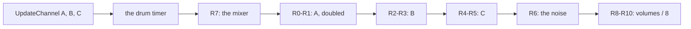

The `OUT (C),A` at `$D3CD` runs 165 607 times in menu and 86 052 in deaths (WALKTHROUGH 6.0). In c1's 50 traced
interrupts it runs 546 times: 11 a frame, plus Silence's 7 in the StartTune frame (49 x 11 + 7).

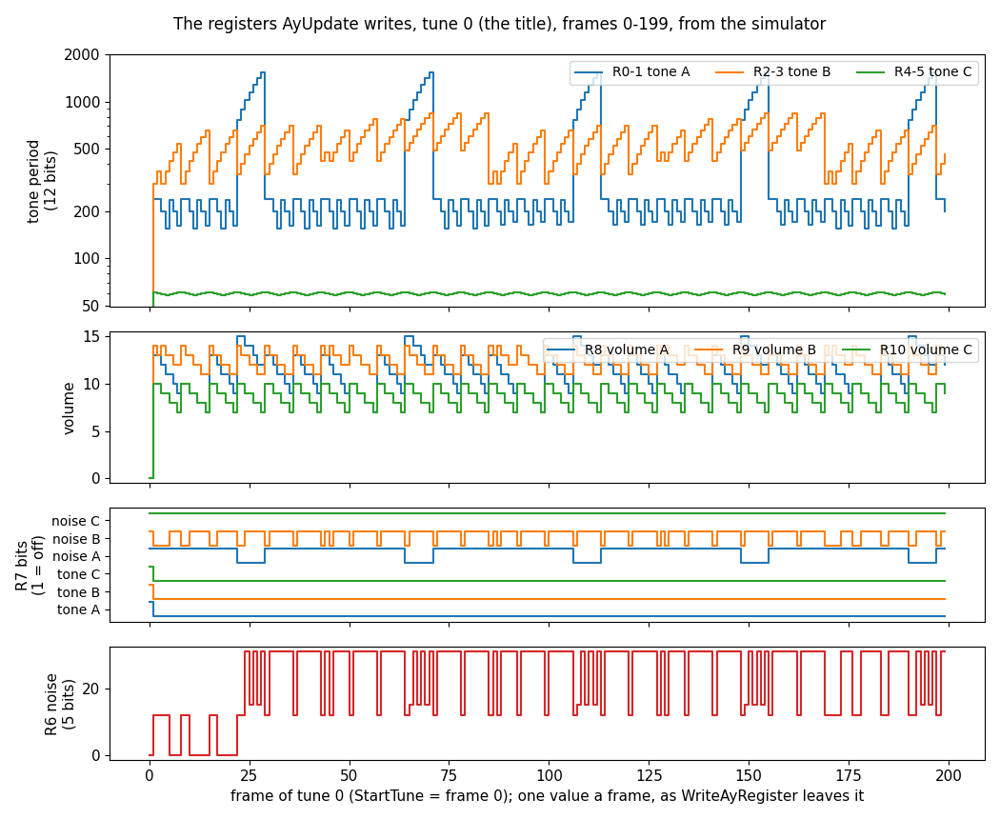

How to read the figure:

- **The top panel** is the three tone periods (12 bits, as the AY reads them), on a log scale; channel A doubled.
- **The second** is the three volumes, R8-R10 (0-15).
- **The third** is R7's six bits: 1 is off. Tone A, B and C are on throughout; noise A and noise B open in bursts at
  the drummed notes.
- **The fourth** is R6 AND 31, the noise period the AY uses.

The point: the 11 registers are rewritten every interrupt, whether they changed or not. The player keeps no shadow
of the AY: AyUpdate is the whole state, written out.

Command: `python3 tools/sound_sim.py fig-regs docs/img/sound/registers.png --tune 0 --frames 200`. The recording:
none; frames 0-49 of the figure are c1 frames 16 013-16 062, checked write for write in 9.17.

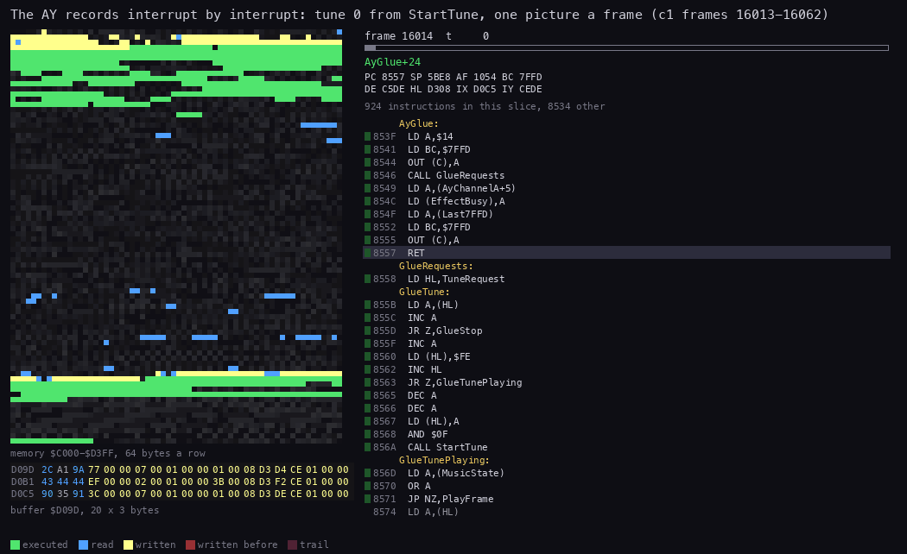

*The routine animation of the glue and the player in `c1` from 16013:0 to 16063:0: tune 0's frames 0-49, one picture
a frame (70 908 T), each taken at T 0 of its frame, after the previous interrupt's writes. The view is the three AY
records `$D09D-$D0D8`, 20 bytes a row: +`$03`/+`$04` the period, +`$05` the volume, +`$09`/+`$0A` the vibrato
offset, +`$0D`/+`$0E` the envelope phase, +`$0F`/+`$10` the instrument, +`$11` the flags. Command, from the case
folder after `. work/env.sh`: `python3 ../../kit/routine_anim.py --work work/docs/zsD/c1 --window 16013:0-16063:0
--listing work/docs/zsD/game128.lst --page 4=build/bank4.lst --view buffer:D09D:20x3:hex --pc 853F-85E0,4:C000-D3D0
--range C000-D3FF --row-bytes 64 --step 70908 --delay 200 --out docs/img/routines/AyUpdate-frames.gif`.*

How to read it: watch +`$05` (the volume) of each row. It jumps to the peak at a note and falls by the decay step
each picture; +`$0D`/+`$0E` changes from `$D308` (EnvAttack) to `$D327` (EnvDecay) in the frame the peak is reached.
These bytes, divided by 8 or doubled, are exactly the registers of the figure above.

## 9.15 The tunes

Three tunes, all by Ben Daglish:

| Tune | When | Order lists end | MusicState 0 | Length |
| ---: | --- | ---: | ---: | --- |
| 0 | the title, looped | 8484 frames | 8510 | 170.2 s |
| 1 | play in music mode, looped, after the jingle (`$81`) | 10 080 | 10 105 | 202.1 s |
| 2 | the start jingle (NewGame) | 120 | 147 | 2.9 s |

The lengths are from the model run to MusicState 0, with the loop bit off (`python3 tools/sound_sim.py tunes`).

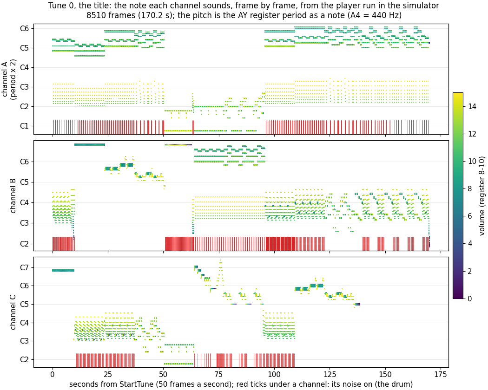

How to read the figure: one panel a channel; x is the time from StartTune; each dot is the note the channel's
period sounds in that frame (channel A at its doubled pitch), coloured by the volume register. The red ticks under a
channel are its noise.

The point: the title is a groove with a break. From 0 to 50 s channel A plays arpeggiated chords with the noise
drum, B the falling toms, C the chords; from 50 to 95 s A drops to a bass, and C takes a lead that falls from C7;
from 95 s the groove returns under a new lead on A.

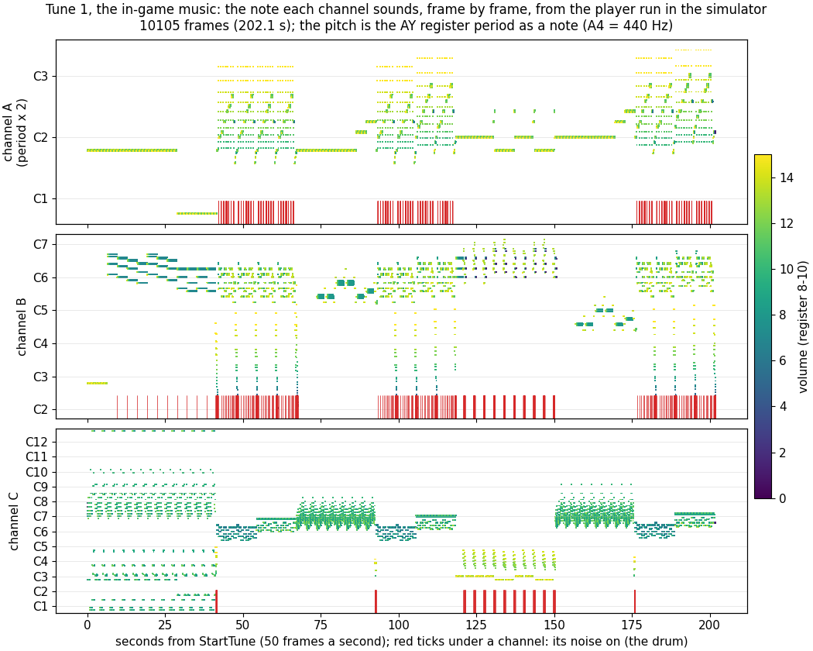

How to read it: as tune 0. The point: tune 1 is the longest (202 s) and the one heard most in music mode. It opens
with a held bass on A, a slow melody on B and a high pattern on C; the drummed sections (41-67 s, 93-118 s, 176-202
s) carry chords on A and B. The scattered dots far from channel C's notes in its opening are its vibrato pushing very
small periods through 0: the period wraps to `$0Fxx`, and the AY plays a click of a very low note for a frame (9.19).

Commands: `python3 tools/sound_sim.py fig-tune docs/img/sound/tune0.png --tune 0` (and `--tune 1`). The recording:
none (the model); 9.17 checks it on tune 0.

## 9.16 The 14 AY effects, checked against menu

PlayEffect `$C011` starts effect A on channel A: IY = Effects `$CF60` + 13 A, a 13-byte record (`effects.csv`):
an instrument's 10 bytes, a tone period word and a gate. StartNote starts it on AyChannelA; then bit 7 of the
channel's flags (+`$11`) locks it: the sequencer and the arpeggio leave channel A alone until the release ends
(EnvRelease clears the bit).

```asm
PlayEffect:                ; $C011
  PUSH IX
  PUSH IY
  LD IX,AyChannelA         ; effects play on channel A only
  LD L,A                   ; HL = 13 x A
  ...
  LD IY,Effects            ; $CF60
  EX DE,HL
  ADD IY,DE
  LD L,(IY+$0A)            ; HL = the period, C = the gate
  LD H,(IY+$0B)
  LD C,(IY+$0C)
  CALL StartNote
  SET 7,(IX+$11)           ; lock channel A
  POP IY
  POP IX
  RET
```

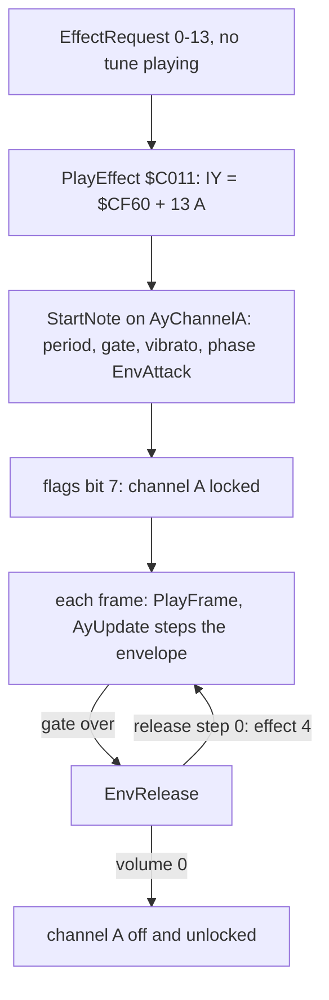

The 13 bytes of an AY effect hold mostly the same numbers as the 48K effect's 12, in another arrangement. The attack,
decay, sustain, release and peak are equal in 13 of 14 (effect 8 differs); the 128K period's low byte is the 48K
time in 12 of 14; the 128K gate is the 48K pitch in 11. So the same effect lasts differently on the two machines:
effect 1, the hard landing, is 244 frames on the 48K (the time 225 before the release) and 31 on the 128K (the gate
12).

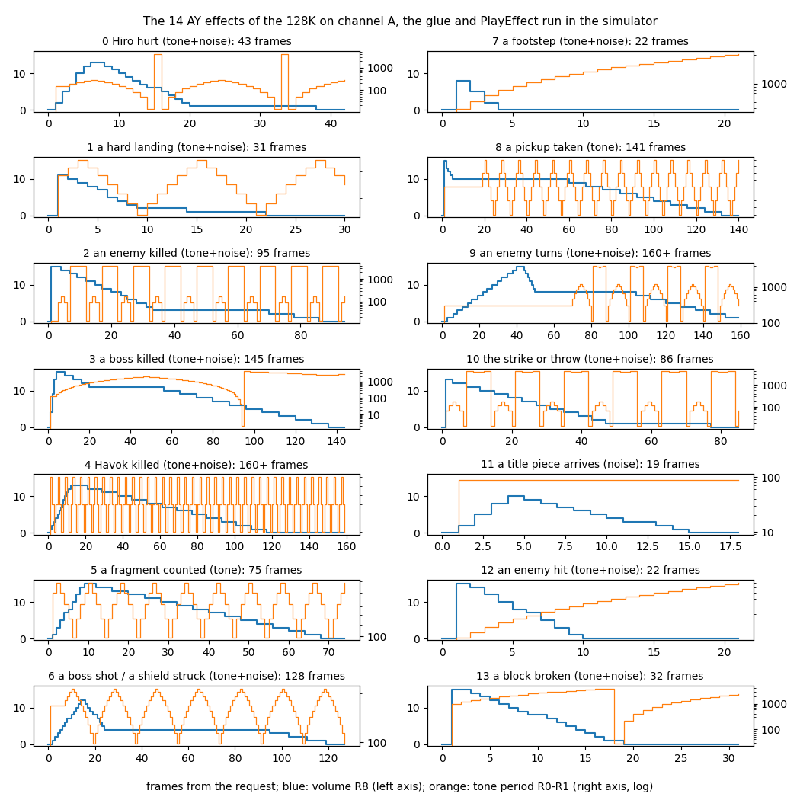

How to read the figure:

- **Each panel** is one effect, from Silence, played by the glue, PlayEffect and AyUpdate in the simulator.
- **The blue line** is R8, channel A's volume (left axis, 0-15).
- **The orange line** is R0-R1, the tone period (right axis, log): a falling line is a rising pitch.
- **Effect 9** is cut at 160 frames (it lasts 169); **effect 4** never ends (9.19).

The point: on the AY the "pitch" is a real pitch. The vibrato of the effect records is wide (width 4-10, steps up to
`$5C`), so most effects are sirens or swoops, unlike the beeper's buzz. Effects 0, 2, 3, 9, 10 and 13 swing channel
A's doubled period through 0: the period wraps to `$0Fxx`, a very low note, for a frame or two.

The lengths, from the model (`python3 tools/sound_sim.py effects128`):

| # | Event | Frames | Period | Peak volume | Tone / noise |
| ---: | --- | ---: | --- | ---: | --- |
| 0 | Hiro hurt | 43 | `$000E`-`$0FEC` | 13 | tone, noise |
| 1 | a hard landing | 31 | `$015C`-`$0228` | 11 | tone, noise |
| 2 | an enemy killed | 95 | `$000E`-`$0FC4` | 15 | tone, noise |
| 3 | a boss killed | 145 | `$0002`-`$0FD8` | 15 | tone, noise |
| 4 | Havok killed | endless | `$01FC`-`$0208` | 13 | tone, noise |
| 5 | a fragment counted | 75 | `$0062`-`$00EA` | 15 | tone |
| 6 | a boss shot / a shield struck | 128 | `$0062`-`$014C` | 12 | tone, noise |
| 7 | a footstep | 22 | `$0184`-`$0BFC` | 8 | tone, noise |
| 8 | a pickup taken | 141 | `$0054`-`$005C` | 15 | tone |
| 9 | an enemy turns | 169 | `$0074`-`$0FBC` | 15 | tone, noise |
| 10 | the strike or throw | 86 | `$000E`-`$0FD8` | 13 | tone, noise |
| 11 | a title piece arrives | 19 | `$0058` | 10 | noise |
| 12 | an enemy hit | 22 | `$00DC`-`$0384` | 15 | tone, noise |
| 13 | a block broken | 32 | `$001C`-`$0F64` | 15 | tone, noise |

The model against the machine. `work/docs/zsD/effcheck.py` reads the menu trace 1840:0-1932:0 (128K, effects mode,
play), collects the AY writes of every frame and replays the same requests, at the same frames, in one model started
from Silence (as the jingle's StartTune left the AY). It compares channel A (R0, R1 AND 15, R8) frame by frame.

| Frames | Requests | Channel A equal |
| --- | --- | ---: |
| 1846-1931 | 11 at 1846; 7 at 1863, 1869, 1881, 1887, 1899, 1905, 1917 | 85 of 86 |

The one different frame is 1846, the request frame itself: the machine's R0 still holds the jingle's last value
(`$AC`), the model's 0. From the next frame on every value matches, including the re-triggered footsteps, whose
attack starts from the volume the previous step left.

## 9.17 The model checked against c1

`python3 tools/sound_sim.py check --work work/docs/zsD/c1 --window 16013:0-16063:0 --tune 128 --start 16013` traces
50 interrupts of c1 from the title's StartTune, collects every AY write (register, value) per frame, and compares the
lists with the model's frames 0-49 of tune 0 (TuneRequest `$80`).

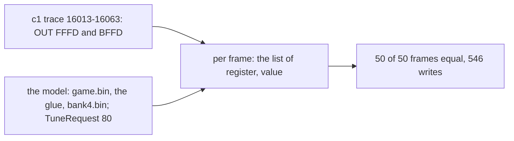

Result: 50 frames with AY writes in the trace, all 50 equal to the model; 546 writes. The model's cost for frame 7
(8675 T) is within 6 T of the machine's glue call in c1 frame 16020 (T 1996-10 665, 8669 T).

So every number of 9.8-9.15 that comes from the model is the machine's.

## 9.18 The audio files

`python3 tools/sound_sim.py wavs docs/audio` renders, from the same model. A render of up to 1 s stays a WAV; a
longer one is an MP3 (`lame -V 4`), written by the same command:

| File | What | Rendered from |
| --- | --- | --- |
| [tune-0.mp3](audio/tune-0.mp3) | the title, 170 s | the 14 registers a frame: three square-wave channels, the noise, the AY's volume table |
| [tune-1.mp3](audio/tune-1.mp3) | the in-game music, 202 s | the same |
| [tune-2.mp3](audio/tune-2.mp3) | the start jingle, with 40 frames of tail | the same |

The 14 effects: the AY ones with 10 frames of tail, rendered from the registers as the tunes; the beeper ones from the
speaker's edges at their T-states, 3.5 MHz, filtered to 44.1 kHz.

| Effect | 128K (AY) | 48K (beeper) |
| ---: | --- | --- |
| 0 | [ay-effect-00.mp3](audio/ay-effect-00.mp3) | [beeper-00.mp3](audio/beeper-00.mp3) |
| 1 | [ay-effect-01.wav](audio/ay-effect-01.wav) | [beeper-01.mp3](audio/beeper-01.mp3) |
| 2 | [ay-effect-02.mp3](audio/ay-effect-02.mp3) | [beeper-02.mp3](audio/beeper-02.mp3) |
| 3 | [ay-effect-03.mp3](audio/ay-effect-03.mp3) | [beeper-03.mp3](audio/beeper-03.mp3) |
| 4 | [ay-effect-04.mp3](audio/ay-effect-04.mp3) | [beeper-04.mp3](audio/beeper-04.mp3) |
| 5 | [ay-effect-05.mp3](audio/ay-effect-05.mp3) | [beeper-05.mp3](audio/beeper-05.mp3) |
| 6 | [ay-effect-06.mp3](audio/ay-effect-06.mp3) | [beeper-06.mp3](audio/beeper-06.mp3) |
| 7 | [ay-effect-07.wav](audio/ay-effect-07.wav) | [beeper-07.wav](audio/beeper-07.wav) |
| 8 | [ay-effect-08.mp3](audio/ay-effect-08.mp3) | [beeper-08.mp3](audio/beeper-08.mp3) |
| 9 | [ay-effect-09.mp3](audio/ay-effect-09.mp3) | [beeper-09.mp3](audio/beeper-09.mp3) |
| 10 | [ay-effect-10.mp3](audio/ay-effect-10.mp3) | [beeper-10.mp3](audio/beeper-10.mp3) |
| 11 | [ay-effect-11.wav](audio/ay-effect-11.wav) | [beeper-11.wav](audio/beeper-11.wav) |
| 12 | [ay-effect-12.wav](audio/ay-effect-12.wav) | [beeper-12.mp3](audio/beeper-12.mp3) |
| 13 | [ay-effect-13.wav](audio/ay-effect-13.wav) | [beeper-13.mp3](audio/beeper-13.mp3) |

The renders were not listened to while writing this document. They are made by the code from the registers and edges
that the checks of 9.6, 9.16 and 9.17 compared with the machine.

## 9.19 Known only from the code

- **The 128K hardware envelope** (HardEnvelope `$D163`, HardEnvelopeWait `$D377`): no instrument or effect sets flags
  bit 2; it ran in no recording (9.13).
- **The order-list codes `$FC` and `$FD`** (not the pattern commands `$FC` / `$FD`, the drums of 9.13): in no
  tune's order list; the skips at `$C1FC` / `$C206` ran in no recording (9.9).
- **The raw period `$7E`**: in no pattern of the three tunes.
- **The 128K stop `$FF`** (TuneRequest `$FF`, the glue's Silence at `$858D`): the game writes it at its end, but in
  no recording was a tune still playing then (MusicState 0), so Silence was not called from there.
- **Effect 4 never ends**, on both machines. Its release step is 0 (48K +10, 128K +3). On the 48K the decay (-1 a
  frame) takes the level from the peak 111 down to the sustain 0; the sustain passes to the release at once
  (EffectTime 1), and a release of 0 keeps the level at 0, never negative, so the effect never goes idle. What is left
  is a quiet tick: LevelToBurst gives 4 toggles at level 0, at B = 7 (pitch `$FF`), every frame, until another effect
  replaces it; a footstep can, since its gate is the level 0 (9.3). On the 128K it holds until Silence. Havok's death
  (KillScore E = 4, GameWonSound `$97DE`) and the end picture's fade (`$8744`) request it: havok runs the requests 17
  times (1 and 16), r138000 16 times (the fade).
- **The music-mode silence of the effects** (9.7): in music mode the glue never reaches the effect branch, so a 128K
  in music mode plays no effects. It is the glue's logic; no recording plays in music mode long enough to show a
  request lost (menu chose effects).
- **StartNote keeps the old volume** (9.11): a new note or effect attacks from the volume the channel had. After
  Silence or a release that is 0, so it is not heard in the tunes; a re-triggered effect (the footsteps of menu)
  attacks from where the previous one stood. The model reproduces the machine only when started from Silence
  (9.16).
- **The period wrap**: the vibrato can take a small period through 0 (channel C in tune 1, channel A in effects 0, 2,
  3, 9, 10, 13). The AY reads 12 bits, so the period becomes `$0Fxx`: a frame of a very low note.
- **The off-scale notes**: NoteTable entries 2 (`$04D4`), 6 (`$03DC`) and 66 are off the equal-tempered scale. Entry
  6 is the jingle's bass (9.10).
- **SoundSpare `$8451`**: no reader found.
- **The 48K table's fields against the 128K's** (9.16): the same values in other roles, so the two machines' effects
  last differently.

## 9.20 The point

Switchblade's sound is one interface over two engines. The game writes an effect number. A 48K plays it as a buzz
whose loudness follows a four-state envelope, one burst a frame. A 128K plays the same number through Ben Daglish's
player, with nearly the same envelope numbers driving a real pitch. The player itself is a compact sequencer: order
lists, patterns, 14 instruments with software envelopes, arpeggios, slides and a noise drum, all written out to 11 AY
registers every interrupt for about 5500 T. The model of `tools/sound_sim.py` runs the game's own bytes, and it
matches the machine write for write (c1, 50 of 50 frames), burst for burst (play48, 178 of 178 frames) and effect for
effect (menu, 85 of 86 frames).
