# 10. Gameplay logic

What this covers: the rules of Switchblade as code. Hiro walks, turns, jumps, climbs ladders, falls, strikes, throws
weapons, is hurt, loses lives, takes pickups and fragments, and scores. Then the end: Havok dies, the dawn text, the
high-score entry. Each rule is given as prose, pseudocode, the code with its addresses, a diagram, a worked example
from a recording, its witness and a picture. The objects these rules act on (the actor record, the kinds, the
spawner, the scheduler, the enemy behaviours and the collision tests) are doc 7. The keys and the charge meter are
doc 5, the panel doc 8.

The recordings it rests on ([WALKTHROUGH 6.0](../WALKTHROUGH.md#60-the-recordings)):

- `play48`: the 48K game played from the keyboard on our machine, 3769 frames from the menu
  (`work/stage2/rec/play48`, made by `tools/record.py`). Hiro walks through rooms 4 to 9. He jumps 12 times,
  strikes 9 times, is hurt 29 times, falls 32 steps from room 8 into room 9, takes two pickups and loses four lives.
  It was opened on an own instance after `source work/env.sh`:
  `python3 $RS open --work work/docs/zsC/play48 --ttd work/stage2/rec/play48/session.ttd --model 48K --port-base 37420 --binary $BIN`.
  Hiro's page `$5D00` (66 bytes), the game variables `$6642-$6659` and Room `$6BDD` were sampled at every frame
  519-3768 with `work/docs/zsC/sample.py` (TTD `memory_at`) into `work/docs/zsC/play48-hiro.jsonl`.
- `r014000`, `r034000`, `r136000`, `r138000`: the RZX run's state at RZX frames 14 000, 34 000, 136 000 and 138 000,
  each with its keys replayed by us for 2000 frames (`work/stage2/rzx/rNNNNNN`), opened the same way into
  `work/docs/zsC/rNNNNNN`. `r014000` takes a ladder from room 20 down into room 28; `r034000` takes the third
  Fireblade fragment in room 56; `r136000` reaches Havok's room 123 with 16 fragments; `r138000` plays the end.
  Their samples are `work/docs/zsC/r*-hiro.jsonl`, `r034000-frag.jsonl`, `r136000-sum.jsonl` and
  `r138000-sum.jsonl`.
- The L1 execution counts of every build, printed by `python3 tools/l1q.py ADDR` and summed by
  `work/docs/zsC/l1sum.sh`: the keyed recordings (`c1`, `c48`, `deaths`, `gameover`, `menu`, `rooms`, `opt2-4`,
  `play48`, the 15 POKE probes) and the 71 RZX segments.

Two cautions hold for every example:

- A `memory_at` sample of frame N is the state at the start of frame N. A trace (and a routine animation) puts an
  instruction in the frame where it ran. So a change made during frame N shows in the sample of frame N + 1.
- The RZX run is another player's run. Our segment replays start from its states with its keys, but they diverge from
  it after some frames (Hiro is a few pixels off and the fight goes otherwise). What a segment shows is a valid game,
  not the RZX run itself.

## 10.1 Hiro's clocks and states

Hiro is the actor in page `$5D00`, kind `$24`. Like every actor (doc 7, 7.12) he steps when his due count +`$1D` runs
out. Each step runs the step handler of the first busy sequence slot. With no slot busy, a Hiro in the air takes a
fall step; otherwise his state handler HiroControl `$9333` runs. The nine slots +`$30-$38` are his states. A slot
holds the steps left of a script; 0 means idle.
The slot table of doc 7 names their step handlers:

| Slot | State | Step handler | Started by |
| --- | --- | --- | --- |
| +`$30` | jump | JumpStep `$921C` | ActorJump `$9023` |
| +`$31` | fall or hurt script | FallScriptStep `$9238` | FallSequenceStart `$904A` |
| +`$32` | pose (a crouch, the end of a climb) | PoseStep `$91EE` | StartPoseSeq `$90A1` |
| +`$33` | turn | TurnStep `$91E1` | StartTurn `$90B1` |
| +`$34` | action (a strike, a throw) | ActionStep `$91F4` | StartActionSeq `$9104` |
| +`$35` | hard landing | FallDamageStep `$920A` | HiroLanded `$90C3` |
| +`$36` | ladder grab | HangStep `$9215` | GrabLadder `$906C` |
| +`$37` | death | DeathStep `$91A9` | not used for Hiro |
| +`$38` | rise | RiseStep `$91D4` | not used for Hiro |

Before the handler, StepActor tests the flags +`$10`. Bit 4 (hurt) starts the fall-or-hurt script, bit 5 (expired)
the end, bit 2 the crush. For Hiro alone it then tests FireRequest `$6650`: a pending strike calls HiroAttack `$926E`
before HiroControl.

```text
HiroStep:                                  ; Hiro's step, when +$1D is due
    for slot in +$30..+$38: if busy: run its step handler; return
    if +$02 bit 1: FallStep; return       ; in the air (10.5)
    if +$10 bit 4: FallSequenceStart       ; hurt: the push-back script in +$31
    if +$10 bit 5: ActorExpired
    if FireRequest: HiroAttack(FireRequest); return
    HiroControl:
        if EndFlags: HiroEndWalk           ; the end: the game steers him
        D, E = ReadDirection()             ; -1, 0, +1 each
        if no key: StopActor; return
        HiroMove(D * 2, E * 4)             ; X 2 units, Y 4 pixels
```

```asm
StepActorSlots:
$9AB3  CALL StartLifetime
$9AB6  LD (AnimateFrame+$001A),A
$9AB9  LD DE,ActorKindHandlers   ; the slot table $73E7
$9ABC  LD L,$2F
$9ABE  LD B,$09
FindSlotLoop:
$9AC0  INC E
$9AC1  INC E
$9AC2  INC L
$9AC3  OR (HL)                   ; the first busy slot runs
$9AC4  JR NZ,RunSlotHandler
$9AC6  DJNZ FindSlotLoop
$9AC8  LD L,$02                  ; in the air: fall
$9ACA  BIT 1,(HL)
$9ACC  JP NZ,FallStep
$9ACF  LD L,$10
$9AD1  BIT 4,(HL)                ; +$10 bit 4: hurt
$9AD3  JP NZ,FallSequenceStart
$9AD6  BIT 5,(HL)                ; expired: its end
$9AD8  JP NZ,ActorExpired
$9ADB  BIT 2,(HL)                ; bit 2
$9ADD  JP NZ,StartHurtSeq
$9AE0  LD A,H                    ; Hiro: a combat move pending?
$9AE1  CP $5D
$9AE3  JR NZ,RunHandler
$9AE5  LD A,(FireRequest)
$9AE8  OR A
$9AE9  JP NZ,HiroAttack
RunHandler:
$9AEC  LD L,$03                  ; the state handler +$03/+$04
...
HiroControl:
$9333  LD A,(EndFlags)
$9336  OR A
$9337  JR NZ,HiroEndWalk
$9339  CALL ReadDirection
$933C  JP NC,StopActor
HiroScriptMove:
$933F  SLA D                     ; X step x 2, Y step x 4
$9341  SLA E
$9343  SLA E
$9345  JP HiroMove
```

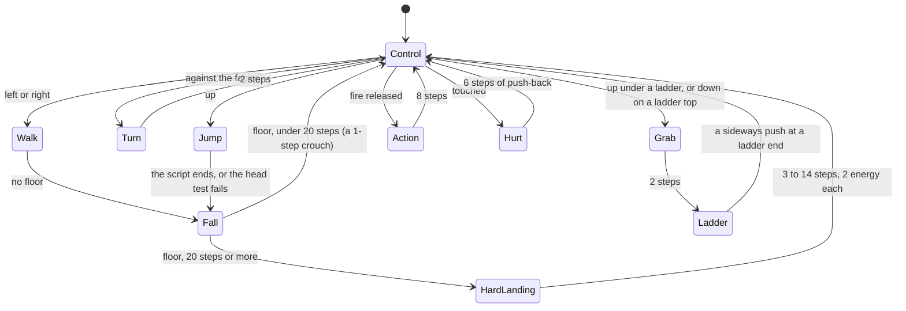

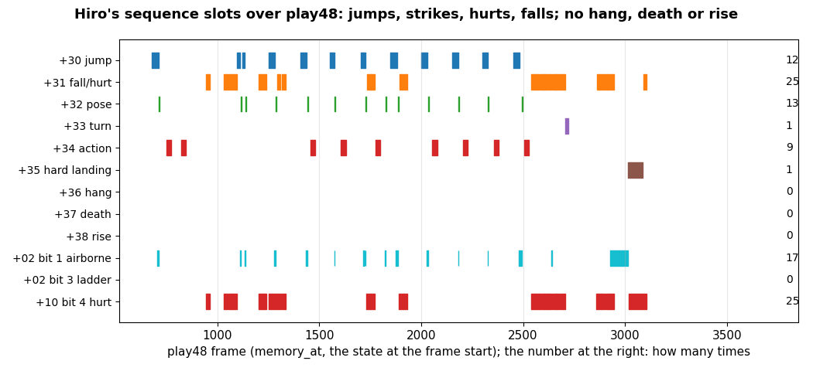

How to read the figure:

- One lane is one slot or one flag of Hiro's page. A bar marks the frames where it was not zero in the samples
  of `play48`.
- The number at the right counts the bars.
- The lanes +`$37` (death) and +`$38` (rise) stay empty: Hiro never dies or rises like an enemy. A lost life is
  the energy ball (10.9).

**The point**: Hiro is an ordinary actor with a special state handler. His jumps, falls, strikes and hurts are the
same script slots the enemies use. Only HiroControl and the FireRequest test are his own.

```bash
python3 tools/fig_gameplay.py --only slots
```

Worked example: `play48` frame 1095. Hiro stands in room 5 at Y `$40`, X `$52`, flags `11` (active, strike armed),
all slots 0. The up key is held. The step of frame 1097 runs HiroControl: D = 0, E = -1, so HiroMove gets Y step -4
and ActorJump starts StandScript in +`$30`. The sample of 1098 shows +`$30` = `0B` (11 steps) and Y `$3C`.

Witness: HiroControl `$9333` ran 629 times in `play48`, 4375 in the other keyed builds and 24 579 times in all 71
RZX segments. The FireRequest branch `$9AE9` ran 637 times in `play48`.

## 10.2 Walk and turn

HiroMove `$9AFD` sends a step on a ladder to ClimbMove (10.4); otherwise MoveActor `$9B05` does it. A sideways key
against Hiro's facing starts a turn: the turn script (low byte +`$07`) in slot +`$33`. TurnStep flips the facing
+`$1B` at the step where 2 remain. A key with Hiro's facing walks: the floor and the walls are probed, the run
counter +`$24` and the step counter +`$25` go up, and ApplyMove moves him. No key, or down with no ladder, stands
him: both counters go back to 0. A run of 4 steps or more (+`$24` at least 4) makes a jump the long RunScript
(10.3).

```text
MoveActor(D, E):
    if D and sign(D) != sign(facing): StartTurn; return     ; +$24 = +$25 = 0, script +$07 in +$33
    if E < 0: ActorJump(D); return
    if E > 0:
        if D: E = 0                                         ; down with a side key: walk
        else if LadderBelow: GrabLadder; return
        else: stand
    ProbeVertical; ProbeWalls                               ; the floor, the walls ahead
    if Hiro and D == 0: stand (+$24 = +$25 = 0)
    else: +$24 += 1; +$25 += 1
    ApplyMove(D, E)
```

```asm
MoveActor:
$9B05  LD A,D
$9B06  OR A
$9B07  JR Z,MoveActorY
$9B09  LD L,$1B                  ; against the facing: turn
$9B0B  XOR (HL)
$9B0C  JP M,StartTurn
MoveActorY:
$9B0F  LD A,E                    ; up: the jump
$9B10  OR A
$9B11  JP M,ActorJump
$9B14  JR Z,MoveWalk
$9B16  LD A,D                    ; down: with a D, just walk
$9B17  OR A
$9B18  JR NZ,MoveDownWalk
$9B1A  CALL LadderBelow          ; no D: a ladder below?
$9B1D  JP NZ,GrabLadder
$9B20  LD E,D                    ; no: stand
$9B21  JR MoveStand
MoveDownWalk:
$9B23  LD E,$00
MoveWalk:
$9B25  CALL ProbeVertical        ; the floor under, the walls ahead
MoveProbeWalls:
$9B28  CALL ProbeWalls
$9B2B  LD A,H                    ; Hiro not moving in X: stand
$9B2C  CP $5D
$9B2E  JR NZ,MoveWalkCount
$9B30  LD A,D
$9B31  OR A
$9B32  JR Z,MoveStand
MoveWalkCount:
$9B34  LD L,$24                  ; the walk counters
$9B36  INC (HL)
$9B37  LD L,$25
$9B39  INC (HL)
...
MoveStand:
$9B4A  XOR A
SetWalkCounters:
$9B4B  LD L,$24
$9B4D  LD (HL),A
$9B4E  LD L,$25
$9B50  LD (HL),A
$9B51  JR ApplyMove
...
TurnStep:
$91E1  LD A,(HL)                 ; at 2 steps left: the facing flips
$91E2  CP $02
$91E4  JR NZ,PoseStep
$91E6  LD L,$1B
$91E8  LD A,(HL)
$91E9  NEG
$91EB  LD (HL),A
```

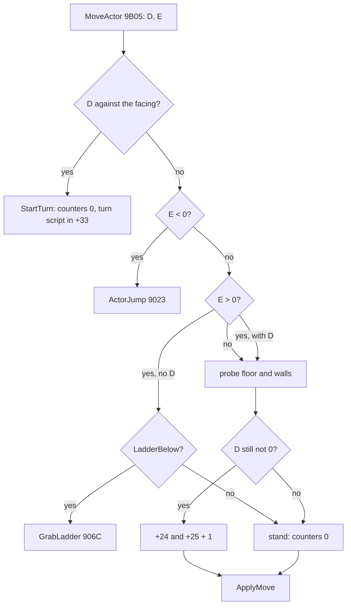

Worked example: `play48` frames 938-942, room 5. The samples read X `$50`, `$52` at 939 and `$54` at 942: one
step of 2 units every 3 frames. The run counter +`$24` reads `1F`, `20`, `21`: Hiro has walked right for 33 steps
without a stop, so a jump now would be the long one.

Witness: StartTurn `$90B1` ran 43 times in `play48` (TurnStep's flip `$91E6` 42 times), 1062 times in 69 RZX
segments. Doc 5 shows HiroControl and MoveActor running on a key in its Animation 5.3
([5.6](05-controls.md#56-from-the-input-byte-to-hiro)).

**The point**: walking is one counter and one probe. The counter +`$24` is the only memory of speed in the game: it
decides how far the next jump goes.

## 10.3 Jumps

Up starts a jump. ActorJump `$9023` picks one of three fixed scripts by the side key and the run counter:

- no side key: StandScript `$7B00`, 11 steps; but with a ladder above Hiro's column, GrabLadder instead (10.4);
- a side key: WalkScript `$7A51`, 12 steps;
- a side key after a run of 4 steps or more: RunScript `$7A7A`, 16 steps.

A script starts with a count, a delay (2 frames a step), the X offsets of the frames left and right and the size
class. Then each step is three bytes: the frame, the Y step, the X step. MotionStep `$9253` applies one step and
negates X when Hiro faces left. JumpStep `$921C` runs a step every 2 frames. It ends the jump (StartFallEndJump
`$9CD1`, slot cleared, the fall begins) when the count runs out, or when the step has no X move and the head test
fails. ProbeCeiling `$9DF1` fails a step that does not rise (E = 0) or whose head hits a ceiling. So the standing
jump never hovers: its five flat steps at the top end it at once. The running jumps keep their flat steps because
they move in X.

```text
ActorJump(D):
    if D == 0 and LadderAbove: GrabLadder; return
    script = StandScript if D == 0 else (RunScript if +$24 >= 4 else WalkScript)
    +$30 = script.count; delay = script.delay
    JumpMove(script)

JumpStep:                                  ; slot +$30, every 2 frames
    +$30 -= 1
    if +$30 == 0: end the jump, fall
    frame, dy, dx = next step; if facing left: dx = -dx
    ProbeWalls(dx)                         ; a wall cuts dx to 0
    if dx == 0 and (dy >= 0 or the head is blocked): end the jump, fall
    ProbeVertical; ApplyMove(dx, dy)
```

```asm
ActorJump:
$9023  LD A,D
$9024  OR A
$9025  JR NZ,ActorJumpScript
$9027  CALL LadderAbove          ; a ladder above?
$902A  OR A
$902B  JP NZ,GrabLadder
ActorJumpScript:
$902E  LD BC,StandScript         ; the straight jump
$9031  LD A,D
$9032  OR A
$9033  JR Z,ActorJumpStart
$9035  LD BC,WalkScript          ; the running jump
$9038  LD L,$24
$903A  LD A,(HL)
$903B  CP $04
$903D  JR C,ActorJumpStart
$903F  LD BC,RunScript           ; a run of 4 steps or more: the long jump
ActorJumpStart:
$9042  LD L,$30                  ; sequence +$30
$9044  CALL SequenceHeader
$9047  JP JumpMove
...
JumpStep:
$921C  DEC (HL)
$921D  JP Z,StartFallEndJump
$9220  LD L,$3A                  ; the script pointer +$3A/+$3B
$9222  LD C,(HL)
$9223  INC L
$9224  LD B,(HL)
JumpMove:
$9225  CALL MotionStep
$9228  LD A,D
$9229  OR A
$922A  JR NZ,JumpMoveOn
$922C  CALL ProbeCeiling         ; no X: a flat step or a blocked head ends it
$922F  JP Z,StartFallEndJump
JumpMoveOn:
$9232  CALL ProbeVertical
$9235  JP ApplyMove
...
ProbeCeilingE:
$9DF8  LD A,E
$9DF9  OR A
$9DFA  RET P                     ; E >= 0: Z when E = 0
$9DFB  CALL ProbeHead
$9DFE  RET NZ
$9DFF  LD E,$00                  ; blocked: no rise, Z
$9E01  RET
```

The three scripts, from `src/res/tables/scripts-7a.txt` (the step bytes are frame, Y step, X step):

| Script | Count, delay | Steps |
| --- | --- | --- |
| StandScript `$7B00` | 11, 2 | 6 x (Y -4), then 5 x (Y 0) |
| WalkScript `$7A51` | 12, 2 | 4 x (Y -4), 1 x (Y -4, X 2), 5 x (X 2), 2 x (Y 4, X 2) |
| RunScript `$7A7A` | 16, 2 | 4 x (Y -4), 1 x (Y -4, X 2), 9 x (X 2), 2 x (Y 4, X 2) |

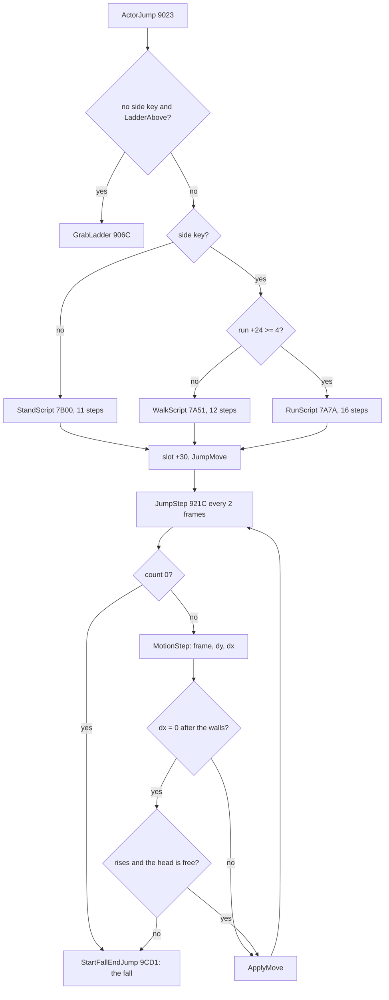

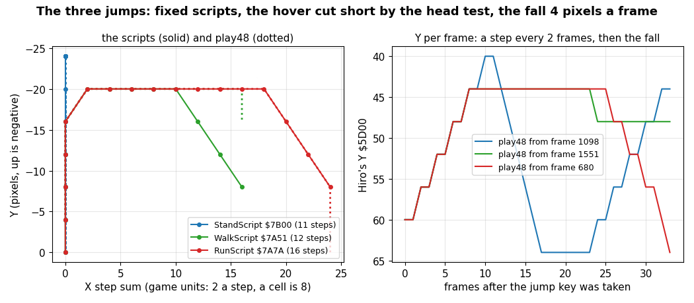

How to read the figure:

- Left: the path of each script (solid, X sum against Y), and Hiro's measured path from `play48` (dotted, same
  colour). Y grows downwards as on the screen.
- Right: Hiro's Y per frame for 34 frames after the jump key was taken. Blue is the standing jump of frame 1098,
  green the walking jump of 1551, red the running jump of 680.
- The blue curve turns after its six rises (24 pixels): the standing jump's first flat step ends it, and the fall
  takes over at 4 pixels a frame.

**The point**: a jump is not physics but a table of steps. The run counter picks the table, and one head test
turns the standing jump's top into a fall.

```bash
python3 tools/fig_gameplay.py --only jumps
```

Worked example: the standing jump of `play48` frames 1096-1116 (room 5).

1. Sample 1098: +`$30` = `0B`, Y `$3C`. The jump took its first step in frame 1097.
2. Samples 1100, 1102, 1104, 1106, 1108: +`$30` = `0A`, `09`, `08`, `07`, `06`; Y `$38`, `$34`, `$30`, `$2C`,
   `$28`. Six rises of 4: 24 pixels.
3. In frame 1109 the seventh step has Y 0 and X 0. ProbeCeiling returns Z, so StartFallEndJump clears +`$30`. The
   sample of 1110 shows +`$30` = 0, flags `17` (in the air, falling), the fall count +`$26` = 1 and Y `$2C`.
4. Samples 1111-1115: Y `$30` to `$40`, 4 pixels a frame, +`$26` = 2 to 6.
5. Sample 1116: Hiro is on the floor at Y `$40`. HiroLanded saw 6 fall steps (fewer than 20) and started LandScript:
   +`$32` = 1, a one-step crouch.

The walking jump of frames 1549-1576 (room 6): WalkScript from 1551 (+`$30` = `0C`), four rises to Y `$2C`, then X
`$1A` to `$28` in steps of 2 at the same height. Its last step is reached at 1573 (+`$30` = 1); at 1575 Hiro falls
one step and lands at 1576 (+`$32` = 1).

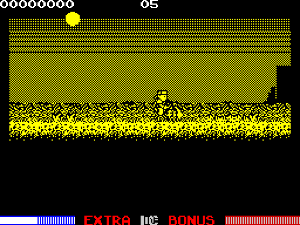

*Animation 10.1. The screen of `play48` frames 1096-1126, one picture a frame. Command: `python3
../../kit/screen_anim.py --work work/docs/zsC/play48 --from 1096 --to 1126 --step 1 --delay 80
docs/img/play/play48-jump.gif`.*

How to read it: Hiro stands in room 5, rises 24 pixels in six steps (two frames each), drops back 4 pixels a frame
and crouches for one step.

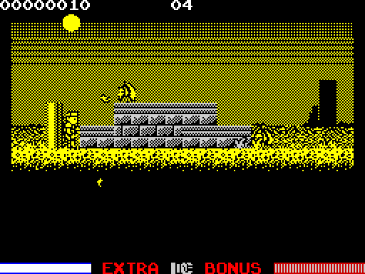

*Animation 10.2. The screen of `play48` frames 1549-1590, one picture a frame. Command: `python3
../../kit/screen_anim.py --work work/docs/zsC/play48 --from 1549 --to 1590 --step 1 --delay 80
docs/img/play/play48-running-jump.gif`.*

How to read it: from a stand with right held, Hiro rises 20 pixels, glides right along the top of WalkScript, drops
from its end and crouches for one step.

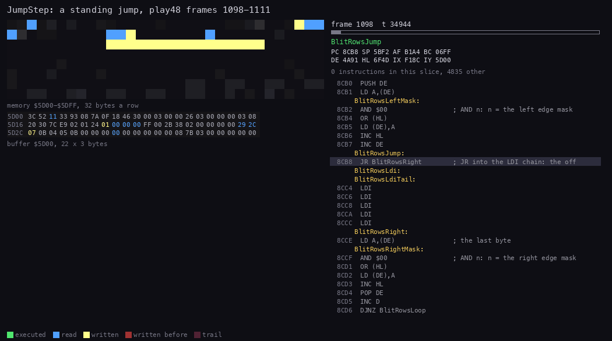

*Animation 10.3. JumpStep `$921C`, MotionStep and ProbeCeiling in `play48` frames 1098-1111, 28 pictures of 34944 T.
Command: `python3 ../../kit/routine_anim.py --work work/docs/zsC/play48 --listing build/game.lst --window
1098:0-1112:0 --pc 921C-926D --view buffer:5D00:22x3:hex --range 5D00-5DFF --pictures 28 --out
docs/img/routines/JumpStep.gif --title "JumpStep: a standing jump, play48 frames 1098-1111"`.*

How to read it:

- Left: Hiro's page `$5D00`, 66 bytes in three rows of 22. Byte 0 is Y, byte `$30` (row 3, column 5) the jump
  count.
- Right: the code of `$921C-$926D` running in each slice, the current instruction highlighted.
- Y drops by 4 and the count by 1 every second frame. In the slice of frame 1109 the path takes
  `JP Z,StartFallEndJump` at `$922F`.

Witness: ActorJump ran 12 times in `play48` (WalkScript 10, RunScript 7 of them), 51 times in the other keyed
builds and 733 times in 64 RZX segments. JumpStep ran 160 times in `play48`.

## 10.4 Ladders

The stage-2 source first called them ledges; they are ladders (GrabLadder, LeaveLadder, LadderGrabScript). Plane
`$6A` (doc 7, 7.1) marks a ladder's cells with the special tiles `$55` (a rung under the feet) and `$54`, and a ladder's top
with `$53`. Hiro takes a ladder in two ways:

- up with no side key, when the cell 20 pixels above holds `$55` or `$54` (LadderAbove `$9CA7`);
- down with no side key, when the cell below holds one (LadderBelow `$9CA1`).

Both need Hiro on the ladder's column: X mod 16 = 0 or 8. GrabLadder `$906C` sets +`$02` bit 3 (on a ladder) and
plays LadderGrabScript `$7AAF` (2 steps) in slot +`$36`. From then on HiroMove sends every step to ClimbMove
`$9C4A`:

- up: no X; the head test; the step stops (E = 0) when the cell at Y + 16, X + 2 is the top tile `$53`;
- down: the floor 4 pixels below; while the cell at the feet is `$55`, E = 4, otherwise E = 0;
- a side key at a stop: the facing is set and LeaveLadder `$9078` leaves the ladder: bit 3 cleared, X + 2,
  LadderLeaveScript `$7AE8` (2 steps) in +`$32`.

A fall that starts on a ladder (FallSequenceStart with bit 3 set) also goes to LeaveLadder: Hiro does not fall
off a ladder.

```text
LadderTest(cell):                          ; LadderAbove: the cell 20 above; LadderBelow: the cell below
    return plane6A[cell] in (55, 54) and X mod 16 in (0, 8)

ClimbMove(D, E):
    if E < 0:                              ; up
        D = 0; ProbeCeiling
        if plane6A[cell(Y + 16, X + 2)] == 53: E = 0
        ApplyMove(D, E); return
    if the floor 4 below is solid: ApplyMove; return
    E = 4 if plane6A[cell at the feet] == 55 else 0
    if D == 0: ApplyMove(0, E); return
    facing = D / 2; LeaveLadder         ; bit 3 off, X + 2, LadderLeaveScript in +$32
```

```asm
GrabLadder:
$906C  LD L,$02                  ; +$02 bit 3, script $7AAF in +$36
$906E  SET 3,(HL)
$9070  LD BC,LadderGrabScript
$9073  LD L,$36
$9075  JP StartSequence
LeaveLadder:
$9078  LD L,$02                  ; off: script $7AE8 in +$32, X + 2
$907A  RES 3,(HL)
$907C  LD BC,LadderLeaveScript
$907F  LD L,$01
$9081  LD A,(HL)
$9082  ADD A,$02
$9084  LD (HL),A
$9085  JR StartPoseSeq
...
ClimbMove:
$9C4A  LD A,E                    ; on a ladder: up or down?
$9C4B  RLA
$9C4C  JR NC,ClimbDown
$9C4E  LD D,$00                  ; up: no X; the ceiling
$9C50  CALL ProbeCeiling
$9C53  LD A,$10                  ; the cell at Y + $10, X + 2
...
$9C61  LD A,(HL)
...
$9C65  CP $53                    ; the ladder's top: stop
$9C67  JP NZ,ApplyMove
$9C6A  LD E,$00
$9C6C  JP ApplyMove
ClimbDown:
$9C6F  PUSH DE                   ; down or none: the floor 4 below
$9C70  CALL ProbeBelow
$9C73  POP BC
$9C74  JP NZ,ApplyMove
...
$9C88  LD A,(HL)                 ; the cell at the feet in plane $6A
$9C89  LD H,$5D
$9C8B  CP $55
$9C8D  LD E,$00
$9C8F  JR NZ,ClimbLeave
$9C91  LD E,$04
ClimbLeave:
$9C93  LD D,B                    ; a sideways push leaves the ladder
$9C94  LD A,D
$9C95  OR A
$9C96  JP Z,ApplyMove
$9C99  LD L,$1B
$9C9B  SRA D
$9C9D  LD (HL),D
$9C9E  JP LeaveLadder
...
LadderCellTest:
$9CB1  LD L,B                    ; the cell's tile in plane $6A
$9CB2  LD H,$6A
$9CB4  LD A,(HL)
$9CB5  LD HL,SpecialTiles        ; $55 or $54
$9CB8  LD BC,$0002
$9CBB  CPIR
...
$9CC2  LD L,$01                  ; on the ladder's column: X mod 16 = 0 or 8
$9CC4  LD A,(HL)
$9CC5  AND $0F
$9CC7  JR Z,LadderYes
$9CC9  CP $08
$9CCB  JR Z,LadderYes
```

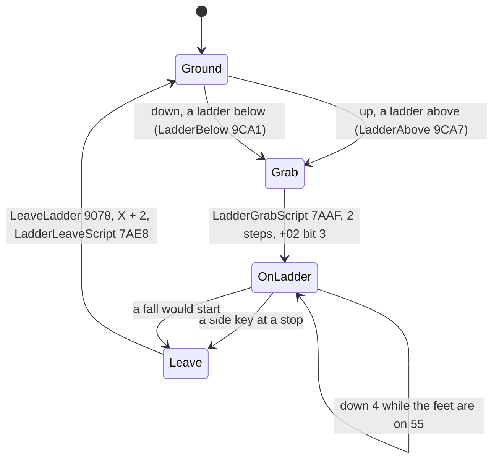

Worked example: `r014000` frames 1212-1249, room 20 (our replay of the RZX run, not the run itself).

1. Samples 1212-1216: Hiro stands at Y `$80`, X `$80` (X mod 16 = 0, on a ladder column), flags `01`.
2. Sample 1217: flags `09` (bit 3, on the ladder), slot +`$36` = 2, X `$7E`. Down was pressed on a ladder top:
   LadderBelow, then GrabLadder in frame 1216.
3. Samples 1219 and 1221: +`$36` = 1, then 0. The grab is over.
4. Samples 1221-1248: Y `$84`, `$88`, ... `$9C`: 4 pixels every 4 frames. Each step found tile `$55` at the feet.
5. Sample 1249: Room `$1C` (28), Y `$F0`. Hiro climbed out of room 20's bottom into the room below, still on the
   ladder (flags `09`).

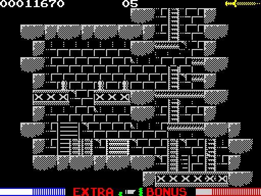

*Animation 10.4. The screen of `r014000` frames 1200-1340, every second frame. Command: `python3
../../kit/screen_anim.py --work work/docs/zsC/r014000 --from 1200 --to 1340 --step 2 --delay 80
docs/img/play/r014000-ladder.gif`.*

How to read it: Hiro walks to the ladder, grabs it, climbs down 4 pixels a step, and the screen changes to room 28
with him on the same ladder.

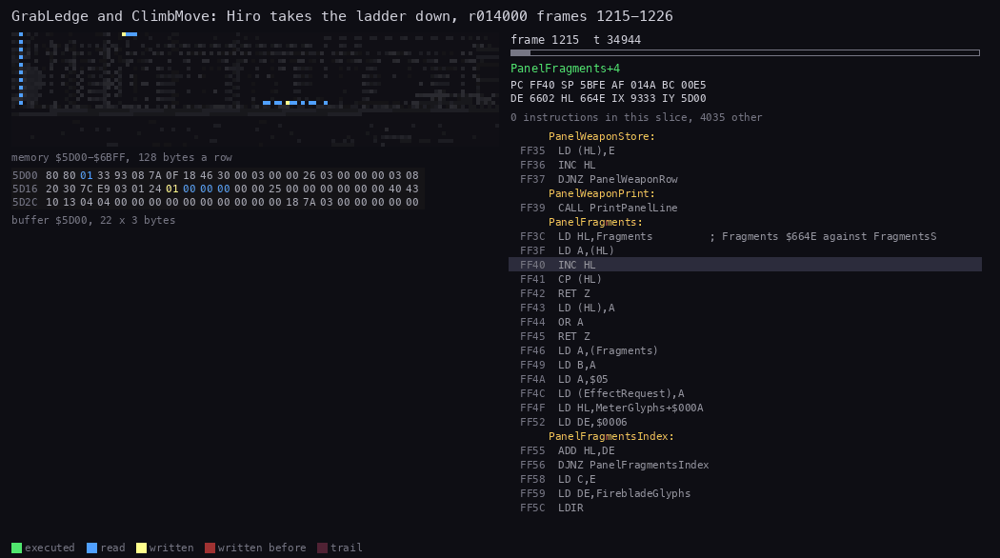

*Animation 10.5. GrabLadder `$906C`, ClimbMove `$9C4A` and LadderBelow `$9CA1` in `r014000` frames 1215-1226, 24
pictures of 34944 T. Command: `python3 ../../kit/routine_anim.py --work work/docs/zsC/r014000 --listing
build/game.lst --window 1215:0-1227:0 --pc 9C4A-9CA6,906C-9086,9CA7-9CD0 --view buffer:5D00:22x3:hex --range
5D00-6BFF --pictures 24 --out docs/img/routines/ClimbMove.gif --title "GrabLadder and ClimbMove: Hiro takes the
ladder down, r014000 frames 1215-1226"`.*

How to read it:

- Left: Hiro's page; byte 2 (the flags) turns from `01` to `09`, byte `$36` (row 3, column 11) counts the grab.
- Right: the ladder code; LadderCellTest's `CPIR` finds `$55`, then ClimbDown keeps E = 4.

Witness: ClimbMove ran 331 times in 13 RZX segments; GrabLadder 8 times in 8 segments; LeaveLadder 15 times in 13
segments. No keyed recording of ours climbs (`play48` 0). The stop at the top tile `$9C6A` ran 10 times in 3
segments.

**The point**: a ladder is a tile, not an object. Two tile numbers and a column test make Hiro climb, and the same
step code (4 pixels, the floor probe) serves the ladder and the ground.

## 10.5 Falls and the hard landing

Hiro falls when the floor under him is gone, or when a jump ends. StartFall `$9CD5` sets +`$02` bit 1 (in the air);
FallStep `$9CD9` sets bit 2 (falling), probes 4 pixels below and counts the fall step in +`$26`. A probe that finds
the floor clears the count (it is set to `$FF` and then incremented). The fall is 4 pixels a frame, and the count
goes on across a room change.

When a falling Hiro finds the floor, `$9D3B` calls HiroLanded `$90C3`. It reads and clears +`$26`:

- 0: nothing;
- 1-19: LandScript `$7AB6` in +`$32`, one step of 3 frames: a crouch;
- 20 or more: sound 1, and HardLandScript `$7ABC` in +`$35` with the count min(steps - 17, 14). Its first byte,
  5, is read as the delay, so a step comes every 5 frames. Each step runs FallDamageStep `$920A`: LoseEnergy 2.

So a fall of 20 steps (80 pixels) costs 6 energy, a fall of 31 steps or more 28 of the full 32. LoseEnergy ignores
the loss while the energy ball shines (10.9), but the steps still run.

```text
FallStep:                                  ; each frame of a fall
    +$02 |= 2 | 4
    if the floor 4 below is solid: +$26 = 0 else +$26 += 1

HiroLanded:                                ; from $9D3B, a falling Hiro on the floor
    steps = +$26; +$26 = 0
    if steps == 0: return
    if steps < 20: LandScript in +$32; return
    count = min(steps - 17, 14)
    sound 1; HardLandScript in +$35 with count, a step every 5 frames

FallDamageStep:                            ; slot +$35
    LoseEnergy(2)
    +$35 -= 1; if 0: back to HiroControl
```

```asm
StartFall:
$9CD5  LD L,$02
$9CD7  SET 1,(HL)                ; in the air
FallStep:
$9CD9  LD L,$02
$9CDB  SET 2,(HL)                ; falling
$9CDD  CALL ProbeBelow
$9CE0  LD L,$26
$9CE2  LD A,E
$9CE3  OR A
$9CE4  JR NZ,FallCount
$9CE6  LD (HL),$FF               ; landed: the counter back to 0
FallCount:
$9CE8  INC (HL)
...
HiroLanded:
$90C3  LD L,$26
$90C5  LD A,(HL)
$90C6  LD (HL),$00
$90C8  CP $14                    ; fewer than 20 steps: the crouch
$90CA  JR C,HiroLandedSoft
$90CC  SUB $11
$90CE  LD E,$0E
$90D0  CP E                      ; at most 14 damage steps
$90D1  JR C,HiroLandedHard
$90D3  LD A,E
HiroLandedHard:
$90D4  POP BC
$90D5  EX AF,AF'
$90D6  LD A,$01                  ; sound 1
$90D8  LD (EffectRequest),A
$90DB  EX AF,AF'
$90DC  LD BC,HardLandScript      ; 05 = the delay, then the frames
$90DF  LD L,$35
$90E1  JP StartSequenceCount
HiroLandedSoft:
$90E4  OR A
$90E5  RET Z
$90E6  POP BC
$90E7  LD BC,LandScript
$90EA  JR StartPoseSeq
...
FallDamageStep:
$920A  PUSH HL
$920B  PUSH IY
$920D  LD A,$02                  ; 2 energy a step
$920F  CALL LoseEnergy
$9212  POP IY
$9214  POP HL
HangStep:
$9215  DEC (HL)
$9216  JP Z,RunHandler
$9219  JP SequenceNextFrame
```

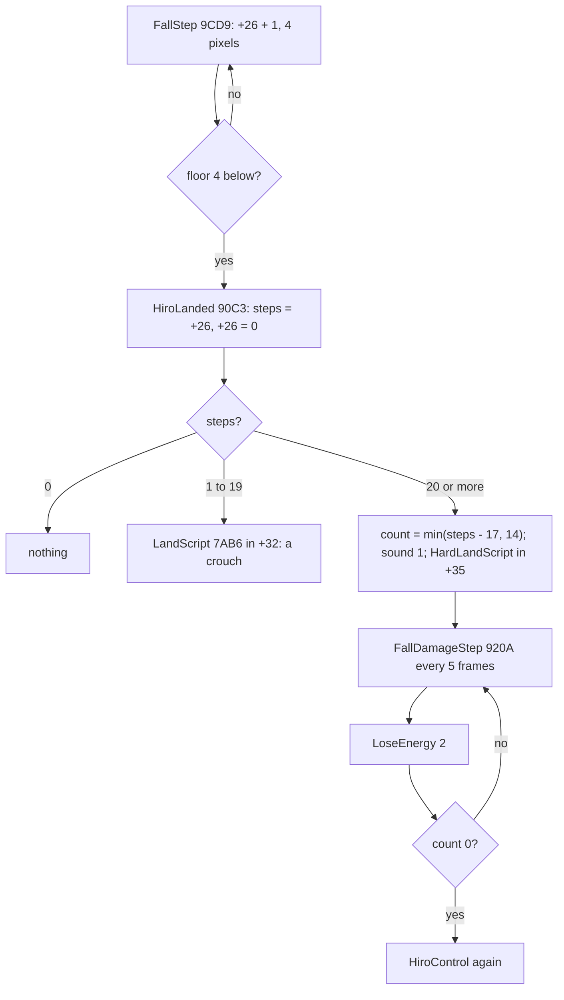

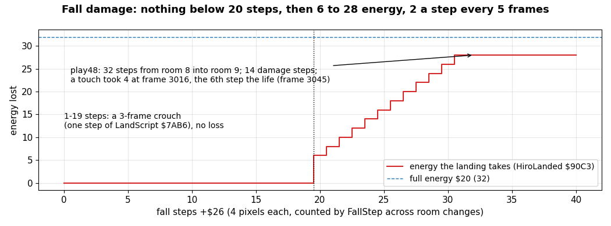

How to read the figure:

- X: the fall steps counted in +`$26` (4 pixels each). Y: the energy the landing takes in total.
- The red step line is HiroLanded's rule; the dotted line marks 20 steps, the blue dashed line full energy.
- The arrow marks `play48`'s fall of 32 steps.

**The point**: falls are the game's hard rule. A fall of 31 steps or more takes 28 of 32 energy, and it does not
matter how the fall began.

```bash
python3 tools/fig_gameplay.py --only fall
```

Worked example: `play48` frames 2974-3046, the fall from room 8 into room 9.

1. Sample 2974: Hiro falls in room 8 at Y `$84`, +`$26` = `$11` (17). Energy `$10` (16), lives 2.
2. Samples 2975-2980: Y `$88` to `$9C`, the count 18 to 23.
3. Sample 2981: Room 9, Y `$F0`, count 24. The room change stalls the game for the room's build and entry (doc 4,
   [4.5](04-game-loop.md#45-the-stalls)); Hiro hangs at Y `$F0` until sample 3007.
4. Samples 3008-3015: Y `$F4` to `$10`, the count 25 to 32.
5. Sample 3016: Hiro is on the floor at Y `$10`; +`$26` = 0, +`$35` = `0E`. HiroLanded saw 32 steps: 32 - 17 = 15,
   cut to 14.
6. Sample 3017: energy 12, and +`$10` bit 4 is set. This 4 is not the fall: an enemy touched Hiro in frame 3016
   (HurtHiro, 10.8).
7. Samples 3021, 3026, 3031, 3036, 3041: +`$35` = `0D` to `09`, energy 10, 8, 6, 4, 2. Two a step, a step every 5
   frames.
8. Sample 3046: +`$35` = `08`, energy `$20`, lives 1, Invulnerable `$48`. The sixth damage step found 2 energy
   left and LoseLife ran (10.9). The other 8 steps run under the energy ball and take nothing: FallDamageStep ran 14
   times in `play48`.

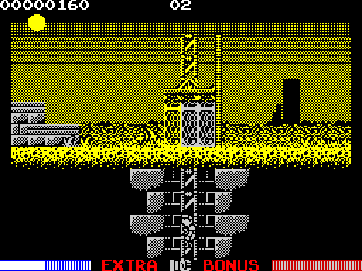

*Animation 10.6. The screen of `play48` frames 2976-3056, every second frame. Command: `python3
../../kit/screen_anim.py --work work/docs/zsC/play48 --from 2976 --to 3056 --step 2 --delay 80
docs/img/play/play48-hard-landing.gif`.*

How to read it: Hiro drops out of room 8; room 9 is built while he waits at its top; he falls on, lands, the energy
meter shrinks step by step, and the energy ball appears when it is empty.

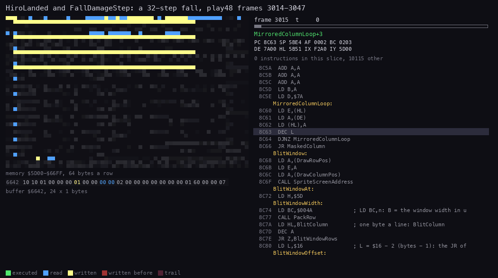

*Animation 10.7. HiroLanded `$90C3` and FallDamageStep `$920A` in `play48` frames 3014-3047, 34 pictures of 69888 T.
Command: `python3 ../../kit/routine_anim.py --work work/docs/zsC/play48 --listing build/game.lst --window
3014:0-3048:0 --pc 920A-921B,90C3-90EB --view buffer:6642:24x1:hex --range 5D00-66FF --pictures 34 --out
docs/img/routines/FallDamageStep.gif --title "HiroLanded and FallDamageStep: a 32-step fall, play48 frames
3014-3047"`.*

How to read it:

- Left: the game variables `$6642-$6659` in one row; byte 0 is the energy, byte 11 the lives, byte 15
  Invulnerable.
- Right: HiroLanded once (the hard branch), then FallDamageStep in every fifth picture.

Witness: HiroLanded ran 2895 times in all builds; the hard branch `$90CC` once in `play48`, once in `deaths` and 11
times in 7 RZX segments. The soft crouch `$90E4` ran 42 times in `play48`.

## 10.6 The strike: the charge and three moves

Fire is read once a frame by TickInput (doc 5, [5.5](05-controls.md#55-gameticks-input-the-latch-the-charge-and-the-strike)).
While fire is held, the charge meter Charge `$6645` grows by ChargeStep `$6644` a frame, up to 32. When fire is
released, Charge goes back to ChargeReset `$6647`. If Hiro is not busy and no weapon is in flight, the old charge
goes to FireHeld and FireRequest `$6650` is set by it:

| Charge at the release | FireRequest | With the fist | Script |
| --- | --- | --- | --- |
| 0-8 | 1 | strike 1 | StrikeScript1 `$7A46`, 6 steps of 2 frames |
| 9-24 | 2 | strike 2 | StrikeScript2 `$7ACE`, 8 steps of 3 frames |
| 25-32 | 3 | strike 3 | StrikeScript3 `$7ADB`, 8 steps of 3 frames |

At Hiro's next step, HiroAttack `$926E` stores FireRequest in Strike `$69E1`. With Weapon `$664B` = 0 (the fist) it
goes to HiroMelee `$90EC`. HiroMelee picks the script, asks sound `$0B`, sets +`$02` bit 4 (a strike armed), then
StartActionSeq clears FireRequest, asks sound `$0A` and starts the script in slot +`$34`. The second sound request
overwrites the first, so `$0B` is never heard. While bit 4 is set, each ActionStep probes the cell ahead for a
block (ProbeStrikeCell, doc 7 7.11), and the collision pass tests the strike against the actors (doc 7, 7.14). The
fist does the strike's number in damage (1, 2 or 3) and cannot hurt a boss.

```text
TickInput (fire):                           ; once a frame
    if fire held: Charge = min(Charge + ChargeStep, 32); return
    if fire released:
        old = Charge; Charge = ChargeReset
        if Hiro busy or a weapon in flight: return
        FireHeld = old
        FireRequest = 1 if old < 9 else (2 if old < 25 else 3)

HiroAttack(strike):                         ; Hiro's step, FireRequest set
    Strike = strike
    if Weapon == 0: HiroMelee(strike); return
    ...                                     ; a throw, 10.7

HiroMelee(strike):
    script = StrikeScript1, 2 or 3
    sound 0B; +$02 |= 16                    ; armed
    FireRequest = 0; sound 0A               ; overwrites 0B
    +$34 = script                           ; ActionStep probes blocks while armed
```

```asm
TickChargeFire:
$84DA  LD L,$44                  ; fire held: Charge + ChargeStep, at most $20
$84DC  LD A,(HL)
$84DD  INC L
$84DE  ADD A,(HL)
$84DF  CP $21
$84E1  JR C,TickChargeStore
$84E3  LD A,$20
TickChargeStore:
$84E5  LD (HL),A
$84E6  RET
TickFireReleased:
$84E7  XOR E                     ; fire released: the strike's power
$84E8  RET Z
$84E9  LD A,(ChargeReset)
$84EC  LD HL,Charge
$84EF  LD C,(HL)
$84F0  LD (HL),A
$84F1  CALL HiroBusy
$84F4  RET NZ
$84F5  LD A,(WeaponActor+$0002)  ; a weapon in flight: no strike
$84F8  RRA
$84F9  RET C
$84FA  LD A,C
$84FB  LD (FireHeld),A
$84FE  LD HL,FireRequest
$8501  LD (HL),$03
$8503  CP $19                    ; 25 or more: 3
$8505  RET NC
$8506  DEC (HL)
$8507  CP $09                    ; 9 or more: 2, else 1
$8509  RET NC
$850A  DEC (HL)
$850B  RET
...
HiroMelee:
$90EC  LD BC,StrikeScript1
$90EF  DEC L
$90F0  JR Z,HiroMeleeArm
$90F2  LD BC,StrikeScript2
$90F5  DEC L
$90F6  JR Z,HiroMeleeArm
$90F8  LD BC,StrikeScript3
HiroMeleeArm:
$90FB  LD A,$0B                  ; sound $0B (overwritten at $910A)
$90FD  LD (EffectRequest),A
$9100  LD L,$02
$9102  SET 4,(HL)                ; a strike armed
StartActionSeq:
$9104  XOR A
$9105  LD (FireRequest),A
$9108  LD A,$0A
$910A  LD (EffectRequest),A
$910D  LD L,$34
$910F  JP StartSequence
...
ActionStep:
$91F4  DEC (HL)
$91F5  JR Z,SequenceEndDrop
$91F7  LD L,$02
$91F9  BIT 4,(HL)
$91FB  CALL NZ,ProbeStrikeCell   ; a block ahead breaks
$91FE  JP SequenceNextFrame
```

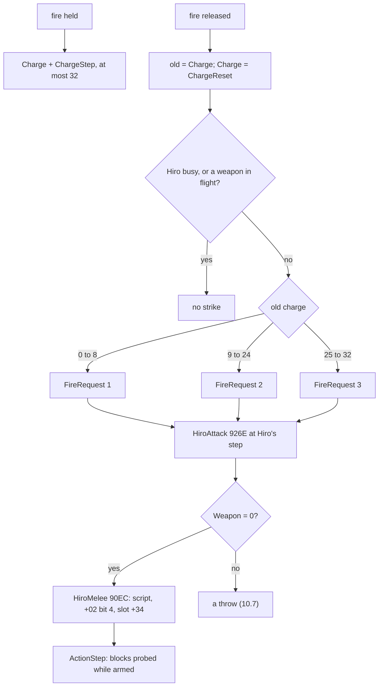

Worked example: the strike of `play48` frames 744-768 (room 5).

1. Samples 744-749: Charge `$0F`, `$10`, ... `$14`: fire is held, ChargeStep is 1, one more a frame.
2. In frame 749 fire is released with Charge 20 (`$14`): 20 is at least 9 and below 25, so FireRequest = 2, and
   Charge goes back to ChargeReset 0.
3. Sample 750: +`$34` = 8, flags `11`, X `$12` (StrikeScript2's frame offset `$FE` moved the frame 2 units left),
   Charge 0. HiroAttack and HiroMelee ran in frame 749, after the input.
4. Samples 753, 756, 759: +`$34` = 7, 6, 5: a step every 3 frames. Fire is held again (Charge 1 at 760).

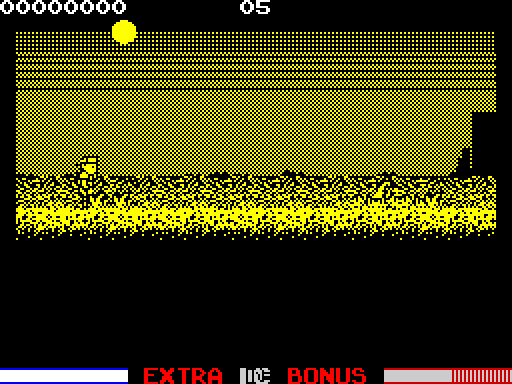

*Animation 10.8. The screen of `play48` frames 746-776, one picture a frame. Command: `python3
../../kit/screen_anim.py --work work/docs/zsC/play48 --from 746 --to 776 --step 1 --delay 80
docs/img/play/play48-strike.gif`.*

How to read it: the power meter fills while fire is held, empties at the release, and Hiro plays strike 2 (a high
kick) for 8 steps.

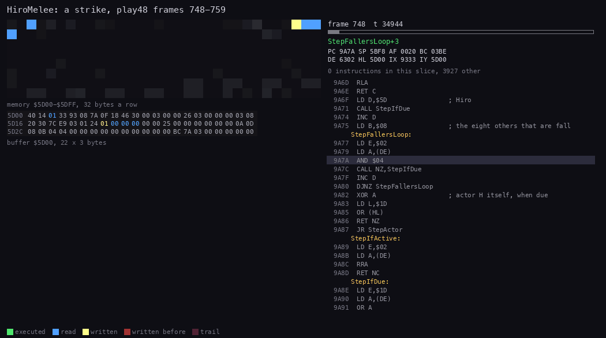

*Animation 10.9. HiroMelee `$90EC`, StartSequence and ActionStep in `play48` frames 748-759, 24 pictures of 34944 T.
Command: `python3 ../../kit/routine_anim.py --work work/docs/zsC/play48 --listing build/game.lst --window
748:0-760:0 --pc 90EC-91FF --view buffer:5D00:22x3:hex --range 5D00-5DFF --pictures 24 --out
docs/img/routines/HiroMelee.gif --title "HiroMelee: a strike, play48 frames 748-759"`.*

How to read it:

- Left: Hiro's page; byte 2 (flags) and byte `$34` (row 3, column 9) are the ones to watch.
- Right: the strike code. One slice of frame 749 runs HiroMelee through StartSequence; the later slices run
  ActionStep once every three frames.

Witness: HiroMelee ran 9 times in `play48`: strike 2 once (`$8506` once, `$90F8` skipped once) and strike 3 eight
times. In the other keyed builds 21 times, in 56 RZX segments 356 times.

**The point**: one button gives three moves. The game measures how long fire was held and turns it into a move and
its damage at the release.

## 10.7 Weapons

A weapon shield (10.10) sets Weapon `$664B` to 1-6 with 16 shots in WeaponCount `$6649`; the sixteenth Fireblade
fragment gives weapon 7. With a weapon, HiroAttack throws a shot instead of striking:

1. Not during the end (EndFlags), and only one shot at a time: WeaponActor `$6600` must be free.
2. The kind is `$40` + Weapon - 1. Its 7-byte record (`src/res/tables/weapons.csv`, `$6C51-$6C81`) is patched into
   WeaponTemplate `$64EE`: the walk list (+`$05`, +`$06`), a byte for +`$0B` that is also the X offset facing left
   (-4, -2 or -6), the step delay +`$0C`, the death script +`$0F`, the damage +`$13` and the size class +`$14`.
3. The shot is put at Hiro's Y + 10 and his X plus an offset (6 facing right, the record's third byte facing left),
   on page `$66` (InitActor), facing his way, with +`$3F` = 0.
4. Per kind: kinds `$40-$42` live FireHeld x 4 steps (+`$3F`); kind `$43` steps faster the longer fire was held
   (+`$0C` = 5 - ((FireHeld / 8) AND 7)); kind `$44` takes its walk list from the strike number (+`$05`). The others
   live 256 steps (+`$3F` from 0).
5. A shot placed at X `$9C` or more expires at once.
6. One shot is spent (WeaponCount - 1), except in a boss fight, where shots are free.
7. The throw script `$7AEF` plays in +`$34`.

WeaponControl `$9514` flies the shot: +`$3F` - 1 (0: it expires), then a step of 2 units along its facing through
MoveProbeWalls, which stops it at a wall. The strike code treats it like Hiro's strike (doc 7, 7.14): the damage is
its +`$13`, or the strike number when that is 0. Kind `$41` goes on through the actors it hits; the others expire
at the first hit. A shot does hurt the bosses.

| Weapon | Name (doc 1) | Kind | Record | Delay | Damage +`$13` | Life |
| ---: | --- | --- | --- | ---: | --- | --- |
| 1 | blade | `$40` | `$6C5F` | 1 | 3 | FireHeld x 4 |
| 2 | scorchball | `$41` | `$6C51` | 2 | 3, passes through | FireHeld x 4 |
| 3 | dart | `$42` | `$6C74` | 1 | 1 | FireHeld x 4 |
| 4 | spinblade | `$43` | `$6C7B` | 5 - FireHeld / 8 | 3 | 256 |
| 5 | needle bolts | `$44` | `$6C58` | 1 | the strike, 1-3 | 256 |
| 6 | trispike | `$45` | `$6C66` | 1 | 3 | 256 |
| 7 | the Fireblade | `$46` | `$6C6D` | 1 | 3 | 256 |

```text
HiroAttack(strike) with Weapon w:
    if EndFlags: HiroControl; return
    if WeaponActor active: return
    kind = 40 + w - 1
    patch WeaponTemplate from the kind's record
    x = Hiro.X + (6 if facing right else WeaponTemplate[8]); y = Hiro.Y + 10
    InitActor(page 66, kind, y, x); shot.facing = Hiro.facing; shot.+3F = 0
    if kind <= 42: shot.+3F = FireHeld * 4
    if kind == 43: shot.+0C = 5 - ((FireHeld >> 3) & 7)
    if kind == 44: shot.+05 = (FireRequest - 1) * 2 + F3
    if shot.X >= 9C: expire it
    if no boss fight: WeaponCount -= 1
    script 7AEF in +$34; FireRequest = 0

WeaponControl:                              ; the shot's step
    +$3F -= 1; if 0: expire
    MoveProbeWalls(facing * 2, 0)
```

```asm
HiroAttack:
$926E  LD (Strike),A
$9271  LD L,A
$9272  LD A,(Weapon)
$9275  OR A
$9276  JP Z,HiroMelee
$9279  LD C,A
$927A  LD A,(EndFlags)
$927D  OR A
$927E  JP NZ,RunHandler
$9281  LD A,(WeaponActor+$0002)  ; one weapon in flight at a time
$9284  RRA
$9285  RET C
$9286  LD A,C                    ; the kind $40 + Weapon - 1
$9287  PUSH HL
$9288  DEC A
$9289  ADD A,$40
$928B  CALL TemplateForKind
$928E  EX DE,HL
$928F  LD DE,WeaponTemplate+$0002  ; patch the weapon template $64EE
$9292  LDI
...
$92B5  LD BC,(Hiro)              ; Y + $0A, X + the offset
...
$92C7  CALL InitActor            ; spawn on page $6600
$92CA  LD A,(Hiro+$001B)  ; Hiro's facing
$92CD  LD E,$1B
$92CF  LD (DE),A
$92D0  LD E,$3F
$92D2  XOR A
$92D3  LD (DE),A
$92D4  POP AF
$92D5  CP $43
$92D7  JR C,HiroAttackLife
$92D9  JR Z,HiroAttackKind43
$92DB  CP $44
$92DD  JR Z,HiroAttackKind44
HiroAttackCount:
$92DF  LD E,$01
$92E1  LD A,(DE)
$92E2  CP $9C                    ; placed past X $9C: gone at once
$92E4  JR C,HiroAttackAmmo
$92E6  EX DE,HL
$92E7  CALL ExpireActor
$92EA  EX DE,HL
HiroAttackAmmo:
$92EB  LD A,(RunActorSteps+$000E)  ; no boss: one weapon less
$92EE  OR A
$92EF  JR NZ,HiroAttackThrow
$92F1  LD HL,WeaponCount
$92F4  DEC (HL)
HiroAttackThrow:
$92F5  LD BC,Script92F5          ; the throw frames $7AEF, sequence +$34
$92F8  POP HL
$92F9  JP StartActionSeq
HiroAttackLife:
$92FC  LD A,(FireHeld)           ; kinds $40-$42: the life = hold time x 4
$92FF  ADD A,A
$9300  ADD A,A
$9301  LD (DE),A
$9302  JR HiroAttackCount
...
WeaponControl:
$9514  LD L,$3F
$9516  DEC (HL)
$9517  JR Z,WeaponExpire
$9519  LD L,$1B                  ; facing x 2: the X step
$951B  LD A,(HL)
$951C  ADD A,A
$951D  LD D,A
$951E  LD E,$00
$9520  JP MoveProbeWalls
```

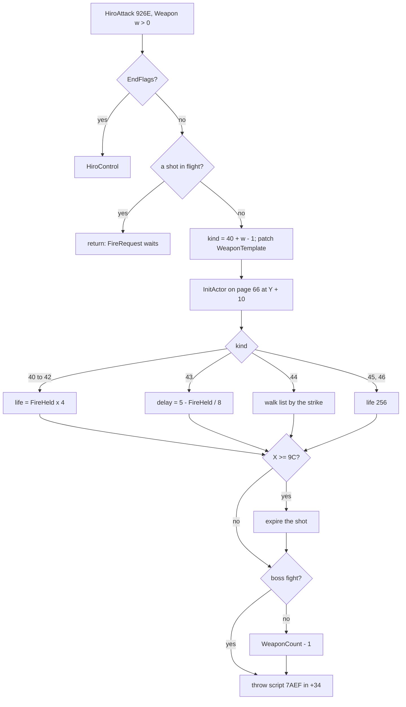

Worked example: the code, with weapon 2 and a release at Charge 20 (the `throw` recording throws the spinblade and the blade, below). Take the code with weapon 2 and a release at Charge 20:
FireRequest 2, FireHeld 20. HiroAttack finds the kind `$41`, patches WeaponTemplate from `$6C51` 
(`EF 5E FC 02 40 03 08`: walk list `$5EEF`, delay 2, damage 3, size 8), places the scorchball 10 pixels below Hiro's Y, sets its
life to 20 x 4 = 80 steps, and WeaponCount goes from 16 to 15. At 2 units a step the scorchball flies 160 units
(about 240 pixels, more than a room's width), unless a wall stops it.

Witness: the throw (InitActor at `$92C7`) ran 141 times in 26 RZX segments, WeaponControl 2184 times in the same
26. Kinds `$40-$42` (`$9302`) 43 times in 12 segments, kind `$43` 14 times and kind `$44` 19 times, each in 2
segments. Our own `throw` recording (128K, Weapon `$664B` and WeaponCount `$6649` POKEd at frame 1869) throws
eight times from the keys, frames 1893-3039: HiroAttack 8 runs, the throw `$92C7` 8, WeaponControl 268
(the figure in 10.17); `bossgate` throws 10 times.

**The point**: a weapon is a second actor that Hiro launches. The charge sets its range, its speed or its path
depending on the weapon, and only the boss fights make shots free.

## 10.8 Hurts and energy

The collision pass (doc 7, 7.14) calls TouchHiro when an enemy's box meets Hiro's, then HurtHiro `$9860`:

1. The push-back: the attacker's facing against Hiro's. Opposite facings choose script `$7A18` (pushed back),
   the same facing `$7A2F` (pushed forward). The low byte goes to HiroFallScript `$69DC`.
2. Sound 0.
3. The damage: 4, or 8 from a boss's shot (kind `$2D`). LoseEnergy takes it.
4. In a jump (+`$30` AND 7 not 0): the jump count is cut to its low three bits, and the flags become `03` (active,
   in the air): the jump goes on, shorter, and a strike in progress is disarmed.
5. Otherwise +`$10` bit 4 is set. At Hiro's next step ActorUpdate starts the push-back script from HiroFallScript
   in slot +`$31` (FallSequenceStart `$904A`): 6 steps of 3 frames, 2 units each. On a ladder LeaveLadder runs
   instead.

Between steps 4 and 5 stands a loop of 8 rounds at `$9895`. It enters with A = 0 and tests `AND $01`, which is
always 0; it reads no memory. It never branches. It looks like a scan of the other slots that lost its `OR (HL)`.

LoseEnergy `$9615` does nothing while Invulnerable `$6651` is set (the energy ball). Otherwise it clears
FireRequest (a hurt cancels a pending strike) and subtracts the damage from Vitality `$6642`. Zero or below calls
LoseLife (10.9).

```text
HurtHiro(attacker):
    HiroFallScript = 18 if sign(attacker.facing) != sign(Hiro.facing) else 2F
    sound 0
    LoseEnergy(8 if attacker.kind == 2D else 4)
    if Hiro.+30 & 7: Hiro.+30 &= 7; Hiro.+02 = 03; return
    Hiro.+10 |= 16                         ; the push-back at the next step

LoseEnergy(n):
    if Invulnerable: return
    FireRequest = 0
    Vitality -= n
    if Vitality <= 0: LoseLife
```

```asm
HurtHiro:
$9860  LD E,$1B                  ; the attacker's facing against Hiro's
$9862  LD A,(DE)
$9863  LD L,E
$9864  XOR (HL)
$9865  RLA
$9866  JR C,HurtFacingOpposite   ; opposite facings: $7A18
$9868  LD A,$2F                  ; the same way: hurt animation $7A2F
$986A  JR HurtHiroSet
...
HurtFacingOpposite:
$9876  LD A,$18
HurtHiroSet:
$9878  LD (HiroFallScript),A     ; the low byte of Hiro's hurt animation
$987B  LD A,$00                  ; sound 0
$987D  LD (EffectRequest),A
$9880  LD L,$1C
$9882  LD A,(HL)
$9883  CP $2D
$9885  LD A,$04                  ; damage 4, 8 from kind $2D
$9887  JR NZ,HurtHiroDamage
$9889  ADD A,A
HurtHiroDamage:
$988A  CALL LoseEnergy
$988D  LD HL,Hiro+$0030  ; Hiro's slot +$30 (a jump) on?
$9890  LD A,(HL)
$9891  AND $07
$9893  JR NZ,HurtKnockOff
$9895  LD B,$08                  ; A = 0 here: AND $01 never branches
HurtSlotLoop:
$9897  INC HL
$9898  AND $01
$989A  JR NZ,HurtKnockOff
$989C  DJNZ HurtSlotLoop
$989E  JR HurtHiroFlag
HurtKnockOff:
$98A0  LD (HL),A                 ; in a jump: +$30 AND 7, in the air (+2 = 3)
$98A1  LD A,$03
$98A3  LD (Hiro+$0002),A
$98A6  RET
HurtHiroFlag:
$98A7  LD HL,Hiro+$0010  ; +$10 bit 4: Hiro is hurt
$98AA  SET 4,(HL)
$98AC  RET
...
LoseEnergy:
$9615  LD C,A
$9616  LD A,(Invulnerable)       ; the energy ball on: no loss
$9619  OR A
$961A  RET NZ
$961B  LD (FireRequest),A        ; cancel the pending combat move
$961E  LD HL,Vitality
$9621  LD A,(HL)
$9622  SUB C                     ; vitality - damage
$9623  JR Z,LoseLife
$9625  JP M,LoseLife
$9628  LD (HL),A
$9629  RET
```

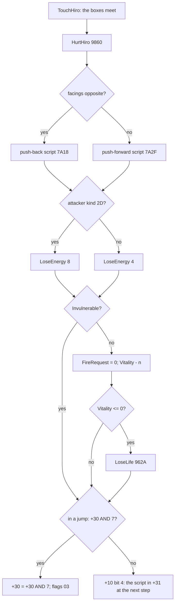

Worked example: `play48` frames 938-948 (room 5).

1. Samples 938-942: Hiro walks right (facing `01`), X `$50` to `$54`, energy `$20`.
2. In frame 942 an enemy's box meets his. The sample of 943 shows energy `$1C` (28): 4 taken.
3. Sample 945: +`$31` = 6, X `$52`. The push-back script started at his next step; its steps move him 2 units
   against his facing.
4. Sample 948: +`$31` = 5, X `$50`.

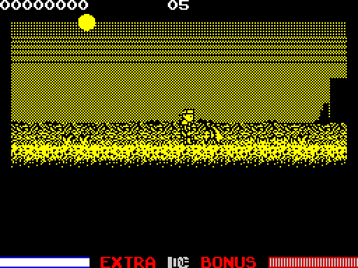

*Animation 10.10. The screen of `play48` frames 938-962, one picture a frame. Command: `python3
../../kit/screen_anim.py --work work/docs/zsC/play48 --from 938 --to 962 --step 1 --delay 80
docs/img/play/play48-hurt.gif`.*

How to read it: Hiro walks into an enemy; the energy meter loses a notch and Hiro is pushed back for six steps.

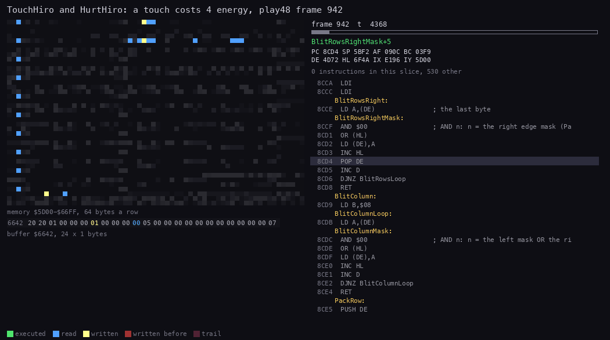

*Animation 10.11. TouchHiro and HurtHiro `$9860` in `play48` frame 942, 16 pictures of 4368 T. Command: `python3
../../kit/routine_anim.py --work work/docs/zsC/play48 --listing build/game.lst --window 942:0-943:0 --pc 9801-98B5
--view buffer:6642:24x1:hex --range 5D00-66FF --pictures 16 --out docs/img/routines/HurtHiro.gif --title
"TouchHiro and HurtHiro: a touch costs 4 energy, play48 frame 942"`.*

How to read it:

- Left: the game variables; byte 0, the energy, goes from `20` to `1C`.
- Right: the touch tests, then HurtHiro, LoseEnergy and the loop at `$9895` running its eight empty rounds.

Witness: HurtHiro ran 29 times in `play48` (the push-forward `$9868` 13 times, the push-back 16), 27 times in the
other keyed builds and 612 times in 57 RZX segments. The in-jump branch `$98A0` ran 4 times in `play48`.
LoseEnergy ran 43 times in `play48`.

**The point**: every hurt costs the same 4, and only the bosses' shots cost 8. What changes is where Hiro ends up: a
hurt in a jump shortens the jump instead of pushing him.

## 10.9 Lives and the energy ball

LoseLife `$962A` runs when the energy reaches zero. It does nothing during the end. Otherwise:

1. SpawnShield `$9962` with 170 frames: the energy ball, kind `$48`, on page `$65`, put at Hiro's X + 8 (or where an
   older ball still is). The A register still holds `$48` after InitActor, and it goes to Invulnerable `$6651`.
   The ball follows
   Hiro (ShieldFollow, doc 7, 7.13). When its timer ends, DeathStep clears Invulnerable.
2. The first 10 game variables are reloaded from GlobalsInit `$5C00` = `20 1F 01 00 01 00 01 00 01 00`: energy 32,
   ChargeStep 1, Charge 0, ChargeReset 0, WeaponCount 0, Weapon 0 (the bytes between are the panel's "shown" copies
   that force a redraw). So a lost life takes the power-ups, the speed-ups and the weapon. In a boss fight only 7
   bytes are reloaded: the weapon and its shots stay.
3. Lives `$664D` - 1 in BCD. Only a borrow below zero (`JP M`) ends the game (GameOver `$5C42`). So with 0 lives on
   the panel Hiro still plays: the game starts with 5 and gives six chances.
4. The lives' digits and the panel are printed.

Hiro has no death animation. His slots +`$37` and +`$38` are never used: he stays where he was hurt and the ball
appears around him.

```text
LoseLife:
    if EndFlags: return
    SpawnShield(170)                       ; kind 48 on page 65; Invulnerable = 48
    n = 7 if a boss fight else 10
    copy n bytes GlobalsInit -> Vitality.. ; 20 1F 01 00 01 00 01 00 01 00
    Lives = Lives - 1 (BCD)
    if Lives < 0: GameOver
    print the lives and the panel
```

```asm
LoseLife:
$962A  LD A,(EndFlags)           ; not during the end sequence
$962D  OR A
$962E  RET NZ
$962F  LD BC,$00AA               ; the energy ball for 170 frames
$9632  CALL SpawnShield
$9635  LD BC,$000A               ; 10 bytes to reload ...
$9638  LD A,(RunActorSteps+$000E)
$963B  OR A
$963C  JR Z,LoseLifeReload
$963E  LD BC,$0007               ; ... 7 in a boss fight: weapon and shots kept
LoseLifeReload:
$9641  LD HL,GlobalsInit         ; $5C00 -> $6642-$664B
$9644  LD DE,Vitality
$9647  LDIR
$9649  LD HL,Lives               ; lives - 1, BCD
$964C  LD A,(HL)
$964D  SUB $01
$964F  DAA
$9650  LD (HL),A
$9651  JP M,GameOver             ; below zero: the game over
$9654  LD DE,LivesDigits
$9657  LD B,$01
$9659  CALL BcdToDigits
$965C  JP PrintScore
...
SpawnShield:
$9962  PUSH BC
$9963  LD HL,ActorPage9
$9966  LD BC,(ActorPage9)        ; a ball already: its place
$996A  LD A,(ActorPage9+$0002)
$996D  RRA
$996E  JR C,SpawnShieldPut
$9970  LD BC,(Hiro)              ; no ball yet: at Hiro, X + 8
$9974  LD A,B
$9975  ADD A,$08
$9977  LD B,A
SpawnShieldPut:
$9978  LD DE,ActorPage9+$0094    ; kind $48 in page $65
$997B  LD A,$48
$997D  CALL InitActor
$9980  LD (Invulnerable),A       ; harm is ignored
$9983  EX DE,HL
$9984  POP BC
$9985  JR SetActorTimer
```

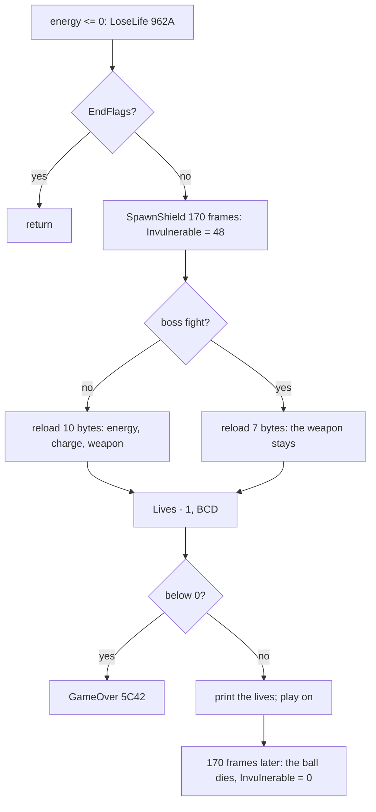

Worked example: `play48` frames 1308-1316 (room 5).

1. Sample 1313: energy 4, lives 5, Invulnerable 0.
2. In frame 1313 an enemy touches Hiro: HurtHiro asks 4; 4 - 4 = 0, so LoseEnergy jumps to LoseLife.
3. Sample 1314: energy `$20`, lives 4, Invulnerable `$48`, and +`$10` bit 4 (HurtHiro went on after LoseLife).
4. Sample 1316: +`$31` = 6: the push-back plays inside the ball.

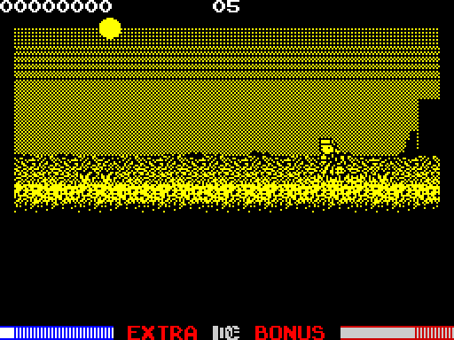

*Animation 10.12. The screen of `play48` frames 1300-1340, one picture a frame. Command: `python3
../../kit/screen_anim.py --work work/docs/zsC/play48 --from 1300 --to 1340 --step 1 --delay 80
docs/img/play/play48-life-lost.gif`.*

How to read it: the energy meter is nearly empty; at the touch it refills, the lives digit drops from 5 to 4, and
the ball appears beside Hiro.

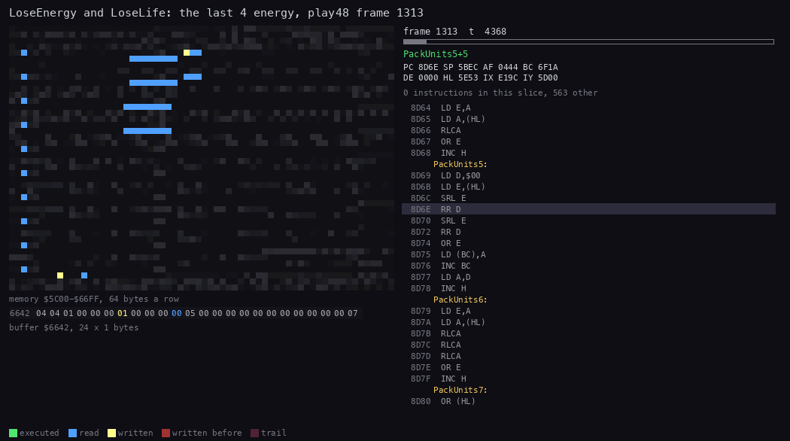

*Animation 10.13. LoseEnergy `$9615`, LoseLife `$962A` and SpawnShield in `play48` frame 1313, 16 pictures of 4368
T. Command: `python3 ../../kit/routine_anim.py --work work/docs/zsC/play48 --listing build/game.lst --window
1313:0-1314:0 --pc 9615-9690 --view buffer:6642:24x1:hex --range 5C00-66FF --pictures 16 --out
docs/img/routines/LoseLife.gif --title "LoseEnergy and LoseLife: the last 4 energy, play48 frame 1313"`.*

How to read it:

- Left: the game variables; byte 0 (energy) is reloaded with `20`, byte 11 (lives) goes from `05` to `04`, byte 15
  (Invulnerable) becomes `48`.
- Right: LoseEnergy, then LoseLife's `LDIR` from `$5C00` and the BCD decrement.

Witness: LoseLife ran 4 times in `play48`, 5 in the keyed builds and 83 times in 52 RZX segments. The boss-fight
reload `$963E` ran 8 times in 5 RZX segments. GameOver ran once in `gameover` and in 4 RZX segments. The lives of
the RZX run go 5, 4, 3, 2, 1, then 2 (EXTRA) and 1 ([WALKTHROUGH 6.3](../WALKTHROUGH.md#63-the-state-variables-and-the-pokes)).

**The point**: a life is cheap and the ball is generous. 170 frames without any harm, a full meter, and the game
goes on at 0 lives; but every lost life takes the collected power with it.

## 10.10 Pickups

A pickup is a kind `$01-$22` actor (doc 7, 7.10): a hidden item freed from a block (BreakReveal, doc 7 7.11), or one
placed by the room record. When Hiro's box meets it, TouchPickup expires it and calls CollectPickup `$98B6`. That
asks sound 8 and reads the kind's item record (`src/res/tables/items.csv`, `$6BAC-$6C35`: the frame, the score
record, two bytes). Then the kind decides:

| Kind | Pickup | Effect | Points |
| --- | --- | --- | ---: |
| `$01-$05` | gems | the score | 50, 100, 200, 400, 700 |
| `$06` | flask | the score | 7000 |
| `$07-$0B` | E, X, T, R, A | LetterPickup `$9997`: the letter lit; all five: lives + 1, EXTRA LIFE | 0 |
| `$0C-$10` | B, O, N, U, S | the letter lit; all five: 10 000, BONUS POINTS | 0 (10 000) |
| `$11-$17` | weapon shields | Weapon = 0-6 (the record's last byte), 16 shots (none for weapon 0) | 0 |
| `$18` | a Fireblade fragment | CollectFragment `$9908` (10.11) | 10 000 |
| `$19` | power-up | ChargeReset + 2, at most 16; Charge starts there | 0 |
| `$1A` | speed-up | ChargeStep + 1, at most 3 | 0 |
| `$1B` | bullets | 16 shots with a weapon; 50 points with the fist | 0 or 50 |
| `$1C` | power reset | ChargeReset = 0, Charge = 0 | 400 |
| `$1D` | speed reset | ChargeStep = 1 | 400 |
| `$1E` | vitality | Vitality = `$20` | 0 |
| `$1F` | invulnerability | SpawnShield for `$355` = 853 frames (10.9) | 0 |
| `$20-$22` | orbs | the score | 1000, 2000, 5000 |

The power-up and the speed-up shields change the charge of 10.6. ChargeReset is where the meter starts after each
release: with 16, a tap is already strike 2 (16 is at least 9). ChargeStep is how fast it fills: at 3, strike 3
takes 9 frames of holding instead of 25. A strike on these two shields (StrikeActor's pickup branch) turns them into
the reset shields `$1C` and `$1D` (TransformShield `$973F`, sound 6): striking a good shield spoils it.

The kind `$11` shield sets weapon 0, the fist, with no shots: it takes a weapon away.

```text
CollectPickup(kind):
    sound 8; rec = ItemRecord[kind]
    if kind < 07: AddScore(rec.score)                     ; gems, flask
    elif kind < 11: LetterPickup(rec)                     ; EXTRA, BONUS
    elif kind < 19:                                       ; weapons, the fragment
        if rec.score: CollectFragment(rec.score)          ; may not return here (10.11)
        WeaponIcon = rec.b2, rec.b2 + 1; Weapon = rec.b3
        WeaponCount = 16 if Weapon else 0
    elif kind == 19: if ChargeReset + 2 <= 16: ChargeReset += 2; Charge = ChargeReset
    elif kind == 1A: if ChargeStep + 1 <= 3: ChargeStep += 1
    elif kind == 1B: WeaponCount = 16 if Weapon else AddScore(50)
    elif kind == 1C: ChargeReset = Charge = 0; AddScore(400)
    elif kind == 1D: ChargeStep = 1; AddScore(400)
    elif kind == 1E: Vitality = 20
    elif kind == 1F: SpawnShield(355)
    else: AddScore(rec.score)                             ; the orbs
```

```asm
CollectPickup:
$98B6  LD HL,EffectRequest
$98B9  LD (HL),$08               ; sound 8
$98BB  CALL TemplateForKind      ; DE = the kind's record
$98BE  EX DE,HL
$98BF  INC HL
$98C0  CP $07                    ; kinds 1-6: the score only
$98C2  JR C,PickupScore
$98C4  CP $11                    ; kinds 7-$10: a letter
$98C6  JP C,LetterPickup
$98C9  CP $19                    ; kinds $11-$18: a weapon shield or a fragment
$98CB  JR C,PickupWeapon
$98CD  JR Z,PowerUpShield        ; $19: power-up
$98CF  CP $1A
$98D1  JR Z,SpeedUpShield
$98D3  CP $1B
$98D5  JR Z,BulletShield
$98D7  CP $1C
$98D9  JR Z,PowerResetShield
$98DB  CP $1D
$98DD  JR Z,SpeedResetShield
$98DF  CP $1E
$98E1  JR Z,VitalityRefill
$98E3  LD BC,$0355               ; $1F: invulnerability for $355 frames
$98E6  CP $1F
$98E8  JR Z,SpawnShield
PickupScore:
$98EA  LD E,(HL)                 ; the record's score index (the orbs too)
$98EB  JR PickupAddScore
PickupWeapon:
$98ED  LD A,(HL)                 ; a score (the fragment's)? CollectFragment
$98EE  OR A
$98EF  CALL NZ,CollectFragment
$98F2  INC HL
SetWeapon:
$98F3  LD A,(HL)
$98F4  LD DE,WeaponIcon          ; the icon: two characters
$98F7  LDI
$98F9  INC A
$98FA  LD (DE),A
$98FB  LD A,(HL)                 ; the weapon
$98FC  LD (Weapon),A
$98FF  OR A
$9900  JR Z,SetBullets
RefillBullets:
$9902  LD A,$10                  ; 16 shots
SetBullets:
$9904  LD (WeaponCount),A
$9907  RET
...
BulletShield:
$991F  LD A,(Weapon)             ; with a weapon: 16 shots
$9922  OR A
$9923  JR NZ,RefillBullets
$9925  LD E,$82                  ; with the fist: 50
PickupAddScore:
$9927  JP AddScore
PowerUpShield:
$992A  LD HL,ChargeReset         ; the minimum power + 2, up to $10
$992D  LD A,$02
$992F  ADD A,(HL)
$9930  CP $11
$9932  RET NC
$9933  LD (HL),A
$9934  LD (Charge),A
$9937  RET
SpeedUpShield:
$9938  LD HL,ChargeStep          ; the meter's rate + 1, up to 3
$993B  LD A,$01
$993D  ADD A,(HL)
$993E  CP $04
$9940  RET NC
$9941  LD (HL),A
$9942  RET
PowerResetShield:
$9943  LD A,$00
$9945  LD (ChargeReset),A
$9948  LD (Charge),A
$994B  JR ResetShieldScore
SpeedResetShield:
$994D  LD A,$01
$994F  LD (ChargeStep),A
ResetShieldScore:
$9952  LD E,$8E                  ; 400
$9954  JR PickupAddScore
VitalityRefill:
$9956  LD A,$20                  ; vitality full
$9958  LD (Vitality),A
$995B  RET
```

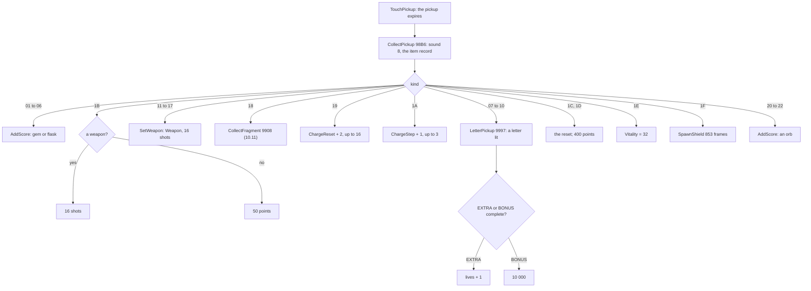

Worked example: the gem of `play48` frame 2318, room 7.

1. Sample 2318: the score is 00000110.
2. In frame 2318 Hiro's box meets a gem, kind `$01`. TouchPickup expires it; CollectPickup asks sound 8 and reads
   the item record at `$6BAC`: `9A 82 00 00` (frame `$9A`, score record `$82`).
3. The kind is below 7, so PickupScore takes E = `$82`: record n 0, 50 points.
4. Sample 2319: the score is 00000160.

`play48`'s other pickup is a vitality shield: VitalityRefill `$9956` ran once. The energy was already full, so no
sample shows a change.

Witness: CollectPickup ran 2 times in `play48`, once in the keyed builds and 45 times in 31 RZX segments.
LetterPickup ran 4 times in 4 segments; the power-up shield 10 times in 9 segments, the speed-up once, the speed
reset once, the bullets once, the invulnerability twice (`$98E8`) and the weapon shields 79 times through SetWeapon.
EXTRA's completion (`$99AA`) ran once in our replay segment `r128000` (its L1); BONUS's (`$99CB`) in no build of
ours. The RZX run completes EXTRA at RZX frame 128 606
(its lives go from 1 to 2, [WALKTHROUGH 6.3](../WALKTHROUGH.md#63-the-state-variables-and-the-pokes)); doc 8
([8.10](08-hud-and-text.md#810-extra-and-bonus)) gives the letters' panel. Known only from the code: the power
reset `$9943` and TransformShield `$973F` (0 runs in all builds).

**The point**: the pickups tune the strike more than they score. Two shields make the charge start higher and fill
faster, two others undo it, and a careless strike turns the good ones into the bad.

## 10.11 Fragments and the Fireblade

The kind `$18` pickup is a Fireblade fragment. Its item record has a score byte, `$C2` (10 000). PickupWeapon sees
that byte and calls CollectFragment `$9908`:

1. AddScore 10 000.
2. SpawnSparks `$965F`: three sparks (kind `$47`, 170 frames each) where the fragment was.
3. Fragments `$664E` + 1. Below 16 (bit 4 clear), CollectFragment pops its return address: the weapon code that
   follows is skipped, and Hiro keeps his weapon.
4. At 16, it adds 50 000 (`$C6`) and returns into SetWeapon. The record's last bytes give weapon 7, the whole
   Fireblade, with 16 shots.

Sixteen fragments lie on the map (doc 7, 7.8), one in each of sixteen rooms.

```text
CollectFragment(score = C2):
    AddScore(10000)
    SpawnSparks(three kind 47 sparks, 170 frames)
    Fragments += 1
    if Fragments < 16: drop the caller's return; return to TouchPickup
    AddScore(50000); return to SetWeapon        ; Weapon = 7, 16 shots
```

```asm
CollectFragment:
$9908  LD E,A                    ; the record's score byte, $C2
$9909  CALL AddScore
$990C  PUSH HL
$990D  CALL SpawnSparks
$9910  LD HL,Fragments           ; one more fragment
$9913  INC (HL)
$9914  BIT 4,(HL)                ; the 16th?
$9916  POP HL
$9917  JR Z,FragmentDone
$9919  LD E,$C6                  ; 50000 for the whole Fireblade
$991B  JR PickupAddScore         ; AddScore, then back into SetWeapon
FragmentDone:
$991D  POP HL                    ; below 16: pop the return, the weapon stays
$991E  RET
```

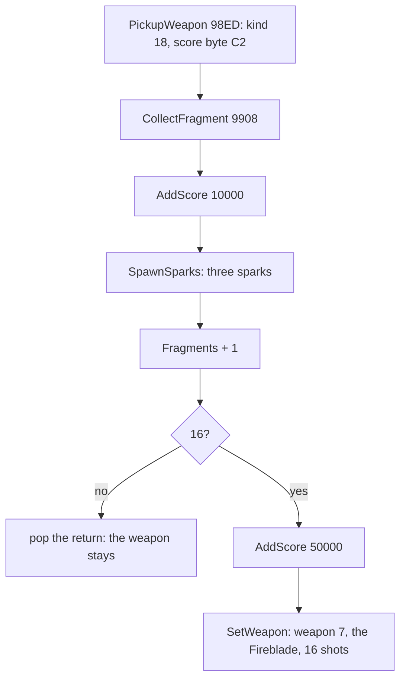

Worked example: `r034000` frame 529, room 56 (our replay of the RZX run). Before it, Fragments = 2 and the score is
29 270. Hiro touches the fragment; CollectPickup reads the record at `$6BE2` (`AD C2 3F 07`), PickupWeapon sees
`$C2`, CollectFragment adds 10 000, spawns three sparks and makes Fragments 3. Bit 4 is clear, so it pops the return
and the weapon stays. The sample of frame 530 reads Fragments `03`, Room `$38` (56) and the score 00039270.

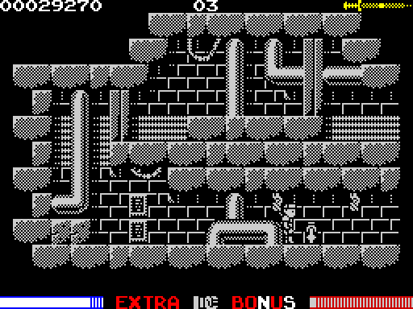

*Animation 10.14. The screen of `r034000` frames 500-580, every second frame. Command: `python3
../../kit/screen_anim.py --work work/docs/zsC/r034000 --from 500 --to 580 --step 2 --delay 80
docs/img/play/r034000-fragment.gif`.*

How to read it: Hiro reaches the fragment in room 56; it vanishes in three sparks, the score grows by 10 000 and the
fragment count on the panel goes to 3.

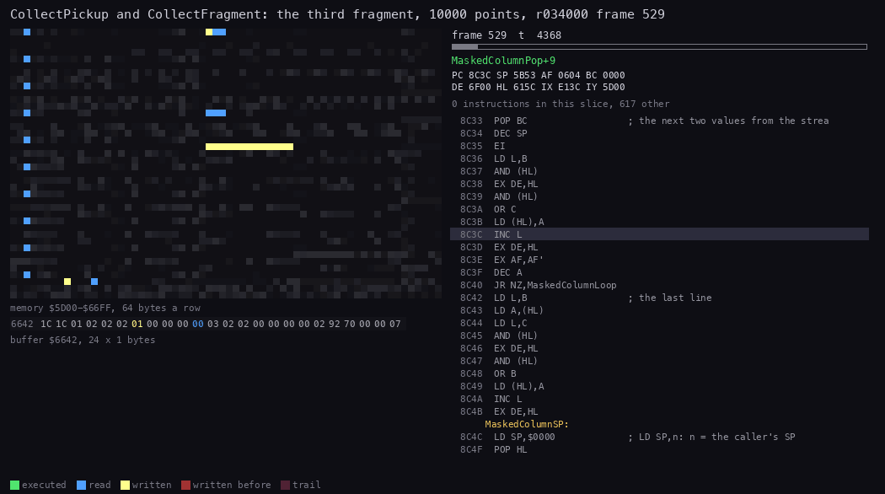

*Animation 10.15. CollectPickup `$98B6`, CollectFragment `$9908`, SpawnSparks and AddScore in `r034000` frame 529, 16
pictures of 4368 T. Command: `python3 ../../kit/routine_anim.py --work work/docs/zsC/r034000 --listing
build/game.lst --window 529:0-530:0 --pc 98B6-9961,965F-96A0,99E7-9A26 --view buffer:6642:24x1:hex --range
5D00-66FF --pictures 16 --out docs/img/routines/CollectFragment.gif --title "CollectPickup and CollectFragment: the
third fragment, 10000 points, r034000 frame 529"`.*

How to read it:

- Left: the game variables; byte 12 (Fragments) goes from `02` to `03`, bytes 17-20 (the score) gain 10 000.
- Right: CollectPickup's kind tests, then CollectFragment, the spark loop and AddScore's BCD loop.

Witness: CollectFragment ran once in each of 4 RZX segments (`r034000`, `r056000`, `r116000`, `r132000`). The 16th
fragment's branch `$9919` ran in no build of ours. `r136000` starts with Fragments `$10` and Weapon 7: the RZX run
took all sixteen. Known only from the code and that state: the 50 000 bonus and the hand-over of weapon 7.

**The point**: the fragments are the game's goal and its best weapon at once. Each one is worth 10 000, and the
sixteenth turns the collection into the Fireblade.

## 10.12 The enemies

Doc 7 gives each enemy's state machine (7.13) and the collision tests (7.14). Here are their rules as the player
meets them: what each kind does, what it costs Hiro, what it takes to kill and what it pays.

| Kind | Enemy | Behaviour (doc 7) | Harm to Hiro | Hits | Points |
| --- | --- | --- | --- | ---: | ---: |
| `$2B` | patroller | walks 16 steps each way, a step every 3 frames ([7.13](07-objects.md#the-patroller-patrolcontrol-93af-kind-2b)) | 4 | 2 | 50 |
| `$2C` | chaser | waits a random hold, then walks toward Hiro, wanders 0 or 4 steps ([7.13](07-objects.md#the-chasers-chasercontrol-9348-kinds-2c-37-3d)) | 4 | 2 | 350 |
| `$37` | chaser | as `$2C` | 4 | 9 | 200 |
| `$38`, `$3D` | chasers | as `$2C` | 4 | 9 | 250 |
| `$39` | chaser | as `$2C` | 4 | 6 | 100 |
| `$3A`, `$3B` | chasers | as `$2C` | 4 | 12 | 300 |
| `$3C` | chaser | as `$2C` | 4 | 3 | 300 |
| `$2E-$31` | traps | still until Hiro enters their touch zone 1 or 2, then they run their script ([7.13](07-objects.md#the-traps-trapcontrol-93d6-kinds-2e-31-34)) | 4 | 2 | 100 |
| `$34` | trap | as above, zone 3 | 4 | 6 | 100 |
| `$36` | stalactite | shakes when Hiro is under it (zone 5), harms from phase `$0D` of its script ([7.13](07-objects.md#the-stalactite-stalactitecontrol-93a8-kind-36)) | 4 | 0 | 0 |
| `$32`, `$33`, `$35` | fliers | follow a fixed path ([7.13](07-objects.md#the-path-movers-pathcontrol-93fb-bosses-fliers-sparks-the-energy-ball)) | 4 | 0 | 0 |
| `$26-$29` | the giants | follow a path in their own room, shoot kind `$2D` | 4, the shot 8 | 18, 36, 30, 54 | 5000 |
| `$25` | Havok | room 123, a path, a step every 5 frames | 4, the shot 8 | 42 | 50 000 |

Rules that hold for all of them:

- "Hits" is the template's +`$13`. A strike subtracts the striker's damage: the fist the strike number 1-3, a shot
  its +`$13` (10.7). At zero or below, KillActor `$97A8` runs; otherwise sound `$0C` and, if the kind has a hurt
  script, a flinch.
- Kinds with 0 hits (the stalactite, the fliers) cannot be hurt.
- Hiro's own strike (H = `$5D`) does nothing to a boss: only shots hurt the giants and Havok.
- A killed enemy pays its +`$0B` score and stays dead in that room: MarkSpawnKilled sets its bit in GoneEnemies
  (doc 7, 7.11).
- A giant's death opens its room's gate (OpenGate `$97E2`, sound 3). A boss with no gate in the room is Havok: his
  death is the end (10.14).

```text
StrikeEnemy(target, striker):
    if target is a boss (25-29):
        remember it for KillActor
        if striker is Hiro: return               ; the fist cannot hurt a boss
        if target is a giant: SpawnSparks
    damage = striker.+13 or Strike
    if target.+13 == 0: return                   ; cannot be hurt
    target.+13 -= damage
    if target.+13 <= 0: KillActor(target)
    else: sound 0C; if target has a hurt script: target.+10 |= 16
```

```asm
StrikeEnemy:
$9759  CP $25                    ; a boss (kinds $25-$29)?
$975B  JR C,StrikeDamage
$975D  CP $2A
$975F  JR NC,StrikeDamage
$9761  LD (KillActor+$000D),A    ; remember the boss kind for KillActor
$9764  LD A,H                    ; Hiro's own strike: a boss takes none
$9765  CP $5D
$9767  RET Z
$9768  LD A,(DE)                 ; a boss other than kind $25 sparks
$9769  CP $25
$976B  CALL NZ,SpawnSparks
StrikeDamage:
$976E  LD L,$13                  ; the damage: the striker's +$13 ...
$9770  LD A,(HL)
$9771  OR A
$9772  JR NZ,StrikeDamageC
$9774  LD A,(Strike)             ; ... or the strike 1-3
StrikeDamageC:
$9777  LD C,A
$9778  LD E,$13
$977A  LD A,(DE)                 ; no hit points: cannot be hurt
$977B  OR A
$977C  RET Z
$977D  SUB C                     ; hit points - damage
$977E  LD (DE),A
$977F  DEC A
$9780  JP M,KillActor            ; at zero or below: killed
$9783  LD A,$0C                  ; sound $0C: a hit
$9785  LD (EffectRequest),A
```

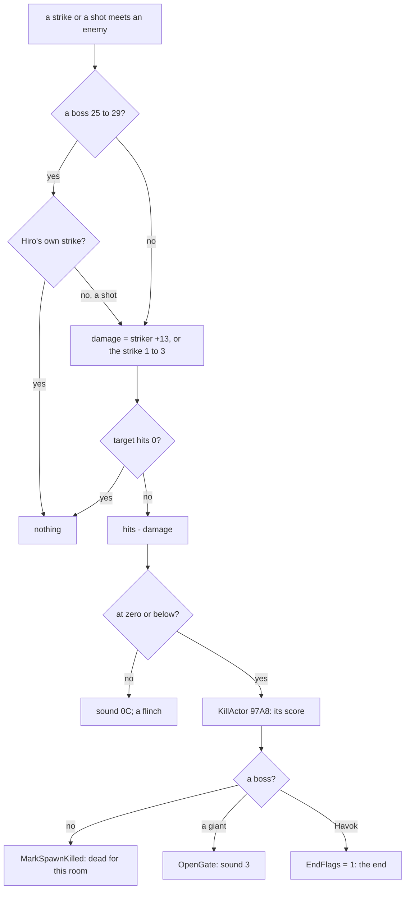

Worked example: `play48` frame 2219, room 7 (doc 7, 7.14). Hiro's strike 3 meets a patroller with 2 hits. Hiro's
+`$13` is 0, so the damage is Strike = 3; 2 - 3 = -1, and KillActor pays the patroller's 50 points. Doc 7 shows it
in its Animation 7.5 (the code) and Animation 7.6 (the screen).

Witness: KillActor ran twice in `play48` and 49 times in 27 RZX segments. A boss was struck (`$9761`) 36 times in 6
RZX segments, but no boss died in any build of ours (`$97B9` 0 runs). The RZX run itself kills the giants and Havok
(the `rzx-c` recording reaches the end text, [WALKTHROUGH 6.0](../WALKTHROUGH.md#60-the-recordings)).

**The point**: most enemies die to a strike or two, and they are worth little. The weight of the game is in the five
bosses, which only a weapon can hurt.

## 10.13 The score

Every score goes through AddScore `$99E7`. Its argument E is a score record `$82` + 4 x n in Hiro's page tail
(`src/res/tables/score-table.csv`): a sprite number (the rising points shown where the score was made, 0 for none)
and three BCD bytes added to Score `$6653-$6656`. Then the eight digits are rewritten (ScoreDigits `$665B`) and
PrintScore prints them.

| Source | Record | Points |
| --- | --- | ---: |
| gems `$01-$05` | n 0-4 | 50, 100, 200, 400, 700 |
| the flask `$06` | n 8 | 7000 |
| the orbs `$20-$22` | n 5-7 | 1000, 2000, 5000 |
| the bullets with the fist | n 0 | 50 |
| the reset shields `$1C`, `$1D` | n 3 | 400 |
| a block broken | n 19 | 10 |
| a fragment | n 16 | 10 000 |
| the 16th fragment, more | n 17 | 50 000 |
| BONUS complete | n 16 | 10 000 |
| a patroller, a chaser, a trap | n 9-14 | 50 to 350 (10.12) |
| a giant | n 15 | 5000 |
| Havok | n 17 | 50 000 |
| each life left at the end | n 18 | 20 000 |

The flask's record is n 8, 7000 points. The manual says 700. The code is what plays.

```text
AddScore(E):                               ; E = 82 + 4 n
    rec = HiroPage[E .. E + 3]             ; the sprite, then three BCD bytes
    actor.+39 = rec.sprite                 ; the rising points
    Score += rec.points  (BCD, low byte first, carry into the top byte)
    ScoreDigits = the eight digits
```

```asm
AddScore:
$99E7  PUSH BC
$99E8  PUSH DE
$99E9  PUSH HL
$99EA  LD D,$5D                  ; the record in Hiro's page
$99EC  LD A,(DE)
$99ED  INC E
$99EE  INC E
$99EF  INC E
$99F0  LD (IY+$39),A             ; the score sprite to the actor
$99F3  LD HL,Score+$0003         ; the three BCD bytes, low first
$99F6  XOR A
$99F7  LD B,$03
AddScoreLoop:
$99F9  LD A,(DE)
$99FA  ADC A,(HL)
$99FB  DAA
$99FC  LD (HL),A
$99FD  DEC L
$99FE  DEC E
$99FF  DJNZ AddScoreLoop
$9A01  LD A,B                    ; the carry into the top byte
$9A02  ADC A,(HL)
$9A03  DAA
$9A04  LD (HL),A
$9A05  LD B,$04                  ; the 8 digits
$9A07  LD DE,ScoreDigits
$9A0A  CALL BcdToDigits
```

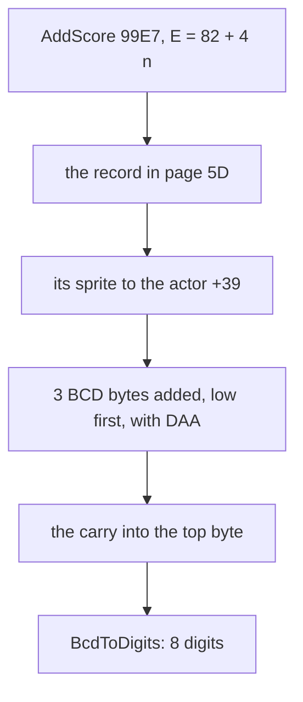

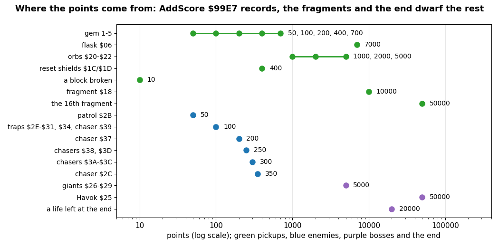

How to read the figure:

- One row is one source of points, on a log scale. Green rows are pickups, blue the common enemies, purple the bosses
  and the end.
- The numbers at the right are the exact values from the score records.

**The point**: the ordinary play pays tens and hundreds; the fragments, the bosses and the lives left at the end pay
tens of thousands. The score measures how far Hiro got, not how many enemies he killed.

```bash
python3 tools/fig_gameplay.py --only points
```

Worked example: the third fragment of `r034000` (10.11). E = `$C2` = `$82` + 4 x 16: record n 16, the BCD bytes
`01 00 00`. Score 00029270 + 00010000 = 00039270, as the sample of frame 530 shows. The end of the RZX run: the
state of `r138000` holds 342 890 with 1 life left, after Havok's 50 000 and one life bonus of 20 000.

Witness: AddScore ran 4 times in `play48`: the block broken at frame 1458 (10), the patrollers killed at 1775 and
2219 (50 each) and the gem at 2318 (50); the samples read the score 10, 60, 110 and 160 after them. Once in the keyed
builds, and 111 times in 47 RZX
segments. The RZX run's score at RZX frame 72 000 is 00092060 ([WALKTHROUGH 6.3](../WALKTHROUGH.md#63-the-state-variables-and-the-pokes)).

## 10.14 The end

KillActor recognises Havok as a struck boss with no gate (kind `$2A`) in the ten pages. It ends the boss fight, sets
EndFlags `$6652` = 1, adds 20 000 for each life left (the low BCD digit of Lives), asks sound 4 and pays Havok's own
50 000. From then on:

1. Havok fades: HavokFadeStep `$8738` redraws his 48 x 80 picture ANDed with a shrinking mask, with sound 4 every
   16 steps.
2. At the end of the fade it spawns the energy ball, sets EndFlags bit 6 and prints EndText "THE DAWN HAS COME AND MY
   WORLD IS SAFE, FOR NOW....".
3. While EndFlags is set, HiroControl hands Hiro to HiroEndWalk `$9321`. With bit 6 clear (the fade), Hiro jumps
   again and again (E = -1) and walks left while his X is at least `$58`. With bit 6 set, he stands still. LoseLife
   returns at once, and HiroAttack hands a pending throw back to HiroControl.
4. TickInput, with bit 6 set, turns a fire press into EndFlags bit 7. The main loop sees bit 7 and jumps to
   EndOfGame `$5C45`: the tune `$FF` and the high-score entry (doc 8, [8.14](08-hud-and-text.md#814-insertion-and-the-name-entry)).

```text
KillActor(Havok):                          ; no gate kind 2A in the pages
    boss fight = 0; EndFlags = 1
    repeat Lives & 0F times: AddScore(20000)
    sound 4; AddScore(50000)
HavokFadeStep:                             ; Havok's step, after his death
    mask -= 1; if mask & 0F == 0: sound 4
    DrawHavok(mask)
    if mask == 0: SpawnShield; EndFlags |= 40; PrintString(EndText)
HiroEndWalk:                               ; HiroControl while EndFlags
    if EndFlags & 40: D = E = 0
    else: E = -1; D = -1 if X >= 58 else 0
TickInput (fire pressed, EndFlags & 40): EndFlags |= 80
MainLoop: if EndFlags & 80: EndOfGame      ; the high-score entry
```

```asm
$97CA  LD A,$01                  ; no gate: Havok is dead, the game is won
$97CC  LD (EndFlags),A
$97CF  LD A,(Lives)              ; 20000 for each life left (the low digit)
$97D2  AND $0F
$97D4  JR Z,GameWonSound
$97D6  LD B,A
LifeBonusLoop:
$97D7  LD E,$CA
$97D9  CALL AddScore
$97DC  DJNZ LifeBonusLoop
GameWonSound:
$97DE  LD E,$04                  ; sound 4
$97E0  JR KillScore
...
$874F  LD (IY+$02),$00           ; the fade is over: Havok's page free
$8753  LD BC,$0000
$8756  CALL DelayBC
$8759  CALL SpawnShield
$875C  LD HL,EndFlags
$875F  SET 6,(HL)
$8761  LD HL,EndText
$8764  CALL PrintString
...
HiroEndWalk:
$9321  AND $40                   ; the end: no keys
$9323  LD DE,$0000
$9326  JR NZ,HiroScriptMove      ; bit 6: stand
$9328  DEC E                     ; up: a jump
$9329  LD A,(Hiro+$0001)
$932C  CP $58
$932E  JR C,HiroScriptMove
$9330  DEC D                     ; and left while X >= $58
$9331  JR HiroScriptMove
...
$84D0  LD HL,EndFlags            ; TickInput, fire pressed
$84D3  BIT 6,(HL)
$84D5  JR Z,TickChargeFire
$84D7  SET 7,(HL)                ; the end text is up: fire ends the game
$84D9  RET
...
$8E0E  LD A,(EndFlags)           ; MainLoop: bit 7, the end after Havok
$8E11  RLA
$8E12  JP C,EndOfGame
```

```mermaid
stateDiagram-v2
    [*] --> Fight: room 123, Havok's boss fight
    Fight --> Won: KillActor, no gate: EndFlags 1, 20000 per life, 50000
    Won --> Fade: HavokFadeStep 8738, Hiro jumps on the spot
    Fade --> Text: the mask is 0: the ball, EndFlags bit 6, EndText
    Text --> Text: Hiro stands; LoseLife ignored
    Text --> HighScore: fire: EndFlags bit 7, EndOfGame 5C45
    HighScore --> [*]
```

Worked example: `r138000`, RZX frame 138 000 replayed by us for 2000 frames in room 123.

1. Sample 0: EndFlags `01`, Lives 1, Fragments `$10`, Weapon 7, Score 00342890. Havok is already dead: the win
   happened in the RZX run before RZX frame 138 000.
2. Samples 0-1645: Hiro's X stays `$52` (below `$58`, so no walk) and his Y goes between `$68` and `$80`: he jumps on
   the spot. HavokFadeStep ran 241 times in this segment.
3. Sample 1650: EndFlags `$41`. The fade ended: the end text is printed (`$875C` ran once).
4. Samples 1665-1995: Y `$80`, Hiro stands. No fire is pressed in our 2000 frames. In the next segment, `r140000`,
   the fire press `$84D7` runs once and the RZX run goes on to the high-score entry.

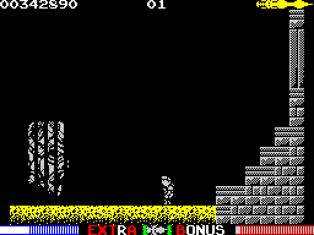

*Animation 10.16. The screen of `r138000` frames 0-1995, every 15th frame. Command: `python3
../../kit/screen_anim.py --work work/docs/zsC/r138000 --from 0 --to 1995 --step 15 --delay 100
docs/img/play/r138000-ending.gif`.*

How to read it: Havok's picture thins out while Hiro hops in place; then the energy ball appears and the end text
is printed over the room.

Witness: HavokFadeStep 241 runs and `$875C` once in `r138000`; HiroEndWalk 515 runs in 2 segments; `$84D7` once in
`r140000`; EndOfGame 5 times in 5 segments (the game overs and the end). The KillActor win branch `$97CA` ran in no
RZX segment of ours (`r136000` leaves Havok alive). Our `havok` recording (48K, from the RZX snapshot at 136 000,
Havok's hit points `$5E13` POKEd to 1 at frame 20) kills him at frame 29: KillActor `$97B9`, the gate search finds
none, the win `$97CA`, the life bonus loop and GameWonSound `$97DE` once each; the score goes 00272890 to
00342890, the RZX run's own end score. InsertHighScore runs at 1816 and EnterName at 1819.

**The point**: the end is a cutscene made of game code. The win flag disables the keys, the hurts and the throws; the
same Hiro, driven by HiroEndWalk, hops while the boss fades, and one press of fire leads to the high-score table.

## 10.15 The POKEs and the difficulty

The game has no difficulty setting. The rules above are the same in every game; only the room's boss fight changes
two of them (free shots, the weapon kept after a lost life). The POKE files checked against this release
([WALKTHROUGH 6.3](../WALKTHROUGH.md#63-the-state-variables-and-the-pokes)) act on the routines of this document:

| POKE | Address | What it does to the rules |
| --- | --- | --- |
| 38421,201 | `$9615` LoseEnergy | `RET`: no energy is ever lost: no hurt, no fall damage, no lost life |
| 38913,201 (46 off) | `$9801` TouchHiro | `RET`: no touch with any actor: no hurt, but no pickup either |
| 38478,0 | `$964E` the `$01` of `SUB $01` in LoseLife | Lives - 0: infinite lives (this release's address) |
| 37620,0 | `$92F4` the `DEC (HL)` of WeaponCount | `NOP`: infinite shots |

```text
LoseEnergy with 38421,201:  return at once          ; energy fixed
LoseLife with 38478,0:      Lives = Lives - 0       ; the ball and the reload still happen
HiroAttack with 37620,0:    WeaponCount unchanged
```

```asm
$9615  LD C,A                    ; 38421,201: RET here
...
$964D  SUB $01                   ; 38478,0: SUB $00
...
$92F4  DEC (HL)                  ; 37620,0: NOP (WeaponCount)
```

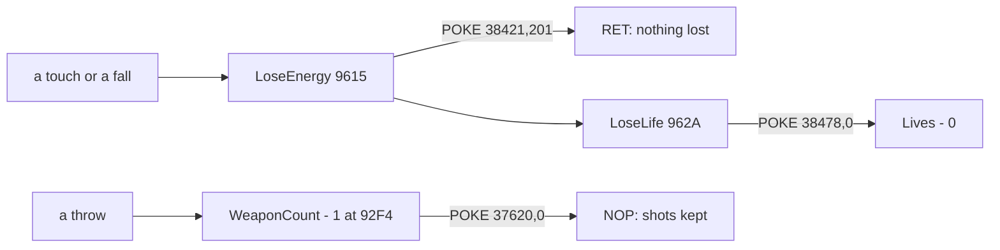

Worked example: with 38478,0 the life lost at `play48` frame 1313 would still spawn the ball and reload the energy;
the BCD step `SUB $00` / `DAA` leaves 5 lives, and `JP M` never jumps.

Witness: none of our recordings plays with these POKEs (the `poke-room*` probes poke the map position, not these).
All four are known only from the code (`work/stage2/NOTES.md`); the infinite-shots POKE 37620 is new, the files
miss this release's lives address.

**The point**: four bytes switch the game's four limits off: energy, touch, lives and shots. That they are single
bytes shows how central LoseEnergy, LoseLife and the WeaponCount decrement are.

## 10.16 Notable features

- **A loop that tests nothing.** HurtHiro's 8-round loop at `$9895` runs with A = 0 and `AND $01`, reads no memory and
  never branches (10.8). It ran 25 times in `play48` and 609 times in 57 RZX segments, always to the end.
- **A sound request overwritten.** HiroMelee asks sound `$0B`, and StartActionSeq overwrites it with `$0A` three
  instructions later (10.6). The strike always sounds `$0A`.
- **Lives at zero still play.** LoseLife ends the game only below zero (`JP M`), so the panel's 0 is a real life:
  five lives on the panel are six chances (10.9).
- **The flask is worth 7000, not 700.** Its record is n 8 of the score table (10.13).
- **Invulnerability lasts 853 frames**, the energy ball after a lost life 170. The manual's 16 seconds is about 800
  frames at 50 Hz (10.10).
- **A hurt in mid-air shortens the jump.** HurtHiro cuts the jump count to its low three bits and keeps Hiro in the air;
  it does not push him (10.8).
- **The fall counter survives a room change.** Fall steps are counted across the room's build; `play48` falls 24
  steps in room 8 and 8 more in room 9, and the landing counts all 32 (10.5).
- **Hard landings still tick under the ball.** After the life is lost the remaining FallDamageStep steps run and take
  nothing (10.5).
- **Striking a shield spoils it.** The power-up and speed-up shields turn into their resets when struck (10.10).
- **The fist cannot hurt a boss** (10.12); in a boss fight shots are free and a lost life keeps the weapon (10.7,
  10.9).
- **The end is a puppet show.** HiroEndWalk replaces the keys with a fixed jump and walk (10.14).
- **A standing jump has no top.** Its five flat steps are never played: the head test ends the jump at the first of
  them (10.3).

## 10.17 What no recording reached

The builds checked are `play48`, the other keyed builds (`c1`, `c48`, `deaths`, `gameover`, `menu`, `rooms`, `opt2-4`,
the 15 POKE probes), the 71 RZX segments, and the four witness recordings made at integration (`bossgate`,
`throw`, `hiscore`, `havok`; WALKTHROUGH 6.0), each with a POKE that sets the scene.

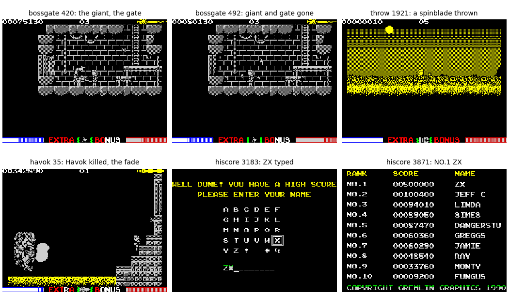

*The four witness recordings (WALKTHROUGH 6.0): `bossgate` frames 420 and 492, `throw` 1921, `havok` 35, `hiscore`
3183 and 3871. Command (the `havok` shot from its TTD with `kit/screen_shot.py`, WALKTHROUGH 6.1):*

```sh
python3 tools/fig_text.py screens docs/img/play/witness-recordings.png --shots \
  "work/stage2/rec/bossgate/screens/000420-boss.png:bossgate 420: the giant, the gate" \
  "work/stage2/rec/bossgate/screens/000492-gate-gone.png:bossgate 492: giant and gate gone" \
  "work/stage2/rec/throw/screens/001921-spinblade-0-flying.png:throw 1921: a spinblade thrown" \
  "work/docs/integrate/tt-havok/shots/f0035.png:havok 35: Havok killed, the fade" \
  "work/stage2/rec/hiscore/screens/003183-typed.png:hiscore 3183: ZX typed" \
  "work/stage2/rec/hiscore/screens/003871-after-05.png:hiscore 3871: NO.1 ZX"
```

How to read it: the giant stands left of Hiro, and one frame-435 strike later the giant and its gate are gone and the
score is 5 000 higher; a spinblade flies right of Hiro; Havok's picture thins after the kill; ZX is typed in the grid
and sits at the top of the table.

| Rule | Code | Status |
| --- | --- | --- |
| a giant's death, the gate opening | KillActor `$97B9`, OpenGate `$97E2` | `bossgate` frame 435 (the giant's hit points POKEd to 1) |
| Havok's death, the life bonus | `$97CA-$97DC` | `havok` frame 29 (Havok's hit points POKEd to 1) |
| the 16th fragment, 50 000, weapon 7 | `$9919` | not executed in any build; `r136000` holds Fragments 16 and Weapon 7 |
| EXTRA complete | `$99AA` | once in `r128000` (L1); the RZX run's lives show EXTRA at 128 606 |
| BONUS complete | `$99CB` | not executed in any build |
| the power reset shield | `$9943` | not executed in any build |
| a struck shield transformed | TransformShield `$973F` | not executed in any build |
| a throw seen on our screen | HiroAttack `$92C7` | `throw` frames 1893-3039 (Weapon POKEd), the figure in 10.17 |
| a boss's shot hurting Hiro (8) | `$9889` | only in 7 RZX segments (20 runs); no sample of ours |
| a hurt on a ladder (LeaveLadder from FallSequenceStart) | `$9058` | not checked by a sample of ours |

Our segment replays diverge from the RZX run, so the boss fights they reach go otherwise: `r136000` reaches Havok
with 16 fragments and the Fireblade, but he does not die in our 2000 frames; `havok` kills him by a POKE.
