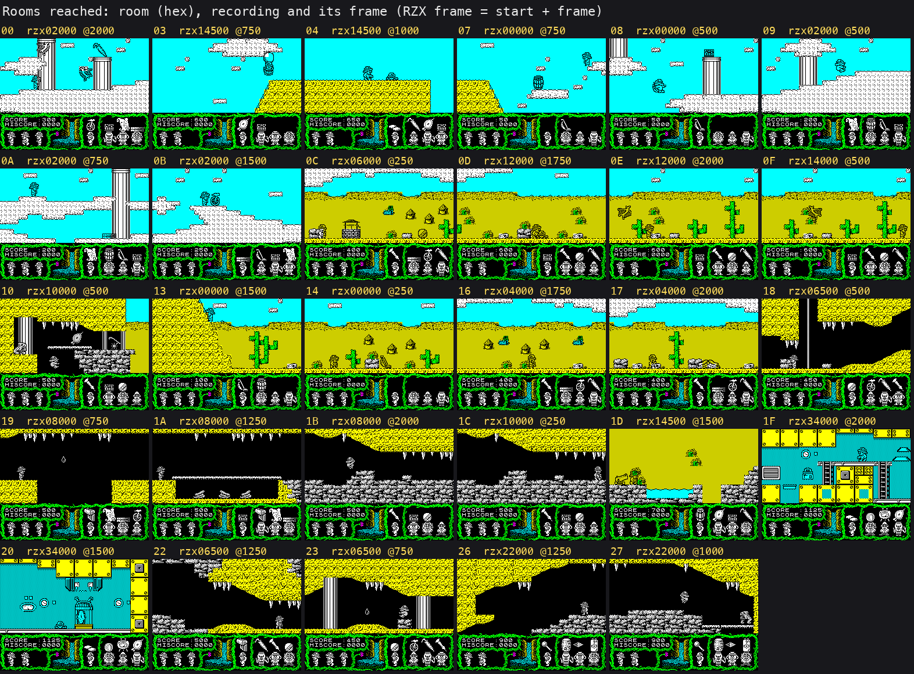
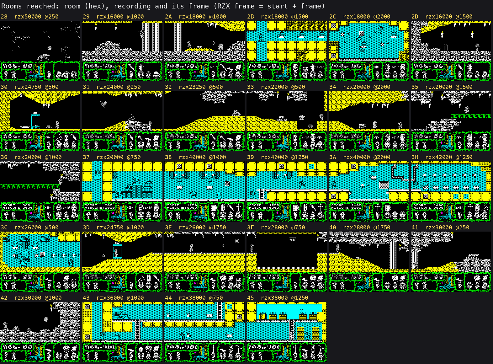

# Terramex: walkthrough

How the reverse was done, step by step, and which unreal-ng call answered each question. Terms:
[docs/README.md](docs/README.md). Recipes: `../recipes/`.

Every recording is named with its load (ROM speed or the fast LD-BYTES trap) beside every frame number. In this case
every load is at ROM speed (fast_tape and turbo_tape off), on the 128K.

## 0. The medium

The case starts from ZXDB 5195 (Terramex, Grandslam Entertainments, 1987; Teque Software Development). ZXDB lists
three tapes beside the original: the Quicksilva-labelled "Original Big Box Release", the Bug-Byte Premier re-release
and the Spanish Zafiro re-release. The original is `orig/Terramex.tzx.zip` from ZXDB's `pub/sinclair/games/t/`
(hashes in the [README](README.md)).

The release check (`tools/media_compare.py`, `work/stage1/media-compare.txt`): all four TZXs and the TAP hold the
same five data blocks byte for byte; the TAP's BASIC adds a wait for a key before `JP $8F00` (13 bytes), and the
Bug-Byte and Quicksilva TZXs add a TZX block `$2A` ("stop the tape if in 48K mode") before the last block. Every
other copy the collection index lists was copied unchanged into `work/candidates/<source>/` (`tools/fetch_copies.py`)
and scored by the share of the original's blocks it holds (`tools/copy_compare.py`, `work/stage1/copy-compare.tsv`):
the World of Spectrum FTP TAP, TOSEC's `(Europe).TZX`, the ULA+ TAP and zxart's Omega Ltd TAP carry the data blocks
whole; Astemex (Load 'n' Run, ZXDB's "unauthorized version", also filed by TOSEC 2005 as "Argus Press Software") is a
48K cut of two CODE blocks, and the Specman and Gryzor hacks are made from it; the TR-DOS and Microdrive copies are
packed. The table is in the README.

The tape is five standard-speed blocks: a BASIC header and line, the screen, a 38 648-byte block at `$6000` and a
36 352-byte block at `$7200` that loads over it ([doc 3, 3.1](docs/03-build-and-load.md#31-the-tape-block-by-block)).
The BASIC hides its loader in the variables area ([doc 3, 3.2](docs/03-build-and-load.md#32-the-basic-loader)); no
packer, no turbo blocks.

Other sources: nzeemin's SkoolKit disassembly (cloned at `work/candidates/skoolkit-game-revs`, the starting point for
names, checked as we go: `work/stage1/NOTES.md`), the RZX archive's `terramex.rzx` (someone else's run to the
ending), ZXDB's instructions, maps and POKE file (`work/candidates/zxdb-*`).

## 1. One recording from power-on

`c1`: the 128K from power-on, the original TZX at ROM speed (`tools/rs_capture.py --record-load --load-frames 21900`,
port base 37500), then `tests/inputs/c1.txt` (the menu, the selector, play, abort). The stages from the L1 arrivals
are in [doc 3, 3.3](docs/03-build-and-load.md#33-the-128k-setup-at-7200): the loader at frame 696, the selector in
RAM 6 at 11841, GameEntry `$8F00` at frame 21597 t 67875 (`time_travel find_last`, access execute).

The interrupts and the timing, a first look:

- **IM mode and handler.** Before the game the ROM's IM 1. GameEntry `$8F00` runs `DI`, fills `$8E00-$8F00` with
  `$5F`, writes `JP $9491` at `$5F5F`, sets `SP` = `$5E00`, `I` = `$8E`, `IM 2`, `EI` (the bytes at `$8F00` in the
  image; the instructions `$8F1C`, `$8F21`, `$8F23` in `c1`'s L1). The handler `$9491` pushes AF and, when the 128K
  flag `$5FFE` is set, pages RAM 1 in (`$7FFD` = `$16`), calls the music player at `$C000`, pages back and returns
  with `EI` (SK). In `c1` it ran 5029 times, about 3793 T each, 1 % of the CPU (`$RS interrupts`).
- **DI and EI in play.** None that costs an interrupt: `explorers` (15 190 frames), `gameover` (6000) and every RZX
  segment take as many interrupts as frames (the L1's `replay.interrupts`). `c1` takes 5214 in 26 628 frames: the
  load runs with interrupts off.
- **The main loop.** `$9018` (SK "main game loop") with no HALT: the room-entry check, the player, the items, the
  countdown, the creatures, the five party slots, the frame counter `$5C02` (so `$5C02` counts passes, not frames),
  and the pause and abort keys (Q, then CAPS SHIFT + Q to abort, A held to stay paused). The menu waits with a HALT at
  `$9468`.
- **Frames per pass**, measured on our instance (`tools/passes.py`: 300 passes from one `$9018` to the next with
  `/skip_until`, timed by `/video/beam`, 70 908 T a frame, no key held; `work/stage1/passes.json`):

| State (RZX snapshot) | Room | Median T a pass | Frames (median) | Heaviest pass | Frames |
| --- | --- | ---: | ---: | ---: | ---: |
| `snap-02000` | `$08` | 170 403 | 2.40 | 190 242 (pass 18) | 2.68 |
| `snap-12000` | `$1A` | 182 464 | 2.57 | 199 956 (pass 130) | 2.82 |
| `snap-24000` | `$32` | 193 191 | 2.72 | 198 704 (pass 6) | 2.80 |
| `snap-36000` | `$1F` | 197 754 | 2.79 | 203 107 (pass 262) | 2.86 |
| `snap-46000` | `$3B` | 220 476 | 3.11 | 232 943 (pass 151) | 3.29 |

A pass is 2.4 to 3.1 frames of work; the heaviest measured is 232 943 T (3.29 frames) in room `$3B`. The RZX's own
reads of the Kempston port at `$B8CC` agree: in its 51 148 frames the gap between reads is 2 frames 4376 times and 3
frames 12 178 times (`work/stage1/rzx/inputs.json`).

## 2. Static pass over the medium

## 3. The stages and the packers

## 4. The medium from source

## 5. Tool gaps found and fixed in unreal-ng

| Gap | Fix | unreal-ng commit |
| --- | --- | --- |

## 6. The game

### 6.0 The recordings

| Name | Session | Start (load) | Inputs | Frames | Reached |
| --- | --- | --- | --- | ---: | --- |
| `c1` | `work/stage1/c1/session.ttd` | power-on, the original TZX at ROM speed | `tests/inputs/c1.txt` | 26 628 | the load, the device menu (1, 3, 2, 0), the selector, Herr Krusche, room `$14`, jumps, bearer keys, T, 5, abort |
| `explorers` | `work/stage1/explorers/session.ttd` | `work/stage1/probe/load-128K/end.szx`, the menu after a ROM-speed 128K load of the original | `tests/inputs/explorers.txt` | 15 190 | the five explorers (`$5B70` = 0-4 at frames 1000, 3500, 6000, 9000, 11 500, `time_travel memory_at`), the three devices (Kempston; keyboard Z X 0 K SPACE; Sinclair 6 7 8 9 0), Help and its pages (13 750-15 190), five aborts |
| `gameover` | `work/stage1/gameover/session.ttd` | `rzx/snap-10000.z80` with lives `$5B97` = 1 (a POKE, said so; `work/stage1/probe/go/lives1.szx`) | `tests/inputs/gameover.txt` | 6000 | the RZX player's death in room `$1C` as the last life: `$9090` at frame 1509, the space scene, `$906D` (high score) at 1962, the menu at 1963 |
| `rzx00000` ... `rzx50000` (26) | `work/stage1/rzx/rNNNNN/session.ttd` | `work/stage1/rzx/snap-NNNNN.z80`, the RZX archive's run at frame NNNNN (`tools/rzx_dump.py` in SkoolKit's simulator; someone else's play) | `tests/inputs/rzx-NNNNN.txt` (`tools/rzx_script.py`: the RZX's port reads as held keys) | 2000 each, 1147 the last | the RZX run in pieces: 57 rooms, score 2300, one life lost, the ending (`$B0B6` sets `$5BFF` at `rzx50000` frame 729, the menu at 732) |
| `rzx06500`, `rzx14500`, `rzx23250`, `rzx24750`, `rzx32750` | as above | later snapshots where a segment drifted | as above | 750-1500 | the rest of those pieces in sync |

How they were made: `$RS capture --snapshot ... --model 128K --inputs ... --ranges 4000-FFFF --port-base 37510`
(`work/stage1/rzx_capture_all.sh`, `work/stage1/capture2.sh`). The RZX pieces were checked against the RZX's own
screen every 250 frames (under 3 % of the bitmap bytes differ); five pieces drifted after 500-1250 frames, the five
later starts cover their rest. More in `work/stage1/NOTES.md`.

Not reached yet: 13 rooms (`$01 $02 $05 $06 $11 $12 $15 $1E $21 $24 $25 $2E $2F`), eight items never picked up in the
RZX run, the countdown running out, the other ways to die, the 48K path (the tape stops at the TZX `$2A` block and
our instance did not resume it), the sound effects one by one. Stage 2 takes them from the room data and the RZX
states.

### 6.1 Screens and rooms

Every screen reached, from our recordings at the frames named:

| Screen | Picture | Recording, frame |
| --- | --- | --- |
| the loading screen | [loading-screen.png](docs/img/play/loading-screen.png) | the tape's block 3 (the image `$4000-$5AFF`) |
| the device menu | [menu.png](docs/img/play/menu.png) | `explorers` 7750 |
| the explorer selector | [selector.png](docs/img/play/selector.png) | `explorers` 250 |
| Help: the title, the controls, the story | [help-1.png](docs/img/play/help-1.png), [help-2.png](docs/img/play/help-2.png), [help-3.png](docs/img/play/help-3.png) | `explorers` 13 750, 14 000, 15 000 |
| play, the start room `$14` | [start-room-14.png](docs/img/play/start-room-14.png) | `explorers` 750 |
| the last life lost: the space scene | [gameover-1509.png](docs/img/play/gameover-1509.png), [gameover-1700.png](docs/img/play/gameover-1700.png) | `gameover` 1509, 1700 |
| room `$3B` before the end | [ending-lab-r48000-1999.png](docs/img/play/ending-lab-r48000-1999.png) | `rzx48000` 1999 |
| the ending in room `$28` | [ending-room-28-r50000-500.png](docs/img/play/ending-room-28-r50000-500.png) | `rzx50000` 500 |

The 57 rooms reached, one screen each (`tools/fig_rooms_reached.py`; the room from the RZX's `$5C01`, the picture
ours, kept where it matches the RZX's screen):

All 70 rooms drawn from the data are in [doc 2, 2.5](docs/02-architecture.md#25-the-rooms-in-the-data).

## 7. Review
