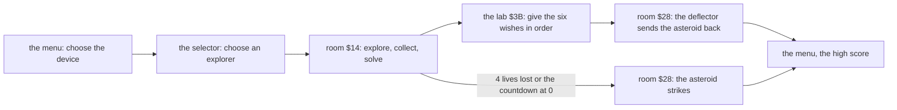
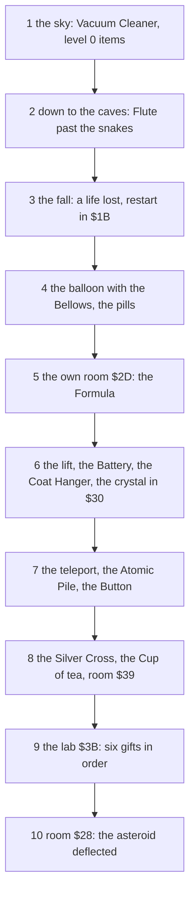

# 1. Game design

What this covers: the game as a player meets it.

- the premise and the goal: find Professor Eyestrain and bring him what he wants;
- every screen: the loading screen, the device menu, the explorer selector and Help, play and its panel, the lab,
  the space scene, the end;
- the five explorers;
- the controls;
- the rules as the game plays them: lives, the 30-day countdown, the score;
- the items and the professor's six wishes;
- the 72 rooms: the map, and every room on a contact sheet;
- a walkthrough of the RZX run's route;
- the end of a game, lost or won.

The recordings it rests on ([WALKTHROUGH 6.0](../WALKTHROUGH.md#60-the-recordings)):

| Recording | Load | Used for |
| --- | --- | --- |
| `c1` | power-on, the original tape at ROM speed on the 128K | the load, the device menu, the selector, Herr Krusche in room `$14` |
| `explorers` | the menu after a ROM-speed 128K load | all five explorers, the menu, the selector, Help, the start room |
| `gameover` | the RZX state at 10000 with Lives `$5B97` poked to 1 (a POKE) | the last life lost, the space scene, the menu again |
| `rzx50000` and the other `rzxNNNNN` | the RZX archive's run (Bobby Lequay's game, recorded in Spectaculator), replayed in segments | the lab, the ending |
| the RZX dump | the RZX played in SkoolKit's simulator by `tools/rzx_dump.py` (no emulator instance), the variables every 25 frames (`work/docs/tmA/rzx25`) | the route, the score, the lives and the countdown of the whole run |

The route and the walkthrough are another player's game. Their frames are "RZX frames", counted from the RZX's start.

## 1.1 The game in one page

Terramex (Grandslam, 1987; written by Teque: Shaun Hollingworth and Pete Harrap, 128K music by Ben Daglish) is a
flip-screen arcade adventure.

The story, from the selector's Help pages (`src/res/texts/help-page1.txt`, `help-page2.txt`):

- Twenty years ago Professor Albert Eyestrain warned that a gigantic asteroid would hit the Earth. Nobody believed
  him, and he vanished.
- Now the asteroid will hit within a month. The professor said he might be able to solve the crisis when the time
  came.
- "Your job then is to find him and convince him to save the world."
- You are one of five explorers, in a desert mountain range "where strange creatures live, and where things do not
  behave normally".

How it plays:

- **Find him.** The professor sits in his lab, room `$3B`, deep in the mountain. The way there runs through 57 of the
  72 rooms in the RZX run.
- **Convince him.** He wants six things, one at a time, in a fixed order (WantedItems `$B6BB`): the Formula, a Coat
  Hanger, a Battery, the Atomic Pile, a Button and a Cup of tea. Each wish shows in his speech bubble.
- **In time.** A countdown of 30 days, 23 hours and 59 minutes runs from the start. When it runs out, the asteroid
  strikes.
- **With help.** Invisible bearers carry what the explorer is not holding. Only the item in the hand can be used.

**The point**: Terramex is a collecting game on a timer. Most of the map serves to gather the right items, and the
end is one room, the lab, where they are handed over in order.

## 1.2 The screens

*Nine screens of the 128K version, from the screenshots in `docs/img/play/` ([WALKTHROUGH](../WALKTHROUGH.md)):
the loading screen (the tape's block 3), the menu (`explorers` frame 7750), the selector (`explorers` 250), Help pages
1 and 3 (`explorers` 13 750 and 15 000), play in room `$14` (`explorers` 750), the space scene (`gameover` 1700), the
lab (`rzx48000` 1999) and the ending (`rzx50000` 500). Made with `python3 tools/fig_design.py screens
docs/img/design/screens.png`.*

How to read it, in the order a player meets them:

- **The loading screen** (block 3 of the tape): the title art, shown for the six minutes the rest of the tape loads.
- **The device menu**: 1 KEYBOARD, 2 KEMPSTON, 3 SINCLAIR, 0 START GAME, the credits underneath. The menu redraws its
  frame from the saved panel.
- **The selector** (128K only, before every game): the five explorers' faces and a Help box. A hand cursor moves over
  them; FIRE chooses.
- **Help**: three pages of story and instructions. SPACE turns the page; ENTER goes back to the selector.
- **Play**: the room above, 256 x 128 pixels, and the panel below.
- **The space scene**: room `$28`, the end of every game.
- **The lab** `$3B`: the professor and his speech bubble.

| Screen | Where in the code | Recording, frame |
| --- | --- | --- |
| the loading screen | block 3 of the tape, `$4000` | `c1` 2600 |
| the device menu | DeviceMenu `$93AF` | `explorers` 7750 |
| the selector | SelectorEntry `$C0D2`, RAM 1 | `explorers` 250 |
| Help | ShowHelp `$C536`, RAM 1 | `explorers` 13 750-15 190 |
| play | MainLoop `$9018` | `explorers` 750 |
| the lab | room `$3B`'s script | `rzx48000` 1999 |
| the space scene | SpaceScene `$B0B6` | `gameover` 1509-1961, `rzx50000` 194-729 |

## 1.3 The five explorers

The selector offers five explorers. Each has a sprite set of 64 frames, a portrait in the panel, and a room of his own
left of room `$29` (ExplorerRooms `$A66C`), where he gets the Formula. In four of the rooms it lies on the floor
(ItemPlaces records 27-30). In room `$2D` a scene hands it over (Room2DAnim `$A828`, status 28).

| Explorer | `$5B70` | Sprite set on the tape | 128K page | Own room |
| --- | ---: | --- | --- | --- |
| Fortisque-Smithe | 0 | `$9CF8` | RAM 4 `$C000` | `$2D` |
| Herr Krusche | 1 | `$AEF8` | RAM 4 `$D200` | `$2E` |
| Henri Beaucoup | 2 | `$C0F8` | RAM 4 `$E400` | `$2F` |
| Big John Caine | 3 | `$D2F8` | RAM 3 `$C000` | `$46` |
| Wu Pong | 4 | `$E4F8` | RAM 3 `$D200` | `$47` |

*The five explorers. Left: the panel in play, from the `explorers` recording at frames 1250, 3750, 6250, 9250 and
11 750, one game each (`$5B70` = 0-4, read with `time_travel memory_at` at frames 1000, 3500, 6000, 9000 and 11 500),
2 x. Right: each explorer's sprite set,
`src/res/sprites/explorer-N.png`, frames `$00-$3F`. Made with `python3 tools/fig_design.py explorers
docs/img/design/explorers.png`.*

How to read it:

- The spare lives (left of the panel) and the hero are drawn with the chosen set, so they change with the explorer.
- The portrait in the middle and the bearers on the right are the same for all five.
- In each sheet the first rows are walking and standing, then climbing, jumping and the poses; the last row holds the
  deaths.

The explorer changes only the figures and the own room. The map, the creatures, the items and the professor's wishes
are the same. The RZX run plays Fortisque-Smithe. It enters room `$2D` at RZX frame 17 375 and has the Formula in the hand at
18 050, without a pickup score.

**The point**: the choice of explorer is cosmetic plus one room. It is the 128K's showpiece: the selector and the five
sets live in the extra pages, and a 48K player gets one explorer per load.

## 1.4 The controls

From Help page 3 (`src/res/texts/help-page3.txt`) and the code ([doc 5](05-controls.md)):

| Key | Action |
| --- | --- |
| Z, X | left, right |
| O, K | up, down: climb, enter a lift, use some items |
| SPACE | jump; FIRE on a joystick |
| S | swap the held item with the nearest one |
| 1, 2 | move the bearers and their objects right, left: scroll the panel's bearer row |
| T | think: the explorer thinks of the item this room needs, if any (ThinkHints `$A6E6`) |
| CAPS SHIFT + Q | quit to the menu |
| Q + A | freeze while A is held (not in Help; known only from the code) |

- The device is chosen on the menu: 1 keyboard, 2 Kempston (port `$1F`), 3 Sinclair (keys 6-0).
- The selector reads all three devices at once (ReadAnyDevice `$C3BF`), whatever the menu says.
- The keys are read once a pass of the main loop, about 17 times a second ([doc 4](04-game-loop.md)).

## 1.5 The panel

*The status panel, the screen's bottom third, with explorer 0 in room `$14` (`explorers` frame 1250, 3 x). The boxes
mark its parts. Made with `python3 tools/fig_design.py panel docs/img/design/panel.png`.*

How to read it:

- **SCORE and HISCORE** (top left): four digits each, printed by PrintScore `$BD75`. The high score lasts from game to
  game until the tape is loaded again.
- **The spare lives** (bottom left): one figure of the explorer a spare life. A game starts with 4 lives, 3 figures.
- **The portrait** (middle): the same picture for all five explorers.
- **The item in the hand** (above the small figure): what the explorer holds and can use.
- **The bearers** (right): a row of carried items, each above a bearer figure (DrawBearers `$9EBD`). Three show at a
  time; the keys 1 and 2 scroll the row a character at a time.

The panel has no clock. The time left is shown only by the telescope in room `$12` ([doc 4](04-game-loop.md)).

## 1.6 The rules

### Lives

- A game starts with 4 lives (InitGame `$8F69`).
- A death plays its frames, then the explorer lies still for 50 passes, about 135 frames or 2.7 seconds
  (LoseLifeWait `$A9EE`).
- Then a life is lost, and the explorer restarts at the entry of the last checkpoint room, as he entered it. The 44
  checkpoint rooms are listed at CheckpointRooms `$9AF5` (`src/res/tables/checkpoint-rooms.txt`).
- The last life lost takes the game to the space scene: the asteroid strikes.

The ways to die ([doc 10](10-gameplay-logic.md)):

| Death | Status | Seen in |
| --- | ---: | --- |
| a landing after 20 fall passes or more (FallPasses `$5C05`, not counted with the umbrella in use) | 26 | `gameover` frame 1363; the RZX run, RZX frames 11 375-11 500 |
| a creature within 12 pixels | 24 | `rzx06000`, `rzx22000`, `rzx32000` |
| the snakes of room `$1A` | 25 | `rzx10000` frames 1943-1958 |
| silent: the pad of room `$20`, the radiation of room `$3C` without the pills, the creature of room `$39` without the Silver Cross | 23 | a clone probe only (stage 2) |
| the balloon landing while it falls (status 9), then the fall death | 26 | known only from the code |
| the barrel rides Small and Big | 15, 16 | known only from the code |

Sinking in the mud (status 17, after 50 passes on a mud tile) does not kill. The explorer drops one row and goes on.

### The countdown

- 30 days, 23 hours, 59 minutes at the start (InitGame).
- One minute goes every pass of the main loop: a day is 1440 passes, about 80 seconds of play.
- At 0 the asteroid strikes: the same space scene as the last life's. There is no message.
- The whole countdown is 44 641 passes, about 42 minutes at the RZX run's 2.86 frames a pass
  ([doc 4](04-game-loop.md)). The RZX player finished with 18 days 15:32 left.

### The score

The score has five sources (AddScore `$BCF2` and its callers, `src/game/game.ann`):

| Event | Points | Code |
| --- | ---: | --- |
| an item picked up from the floor | +50 | PickUpItem `$BB6C`, `$BBE9` |
| the Energy Crystal placed in room `$30` | +75 | ItemsPass, `$BA2A` |
| the Silver Lining used in room `$43` | +75 | Room43Anim `$A851` |
| the creature of room `$39` driven off with the Silver Cross | +150 | `$B538` |
| each of the six gifts given to the professor | +150 | the lab's script, `$B5FE` |

Swapping between the hand and a bearer does not score. The Formula, given by the scene of the explorer's own room,
does not score either.

Worked example, the RZX run's final score of 2300:

- 22 pickups x 50 = 1100;
- the crystal and the Silver Lining, 2 x 75 = 150;
- room `$39` and the six gifts, 7 x 150 = 1050;
- 1100 + 150 + 1050 = 2300, the score in the RZX dump at RZX frame 50 200.

The score is printed as four digits. A negative score never becomes the high score (NewHiScore `$BD50`;
[doc 8](08-hud-and-text.md)).

**The point**: the score is a side show. It counts what was done, but the game is won or lost on the six gifts and
the clock.

## 1.7 The items and the professor's six wishes

*The 32 item sprites at `$8400`, 72 bytes each, drawn from `src/res/sprites/items.png` at 3 x, with their names. A
yellow ring and a number mark the professor's six wishes in their order (WantedItems `$B6BB`,
`src/res/tables/wanted-items.csv`). Made with `python3 tools/fig_design.py items docs/img/design/items.png`.*

How to read it:

- The names are the SkoolKit notes' (Items-Format.md), checked in play by stage 2.
- Items 25, 26, 30 and 31 (Basket, Balloon, Basket 2, Lift) are scenery that room scripts draw. They are never carried.
- The six ringed items are the goal. The rest open the way to them.

The six wishes, where each item lies, and when the RZX player gave it:

| Wish | Item | Lies in | Opened by | Given at RZX frame |
| ---: | --- | --- | --- | ---: |
| 1 | Formula (15) | the explorer's own room | in `$2D`, the room's scene (the RZX player held the Cricket Ball there first) | 44 475 |
| 2 | Coat Hanger (19) | `$31` | | 45 225 |
| 3 | Battery (18) | `$34` | | 46 175 |
| 4 | Atomic Pile (21) | `$3C`, the radiation room | the Anti Rad. Pills held | 47 775 |
| 5 | Button (17) | `$42` | | 48 800 |
| 6 | Cup of tea (23) | `$45` | the Silver Cross past room `$39` | 50 200 |

Where the other items lie at the start is `src/res/tables/item-places.csv` (ItemPlaces `$B99D`); what each one does is
[doc 10](10-gameplay-logic.md)'s subject.

## 1.8 The map

The 72 rooms are numbered level x 12 + column: six levels of 12 columns, level 0 at the top (the sky) and level 5 at
the bottom (the deepest caves). Each level wraps round: the right exit of column 11 leads to column 0 of the same
level. Rooms `$2D`, `$2E`, `$2F`, `$46` and `$47` are the explorers' own rooms; a game reaches only its explorer's one,
through room `$29`'s left exit.

*The map: the 72 rooms drawn from `src/res` by `tools/fig_rooms.py`'s room drawing, by level and column, and the RZX
run's route over them in red: the room every 25 RZX frames from the RZX dump (`work/docs/tmA/route-events.txt`). Rooms
the run never entered are greyed. Made with `python3 tools/fig_design.py map docs/img/design/map-route.png`.*

How to read it:

- Each small picture is a room. The label is its number; a grey label is a room the run never entered.
- The red line joins the rooms in the order the run entered them. A dot is a room.
- Most moves are to a neighbour: the room's left, right, top or bottom exit.
- Three lines run across a whole level: the wrap round from column 11 to column 0 (`$0B` to `$00`, `$17` to `$0C`,
  `$18` to `$23` and back).
- The other long lines are not walks: room `$29` to the explorer's room `$2D`, the teleport pads (TeleportPads
  `$B073`: rooms `$20`, `$3D`, `$30`; RZX frames 25 525 and 35 500), and the end, the lab `$3B` to room `$28`.
- Level 0 is the sky, level 1 the desert, levels 2-5 the caves. The rooms with the yellow blocks use the alternate tile
  set: `$12 $1E $1F $20 $2B $2C $37-$3C $43-$45` (AltTilesetRooms `$9AC6`).

The run never enters 15 rooms: `$01 $02 $05 $06 $11 $12 $15 $1E $21 $24 $25 $2E $2F $46 $47`. Four of them are the
other explorers' own rooms. Room `$12` holds the telescope. These rooms are known from the data only.

### Every room

*Rooms `$00-$23` (levels 0-2), each at 1 x from `src/res/rooms` and `src/res/tiles`, with its creatures (white) and
the items lying there at the start (yellow). Made with `python3 tools/fig_design.py rooms docs/img/design/rooms-1.png
--levels 0-2`.*

*Rooms `$24-$47` (levels 3-5), the same way. Made with `python3 tools/fig_design.py rooms docs/img/design/rooms-2.png
--levels 3-5`.*

How to read them:

- The label gives the room's number, its level and column; `*` marks the alternate tile set.
- The rooms are drawn from the resources, not from the screen: the creatures stand at their start places.
- Items taken at the start (the Energy Crystal of room `$30`) are not drawn.
- Room `$14` (level 1, column 8) is the start, with the Vacuum Cleaner. Room `$3B` is the lab; room `$28` is space.

**The point**: the map is small but deep. The way down from the desert to the lab crosses all six levels, and the
items for the six wishes lie in levels 3-5.

## 1.9 The end of a game

Every game ends in room `$28`, the space scene: the asteroid falls towards a building.

- **Lost** (the last life or the countdown): the asteroid strikes the building.
- **Won** (the sixth gift given): the professor's deflector stands beside the building and sends the asteroid back.

Either way the game returns to the menu, and the high score is kept if beaten.

*The lost game: `gameover` frames 1500-1965 (the RZX state at 10000 with Lives poked to 1), every 5th frame, 4 x. Made
with `python3 ../../kit/screen_anim.py --work work/docs/tmA/gameover --from 1500 --to 1965 --step 5 --scale 4
docs/img/play/space-scene-lost.gif`.*

*The ending: `rzx50000` frames 150-735 (the RZX run, replayed), every 6th frame, 4 x. Made with `python3
../../kit/screen_anim.py --work work/docs/tmA/r50000 --from 150 --to 735 --step 6 --scale 4
docs/img/play/space-scene-won.gif`.*

How to read them:

- Both open on the same picture: the building at the bottom, the asteroid high on the right.
- In the lost game the asteroid reaches the building and the building flashes.
- In the ending the deflector stands left of the building and sends the asteroid back.
- Both end on the device menu.

*Four moments from the recordings: the fall death in room `$1C` (`gameover` frame 1366; the panel still shows three
spare figures because Lives was poked, not lost), the professor in the lab (`rzx50000` frame 100, score 2150, five
gifts given), the asteroid falling (`gameover` 1600) and after the strike (`gameover` 1900). Made with `python3
tools/fig_design.py moments docs/img/design/moments.png` from `time_travel memory_at` screens.*

There is no ending text and no congratulation: the deflector scene is the reward. The professor's last gift, the Cup of
tea, starts it at once (RZX frame 50 200).

## 1.10 A walkthrough: the RZX run

The RZX archive's run (Bobby Lequay, Fortisque-Smithe) wins with one life lost, score 2300 and 18 days 15:32 left. Its
route, from the RZX dump every 25 RZX frames (`work/docs/tmA/route-events.txt`, made by
`work/docs/tmA/route_events.py`):

| Phase | RZX frames | Rooms | What happens |
| --- | --- | --- | --- |
| 1. The sky | 225-5 600 | `$14 $08 $07 $13 $14 $08 $09 $0A $0B $00 $0B $0A $16` | the Vacuum Cleaner in `$14`, then the items of levels 0 and 1: Barrel Medium, ACME Bridge, Party Manifesto, Silver Lining, Unicycle, Umbrella |
| 2. Down to the caves | 5 600-10 500 | `$16 $17 $0C $18 $23 $22 $23 $18 $19 $1A $1B $1C $10` | the Flute, the Cricket Ball, the Flashgun in `$22`; the ACME Bridge in the hand in `$19`, the Flute in `$1A`, the snakes' room |
| 3. The fall | 10 500-11 525 | `$10 $1C $1B` | the Bellows and the Spurs in `$10`; a fall into `$1C` kills (status 18 at 11 375-11 500); the restart in `$1B` with 3 lives |
| 4. The balloon | 11 525-15 950 | `$1A $19 $18 $0C $0D $0E $0F $03 $04 $10 $1C $1D` | the balloon of `$0F` with the Bellows in the hand (status 8), up to `$03`; the Anti Rad. Pills in `$04`; the Barrel Big in `$1D` |
| 5. The Formula | 15 950-18 275 | `$1D $29 $2D $29` | the barrels swapped in `$1D`; the explorer's own room `$2D`: the Cricket Ball, then the Formula |
| 6. The lift and the crystal | 18 275-25 525 | `$2A $2B $2C $2B $37 $36 $35 $34 $33 $27 $26 $32 $31 $30` | the Beer Barrel, the Energy Crystal of `$2C`; the lift down from `$2B`; the Battery in `$34`, the Switch, the Coat Hanger in `$31`; the crystal placed in `$30` (+75) |
| 7. The deep caves | 25 525-35 500 | `$3D $3C $3D $3E $3F $40 $41 $42 $41 $40 $3F $3E $3D` | the teleport `$30` to `$3D`; the Atomic Pile in `$3C` with the pills held; the Button in `$42` and back |
| 8. The Silver Cross | 35 500-43 050 | `$20 $1F $2B $37 $43 $44 $45 $44 $43 $44 $38 $39 $3A $3B` | the teleport to `$20`; the Silver Lining in `$43` (+75) gives the Silver Cross; the Cup of tea in `$45`; the Silver Cross drives off the creature of `$39` (+150) |
| 9. The lab | 43 050-50 200 | `$3B` | the six gifts, each +150: Formula 44 475, Coat Hanger 45 225, Battery 46 175, Atomic Pile 47 775, Button 48 800, Cup of tea 50 200 |
| 10. The end | 50 200-51 125 | `$28` | GameWon set, status 29: the deflector scene, then the menu |

The run takes 83 room changes through 57 rooms. Its 50 900 RZX frames are about 17 minutes. 17 779 minutes of the
countdown went in that time: 2.86 frames a pass of the main loop.

**The point**: the route is a sweep, not a maze. It clears each level of what is needed, then goes down, and only the
lab's six gifts are taken in a fixed order.

## 1.11 Known only from the code

- The 48K path: the explorer chosen during the load, once per load ([doc 3](03-build-and-load.md)).
- The Q + A freeze.
- The time running out in a real game (seen only on a clone with the countdown poked, stage 2 probe A).
- The telescope of room `$12`: the asteroid and the time left (TelescopeView `$A7B9`).
- The think key's hint (statuses 10-12).
- The deaths: the balloon crash, the barrels Small and Big, the mud, room `$20`'s pad, room `$39`'s creature.
- The infinite-lives hook of the loader (`$8000` = `$C9` before the load).
