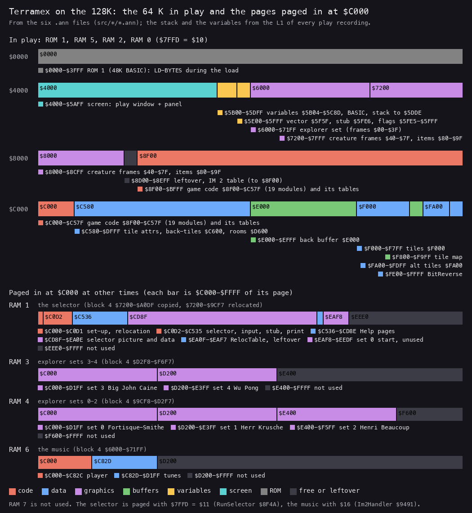
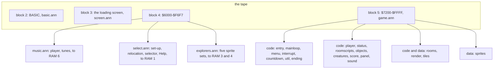
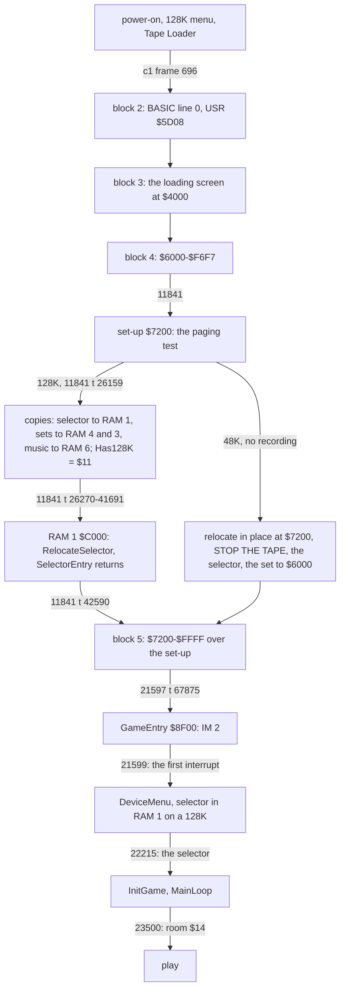
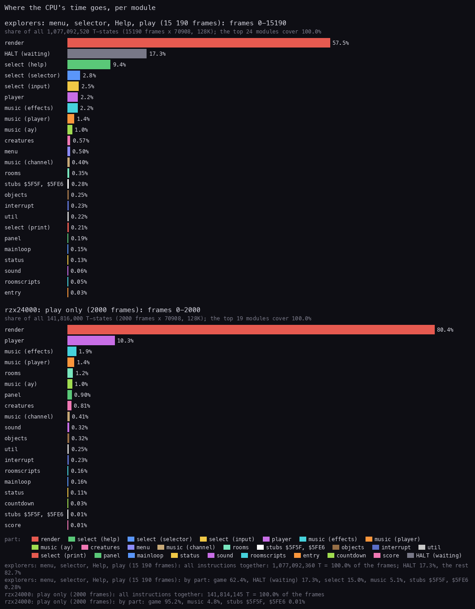
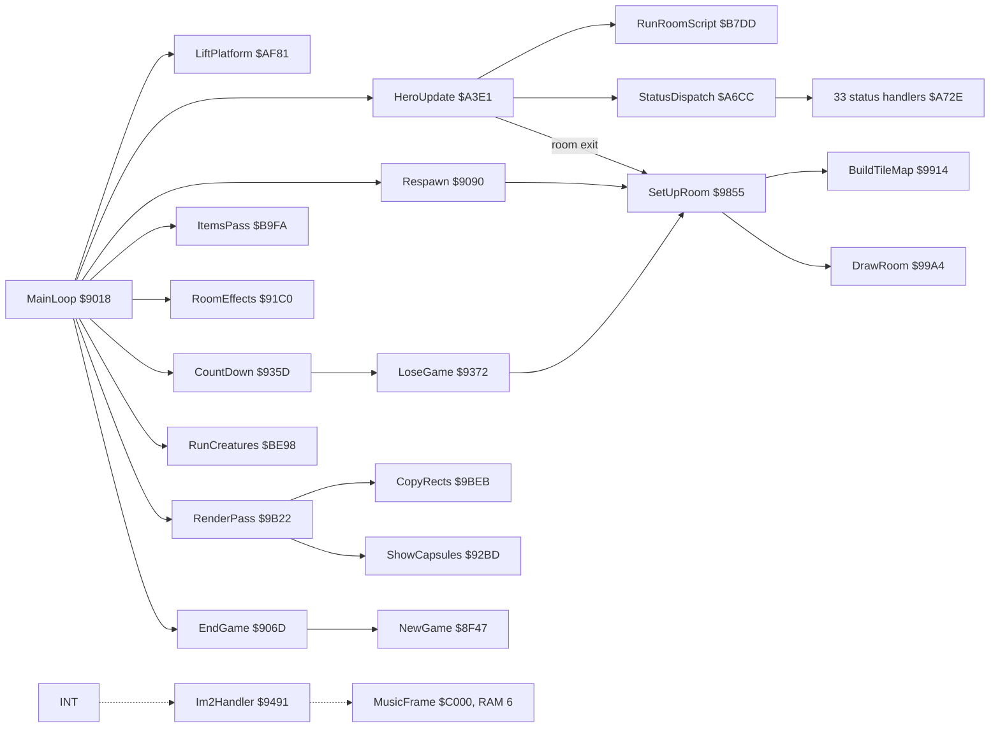
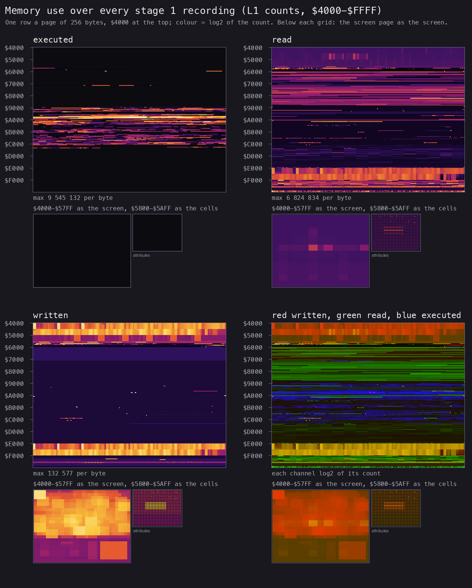
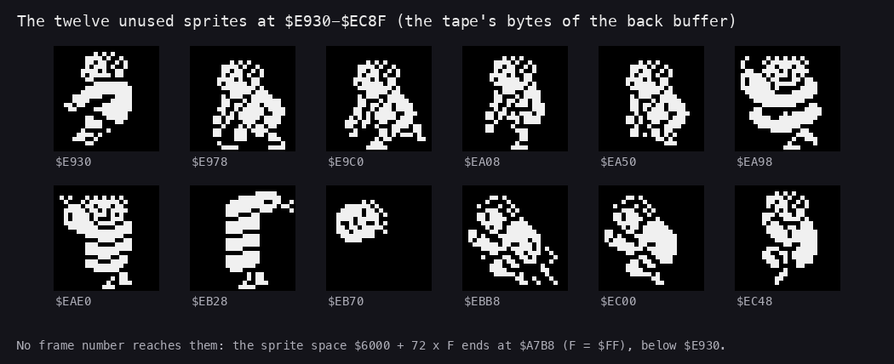

# 2. Architecture

What this covers:

- the machine budget and what each part of the 128K is used for;
- the memory map of the 128K: the 64 K in play and the four pages paged in at `$C000`;
- the module map of the six `.ann` files;
- the stages from power-on to play, and the images at each;
- the frame budget: where the CPU's time goes, IM 2 with no HALT in play;
- the main loop's call graph;
- the heatmap, the stack, and the leftovers (the twelve unused sprites);
- the differences between the 48K and the 128K;
- what the SkoolKit disassembly covers and where this case differs from it.

The recordings it rests on ([WALKTHROUGH 6.0](../WALKTHROUGH.md#60-the-recordings)):

- `c1`: power-on, the original tape at ROM speed on the 128K, the menu, the selector, play;
- `explorers`: from the menu after a ROM-speed 128K load, all five explorers, Help, five aborts;
- `gameover`: the RZX state at 10000 with a POKE (Lives = 1);
- the 31 `rzxNNNNN` segments: the RZX archive's run (another player's game), replayed in pieces.

The images are `work/mkgame/original.bin` (`tools/image.py`, the tape's blocks) and `work/stage1/images/`
(`tools/ttd_dump.py`, from `c1`).

The case started from nzeemin's SkoolKit disassembly (skoolkit-game-revs `terramex-zx`, commit `6a328b3b`;
[README, Sources](../README.md#sources)). The titles marked (SK) come from it; each was checked against the code and
a recording. 2.10 lists what it covers and where this case reads the code otherwise.

## 2.1 The machine budget

| Resource | Use |
| --- | --- |
| CPU | Z80 at 3.5469 MHz on the 128K, 70 908 T a frame. No frame sync in play: a pass of MainLoop `$9018` (SK) takes 2.4 to 3.3 frames ([doc 4](04-game-loop.md)) |
| interrupts | IM 2, I = `$8E`, the table `$8E00-$8F00` filled with `$5F` by GameEntry `$8F00`, `JP $9491` at `$5F5F`. The handler pages RAM 6 in, calls the music player at `$C000` and pages back. One interrupt every frame in play: `explorers`, `gameover` and every `rzxNNNNN` take as many interrupts as frames (the L1's `replay.interrupts`) |
| RAM 5, 2, 0 | the 64 K view in play: ROM 1, RAM 5, RAM 2, RAM 0 (`$7FFD` = `$10`; `time_travel memory_at` in `c1`, frame 23500) |
| RAM 1 | the explorer selector: block 4's `$7200-$A0DF` copied to `$C000` by the 128K set-up (Copy128K `$C035`, 12 000 bytes) and relocated there: the 11 000-byte selector block `$7200-$9CF7` at `$C000-$EAF7`, then 1000 bytes of set 0, unused, at `$EAF8-$EEDF`; `$EEE0-$FFFF` not used. Paged in with `$7FFD` = `$11` by RunSelector `$8F4A` |
| RAM 3, 4 | the five explorer sprite sets, `$1200` bytes each: sets 0-2 in RAM 4, sets 3-4 in RAM 3 ([doc 3](03-build-and-load.md)) |
| RAM 6 | Ben Daglish's music: block 4's `$6000-$71FF`, the player and the tunes. Paged in with `$7FFD` = `$16` by Im2Handler `$9491` |
| RAM 7 | not used |
| ROM | LD-BYTES for the load. The 128K ROM's paging routines at `$5B00` are only there during the load |
| sound | the AY: the music from RAM 6 every interrupt (the "+2 MUSIC" credit on the menu). The effects are beeper sounds through port `$FE`, PlaySound `$C4B2` ([doc 9](09-sound.md)) |
| input | Kempston port `$1F` (read at `$B8CC` in play), the keyboard through port `$FE`, Sinclair (keys 6-0), chosen on the menu with 1, 2, 3 (InputDevice `$94AF`; [doc 5](05-controls.md)) |

The stage-1 draft of this document had RAM 1 and RAM 6 the other way round. The code settles it:

- RunSelector pages `$11` (RAM 1) before it calls the selector at `$C000`.
- Im2Handler pages `$16` (RAM 6) before it calls the music at `$C000`.
- The set-up copies the selector block to RAM 1 with the LDIR at `$7243` and the music to RAM 6 with the LDIR at
  `$729B` (`c1` frame 11841, the L1 arrivals; `src/select/select.ann`).

**The point**: the 128K's extra RAM holds what play does not need at hand: the selector, the four sets not chosen,
and the music. Play itself runs in the 48K's 64 K, which is why the 48K version can be the same game.

## 2.2 The memory map

*The memory of the 128K: the 64 K the CPU sees in play (four 16 K rows), and the four pages paged in at `$C000` at
other times. The regions are the modules and entries of the six `.ann` files; the stack depth and the variables'
extent are from the L1 of every play recording (`work/stage1/l1-play.json`). Made with `python3 tools/fig_arch.py
memmap docs/img/arch/memmap.png`.*

How to read it:

- Each bar is 16 K. The colour is the kind of content (the key at the bottom). A label under a bar gives each region's
  range.
- The first row is ROM 1, the 48K BASIC ROM. The game calls it only for LD-BYTES during the load.
- The second row is the screen, the variables and the stack, then the explorer set at `$6000` and the creature
  frames from `$7200`.
- The game code starts at GameEntry `$8F00` and ends at `$C57F`. The data above it is the level data and the tiles,
  with the back buffer `$E000` between them.
- The lower four bars are RAM 1, 3, 4 and 6, each as `$C000-$FFFF`. RAM 1 holds the 12 000 bytes Copy128K `$C035`
  copies: the relocated selector to `$EAF7`, then 1000 bytes of set 0 that nothing uses (`$EAF8-$EEDF`).

The regions in play, from the L1 of `explorers`, `gameover` and the RZX segments (`work/stage1/l1-play.json`; `c1`
left out because its load writes everything) and the `.ann`:

| Range | Executed | Read | Written | What |
| --- | --- | --- | --- | --- |
| `$4000-$5AFF` | | yes | yes | the screen: the play window (rows 0-15) and the panel (rows 16-23) |
| `$5B04-$5C8D` | | yes | yes | the game variables over the system variables: Lives `$5B97`, Room `$5C01`, PassCount `$5C02`, BearerLoads `$5B7C`, the countdown `$5BFB-$5BFD`, GameOver `$5BFF`, Explorer `$5B70`, Status `$5C06` ([doc 7](07-objects.md)) |
| `$5CCB-$5DF8` | | | | the BASIC loader, dead after the load |
| `$5DDE-$5DFF` | | | yes | the stack, top `$5E00` (2.7) |
| `$5F5F-$5F61` | yes | | | `JP $9491`, the IM 2 vector's target |
| `$5FE5-$5FFF` | yes | yes | yes | Last7FFD `$5FE5`, PagingStub `$5FE6-$5FFA`, Has128K `$5FFE`, GameLoaded `$5FFF` |
| `$6000-$71FF` | | yes | | the chosen explorer's sprite set (`$1200` bytes, frames `$00-$3F`), copied by the selector |
| `$7200-$83FF` | | yes | | the creatures' sprite frames `$40-$7F` |
| `$8400-$8CFF` | | yes | | the 32 item sprites, frames `$80-$9F`, 72 bytes each |
| `$8D00-$8DFF` | | yes | | Var8D00 and a leftover of 255 bytes |
| `$8E00-$8F00` | | `$8EFF` | | the IM 2 table, 257 bytes of `$5F` |
| `$8F00-$C57F` | yes | yes | few | the code, with its tables between (19 modules, 2.3) |
| `$C580-$C5FF` | | yes | yes | AltTileAttrs: the attributes of the alternate tiles `$80-$FF`, swapped with `$DF80` |
| `$C600-$D5FF` | | yes | | BackTiles: 16 tile indices each ([doc 6](06-rendering.md)) |
| `$D600-$DEFF` | | yes | | RoomGrids: 32 back-tile indices a room, 72 rooms |
| `$DF00-$DFFF` | | yes | yes | TileAttrs |
| `$E000-$EFFF` | | yes | yes | the back buffer. `$E000-$E8FF` keeps the panel over the menu |
| `$F000-$F7FF` | | yes | yes (`$F400`) | TilePixels, 8 bytes a tile; `$F400-$F7FF` is the half swapped with `$FA00` |
| `$F800-$F9FF` | | yes | yes | TileMap: the room's 32 x 16 tile indices, built on room entry |
| `$FA00-$FDFF` | | yes | yes | AltTilePixels: the other half of the tile-set swap |
| `$FE00-$FFFF` | | yes | | BitReverse: a byte's bits reversed, for the mirrored sprites |

**The point**: everything above `$6000` is the game, as loaded, plus four buffers. Nothing is unpacked or generated
except the tile map, the explorer set and the back buffer.

## 2.3 The module map

The source is six `.ann` files, each a part of the tape. The game is cut into 19 modules by the `@module` lines of
`src/game/game.ann`; a module may hold several ranges, because code and data of one subject lie apart.

| Part | Module | Entries | Code entries | Bytes | Ranges |
| --- | --- | ---: | ---: | ---: | --- |
| game | sprites | 3 | 0 | 6 912 | `$7200-$8CFF` |
| game | entry | 6 | 3 | 792 | `$8D00-$9017` |
| game | mainloop | 3 | 3 | 174 | `$9018-$90C5` |
| game | util | 6 | 5 | 195 | `$90C6-$9169`, `$9390-$93AE` |
| game | ending | 2 | 2 | 193 | `$916A-$917B`, `$B0B6-$B164` |
| game | rooms | 30 | 20 | 8 110 | `$917C-$935C`, `$9855-$9B21`, `$C600-$DEFF`, `$F800-$F9FF` |
| game | countdown | 2 | 2 | 51 | `$935D-$938F` |
| game | menu | 16 | 11 | 1 228 | `$93AF-$9490`, `$94AF-$9854`, `$9F27-$9F6A` |
| game | interrupt | 1 | 1 | 30 | `$9491-$94AE` |
| game | render | 33 | 27 | 5 435 | `$9B22-$9E5C`, `$E000-$EFFF`, `$FE00-$FFFF` |
| game | panel | 12 | 11 | 605 | `$9E5D-$9F26`, `$9F6B-$A0FD` |
| game | player | 35 | 27 | 1 718 | `$A0FE-$A6CB`, `$AF09-$AF3A`, `$B87C-$B931` |
| game | status | 65 | 50 | 2 109 | `$A6CC-$AF08` |
| game | roomscripts | 48 | 36 | 2 495 | `$AF3B-$B0B5`, `$B165-$B87B`, `$BA97-$BB58`, `$BC73-$BCDD` |
| game | objects | 12 | 10 | 639 | `$B932-$BA96`, `$BB59-$BC72` |
| game | score | 9 | 8 | 326 | `$BCDE-$BE23` |
| game | creatures | 24 | 20 | 1 678 | `$BE24-$C4B1` |
| game | sound | 12 | 10 | 206 | `$C4B2-$C57F` |
| game | tiles | 4 | 0 | 3 456 | `$C580-$C5FF`, `$DF00-$DFFF`, `$F000-$F7FF`, `$FA00-$FDFF` |
| select (RAM 1) | setup | 3 | 2 | 170 | `$C000-$C0A9` |
| select | relocation | 3 | 2 | 176 | `$C0AA-$C0D1`, `$EA0F-$EA96` |
| select | selector | 20 | 15 | 8 047 | `$C0D2-$C3BC`, `$C4A2-$C4A5`, `$CD8F-$EA0E` |
| select | input | 6 | 5 | 229 | `$C3BD-$C4A1` |
| select | paging | 1 | 1 | 21 | `$C4A6-$C4BA` |
| select | print | 4 | 4 | 123 | `$C4BB-$C535` |
| select | help | 7 | 2 | 2 137 | `$C536-$CD8E` |
| select | leftovers | 1 | 0 | 97 | `$EA97-$EAF7` |
| music (RAM 6) | player | 5 | 5 | 292 | `$C000-$C026`, `$C1E4-$C28F`, `$C780-$C7D0` |
| music | state | 14 | 0 | 445 | `$C027-$C1E3` |
| music | ay | 3 | 3 | 91 | `$C290-$C2E3`, `$CD56-$CD5C` |
| music | channel | 18 | 15 | 717 | `$C2E4-$C554`, `$C7D1-$C82C` |
| music | effects | 5 | 5 | 555 | `$C555-$C77F` |
| music | tunes | 46 | 0 | 2 508 | `$C82D-$CD55`, `$CD5D-$D1FF` |
| explorers (RAM 3, 4) | explorers | 5 | 0 | 23 040 | `$9CF8-$F6F7` on the tape |
| screen | screen | 1 | 0 | 6 912 | `$4000-$5AFF` |
| basic | basic | 6 | 2 | 302 | `$5CCB-$5DF8` |

The select and music ranges are their run addresses at `$C000` in their pages. On the tape the selector sits at
`$7200-$9CF7` and the music at `$6000-$71FF`. The counts come from `python3 work/docs/tmA/modranges.py` over the six
files.

Totals: the game 323 entries (246 code), the selector 45 (31 code), the music 91 (28 code). The game's code region
`$8F00-$C57F` is 13 952 bytes, tables included; the rest of its 36 352 bytes is sprites, rooms, tiles and buffers.

**The point**: the game is the biggest part but not the only one. The selector and the music are 15 608 bytes of the
tape. On a 128K they run outside the main map, the selector in RAM 1 and the music in RAM 6 (after the set-up at
`$7200`); on a 48K the selector runs in place at `$7200` during the load.

## 2.4 The stages from power-on to play

| Stage | `c1` frame | Evidence |
| --- | --- | --- |
| the loader's code (BASIC line 0, `USR $5D08`) | 696 | the L1 arrival in the loader's code |
| the set-up at `$7200` | 11841 | the L1 arrival; `$72A7` enters `$C000` at t 26159 |
| the relocation in RAM 1 | 11841, t 26270-41691 | the trace of `RelocateSelector.gif` ([doc 3](03-build-and-load.md)) |
| SelectorEntry returns to the loader | 11841, t 42590 | the stub `$5FE6` |
| GameEntry | 21597, t 67875 | `time_travel find_last` at `$8F00` |
| the first IM 2 interrupt | 21599 | the L1 arrival at `$5F5F` |
| the selector called from the game | 22215 | the selector's entry from RunSelector `$8F4A` |
| play in room `$14` | 23500 | `memory_at`: Room `$14`, Lives 4 |

The images, one a stage:

| Image | Where | How it differs from the one before |
| --- | --- | --- |
| as loaded | `work/mkgame/original.bin` (`tools/image.py`): block 3 at `$4000`, block 4 at `$6000`, block 5 over it at `$7200` | |
| at the entry | `work/stage1/images/entry.cpu.bin`, `entry.ram.bin` (`c1` frame 21597 t 67875, `$8F00` about to run) | `$6000-$FFFF`: none. `$5B00-$5FFF` holds the ROM's and the loader's bytes |
| in play | `work/stage1/images/play-c1.cpu.bin` (`c1` frame 23500: explorer 1, room `$14`, lives 4) | 8638 bytes of `$6000-$FFFF`: the explorer set `$6000-$71FF`; the IM 2 table `$8E00-$8F00`; single bytes of code-space variables `$93AD`, `$94AF`, `$9517`, `$A700`, `$AF39`, `$B87C`, `$B9D9`, `$BE24-$BE36`; the buffer `$E000-$EFFF`; the tile map `$F800-$F9F1`. Below `$6000`: the variables `$5B04-$5C8D`, the stack, `$5F5F`, `$5FE5` |

The SkoolKit disassembly's image (`skool2bin`, `work/stage1/skool.bin`) equals block 4 at `$6000-$71FF` and block 5 at
`$7200-$FFFF` except `$8E00-$8F00` and `$9517-$9518`. It was taken after GameEntry, on the menu, before an explorer
was chosen. Its `$6000-$71FF` is therefore the music player as loaded, not an explorer set.

**The point**: block 4 is not part of the game at all. It is the 128K's luggage: it is unpacked into the extra pages
and overwritten by block 5, so the game image in play starts at `$7200`.

## 2.5 The frame budget

The game has two kinds of time:

- **Menu and selector**: one turn a frame, a HALT in each loop (MenuKeys `$9468`, SelectorWait `$C12A`).
- **Play**: no HALT at all. A pass takes as long as its work, 2.4-3.3 frames ([doc 4](04-game-loop.md)).

The interrupt runs in both: about 3 800 T a frame for the music on a 128K.

*The CPU's T-states per module, as a share of all the T-states of the recording. Above: `explorers` (15 190 frames,
the menu, the selector, Help and five games). Below: `rzx24000` (2000 frames of the RZX run, replayed: play only).
Made with `python3 ../../kit/fig_budget.py work/stage1/explorers/l1.json docs/img/arch/budget.png`
`--ann src/game/game.ann,page=0/2/5 --ann src/select/select.ann,page=1,label=select`
`--ann src/music/music.ann,page=6,label=music --page-name '5=stubs $5F5F, $5FE6' --by module`
`--label "explorers: ..." --state "rzx24000: play only (2000 frames)=work/stage1/rzx/r24000/l1.json"`
`--title "Where the CPU's time goes, per module"`.*

How to read it:

- A bar is a module's share of all the frames' T-states. Each bar is named on its left: read the name, not the
  colour. The kit's palette has fewer colours than there are modules, so colours repeat (render and select (print)
  are both red, panel and select (help) both green); a module keeps its colour in both panels.
- In play (below) render takes 80.4 % and player 10.3 %. All of the music together is 4.8 %. There is no HALT.
- In `explorers` (above) HALT takes 17.3 %: the menu and the selector waiting for the frame.
- select (help) is 9.4 % of `explorers`: PrintPage's pause between the Help pages is a busy loop of about 10.2 million
  T a page (`src/select/select.ann`).
- "stubs `$5F5F`, `$5FE6`" is the IM 2 vector's `JP` and the paging stub the selector calls once a byte when it copies
  a set.

**The point**: in play the CPU never idles. Four fifths of it draws the screen, and the music takes its five percent
off the top, from the interrupt.

## 2.6 The main loop's call graph

The order of the calls, and what each costs, is [doc 4](04-game-loop.md)'s subject. The dotted edge is the
interrupt: it can fall anywhere in the graph.

## 2.7 The heatmap and the stack

*Memory use over every stage 1 recording: 34 L1 builds, 105 215 frames, merged by `tools/l1merge.py` into
`work/stage1/l1-all.json`. Four panels: executed, read, written, and a composite (red written, green read, blue
executed), one row a page of 256 bytes from `$4000`. The `$C000` window shows RAM 0 only: the instructions run in
RAM 1 (19.5 million) and RAM 6 (26.5 million) at the same addresses are left out. Made with `python3 tools/fig_arch.py
heatmap work/stage1/l1-all.json docs/img/arch/heatmap.png` (`tools/fig_heatmap.py` with `kit/heatmap.py`'s counts,
scaled to 1050 px).*

How to read it:

- Executed: the code band from `$8F00` to `$C57F`, with gaps where tables lie. Nothing above `$C580` runs in RAM 0.
- Read: the sprite space `$6000-$8CFF`, the room data `$C600-$DEFF` and the tiles light up.
- Written: the screen, the variables at `$5B00`, the back buffer `$E000` and the tile map `$F800`. The load writes the
  rest once (`c1`).
- The small inset under each panel is the screen page drawn as the screen.

### The stack

GameEntry sets SP = `$5E00` (`LD SP,StackTop` at `$8F1C`). The lowest byte written below it in every play recording
is `$5DDE`: 34 bytes deep (`work/stage1/l1-play.json`, the writes in `$5D00-$5DFF`). That is 17 words. The music
runs on the game's stack, so the interrupt alone takes at least 12 of them wherever it falls: its return, AF and BC in
Im2Handler `$9491`, the call of MusicFrame, MusicFrame's AF', DE, HL, IX and IY (`src/music/music.ann`), the call of
MusicTick `$C014`, its IY and the call of UpdateTune `$C1E4`. The pass under it needs only a few words.

The stack sits over the BASIC loader (`$5CCB-$5DF8`), which is dead once GameEntry runs. Nothing is placed between
`$5E00` and the vector at `$5F5F`.

**The point**: a flat program has a shallow stack. The main loop is the only caller at the top, and the interrupt's
music, not the game, makes most of the 34 bytes.

## 2.8 The leftovers

Five ranges of the tape are bytes no code reads before writing them, or reads at all (`src/res/leftovers`, from
`work/stage2/bytemap.py` over the play builds):

| Range | Bytes | What |
| --- | ---: | --- |
| Leftover8D01 `$8D01-$8DFF` | 255 | no play build reads or writes it |
| Im2Table `$8E00-$8EFF` | 256 | the IM 2 table's place: GameEntry fills it before interrupts are on |
| BackBufferLeftover `$E900-$EFFF` | 1 792 | the rest of the back buffer: play writes it before reading it. It holds twelve 24 x 24 sprites |
| TileMap `$F800-$F9FF` | 512 | the tile map of some room as it was when the tape was saved; rewritten on every room entry |
| select leftovers `$EA97-$EAF7` | 97 | the end of the selector block in RAM 1 |

*The twelve 24 x 24 sprites in the tape's bytes of the back buffer, `$E930-$EC8F`, drawn in the sprite space's layout
(72 bytes a sprite, three columns of 24 bytes). Made with `python3 tools/fig_arch.py leftovers
docs/img/arch/leftover-sprites.png` from `src/res/leftovers/back-buffer-tape.bin`.*

How to read it:

- The first five are figures walking and standing, in the explorer sets' style.
- `$EA98`, `$EAE0` and `$EB28` show the coils of a snake, the middle one wound round a figure (SK: "captured by the
  snake").
- `$EB70` is a head; the last three are more figures.
- No frame number reaches them. The sprite space is `$6000 + 72 x F`, and frame `$FF` lies at `$A7B8-$A7FF`, far below
  `$E930`.

No code draws them. The game's snakes (room `$1A`) kill with their own frames, Room1ADeath `$A88F`.

**The point**: the back buffer was saved with old graphics in it. They say what the authors drew and dropped, not what
the game does.

## 2.9 The 48K and the 128K

The same tape runs on both. The set-up's paging test decides, and Has128K `$5FFE` carries the answer into the game.

| | 128K | 48K |
| --- | --- | --- |
| the set-up | copies the selector to RAM 1, the sets to RAM 4 and 3, the music to RAM 6 | relocates the selector in place at `$7200` |
| the selector | in RAM 1, from the game's menu before every game | once, during the load, STOP THE TAPE first |
| the explorer | chosen again for every game | fixed until the tape is loaded again |
| the music | tune 0 from RAM 6 every interrupt | none: the handler returns at once |
| the interrupt's cost | about 3 800 T a frame | 93 T a frame |
| the play | the same code, the same 64 K map | the same |
| tested at | the paging test `$C010-$C033` sets Has128K (`$C015`, `$C088`); read at `$8F4A` (RunSelector), `$9492` (Im2Handler), `$C0DD` (SelectorEntry), `$C0FF` (SelectorRun), `$C134` (CopyExplorerSet) and `$C536` (ShowHelp) | the same reads, with Has128K = 0 |

The paging test writes `$AA` to `$C000` with RAM 0 paged in and `$55` with RAM 1 paged in, then compares: on a 48K both
writes hit the same byte. Its asm is in [doc 3, 3.3](03-build-and-load.md#33-the-128k-set-up-at-7200-and-the-relocation).

Only the 128K path ran in a recording. The 48K path up to the explorer's choice was seen on stage 2's 48K tries (STOP
THE TAPE, the selector, the set copy; `work/stage2/p48/*/sheet.png`, no `.ttd`;
[doc 3, 3.4](03-build-and-load.md#34-the-48k-path-and-the-2a-stop-block)); past the choice it is known only from the
code (the `.ann`'s set-up and selector descriptions).

## 2.10 What the SkoolKit disassembly covers, and where this case differs

nzeemin's disassembly (skoolkit-game-revs `terramex-zx`, commit `6a328b3b`) covers the game block `$7200-$FFFF`. It
has entry kinds, titles and comments, but no labels, so every label in this case is ours (`work/stage2/NOTES.md`, the
SkoolKit section).

- Of its 270 entries in `$7200-$FFFF`, 225 are entries of ours at the same address and 3 are inner labels.
- Ours add 98 more: code it left as data, data split by use, the status and room handlers.
- 14 titles are taken from it and marked "(SK)".
- It does not cover the selector, the loader, the music player, GameEntry `$8F00-$8F46` or the explorer sets.

Where this case reads the code otherwise, with the evidence:

| Address | SkoolKit | This case | Evidence |
| --- | --- | --- | --- |
| `$5FE6` | unreferenced OUT/RET | PagingStub | the selector copies it there and calls it 4608 times a choice |
| `$8F5E` | init music player | the call of the selector in RAM 1 | `$7FFD` = `$11` before it; the music is in RAM 6 and needs no init |
| `$9491` | bank `$16` | the `$7FFD` value, RAM 6 | the handler's `OUT` |
| `$5BFB` | minutes first | days, hours, minutes | probe A: the minutes byte `$5BFD` counts down |
| `$5B98` | room category | HeldItem | stage 2 NOTES; [doc 7](07-objects.md) |
| `$5B7C` | pickup log | BearerLoads | stage 2 NOTES; [doc 7](07-objects.md) |
| `$A6E6`, `$B7EC`, `$C152` | 70 rooms | 72 rooms | rooms `$46`, `$47` are reached through room `$29` |
| `$B0B6` | warp fanfare | SpaceScene, both outcomes | `gameover` and `rzx50000` ([doc 4](04-game-loop.md)) |
| `$B02E` | ENTER | the T key (think) | stage 2 NOTES; [doc 5](05-controls.md) |
| `$BC73` | seesaw | RopeTrick | stage 2 NOTES; [doc 10](10-gameplay-logic.md) |
| `$A9EE` | hazard counter | LoseLifeWait | `gameover` frames 1374-1502 |
| `$A34B` | apply joystick | room `$2C`'s float | stage 2 NOTES; the room handler table |
| `$91C0` | sparkles | flames, beams, capsules | stage 2 NOTES; [doc 6](06-rendering.md) |
| `$9B22` | plot pixel | the double-buffered RenderPass | `RenderPass.gif` |
| `$9FDE` | status icons | BearerFigures | stage 2 NOTES; [doc 8](08-hud-and-text.md) |
| `$9390` | | an LCG, x 257 + 41 | the code (`src/game/util.asm`) |
| `$985D` | a throw of dy -7 | `LD HL,$FF02`: room `$2C` throws the hero at dx +2, dy -1 | the bytes `21 02 FF` |
| `$5DBE` | the break message | starts at `$5DB7` with its print codes | the BASIC module |

**The point**: the SkoolKit work found the game's shape: the main loop, the rooms, the sprites, the status table.
Stage 2 added the parts outside the game block and corrected the readings that only a recording or a page number
could settle.
