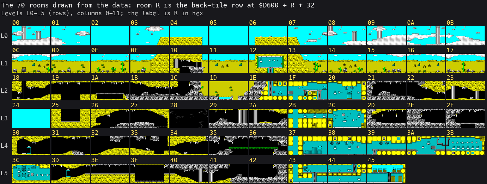
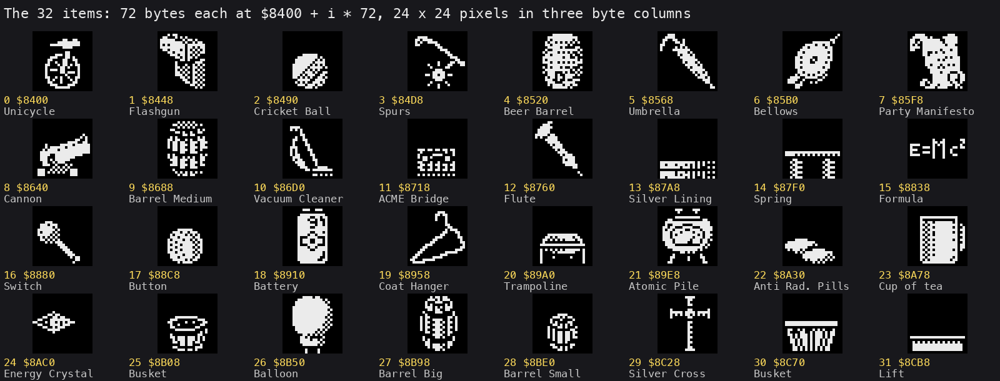

# 2. Architecture

What this covers: the machine budget, the memory map (a figure), the images as loaded, at the entry and in play, the
stack, the rooms and the items in the data. A first look from stage 1; stage 2 settles the names.

The recordings it rests on: `c1` (power-on, the original tape at ROM speed on the 128K), `explorers` and `gameover`
(from the menu after a ROM-speed 128K load, and from an RZX state with a POKE), the 31 `rzxNNNNN` segments (the RZX
archive's run replayed in pieces) ([WALKTHROUGH 6.0](../WALKTHROUGH.md#60-the-recordings)). The images are
`work/mkgame/original.bin` (`tools/image.py`, the tape's blocks) and `work/stage1/images/` (`tools/ttd_dump.py`, from
`c1`).

The names marked (SK) come from nzeemin's SkoolKit disassembly (skoolkit-game-revs `terramex-zx`, commit `6a328b3b`;
[README, Sources](../README.md#sources)); each was checked against the code and a recording as said. The rest are
ours.

<!-- Figures this document needs (GUIDE.md 4.2), remove each line when it is in: -->
<!-- - the stages from power-on to play (mermaid) -->

## 2.1 The machine budget

| Resource | Use |
| --- | --- |
| CPU | Z80 at 3.5469 MHz on the 128K, 70 908 T a frame; no frame sync in play: a pass of the main loop `$9018` (SK) takes 2.4 to 3.3 frames ([WALKTHROUGH 1](../WALKTHROUGH.md#1-one-recording-from-power-on)) |
| interrupts | IM 2, I = `$8E`, the table `$8E00-$8F00` filled with `$5F` by GameEntry `$8F00`, `JP $9491` at `$5F5F`; the handler pages RAM 1 in, calls the music player at `$C000` and pages back. One interrupt every frame in play: `explorers`, `gameover` and every `rzxNNNNN` take as many interrupts as frames (the L1 `replay.interrupts`) |
| RAM 5, 2, 0 | the 64 K view in play: ROM 1, RAM 5, RAM 2, RAM 0 (`time_travel memory_at` in `c1`, frame 23500); the image `$6000-$FFFF` |
| RAM 1 | `$7200-$A0DF` copied to `$C000` by the 128K setup: the music player (the IM 2 handler's `CALL $C000`) and the rest, to be named |
| RAM 3, 4 | the five explorer data sets, `$1200` bytes each ([doc 3, 3.3](03-build-and-load.md#33-the-128k-setup-at-7200)) |
| RAM 6 | the explorer selector, run at `$C000` |
| ROM | LD-BYTES for the load; the 128K ROM's paging routines at `$5B00` |
| sound | the AY: Ben Daglish's music from RAM 1 every interrupt (the "+2 MUSIC" credit on the menu); effects through `$C4BC` (SK "sound-effect dispatcher") |
| input | Kempston port `$1F` (read at `$B8CC` in play), the keyboard through port `$FE`, Sinclair (keys 6-0), chosen on the menu by 1, 2, 3 (`$94AF` (SK)) |

## 2.2 The memory map

The heatmap of every play recording and of `c1` (`tools/l1merge.py` over 34 L1 builds, 105 215 frames; drawn by
`tools/fig_heatmap.py` with `kit/heatmap.py`'s counts). The `$C000` window shows RAM 0 only: the instructions run in
RAM 1 (19.5 million) and RAM 6 (26.5 million) at the same addresses are left out.

The regions in play, from the L1 of `explorers`, `gameover` and the RZX segments (`work/stage1/l1-play.json`; `c1`
left out because its load writes everything) and the image:

| Range | Executed | Read | Written | What |
| --- | --- | --- | --- | --- |
| `$4000-$5AFF` | | yes | yes | the screen: the play window (rows 0-15) and the panel (rows 16-23) |
| `$5B00-$5B57` | | | | the 128K ROM's paging routines (L1 arrival in `c1`, frame 53) |
| `$5B04-$5C8D` | | yes | yes | the game variables over the system variables (SK names: lives `$5B97`, room `$5C01`, frame counter `$5C02`, inventory log `$5B7C`, countdown `$5BFB`, game-over flag `$5BFF`; explorer `$5B70` ours) |
| `$5DDE-$5DFF` | | | yes | the stack, top `$5E00` (2.4) |
| `$5F5F-$5F61` | yes | | | `JP $9491`, the IM 2 vector's target |
| `$5FE5-$5FFF` | yes | yes | yes | the last `$7FFD` value `$5FE5`, a paging stub `$5FE6-$5FFA`, the 128K flag `$5FFE` |
| `$6000-$71FF` | | yes | | the chosen explorer's data set (`$1200` bytes), copied by the selector |
| `$7200-$83FF` | | yes | | data, to be named (graphics) |
| `$8400-$8CFF` | | yes | | the 32 item sprites, 72 bytes each (SK; 2.6) |
| `$8D00-$8DFF` | | yes | | data |
| `$8E00-$8F00` | | | | the IM 2 table, 257 bytes of `$5F` |
| `$8F00-$C55A` | yes | yes | few | the code from GameEntry `$8F00`, with tables between (executed: `$8F47-$90E0`, `$9140-$953F`, `$9855-$9FDD`, `$A102-$B169`, `$B370-$C151`, `$C4B2-$C55A`) |
| `$C152-$C499` | | yes | | the room table, 12 bytes a room, 70 rooms (SK) |
| `$C580-$C5FF` | | yes | yes | the attributes of the alternate tiles `$80-$FF`, swapped with `$DF80` (SK) |
| `$C600-$D5FF` | | yes | | the back-tiles: 16 tile indices each (SK; 2.5) |
| `$D600-$DEBF` | | yes | | the rooms: 32 back-tile indices a room (SK; 2.5) |
| `$DF00-$DFFF` | | yes | yes | the tile attributes (SK) |
| `$E000-$EFFF` | | yes | yes | a buffer: `$E000-$E7FF` and `$E800` keep the panel's screen third and its attributes over the menu (SK GameInit `$8F47`, `$906D`) |
| `$F000-$F7FF` | | yes | yes (`$F400`) | the tile bitmaps, 8 bytes a tile; `$F400-$F7FF` the set swapped with `$FA00` |
| `$F800-$F9FF` | | yes | yes | the room's tile map, 32 x 16, built on room entry (SK) |
| `$FA00-$FDFF` | | yes | yes | the other half of the tile-set swap |
| `$FE00-$FFFF` | | yes | | data, to be named |

## 2.3 The images

| Image | Where | How it differs from the one before |
| --- | --- | --- |
| as loaded | `work/mkgame/original.bin` (`tools/image.py`): block 3 at `$4000`, block 4 at `$6000`, block 5 over it at `$7200` | |
| at the entry | `work/stage1/images/entry.cpu.bin`, `entry.ram.bin` (`c1` frame 21597 t 67875, `$8F00` about to run) | `$6000-$FFFF`: none; `$5B00-$5FFF` holds the ROM's and the loader's bytes |
| in play | `work/stage1/images/play-c1.cpu.bin` (`c1` frame 23500: explorer 1, room `$14`, lives 4) | 8638 bytes of `$6000-$FFFF`: the explorer set `$6000-$71FF`; the IM 2 table `$8E00-$8F00`; single bytes of code-space variables `$93AD`, `$94AF`, `$9517`, `$A700`, `$AF39`, `$B87C`, `$B9D9`, `$BE24-$BE36`; the buffer `$E000-$EFFF`; the tile map `$F800-$F9F1`. Below `$6000`: the variables `$5B04-$5C8D`, the stack, `$5F5F`, `$5FE5` |

The SkoolKit disassembly's image (`skool2bin`, `work/stage1/skool.bin`) equals block 4 at `$6000-$71FF` and block 5 at
`$7200-$FFFF` except `$8E00-$8F00` and `$9517-$9518`: it was taken after GameEntry, on the menu, before an explorer
was chosen.

## 2.4 The stack

GameEntry sets `SP` = `$5E00` (`LD SP,$5E00` at `$8F1C`). The lowest byte written below it in every play recording is
`$5DDE`: 34 bytes deep (`work/stage1/l1-play.json`, writes in `$5D00-$5DFF`). The loader's stack was `$5FE6`.

## 2.5 The rooms in the data

`tools/fig_rooms.py` draws every room from the image as loaded: room R's 32 back-tile indices at `$D600 + R * 32`
(8 x 4), each back-tile 4 x 4 tile indices at `$C600 + index * 16`, each tile 8 bytes at `$F000 + tile * 8`
(`$80-$FF` from `$F400`, or from `$FA00` for the 15 rooms listed at `$9AC6`) with its attribute at `$DF00 + tile`
(`$DF80` or `$C580` for the upper half). The walk is the SkoolKit notes' (Room-Format.md); the check is ours: room
`$14` drawn this way equals the background of `explorers` frame 750 cell for cell. The rooms sit at level * 12 +
column (SK, `$AEEF`).

## 2.6 The items

`tools/fig_items.py` draws the 32 item sprites at `$8400`: 72 bytes each, 24 x 24 pixels as three columns of 24 bytes.
The names are the SkoolKit notes' (Items-Format.md); stage 2 checks them in play.

