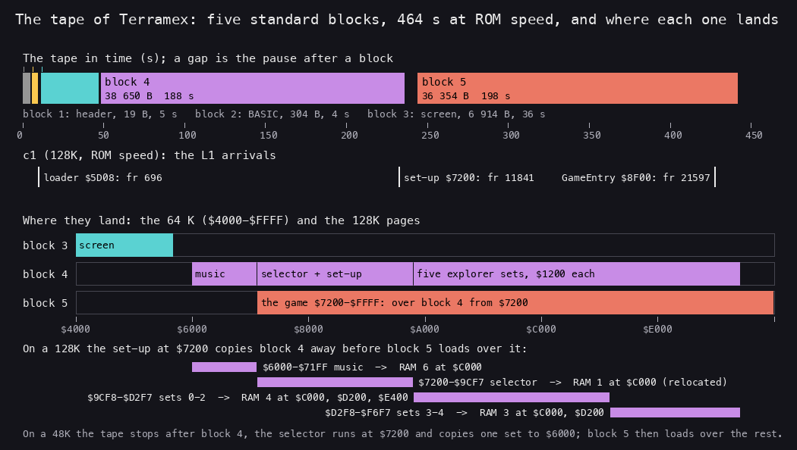
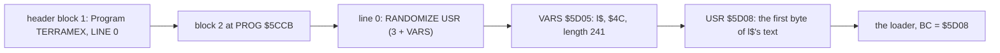
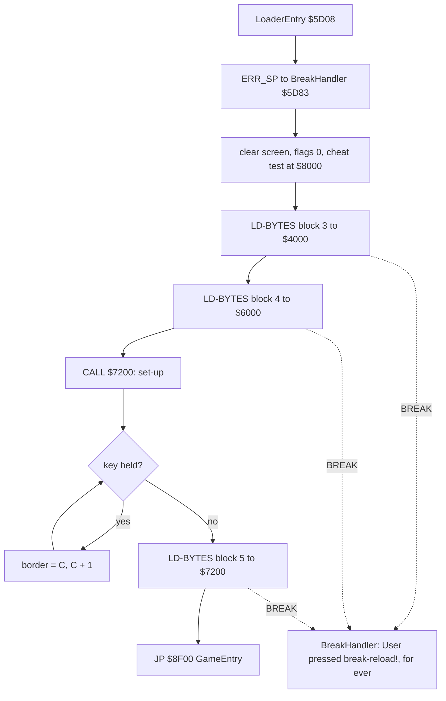
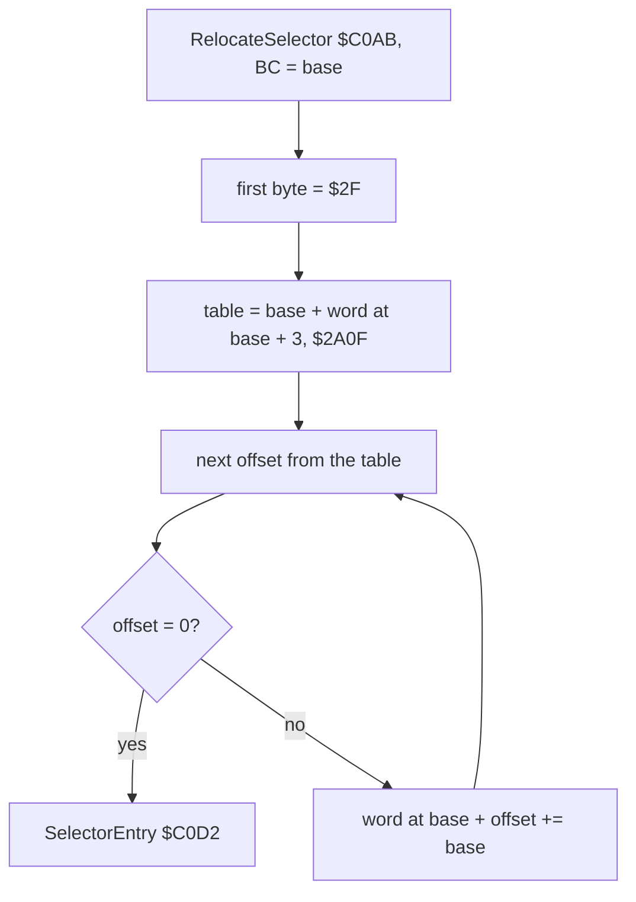
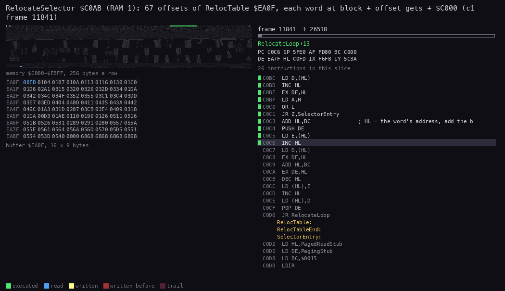
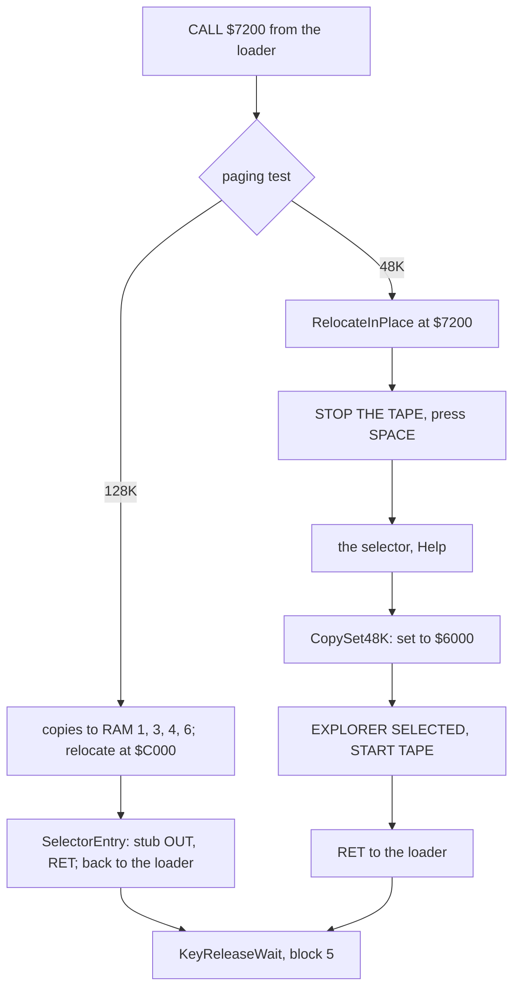
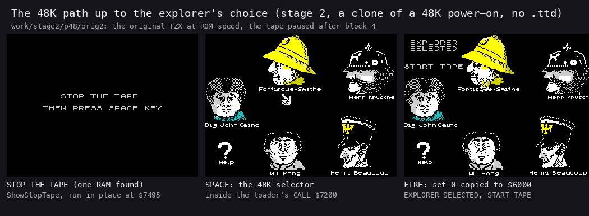
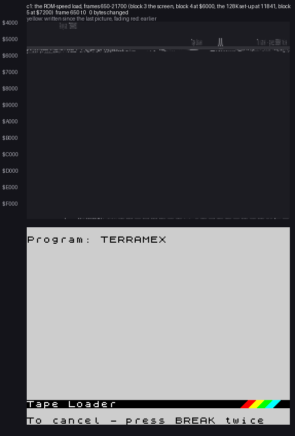
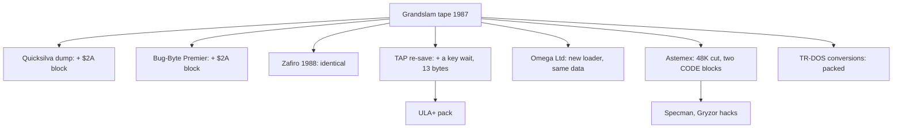
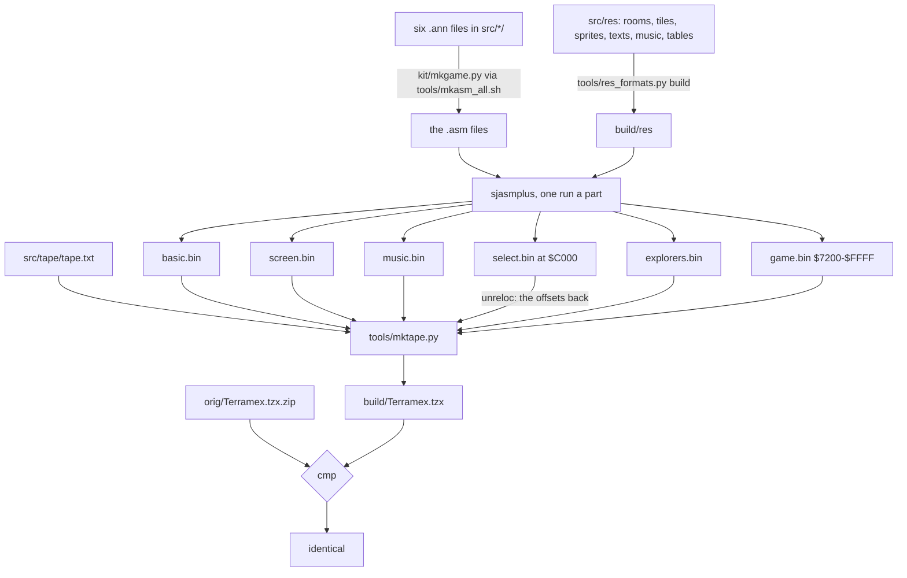

# 3. Build and load

What this covers:

- the tape block by block, as a picture;
- the BASIC loader hidden in the string `l$`;
- the 128K set-up at `$7200`, the relocation of the selector, and the 48K path;
- the stages of the load in `c1`, with an animation of memory filling;
- the copies and re-releases (Quicksilva, Bug-Byte, Zafiro, the TAPs, Astemex, the TR-DOS conversions) and what
  differs;
- the source build that gives the tape back byte for byte.

The recording it rests on: `c1` (power-on, the original tape at ROM speed on the 128K;
[WALKTHROUGH 6.0](../WALKTHROUGH.md#60-the-recordings)). The 48K path has no recording: up to the explorer's choice
it was seen on stage 2's 48K tries (3.4, no `.ttd`); past the choice it is known only from the code.

There is no packer, no decryptor and no turbo loader. The only trick is the loader hidden in a BASIC variable.

## 3.1 The tape block by block

`orig/Terramex.tzx` (in `orig/Terramex.tzx.zip`) holds five standard-speed blocks (TZX block `$10`), read by
`tools/tzxblocks.py`. Durations are the pulses at ROM timing (3.5 MHz). Frames are 48K frames of 69 888 T. The whole
tape plays in 430.1 s without the pauses, 464.2 s with them.



*The tape of Terramex: the five blocks in time (top), the `c1` frames at which the loader, the set-up and GameEntry
start (middle), and where each block lands in memory and where the 128K set-up copies block 4's parts (bottom).
Made with `python3 tools/fig_tape.py docs/img/load/tape.png` from the block table below, the `.ann` files and the L1
arrivals of `c1`.*

How to read it:

- The top band is time. Each block is as long as it plays; a gap is the pause after it.
- Blocks 4 and 5 are nearly the whole tape: about 3 minutes each.
- The middle band marks the `c1` frames. The set-up runs as block 4 ends; GameEntry as block 5 ends.
- The bottom band is the address space. Block 5 lands over block 4 from `$7200`, so only block 4's first `$1200` bytes
  stay in place.
- The last four bars are the 128K copies: what the set-up saves from block 4 before block 5 overwrites it.

| Block | Bytes (with flag and checksum) | Seconds | Pause after | Frames | Contents | Loaded to |
| ---: | ---: | ---: | ---: | ---: | --- | --- |
| 1 | 19 | 5.09 | 989 ms | 255 | header: Program "TERRAMEX", 302 bytes, LINE 0, variables at 58 | |
| 2 | 304 | 3.66 | 1703 ms | 183 | the BASIC line 0 and, in its variables area, the loader (3.2) | `$5CCB` (PROG) |
| 3 | 6 914 | 35.80 | 1150 ms | 1793 | the loading screen ([picture](img/play/loading-screen.png)) | `$4000-$5AFF` |
| 4 | 38 650 | 187.91 | 7777 ms | 9411 | the music `$6000-$71FF`, the set-up and selector `$7200-$9CF7`, the five explorer sets `$9CF8-$F6F7` (`$1200` bytes each) | `$6000-$F6F7` |
| 5 | 36 354 | 197.66 | 22 475 ms | 9899 | the game: sprites `$7200-$8CFF`, code from GameEntry `$8F00`, room and tile data to `$FFFF` | `$7200-$FFFF` |

Blocks 3-5 are headerless. The loader gives their addresses and lengths to LD-BYTES `$0556`.

The stage-1 draft of this table had the selector at `$6000-$71FF`. That is the music: the set-up copies `$6000-$71FF`
to RAM 6 (the LDIR at `$729B`), the page the IM 2 handler plays from ([doc 2](02-architecture.md)).

**The point**: block 4 exists only for the 128K and for the explorer choice. A 48K keeps one set out of it, and a
128K keeps all of it in the extra pages.

## 3.2 The BASIC loader hidden in `l$`

The program is one line, line 0, auto-run by the header's LINE 0. It hides the loader in three ways.

- **The listing lies.** LIST shows `RANDOMIZE USR (0+(PEEK (00000)+000*PEEK (00000)))`. The digits are zeros; the
  hidden five-byte forms after them hold 3, 23627, 256 and 23628. The real line is
  `RANDOMIZE USR (3+PEEK 23627+256*PEEK 23628)`: VARS + 3.
- **The line's length lies.** Its length field says `$FF36`, far past the program's 58 bytes. The ROM's line walk
  (LIST, editing, deleting) treats everything after the line as part of it.
- **The code is a string.** VARS `$5D05` holds one string variable, `l$` (`$4C`: a string named l), 241 bytes long.
  Its text, `$5D08-$5DF8`, is the loader. The ROM never evaluates `l$`; BASIC just keeps it intact.

The line as `tools/basic_list.py` lists it (`python3 tools/basic_list.py build/basic.bin 58`):

```text
    0 (length 65334) RANDOMIZE USR (0{=3}+( PEEK (00000{=23627})+000{=256}* PEEK (00000{=23628})))
      [length 65334 runs past the program end by 65280]
```



USR leaves its own address in BC. The loader uses it to find its own parts, so it would run wherever PROG lay
(a 128K with a different PROG, or a disk system).

### What the loader does

```text
LoaderEntry ($5D08, BC = its own address):
    disable interrupts
    patch BreakHandler's message pointer with BC + offset
    SP = $5FE6; push BC + offset of BreakHandler; ERR_SP = SP     ; BREAK during a load lands there
    clear $4000-$5AFF; border 0
    Has128K = 0; GameLoaded = 0
    InfiniteLives = (byte at $8000 == $C9)                          ; a POKE 32768,201 before LOAD ""
    LD-BYTES $4000, $1B00                                           ; block 3, the screen
    LD-BYTES $6000, $96F8                                           ; block 4
    CALL $7200 with BC = $7200                                      ; the set-up (3.3)
    while a key is held: border = C, C += 1                         ; KeyReleaseWait
    LD-BYTES $7200, $8E00                                           ; block 5
    JP $8F00                                                        ; GameEntry
```

```asm
LoaderEntry:                    ; $5D08, the first byte of l$
        DI
        LD HL,BreakMessage-LoaderEntry
        ADD HL,BC
        EX DE,HL
        LD HL,BreakMessagePtr+1-LoaderEntry
        ADD HL,BC
        LD (HL),E               ; patch BreakHandler's LD HL operand
        INC HL
        LD (HL),D
        LD HL,BreakHandler-LoaderEntry
        ADD HL,BC
        LD SP,PagingStub        ; $5FE6
        PUSH HL
        LD (ErrSp),SP           ; ERR_SP: a BREAK in LD-BYTES lands in BreakHandler
        ...                     ; clear the screen, border 0, Has128K = GameLoaded = 0
        LD A,(CheatByte)        ; $8000
        LD C,$00
        CP $C9
        JR NZ,SetInfiniteLives
        INC C
SetInfiniteLives:
        LD A,C
        LD (InfiniteLives),A    ; $5B03
        LD IX,Screen            ; block 3
        LD DE,$1B00
        LD A,$FF
        SCF
        CALL LdBytes
        LD IX,Block4            ; block 4: $6000-$F6F7
        LD DE,$96F8
        LD A,$FF
        SCF
        CALL LdBytes
        LD BC,SelectorSetup     ; $7200
        CALL SelectorSetup
KeyReleaseWait:
        LD A,C                  ; the border cycles while any key is down
        AND $07
        OUT ($FE),A
        INC C
        XOR A
        IN A,($FE)
        AND $1F
        CP $1F
        JR NZ,KeyReleaseWait
        LD IX,GameImage         ; block 5: $7200-$FFFF
        LD DE,$8E00
        LD A,$FF
        SCF
        CALL LdBytes
        JP GameEntry            ; $8F00
```



Three details:

- **The carry is not tested.** A load error goes on regardless. Only BREAK leaves the loader, through ERR_SP.
- **BreakHandler `$5D83`** clears the screen to blue paper, prints "User pressed break-reload!" at 10,4 through
  `RST $10`, and starts again at its own first byte: there is no way out but a reset. It is not executed in any
  recording.
- **The cheat hook.** The byte at `$8000` is read before any block lands there, so it is whatever was in memory before
  `LOAD ""`. A front end, or a typed `POKE 32768,201`, sets InfiniteLives; GameEntry then patches the life loss away
  ([doc 4](04-game-loop.md)). Not executed in any recording.

Worked example in `c1`: the ROM runs line 0 after block 2. The USR at `$34BB` enters `$5D08` at frame 696 t 29832 (the
L1 arrival). The screen loads, then block 4. The set-up starts at frame 11841, block 5 loads, and `JP $8F00` reaches
GameEntry at frame 21597 t 67875 (`time_travel find_last`, access execute).

**The point**: the protection is only a disguise. The loader is plain LD-BYTES calls; it hides in a string so that LIST
and MERGE show nothing useful.

## 3.3 The 128K set-up at `$7200` and the relocation

Block 4's `$7200-$9CF7` is one relocatable block, 11 000 bytes: the set-up, the selector, Help and the
selector's picture. Its absolute addresses are stored as offsets from its first byte, and a relocation pass adds the
run address. It runs in three places:

- at `$7200`, called by the loader with BC = `$7200`: the paging test;
- at `$C000` in RAM 1 on a 128K: relocated there, and run again from the game's menu;
- at `$7200` again on a 48K: relocated in place.

The block's first byte tells the runs apart: 0 (a `NOP`) before relocation, `$2F` after it.

```text
Setup (BC = the block's address):
    if byte at BC != 0: goto SelectorEntry                ; relocated already
    if B == $C0: goto RelocateSelector                     ; the copy in RAM 1
    ; run at $7200 by the loader: the paging test
    Has128K = 0
    page RAM 0; save byte at $C000; write $AA
    page RAM 1; write $55 at $C000; read it back
    page RAM 0; compare with $C000; restore the byte
    if equal: RelocateInPlace                             ; one RAM there: a 48K
    ; a 128K
    page RAM 1; copy $7200-$A0DF ($2EE0 = 12 000 bytes) to $C000   ; 1000 of them set 0's, unused at $EAF8
    copy sets 0-2 ($3600 bytes from $9CF8) to RAM 4 at $C000, a byte at a time, paging between
    copy sets 3-4 ($2400 bytes) to RAM 3 at $C000
    Has128K = $11
    page RAM 6; copy $6000-$71FF (the music) to $C000
    page RAM 1; JP $C000 with BC = $C000
```

```asm
Setup:                          ; $7205 on the tape, BC = the block's address
        PUSH BC
        POP HL
        LD A,(HL)
        OR A
        JR NZ,SetupToEntry      ; relocated: the selector proper
        LD A,B
        CP $C0
        JR Z,SetupToRelocate    ; the copy in RAM 1: relocate it there
TestPaging:
        EXX
        LD BC,$7FFD
        XOR A
        LD (Has128K),A
        LD A,$10
        OUT (C),A               ; RAM 0
        PUSH HL
        LD HL,$C000
        LD E,(HL)
        LD (HL),$AA
        LD A,$11
        OUT (C),A               ; RAM 1
        LD (HL),$55
        LD A,(HL)
        EX AF,AF'
        LD A,$10
        OUT (C),A               ; RAM 0 again
        EX AF,AF'
        CP (HL)                 ; equal: a 48K, the same RAM both times
        LD (HL),E
        POP HL
        JR Z,RelocateInPlace
Copy128K:
        EXX
        LD BC,$7FFD
        LD A,$11
        OUT (C),A
        LD DE,SelectorStart     ; $C000 in RAM 1
        LD BC,$2EE0
        LDIR                    ; 11 000 bytes of the block and 1000 of set 0 after it
        ...                     ; sets 0-2 to RAM 4, sets 3-4 to RAM 3, a byte at a time
        LD A,$11
        LD (Has128K),A
        LD BC,$7FFD
        LD A,$16                ; RAM 6
        OUT (C),A
        LD HL,$6000             ; the music player and tunes
        LD BC,$1200
        LD DE,$C000
        LDIR
        LD A,$11                ; RAM 1 again
        LD BC,$7FFD
        OUT (C),A
        LD BC,SelectorStart
        JP SelectorStart        ; the copy: B = $C0, so it relocates
```

The paging test works because a 48K ignores port `$7FFD`. Both writes then go to the same byte, and the read gives
back `$55` from both. On a 128K the `$55` went to RAM 1, and RAM 0 still holds `$AA`.

The set copies page between every byte: the source is in RAM 0 at `$9CF8`, but the destination is also at `$C000`
in another page. RAM 0 is paged in to read a byte, RAM 4 (or 3) to write it.

### The relocation

RelocateSelector `$C0AB` reads the table's offset from the block's bytes 3-4 (`$2A0F`), and adds the base to each of
the 67 words RelocTable `$EA0F` lists. A zero word ends the table. Then it falls into SelectorEntry.

```asm
RelocateSelector:               ; HL = BC = the base
        LD (HL),$2F             ; mark the block relocated
        PUSH HL
        INC HL
        INC HL
        INC HL
        LD E,(HL)               ; the table's offset, $2A0F
        INC HL
        LD D,(HL)
        POP HL
        PUSH HL
        ADD HL,DE
        EX DE,HL                ; DE = the table
        POP BC                  ; BC = the base
RelocateLoop:
        EX DE,HL
        LD E,(HL)               ; the next offset
        INC HL
        LD D,(HL)
        INC HL
        EX DE,HL
        LD A,H
        OR L
        JR Z,SelectorEntry      ; zero: done
        ADD HL,BC               ; the word's address
        PUSH DE
        LD E,(HL)
        INC HL
        LD D,(HL)
        EX DE,HL
        ADD HL,BC               ; the word + the base
        EX DE,HL
        DEC HL
        LD (HL),E
        INC HL
        LD (HL),D
        POP DE
        JR RelocateLoop
```



Worked example, the first table word:

- RelocTable's first word is `$00FD`. Offset `$00FD` is the operand of the `CALL` at offset `$00FC`.
- On the tape the operand is `$037F`: ClearScreen's offset in the block.
- On a 128K the base is `$C000`, so it becomes `$C37F`, and the instruction at `$C0FC` reads `CALL $C37F`
  (ClearScreen). `build/select.bin`, assembled at `$C000`, holds `CD 7F C3` there.
- On a 48K the base is `$7200`, so it becomes `$757F`.

`tools/parts.py` does the same relocation for the case's image, and `tools/mktape.py` the inverse for the tape: the
source is assembled at `$C000` and unrelocated when the tape is written (`unreloc:select.bin` in
`src/tape/tape.txt`).



*RelocateSelector `$C0AB` in `c1`, frame 11841 from t 26260 to t 41700: the 67 words patched in RAM 1, 60 pictures.
Left above: memory `$C000-$EBFF`. Left below: RelocTable `$EA0F` as words. Right: the listing at the PC. Made with
`python3 ../../kit/routine_anim.py --work work/docs/tmA/c1 --window 11841:26260-11841:41700 --listing build/select.lst
--view buffer:EA0F:16x9:words --pc C0AB-C0D1 --range C000-EBFF --pictures 60 --out
docs/img/routines/RelocateSelector.gif`.*

How to read it:

- The table below is read word by word. Each word is an offset into the block.
- In the memory map above, a write lights up at `$C000` + that offset: the word being patched.
- The writes jump about the block in the table's order, not in address order.
- At the end the PC leaves for SelectorEntry.

### The selector's first entry: back to the loader

SelectorEntry `$C0D2` copies PagedReadStub `$C4A6` to PagingStub `$5FE6`, below `$6000`, where it can page RAM 3 or 4
in under the selector. Then:

- **On a 128K, first entry** (GameLoaded `$5FFF` = 0: still inside the loader): it patches the stub to
  `OUT (C),A`, `RET`, and jumps to it with A = `$10`. RAM 0 is paged back at `$C000`, and the stub's `RET` returns to
  the loader at `$5D64`, KeyReleaseWait. In `c1` the stub runs at frame 11841 t 42590.
- **On a 128K, later entries** (from the game's menu, RunSelector `$8F4A`): the selector proper. FIRE on a face copies
  that set from RAM 4 or 3 to `$6000-$71FF`, through the stub, once a byte.
- **On a 48K**: see 3.4.

```asm
SelectorEntry:                  ; $C0D2
        LD HL,PagedReadStub
        LD DE,PagingStub        ; $5FE6
        LD BC,$0015
        LDIR
        LD A,(Has128K)
        OR A
        JR Z,SelectorRun        ; 48K: the selector now
        LD A,(GameLoaded)
        OR A
        JR NZ,SelectorRun       ; called from the game: the selector
        LD BC,$7FFD             ; a 128K inside the loader
        LD HL,$79ED             ; $ED,$79: OUT (C),A
        LD (PagingStub),HL
        LD A,$C9                ; RET
        LD (PagingStub+2),A
        LD A,$10                ; RAM 0, ROM 1
        JP PagingStub           ; the RET goes back to the loader
```

**The point**: the set-up is a small installer. It sorts block 4 into four pages and patches the selector for its new
home, and the selector waits there until the game asks for it.

## 3.4 The 48K path, and the `$2A` stop block

On a 48K the paging test finds one RAM, and the block is relocated in place at `$7200` (RelocateInPlace). SelectorEntry
finds Has128K = 0 and runs the selector at once, still inside the loader's `CALL $7200`:

1. ShowStopTape `$C295` prints STOP THE TAPE / THEN PRESS SPACE KEY.
2. The selector runs: the picture, the cursor, Help. A 48K first shows a Help page of its own: choose now, because a
   new explorer means loading the tape again.
3. FIRE on a face: CopySet48K copies the set from the tape's copy at `$9CF8 + $1200 x Explorer` to `$6000`.
4. It prints EXPLORER SELECTED / START TAPE and returns to the loader, which loads block 5 over the block and the sets.

The game's menu does not call the selector on a 48K (Has128K = 0 at `$8F4A`), so the choice is final.



The tape must stop between blocks 4 and 5 while the player chooses. The original TZX has no stop block: a 48K player
stops the tape by hand. The Quicksilva and Bug-Byte TZXs add a TZX block `$2A` ("stop the tape if in 48K mode")
before block 5, so an emulator stops there by itself.

No recording reached play on a 48K (stage 2, open point 4). The tries, the Quicksilva TZX with the `$2A` block and the
original with an explicit `/tape/pause`, saw the STOP THE TAPE screen, the selector and the set copy. But the tape
never resumed for block 5 in our instance. The 48K path past the choice is known only from the code.



*The 48K screens of stage 2's second try on the original TZX: a clone of a 48K power-on at ROM speed, no `.ttd`
(`python3 work/stage2/probe_48k_orig2.py PORT_BASE`, its screens in `work/stage2/p48/orig2/`). Made with `python3
tools/fig_load48k.py docs/img/load/48k-screens.png`.*

How to read it:

- Left: block 4 has loaded and the set-up found one RAM. ShowStopTape runs in place, at `$C295 - $4E00` = `$7495`.
- Middle: after SPACE, the selector, the same faces as on the 128K, with its hand cursor.
- Right: FIRE on Fortisque-Smithe. Explorer `$5B70` = 0 and `$6000` holds set 0's first bytes
  (`00 00 00 01 04 0F 03 00`, the same as `$9CF8`; `work/stage2/p48/orig2/log.txt`); the selector prints EXPLORER SELECTED / START TAPE.
- After this the tape stayed paused in our instance, so block 5 never loaded.

**The point**: on a 48K the explorer choice happens during the load, in the gap between two blocks. That is why the
re-releases added a stop block for emulators, and why a 48K player chooses once a load.

## 3.5 The stages of the load in `c1`

The stages from the L1 arrivals (`$RS stages`):

| Arrival | Frame, T in frame | From | What |
| --- | --- | --- | --- |
| `$5B00` | 53, 45129 | `$0068` | the 128K ROM's paging routines copied to `$5B00-$5B57` |
| `$5D08` | 696, 29832 | `$34BB` | the loader (3.2) |
| `$C000` | 11841, 26159 | `$72A7` | the set-up's copy in RAM 1, entered by `JP SelectorStart` |
| `$C0AB` | 11841, 26270 | | RelocateSelector, to t 41691 |
| `$5FE6` | 11841, 42590 | `$C0F9` | the stub `OUT (C),A`, `RET`, written by SelectorEntry: back to the loader |
| `$8F00` | 21597, 67875 | the loader's `JP` | GameEntry (found with `time_travel find_last`, access execute) |
| `$5F5F` | 21599, 1866 | the interrupt | the first IM 2 interrupt, on the menu |



*The 64 K during the load in `c1`, frames 650-21700, one picture every 18 000 000 T (about 254 frames), 83 pictures,
1050 px wide (the grid 988 px, a byte 3 or 4 px). Above: memory `$4000-$FFFF`, one row a page of 256 bytes, each byte's grey its value;
yellow is written since the last picture, fading through red. Below: the screen. Made with `python3
../../kit/memanim.py --work W --from 650 --to 21700 --step 18000000 --from-address 4000 --screen --cell fit --label
"c1: the ROM-speed load, blocks 3-5 and the set-up, the 64 K seen by the CPU" docs/img/load/load-memory.gif`, W an
instance with `work/stage1/c1/session.ttd` open (`$RS open`).*

How to read it:

- First the screen fills from the top: block 3, the loading screen, at `$4000-$5AFF`.
- Then block 4 fills `$6000` upwards for about three minutes. The screen stays.
- At the set-up nothing changes in this map: the copies go to RAM 1, 3, 4 and 6, outside the 64 K shown.
- Then block 5 fills `$7200` upwards again, over block 4: the rows flash a second time.
- The last picture (frame 21700) is past GameEntry: the device menu is on the screen, its panel and text written in
  `$4000-$5AFF` (the yellow band).

**The point**: the load is plain and slow. Seven and a half minutes of tape, and the only work between the blocks is the
set-up, which enters RAM 1 at frame 11841 and is back in the loader the same frame.

## 3.6 The copies and the re-releases

The case compared every copy it could find (`tools/media_compare.py`, `tools/copy_compare.py`;
`work/stage1/media-compare.txt`, `work/stage1/copy-compare.tsv`; [README, Sources](../README.md#sources)):

| Copy | What it is | Against the original |
| --- | --- | --- |
| `orig/Terramex.tzx.zip` (ZXDB) | the Grandslam tape, 1987 | the reference |
| ZXDB `Terramex (Quicksilva).tzx` | another dump of the Grandslam tape ("Original Big Box Release") | the five data blocks byte for byte; a TZX block `$2A` before block 5 |
| ZXDB `Terramex (Bug-Byte Premier).tzx` | the Bug-Byte Premier re-release | the five data blocks byte for byte; the `$2A` block as in Quicksilva's |
| ZXDB `Terramex (Zafiro).tzx` | the Spanish re-release (Zafiro Software Division, 1988) | the five data blocks byte for byte; no `$2A` block |
| ZXDB `TERRAMEX.TAP` | a re-save | the BASIC block differs in 13 bytes from offset 182: after the last load it waits for a key (`CALL $028E` in a loop) before `JP $8F00`. The other blocks byte for byte |
| WoS `TERRAMEX.TAP`, TOSEC 2005 `Terramex (Europe).TZX` | other dumps | all five blocks whole |
| ULA+ pack `Terramex.tap` | a ULA+ palette version | an extra first block, the TAP's BASIC, then the three data blocks byte for byte |
| zxart `[h Omega Ltd].tap` | a re-save with a new loader | a 198-byte BASIC and headers before each block; the three data blocks byte for byte |
| TOSEC `Astemex (1988)(Load 'n' Run)(it)`, TOSEC 2005 `(Argus Press Software).tzx` | Astemex, the unauthorized Italian version (ZXDB) | another layout: a BASIC and two CODE blocks, 34 600 bytes at `$60EB` and 1968 at `$4050`. Only 44 of the 142 pieces of the `$7200` block and 9 of 150 of the `$6000` block are found: a 48K cut |
| zxart `[h Specman]`, `[h2 Specman]`, `[h Gryzor]` | hacks of Astemex | Astemex's two CODE blocks under new headers |
| zxart `[h Atossoft].tap` | a hack | one 42 240-byte block holding 121 of the 142 pieces of the `$7200` block |
| zxart `(128K)[h 1995 I.Boneman].scl` | a TR-DOS conversion | the screen and the `$6000` block whole, 140 of 142 pieces of the `$7200` block |
| other TR-DOS conversions (HorrorSoft / CyberPunks Unity '99, Werewolf Group '95, AmoNik / Welcome Corporation '01, Eldar Agaev 1994, n-Discovery / Newart 2003 with General Sound, and more), the Microdrive copies | re-releases on disk | packed: at most one 256-byte piece of the original's blocks is found whole |

A "piece" is a 256-byte run of the original's block found byte for byte in the copy (`tools/copy_compare.py`).



**The point**: every commercial tape carries the same five data blocks. The re-releases changed only what lies around
them: a stop block, a key wait, a new loader. Only the pirate Astemex and the disk conversions touched the game's
bytes.

## 3.7 The build

The case's source gives the original tape back byte for byte. `sh tools/build.sh $SJASMPLUS` (after
`. work/env.sh`) prints "identical".



`src/tape/tape.txt` lists the TZX one block a line:

```text
tzx 1.10
text Created with Ramsoft MakeTZX
header 989 0 TERRAMEX @basic.bin 0 58
data 1703 basic.bin
data 1150 screen.bin
data 7777 music.bin unreloc:select.bin explorers.bin
data 22475 game.bin
```

- `header` is the Program header: pause 989 ms, type 0, the name, the length of `basic.bin`, LINE 0, the variables at
  58.
- Each `data` line is one block: the pause after it and the files in order. Block 4 is three parts glued together.
- `unreloc:select.bin` is the selector with its relocation undone: assembled at `$C000` for the listing to read like
  the running code, written to the tape as offsets.

**The point**: the build is the load run backwards. Each part is assembled at the address it runs at, and the only
transform on the way to the tape is the selector's relocation, undone.
