# 4. Game loop

What this covers:

- GameEntry `$8F00` and the game cycle: NewGame, the device menu, the explorer selector, InitGame, MainLoop, EndGame;
- one pass of the main loop `$9018`, step by step, and what each step costs, measured in five rooms;
- the pass against the beam;
- the hero's status machine `$5C06` and its 33 handlers;
- the countdown `$935D` and the lost game `$9372`;
- the IM 2 handler `$9491` and the music it calls in RAM 6;
- every delay and timer.

The recordings it rests on (WALKTHROUGH 6.0; all on the 128K, every load at ROM speed):

| Recording | Used for |
| --- | --- |
| `c1` | GameEntry at frame 21597, the first interrupt at 21599, the menu, the selector, play in room `$14`, the abort |
| `explorers` | five games from the menu and five aborts; the menu's and the selector's HALT loops |
| `gameover` | the RZX state at 10000 with Lives `$5B97` poked to 1 (a POKE): the fall death at frame 1363, status 18 from 1374, LoseGame at 1502, the space scene, EndGame at 1962. Traced over frames 1355-1512 for `StatusDispatch.gif` |
| `rzx02000`, `rzx12000`, `rzx24000`, `rzx36000`, `rzx46000` | segments of the RZX archive's run (another player's game, replayed by its port reads) in rooms `$08`, `$1A`, `$32`, `$1F`, `$3B`. Frames 1-31 of each were traced for the step costs (4.3). `rzx02000` frames 1-3 give `RenderPass.gif`; `rzx02000` frames 100-103 and `rzx46000` frames 7-11 give the beam timelines, and the latter `MainLoop-heaviest.gif` |
| `rzx50000` | the ending: SpaceScene `$B0B6` with the deflector, GameOver at frame 729 |
| probe A (stage 2) | the countdown poked to 0 days, 0 hours, 2 minutes on a clone of the RZX state at 44000: the time running out (`work/stage2/probe_points.py`) |

Conventions:

- **A frame** is 1/50 s of the 128K, 70 908 T.
- **A pass** is one turn of the main loop, from `$9018` to the `JP MainLoop` that returns to it
  ([terms](README.md#terms)).
- Times are T-states in the frame, 0 at the frame's start. `kit/beam_timeline.py --machine 128k` draws the 128K
  raster: 228 T a line.
- A trace puts an instruction in the frame where it ran. A value read with `time_travel memory_at` is the memory at
  the start of the frame named.
- "RZX frame N" is a sample from the RZX dump (`tools/rzx_dump.py`: the RZX played in SkoolKit's simulator, no
  emulator instance, the variables every 25 frames, kept in `work/docs/tmA/rzx25`).
- The traces were taken on our own instance by `kit/kitlib.py` (`analysis trace`) and kept in
  `work/docs/tmA/<recording>/traces/`.

## 4.1 The shape of the program

Terramex has no frame lock in play. The main loop never waits for the interrupt. When a pass is done, the next one
starts at once.

- **A pass** moves everything one step: the lift, the hero, the items, the room's flames and beams, one minute off
  the countdown, the three creatures, and the screen update. It takes 2.4 to 3.3 frames, and almost all of it is
  drawing (4.3).
- **The interrupt** (IM 2, 50 times a second) does one thing. On a 128K it pages RAM 6 in and plays one frame of Ben
  Daglish's tune (4.7). On a 48K it does nothing.
- **The game's clock is the pass.** The countdown loses one minute a pass. The jump has 17 passes. A death waits 50
  passes. A room with more to draw makes the whole game slower, and nothing makes it catch up.

Only two pieces wait for the frame, and both are outside play:

- the device menu (HALT at MenuKeys `$9468`);
- the explorer selector (HALT in SelectorWait `$C12A`, in RAM 1).

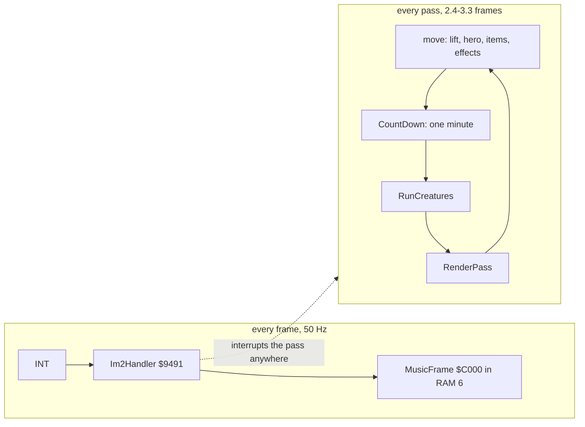

**The point**: the tune keeps time; the game does not. The game's speed depends on the room, while the music runs at
an even 50 Hz beside it.

## 4.2 The states of the program

The program has no dispatcher. Its states are joined by falls and jumps, with the stack set once at GameEntry. One
game runs from NewGame `$8F47` to EndGame `$906D`, which jumps back to NewGame.

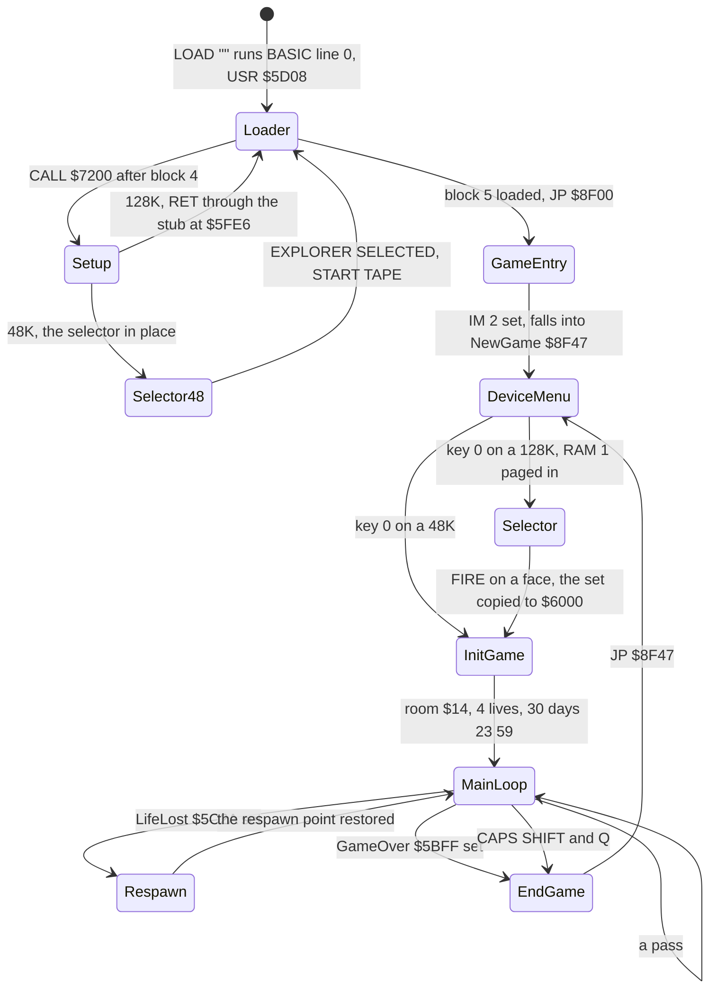

| Transition | Code | Trigger | Witness |
| --- | --- | --- | --- |
| loader to the set-up | `CALL $7200` in the loader's code | block 4 loaded | `c1` frame 11841 |
| the set-up back to the loader (128K) | SelectorEntry patches PagingStub `$5FE6` to `OUT (C),A`, `RET` | GameLoaded `$5FFF` = 0 | `c1` frame 11841 t 42590 |
| loader to GameEntry | `JP $8F00` | block 5 loaded | `c1` frame 21597 t 67875 |
| GameEntry to the menu | falls into NewGame `$8F47`, `CALL DeviceMenu` | | `c1` frame 21597 |
| the menu to the selector | RunSelector `$8F4A`: `$7FFD` = `$11`, `CALL $C000` | key 0, Has128K `$5FFE` not 0 | `c1` frame 22215; `explorers` |
| the selector to the game | the selector returns to InitGame `$8F69` | FIRE on a face | `c1` (one explorer), `explorers` (all five) |
| InitGame to MainLoop | falls in at `$9018` | | `c1`, `explorers` |
| MainLoop to Respawn `$9090` | `JR NZ,Respawn` | LifeLost `$5C2A` set by LoseLifeWait `$A9EE` | `gameover` frame 1509; 4 runs in the rzx segments |
| MainLoop to EndGame `$906D` | `JR NZ,EndGame` | GameOver `$5BFF` set by SpaceScene `$B0B6` | `gameover` frame 1962; `rzx50000` frame 732 |
| MainLoop to EndGame, the abort | `JR Z,EndGame` | Q and CAPS SHIFT held at the end of a pass | `c1` and `explorers`: 6 runs of `$9059` |
| EndGame to the menu | `JP $8F47` | | `c1`, `explorers`, `gameover`, `rzx50000` |

Two things are not states of the program but of the hero: the death and the space scene.

- A death is a status (4.5).
- The space scene is room `$28` with status 29. The main loop runs it like any room until SpaceScene sets GameOver.

**The point**: the whole game cycle is one loop through four routines. Losing and winning both leave by the same door,
GameOver `$5BFF`, so EndGame never knows which of the two happened.

### GameEntry `$8F00`: the IM 2 table, the stack, the life-loss patch

GameEntry runs once, straight from the loader. It builds the interrupt set-up the game needs, and makes one patch that
decides whether lives can be lost.

1. With interrupts off, Last7FFD `$5FE5` = `$10` (RAM 0 at `$C000`, ROM 1).
2. The IM 2 table `$8E00-$8F00` gets 257 bytes of `$5F`. The last one is GameEntry's own first byte.
3. `JP $9491` goes to `$5F5F`; SP = `$5E00`; I = `$8E`; IM 2; EI.
4. GameLoaded `$5FFF` = 1. The selector, run again from the menu, now runs instead of returning at once.
5. Border 0, `$8D00` = 0, the high score `$5B78-$5B7B` = 0. The high score is cleared only here, so it lasts from game
   to game.
6. The opcode at LifeLossOp `$A9FD` becomes `$35` (`DEC (HL)`), or `$B7` (`OR A`) when InfiniteLives `$5B03` is not 0.

```text
GameEntry:
    disable interrupts
    Last7FFD = $10
    fill $8E00..$8F00 with $5F                 ; 257 bytes
    write JP Im2Handler at $5F5F
    SP = $5E00; I = $8E; IM 2; enable interrupts
    GameLoaded = 1
    border = 0; Var8D00 = 0; HiScore = 0
    LifeLossOp = (InfiniteLives ? OR A : DEC (HL))
    fall into NewGame
```

```asm
GameEntry:                      ; $8F00
        DI
        LD A,$10
        LD (Last7FFD),A         ; RAM 0, ROM 1: what the handler pages back
        LD HL,Im2Table          ; $8E00
        LD BC,$005F
FillIm2Table:
        LD (HL),C               ; B = 0: 256 bytes of $5F
        INC HL
        DJNZ FillIm2Table
        LD (HL),C               ; and the 257th, at $8F00
        LD A,$C3
        LD (Im2Jump),A          ; JP at $5F5F
        LD HL,Im2Handler
        LD (Im2Jump+1),HL       ; ... $9491
        LD SP,StackTop          ; $5E00
        LD A,$8E
        LD I,A
        IM 2
        EI
        LD A,$01
        LD (GameLoaded),A       ; $5FFF
        XOR A
        OUT ($FE),A             ; border 0
        LD (Var8D00),A
        LD H,A
        LD L,A
        LD (HiScore),HL
        LD (HiScore+2),HL
        LD C,$35                ; DEC (HL)
        LD A,(InfiniteLives)    ; $5B03, set by the loader
        OR A
        JR Z,SetLifeLossOp
        LD C,$B7                ; OR A: lives never decrease
SetLifeLossOp:
        LD A,C
        LD (LifeLossOp),A       ; $A9FD
```

Why the table is filled with `$5F`:

- The CPU forms the vector from I and the byte on the data bus.
- With an idle bus that byte is `$FF`, so the vector is read from `$8EFF` and `$8F00`.
- Both hold `$5F`, so the handler address is `$5F5F`, where the `JP $9491` is.
- Any other bus byte also gives `$5F5F`, so a device that drove the bus would not break it.

Worked example:

- In `c1` GameEntry runs at frame 21597 t 67875 (`time_travel find_last`, access execute).
- The first interrupt through `$5F5F` arrives at frame 21599, on the menu.
- The play L1 counts 69 582 reads of `$8EFF` (and as many of `$8F00`) and no other byte of the table (Im2Table in
  `src/game/game.ann`). The same builds take 78 587 interrupts, so the L1 counts fewer vector reads than interrupts:
  69 582 is a lower bound, and the handler count of 4.4 (83 616 runs) is the measure of how often the vector is used.

The life-loss patch is a hook for a cheat.

- The BASIC loader sets InfiniteLives when `$8000` held `$C9` before the load ([doc 3](03-build-and-load.md)). A front
  end, or a `POKE 32768,201` before `LOAD ""`, gives infinite lives.
- The SkoolKit disassembly gives the classic POKE 43517,182: `$A9FD` = `$B6`, `OR (HL)`, which also leaves Lives
  alone.
- Neither path ran in a recording: `$8F41` (the `LD C,$B7`) is not executed in any recording.

**The point**: one byte of self-modified code decides the cheat, and it is written once per load, not once per game.

### NewGame `$8F47`, the selector and InitGame `$8F69`

NewGame starts every game, from GameEntry and from EndGame. It has three steps.

1. **DeviceMenu `$93AF`.** The menu draws its frame from the saved panel, the logo, the options and the credits. It
   loops once a frame (HALT at `$9468`) until 0 is pressed. Keys 1-3 set InputDevice `$94AF`
   ([doc 5](05-controls.md)).
2. **The selector, on a 128K only.** RunSelector `$8F4A` tests Has128K `$5FFE`. On a 128K it pages RAM 1 in (`$7FFD`
   = `$11`, kept in Last7FFD), calls `$C000` with BC = `$C000`, and pages RAM 0 back (`$10`). The selector copies the
   chosen explorer's sprite set to `$6000-$71FF` and returns. On a 48K the explorer was chosen during the load, so
   every game plays the same explorer ([doc 3](03-build-and-load.md)).
3. **InitGame `$8F69`.** It sets up a new game and falls into MainLoop.

```asm
RunSelector:                    ; $8F4A
        LD A,(Has128K)          ; $11 on a 128K, 0 on a 48K
        OR A
        JR Z,InitGame
        LD BC,$7FFD
        LD A,$11                ; RAM 1 at $C000: the relocated selector
        PUSH BC
        LD (Last7FFD),A         ; so the interrupt pages RAM 1 back after the music
        OUT (C),A
        LD BC,SelectorStart     ; BC = $C000, the selector's base
        CALL SelectorStart
        POP BC
        LD A,$10                ; RAM 0 back
        LD (Last7FFD),A
        OUT (C),A
```

Last7FFD is written before the `OUT`, and the order matters.

- An interrupt between the two would page RAM 6 in for the music, then page back whatever Last7FFD says.
- With Last7FFD written first, the handler always restores the page the code is about to run in.

InitGame, in order (its description in `src/game/game.ann` lists every byte):

| Step | What | Value |
| --- | --- | --- |
| 1 | clear the hero, party and actor records `$5B04-$5B67` (one byte stored, 99 copied by the LDIR at `$8F74`) | 100 bytes of 0 |
| 2 | BearerLoads `$5B7C-$5B96`: no bearer carries anything | 27 bytes of `$FF` |
| 3 | ResetItems `$B932`, then the Energy Crystal's place (`$B9D9`) bit 7 set | |
| 4 | the panel EndGame saved, back on the screen | `$E000` to `$5000` (2048 bytes), `$E800` to `$5A00` (256) |
| 5 | TilePixelsPtr `$5B72` = `$F000` (the base tile set) | |
| 6 | WantedItem `$5C3C`, HeldItem `$5B98` and Thought+2 `$5B9B` = `$FF`; the ThinkHints patches: `$A6FD` and `$A700` (rooms `$17`, `$1A`) = `$FF`, `$A6F5` (room `$0F`) = 7 | WantedItem is cleared again by step 8 |
| 7 | the hero's frame `$5B06` = 0 | |
| 8 | clear `$5BFA-$5C8D` | the countdown, GameOver, Room, PassCount, Status and the rest (148 bytes) |
| 9 | score 0 (AddScore `$BCF2` with DE = 0); the object at `$5C25-$5C27` (the balloon) at X `$70`, Y `$60`, room `$0F` | |
| 10 | TilePixelsPtr = `$F000` again; Room `$5C01` = `$14`, SetUpRoom `$9855`, DrawBearers `$9EBD` | |
| 11 | Lives `$5B97` = 4, DrawSpareLives `$9E96` | |
| 12 | the hero at X `$0A`, Y `$60`; the lift in room `$2B` at Y `$30` | |
| 13 | the countdown: 30 days, 23 hours, 59 minutes | `$5BFB` = `$1E`, `$5BFC` = `$17`, `$5BFD` = `$3B` |
| 14 | SaveRespawnPoint `$9AA1`: the start is the first respawn point | |
| 15 | DrawPortrait `$9E5D`: the explorer's face and the empty hand; then MainLoop `$9018` follows | |

Witness: `c1` frame 23500 holds Room `$14`, Lives 4 and the countdown 30 days 23:11 (`memory_at`). The first RZX
sample in play, RZX frame 225, holds 30 days 23:51: eight passes after InitGame.

### EndGame `$906D`

EndGame runs after the lost game's space scene, after the ending, and on the abort. It has four steps.

1. NewHiScore `$BD50`: the score becomes the high score when it is higher ([doc 8](08-hud-and-text.md)).
2. The panel's screen third `$5000-$57FF` and its attributes `$5A00-$5AFF` are saved to `$E000-$E7FF` and
   `$E800-$E8FF`. The menu cuts its frame from there, and InitGame puts the panel back from there. Play uses
   `$E000-$EFFF` as its back buffer, so the panel must be kept while the menu runs.
3. When the alternate tile set is in (AltTileset `$918C` not 0), SwapTileset `$918D` puts the base set back. Every
   game in the recordings ended in a base-set room, so this call is not executed in any recording.
4. `JP $8F47`.

```asm
EndGame:                        ; $906D
        CALL NewHiScore         ; $BD50
        LD HL,Screen+4096       ; $5000: the panel
        LD DE,BackBuffer        ; $E000
        LD BC,$0800
        LDIR
        LD HL,Attributes+512    ; $5A00
        LD DE,SavedPanelAttrs   ; $E800
        LD BC,$0100
        LDIR
        LD A,(AltTileset)
        OR A
        CALL NZ,SwapTileset
        JP NewGame
```

Witness: `gameover` frame 1962 (after the space scene), `rzx50000` frame 732 (after the ending), `c1` and `explorers`
(the aborts).

## 4.3 One pass of the main loop

MainLoop `$9018` is 35 instructions and seven calls. Its order is fixed: everything that moves runs before anything is
drawn, and the screen is updated once, at the end.

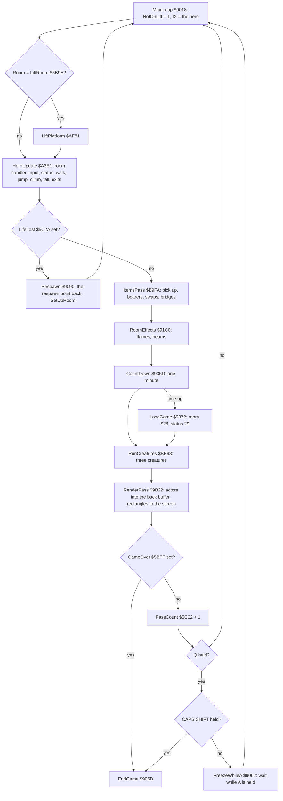

```text
MainLoop:
    loop
        NotOnLift = 1
        if Room == LiftRoom: LiftPlatform()
        HeroUpdate()
        if LifeLost: Respawn(); continue
        ItemsPass(); RoomEffects(); CountDown(); RunCreatures(); RenderPass()
        if GameOver: EndGame()                   ; never returns: JP NewGame
        PassCount += 1
        if key Q:
            if key CAPS SHIFT: EndGame()         ; the abort
            while key A: wait                    ; the freeze
```

```asm
MainLoop:                       ; $9018
        LD A,$01
        LD (NotOnLift),A        ; $5BA0 = 1 every pass (LiftPlatform clears it)
        LD IX,Hero              ; $5B04
        LD A,(Room)
        LD HL,LiftRoom
        CP (HL)
        CALL Z,LiftPlatform     ; $AF81, only in the lift's room
        CALL HeroUpdate         ; $A3E1
        LD A,(LifeLost)         ; $5C2A
        OR A
        JR NZ,Respawn           ; $9090
        CALL ItemsPass          ; $B9FA
        CALL RoomEffects        ; $91C0
        CALL CountDown          ; $935D
        CALL RunCreatures       ; $BE98
        CALL RenderPass         ; $9B22
        LD A,(GameOver)         ; $5BFF
        OR A
        JR NZ,EndGame
        LD A,(PassCount)        ; $5C02 + 1
        INC A
        LD (PassCount),A
        LD A,$FB                ; half row Q-T
        IN A,($FE)
        AND $01                 ; Q
        JP NZ,MainLoop
        LD BC,$FEFE             ; half row CAPS SHIFT-V
        IN A,(C)
        AND $01
        JR Z,EndGame            ; Q + CAPS SHIFT: the abort
FreezeWhileA:
        LD A,$FD                ; half row A-G
        IN A,($FE)
        AND $01
        JR Z,FreezeWhileA       ; Q + A: frozen until A is let go
        JP MainLoop
```

The keys at the end of a pass are read once a pass, so a tap of Q shorter than a pass can be missed.

- **Q alone** does nothing.
- **Q with CAPS SHIFT** ends the game: 6 runs of `$9059` in `c1` and `explorers`, all aborts.
- **Q with A** holds the game in a tight loop for as long as A is held. `$9062` is not executed in any recording, so
  the freeze is known only from the code.
- The freeze polls the keyboard with no HALT, and the interrupt still plays the music under it.

**The point**: the abort and the freeze are not in a key table. They are three port reads at the bottom of the loop,
and the freeze is a busy loop that the music keeps running under.

### The steps and their cost

`tools/fig_loop.py steps` traced frames 1-31 of five rzx segments and cut every whole pass at the main loop's call
sites. It sums the CPU T-states of each step. The interrupt (from `$5F5F` to the handler's `RET` at `$94AE`, the music
included) is counted apart, wherever it fell. The medians of each recording:

| Step | Routine | rzx02000, room `$08` | rzx12000, `$1A` | rzx24000, `$32` | rzx36000, `$1F` | rzx46000, `$3B` |
| --- | --- | ---: | ---: | ---: | ---: | ---: |
| the lift test | `$9018-$902A`, LiftPlatform `$AF81` | 77 | 76 | 75 | 203 | 74 |
| the hero | HeroUpdate `$A3E1` | 1 000 | 15 415 | 15 696 | 16 268 | 18 241 |
| the items | ItemsPass `$B9FA` | 993 | 1 007 | 993 | 1 101 | 997 |
| the room's effects | RoomEffects `$91C0` | 297 | 297 | 301 | 652 | 8 970 |
| the countdown | CountDown `$935D` | 71 | 67 | 64 | 61 | 85 |
| the creatures | RunCreatures `$BE98` | 3 505 | 1 024 | 1 594 | 3 681 | 880 |
| the screen | RenderPass `$9B22` | 156 988 | 161 465 | 166 378 | 165 537 | 173 964 |
| the tail and the keys | `$9043-$906A` | 89 | 90 | 89 | 90 | 89 |
| the interrupt, music included | Im2Handler `$9491` | 9 465 | 10 571 | 12 082 | 10 903 | 12 158 |
| **the pass** | | **173 444 (2.45 frames)** | **190 187 (2.68)** | **195 334 (2.75)** | **199 347 (2.81)** | **215 637 (3.04)** |
| passes measured | | 12 | 10 | 10 | 10 | 9 |

The steps' medians do not add up to the pass's median exactly: each column is a median of its own.

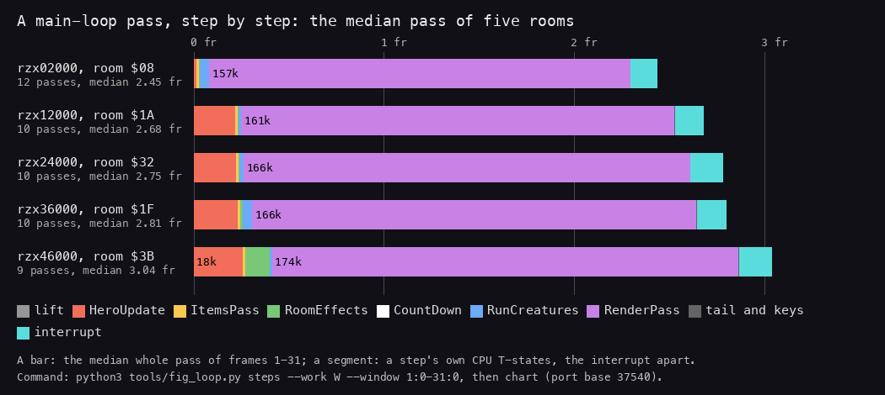

*A main-loop pass, step by step. Each bar is the median whole pass in frames 1-31 of one rzx segment (the RZX run,
replayed); each segment is one step's own CPU T-states, the interrupt counted apart. Made with `python3
tools/fig_loop.py steps --work W --window 1:0-31:0 --name rzxNNNNN --room RR --out work/docs/tmA/steps.json` on each
recording, then `python3 tools/fig_loop.py chart work/docs/tmA/steps.json docs/img/loop/pass-steps.png`.*

How to read it:

- The scale is in frames of 70 908 T. The bar's end is the pass's length.
- Violet is RenderPass. Its 157 000-174 000 T are 81-91 % of every pass.
- Red is HeroUpdate. It is small in room `$08`, where the hero hovers with the Vacuum Cleaner: Hover `$AD32`, status
  4, replaces most of the update. Elsewhere it is about 15 000-18 000 T: the room handler, the tile probes and the
  walk.
- Green is RoomEffects. It is about 300 T where nothing is animated, and 8 970 T in the lab `$3B`, which animates its six
  capsules (Capsules `$9282`, tile `$8C`); the lab has no beam.
- Cyan is the interrupt: about 3 900 T for each of the 2-3 interrupts a pass holds.

**The point**: the game logic is cheap; drawing is the game's cost. A pass is long because RenderPass composes five
24 x 24 actors in a back buffer and copies ten rectangles to the screen, every pass, whether the actors moved or not.

### RenderPass `$9B22`, one pass

RenderPass draws the five actor slots (`$5B04`, 4 bytes each: X, Y, frame, flags; slot 0 is the hero) and the floor
items. Its draw paths are [doc 6](06-rendering.md)'s subject. Here is its shape in time:

1. For each slot, BufferAddress `$9CEE` gives the back-buffer address of (X, Y) and the row plotter for X mod 8.
2. The slot's sprite (frame F at `$6000 + 72 x F`) is drawn into the back buffer `$E000` in three columns of 24 rows,
   mirrored through BitReverse `$FE00` when flags bit 7 is set (the stored graphics face left; the right key sets
   the bit, `$A48B`, so a mirrored sprite faces right).
3. DrawItems `$9DE3` draws the floor items.
4. CopyRects `$9BEB` copies the 4-byte by 24-row rectangles from the buffer to the screen. Last pass's places
   (PrevActorRects `$5B24`) get their background back; this pass's places (ActorRects `$5B44`) get the sprites.
5. An `LDIR` at `$9BDE` copies ActorRects `$5B44` to PrevActorRects `$5B24` (32 bytes): this pass's rectangles become
   the next pass's places to clear.
6. ShowCapsules `$92BD` (alternate tile set only; it returns at once otherwise) copies the capsule cells of
   EffectCellsB `$9AE5`, 2 cells x 8 rows each, from the buffer to the screen with CopyBackCell `$92D6`.
7. RestoreActorBackgrounds `$9D3C` repaints the buffer under the five actors from the tile map, ready for the next
   pass.

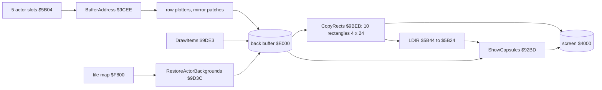

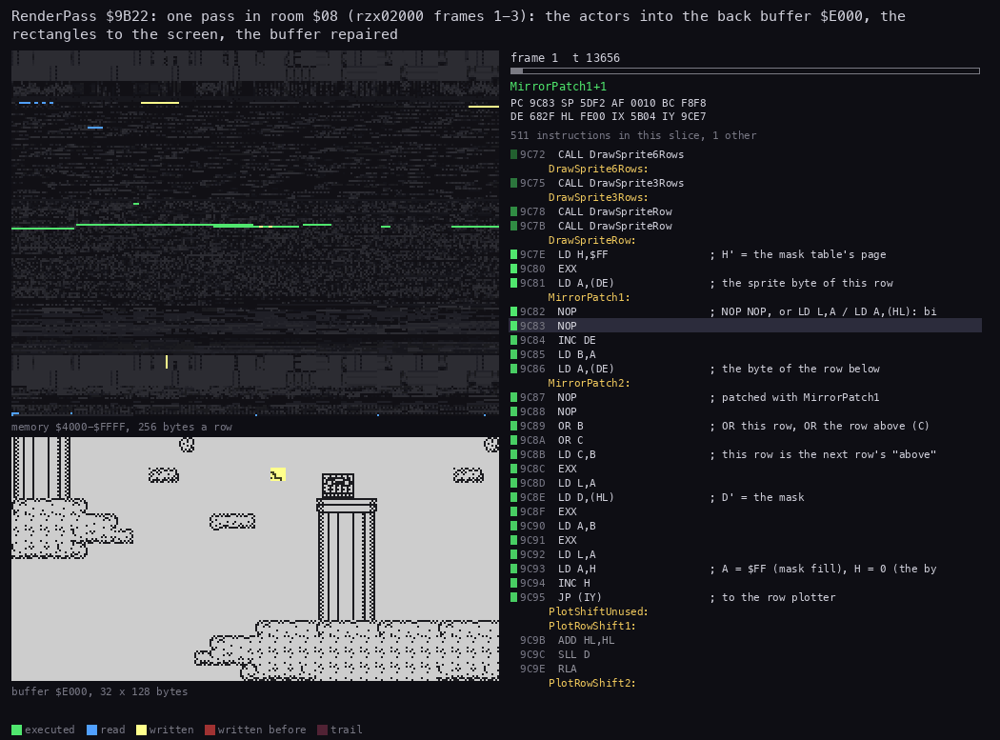

*RenderPass `$9B22` over one pass of `rzx02000` (the RZX run, replayed), from its call at frame 1 t 9746 to its return
at frame 3 t 24326: 156 396 T in 90 pictures of 1738 T. Left above: memory `$4000-$FFFF`, lit by age (executed, read,
written). Left below: the back buffer `$E000` laid out as the screen's top two thirds. Right: the listing at the PC and
the registers. Made with `python3 ../../kit/routine_anim.py --work work/docs/tmA/r02000 --window 1:9746-3:24326
--listing build/game.lst --view buffer:E000:32x128:screen --pc 9B22-9E5C --range 4000-FFFF --pictures 90 --out
docs/img/routines/RenderPass.gif`.*

How to read it:

- The first two thirds of the GIF are the sprites going into the buffer, column by column. The PC sits in the row
  plotters (PlotRowAligned, PlotRowShift1-7) and the mirror patches.
- The rows of `$4000-$4FFF` in the memory map light up only near the end: that is CopyRects writing the ten
  rectangles to the screen.
- The last stretch is RestoreActorBackgrounds writing the buffer again from the tile map.

**The point**: the screen is written in one short burst at the end of the pass. The rest of RenderPass works in the
buffer, where the beam cannot see it.

## 4.4 Frames per pass, and the pass against the beam

Stage 1 timed 300 passes from five RZX states with no key held (`tools/passes.py`: from one `$9018` to the next, the
time from `/video/beam`; `work/stage1/passes.json`):

| State (RZX snapshot) | Room | Median T a pass | Frames (median) | Heaviest pass | Frames |
| --- | --- | ---: | ---: | ---: | ---: |
| `snap-02000` | `$08` | 170 403 | 2.40 | 190 242 | 2.68 |
| `snap-12000` | `$1A` | 182 464 | 2.57 | 199 956 | 2.82 |
| `snap-24000` | `$32` | 193 191 | 2.72 | 198 704 | 2.80 |
| `snap-36000` | `$1F` | 197 754 | 2.79 | 203 107 | 2.86 |
| `snap-46000` | `$3B` | 220 476 | 3.11 | 232 943 | 3.29 |

The traced passes of 4.3 (the same states, the RZX's keys held) agree within 5 %: 2.45, 2.68, 2.75, 2.81 and 3.04
frames. Two more measures agree.

- **The RZX's own port reads.** The pass-end Q test at `$9052` reads the keyboard once a pass. Between RZX frames 209
  and 50 730 (GameOver) it is read 17 786 times, a mean of 2.84 frames (`work/stage1/rzx/inputs.json`, WALKTHROUGH 1).
  The gaps between two reads:

| Gap (frames) | 2 | 3 | 4 | 5-6 | 9-12 | 17 |
| --- | ---: | ---: | ---: | ---: | ---: | ---: |
| Reads | 4470 | 12 236 | 954 | 39 | 85 | 1 |

  The gaps of 2-4 frames are ordinary passes; the 125 longer ones are passes with a room set-up or a status that waits.
- **The countdown.** It loses a minute a pass. Between RZX frame 225 (30 days 23:51) and GameOver at 50 730 (18 days
  15:32, the countdown stands from then on) it lost 44 631 - 26 852 = 17 779 minutes in 50 505 frames: 2.84 frames a
  pass over the whole run.

So the game runs at about 17.6 passes a second: about 20.8 in a light room, 16.4 in the lab.

**Nothing is lost when a pass runs over a frame.** Interrupts are never off in play. The handler ran 83 616 times over
the recordings, one a frame in every build after GameEntry (Im2Handler in `src/game/game.ann`). It interrupts the
pass wherever it is, plays the music, and the pass goes on.

### A typical pass against the raster

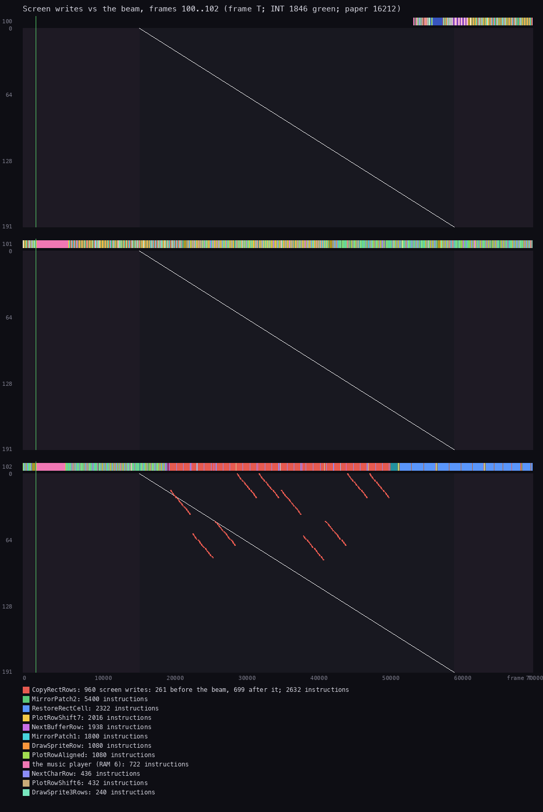

*One main-loop pass of `rzx02000` (the RZX run, replayed), from `$9018` at frame 100 t 54365 to the next `$9018` at
frame 103 t 10087 (168 446 T, 2.38 frames). The figure shows frames 100-102; the last 10 087 T, in frame 103, are the
pass's last few hundred instructions of buffer work. Made with `python3 ../../kit/beam_timeline.py --page-name "6=the
music player (RAM 6)" --page 1=build/select.lst --work work/docs/tmA/r02000 --window 100:54365-103:10087 --listing
build/game.lst --machine 128k --out docs/img/loop/beam-pass-r02000.png`. `--page` and `--page-name` tell the 128K
pages apart: code at `$C000-$FFFF` that runs while RAM 6 is paged in is the music player, not the RAM 0 data at the
same addresses.*

How to read it:

- Each band is a frame, its paper lines 0-191 down, its T-states across.
- The coloured strip above each band shows which routine ran at each T-state. The legend gives the colours; "the
  music player (RAM 6)" is the interrupt's MusicFrame and its callees (722 instructions here).
- The diagonal is the beam on the paper. The thin vertical line near T 1 900 is the interrupt.
- Each dot is a write to the screen at its line and T-state.
- Frames 100 and 101 hold only buffer work (the plotters and the mirror patches): no screen write.
- In frame 102 the red strip is CopyRectRows, from about T 19 000 to T 51 000. Its 960 writes are the ten rectangles
  of 4 bytes by 24 rows. 261 land before the beam reaches their line, 699 after it.
- The blue strip after it is RestoreRectCell: the buffer repaired, no screen write.

### The heaviest pass

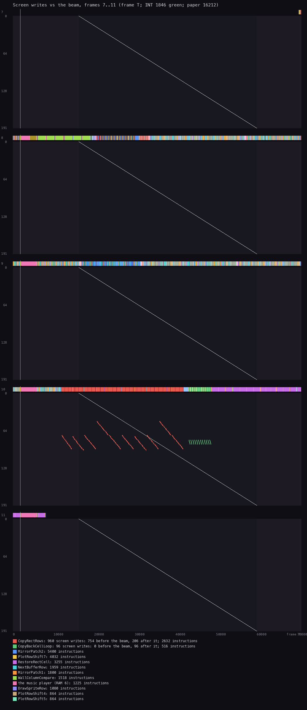

*The longest of the nine passes traced in frames 1-31 of `rzx46000` (the RZX run, replayed), room `$3B` (the lab):
from frame 7 t 70304 to frame 11 t 8133, 221 461 T (3.12 frames). Made with `python3 ../../kit/beam_timeline.py
--page-name "6=the music player (RAM 6)" --page 1=build/select.lst --work work/docs/tmA/r46000 --window 7:70304-11:8133 --frames 5
--listing build/game.lst --machine 128k --out docs/img/loop/beam-pass-r46000.png`.*

How to read it:

- The pass begins at the very end of frame 7 and ends early in frame 11.
- Frame 8 starts with WallColumnCompare: the hero's probes against the lab's walls, part of HeroUpdate.
- In frame 10 CopyRectRows (red) writes the 960 rectangle bytes: 754 before the beam, 206 after it.
- CopyBackCellLoop (green, 96 writes, all after the beam) is ShowCapsules `$92BD`, called by RenderPass after
  CopyRects: the lab's six capsules, 2 cells x 8 rows each, copied from the back buffer to the screen.
- RestoreRectCell (violet here) runs from frame 10 into frame 11.
- The pink blocks at the start of frames 8-11 are the music player (RAM 6), 1225 instructions over the pass.

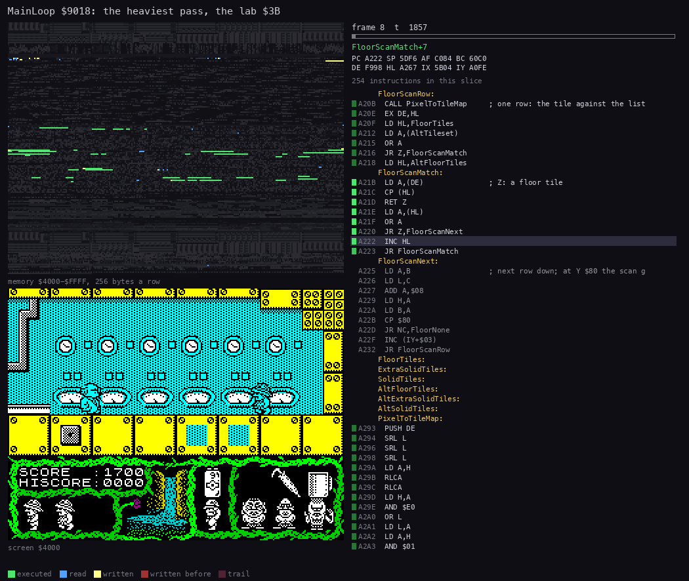

*The same pass as an animation: 90 pictures of 2461 T from the cached trace of `rzx46000` frame 7 t 70304 to frame 11
t 8133 (30 963 instructions). Left above: memory `$4000-$FFFF`; left below: the screen; right: the listing at the PC.
Made with `python3 ../../kit/routine_anim.py --page 6=build/music.lst`
`--trace work/docs/tmA/r46000/traces/7_70304-11_8133.uatr --listing build/game.lst --view screen`
`--range 4000-FFFF --pc 5F00-C57F --pictures 90 --title 'MainLoop $9018: the heaviest pass, the lab $3B'`
`--out docs/img/routines/MainLoop-heaviest.gif`. The screen view starts from the trace's memory at the pass's start.
`--page 6` shows the music player's own listing when the interrupt runs it in RAM 6 ("UpdateTuneChannels (RAM 6)");
its instructions count as "other", outside `--pc`.*

How to read it:

- The first pictures (frame 8) are HeroUpdate: the professor's script, the controls, then the floor probe
  (FloorScanMatch, pictures 1-3) and the wall probes (WallColumnCompare over the lab's columns, pictures 3-8).
- Pictures 9-13 are RoomEffects' capsules (CapsulesLoop, DrawTileAt) and RunCreatures.
- Most of the pass is the plotters and the buffer rows (NextBufferRow, PlotRowShift7, the mirror patches): the
  sprites drawn into the back buffer, while the screen does not change.
- Late in frame 10 CopyRectRows puts the ten rectangles on the screen: only then do the moved sprites show.
- The interrupt's music runs in RAM 6; the picture counts it as "other" ("66 other" in a slice), so the listing never
  shows the RAM 0 data at its addresses. One interrupt on its own is
  [doc 9's MusicFrame animation](09-sound.md#93-the-players-frame-musicframe-and-updatetune).

**The point**: the copy to the screen takes about 30 000 T, under half a frame, but it runs wherever the pass happens
to be in the frame.

- It is not timed to the beam, so a rectangle the beam crosses shows half old and half new for one frame.
- The ten rectangles are small (24 rows each), so the tear is short and hard to see.

## 4.5 The hero's status machine `$5C06`

Every special thing the hero does is a status: a jump, a ride, a pose, a death.

- Status `$5C06` holds 0-33.
- StatusTimer `$5C07` counts passes in the status. SetStatus `$AE85` clears it.
- Status 0 is the hero walking, climbing and falling under the player's control. HeroUpdate does that itself.

StatusDispatch `$A6CC` is called from HeroUpdate at `$A40C`, after the room handler, the frame list and the input.

- For status 0 it returns, and HeroUpdate goes on.
- For any other status it jumps to the word StatusHandlers `$A72E` + 2 x (status - 1), through JumpThroughWord
  `$A6DD`.
- The return into HeroUpdate is still on the stack. Every handler starts with `POP`, or never returns there, so the rest
  of HeroUpdate is skipped. The handler does the whole update for that pass.
- One exception: Teleport `$A8EA` at timer 0 in rooms `$30` and `$3D` reaches TeleportStep `$A910`, whose `RET Z`
  (CrystalPlaced `$5C44` = 0) returns into HeroUpdate before any `POP`: the hero walks on, and status 22 stays.

The SkoolKit disassembly named the dispatcher and the table; the handler names are ours (stage 2 renamed most of them
from their effect, `src/game/game.ann`).

```text
StatusDispatch():                     ; called from HeroUpdate
    if Status == 0: return            ; HeroUpdate goes on: walk, climb, fall
    C = $FF
    handler = StatusHandlers[Status - 1]
    jump handler                       ; the handler drops HeroUpdate's return

SetStatus(a):  Status = a; StatusTimer = 0
```

```asm
StatusDispatch:                 ; $A6CC
        LD A,(Status)           ; $5C06
        OR A
        RET Z                   ; status 0: back into HeroUpdate
        LD C,$FF
        DEC A
        ADD A,A
        LD L,A
        LD H,$00
        PUSH DE
        LD DE,StatusHandlers    ; $A72E: words for statuses 1-33
        ADD HL,DE
JumpThroughWord:                ; $A6DD, shared with the room handler dispatch
        LD E,(HL)
        INC HL
        LD D,(HL)
        EX DE,HL
        POP DE
        LD A,H
        OR L
        RET Z
        JP (HL)
...
SetStatus:                      ; $AE85
        LD (Status),A
        XOR A
        LD (StatusTimer),A      ; $5C07
        RET
```

The 33 handlers, from the words at `$A72E` and the `.ann`. The witness is the L1 count of the handler's first
instruction over the 34 recordings:

| Status | Handler | What | Next status | Witness |
| ---: | --- | --- | --- | --- |
| 1 | JumpArc `$ADAC` | the forced jump after three refused drops | 0, or a fall | 2391 runs for 1-3 (`gameover`, rzx) |
| 2 | JumpArc `$ADAC` | the jump (fire): 17 passes of JumpFrames | 0 | as above |
| 3 | JumpArc `$ADAC` | the hop off the ladder top in room `$18` | 0 | as above |
| 4 | Hover `$AD32` | hover with the Vacuum Cleaner | 0 | 4908 (`c1`, `explorers`, rzx) |
| 5 | BounceUp `$AD17` | rise off the Spring or the Trampoline | 2 (on a floor, `$AD2D`) | 67 (`gameover`, rzx) |
| 6 | `$A5F0`, inside HeroUpdate | stay in place, animate only | set back by the room | |
| 7, 8 | BalloonRide `$AC35` | in the balloon; 8 with the Bellows | 9 or 0 | 452 (rzx) |
| 9 | BalloonCrash `$AC1A` | the balloon falls; landing kills | 26 | not executed |
| 10 | Think `$AB6E` | the T key: think | 11 or 12 | not executed |
| 11 | BrightIdea `$ABC7` | an idea: the item ThinkHints `$A6E6` names | 0 | not executed |
| 12 | NoIdea `$ABD9` | no idea: the head shakes | 0 | not executed |
| 13 | BarrelSpot `$AA3C` | at the barrel spot of room `$1D` | 14, 15, 16 or 0 | 6 (rzx) |
| 14 | BarrelRide `$AA6F` | the ride in the Barrel Medium, 84 passes | 0 | 85 (rzx) |
| 15 | BarrelRideShort `$AAA7` | the ride in the Barrel Small, fatal at pass 32 | 18 | not executed |
| 16 | BarrelRideLong `$AABA` | the ride in the Barrel Big, on to the next room, fatal | a death | not executed |
| 17 | SinkInMud `$AA04` | sink one row into the mud | 0 | not executed |
| 18 | LoseLifeWait `$A9EE` | dying: 50 passes, then a life is lost | Respawn, or LoseGame | 292 (`gameover`, rzx) |
| 19 | LiftUp `$A96B` | the lift up | 0 | not executed |
| 20 | LiftDown `$A9C4` | the lift down | 0 | 220 (rzx) |
| 21 | RideObject4 `$A95F` | the hero takes object 4's place | set back by the room | 418 (rzx) |
| 22 | Teleport `$A8EA` | the pads of rooms `$30` and `$3D`, working only once the crystal is placed (CrystalPlaced `$5C44`); room `$20`'s pad kills | 0 or 23 | 36 (rzx) |
| 23 | SilentDeath `$A8A8` | a death with no sound: room `$20`'s pad, the radiation of `$3C`, room `$39`'s creature | 18 | not executed; probe C |
| 24 | CreatureDeath `$A89E` | a creature's touch | 18 | 33 (rzx) |
| 25 | Room1ADeath `$A88F` | the snakes of rooms `$17` and `$1A` (SnakeBite `$B5C8` in the shared RunSnakes `$B57C`) | 18 | 7 (rzx) |
| 26 | FallDeath `$A888` | the fall death | 18 | 9 (`gameover`, rzx) |
| 27 | Room43Anim `$A851` | room `$43`'s frame list, then +75 | 0 | 50 (rzx) |
| 28 | Room2DAnim `$A828` | room `$2D`'s frame list | 29 | 43 (rzx) |
| 29 | Frozen `$A90E` | nothing: a room handler drives the scene (room `$2D`, the space scene) | set by LoseGame `$938D`, ProfessorEnding `$B6FB`, ExplorerRoom46 `$B2EB`; Room2DAnim steps into it | 413 (`gameover`, rzx) |
| 30 | LookIntoTelescope `$A822` | bend to the telescope in room `$12` | 31 | not executed |
| 31 | TelescopeView `$A7B9` | the asteroid in space and the time left, 128 passes | 0 | not executed |
| 32 | DrinkPose `$A783` | frames `$3D-$3F` in room `$2E` | set back by the room | not executed |
| 33 | FlashPose `$A770` | frame `$3F` for 64 passes in room `$47` | 0 | not executed |

The rules behind each status (what starts it, which item it needs) are [doc 10](10-gameplay-logic.md)'s subject.

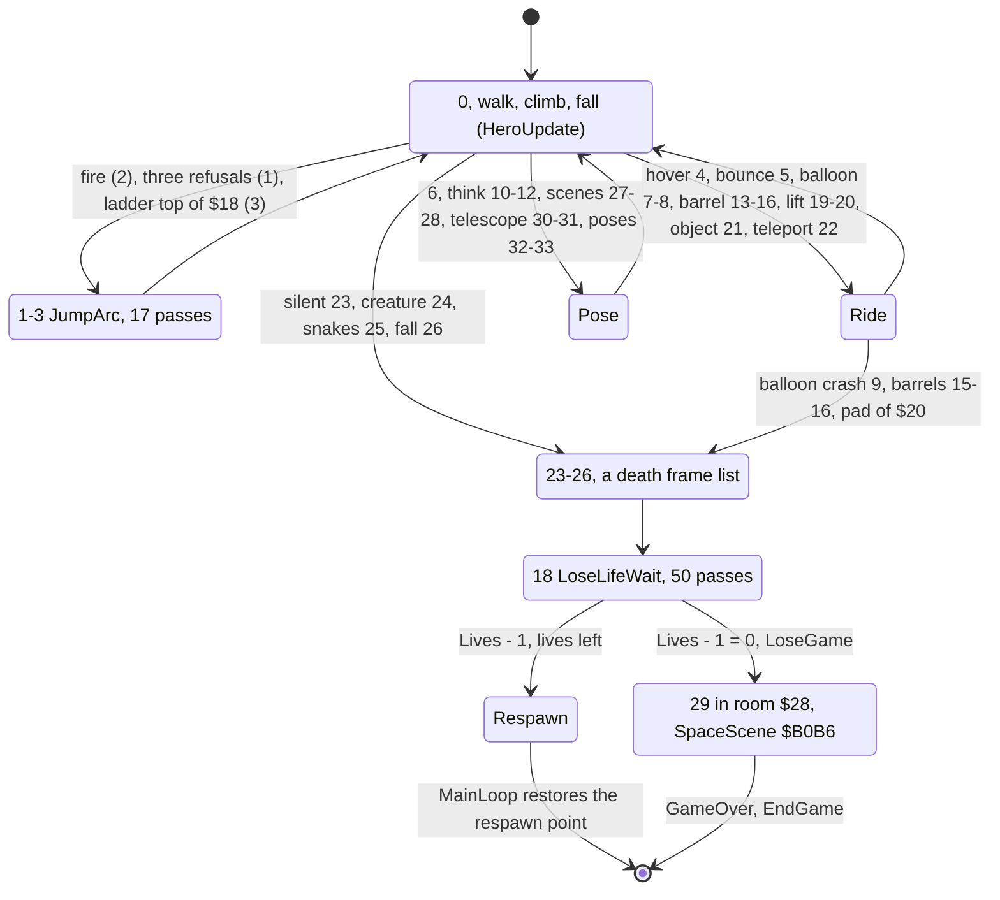

**The point**: the status is a jump table, not a set of flags. One byte says what the hero is doing, and each status
owns the whole update of its pass. That is why a death, a ride or a pose can never mix with walking.

### A death, worked through

The `gameover` recording starts from the RZX state at 10000 with Lives poked to 1. The RZX player falls from room
`$10` into room `$1C` and dies on landing, which is now the last life. Frames are trace frames.

| Frame | Event | Status `$5C06` | Timer `$5C07` | Lives |
| --- | --- | ---: | ---: | ---: |
| 1360 t 68717 | SetStatus `$AE85`: the landing after a long fall | 26 | 0 | 1 |
| 1363 | FallDeath `$A888` plays its frames | 26 | | 1 |
| 1374 t 9685 | LoseLifeWait `$A9EE`, first pass | 18 | 1 | 1 |
| 1374-1502 | 50 passes of LoseLifeWait | 18 | 1 to 50 | 1 |
| 1502 t 29408 | Lives - 1 = 0: `JP Z,LoseGame` | 18 | 50 | 0 |
| 1502 | LoseGame `$9372`: Room `$28`, the respawn point room `$28`, status `$1D` | 29 | 0 | 0 |
| 1509 t 36492 | Respawn `$9090` in the same pass (LoseGame's `JP SetStatus` returns to `$902E`, LifeLost is set): room `$28` set up again | 29 | 0 | 0 |
| 1509-1961 | the space scene: SpaceScene `$B0B6` in room `$28` | 29 | | 0 |
| 1962 | GameOver set: EndGame `$906D`, the menu | | | |

The 50 passes of status 18 took 128 frames (1374 to 1502): 2.56 frames a pass, the same as the pass lengths of 4.4.

```asm
LoseLifeWait:                   ; $A9EE, status 18
        POP HL                  ; drop HeroUpdate's return
        LD HL,StatusTimer       ; $5C07
        INC (HL)
        LD A,(HL)
        CP $32                  ; 50 passes?
        RET NZ
        LD (LifeLost),A         ; $5C2A = $32: MainLoop runs Respawn
        LD HL,Lives             ; $5B97
LifeLossOp:
        DEC (HL)                ; $A9FD: OR A when GameEntry saw the cheat
        JP Z,LoseGame           ; $9372: the last life
        JP DrawSpareLives       ; one figure fewer in the panel
```

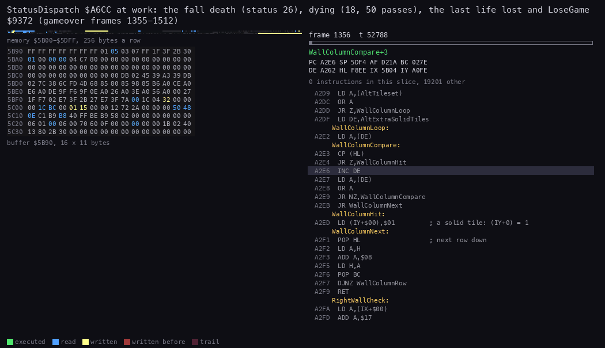

*StatusDispatch `$A6CC` and the handlers over `gameover` frames 1355-1512 (the RZX state at 10000, Lives poked to 1),
90 pictures of about 123 700 T. Left above: memory `$5B00-$5DFF`, 64 bytes a row (the kit wraps a small range so that
it is readable), which shows where the bytes change; the hex view below gives their values. Left below: `$5B90-$5C3F` in hex, so that Lives
`$5B97`, the countdown `$5BFB-$5BFD`, GameOver `$5BFF`, Room `$5C01`, PassCount `$5C02`, Status `$5C06`, StatusTimer
`$5C07`, LifeLost `$5C2A` and the respawn point `$5C2B-$5C33` are all in view. Right: the listing at the PC. Made with
`python3 ../../kit/routine_anim.py --work work/docs/tmA/gameover --window 1355:0-1512:0 --listing build/game.lst
--view buffer:5B90:16x11:hex --pc A6CC-AF08,9372-938F,9090-90C5 --range 5B00-5DFF --pictures 90 --out
docs/img/routines/StatusDispatch.gif`.*

How to read it:

- Watch `$5C06`, the seventh byte of row `$5C00`: `1A` (26) at the fall, then `12` (18), then `1D` (29).
- Watch `$5C07` beside it. It climbs from 1 to `32` (50) while the hero lies dead, one step a pass.
- At the end `$5B97` (Lives) drops to 0 and `$5C01` (Room) becomes `28`: LoseGame has taken the hero to space.

**The point**: a death is three statuses in a row: the death's frames, then 18, then the respawn or the space scene.
Each is a plain counter in `$5C07`, and the whole sequence is timed in passes, not frames.

### The respawn and the checkpoints

When LoseLifeWait leaves lives, MainLoop sees LifeLost and runs Respawn `$9090`.

- It clears LifeLost and FallPasses `$5C05`.
- It copies the respawn point back: Status and StatusTimer from `$5C2B-$5C2C`, Room from `$5C2D`, the hero's X, Y,
  frame and flags from `$5C2E-$5C31`, and the lift from `$5C32-$5C33`.
- It calls SetUpRoom `$9855` and returns to MainLoop.

SaveRespawnPoint `$9AA1` writes the respawn point at two moments:

- at InitGame;
- in SetUpRoom, on entering a room listed in CheckpointRooms `$9AF5` (44 rooms) while the hero is not falling
  (FallPasses = 0).

So a lost life restarts at the entry of the last checkpoint room, not of the room where the hero died.

Worked example from the RZX dump:

- The hero falls from room `$10` into room `$1C` at RZX frame 11 325, dies, and is in status 18 from RZX frame 11 375
  to 11 500.
- At RZX frame 11 525 he stands in room `$1B` with 3 lives.
- `$1C` is not a checkpoint; `$1B` is, and RespawnRoom `$5C2D` held `$1B` all through.

## 4.6 The countdown `$935D` and the lost game `$9372`

The story gives Professor Eyestrain 30 days before the asteroid hits ([doc 1](01-game-design.md)). The game keeps them
as three plain binary bytes: days `$5BFB`, hours `$5BFC`, minutes `$5BFD`. InitGame sets 30, 23, 59. CountDown takes
one minute off every pass.

```text
CountDown():                        ; once a pass
    Minutes -= 1
    if Minutes >= 0: return
    Minutes = 59; Hours -= 1
    if Hours >= 0: return
    Hours = 23; Days -= 1
    if Days >= 0: return
    fall into LoseGame                 ; Days is now 255
```

```asm
CountDown:                      ; $935D
        LD HL,CountdownMinutes  ; $5BFD
        DEC (HL)
        BIT 7,(HL)              ; below 0?
        RET Z
        LD (HL),$3B             ; 59
        DEC HL
        DEC (HL)                ; hours, $5BFC
        BIT 7,(HL)
        RET Z
        LD (HL),$17             ; 23
        DEC HL
        DEC (HL)                ; days, $5BFB
        BIT 7,(HL)
        RET Z
LoseGame:                       ; $9372: falls in when the days go below 0
        LD A,$7F
        LD (Hero+2),A           ; the hero's frame: the blank sprite
        LD A,$28
        LD (Room),A             ; room $28: space
        CALL SetUpRoom
        LD A,$28
        LD (RespawnRoom),A
        XOR A
        LD (RespawnTimer),A
        LD A,$1D
        LD (RespawnStatus),A
        JP SetStatus            ; status 29: Frozen; room $28's handler runs the scene
```

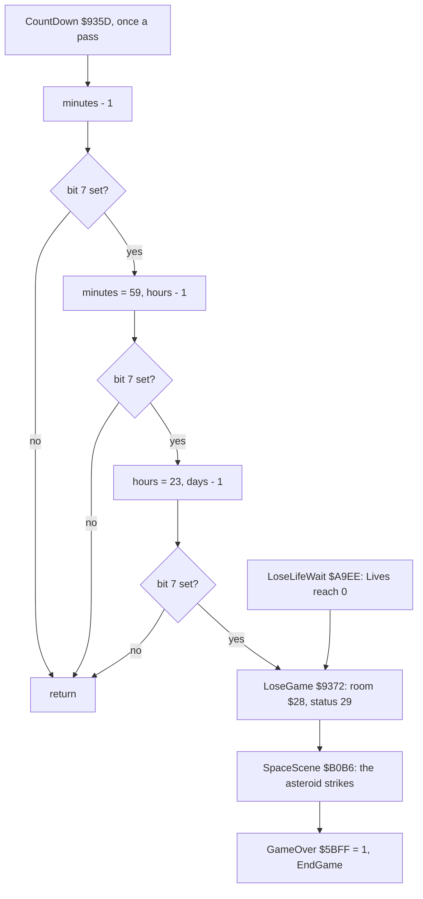

The bit-7 test makes the counters signed: 0 - 1 is `$FF`, with bit 7 set. A day is 24 x 60 = 1440 passes.

Worked example, minutes into the next hour:

- `c1` frame 23500 holds `$1E`, `$17`, `$0B` at `$5BFB-$5BFD`: 30 days, 23 hours, 11 minutes (`memory_at`).
- Eleven passes later the minutes reach 0.
- On the twelfth, `DEC (HL)` gives `$FF` and bit 7 is set. The minutes become `$3B` and the hours `$16`: 30 days
  22:59.
- The hour rollover `$9364` ran 440 times in the recordings, the day rollover `$936B` 13 times (rzx, about every 4000
  frames).

How long a game can last:

- 30 days 23:59 is 30 x 1440 + 23 x 60 + 59 = 44 639 minutes. `DEC` comes before the test, so the clock reads 0/0/0
  after 44 639 passes and the 44 640th pass runs out: the whole countdown is 44 640 passes.
- At the 2.84 frames a pass measured over the RZX run (4.4) that is about 126 800 frames, 42 minutes 16 seconds.
- The RZX player won with 18 days 15:32 left (the countdown stands from GameOver at RZX frame 50 730).

The time running out was seen only on a clone (stage 2, probe A):

- the RZX state at 44000, in room `$3B`, the countdown poked to 0 days 0 hours 2 minutes;
- the pass after 0/0/0 falls into LoseGame: Room `$28` 10 frames after the poke, then status 29 (the space scene);
- GameOver at frame 430;
- the days had wrapped to 255.

There is no "time up" message: the end is the same space scene as the last life's.

LoseGame also writes the respawn point. That is for the last-life path.

- LoseLifeWait has already set LifeLost, and LoseGame's `JP SetStatus` returns into MainLoop at `$902E`, where
  LifeLost is tested: Respawn runs in the same pass and builds room `$28` a second time (the `gameover` frames
  1502-1509 show the two set-ups before the scene starts).
- Respawn reloads room `$28` and status `$1D` from the respawn point.
- Without that, the respawn would take the hero back to the last checkpoint with no lives.

The telescope in room `$12` shows the countdown as the player sees it. TelescopeView `$A7B9` prints CollisionText
`$B07C` and the days, hours and minutes, and puts the asteroid at Y = 2 x (40 - days): the fewer the days, the lower
it stands. No recording looked into the telescope, so this is known only from the code.

**The point**: the countdown is a pass counter dressed as a clock. A game in heavy rooms has fewer real seconds than a
game in light ones, but always the same 44 640 passes.

### The space scene: the end of every game

Room `$28`'s handler, SpaceScene `$B0B6`, runs both ends of the game with status 29 (Frozen). RoomStage `$5C41` steps
it:

| Step | Without the deflector (lost) | With the deflector (GameWon `$5BFE` set) |
| --- | --- | --- |
| 0 | the asteroid at X `$A2`, Y 4; the Earth at the bottom | the same, and the deflector (object 4) at `$89`, `$5C` |
| 1 | the asteroid moves 1 left, 4 down a pass, to Y `$54` | the same |
| 2 | the asteroid hidden; the Earth's frame `$76`, then `$77`: the strike, sound 1 (2 passes) | skipped: at Y `$54` the step goes straight to 3, the deflector fires (frame + 1), sound 2 |
| 3 | | the asteroid flies off to the left (X - 4, Y - 1 a pass) until X < 4, then is hidden (35 passes) |
| 4 on | the step counts from 4 to `$80` (124 passes), then GameOver = 1 | the same |

The lost scene is 1 + 20 + 2 + 124 = 147 passes, the won one 1 + 20 + 35 + 124 = 180.

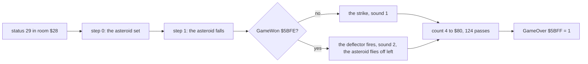

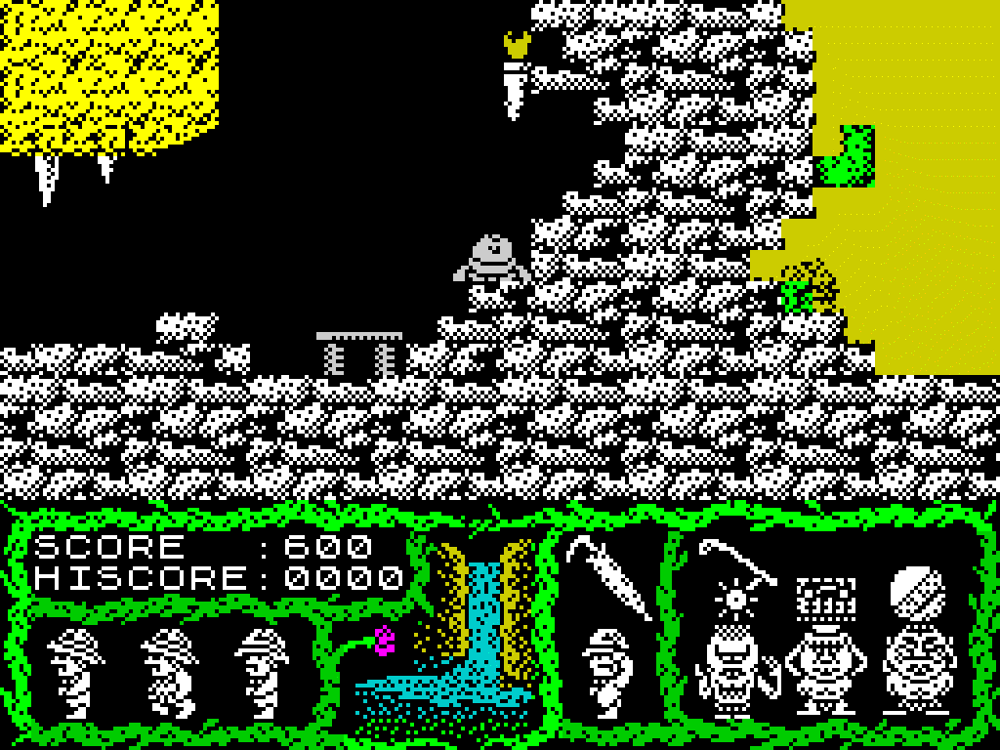

*The lost game's space scene: `gameover` frames 1500-1965 (the RZX state at 10000, Lives poked to 1), every 5th frame,
scale 4. Made with `python3 ../../kit/screen_anim.py --work work/docs/tmA/gameover --from 1500 --to 1965 --step 5 --scale 4
docs/img/play/space-scene-lost.gif`.*

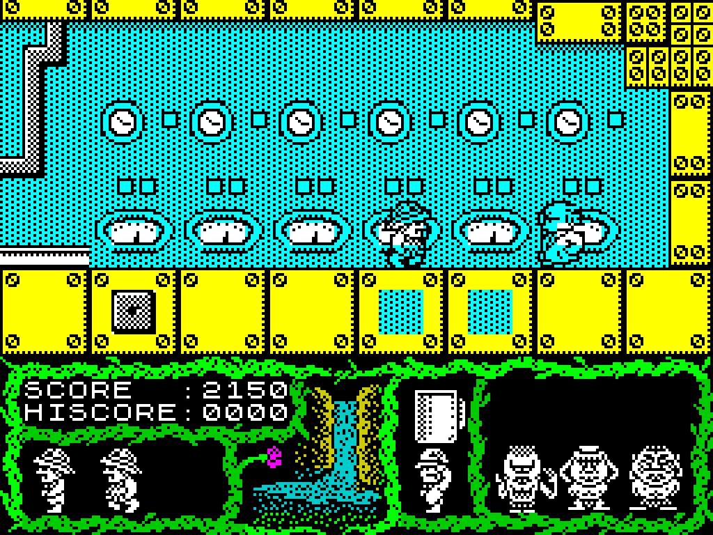

*The ending's space scene, with the deflector: `rzx50000` frames 150-735 (the RZX run, replayed), every 6th frame,
scale 4. Made with `python3 ../../kit/screen_anim.py --work work/docs/tmA/r50000 --from 150 --to 735 --step 6 --scale 4
docs/img/play/space-scene-won.gif`.*

How to read them:

- The lost game opens on the dead hero in room `$1C` (frame 1500; Respawn at 1509 enters room `$28`); the ending opens
  in the lab (frame 150), and room `$28` follows from frame 194.
- In room `$28` the asteroid comes down 4 pixels a pass from Y 4 to `$54`, 20 passes, so it reaches the Earth near
  frame 1570 in the lost game.
- In the lost game the asteroid strikes the Earth and the Earth flashes.
- In the ending the deflector stands on top of the Earth; it fires and the asteroid flies off to the left.
- Both close as EndGame starts (the lost one already shows the updated high score); the menu that follows is not in
  the GIFs.

The scene lasts 453 frames in the lost game (1509-1961) and 536 in the ending (194-729). That is 147 passes lost and 180 won (the table above): 3.08 and 2.98 frames a pass.

**The point**: winning and losing are one routine with one flag. GameWon `$5BFE` only adds the deflector and turns
the asteroid away.

## 4.7 The interrupt

### The set-up

The game runs in IM 2 with I = `$8E`, the 257-byte table `$8E00-$8F00` of `$5F`, and the vector `$5F5F` holding
`JP $9491` (4.2, GameEntry). Before GameEntry the ROM's IM 1 handler runs. The loader turns interrupts off while it
loads ([doc 3](03-build-and-load.md)).

### The handler, line by line

```asm
Im2Handler:                     ; $9491, through JP $9491 at $5F5F
        PUSH AF
        LD A,(Has128K)          ; $5FFE: $11 on a 128K, 0 on a 48K
        OR A
        JR Z,Im2Done            ; 48K: no music
        PUSH BC
        LD BC,$7FFD             ; RAM 6, ROM 1
        LD A,$16
        OUT (C),A
        CALL MusicFrame         ; $C000 in RAM 6: one frame of the tune
        LD A,(Last7FFD)         ; $5FE5: the page the game had
        LD BC,$7FFD
        OUT (C),A
        POP BC
Im2Done:
        POP AF
        EI
        RET
```

```text
Im2Handler():
    save AF
    if Has128K:
        save BC
        page RAM 6 in ($7FFD = $16)
        MusicFrame()                  ; one frame of the tune
        page Last7FFD back
        restore BC
    restore AF; enable interrupts; return
```

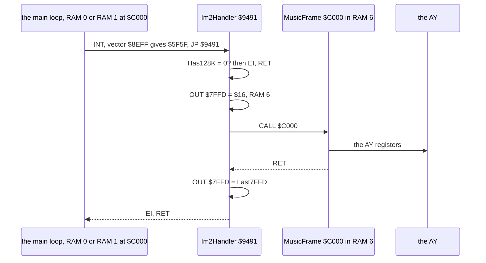

- The handler keeps AF and BC. MusicFrame keeps the rest itself (`src/music`). So the game can be interrupted
  anywhere.
- The page it restores is Last7FFD, not a fixed RAM 0. When the interrupt falls in the selector (RAM 1 at `$C000`),
  RAM 1 comes back. Every writer of `$7FFD` in the game writes Last7FFD first (RunSelector, 4.2).
- The tune is the player's only job: tune 0, started by the first call and started again at its end, a loop of 9698
  frames, 3 minutes 14 seconds ([doc 9](09-sound.md)).
- The game's sound effects are beeper sounds played from the main loop, not from here.

The SkoolKit disassembly covers the game block only, so its music player and the page in which it lives were stage
2's reading. The first draft of this case had the music in RAM 1. The `$16` above, and the selector's `$11` in
RunSelector, settle it: RAM 6 holds the music, RAM 1 the selector ([doc 2](02-architecture.md)).

### What an interrupt costs

- MusicFrame averages 3590 T a call (`explorers`: 54 533 870 T in 15 190 calls, `src/music/music.ann`).
- The traced passes of 4.3 give 9 465-12 158 T of interrupt a pass of 2.4-3.0 frames: about 3 900 T an interrupt with
  the handler, 5.5 % of a frame.
- In `c1` the handler ran 5029 times, one a frame from frame 21599, about 3793 T each (`$RS interrupts`,
  WALKTHROUGH 1).
- On a 48K the handler costs 93 T with the IM 2 response (19 T), the `JP` (10) and seven instructions (64: `PUSH AF`,
  `LD A,(Has128K)`, `OR A`, `JR Z`, `POP AF`, `EI`, `RET`), and the game has no music. No 48K run reached play, so
  this is known only from the code.

**The point**: the interrupt is a music box bolted onto a free-running game. Paging RAM 6 in and out around one call
is all the 128K version needed; the game itself never knows the tune is there.

## 4.8 Delays and timers

Every delay of the game is counted in passes (play) or in frames (the menu, the selector, the music):

| Timer | Where | Count | Unit | Measured or derived |
| --- | --- | ---: | --- | --- |
| the countdown | CountDown `$935D`, `$5BFB-$5BFD` | 44 640 | passes | about 126 800 frames (42 min 16 s) at 2.84 frames a pass |
| a day of the countdown | `$936B` | 1440 | passes | about 4090 frames: 13 day rollovers in the rzx segments |
| dying | LoseLifeWait `$A9EE`, `$5C07` | 50 | passes | `gameover` frames 1374-1502: 128 frames |
| the jump | JumpArc `$ADAC`, JumpFrames `$AE8D` | 17 | passes | about 45 frames |
| a fall that kills | FallPasses `$5C05` | 20 or more | passes | [doc 10](10-gameplay-logic.md) |
| the mud | MudPasses `$5C29` | 50 | passes | known only from the code |
| the barrel ride | BarrelRide `$AA6F` | 84 | passes | 85 runs in the rzx segments |
| the telescope view | TelescopeView `$A7B9` | 128 | passes | known only from the code |
| room `$47`'s pose | FlashPose `$A770` | 64 | passes | known only from the code |
| the space scene | SpaceScene `$B0B6`, RoomStage to `$80` | 147 lost, 180 won | passes | 453 frames (`gameover`), 536 frames (`rzx50000`) |
| the device menu | MenuKeys `$9468` | 1 | frame a turn | HALT |
| the selector | SelectorWait `$C12A` | 1 | frame a turn | HALT |
| the tune | MusicFrame `$C000` | 9698 | frames | the tune's loop ([doc 9](09-sound.md)) |

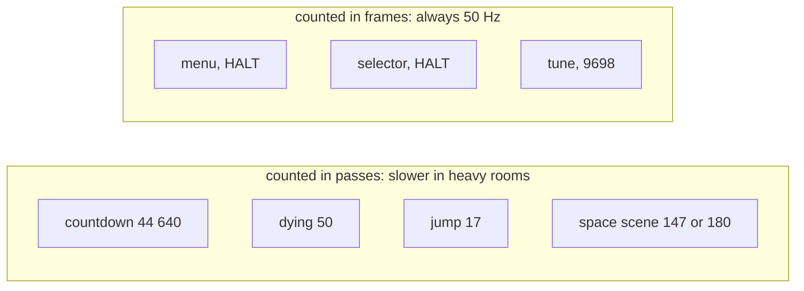

**The point**: only the menu, the selector and the music run on the frame. Everything the player meets in play runs
on the pass, so play is about 25 % slower in the lab (3.11 frames a pass) than in room `$08` (2.40).

## 4.9 Known only from the code

- The freeze: Q + A, FreezeWhileA `$9062`.
- The time running out in a real game: seen only on a clone with the countdown poked (probe A).
- EndGame's tile-set swap: every game in the recordings ended in a base-set room.
- The life-loss cheat path at `$8F41` (InfiniteLives = 1).
- The 48K handler and its silence: no 48K run reached play.
- The telescope's countdown view.
- The statuses never executed: 9-12, 15-17, 19, 23 (seen only on probe C), 30-33.
