# 5. Controls

What this covers:

- the input devices and every port the game, the selector and Help read;
- the device menu: 1, 2 and 3 choose the device, 0 starts;
- the three readers of play: the keyboard Z X O K SPACE, the Kempston port `$1F` and the Sinclair keys 6-0;
- ReadControls, which returns 0 for opposite directions in A but keeps the raw reading in E;
- the cursor-key readers, which no path reaches;
- the selector's input: every device at once, the Kempston probe, the cursor and its boxes, the Help keys;
- the path from the input byte to the hero: walking, jumping, climbing, the hover;
- the other play keys: T thinks, S swaps the held item, 1 and 2 scroll the bearers;
- the abort (Q + CAPS SHIFT) and the freeze (Q + A).

The recordings it rests on (WALKTHROUGH 6.0; all on the 128K, every load at ROM speed):

| Recording | Used for |
| --- | --- |
| `explorers` | five games from the device menu (Kempston twice, the keyboard, Sinclair, Kempston), each ended by CAPS SHIFT + Q, then Help. Round 3, the keyboard, gives the menu keys (1 at frame 5138, 0 at 5223), the selector (X from 5548, K from 5588, SPACE at 5648), the walk (X from 5958), the bearer key 1 (6470), T (6590), 5 (6750), Z (6860), 0 (7322) and CAPS SHIFT + Q (7642). Round 4 gives the Sinclair reads (frames 8219-10185). Help runs from the fire at frame 13660 (the cursor moves there from 13560) to the end of the script, 15190: the screen of frame 15000 still shows page 1, so the ENTER at 14780 did not return to the selector |
| `c1` | the menu keys 1, 3, 2 and 0; the selector moved by the Kempston; one abort |
| `gameover` | the RZX state at 10000 with Lives `$5B97` poked to 1 (a POKE): the RZX player's Kempston keys from `tests/inputs/gameover.txt`, with jumps at frames 2, 122, 289 and 749 |
| `rzx02000` | a segment of the RZX archive's run (another player's game, replayed from its port reads as Kempston keys): a ladder climbed down over frames 1003-1110 and up over 1136-1232 |
| the 31 `rzx` segments | the counts of runs (L1 builds) |

Conventions:

- **A frame** is 1/50 s of the 128K, 70 908 T. **A pass** is one turn of the main loop ([terms](README.md#terms)); in
  play it takes 2.4-3.3 frames ([doc 4](04-game-loop.md)).
- A value read with `time_travel memory_at` is the memory at the start of the frame named. So a sample of frame N
  shows what the passes that ended before frame N did.
- A trace puts an instruction in the frame where it ran, with its T-state in that frame ("frame 6001 T 35101").
- The keys of an input script are held from their frame on. A script's frame is a frame of the recording.
- Counts of runs are from the L1 builds (`work/stage1/*/l1.json`) of `c1`, `explorers`, `gameover` and the 31 `rzx`
  segments: 34 builds.
- The SkoolKit disassembly of the game by nzeemin (`work/candidates/skoolkit-game-revs/terramex-zx`, "SK" below)
  named the readers first. Where this document reads the code differently, it says so in 5.10.

## 5.1 The devices and the ports

The game reads three devices: the keyboard, a Kempston joystick on port `$1F`, and a Sinclair joystick, which is the
keys 6 to 0. The player chooses one on the device menu. The choice goes to InputDevice `$94AF`: 0 the keyboard, 1
the Kempston, 2 Sinclair. In play only the chosen device is read. The explorer selector, which runs before each game,
reads all three at once.

A keyboard half row is read by putting its select byte in the high byte of the port address. The game does this in
two ways: `LD BC,$xxFE` then `IN A,(C)`, or `LD A,$xx` then `IN A,($FE)`. A bit of the result is 0 while its key is
down. Bit 0 is the key at the outer end of the half row.

| High byte | Bit 0 | Bit 1 | Bit 2 | Bit 3 | Bit 4 |
| --- | --- | --- | --- | --- | --- |
| `$FE` | CAPS SHIFT | Z | X | C | V |
| `$FD` | A | S | D | F | G |
| `$FB` | Q | W | E | R | T |
| `$F7` | 1 | 2 | 3 | 4 | 5 |
| `$EF` | 0 | 9 | 8 | 7 | 6 |
| `$DF` | P | O | I | U | Y |
| `$BF` | ENTER | L | K | J | H |
| `$7F` | SPACE | SYMBOL SHIFT | M | N | B |

The game's IN instructions, with their runs summed over the 34 builds:

| Address | Routine | What it reads | Runs |
| --- | --- | --- | ---: |
| `$946C` | MenuKeys `$9468` | `$F7FE`: 1, 2, 3 choose the device | 6 836 |
| `$948A` | MenuKeys | `$EFFE` bit 0: 0 starts | 6 836 |
| `$B8A6` | ReadDevice `$B894` | `$EFFE`: Sinclair 6 7 8 9 0 | 853 |
| `$B8CC` | ReadKempston `$B8CC` | port `$1F` | 24 910 |
| `$B8D7`, `$B8E2` | ReadCursorKeys `$B8D4` | `$F7FE` bit 4 and `$EFFE`: 5 6 7 8 0 | 0 |
| `$B901`, `$B90C`, `$B91D`, `$B928` | ReadKeyboard `$B8FE` | SPACE, Z and X, O, K | 849 each |
| `$B031` | ThinkKey `$B02E` | `$FBFE` bit 4: T | 16 037 |
| `$BA40` | ItemsKeys `$BA36` | `$FDFE` bit 1: S | 26 514 |
| `$BC24` | BearerKeys `$BC1F` | `$F7FE` bits 0 and 1: 1 and 2 | every pass with no scroll running |
| `$9052` | the end of MainLoop `$9018` | `$FBFE` bit 0: Q | every pass |
| `$905C` | the end of MainLoop | `$FEFE` bit 0: CAPS SHIFT, after Q | 6 |
| `$9064` | FreezeWhileA `$9062` | `$FDFE` bit 0: A, after Q | 0 |

The selector in RAM 1 has its own copies of the readers, and Help has its own keys:

| Address | Routine | What it reads |
| --- | --- | --- |
| `$C3D1` | KempstonProbe `$C3D1` | port `$1F`, 256 times in a row |
| `$C416` | the selector's ReadDevice `$C403` | `$EFFE`: Sinclair |
| `$C43C` | the selector's ReadKempston `$C43C` | port `$1F` |
| `$C447`, `$C452` | the selector's ReadCursorKeys `$C444` | 5 6 7 8 0, never reached |
| `$C471`, `$C47C`, `$C48D`, `$C498` | the selector's ReadKeyboard `$C46E` | SPACE, Z and X, O, K |
| `$C2B1` | ShowStopTape `$C295` | SPACE (the 48K's "stop the tape" screen) |
| `$C544` | WaitKeysUp `$C543` | all half rows at once (48K only) |
| `$C5E7`, `$C5F0` | WaitSpaceOrEnter `$C5E4` | SPACE and ENTER on the Help pages |

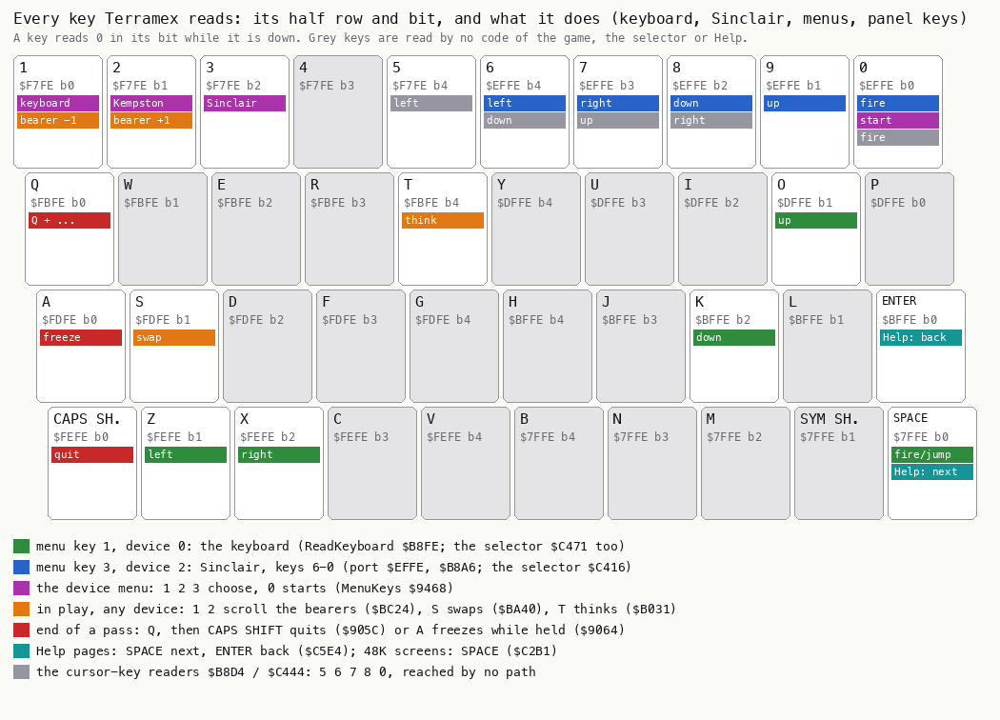

*Figure 5.1: every key the code reads, with its half row, its bit and its uses. Drawn from the IN sites of
`build/game.lst` and `build/select.lst`: `python3 tools/fig_controls.py keyboard --out
docs/img/controls/keyboard.png`. No recording: the figure is the code's data.*

How to read:

- One box per key, in the keyboard's layout.
- The grey line in a box is the half row's port and the bit that reads 0 while the key is down.
- White keys are read by some code; grey keys are read by no code of the game, the selector or Help.
- The coloured tags name each use. Green is the keyboard device, blue Sinclair, purple the device menu, orange the
  panel keys of play, red the end of a pass, teal Help, grey the cursor readers that nothing calls.

The point: the controls are five directions and a fire button on any device. Around them are a few fixed keys: 1, 2
and S for the bearers, T to think, Q with CAPS SHIFT or A at the end of a pass. Nothing can be redefined.

### The input byte InputBits `$B87C`

Every reader leaves one byte in InputBits `$B87C`. The byte uses the Kempston interface's own order: bit 0 right, 1
left, 2 down, 3 up, 4 fire. A set bit means "pressed". The Kempston reading is stored as it comes. The keyboard and
Sinclair readers start from 0 and set one bit for each key down.

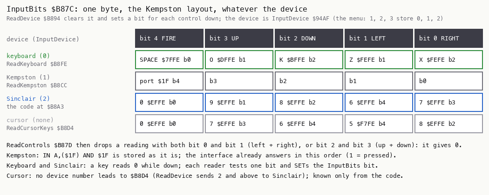

*Figure 5.2: which key or port bit sets each bit of InputBits, for each device. Drawn from ReadDevice `$B894` and its
readers in `build/game.lst`: `python3 tools/fig_controls.py bits --out docs/img/controls/inputbits.png`. No
recording.*

How to read:

- One row per reader, one column per bit of InputBits.
- Each cell names the key and its port bit, or the Kempston port's bit.
- The grey row is the cursor reader at `$B8D4`, which no device number selects (5.5).

The point: after the reader, nothing in the game knows which device was used. The hero, the jump and the climb all
read the same five bits.

## 5.2 The device menu

DeviceMenu `$93AF` draws the menu once: the frame cut from the saved panel, the logo, the Earth and the Moon
(DrawMenuGlobes `$9F27`), the four options and the credits. Then it loops once a frame in MenuLoop `$9440` and
MenuKeys `$9468`:

1. MenuLoop paints attribute `$43` on the option box (5 rows of 14 cells at row 8, column 8).
2. It paints attribute `$47` on the 14 cells of the chosen device's row. The row is 8 + 2 x InputDevice. This white
   bar is the only sign of the choice.
3. MenuKeys halts for the interrupt. Then it reads the half row `$F7FE` (keys 1-5) and keeps bits 0-4.
4. `$1E` (only 1 down) stores device 0. `$1D` (only 2) stores 1. `$1B` (only 3) stores 2. Any other value stores
   nothing: two keys at once, 4, 5, or no key.
5. It reads key 0. B is reloaded with `$EF` and C still holds `$FE`, so the port is `$EFFE`. Bit 0 at 0 returns to
   RunSelector `$8F4A`, after the CALL in NewGame `$8F47`.
6. Otherwise it jumps back to MenuLoop.

Pseudocode:

```text
DeviceMenu:
    draw the menu
    loop:                                   ; MenuLoop $9440, once a frame
        paint the 5 x 14 box at row 8, column 8 with $43
        paint row 8 + 2 * InputDevice, columns 8-21, with $47
        HALT                                ; MenuKeys $9468
        a = IN($F7FE) AND $1F
        if a == $1E: InputDevice = 0        ; 1 alone: keyboard
        if a == $1D: InputDevice = 1        ; 2 alone: Kempston
        if a == $1B: InputDevice = 2        ; 3 alone: Sinclair
        if IN($EFFE) bit 0 == 0: return     ; 0: start
```

The keys, from `build/game.lst`:

```text
9468 76          HALT                    ; one turn a frame
9469 01 FE F7    LD BC,$F7FE             ; keys 1-5
946C ED 78       IN A,(C)
946E E6 1F       AND $1F
9470 FE 1F       CP $1F
9472 28 14       JR Z,MenuCheckStart
9474 1E 00       LD E,$00                ; 1: E = 0 (keyboard), 2: 1 (Kempston), 3: 2
9476 FE 1E       CP $1E
9478 28 0A       JR Z,MenuSetDevice
947A 1C          INC E
947B FE 1D       CP $1D
947D 28 05       JR Z,MenuSetDevice
947F 1C          INC E
9480 FE 1B       CP $1B
9482 20 04       JR NZ,MenuCheckStart
9484 7B          LD A,E                  ; MenuSetDevice
9485 32 AF 94    LD (InputDevice),A
9488 06 EF       LD B,$EF                ; MenuCheckStart: key 0 starts the game
948A ED 78       IN A,(C)
948C E6 01       AND $01
948E C8          RET Z
948F 18 AF       JR MenuLoop
```

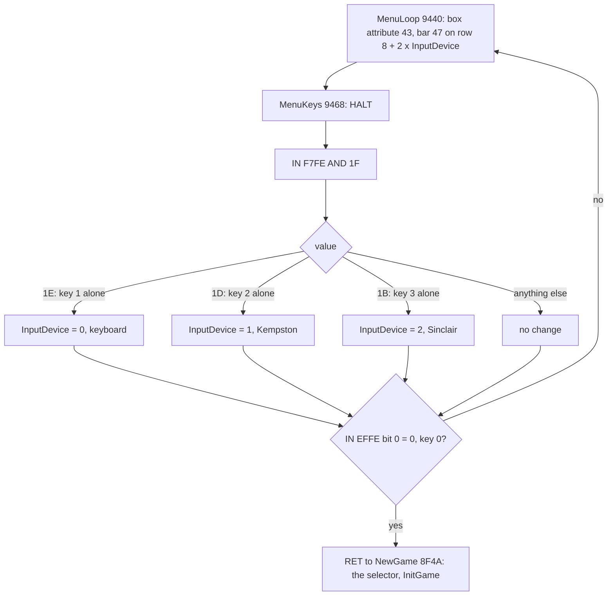

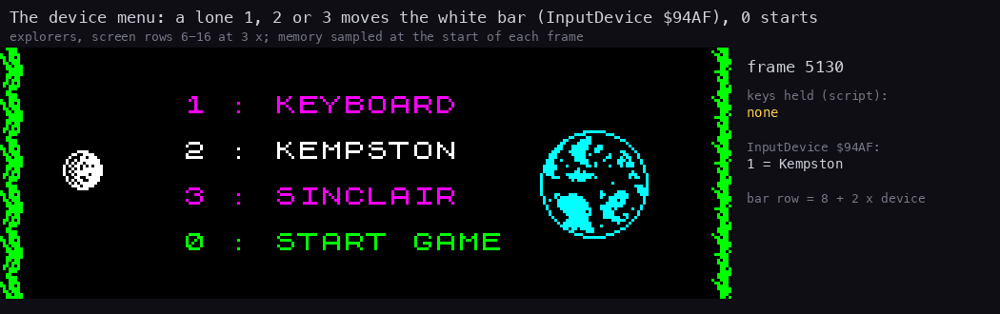

*Animation 5.1: the device menu over frames 5130-5226 of `explorers` (round 3), one picture every 2 frames. Screen
rows 6-16 at 3 x, sampled at each frame's start, with the keys the input script holds and InputDevice `$94AF`:
`python3 tools/fig_controls.py menu --work work/docs/tmB/explorers --inputs tests/inputs/explorers.txt --from 5130
--to 5226 --step 2 --out docs/img/play/device-menu-keys.gif`, the instance opened on
`work/stage1/explorers/session.ttd` with `kit/rs.py open --model 128K`.*

How to read:

- Left: the menu as the screen shows it. The white option is the chosen device.
- Right: the frame number, the keys the input script holds, and InputDevice.
- The bar moves from KEMPSTON to KEYBOARD when 1 is pressed at frame 5138. The screen goes black after 0 at frame
  5223: the selector clears it.

Worked example (`explorers` round 3). Round 2 ended with InputDevice = 1, so the sample of frame 5130 shows the bar
on row 10, KEMPSTON. The script holds 1 from frame 5138. The next MenuKeys reads `$F7FE` as `$1E` after `AND $1F`.
E stays 0, so InputDevice = 0. The next MenuLoop paints row 8 + 2 x 0 = 8 white. The sample of frame 5143 shows
InputDevice = 0 and the bar on KEYBOARD. The script holds 0 from frame 5223. `IN A,(C)` with BC = `$EFFE` gives bit
0 = 0, and `RET Z` returns to RunSelector `$8F4A` (after the CALL in NewGame `$8F47`).

Witness: MenuKeys ran 6 836 times in 5 builds (`c1`, `explorers`, `gameover`, and two `rzx` segments that end in the
menu). `c1` chose 1, 3 and 2, then 0; `explorers` chose all three devices.

The point: the menu reads only the keyboard, even for a joystick player. A key pressed with another one does
nothing, so a hand resting on the row cannot change the device by accident.

## 5.3 ReadDevice `$B894` and the three readers

In play, ReadControls `$B87D` calls ReadDevice `$B894` once a pass. ReadDevice clears InputBits, picks a reader by
InputDevice, and returns InputBits in A through InputBitsOut `$B930`.

1. **The keyboard** (ReadKeyboard `$B8FE`): SPACE (`$7FFE` bit 0) is fire, Z (`$FEFE` bit 1) left, X (`$FEFE` bit
   2) right, O (`$DFFE` bit 1) up, K (`$BFFE` bit 2) down. Each key down sets its bit with `SET n,(HL)`.
2. **The Kempston** (ReadKempston `$B8CC`): `IN A,($1F)`, `AND $1F`, stored as it is. The interface already answers
   in this order, with 1 for pressed.
3. **Sinclair** (the code from `$B8A3`): the half row `$EFFE`. 0 (bit 0) is fire, 6 (bit 4) left, 7 (bit 3) right,
   9 (bit 1) up, 8 (bit 2) down. Any device number other than 0 and 1 lands here.

Pseudocode:

```text
ReadDevice:                                 ; $B894
    InputBits = 0
    if InputDevice == 0:                    ; ReadKeyboard $B8FE
        if IN($7FFE) bit 0 == 0: set bit 4  ; SPACE fire
        a = IN($FEFE)
        if a bit 1 == 0: set bit 1          ; Z left
        if a bit 2 == 0: set bit 0          ; X right
        if IN($DFFE) bit 1 == 0: set bit 3  ; O up
        if IN($BFFE) bit 2 == 0: set bit 2  ; K down
    elif InputDevice == 1:                  ; ReadKempston $B8CC
        InputBits = IN($1F) AND $1F
    else:                                   ; Sinclair, $B8A3
        a = IN($EFFE) AND $1F
        if a bit 0 == 0: set bit 4          ; 0 fire
        if a bit 4 == 0: set bit 1          ; 6 left
        if a bit 3 == 0: set bit 0          ; 7 right
        if a bit 1 == 0: set bit 3          ; 9 up
        if a bit 2 == 0: set bit 2          ; 8 down
    return InputBits                        ; InputBitsOut $B930
```

The dispatch, the Sinclair start, the Kempston and the keyboard's start, from `build/game.lst`:

```text
B894 21 7C B8    LD HL,InputBits         ; ReadDevice
B897 36 00       LD (HL),$00
B899 3A AF 94    LD A,(InputDevice)
B89C B7          OR A
B89D CA FE B8    JP Z,ReadKeyboard
B8A0 3D          DEC A
B8A1 28 29       JR Z,ReadKempston
B8A3 01 FE EF    LD BC,$EFFE             ; device 2: Sinclair, keys 6 7 8 9 0
B8A6 ED 78       IN A,(C)
B8A8 E6 1F       AND $1F
B8AA CB 47       BIT 0,A
B8AC 20 02       JR NZ,SinclairLeft
B8AE CB E6       SET 4,(HL)
...
B8CC DB 1F       IN A,($1F)              ; ReadKempston: device 1, Kempston port $1F
B8CE E6 1F       AND $1F
B8D0 77          LD (HL),A
B8D1 C3 30 B9    JP InputBitsOut
...
B8FE 01 FE 7F    LD BC,$7FFE             ; ReadKeyboard: SPACE
B901 ED 78       IN A,(C)
B903 CB 47       BIT 0,A
B905 20 02       JR NZ,KeyZ
B907 CB E6       SET 4,(HL)
B909 01 FE FE    LD BC,$FEFE             ; Z (port $FEFE bit 1): left
B90C ED 78       IN A,(C)
B90E CB 4F       BIT 1,A
B910 20 02       JR NZ,KeyX
B912 CB CE       SET 1,(HL)
B914 CB 57       BIT 2,A                 ; X (bit 2): right
...
B930 7E          LD A,(HL)               ; InputBitsOut
B931 C9          RET
```

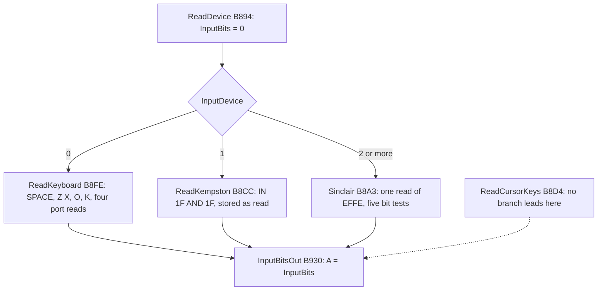

Worked example (`explorers`, the keyboard round). At frame 6001 the script holds X. A trace of frames 6001-6004 puts
ReadControls at frame 6001 T 35101, ReadDevice's InputBitsOut `$B930` at T 35370 and ReadControls' `RET` at T
35456: 365 T for the call with its `RET`, four port reads included (Z and X share the one `IN` of `$FEFE`). The `$FEFE`
read gives bit 2 = 0, so `SET 0,(HL)` runs, and InputBits = `$01`. The hero moves 2 pixels right in the same pass
(5.7).

Witness: ReadKeyboard ran 849 times, only in `explorers`, over frames 5675-7641 (the keyboard round). The Sinclair
code ran 853 times, only in `explorers`, over frames 8219-10185 (round 4). ReadKempston ran 24 910 times in all 34
builds: every other round and the whole RZX run, which plays with the Kempston.

What a missing Kempston gives: with the Kempston chosen and nothing on port `$1F`, a read that returns `$FF` becomes
`$1F` after `AND $1F`. That is all five bits at once, left with right and up with down. ReadControls (5.4) turns it
into 0, so the hero stands still. This follows from the code only; the recordings all had a Kempston interface.

The point: the three readers give the same byte. The Kempston costs one IN; the keyboard costs four. A pass of 2.4 to
3.3 frames reads the device only once, so a tap shorter than a pass can be missed.

## 5.4 ReadControls `$B87D`: opposite directions cancel in A

ReadControls calls ReadDevice, then looks at the pairs. Left with right gives A = 0. Up with down gives A = 0. Fire is
lost with them: the whole byte becomes 0. The cancel clears A only: E keeps the raw reading (`LD E,A` at `$B880`).

```text
ReadControls:                               ; $B87D
    e = ReadDevice()                        ; E = the raw reading, kept on every path
    if e AND 3 == 3: return a = 0           ; left and right
    if e AND $0C == $0C: return a = 0       ; up and down
    return a = e
```

```text
B87D CD 94 B8    CALL ReadDevice
B880 5F          LD E,A
B881 E6 03       AND $03
B883 FE 03       CP $03
B885 20 02       JR NZ,ReadControlsUpDown
B887 AF          XOR A
B888 C9          RET
B889 7B          LD A,E                  ; ReadControlsUpDown: up and down both?
B88A E6 0C       AND $0C
B88C FE 0C       CP $0C
B88E 20 02       JR NZ,ReadControlsDone
B890 AF          XOR A
B891 C9          RET
B892 7B          LD A,E                  ; ReadControlsDone
B893 C9          RET
```

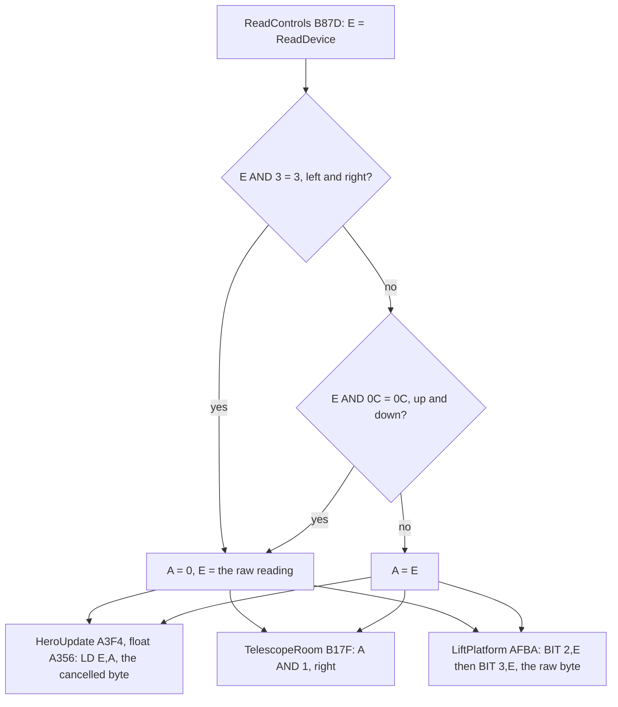

Worked example: Kempston up + down + fire reads `$1C`. `$1C AND $03` = 0, so the first test passes. `$1C AND $0C` =
`$0C`, so the second test returns 0, and the fire is lost too.

Its callers, and which output each uses:

| Caller | Call at | Uses | Effect of a cancel |
| --- | --- | --- | --- |
| HeroUpdate `$A3E1` (every pass) | `$A3F4` | A, copied to E by `LD E,A` at `$A3F7` | no move, no jump |
| FloatInRoom2C `$A34B` (room `$2C`'s float) | `$A356` | A, copied to E at `$A359` | no velocity change |
| LiftPlatform `$AF81` | `$AFBA` | E, the raw reading (`BIT 2,E` at `$AFBD`, then `BIT 3,E`) | none: up + down gives down, status 20 |
| TelescopeRoom `$B16A` (room `$12`) | `$B17F` | A AND 1: right sets status `$1E` | no telescope view |

On the lift, up + down together is not cancelled: E still has both bits, `BIT 2,E` (down) is tested first, and the
status becomes 20. This is known only from the code: no recording holds opposite keys (5.11).

Witness: ReadControls ran 26 612 times in 34 builds. Its two cancel branches (`$B887`, `$B890`) ran in no recording.

The point: no keyboard player can press Z and X together to get a strange move. The cost is the fire: a jump
pressed with both directions is not taken. The lift escapes the rule only because it tests E, not A.

## 5.5 The cursor-key readers (known only from the code)

ReadCursorKeys `$B8D4` reads the cursor keys: 5 left (`$F7FE` bit 4), 8 right, 7 up, 6 down and 0 fire (`$EFFE` bits
2, 3, 4 and 0). No instruction calls it or jumps to it. ReadDevice sends every device number above 1 to the Sinclair
code, so no menu choice reaches it. SK left these bytes as data.

```text
B8D4 01 FE F7    LD BC,$F7FE             ; ReadCursorKeys
B8D7 ED 78       IN A,(C)
B8D9 CB 67       BIT 4,A                 ; 5 (port $F7FE bit 4): left
B8DB 20 02       JR NZ,CursorRow2
B8DD CB CE       SET 1,(HL)
B8DF 01 FE EF    LD BC,$EFFE             ; port $EFFE: 0 fire
B8E2 ED 78       IN A,(C)
B8E4 CB 47       BIT 0,A
B8E6 20 02       JR NZ,CursorRight
B8E8 CB E6       SET 4,(HL)
B8EA CB 57       BIT 2,A                 ; 8: right
B8EC 20 02       JR NZ,CursorUp
B8EE CB C6       SET 0,(HL)
B8F0 CB 5F       BIT 3,A                 ; 7: up
B8F2 20 02       JR NZ,CursorDown
B8F4 CB DE       SET 3,(HL)
B8F6 CB 67       BIT 4,A                 ; 6: down; RET NZ when released (A = the port byte)
B8F8 C0          RET NZ
B8F9 CB D6       SET 2,(HL)
B8FB C3 30 B9    JP InputBitsOut
```

The reader has a bug. When 6 is up, `RET NZ` at `$B8F8` returns at once. A then holds the port byte, not InputBits:
a value with bits 5-7 set, and with bits set for the keys that are not pressed. Only with 6 held does the code reach
InputBitsOut. The selector's copy at `$C444` has the same shape and is not reached either.

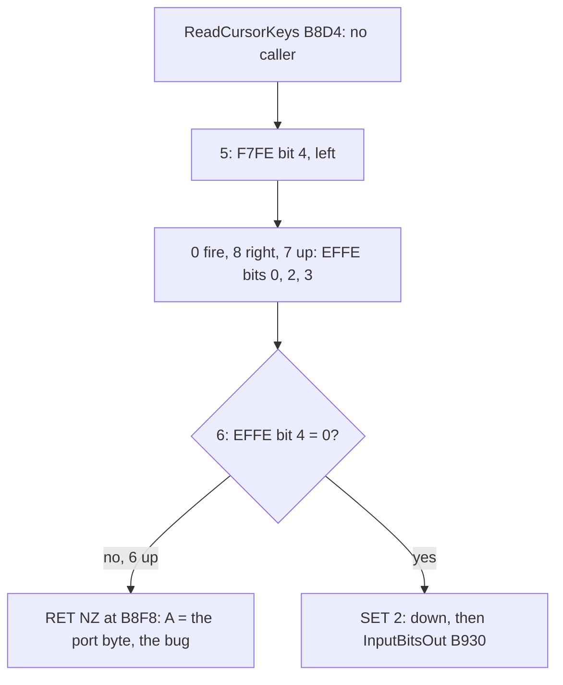

Worked example (on paper): cursor keys 5 + 0 down, 6 up. `$F7FE` bit 4 is 0, so bit 1 is set. `$EFFE` reads `$BE`
(bit 0 at 0), so bit 4 is set; bits 2 and 3 are 1, so right and up stay clear. Bit 4 of `$BE` is 1: `RET NZ`. A =
`$BE` instead of InputBits `$12`. Through ReadControls, `$BE AND 3` = 2 and `$BE AND $0C` = `$0C`: the up + down test
returns 0. The hero would ignore 5 + 0 unless 6 was held too.

Witness: the L1 builds show no execution of `$B8D4-$B8FD` or of `$C444-$C46D` in any of the 34 builds.

The point: the code once had a fourth device, the cursor keys (a Protek or AGF interface). The menu offers three,
and the reader stayed behind with a bug no player could meet.

## 5.6 The selector's input

The explorer selector runs in RAM 1 on a 128K. NewGame pages it in (`$7FFD` = `$11`), calls `$C000`, and pages RAM
0 back (`$10`). It has its own copy of the readers, with its own InputBits `$C3BD` and InputDevice `$C3BE`. It does
not use the menu's choice.

### ReadAnyDevice `$C3BF` and the Kempston probe

Each frame the selector polls every device, in this order:

1. The keyboard (device 0) through ReadDeviceFiltered `$C3EC`, which drops opposite pairs like ReadControls. A
   non-zero reading returns at once.
2. The Kempston, if one answers. KempstonProbe `$C3D1` ORs 256 reads of port `$1F` into C. If bits 5-7 of the OR
   are all 0, a Kempston is taken to be there, and it is read. A port that reads `$FF` fails the test.
3. Sinclair, last. After it InputBits is cleared, but A keeps the reading.

```text
ReadAnyDevice:                              ; $C3BF
    device = 0; a = ReadDeviceFiltered(); if a: return a
    device = 1
    c = 0; repeat 256: c |= IN($1F)         ; KempstonProbe $C3D1
    if c AND $E0 == 0:
        a = ReadDeviceFiltered(); if a: return a
    device = 2; a = ReadDeviceFiltered()
    InputBits = 0
    return a
```

```text
C3BF AF          XOR A
C3C0 32 BE C3    LD (InputDevice),A
C3C3 CD EC C3    CALL ReadDeviceFiltered
C3C6 B7          OR A
C3C7 C0          RET NZ
C3C8 3E 01       LD A,$01                ; the keyboard gave nothing: Kempston, if one answers
C3CA 32 BE C3    LD (InputDevice),A
C3CD 06 00       LD B,$00
C3CF 0E 00       LD C,$00
C3D1 DB 1F       IN A,($1F)              ; KempstonProbe: port $1F ORed over 256 reads
C3D3 B1          OR C
C3D4 4F          LD C,A
C3D5 10 FA       DJNZ KempstonProbe
C3D7 79          LD A,C
C3D8 E6 E0       AND $E0
C3DA 20 05       JR NZ,TrySinclair
C3DC CD EC C3    CALL ReadDeviceFiltered
C3DF B7          OR A
C3E0 C0          RET NZ
C3E1 3E 02       LD A,$02                ; TrySinclair: the last; InputBits cleared after
C3E3 32 BE C3    LD (InputDevice),A
C3E6 CD EC C3    CALL ReadDeviceFiltered
C3E9 36 00       LD (HL),$00
C3EB C9          RET
```

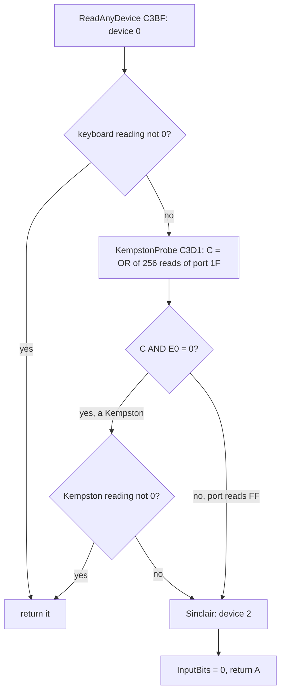

Worked example: on our instance the Kempston card answers 0 with the stick at rest. The probe's OR is 0, so the test
passes each frame. The reading is 0, so the poll goes on to Sinclair. In `c1`, 796 of the 1127 calls reached Sinclair
this way.

Witness: ReadAnyDevice ran 3 526 times in 3 builds (`c1`, `explorers`, `r00000`). The probe's loop ran 881 920
times: 256 for each of 3 445 probes. In `explorers` the keyboard's fire and right were taken (`$C477`, `$C488`), and
Sinclair's left and fire (`$C424`, `$C41E`).

The point: the selector lets any device choose the explorer. The probe is the only Kempston detection in the program,
and play does not use it.

### The cursor and its boxes

SelectorLoop `$C112` turns once a frame: DrawCursor `$C314`, MoveCursor `$C1D5`, a test of fire, then HALT and
RestoreUnderCursor `$C1A2`. MoveCursor moves CursorXY `$C4A2` 2 pixels a frame: x from 0 to `$E8`, y from 0 to `$A8`.
Then ClassifyCursor `$C206` tests six boxes in turn and stores the answer in Explorer `$5B70`: 0-4 an explorer, `$FE`
Help, `$FF` nothing. Fire on an explorer copies the explorer's 64 frames (`$1200` bytes) to `$6000`. Fire on Help
shows the pages. Fire on nothing does nothing.

```text
SelectorLoop:                               ; $C112, once a frame
    DrawCursor()                            ; $C314: the hand at CursorXY, masked
    e = MoveCursor()                        ; $C1D5: ReadAnyDevice, x +- 2, y +- 2, classify
    if e bit 4 and Explorer != $FF:
        if Explorer == $FE: ShowHelp()      ; $C536
        else: copy the explorer's set to $6000 and return
    HALT
    RestoreUnderCursor()                    ; $C1A2
```

```text
C1D5 CD BF C3    CALL ReadAnyDevice      ; MoveCursor
C1D8 5F          LD E,A
C1D9 2A A2 C4    LD HL,(CursorXY)        ; L = x, H = y
C1DC CB 43       BIT 0,E                 ; right: x + 2 below $E8
C1DE 28 07       JR Z,MoveLeft
C1E0 7D          LD A,L
C1E1 FE E8       CP $E8
C1E3 30 02       JR NC,MoveLeft
C1E5 2C          INC L
C1E6 2C          INC L
...
C206 22 A2 C4    LD (CursorXY),HL        ; ClassifyCursor: C = 0, Fortisque-Smithe's box
C209 0E 00       LD C,$00
C20B 7C          LD A,H
C20C FE 4D       CP $4D
C20E 30 0B       JR NC,TryKrusche
C210 7D          LD A,L
C211 FE 4C       CP $4C
C213 38 06       JR C,TryKrusche
C215 FE 91       CP $91
C217 30 02       JR NC,TryKrusche
C219 18 5B       JR StoreExplorer
```

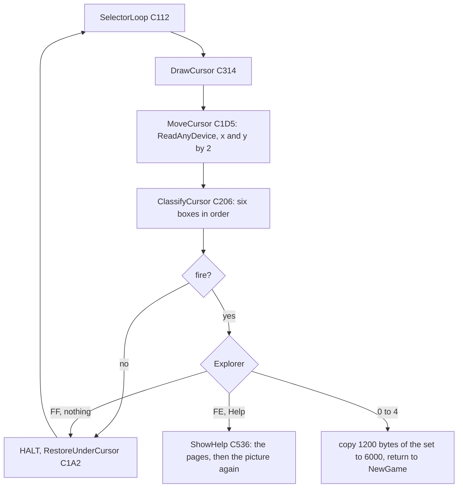

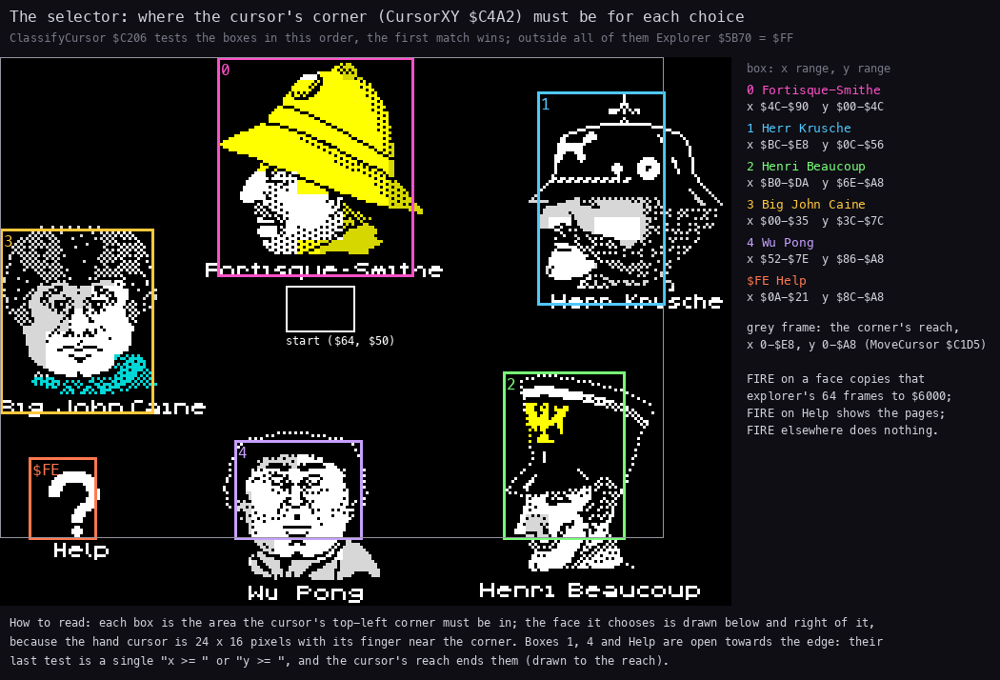

*Figure 5.3: the box each choice needs the cursor's corner in, over the selector picture. Drawn from the CP constants
of ClassifyCursor `$C206-$C275` in `build/select.lst` and `src/res/screens/selector.png`: `python3
tools/fig_controls.py selector --out docs/img/controls/selector-regions.png`. No recording.*

How to read:

- Each coloured box is where CursorXY, the cursor's top-left corner, must be for that choice.
- The hand is 24 x 16 pixels and points from its corner, so the boxes sit up and left of the faces.
- The white box is the start position, x `$64`, y `$50`. The grey frame is the corner's reach.
- The boxes are tested in order 0, 1, 2, 3, 4, Help. The first match wins.

Worked example (`explorers` round 3). The cursor starts at x `$64`, y `$50`: in no box, Explorer = `$FF`. The script
holds X from frame 5548 for 40 frames. The keyboard reading is `$01` each frame, so x rises 2 a frame: the samples
show `$68` at 5550, `$7C` at 5560 and `$B4` at 5588. K is held from 5588 for 40 frames, so y rises from `$50` to `$A0`
(sample of 5628). On the way, y passes `$6E` with x = `$B4`, inside `$B0-$DA`: box 2, Henri Beaucoup, and Explorer =
2. SPACE at 5648 sets bit 4, and the selector copies set 2 from RAM 4 at `$E400`. Round 3 is played by Henri
Beaucoup.

[DrawCursor.gif](img/routines/DrawCursor.gif) shows the drawing of the hand in that round, `explorers` frames
5550-5553 ([doc 6](06-rendering.md)).

Witness: MoveCursor and DrawCursor ran 3 526 times each in 3 builds.

The point: the cursor is a device-independent pointer. Its speed, 2 pixels a frame, is why the hand needs only four
pre-shifted frames.

### The Help keys and the 48K waits

Help shows its pages with PrintPage `$C574`. WaitSpaceOrEnter `$C5E4` then polls two keys: SPACE (`$7FFE` bit 0)
returns 1, the next page; ENTER (`$BFFE` bit 0) returns 0, back to the selector. The poll has no HALT; its loop ran
577 796 times in the Help part of `explorers` (frames 13660-15190; the cursor moves to Help from 13560).

The 128K path does not wait for the key to be let go (only the 48K's Help48KText goes through WaitKeysUp). A SPACE
held longer than a page takes to draw, about 8 frames, turns two pages. In `explorers` page 1 is drawn over frames
13857-13865, so the SPACE of 13820 falls in the title's pause and is lost. The SPACE held over 13980-13990 then shows
page 2 and at once page 3, which is on the screen at frame 14000 ([doc 8](08-hud-and-text.md), 8.4). PrintPage ran
10 times in all, 3 of them titles, for the six SPACEs.

Three more waits exist for other machines and loads:

- ShowStopTape `$C295` (a 48K only) shows "stop the tape" and waits for SPACE (`$C2B1`).
- WaitKeysUp `$C543` (a 48K only) reads all half rows at once (`IN A,($FE)` with A = 0) until no key is down.
- The BASIC loader's KeyReleaseWait `$5D64` cycles the border while any key is down ([doc 3](03-build-and-load.md)).

No 48K run reached play in the recordings; these waits are known only from the code.

## 5.7 From the input to the hero

HeroUpdate `$A3E1` runs once a pass, from MainLoop. Its input part:

1. RunRoomScript `$B7DD`; IY = the probe record HeroProbes `$A0FE`.
2. A frame list in progress (FrameListPtr `$AEED` not 0) replaces the whole update: no input then.
3. E = ReadControls. With status 0, StatusZeroTriggers `$AF3B`.
4. HeroSavedXY `$5C09` = X, Y: walls and refusals put the hero back there.
5. StatusDispatch `$A6CC`. A status other than 0 runs its handler, which drops the return and ends the update
   ([doc 4](04-game-loop.md)).
6. TeleportPadCheck `$B03B`; standing (probe `+3` = 0): ThinkKey `$B02E` (5.8).
7. Holding item `$0A` (the vacuum cleaner) in room `$14` or `$08`: status 4 (Hover `$AD32`), frame `$1D`, Y - 8.
8. While falling (Falling `$5C04` not 0) E = 0: no control in the air.
9. Fire: a jump, if the hero stands, is not on the lift (NotOnLift `$5BA0` not 0), is not on the unicycle
   (UnicycleFrames `$5BFA` = 0) and, in room `$1A`, has Y >= `$3A`. StartJump `$A465` sets status 2, RefuseCount
   `$5C03` = `$82`, JumpDirection `$5C08` = E, and plays sound 6.
10. Right: facing bit 7 of the flags set, X + 2; X >= `$E8` leaves by ExitRight `$A671`.
11. Left: facing bit 7 clear, X - 2; X < 4 leaves by ExitLeft `$A640`.
12. Down: only when OnLadder `$A193` sees a ladder tile under the middle of the feet; Y + 2. Y >= `$67` leaves by
    ExitDown `$A6AE`.
13. Up: only on a ladder; Y - 2. Above the top it leaves by ExitUp `$A69B`. In room `$18` ClimbOutTop `$A4F1` calls
    ExitUp too, then sets Y = `$60`, JumpDirection = 0 and status 3 (a hop), not the climb-out status.
14. Climbing sets the frame to `$20 + (Y AND 6) / 2`: four climb frames by height.
15. Otherwise the probes HeroTileChecks `$A102`: a wall puts X back; then the ladder, landing, falling (4 pixels a
    pass) or a refusal of a big drop ([doc 10](10-gameplay-logic.md)).
16. HeroWalkFrames `$A5E3`: with any direction, on every second pass (PassCount odd) the walk frame steps, frame + 1
    AND 3. With no direction the frame is 2, standing. Holding the Flute (item `$0C`) adds `$10` to frames 0-3.

```text
HeroUpdate:                                 ; $A3E1, once a pass
    RunRoomScript()
    if FrameListPtr: play the frame list; return
    e = ReadControls()
    HeroSavedXY = (X, Y)
    StatusDispatch()                        ; a status other than 0 ends the update here
    TeleportPadCheck()
    if standing: ThinkKey()
    if HeldItem == $0A and Room in ($14, $08): Status = 4; frame = $1D; Y -= 8; return
    if Falling: e = 0
    if e.fire and standing and NotOnLift and not UnicycleFrames and (Room != $1A or Y >= $3A):
        Status = 2; RefuseCount = $82; JumpDirection = e; PlaySound(6); return
    if e.right: facing right; X += 2; if X >= $E8: ExitRight
    if e.left:  facing left;  X -= 2; if X < 4: ExitLeft
    if e.down and OnLadder(Y + 1): Y += 2; if Y >= $67: ExitDown; frame = $20 + (Y AND 6) / 2; return
    if e.up and OnLadder: Y -= 2; if Y < 0: ExitUp (room $18: then Y = $60, JumpDirection = 0, status 3)
        frame = ...; return
    probes, walls, ladder, land, fall or refuse
    walk frames
```

The fire and the walk, from `build/game.lst`:

```text
A43F 3A 04 5C    LD A,(Falling)          ; HeroInput: falling, no input
A442 B7          OR A
A443 28 02       JR Z,HeroFire
A445 1E 00       LD E,$00
A447 CB 63       BIT 4,E                 ; HeroFire: fire, a jump if allowed
A449 28 3C       JR Z,HeroRight
A44B 3A A0 5B    LD A,(NotOnLift)
A44E B7          OR A
A44F 28 36       JR Z,HeroRight
A451 3A FA 5B    LD A,(UnicycleFrames)
A454 B7          OR A
A455 20 30       JR NZ,HeroRight
A457 3A 01 5C    LD A,(Room)
A45A FE 1A       CP $1A
A45C 20 07       JR NZ,StartJump
A45E DD 7E 01    LD A,(IX+$01)
A461 FE 3A       CP $3A
A463 38 22       JR C,HeroRight
A465 DD 6E 00    LD L,(IX+$00)           ; StartJump: status 2 with the input as the direction
A468 DD 66 01    LD H,(IX+$01)
A46B 22 09 5C    LD (HeroSavedXY),HL
A46E FD 7E 03    LD A,(IY+$03)
A471 B7          OR A
A472 20 13       JR NZ,HeroRight
A474 3E 02       LD A,$02
A476 32 06 5C    LD (Status),A
A479 3E 82       LD A,$82
A47B 32 03 5C    LD (RefuseCount),A
A47E 7B          LD A,E
A47F 32 08 5C    LD (JumpDirection),A
A482 3E 06       LD A,$06
A484 C3 B2 C4    JP PlaySound
A487 CB 43       BIT 0,E                 ; HeroRight: 2 pixels, face right
A489 28 12       JR Z,HeroLeft
A48B DD CB 03 FE SET 7,(IX+$03)
A48F DD 34 00    INC (IX+$00)
A492 DD 34 00    INC (IX+$00)
A495 DD 7E 00    LD A,(IX+$00)
A498 FE E8       CP $E8
A49A D2 71 A6    JP NC,ExitRight
```

The climb up, with its frame:

```text
A4D1 CB 5B       BIT 3,E                 ; HeroUp: up, only on a ladder tile, 2 pixels
A4D3 28 38       JR Z,HeroProbe
A4D5 CD 93 A1    CALL OnLadder
A4D8 20 33       JR NZ,HeroProbe
A4DA DD 7E 01    LD A,(IX+$01)
A4DD 3D          DEC A
A4DE FA F1 A4    JP M,ClimbOutTop
A4E1 3D          DEC A
A4E2 FA F1 A4    JP M,ClimbOutTop
A4E5 DD 77 01    LD (IX+$01),A
A4E8 E6 06       AND $06                 ; ClimbFrame: frame $20 + (Y AND 6) / 2
A4EA 0F          RRCA
A4EB C6 20       ADD A,$20
A4ED DD 77 02    LD (IX+$02),A
A4F0 C9          RET
```

OnLadder `$A193` looks at the tile under the point (X + 12, Y + 23), the middle of the feet. Tiles `$98` and `$99`
are ladders in every room. Rooms below `$0C` also climb on `$92` and `$95`. With the alternate tile set the ladder
tiles are other numbers, tested from `$A1C3` ([doc 6](06-rendering.md)).

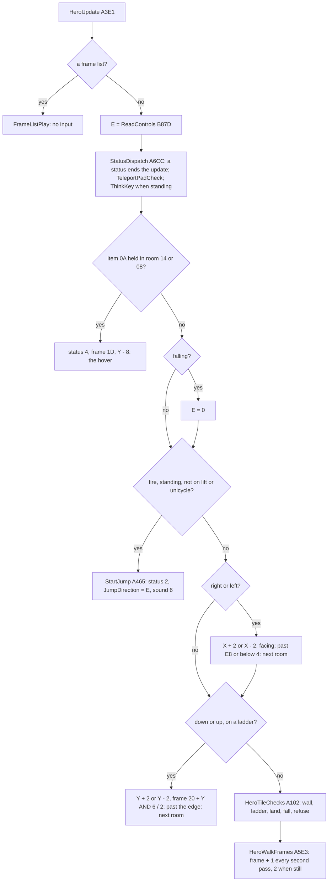

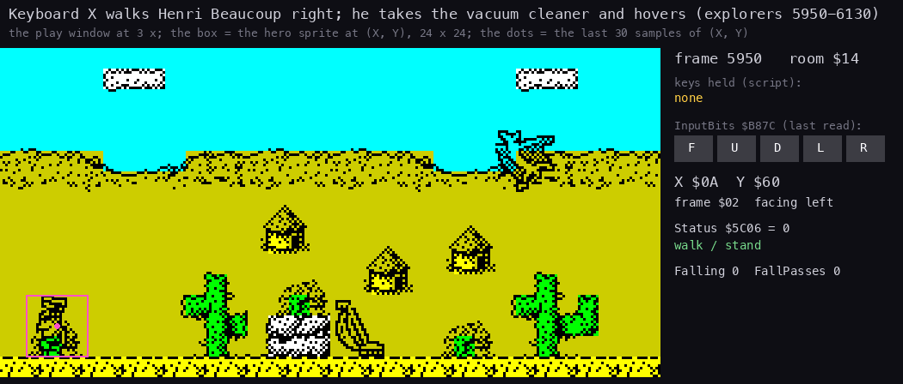

*Animation 5.2: X walks Henri Beaucoup right in room `$14`; he takes the vacuum cleaner and hovers. `explorers`
frames 5950-6130, one picture every 2 frames, sampled at each frame's start: `python3 tools/fig_controls.py play
--work work/docs/tmB/explorers --inputs tests/inputs/explorers.txt --from 5950 --to 6130 --step 2 --title '...' --out
docs/img/play/walk-keyboard.gif`.*

How to read:

- Left: the play window at 3 x. The pink box is the hero's 24 x 24 sprite at (X, Y). The dots are his last 30
  positions.
- Right: the keys the script holds, InputBits as five lamps (F U D L R), X, Y, the frame, the facing, the status and
  the fall counters.
- InputBits lights R one pass after X goes down: it is the reading of the last pass.
- The vacuum cleaner is in hand in the sample of frame 6097. From the sample of frame 6099 the status is 4 and the
  frame `$1D`: the hover. Y goes from `$60` to `$58`.

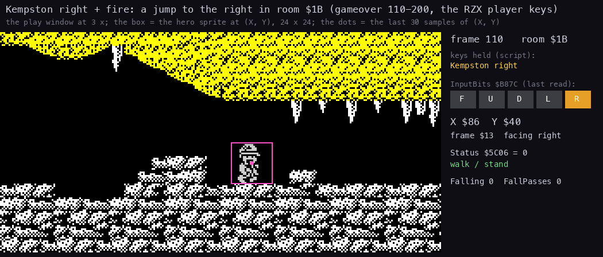

*Animation 5.3: Kempston right + fire, a jump to the right in room `$1B`. `gameover` frames 110-200, one picture a
frame, the RZX player's keys from `tests/inputs/gameover.txt`: `python3 tools/fig_controls.py play --work
work/docs/tmB/gameover --inputs tests/inputs/gameover.txt --from 110 --to 200 --step 1 --title '...' --out
docs/img/play/jump-kempston.gif`.*

How to read: the same panels. Fire is held from frame 122. The status becomes 2 in the sample of frame 123, and the
frames `$0C-$0F` of the jump follow. The arc itself is JumpArc's work ([doc 10](10-gameplay-logic.md)). The hero
takes off at X `$8E`, Y `$40` and lands at Y `$40` again, on the same ground (X `$B0` in the sample of frame 180),
and walks on: status 0, frames `$10-$13` (he holds the Flute).

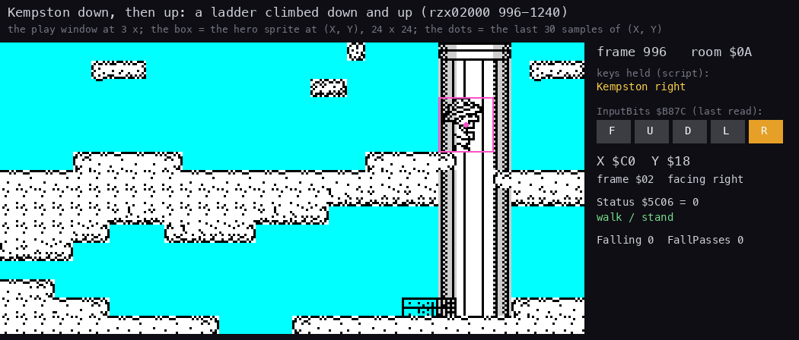

*Animation 5.4: Kempston down, then up: a ladder in room `$0A` climbed down and back up. `rzx02000` frames 996-1240
(the RZX player's keys, `tests/inputs/rzx-02000.txt`), one picture every 2 frames: `python3 tools/fig_controls.py
play --work work/docs/tmB/r02000 --inputs tests/inputs/rzx-02000.txt --from 996 --to 1240 --step 2 --title '...'
--out docs/img/play/climb-kempston.gif`.*

How to read: the hero steps right onto the ladder's top, then down is held from frame 1003. Y grows by 2 a pass (the
hero moves down), and the frame is one of `$20-$23`. The status stays 0: climbing is no status, only frames.

Worked example (`rzx02000`, the climb down). The samples:

| Frame | Keys held | InputBits | X | Y | Frame | PassCount |
| --- | --- | --- | --- | --- | --- | --- |
| 1003 | right, down | `$01` | `$C4` | `$18` | `$03` | `$08` |
| 1007 | down | `$04` | `$C4` | `$1A` | `$21` | `$09` |
| 1010 | down | `$04` | `$C4` | `$1C` | `$22` | `$0A` |
| 1013 | down | `$04` | `$C4` | `$1E` | `$23` | `$0B` |

At frame 1003 the last pass read right only, so X went from `$C2` to `$C4`. The next pass reads `$04`, down. HeroDown
adds 1 to Y and asks OnLadder: the tile at (`$C4 + 12`, `$19 + 23`) is a ladder, so ClimbDown adds the second pixel.
Y = `$1A`, and ClimbFrame gives `$20 + ($1A AND 6) / 2` = `$20 + 1` = `$21`. Each pass is about 3 frames, so the
samples change every 3 frames. On the way up (sample of frame 1139) Y = `$5E` gives `$20 + 3` = `$23`.

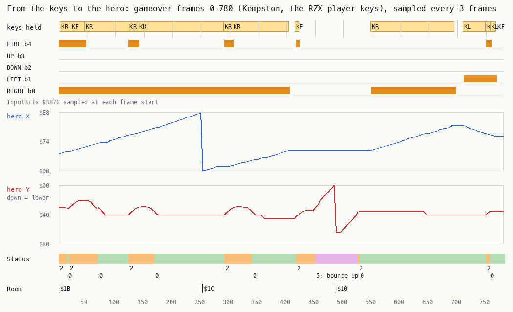

*Figure 5.4: the input path over 780 frames: the keys held, InputBits, X, Y, the status and the room. `gameover`
frames 0-780, sampled every 3 frames at the frame's start: `python3 tools/fig_controls.py chart --work
work/docs/tmB/gameover --inputs tests/inputs/gameover.txt --from 0 --to 780 --step 3 --title '...' --out
docs/img/controls/input-path-gameover.png`.*

How to read:

- Top: the keys the script holds, then the five bits of InputBits as orange lanes.
- Middle: the hero's X (up = right) and Y (down = lower, as on the screen).
- Bottom: the status (green 0, orange 2 the jump, pink others) and the room.
- X falls from `$E8` to 0 at frame 252: the exit right into room `$1C`. At frame 486 Y jumps from 0 to `$66`: the
  bounce (status 5) carried the hero up into room `$10`.

Witness: StartJump ran 168 times in 24 builds. ClimbFrame ran 266 times in 4 builds (`r02000`, `r06500`, `r36000`,
`r38000`). In `explorers` and `c1` StartJump ran 0 times: every round there takes the vacuum cleaner in room `$14`,
and the hover replaces the jump.

The trace of the input in a pass: [HeroUpdate.gif](img/routines/HeroUpdate.gif) shows HeroUpdate and the readers at
work over frame 6004 T 13743-27000 of `explorers` (the hero's record `$5B00-$5B1F` as hex), made with
`python3 ../../kit/routine_anim.py --work work/docs/tmB/explorers --window 6004:13743-6004:27000 --view
buffer:5B00:16x2:hex --range 5B00-FFFF --pc A0FE-A6CB,B87C-B931 --pictures 40 --listing build/game.lst --title '...'
--out docs/img/routines/HeroUpdate.gif`.

The point: a key moves the hero 2 pixels in the same pass that reads it. The walk speed is set by the pass, not by
the frame: 2 pixels per 2.4-3.3 frames. A jump takes its direction once, at take-off, into JumpDirection.

## 5.8 The other play keys

### T: think

ThinkKey `$B02E` reads T (`$FBFE` bit 4). It runs only in status 0, when the hero stands (probe `+3` = 0). T down
sets status 10, think: the hero stops and a thought bubble names an item ([doc 10](10-gameplay-logic.md)).

```text
B02E 01 FE FB    LD BC,$FBFE             ; ThinkKey
B031 ED 78       IN A,(C)
B033 E6 10       AND $10
B035 C0          RET NZ
B036 3E 0A       LD A,$0A
B038 C3 85 AE    JP SetStatus
```

Witness: ThinkKey ran 16 037 times; T was found down in no recording (`$B036` ran 0 times). `explorers` presses T at
frame 6590, but the hero hovers then: status 4, whose handler ends the update before ThinkKey.

### S: swap the held item with a bearer's load

ItemsKeys `$BA36` runs each pass from the items step. It first calls BearerKeys. Then it reads S (`$FDFE` bit 1). S
down swaps HeldItem `$5B98` with BearerLoads[BearerIndex] (`$5B7C + $5C23`). Then it redraws the bearers and the
portrait. SwapLatch `$BA96` makes it one swap per press. The swap is refused in statuses `$1B`, `$1C` and `$1D` (the
room animations and the space scene).

```text
ItemsKeys:                                  ; $BA36
    BearerKeys(BearerPhase)                 ; flags from OR A: phase not 0 = a scroll in progress
    if S down and Status not in ($1B, $1C, $1D):
        if not SwapLatch:
            swap HeldItem, BearerLoads[BearerIndex]
            DrawBearers(); DrawPortrait()
            SwapLatch = 1
    else: SwapLatch = 0
    room effects: the bridge in $19 and $3A, the rope in $10
```

```text
BA3D 01 FE FD    LD BC,$FDFE
BA40 ED 78       IN A,(C)
BA42 E6 02       AND $02
BA44 20 35       JR NZ,SwapRelease
...
BA55 3A 96 BA    LD A,(SwapLatch)
BA58 B7          OR A
BA59 20 24       JR NZ,ItemsRoomEffects
BA5B 3A 23 5C    LD A,(BearerIndex)      ; swap HeldItem with the load of bearer BearerIndex
BA5E 5F          LD E,A
BA5F 16 00       LD D,$00
BA61 21 7C 5B    LD HL,BearerLoads
BA64 19          ADD HL,DE
BA65 3A 98 5B    LD A,(HeldItem)
BA68 5F          LD E,A
BA69 7E          LD A,(HL)
BA6A 32 98 5B    LD (HeldItem),A
BA6D 73          LD (HL),E
BA6E CD BD 9E    CALL DrawBearers
BA71 CD 5D 9E    CALL DrawPortrait
```

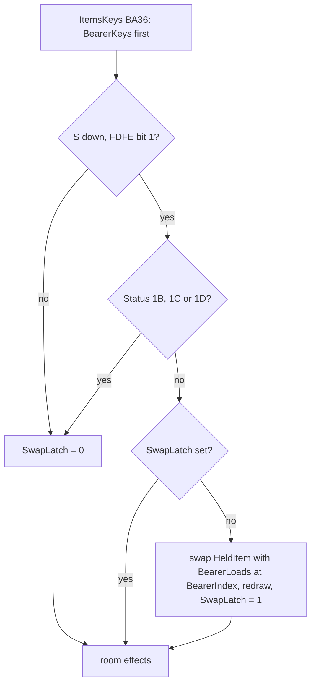

Worked example: HeldItem = `$0A` (the vacuum cleaner), BearerIndex = 2, BearerLoads[2] = `$FF` (free). S down: E =
`$0A`, A = `$FF`; HeldItem = `$FF`, BearerLoads[2] = `$0A`. The portrait's item slot shows the blank icon, and the
leftmost bearer shown (BearerIndex is the first of the row) carries the vacuum cleaner. Held for the next pass, S
does nothing: SwapLatch is 1.

Witness: the swap ran 34 times in 21 builds, all in the RZX run. S was pressed with the latch set or in a blocked
status 57 times in 21 builds.

### 1 and 2: scroll the bearers

The panel shows three of the 27 invisible bearers, each with its load. BearerKeys `$BC1F` reads 1 and 2 (`$F7FE` bits
0 and 1) when no scroll is in progress:

- Key 1: BearerScrollDir `$5C21` = 1, BearerPhase `$5C22` = 4, BearerIndex `$5C23` - 1 (0 wraps to `$1A`). The next
  passes draw phases 3, 2, 1, 0: the row slides right by one column a pass, and the previous bearer comes in from the
  left.
- Key 2: BearerScrollDir = 0, BearerPhase = 0, and the same pass draws phase 0. The next passes draw 1, 2, 3; at 4
  the phase goes back to 0 and BearerIndex + 1 (`$1B` wraps to 0). The row slides left.
- Both keys at once count as key 1. Holding a key repeats the scroll: four passes a bearer.

ShowScrolled `$9F73` skips BearerPhase columns of the 12-column list (4 bearers x 3 columns) and blits 9.

```text
BC1F 20 29       JR NZ,BearerScrollStep  ; BearerKeys: a scroll in progress
BC21 01 FE F7    LD BC,$F7FE
BC24 ED 78       IN A,(C)
BC26 E6 03       AND $03
BC28 FE 03       CP $03
BC2A C8          RET Z
BC2B E6 01       AND $01                 ; key 1: BearerIndex - 1, scroll from phase 4 down
BC2D 20 14       JR NZ,BearerKey2
BC2F 3E 01       LD A,$01
BC31 32 21 5C    LD (BearerScrollDir),A
BC34 3E 04       LD A,$04
BC36 32 22 5C    LD (BearerPhase),A
BC39 21 23 5C    LD HL,BearerIndex
BC3C 35          DEC (HL)
BC3D CB 7E       BIT 7,(HL)
BC3F C8          RET Z
BC40 36 1A       LD (HL),$1A
BC42 C9          RET
BC43 AF          XOR A                   ; BearerKey2: key 2, scroll from phase 0 up
BC44 32 21 5C    LD (BearerScrollDir),A
BC47 32 22 5C    LD (BearerPhase),A
```

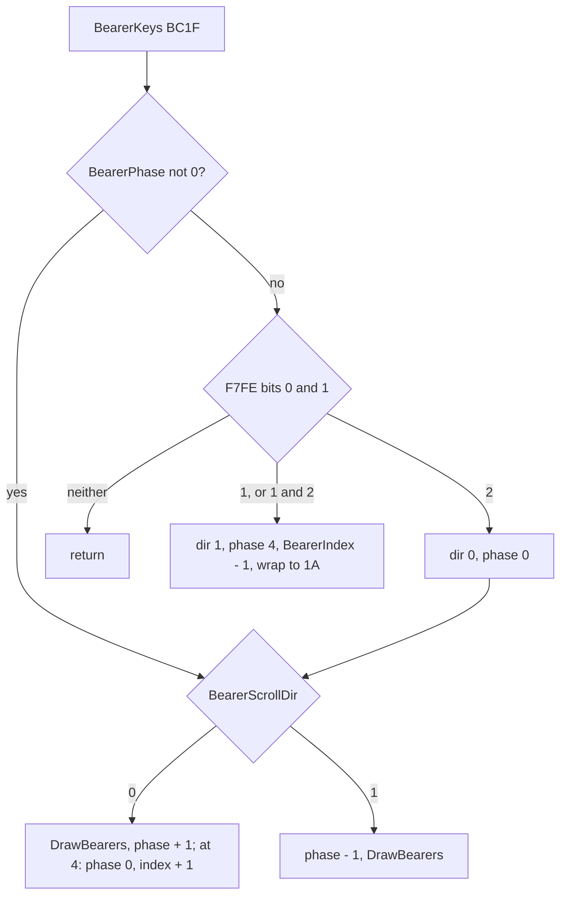

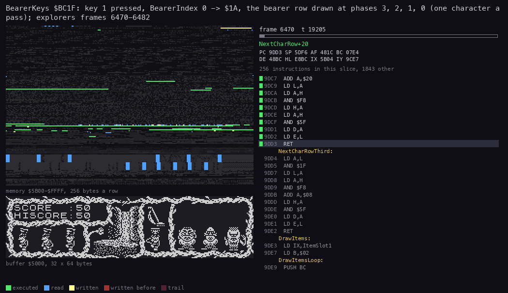

*Animation 5.5: key 1 pressed at frame 6470 of `explorers`: BearerKeys and the panel's redraw, the panel third
(`$5000`, 32 bytes x 64 pixel rows) as screen pixels: `python3 ../../kit/routine_anim.py --work work/docs/tmB/explorers
--window 6470:0-6483:0 --view buffer:5000:32x64:screen --pc BC1F-BC72,9EBD-9F26,9F6B-9FDD,9DBF-9DE2 --pictures 48
--listing build/game.lst --title '...' --out docs/img/routines/BearerKeys.gif`.*

How to read: each picture shows the panel after the instructions run so far. The bearer row at the right (row 20,
columns 22-30) and their loads above it (row 17) slide one column a pass, four times.

Worked example (`explorers`, key 1 at 6470). The sample of frame 6470 shows BearerScrollDir, BearerPhase and
BearerIndex = `00 00 00`. Key 1 sets the phase to 4 and BearerIndex to `$FF`, which `BIT 7` sees: BearerIndex =
`$1A`, the last bearer. That pass returns without drawing: the sample of 6472 shows `01 04 1A`. The samples of
frames 6474-6482 show the phase at 3, 2, 1 and 0, one step a pass, the row redrawn each time.

Witness: BearerKeys ran 26 514 times in 34 builds. Key 1's branch ran 128 times and key 2's 113 times, each in 21
builds; `gameover` presses 1 at frames 999 and 1028.

### The lift

LiftPlatform `$AF81` reads ReadControls on its own while the hero stands on the lift in room `$2B`. Up gives status
19, down status 20 ([doc 10](10-gameplay-logic.md)). It tests E, the raw reading, so up + down together gives status 20
(5.4).

The point: the keys around the hero are few, and each acts at most once a pass. S and the bearer keys work in any
status the swap allows, standing or not.

## 5.9 The abort and the freeze

The end of every pass (`$9050`) reads Q (`$FBFE` bit 0). Q up: the next pass. Q down: the code reads CAPS SHIFT
(`$FEFE` bit 0). CAPS SHIFT down ends the game through EndGame `$906D`. CAPS SHIFT up enters FreezeWhileA `$9062`,
which loops while A (`$FDFE` bit 0) is held, then goes on. So Q alone does nothing; Q + CAPS SHIFT aborts; Q + A
freezes the game until A is let go.

```text
end of pass:                                ; $9050
    if Q up: goto MainLoop
    if CAPS SHIFT down: goto EndGame
    while A down: wait                      ; FreezeWhileA $9062
    goto MainLoop
```

```text
9050 3E FB       LD A,$FB                ; Q held?
9052 DB FE       IN A,($FE)
9054 E6 01       AND $01
9056 C2 18 90    JP NZ,MainLoop
9059 01 FE FE    LD BC,$FEFE             ; and CAPS SHIFT: abort
905C ED 78       IN A,(C)
905E E6 01       AND $01
9060 28 0B       JR Z,EndGame
9062 3E FD       LD A,$FD                ; FreezeWhileA: wait while A is held
9064 DB FE       IN A,($FE)
9066 E6 01       AND $01
9068 28 F8       JR Z,FreezeWhileA
906A C3 18 90    JP MainLoop
```

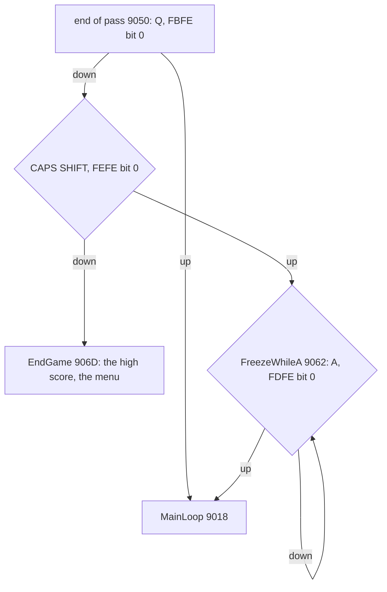

The freeze has no HALT. The interrupt goes on running under it ([doc 4](04-game-loop.md)). This is known only from
the code: no recording held Q + A.

Worked example (`explorers` round 3). The script holds CAPS SHIFT and Q from frame 7642. The pass that ends next reads
Q down (`$9056` not taken), then CAPS SHIFT down (`$9060` taken), and jumps to EndGame.

Witness: the abort ran 6 times: once in `c1`, five times in `explorers` (each round ends with CAPS SHIFT + Q).
FreezeWhileA ran in no recording.

The point: Q is a shift key for two commands. The game has a pause, but under a key pair that no screen of the game
names.

## 5.10 Where the readings differ

| Source | It says | The code says |
| --- | --- | --- |
| SK at `$B894` | device 0 reads "redefined keys, table at `$B8D4`" | the keyboard keys are fixed in ReadKeyboard `$B8FE` (Z X O K SPACE); `$B8D4` is code, ReadCursorKeys, never called (5.5) |
| SK at `$B02E` | "Check ENTER key (port `$FBFE`)" | port `$FBFE` bit 4 is T; ENTER is `$BFFE` bit 0 |
| SK at `$A34B` | "apply joystick" | room `$2C`'s float, which also reads ReadControls ([doc 10](10-gameplay-logic.md)) |
| the stage-1 brief, the `explorers` script as recorded | the bearer keys "1, 2, 5"; "5 swap" | 1 and 2 scroll; the swap key is S (`$FDFE` bit 1); 5 is read by no code of play. `explorers` presses 5 at frame 6750 and nothing happens (the script's header now says so) |
| the `explorers` script, round 3 | "up" as the key 0 at frame 7322 | 0 is not up on the keyboard; O is (`$DFFE` bit 1). The hero's X and Y stay the same |

## 5.11 Known only from the code

- The cursor-key readers `$B8D4` and `$C444`, and the `RET NZ` bug of the first (5.5).
- The cancel branches of ReadControls and of the selector's ReadDeviceFiltered: no recording pressed opposite
  directions. So is the lift's up + down, which E lets through as down (5.4).
- The freeze, Q + A (5.9).
- T from the keyboard: ThinkKey never found T down.
- A Kempston chosen with no interface: `$FF` becomes `$1F`, which ReadControls cancels (5.3).
- The 48K waits: ShowStopTape's SPACE and WaitKeysUp (5.6).
- The menu's refusal of key pairs and of 4 and 5: no recording pressed them on the menu.
