# 6. Rendering

What this covers:

- the screen layout: the play window, the panel, the back buffer `$E000` and the tile map `$F800`;
- the tiles and the two tile sets, swapped in 15 rooms;
- the room build: the room grid at `$D600`, the back-tiles at `$C600`, the tile map, and DrawRoom;
- the room effects: the flames, the beams, the capsules and the well's front wall;
- the sprite space `$6000 + 72 x F`, the outline mask and the mirror;
- RenderPass, the sprite drawer of every pass: the buffer address, the row plotters, the copy to the screen and the
  repair of the buffer;
- the floor items, which are drawn to the buffer and the screen at once;
- the panel's pictures, the menu globes and the selector's hand cursor;
- the code against the screen on real frames, and against the beam.

The recordings it rests on (WALKTHROUGH 6.0; all on the 128K):

| Recording | Used for |
| --- | --- |
| `explorers` | the room build of room `$14` (frames 528-536); the keyboard round's pass of frames 6001-6004 in room `$14` (the hero walking right at X `$2A`, two creatures, a floor item); the vacuum cleaner picked up at frame 6097; the selector's cursor at frames 5550-5553 |
| `rzx02000` | a segment of the RZX archive's run (another player's game, replayed): frame 2 in room `$08`, with a creature, a floor item and a full panel |
| `c1` | the panel animations of doc 8, shown here |
| the 31 `rzx` segments, `c1`, `explorers`, `gameover` | the counts of runs (L1 builds, `work/stage1/*/l1.json`): 34 builds |

Conventions:

- **A frame** is 1/50 s of the 128K, 70 908 T. **A pass** is one turn of the main loop
  ([doc 4](04-game-loop.md)); in play it takes 2.4-3.3 frames.
- A value read with `time_travel memory_at` is the memory at the start of the frame named. At the start of frame 6001
  the pass that ends at frame 6004 has not begun yet: it starts at frame 6001 T 34757.
- A trace puts an instruction in the frame where it ran, with its T-state in that frame ("frame 6003 T 27184").
- X and Y are pixels of the play window: X 0-255 from the left, Y 0-127 from the top. A sprite's (X, Y) is its top
  left corner.
- The SkoolKit disassembly of the game by nzeemin (`work/candidates/skoolkit-game-revs/terramex-zx`, "SK" below)
  described most of these routines first. Where this document uses its reading, it says so. Where it differs, 6.15
  gives the evidence.

## 6.1 The screen, the buffer and the maps

Terramex splits the screen in two. The top two thirds, `$4000-$4FFF` with attributes `$5800-$59FF`, are the play
window: 32 x 16 cells, 256 x 128 pixels. The bottom third, `$5000-$57FF` with attributes `$5A00-$5AFF`, is the panel.
The play code never scrolls. A room is drawn whole when the hero enters it. After that only the moving things are
redrawn.

The play window has a twin: the back buffer `$E000-$EFFF`. It has the screen's own layout. A buffer address is the
screen address with the top three bits set: `$40xx` becomes `$E0xx`, `$48xx` becomes `$E8xx`. Between passes the
buffer holds the clean background: the room's tiles and the floor items, no actors. Every pass draws the actors into
the buffer, copies the rectangles round them to the screen, then wipes them from the buffer again.

Three tables describe the room:

- the room grid (`$D600 + 32 x room`) names 32 back-tiles;
- a back-tile (`$C600 + 16 x index`) is a block of 4 x 4 tiles;
- the tile map `$F800-$F9FF` holds the room as 512 tile numbers, one a cell.

A tile (`$F000 + 8 x T`) is 8 pixel bytes, with its attribute at `$DF00 + T`.

| Address | Size | What | Written by | Read by |
| --- | ---: | --- | --- | --- |
| `$4000-$4FFF` | 4096 | the play window's pixels | DrawRoom, CopyRects, DrawItem, the effects | the ULA |
| `$5000-$57FF` | 2048 | the panel's pixels | the panel routines (6.12), doc 8's printer | the ULA |
| `$5800-$59FF` | 512 | the play window's attributes | DrawRoom, the flames | the ULA |
| `$6000-$8CFF` | 11 520 | the sprite space: 160 frames of 72 bytes | the selector (frames `$00-$3F`), the load | RenderPass, the panel |
| `$C600-$D5FF` | 4096 | BackTiles: 256 back-tiles of 16 tile numbers | the load | BuildTileMap |
| `$D600-$DEFF` | 2304 | RoomGrids: 72 rooms of 32 back-tiles | the load | BuildTileMap |
| `$DF00-$DFFF` | 256 | TileAttrs: one attribute a tile | the load, SwapTileset | DrawRoom |
| `$E000-$EFFF` | 4096 | the back buffer; on the tape, the panel at `$E000-$E8FF` | DrawRoom, RenderPass, the effects, EndGame | CopyRects, CopyBackCell, InitGame |
| `$F000-$F7FF` | 2048 | TilePixels: 256 tiles of 8 bytes | the load, SwapTileset, the flames, the capsules | DrawRoom, RestoreRect, DrawTileAt |
| `$F800-$F9FF` | 512 | TileMap: the room, 32 x 16 tile numbers | BuildTileMap, the capsules | DrawRoom, RestoreRect, the collision code |
| `$FA00-$FDFF` | 1024 | AltTilePixels: the other tiles `$80-$FF` | SwapTileset | SwapTileset |
| `$FE00-$FEFF` | 256 | BitReverse: byte n with its bits reversed | the load | DrawSpriteRow (mirrored) |
| `$FF00-$FFFF` | 256 | OutlineMasks: NOT (v OR v << 1 OR v >> 1) | the load | DrawSpriteRow, DrawItem |

The tape image keeps 12 unused sprites at `$E900-$EFFF` ([doc 2](02-architecture.md)). Play overwrites them: the
first DrawRoom writes the whole buffer.

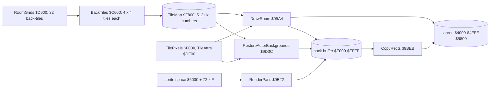

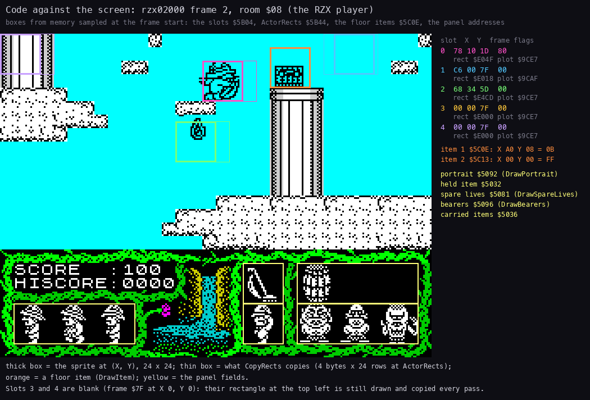

*Figure 6.1: frame 2 of `rzx02000` (the RZX player's game, room `$08`). Over the screen: the five actor slots, the
rectangles CopyRects copies, the floor item and the panel's picture fields. The memory is sampled at the start of frame
2, between two passes. Made with `python3 tools/fig_render.py frame --work work/docs/tmB/r02000 --at 2 --label
'rzx02000 frame 2, room 08' --out docs/img/render/frame-r02000-2.png` (the label in the image also says "the RZX
player"), on an instance opened with
`python3 ../../kit/rs.py open --work work/docs/tmB/r02000 --ttd work/stage1/rzx/r02000/session.ttd --port-base 37550
--model 128K`.*

How to read:

- A thick box is a sprite: 24 x 24 pixels at the slot's (X, Y).
- Its thin box is the rectangle CopyRects copies: 4 bytes x 24 rows, from ActorRects `$5B44`. It is one byte wider
  than the sprite, for the shift.
- The list at the right gives each slot's X, Y, frame and flags, then its rectangle and row plotter.
- Slot 0 is the hero, frame `$1D`, X `$78`, Y `$10`. Slot 2 is a creature at X `$68`, Y `$34`, frame `$5D`.
- Slots 1, 3 and 4 hold the blank frame `$7F`. Slot 1 waits at X `$C6`, Y 0. Slots 3 and 4 sit at (0, 0): their
  rectangle `$E000` is the top left. They are drawn and copied every pass all the same.
- The orange box is the floor item of ItemSlot1, item `$0B` at (`$A0`, `$08`). The yellow boxes are the panel's
  fields.

The point: the play window is a 256 x 128 pixel picture with a byte-for-byte twin in the buffer. All the drawing of a
pass happens in the twin. The screen only receives finished rectangles.

## 6.2 The tiles and the alternate set

A tile is 8 x 8 pixels in one attribute. Tile T has its 8 pixel bytes at `$F000 + 8 x T`, top row first, and its
attribute at `$DF00 + T`. The word TilePixelsPtr `$5B72` holds `$F000`; every tile reader adds `8 x T` to it.
InitGame sets it, and nothing changes it.

Fifteen rooms use other pictures for tiles `$80-$FF`. They are the rooms of the alternate set, AltTilesetRooms
`$9AC6`: `$12 $1E $1F $20 $2B $2C $37 $38 $39 $3A $3B $3C $43 $44 $45`. The other tiles live at AltTilePixels
`$FA00-$FDFF` (1024 bytes), with attributes at AltTileAttrs `$C580-$C5FF` (128 bytes). SwapTileset `$918D` exchanges
them byte for byte with `$F400-$F7FF` and `$DF80-$DFFF`. The flag AltTileset `$918C` says which set is in: 0 the base
set, `$FF` the alternate one. A swap done twice gives the base set back, so no copy of the base set is kept anywhere.

SetUpRoomTiles `$9880` decides on each room entry:

```text
SetUpRoomTiles(room):
    listed = room in AltTilesetRooms[0..14]
    if listed and AltTileset == 0: SwapTileset()     # load the alternate set
    if not listed and AltTileset != 0: SwapTileset() # back to the base set
    WellHole = 0
    BuildTileMap(room)                                # 6.3
    clear EffectCellsA, EffectCellsB                  # 6.5
    EffectCellsA = cells of tile $B5 (base) or $DD (alternate)
    if alternate: EffectCellsB = cells of tile $8C
    ...the room's counters, room $10's hint, room $1C's rope column
    ClearPartySlots(); DrawRoom(); SpawnRoomItems()
```

```asm
SetUpRoomTiles:                     ; $9880, A = the room
        PUSH AF
        LD HL,AltTilesetRooms       ; $9AC6
        LD B,$0F                    ; 15 rooms in the list
SetUpRoomTilesFind:
        CP (HL)
        JR Z,SetUpRoomTilesAlt
        INC HL
        DJNZ SetUpRoomTilesFind
        LD A,(AltTileset)           ; not listed: back to the base set if the alternate is in
        OR A
        CALL NZ,SwapTileset
        JR SetUpRoomTilesBuild
SetUpRoomTilesAlt:
        LD A,(AltTileset)           ; listed: load the alternate set if it is not in
        OR A
        CALL Z,SwapTileset
        ...
SwapTileset:                        ; $918D
        LD A,(AltTileset)
        PUSH AF
        LD HL,AltTilePixels         ; $FA00
        LD DE,TilePixels+$0400      ; $F400: tiles $80-$FF
        LD BC,$0400
SwapTileBitmaps:                    ; 1024 bytes exchanged one by one
        ...
        LD HL,AltTileAttrs          ; $C580 <-> $DF80, 128 attributes
        ...
        POP AF
        XOR $FF                     ; the flag flips
        LD (AltTileset),A
        RET
```

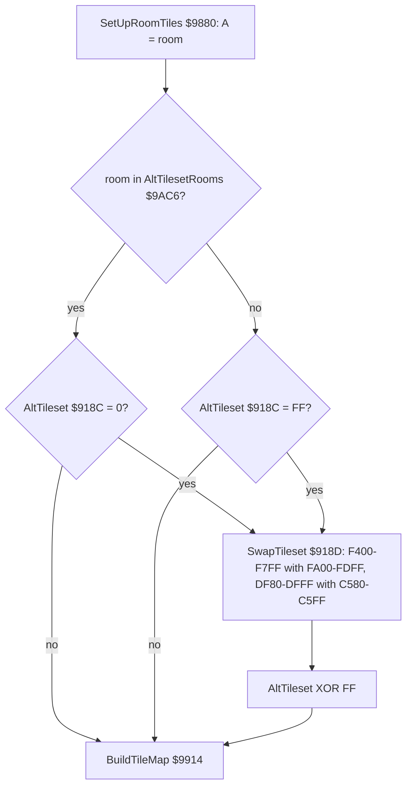

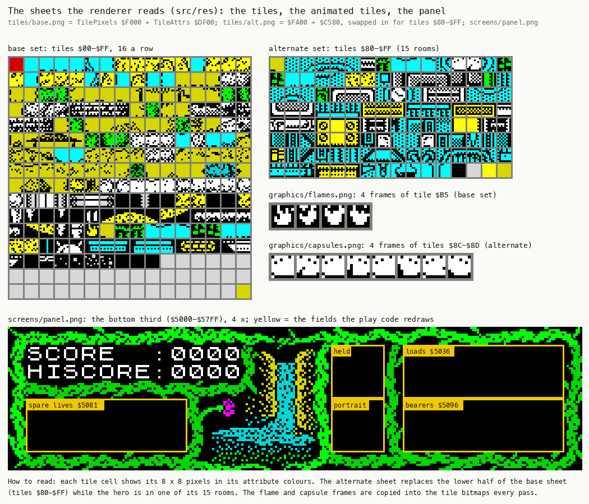

*Figure 6.2: the resource sheets the renderer reads, from src/res: `tiles/base.png` (the 256 tiles of `$F000` with
the attributes of `$DF00`), `tiles/alt.png` (tiles `$80-$FF` of `$FA00` with `$C580`), the four flame frames, the four
capsule frames and the panel. No recording: the figure is the resources. Made with `python3 tools/fig_render.py
sheets --out docs/img/render/tile-sheets.png`.*

How to read:

- Each cell of a sheet is one tile, drawn in its own ink and paper. The base sheet has 16 rows of 16 tiles: tile T is
  row T / 16, column T mod 16. The light grey cells at the end are blank tiles in attribute `$38`: white paper,
  not bright.
- The alternate sheet has 8 rows. Its first cell replaces base tile `$80`.
- The flame frames are copied over tile `$B5`, the capsule frames over tiles `$8C-$8D` (6.5).
- The panel is the bottom third as the tape loads it. The yellow boxes are the five fields the play code redraws
  with BlitColumns (6.12); the score, printed with PrintChar, has no box.

Worked example: the hero walks from a room on the base set into room `$1E`. `$1E` is the second byte of the list, so
SetUpRoomTiles jumps to SetUpRoomTilesAlt. AltTileset is 0, so SwapTileset runs. Tile `$80` now draws the 8 bytes
that were at `$FA00`, in the attribute that was at `$C580`. AltTileset becomes `$FF`. From `$1E` into `$1F`, also
listed, nothing is swapped. The first room on the base set after them swaps the sets back.

Witness: SwapTileset ran 6 times, in 5 builds (`r18000`, `r20000`, `r26000`, `r34000`, `r50000`). The listed branch at
`$9895` ran 19 times in 8 builds. It runs on every entry into a listed room, but swaps only when the set changes.

The point: 15 rooms get a different look for 1152 bytes, with no extra copy and no pointer. The tile numbers in the
back-tiles stay the same; only the pictures under them change. Which tiles are solid changes too: the collision code
reads its own tables for the alternate set (`src/res/tables/alt-solid-tiles.txt`, [doc 10](10-gameplay-logic.md)).

## 6.3 The room build: back-tiles into the tile map

A room is 4 rows of 8 back-tiles. Each back-tile is 4 x 4 tiles, so the room is 16 rows of 32 tiles: the whole play
window. BuildTileMap `$9914` expands the 32 back-tile numbers of the room into the 512 tile numbers of TileMap
`$F800`. It writes each back-tile's 16 numbers with 16 unrolled stores at IX + `$00..$03`, `$20..$23`, `$40..$43`
and `$60..$63`: four rows of the map, 32 bytes apart.

```text
BuildTileMap(room):
    grid = $D600 + 32 * room
    for r in 0..3:                       # back-tile rows
        for c in 0..7:                   # back-tiles in the row
            b = grid[8 * r + c]
            src = $C600 + 16 * b
            if b == $10: WellRecord(IX, src)      # the well, 6.5
            for y in 0..3:
                for x in 0..3:
                    TileMap[128 * r + 32 * y + 4 * c + x] = src[4 * y + x]
```

```asm
BuildTileMap:                       ; $9914, A = the room
        LD L,A
        LD H,$00
        ADD HL,HL                   ; room * 32
        ADD HL,HL
        ADD HL,HL
        ADD HL,HL
        ADD HL,HL
        LD DE,RoomGrids             ; $D600
        ADD HL,DE
        LD B,$04
        LD IX,TileMap               ; $F800, row 0
BuildTileMapRow:
        PUSH BC                     ; 4 back-tile rows
        PUSH IX
        LD B,$08
BuildTileMapCell:
        PUSH BC                     ; 8 back-tiles a row
        LD A,(HL)
        LD C,A
        PUSH HL
        LD L,A
        LD H,$00
        ADD HL,HL                   ; back-tile * 16
        ADD HL,HL
        ADD HL,HL
        ADD HL,HL
        LD DE,BackTiles             ; $C600
        ADD HL,DE
        LD A,C
        CP $10
        CALL Z,WellRecord           ; back-tile $10: note the well
        LD A,(HL)
        LD (IX+$00),A               ; cell row 0 of the back-tile
        INC HL
        ...                         ; 15 more: +$01..+$03, +$20..+$23, +$40..+$43, +$60..+$63
        POP HL
        INC HL
        LD BC,$0004                 ; the next back-tile, 4 cells right
        ADD IX,BC
        POP BC
        DJNZ BuildTileMapCell
        POP IX
        LD BC,$0080                 ; the next back-tile row, 4 cell rows down
        ADD IX,BC
        POP BC
        DJNZ BuildTileMapRow
        RET
```

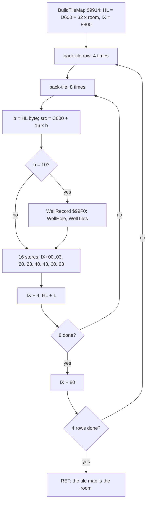

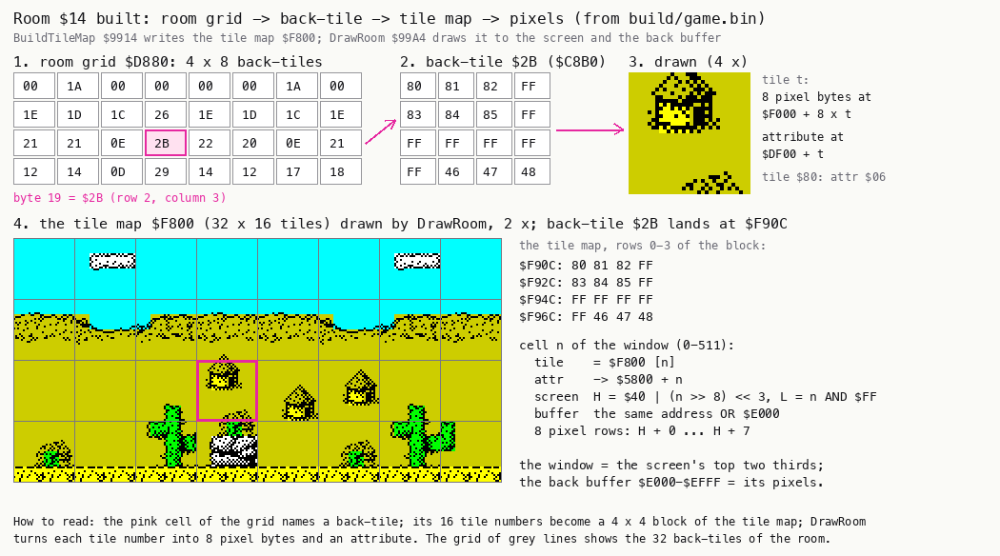

*Figure 6.3: room `$14`, the first room of every game, built step by step from `build/game.bin`: the room grid at
`$D880`, back-tile `$2B` at `$C8B0`, its 16 tiles drawn, and the whole tile map drawn as DrawRoom draws it. No
recording: the figure is computed from the image, and checked against the memory of `explorers` at frame 6001 (below).
Made with `python3 tools/fig_render.py roombuild --room 14 --pick 2,3 --out docs/img/render/roombuild-14.png`.*

How to read:

1. The room grid: 4 rows of 8 back-tile numbers. The pink cell is byte 19, row 2, column 3: back-tile `$2B`.
2. The back-tile: its 16 tile numbers, 4 rows of 4. `$FF` is the empty sky tile.
3. The 16 tiles drawn, 4 times the size: a hut on the plain.
4. The whole room, twice the size. The grey lines mark the 32 back-tiles; the pink box is back-tile `$2B` again. The
   text beside it gives the formulas DrawRoom uses for each cell.

Worked example (room `$14`, from the figure): the grid starts at `$D600 + 32 x $14 = $D880`. Byte 19 (row 2, column
3) is `$2B`. Its tiles start at `$C600 + 16 x $2B = $C8B0`: `80 81 82 FF / 83 84 85 FF / FF FF FF FF / FF 46 47 48`.
IX for row 2, column 3 is `$F800 + 128 x 2 + 4 x 3 = $F90C`. So the map gets `80 81 82 FF` at `$F90C`, `83 84 85 FF`
at `$F92C`, and the next two rows at `$F94C` and `$F96C`.

Witness: BuildTileMap ran 105 times over the 34 builds, once a room entry. The tile map computed from the image for
room `$14` equals the 512 bytes at `$F800` in `explorers` at the start of frame 6001, byte for byte: `$F90C` holds
`80 81 82 FF`. WellRecord ran 3 times, in `r06000` and `r12000`, all in room `$0C`, the only room with back-tile `$10`.

The point: the 72 rooms take 2304 bytes of grids plus 4096 bytes of shared back-tiles, not 72 x 512 bytes of maps.
The price is that rooms are built on a 32-pixel grid. The tile map keeps the detail at 8 pixels.

## 6.4 DrawRoom: the whole play window, once a room

DrawRoom `$99A4` walks the 512 cells of the tile map in order, n = 0 to 511. For cell n with tile T:

- the attribute: `$5800 + n` gets TileAttrs `$DF00 + T`;
- the screen: H = `$40 OR (n >> 8) << 3`, L = n AND `$FF`. Cells 0-255 are in the top third (`$40xx`), cells
  256-511 in the middle third (`$48xx`);
- the buffer: the same address with `$E0` ORed into the high byte;
- the 8 bytes at `$F000 + 8 x T` go to both, one pixel row at a time (INC D and INC B).

The loop stops when bit 1 of the counter's high byte is set: at n = 512. SK described the same walk, but as a copy to
the screen only. The copy to the buffer (`LD (BC),A` at `$99DF`) is our reading (6.15).

```text
DrawRoom():
    for n in 0..511:
        T = TileMap[n]
        attr[$5800 + n] = TileAttrs[T]
        scr = ($40 | (n >> 8) << 3) << 8 | (n & $FF)
        buf = scr | $E000
        for row in 0..7:
            screen[scr + 256 * row] = buffer[buf + 256 * row] = TilePixels[8 * T + row]
```

```asm
DrawRoom:                           ; $99A4
        LD HL,$0000                 ; n
        LD DE,TileMap               ; $F800
DrawRoomCell:
        PUSH HL
        PUSH DE
        LD A,H
        OR $58                      ; HL = $5800 + n, the cell's attribute
        LD H,A
        LD A,(DE)                   ; T
        PUSH AF
        PUSH HL
        LD L,A
        LD H,$00
        LD BC,TileAttrs             ; $DF00
        ADD HL,BC
        LD A,(HL)
        POP HL
        LD (HL),A                   ; the attribute
        LD A,H                      ; $58 or $59: the third
        AND $03
        RLCA
        RLCA
        RLCA
        OR $40
        LD H,A                      ; $40 or $48
        POP AF
        PUSH HL
        LD L,A
        LD H,$00
        ADD HL,HL
        ADD HL,HL
        ADD HL,HL
        LD DE,(TilePixelsPtr)       ; $F000 + 8 x T
        ADD HL,DE
        POP DE                      ; DE = the screen cell
        LD C,E
        LD A,D
        OR $E0                      ; BC = the same cell in the buffer
        LD B,A
        EX AF,AF'
        LD A,$08
DrawRoomRow:
        EX AF,AF'                   ; 8 pixel rows to the screen and the buffer
        LD A,(HL)
        LD (DE),A
        LD (BC),A
        INC D
        INC B
        INC HL
        EX AF,AF'
        DEC A
        JR NZ,DrawRoomRow
        POP DE
        INC DE
        POP HL
        INC HL
        BIT 1,H                     ; 512 cells done?
        JR Z,DrawRoomCell
        RET
```

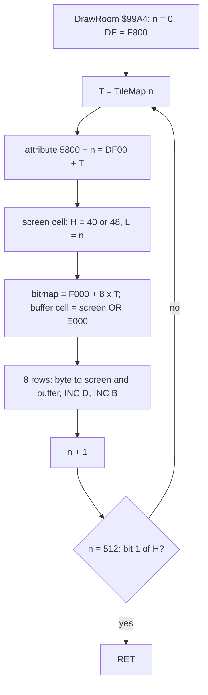

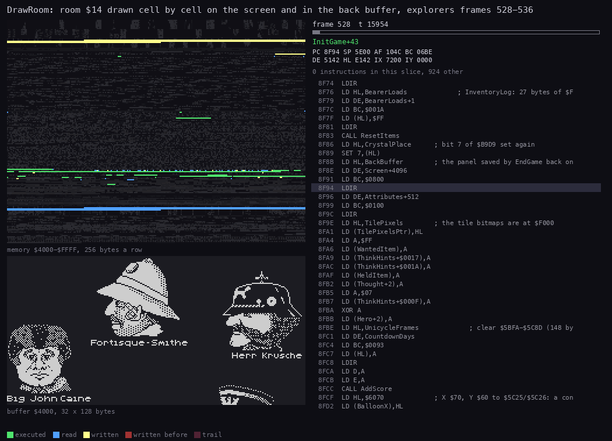

*Figure 6.4: DrawRoom `$99A4` drawing room `$14` at the start of round 1 of `explorers`, frames 528-536. Made with
`python3 ../../kit/routine_anim.py --work work/docs/tmB/explorers --window 528:0-537:0 --listing build/game.lst --view
buffer:4000:32x128:screen --range 4000-FFFF --pc 99A4-99EF --pictures 40 --out docs/img/routines/DrawRoom.gif`.*

How to read:

- Left above: the memory `$4000-$FFFF`, 256 bytes a row, lit when it is executed, read or written.
- Left below: the screen's top two thirds as the routine leaves them. The room grows cell by cell, left to right and
  top to bottom, one character row per 32 cells.
- The coloured stripes at the top of the memory map are the attribute writes at `$5800-$59FF`. The bright band in the
  lower part of the map is the buffer `$E000-$EFFF`, written in step with the screen.
- Right: the listing at the PC, and the registers.

Worked example (room `$14`, cell n = `$10C`, the hut's top left): T = TileMap `$F90C` = `$80`. The attribute goes to
`$5800 + $10C = $590C`: TileAttrs `$DF80` = `$06`, yellow ink on black paper. The screen cell: n >> 8 = 1, so H =
`$40 OR $08 = $48`, and L = `$0C`: `$480C`. The buffer cell is `$E80C`. The 8 bytes come from
`$F000 + 8 x $80 = $F400`. They go to `$480C`, `$490C`, ..., `$4F0C` and to `$E80C`, ..., `$EF0C`.

Witness: DrawRoom ran 106 times in 31 builds: once a room entry, plus the restarts. In `explorers` the call at frame
529 T 38545 returns at frame 536 T 15: 457 826 T, 6.5 frames with the interrupts. The room appears on the screen while
it is being built.

The point: the room is drawn to the screen and to the buffer in one walk, so the buffer starts clean. The cost, 6.5
frames, is paid once a room. The passes after it draw only the actors.

## 6.5 The room effects: flames, beams, capsules and the well

Four effects change the room after DrawRoom. They work on tile cells, not on sprites.

**The lists.** SetUpRoomTiles fills two lists of tile-map addresses with FindTileCells `$9A8C`. FindTileCells
searches the 512 bytes of the map with CPIR and stores each cell that holds the tile. EffectCellsA `$9AD5` gets the
cells of tile `$B5` (the flame, base set) or `$DD` (a beam end, alternate set). EffectCellsB `$9AE5` gets the cells of
tile `$8C` (a capsule, alternate set). A zero word ends a list; each holds 8 cells at most.

**The flames (base set).** RoomEffects `$91C0` runs once a pass, before RenderPass. On the base set it takes the first
two cells of EffectCellsA. It copies flame frame PassCount AND 3 from FlameFrames `$933D` over tile `$B5`'s bitmap at
`$F5A8`. Then SetTile `$9A52` draws tile `$B5` at the cell, on the screen and in the buffer. Last, it flips the cell's
BRIGHT bit when bit 0 of the R register is set. The attribute is the map address plus `$6000`: `$F8xx` becomes
`$58xx`.

**The beams (alternate set).** EffectCellsA holds pairs of cells: a beam's left and right ends. For each pair Beams
`$9208` writes random bytes (R, rotated, XOR PassCount) on pixel rows 6 and 7 of each cell between the ends: from the
cell after the left end (`INC DE` at `$921D`) up to the cell before the right end. It writes
the screen only. If the hero is within the beam's span and within 12 rows of it, with the status below 4, it sets
status `$18`: the hero is hit.

**The capsules (alternate set).** Capsules `$9282` copies capsule frame 3 2 1 0 0 1 2 3 (from PassCount) over tiles
`$8C-$8D` at `$F460`. SetTileBuffer `$9A4D` redraws `$8C` and `$8D` at each listed cell, in the map and the buffer.
ShowCapsules `$92BD`, in step 5 of RenderPass, copies those cells from the buffer to the screen (CopyBackCell
`$92D6`).

**The well's front wall.** WellRecord `$99F0` notes the well when BuildTileMap meets back-tile `$10`. WellHole `$5BA2`
gets the cell one row below the back-tile's top, in attribute form. WellTiles `$5BA4` gets the back-tile's rows 1-2.
WellFront `$9A09` runs in RenderPass right after the hero is drawn. OverHole `$AF22` checks that the hero is at the
well's column. When he climbs into the well (status 2, from the eighth count) or out of it (status 3, the first 8
counts), DrawWellFront `$9A2F` paints the wall's 2 x 4 cells over him, in the buffer. He then seems to be inside the
well.

```text
RoomEffects():                              # once a pass, before RenderPass
    if AltTileset == 0:
        for cell in EffectCellsA[0..1]:
            if cell == 0: continue
            TilePixels[$B5] = FlameFrames[PassCount & 3]
            SetTile(cell, $B5)              # screen and buffer
            attr[cell + $6000] ^= (R & 1) << 6   # BRIGHT
    else:
        for (left, right) in EffectCellsA:
            if hero in span and |hero Y + 6 - beam Y| < 12 and Status < 4: SetStatus($18)
            for cell in left+1..right-1: screen rows 6, 7 = random   # INC DE at $921D first
        f = PassCount & 3; if PassCount bit 2 clear: f ^= 3
        TilePixels[$8C..$8D] = CapsuleFrames[f]
        for cell in EffectCellsB: SetTileBuffer(cell, $8C); SetTileBuffer(cell + 1, $8D)
```

```asm
RoomEffects:                        ; $91C0
        LD B,$02
        LD HL,EffectCellsA          ; $9AD5
        LD A,(AltTileset)
        OR A
        JP NZ,Beams                 ; the alternate set: beams and capsules
FlamesLoop:
        PUSH BC
        LD E,(HL)
        INC HL
        LD D,(HL)
        INC HL
        PUSH HL
        LD A,E
        OR D
        JR Z,FlamesNext
        EXX
        LD A,(PassCount)            ; the frame: PassCount AND 3
        AND $03
        LD L,A
        LD H,$00
        ADD HL,HL
        ADD HL,HL
        ADD HL,HL
        LD DE,FlameFrames           ; $933D
        ADD HL,DE
        LD DE,TilePixels+$B5*8      ; $F5A8: into tile $B5's bitmap
        LD BC,$0008
        LDIR
        EXX
        EX DE,HL
        PUSH HL
        LD A,$B5                    ; draw tile $B5 there: the screen and the buffer
        CALL SetTile
        POP HL
        LD DE,$6000                 ; the map address + $6000: the cell's attribute
        ADD HL,DE
        LD A,R                      ; flip BRIGHT at random
        AND $01
        RRCA
        RRCA
        XOR (HL)
        LD (HL),A
FlamesNext:
        POP HL
        POP BC
        DJNZ FlamesLoop
        RET
```

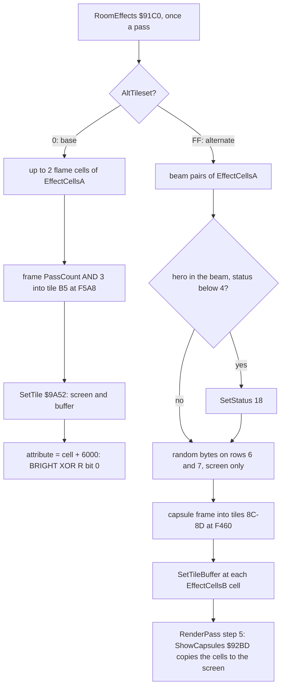

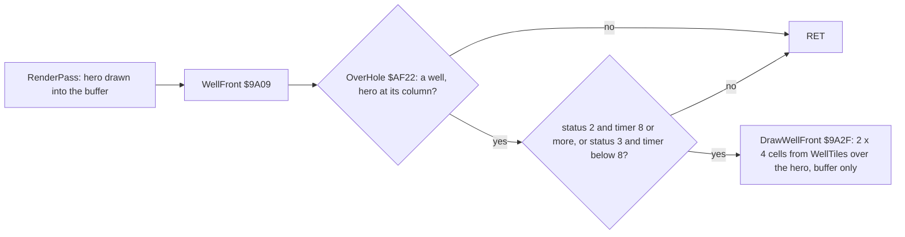

The flame and capsule frames are in Figure 6.2: the two small strips at the right.

Worked example (a flame): PassCount = `$7A`, so the frame is `$7A AND 3 = 2`. The 8 bytes at `$933D + 16 = $934D`
go to `$F5A8-$F5AF`. A cell at map address `$F9C3` (third 1, row 6, column 3) is drawn at screen `$48C3` and buffer
`$E8C3`. Its attribute is `$F9C3 + $6000 = $59C3`. If bit 0 of R is 1, bit 6 of `$59C3` flips.

Witness (L1 builds):

| Code | Runs | Builds |
| --- | ---: | --- |
| the flame body `$91D6` | 5 256 | 12 (`gameover`, `r10000` and others) |
| Beams `$9208` | 7 404 | 12 |
| a beam drawn, `$9265` | 1 823 | 6 |
| the beam hit, `$9260` | 0 | none |
| Capsules `$9282` | 5 581 | 12 |
| CopyBackCell from ShowCapsules, `$92CD` | 16 773 | 12 |
| WellFront drawing, `$9A25` | 11 | 2 (`r06500`, `r12000`) |

The point: the animated scenery costs no sprite. A flame or a capsule is a tile whose bitmap is rewritten each pass.
The tile map stays the same, so RestoreActorBackgrounds paints the current frame under an actor for free. The beams
draw straight onto the screen and are never in the buffer.

## 6.6 The sprite format and the sprite space

A sprite is 24 x 24 pixels in 72 bytes: three columns of 24 bytes, the left column first, the top byte first. A set
bit is ink. There is no mask in the data: the mask is made from the graphic as it is drawn (6.9).

All sprites share one numbering, the frame number F. Frame F lies at `$6000 + 72 x F`:

| Frames | Addresses | What |
| --- | --- | --- |
| `$00-$3F` | `$6000-$71FF` | the chosen explorer's set: walking 0-3, the portrait 9, climbing `$20-$23`, and the rest |
| `$40-$7E` | `$7200-$83B7` | the creatures, the globes of the menu and the space scene, and other shared frames |
| `$7F` | `$83B8-$83FF` | BlankSprite: 72 zero bytes, for an empty slot |
| `$80-$9F` | `$8400-$8CFF` | the items: item n is frame `$80 + n` |

The five explorer sets are on the tape, in RAM 4. The selector copies the chosen one to `$6000`
([doc 5](05-controls.md), 5.6). So the hero's frame numbers do not change with the explorer; only the pictures do.

RenderPass computes the address with shifts: 72 x F = 64 x F + 8 x F.

```asm
RenderPassSprites:                  ; $9B52, IX = the slot
        PUSH BC
        LD A,(IX+$02)               ; F
        LD L,A
        LD H,$00
        ADD HL,HL
        ADD HL,HL
        ADD HL,HL                   ; 8 x F
        PUSH HL
        ADD HL,HL
        ADD HL,HL
        ADD HL,HL                   ; 64 x F
        POP DE
        ADD HL,DE                   ; 72 x F
        LD DE,ExplorerSet           ; $6000
        ADD HL,DE
        EX DE,HL                    ; DE' = the sprite
        LD H,$FE                    ; H' = the page of BitReverse
        EXX
```

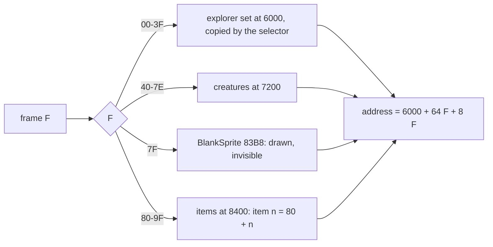

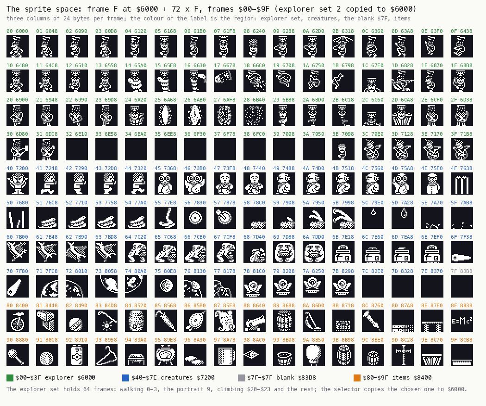

*Figure 6.5: the 160 frames of the sprite space, with explorer set 2 (Henri) copied to `$6000` as the selector would.
Drawn from `build/explorers.bin` and `build/game.bin`. No recording. Made with `python3 tools/fig_render.py sprites
--set 2 --out docs/img/render/sprite-space.png`.*

How to read:

- Each square is one frame, white on black, labelled with its number and address.
- The label's colour is the region: green the explorer set, blue the creatures, grey the blank frame, orange the
  items.
- The empty frames `$32-$3A` are zero bytes in set 2.

Worked example: frame `$1D` (the hero in Figure 6.1) is at `$6000 + 72 x $1D = $6000 + $828 = $6828`. Item `$0B` is
frame `$8B`: `$6000 + 72 x $8B = $8718`. DrawItem reaches the same bytes as `$8400 + 72 x $0B`.

The point: one number picks any picture, and one multiply finds it. The items share the space with the actors, so
the panel shows an item with the same column copy it uses for the explorer's portrait (6.12).

## 6.7 RenderPass: the five steps of a pass

RenderPass `$9B22` draws the five actor slots, the floor items and the cells round them. It runs once a pass, from
MainLoop ([doc 4](04-game-loop.md), 4.3). Its slots are at `$5B04`, 4 bytes each: X, Y, frame, flags. Slot 0 is the
hero. Bit 7 of the flags mirrors the sprite. Each slot also owns the 4 bytes 64 bytes on, at ActorRects `$5B44`: the
buffer address of its rectangle and its row plotter.

1. **Addresses.** For each slot, BufferAddress `$9CEE` (6.8) gives the buffer address BC and the plotter IY. They go
   to IX + `$40..$43`.
2. **Sprites.** For each slot, the sprite goes into the buffer in three columns (6.9). After slot 0, WellFront may
   paint the well over the hero (6.5).
3. **Items.** DrawItems `$9DE3` draws the two floor items and the thought bubble, to the buffer and the screen
   (6.11).
4. **Copies.** CopyRects `$9BEB` copies last pass's five rectangles, then this pass's five, from the buffer to the
   screen (6.10).
5. **Repair.** The 32 bytes of ActorRects go to PrevActorRects `$5B24`. ShowCapsules shows the capsules (6.5).
   RestoreActorBackgrounds `$9D3C` repaints the buffer under the five actors from the tile map (6.10).

```asm
RenderPass:                         ; $9B22
        LD IX,Hero                  ; $5B04
        LD B,$05
RenderPassAddresses:
        PUSH BC                     ; step 1: 5 slots
        LD L,(IX+$00)               ; X
        LD H,(IX+$01)               ; Y
        CALL BufferAddress
        PUSH IY
        POP HL
        LD (IX+$42),L               ; the plotter
        LD (IX+$43),H
        LD (IX+$40),C               ; the buffer address
        LD (IX+$41),B
        INC IX
        INC IX
        INC IX
        INC IX
        POP BC
        DJNZ RenderPassAddresses
        ...                         ; step 2, RenderPassSprites (6.6, 6.9)
        CALL DrawItems              ; step 3
        LD IX,Attributes+740        ; $5AE4: IX + $40 = PrevActorRects $5B24
        CALL CopyRects              ; step 4: last pass's rectangles
        LD IX,Hero                  ; IX + $40 = ActorRects $5B44
        CALL CopyRects              ; this pass's rectangles
        LD HL,ActorRects            ; step 5
        LD DE,PrevActorRects
        LD BC,$0020
        LDIR
        LD IX,Hero
        CALL ShowCapsules
        CALL RestoreActorBackgrounds
        RET
```

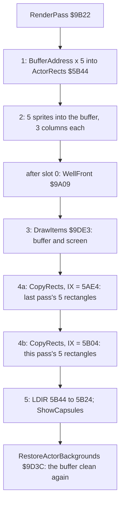

The cost of one pass, measured on the trace of `explorers` frames 6001-6004 (room `$14`, the hero walking right, two
creatures, a floor item, two empty slots):

| Step | From | To | T |
| --- | --- | --- | ---: |
| 1, addresses | 6001 T 55856 | 6001 T 58208 | 2 352 |
| 2, sprites | 6001 T 58208 | 6003 T 12474 | 96 082 |
| 3, items | 6003 T 12474 | 6003 T 27184 | 14 710 |
| 4, copies | 6003 T 27184 | 6003 T 57956 | 30 772 |
| 5, the LDIR and ShowCapsules | 6003 T 57956 | 6003 T 59049 | 1 093 |
| 5, RestoreActorBackgrounds | 6003 T 59049 | 6004 T 13644 | 25 503 |
| RenderPass | 6001 T 55856 | 6004 T 13644 | 170 512 |

The pass runs from 6001 T 34757 to 6004 T 13743: 191 710 T. RenderPass is 89 % of it. The sprites alone take half the
pass, and two of the five are the blank frame.

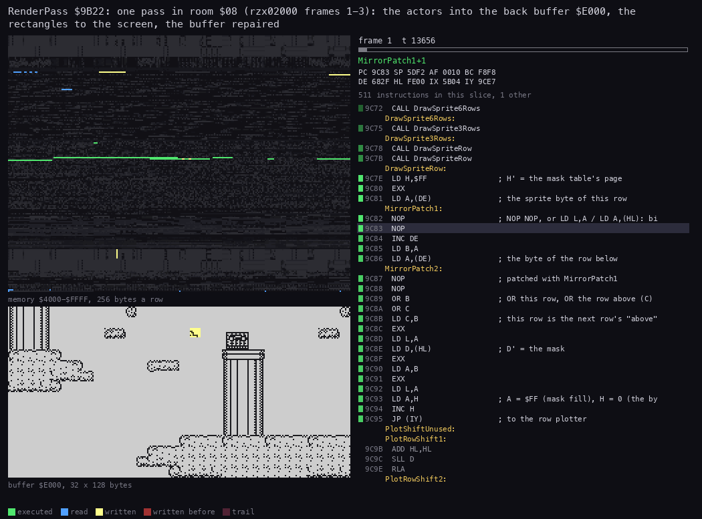

*Figure 6.6: RenderPass `$9B22` over one pass of `rzx02000` (the RZX run, replayed), frames 1-3. This animation is
doc 4's ([4.3](04-game-loop.md)); it is shown here for the whole pass. Made with `python3 ../../kit/routine_anim.py
--work work/docs/tmA/r02000 --window 1:9746-3:24326 --listing build/game.lst --view buffer:E000:32x128:screen --pc
9B22-9E5C --range 4000-FFFF --pictures 90 --out docs/img/routines/RenderPass.gif`.*

How to read:

- Left below: the buffer `$E000`, laid out as the screen's top two thirds. The sprites appear in it slot by slot.
- Left above: the memory map. The rows of `$4000-$4FFF` light up only near the end, when CopyRects writes the
  screen.
- The last pictures are RestoreActorBackgrounds: the sprites vanish from the buffer.

Witness: RenderPass ran 26 515 times over the 34 builds, CopyRects 53 020 times (twice a pass), DrawItems and
RestoreActorBackgrounds 26 510 times each.

The point: a pass is mostly drawing. The game has no frame lock ([doc 4](04-game-loop.md)), so the time RenderPass
takes sets the game's speed: one more creature on the screen slows the whole game.

## 6.8 BufferAddress and the row plotters

BufferAddress `$9CEE` turns (X, Y) into a buffer address and a plotter. The address follows the screen's layout:

- C = X >> 3 (the byte column) OR bits 3-5 of Y moved to bits 5-7 (the character row in the third);
- B = `$E0` OR bits 0-2 of Y (the pixel row in the cell) OR bit 6 of Y moved to bit 3 (the third).

Bit 7 of Y is dropped: the play window has 128 rows. The plotter depends on k = X AND 7, the pixel shift in the byte.
For k = 0, IY = PlotRowAligned `$9CE7`. Otherwise IY = `$9C97 + 4 x k`: one of PlotRowShift1-7.

A shift is a chain of seven identical steps of 4 bytes: ADD HL,HL / SLL D / RLA. Entering at step k runs 8 - k steps.
L holds the sprite byte and H is 0. After 8 - k left shifts, H holds the byte shifted right by k, and L the bits that
spilled into the next byte. D holds the mask and A starts as `$FF`. SLL D shifts a 1 in, and RLA moves the mask's top
bits into A. So E:D is the mask shifted right by k, with 1s round it. The two bytes then go to (BC) and (BC+1).

```text
BufferAddress(X, Y):
    C = (X >> 3) | ((Y << 2) & $E0)
    B = $E0 | (Y & 7) | ((Y & $40) >> 3)
    k = X & 7
    IY = PlotRowAligned if k == 0 else $9C97 + 4 * k

plot one row (sprite byte g, mask m, shift k):
    if k == 0: buf[BC] = buf[BC] & m | g
    else:
        (H, L) = g << (8 - k), as 16 bits          # g >> k, and the spill
        (E, D) = ($FF, m) << (8 - k), 1s shifted in
        buf[BC]   = buf[BC]   & E | H
        buf[BC+1] = buf[BC+1] & D | L
    NextBufferRow(BC)
```

```asm
BufferAddress:                      ; $9CEE, L = X, H = Y
        LD A,L
        PUSH AF
        RRCA
        RRCA
        RRCA
        AND $1F
        LD C,A                      ; X >> 3
        LD A,H
        AND $7F
        RLCA
        RLCA
        AND $E0
        OR C
        LD C,A                      ; OR Y bits 3-5 in bits 5-7
        LD A,H
        AND $07
        LD B,A                      ; Y bits 0-2
        LD A,H
        AND $40
        RRCA
        RRCA
        RRCA
        OR B                        ; Y bit 6 in bit 3
        OR $E0
        LD B,A
        POP AF
        AND $07                     ; k
        LD IY,PlotRowAligned        ; $9CE7
        RET Z
        ADD A,A
        ADD A,A
        LD E,A
        LD D,$00
        LD IY,PlotShiftUnused       ; $9C97
        ADD IY,DE                   ; $9C97 + 4k
        RET
PlotRowShift1:                      ; $9C9B; PlotRowShift2 $9C9F ... PlotRowShift7 $9CB3
        ADD HL,HL
        SLL D
        RLA
        ...                         ; the same 4 bytes, 6 more times
        LD E,A                      ; E = the mask's left byte
        LD A,(BC)
        AND E
        OR H
        LD (BC),A
        INC C                       ; the right byte
        LD A,(BC)
        AND D
        OR L
        LD (BC),A
        DEC C
NextBufferRow:                      ; $9CC2
        INC B
        LD A,B
        AND $07
        RET NZ
        ...                         ; a character row or a third crossed
PlotRowAligned:                     ; $9CE7
        LD A,(BC)
        AND D
        OR L
        LD (BC),A
        JP NextBufferRow
```

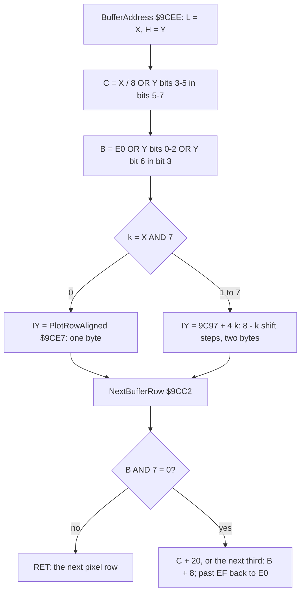

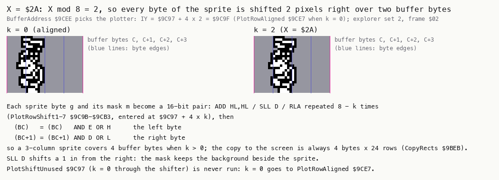

*Figure 6.7: frame `$02` of explorer set 2 drawn at k = 0 and at X = `$2A` (k = 2), over the four buffer bytes of its
rectangle. Computed from `build/explorers.bin` and the plotters of `build/game.bin`; the X is the hero's in
`explorers` at frame 6001. Made with `python3 tools/fig_render.py shift --set 2 --frame 2 --x 0x2A --out
docs/img/render/plot-shift.png`.*

How to read:

- Grey is the background left alone, black the outline the mask clears, white the graphic.
- The blue lines are the byte edges. At k = 0 the sprite fills bytes C to C+2. At k = 2 it moves 2 pixels right and
  spills into C+3.
- The text below the pictures gives the two writes of a shifted row.

Worked example (`explorers`, frame 6001, the hero at X `$2A`, Y `$60`): C = `$2A >> 3 = $05`. Y AND `$7F` = `$60`;
rotated left twice it gives `$81`; AND `$E0` gives `$80`. So C = `$85`. B = `$E0 OR 0 OR ($40 >> 3 = $08) = $E8`.
The rectangle is `$E885`; its screen twin is `$4885`, character row 12, column 5. k = 2, so IY =
`$9C97 + 8 = $9C9F`, PlotRowShift2: 6 shift steps. ActorRects `$5B44` holds `85 E8 9F 9C` at the start of frame 6001, as
computed.

Witness: BufferAddress ran 136 425 times, PlotRowAligned 4 398 977 times, PlotShiftUnused 0 times. The aligned rows
come to about 166 a pass. The two parked slots alone give 144 of them (2 x 3 columns x 24 rows).

The point: the shift is a jump into a straight run of code, not a loop with a counter. The same code serves shifts 1
to 7, and the cost grows with 8 - k.

## 6.9 DrawSpriteRow: the outline mask and the mirror

DrawSpriteColumn `$9C6A` draws one column of 24 rows through a tree of calls. DrawSprite12Rows calls DrawSprite6Rows,
which calls DrawSprite3Rows, which runs DrawSpriteRow `$9C7E` three times. Each level calls the next and then falls
into it. So 24 rows come from 2 x 2 x 2 x 3 runs, with no counter.

DrawSpriteRow makes the mask from the graphic. The index is the OR of three bytes: the row above (C', 0 for the first
row), this row, and the row below (the next byte). OutlineMasks `$FF00` holds NOT (v OR v << 1 OR v >> 1) for each
index v. So the mask clears every pixel of the sprite and every pixel next to one, diagonals included: the rows
above and below are ORed in, then the result is spread left and right. The graphic is then ORed in. A sprite gets a
one-pixel border of paper, and stays readable on any background.

The mirror is two patched instructions. MirrorPatch1 `$9C82` follows the read of this row's byte; MirrorPatch2 `$9C87`
follows the read of the row below. RenderPass writes two NOPs there when flags bit 7 is clear. It writes
`LD L,A / LD A,(HL)` (bytes `$6F $7E`) when bit 7 is set. With H' = `$FE`, `LD A,(HL)` reads BitReverse
`$FE00 + byte`: the byte with its bits reversed. RenderPass also draws the columns in the other order, C+2, C+1, C.
The hero's right key sets bit 7 (`$A48B`), and the left key clears it (`$A4A1`). So the stored graphics face left,
and the mirrored drawing faces right.

```text
DrawSpriteColumn(src, BC, plotter):           # 24 rows
    above = 0
    for row in 0..23:
        g = src[row]; below = src[row + 1]    # row 23 reads the next column's first byte
        if mirrored: g = BitReverse[g]; below = BitReverse[below]
        m = OutlineMasks[above | g | below]
        above = g
        plotter(g, m, BC)                     # 6.8; BC moves down one pixel row
```

```asm
DrawSpriteColumn:                   ; $9C6A
        EXX
        LD BC,$0000                 ; no byte above the first row
        EXX
        CALL DrawSprite12Rows
DrawSprite12Rows:
        CALL DrawSprite6Rows
DrawSprite6Rows:
        CALL DrawSprite3Rows
DrawSprite3Rows:
        CALL DrawSpriteRow
        CALL DrawSpriteRow
DrawSpriteRow:                      ; $9C7E
        LD H,$FF                    ; H = the page of OutlineMasks
        EXX
        LD A,(DE)                   ; the sprite byte of this row
MirrorPatch1:
        NOP                         ; or LD L,A / LD A,(HL): BitReverse through H' = $FE
        NOP
        INC DE
        LD B,A
        LD A,(DE)                   ; the byte of the row below
MirrorPatch2:
        NOP                         ; patched with MirrorPatch1
        NOP
        OR B                        ; OR this row, OR the row above (C)
        OR C
        LD C,B                      ; this row is the next row's "above"
        EXX
        LD L,A
        LD D,(HL)                   ; D = the mask
        EXX
        LD A,B
        EXX
        LD L,A                      ; L = the sprite byte
        LD A,H                      ; A = $FF (the mask fill)
        INC H                       ; H = 0 (the spill)
        JP (IY)                     ; to the row plotter
```

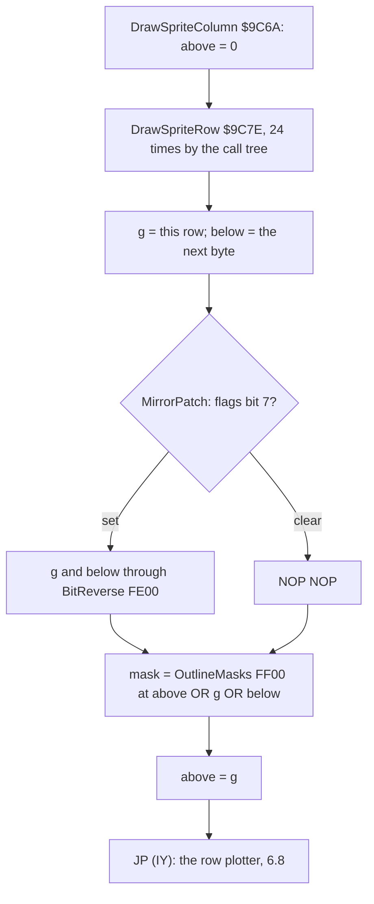

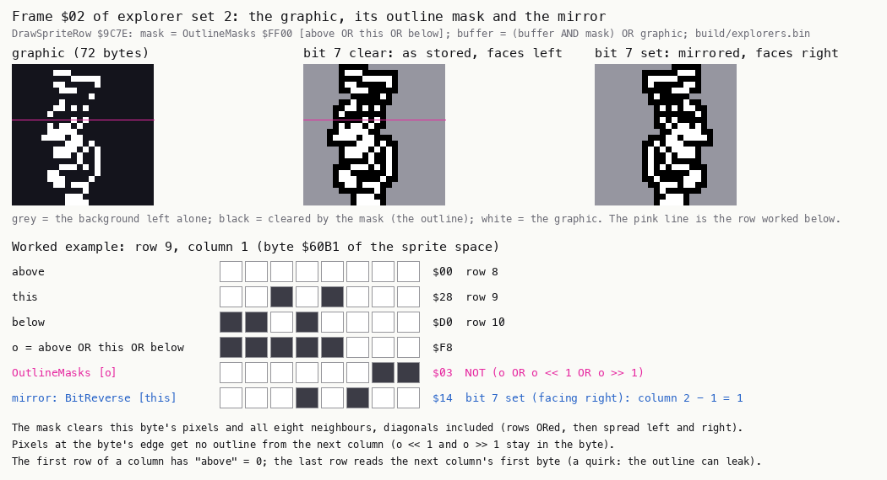

*Figure 6.8: frame `$02` of explorer set 2, as stored, drawn with its mask, and mirrored. Below, the mask of row 9,
column 1, bit by bit. Computed from `build/explorers.bin` and the tables `$FE00` and `$FF00` of `build/game.bin`. No
recording. Made with `python3 tools/fig_render.py outline --set 2 --frame 2 --row 9 --out
docs/img/render/outline-mirror.png`.*

How to read:

- Left: the 72 bytes as pixels. Middle: drawn with flags bit 7 clear. Right: drawn with bit 7 set.
- The figure shows ink as white and the cleared outline as black, so the outline stands out. On the screen the ink is
  the room's ink, and the outline is its paper.
- The pink line is row 9. The rows below the pictures work out its mask.

Worked example (row 9 of column 1, byte `$60B1`): above = `$00`, this = `$28`, below = `$D0`. The OR is `$F8`. Then
`$F8 OR $F0 OR $7C = $FC`, and NOT `$FC` = `$03`: OutlineMasks `$FFF8` holds `$03`. So the row keeps only its two
right pixels of background, and `$28` is ORed in. Mirrored, the byte is BitReverse `$FE28` = `$14`, and the column
goes to C+1 (column 2 - 1).

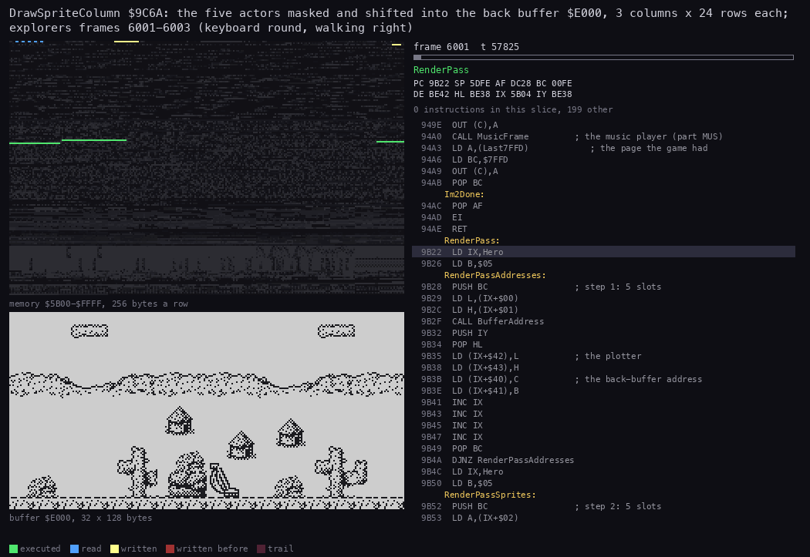

*Figure 6.9: DrawSpriteColumn `$9C6A` and the row plotters putting the five actors into the buffer, `explorers` frames
6001-6003 (the keyboard round, the hero walking right in room `$14`). Made with `python3 ../../kit/routine_anim.py
--work work/docs/tmB/explorers --window 6001:55856-6003:12474 --listing build/game.lst --view
buffer:E000:32x128:screen --range 5B00-FFFF --pc 9C6A-9CED --pictures 50 --out
docs/img/routines/DrawSpriteColumn.gif`.*

How to read:

- Left below: the buffer `$E000`. The hero is drawn first, at the left. Then come the two creatures, then the two blank
  slots at the top left, which change nothing.
- Right: the listing at the PC. It moves between DrawSpriteRow, the patched MirrorPatch points and the shift chain.
- In the memory map, the reads at `$FE00` and `$FF00` light up: the mirror and the mask tables.

Witness: DrawSpriteRow ran 9 545 126 times: 360 a pass (5 slots x 3 columns x 24 rows). The mirrored path at `$9B99`
ran 22 253 times, the stored one at `$9B7F` 110 321 times, both in all 34 builds.

The point: the mask costs no memory. Each sprite gets its own outline, made from its neighbours as it is drawn, and
the mirror is a two-instruction patch. The price: the outline stops at the byte's edge, because o << 1 and o >> 1 do
not reach the next column (6.16).

## 6.10 CopyRects and RestoreActorBackgrounds: the copy and the repair

After step 3 the buffer holds the room with the actors and items on it. CopyRects `$9BEB` copies ten rectangles to
the screen. Each rectangle is 4 bytes by 24 rows: the sprite's three columns and the byte the shift spills into.

The first call copies last pass's rectangles: IX = `$5AE4`, so IX + `$40` = PrevActorRects `$5B24`. The buffer there
now holds the background, or an actor that has moved in, so the old picture is wiped from the screen. The second
call copies this pass's rectangles: IX = `$5B04`, so IX + `$40` = ActorRects `$5B44`. The actors appear. SK explained
the `$5AE4` trick first: no slot lives at `$5AE4`; the base is picked so that IX + `$40` lands on `$5B24`.

A copy walks the rectangle as a snake. One row goes left to right, with three LDI and a fourth byte without a step.
The next goes right to left, with three LDD. INC H and INC D move both pointers down one pixel row. When H crosses a
character row, NextCharRow `$9DBF` steps to the next one. The screen address is the buffer address AND `$5F`: `$E0xx`
becomes `$40xx`, `$E8xx` becomes `$48xx`.

Then RestoreActorBackgrounds `$9D3C` repairs the buffer. For each slot it takes the rectangle's top cell (H AND
`$F8`) and repaints 3 x 3 cells from the tile map. It adds a column when X AND 7 is not 0, and a row when Y AND 7 is
not 0. The tile map cell is `$F800 + 256 x third + L`. So the buffer is clean again for the next pass. A floor item
under an actor is wiped from the buffer too; DrawItems draws it again in the next pass.

```text
CopyRects(IX):                                 # IX + $40 = 5 rectangles
    for slot in 0..4:
        src = rect[slot]; dst = src & $5FFF
        for row in 0..23:
            copy 4 bytes src -> dst: left to right on even rows, right to left on odd rows
            src, dst = the next pixel row (NextCharRow at a cell edge)

RestoreActorBackgrounds():
    for slot in 0..4:
        top = rect[slot] with the pixel row bits cleared
        rows = 3 + (Y & 7 != 0); cols = 3 + (X & 7 != 0)
        for each cell (r, c): buffer cell = TilePixels[TileMap[$F800 + 256 * third + L]]
```

```asm
CopyRects:                          ; $9BEB, IX + $40 = the rectangles
        LD B,$05
CopyRectsLoop:
        LD L,(IX+$40)
        LD H,(IX+$41)
CopyRect:                           ; $9BF3, also EraseItem's
        LD A,H
        AND $5F                     ; DE = the screen address: $E0xx -> $40xx, $E8xx -> $48xx
        LD D,A
        LD E,L
        PUSH BC
        LD B,$04
CopyRectRows:
        PUSH BC                     ; 4 times 6 rows
        LD BC,$07F0                 ; B = 7 for the row test; C keeps BC from reaching 0
        LDI
        LDI
        LDI
        LD A,(HL)                   ; the 4th byte without stepping
        LD (DE),A
        INC H
        INC D
        LD A,H
        AND B
        CALL Z,NextCharRow          ; a character row crossed
        LDD                         ; the next row right to left
        LDD
        LDD
        LD A,(HL)
        LD (DE),A
        INC H
        INC D
        ...                         ; 4 more rows the same way
        POP BC
        DJNZ CopyRectRows
        ...                         ; IX + 4, the next rectangle
RestoreRect:                        ; $9D48, the cells under one rectangle
        PUSH BC
        LD A,H
        AND $F8                     ; the top of the character row
        LD H,A
        LD B,$03
        LD A,(IX+$01)               ; Y AND 7 not 0: one more row
        AND $07
        JR Z,RestoreRectRow
        INC B
RestoreRectRow:
        ...                         ; the same test on X for the columns
RestoreRectCell:
        PUSH HL
        LD A,H                      ; the tile map: $F800 + 256 * third + L
        RRCA
        RRCA
        RRCA
        AND $03
        LD H,A
        LD DE,TileMap
        ADD HL,DE
        LD L,(HL)                   ; T
        LD H,$00
        ADD HL,HL
        ADD HL,HL
        ADD HL,HL
        LD DE,(TilePixelsPtr)
        ADD HL,DE                   ; $F000 + 8 x T
        ...                         ; 8 bytes into the buffer cell, INC H between them
```

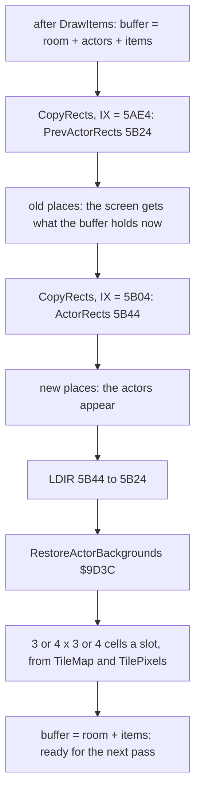

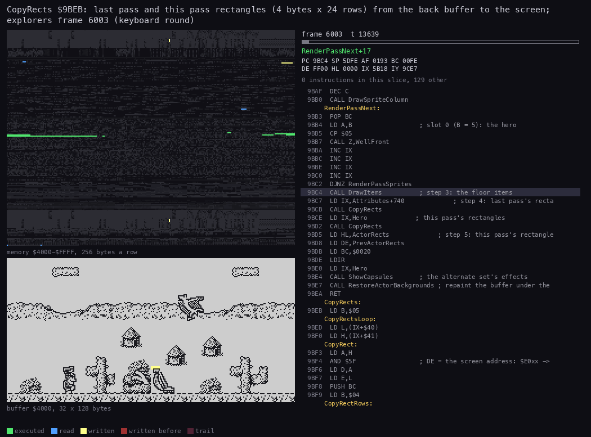

*Figure 6.10: CopyRects `$9BEB` copying last pass's and this pass's rectangles to the screen, `explorers` frame 6003.
Made with `python3 ../../kit/routine_anim.py --work work/docs/tmB/explorers --window 6003:12474-6003:59049 --listing
build/game.lst --view buffer:4000:32x128:screen --range 4000-FFFF --pc 9BEB-9C69,9DBF-9DE2 --pictures 40 --out
docs/img/routines/CopyRects.gif`.*

How to read:

- Left below: the screen's top two thirds. The bright rectangles are the bytes just written. The hero's old and new
  places overlap.
- The rectangle at the top left comes from the two empty slots at (0, 0). It copies unchanged background.
- Right: the listing. The PC alternates between the LDI rows and the LDD rows.

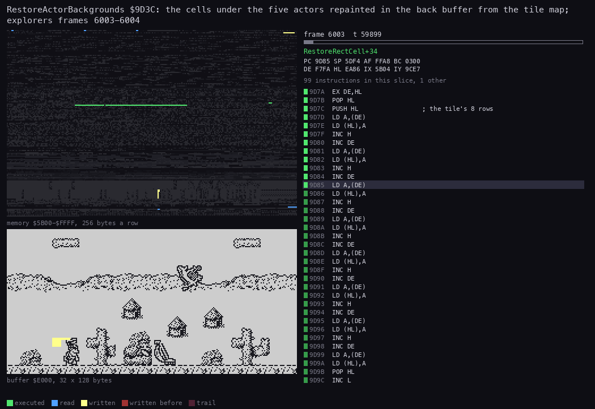

*Figure 6.11: RestoreActorBackgrounds `$9D3C` repainting the cells under the five actors in the buffer, `explorers`
frames 6003-6004. Made with `python3 ../../kit/routine_anim.py --work work/docs/tmB/explorers --window
6003:59049-6004:13644 --listing build/game.lst --view buffer:E000:32x128:screen --range 5B00-FFFF --pc 9D3C-9DB8
--pictures 30 --out docs/img/routines/RestoreActorBackgrounds.gif`.*

How to read:

- Left below: the buffer. The actors disappear cell by cell as the tiles are written over them.
- In the memory map, the reads at `$F800-$F9FF` (the tile map) and `$F000-$F7FF` (the tiles) light up with each cell.

Worked example (`explorers`, frame 6001, the hero's rectangle `$E885`): CopyRect copies `$E885-$E888` to
`$4885-$4888`, then the next row right to left from `$E988`. Y = `$60` is a cell edge, so NextCharRow runs after rows
7 and 15. RestoreRect keeps H = `$E8`. X AND 7 = 2, so 4 columns; Y AND 7 = 0, so 3 rows. The first row of cells is at
`$F800 + 256 x 1 + $85 = $F985`: `FF FF FF 21`. Three sky tiles and tile `$21` are written back over the hero.

Witness: CopyRects ran 53 020 times and RestoreActorBackgrounds 26 510 times over the 34 builds. In the pass of frames
6001-6004, CopyRectRows wrote 960 screen bytes: 10 rectangles x 96 bytes (Figure 6.16).

The point: no background is saved under each sprite. The tile map is the background, so the repair is a few tile
copies, and the screen sees only finished rectangles. Every rectangle is copied whether its actor moved or not, so
the cost is fixed: 960 bytes a pass.

## 6.11 The floor items and the thought bubble

The two floor items of a room (ItemSlot1 `$5C0E` and ItemSlot2 `$5C13`: X, Y, item) and the thought bubble (Thought
`$5B99`) are drawn by DrawItems `$9DE3`, in step 3. They are not actors:

- Item `$FF` means the slot is empty. Item `$FE` means it was just taken, and EraseItem `$9D21` wipes it.
- An item is drawn at X AND `$F8`: byte-aligned, with no plotter.
- Each byte is masked like a sprite row, with OutlineMasks. The "above" of row 0 is the first byte itself.
- The result goes to the buffer and to the screen. RES 5 and RES 7 turn the buffer address (`$E0xx`, `$E8xx`) into
  the screen address (`$40xx`, `$48xx`). ADD A,`$A1` turns the screen's high byte into the buffer's next row:
  `$40 + $A1 = $E1`.
- There is no mirror: items always face the same way.

Items are drawn after the actors, so they stand in front of them. The cost is 72 screen writes an item, every pass,
even when nothing moves.

EraseItem sets the item to `$FF`. It repaints the cells under the item in the buffer (RestoreRect, with B = 1 for one
rectangle), then copies that rectangle to the screen (CopyRect).

```text
DrawItem(slot):
    item = slot.item
    if item == $FF: return
    if item == $FE: EraseItem(slot); return
    DE = BufferAddress(slot.X & $F8, slot.Y)
    src = $8400 + 72 * item
    for col in 0..2:
        above = src[0]
        for row in 0..23:
            m = OutlineMasks[src[0] | src[1] | above]; above = src[0]; g = src[0]; src += 1
            buffer[DE] = buffer[DE] & m | g
            screen[DE & $5FFF] = the same byte
            DE = the next row
        DE = the top of the next column
```

```asm
DrawItem:                           ; $9DF8, IX = the slot
        LD A,(IX+$02)
        CP $FF
        RET Z
        CP $FE
        JP Z,EraseItem
        LD A,(IX+$00)
        AND $F8                     ; byte-aligned
        LD L,A
        LD H,(IX+$01)
        CALL BufferAddress          ; BC = the buffer address
        ...                         ; IX = $8400 + 72 x item, DE = BC
DrawItemRow:
        LD A,(IX+$00)               ; 24 rows
        OR (IX+$01)
        OR C
        LD C,(IX+$00)
        INC IX
        LD L,A                      ; L = the masks' index, H = $FF
        LD A,(DE)
        AND (HL)
        OR C
        LD (DE),A                   ; the buffer
        RES 5,D                     ; the screen byte too
        RES 7,D
        LD (DE),A
        LD A,D                      ; D + $A1: from $4x back to the buffer's next row
        ADD A,$A1
        LD D,A
        AND $07
        JP NZ,DrawItemNextRow
        CALL NextCharRowDE
        LD H,$FF
DrawItemNextRow:
        DJNZ DrawItemRow
```

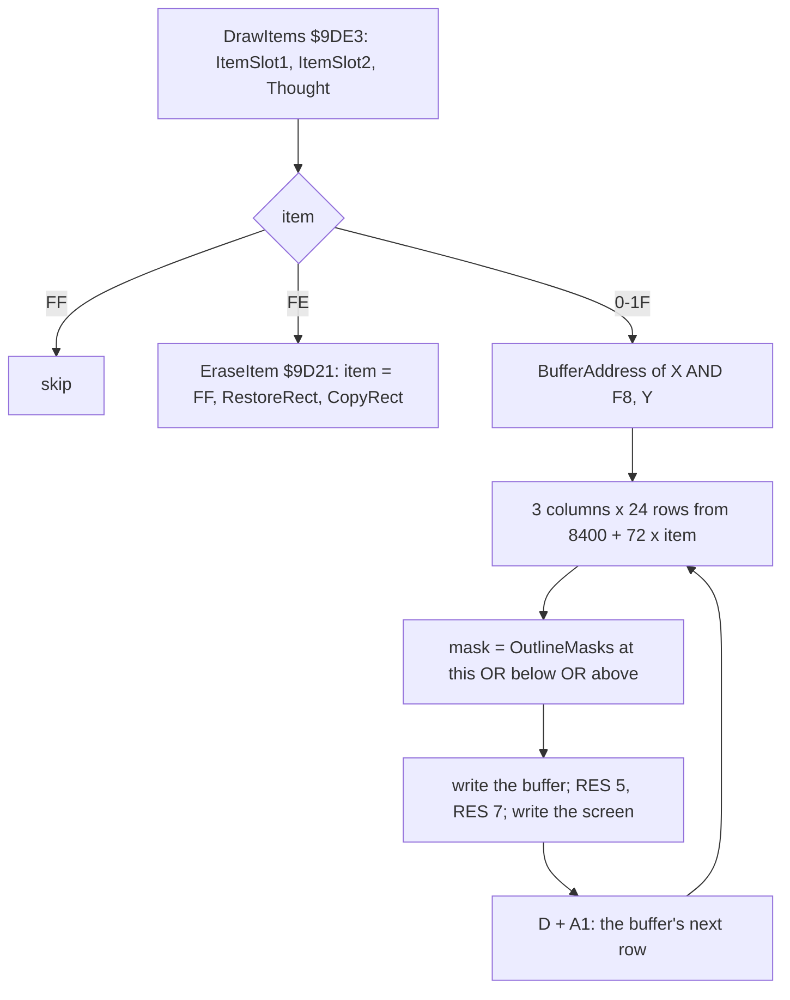

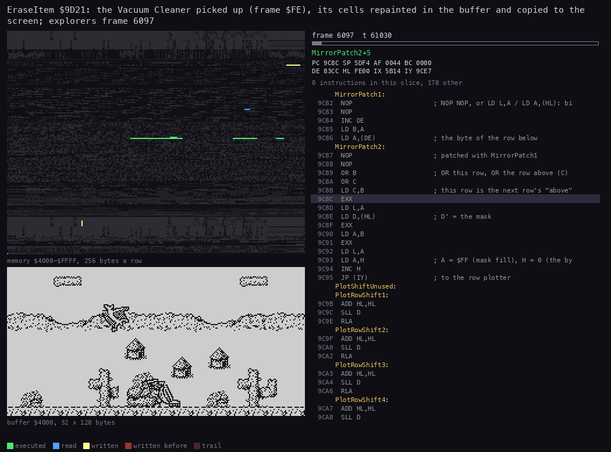

*Figure 6.12: EraseItem `$9D21` wiping the vacuum cleaner, which the hero has just picked up, `explorers` frame 6097.
Made with `python3 ../../kit/routine_anim.py --work work/docs/tmB/explorers --window 6097:60000-6098:20000 --listing
build/game.lst --view buffer:4000:32x128:screen --range 4000-FFFF --pc 9D21-9D3B,9D48-9DB8,9BF3-9C69 --pictures 30
--out docs/img/routines/EraseItem.gif`.*

How to read:

- Left below: the screen. The vacuum cleaner is on the ground beside the hero. Its cells are repainted in the buffer,
  then the rectangle is copied, and the item is gone.
- Right: the listing moves from EraseItem to RestoreRect, then to CopyRect.

Worked example (`explorers`, frame 6001): ItemSlot1 `$5C0E` holds `80 60 0A`: X `$80`, Y `$60`, item `$0A`, the
vacuum cleaner. BufferAddress gives C = `$10 OR $80 = $90` and B = `$E8`: `$E890`. The sprite is at
`$8400 + 72 x $0A = $86D0`. For row 0 the index is (`$86D0`) OR (`$86D1`) OR (`$86D0`) again. The byte goes to
`$E890`. Then D = `$E8` loses bits 5 and 7, giving `$48`, and `$4890` gets the same byte. D + `$A1` = `$E9`:
the next row of the buffer.

Witness: in the pass of frames 6001-6004, DrawItemRow wrote 72 screen bytes, read from `$86D0-$8717` (Figure 6.16). The
item's next-character-row path at `$9E50` ran 34 342 times in 19 builds. EraseItem ran 35 times in 17 builds: once
per item taken.

The point: an item that does not move is still drawn in full every pass, on the screen as well. The game pays 72
writes an item, and in return never tracks which items an actor has passed over.

## 6.12 The panel

The panel is the bottom third: `$5000-$57FF`, with attributes `$5A00-$5AFF` (`src/res/screens/panel.png`, Figure
6.2). The tape holds it at `$E000-$E8FF`, in the back buffer's place. InitGame copies it to the screen before play,
and EndGame saves it back there, because play uses those bytes as the buffer ([doc 4](04-game-loop.md)). During play
the code redraws only five fields with BlitColumns `$9F86`, each 24 rows high (the score and the text fields are
printed with PrintChar, [doc 8](08-hud-and-text.md), 8.5):

| Field | Address | Columns | Routine | What |
| --- | --- | ---: | --- | --- |
| the portrait | `$5092` | 3 | DrawPortrait `$9E5D` | frame 9 of the explorer set (`$6288`) |
| the held item | `$5032` | 3 | DrawPortrait | item HeldItem `$5B98`, or the blank icon `$5C46` |
| the spare lives | `$5081` | 9 | DrawSpareLives `$9E96` | Lives - 1 explorers (frames 2, 3, 4), or blanks |
| the bearers | `$5096` | 9 | DrawBearers `$9EBD` | the bearer figures from BearerIndex `$5C23` |
| the bearers' loads | `$5036` | 9 | DrawBearerItems `$9EE3` | the items of BearerLoads `$5B7C` |

These routines do not draw a sprite pixel by pixel. AddColumnPointers `$9FBA` stores the addresses of a sprite's three
columns in PanelColumns `$5BD6`. BlitColumns then copies each column, 24 bytes, straight to the screen: no mask, no
buffer. The bearer row holds 12 columns of pointers. ShowScrolled `$9F73` skips BearerPhase `$5C22` of them and shows
9. This is how the row slides one character a pass when the player presses 1 or 2 ([doc 5](05-controls.md), 5.8).

```text
BlitColumns(HL = screen, IY = column pointers, B = columns):
    for col in 0..B-1:
        src = PanelColumns[col]
        for row in 0..23:
            screen[HL + row] = src[row]          # NextCharRow at each cell edge
        HL += 1

ShowScrolled(HL):                                 # the bearers and their loads
    IY = PanelColumns + 2 * BearerPhase
    BlitColumns(HL, IY, 9)
```

```asm
ShowScrolled:                       ; $9F73
        LD IY,PanelColumns          ; $5BD6
        LD A,(BearerPhase)
        OR A
        JR Z,Blit9Columns
ShowScrolledSkip:
        INC IY                      ; skip BearerPhase columns
        INC IY
        DEC A
        JR NZ,ShowScrolledSkip
Blit9Columns:
        LD B,$09
BlitColumns:                        ; $9F86
        PUSH HL
        PUSH BC
        LD E,(IY+$00)
        LD D,(IY+$01)
        LD B,$18
BlitColumnsRow:
        LD A,(DE)                   ; 24 bytes of one column
        INC DE
        LD (HL),A
        INC H
        LD A,H
        AND $07
        JR NZ,BlitColumnsNext
        PUSH DE
        CALL NextCharRow
        POP DE
BlitColumnsNext:
        DJNZ BlitColumnsRow
        POP BC
        POP HL
        INC L
        INC IY
        INC IY
        DJNZ BlitColumns
        RET
```

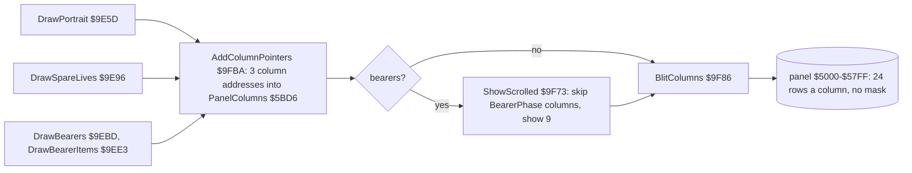

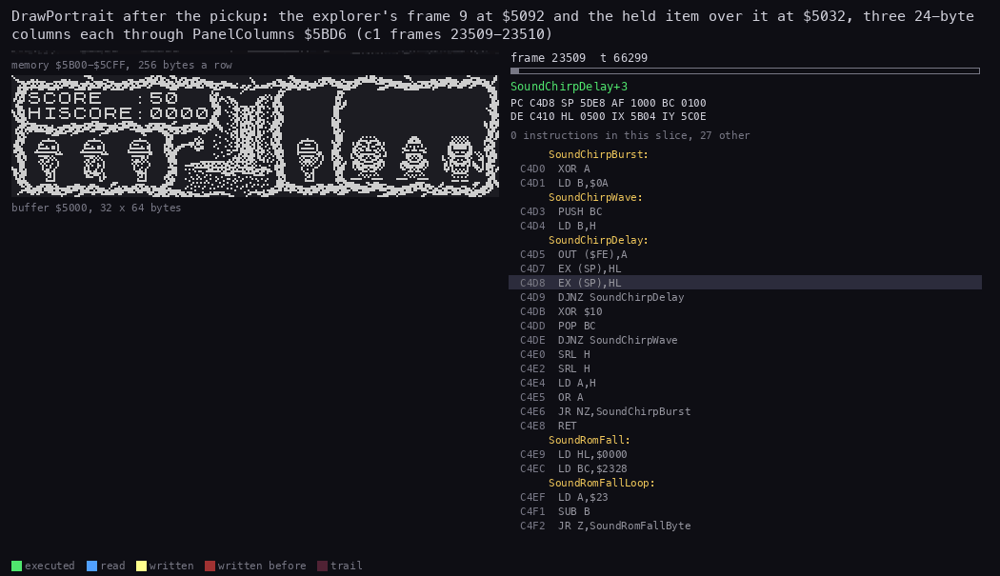

*Figure 6.13: DrawPortrait `$9E5D` after the first pickup of `c1`, frames 23509-23510: the explorer's frame 9 at
`$5092` and the held item at `$5032`. This animation belongs to [doc 8](08-hud-and-text.md). Made with `python3
../../kit/routine_anim.py --work work/docs/tmD/c1 --window 23509:66000-23510:13000 --listing build/game.lst --view
buffer:5000:32x64:screen --pc 9E5D-9EBC,9F6B-9FDD --range 5B00-5CFF --pictures 60 --out
docs/img/routines/DrawPortrait.gif`. The bearer row's scroll is in doc 8's DrawBearers animation
(`img/routines/DrawBearers.gif`) and in doc 5's BearerKeys animation (5.8).*

How to read:

- Left: the panel, under a memory map of only two rows (`$5B00-$5CFF`). The portrait's three columns are written one
  after the other, each 24 rows from top to bottom, with the same bytes as before: the face does not change.
- Then the held item's three columns are written above it: the cell goes from blank to the new item.
- In the thin memory map, PanelColumns `$5BD6` lights up before each column is copied.

Worked example (`rzx02000`, frame 2, Figure 6.1): the portrait goes to `$5092`: third 2, character row 4, column 18,
pixel (144, 160). Its source is frame 9: `$6000 + 72 x 9 = $6288`. The first column's first 8 bytes go to `$5092`,
`$5192`, ..., `$5792`. Then NextCharRow moves to `$50B2` for the next 8 rows, and to `$50D2` for the last 8.

Witness: DrawPortrait ran 81 times in 30 builds, DrawSpareLives 11 times in 7 builds, DrawBearers 1 139 times in 29
builds. Each bearer scroll draws the row four times.

The point: the panel changes only when something happens: a life lost, an item taken, a bearer scroll. So it is
drawn straight to the screen with the plainest copy, and it is never part of the buffer.

## 6.13 The menu globes and the selector's hand cursor

Two more drawers sit outside RenderPass.

**The menu globes.** DrawMenuGlobes `$9F27` draws the Earth and the Moon on the device menu. The Earth is frames
`$71-$74`, 2 rows of 6 columns at `$4837` and `$4897`. The Moon is frame `$75`, at `$4842`. The globes use the panel's
AddColumnPointers and BlitColumns: they are 24-row columns copied to the screen.

Worked example (the Moon, bytes from `build/game.bin`). SpriteAddress `$9FAA` gives
`$6000 + 72 x $75 = $6000 + $20E8 = $80E8`. AddColumnPointers stores `$80E8`, `$8100` and `$8118` in PanelColumns
`$5BD6`. BlitColumns with B = 3 and HL = `$4842` copies 24 bytes a column, one pixel row each (`INC H`, NextCharRow
after every 8). Column 1 (`$8100`) holds `00 00 00 00 1E 67 8D 2F 5B B5 57 BF 5E 33 59 AF 77 1E 00 ...`. Its row 4,
`$1E` (`%00011110`), goes to `$4C43`: the Moon's top. Its row 9, `$B5`, goes to `$4963` (character row 11, pixel row
1). The Earth's four frames give 12 column pointers; the first 6 columns go to `$4837` and the next 6 to `$4897`, so
the Earth is 48 x 48 pixels. The device menu screenshot (`docs/img/play/menu.png`, [doc 8](08-hud-and-text.md)) shows
both globes there. Witness: DrawMenuGlobes ran 9 times, once per menu drawn (`c1`, `explorers`, `gameover`,
`rzx50000`).

**The hand cursor.** The selector in RAM 1 moves a hand over its picture ([doc 5](05-controls.md), 5.6). The hand is
24 x 16 pixels. It is kept in four copies, pre-shifted by 0, 2, 4 and 6 pixels: CursorSprites `$CD8F`, 96 bytes each,
48 of graphic then 48 of mask, column by column. The cursor moves 2 pixels a frame, so every X is even, and one of the
four copies always fits. Each frame RestoreUnderCursor `$C1A2` puts back the 3 x 16 bytes of the selector's picture
from SelectorPicture `$CF0F`. Its source is the screen address with bit 14 cleared, plus `$CF0F`. DrawCursor `$C314`
then draws the copy for X AND 6 at the new place: screen AND mask OR graphic. There is no buffer: the picture's copy
in RAM 1 serves as one.

```text
each selector frame:
    RestoreUnderCursor()                    # 3 x 16 bytes from SelectorPicture $CF0F
    MoveCursor()                            # 2 pixels
    BC = PixelToScreen(CursorXY); A = x & 6
    src = CursorSprites + 96 * (A / 2); mask = src + 48
    for col in 0..2: for row in 0..15: screen = screen & mask | src
```

```asm
DrawCursor:                         ; $C314 (selector, RAM 1)
        LD HL,(CursorXY)
        CALL PixelToScreen          ; BC = the screen byte, A = x AND 6
        PUSH BC
        POP HL
        LD (CursorScreen),HL
        LD HL,CursorSprites         ; $CD8F
        OR A
        JR Z,CursorFrameChosen
        LD HL,CursorFrame2          ; x AND 6 = 2
        CP $02
        JR Z,CursorFrameChosen
        LD HL,CursorFrame4          ; 4
        CP $04
        JR Z,CursorFrameChosen
        LD HL,CursorFrame6          ; 6
CursorFrameChosen:
        PUSH HL                     ; DE = the mask, 48 bytes after the graphic
        LD DE,$0030
        ADD HL,DE
        EX DE,HL
        POP HL
        LD A,$03
DrawColumnLoop:
        ...                         ; three columns of DrawColumn16
PlotCursorByte:                     ; $C357
        LD A,(BC)
        EX DE,HL
        AND (HL)                    ; the mask
        EX DE,HL
        OR (HL)                     ; the graphic
        LD (BC),A
        INC DE
        INC HL
```

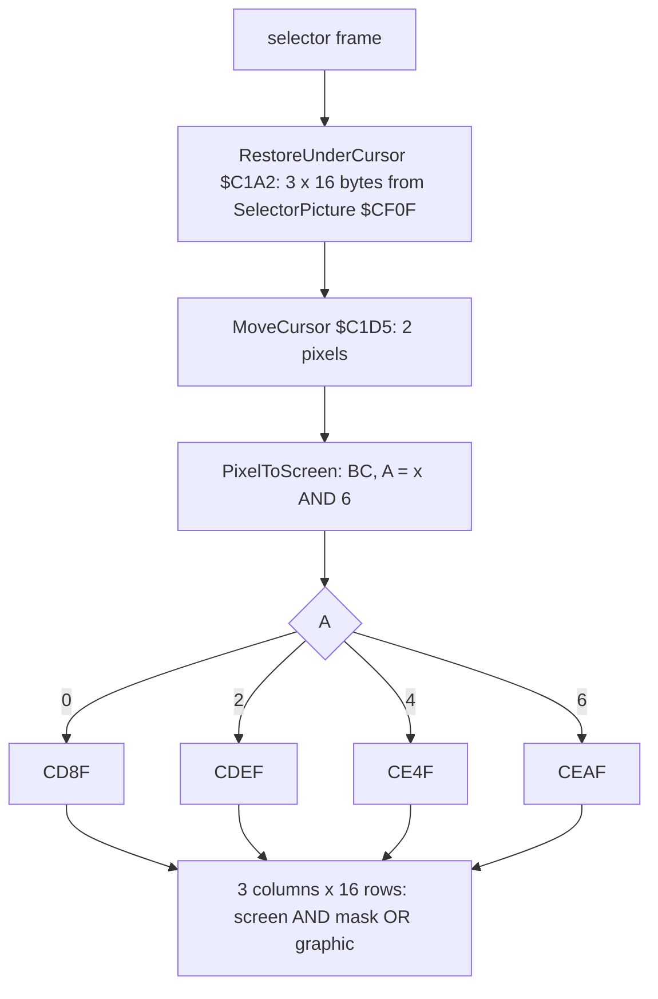

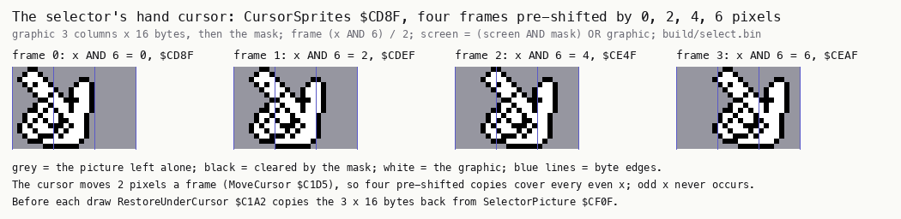

*Figure 6.14: the four pre-shifted copies of the hand, drawn with their masks over grey. From `build/select.bin`. No
recording. Made with `python3 tools/fig_render.py cursor --out docs/img/render/cursor-frames.png`.*

How to read:

- One copy per value of X AND 6. The blue lines are the byte edges: each copy is 3 bytes wide.
- Black is the mask's outline, white the hand. Each copy has its own mask: nothing is shifted while drawing.

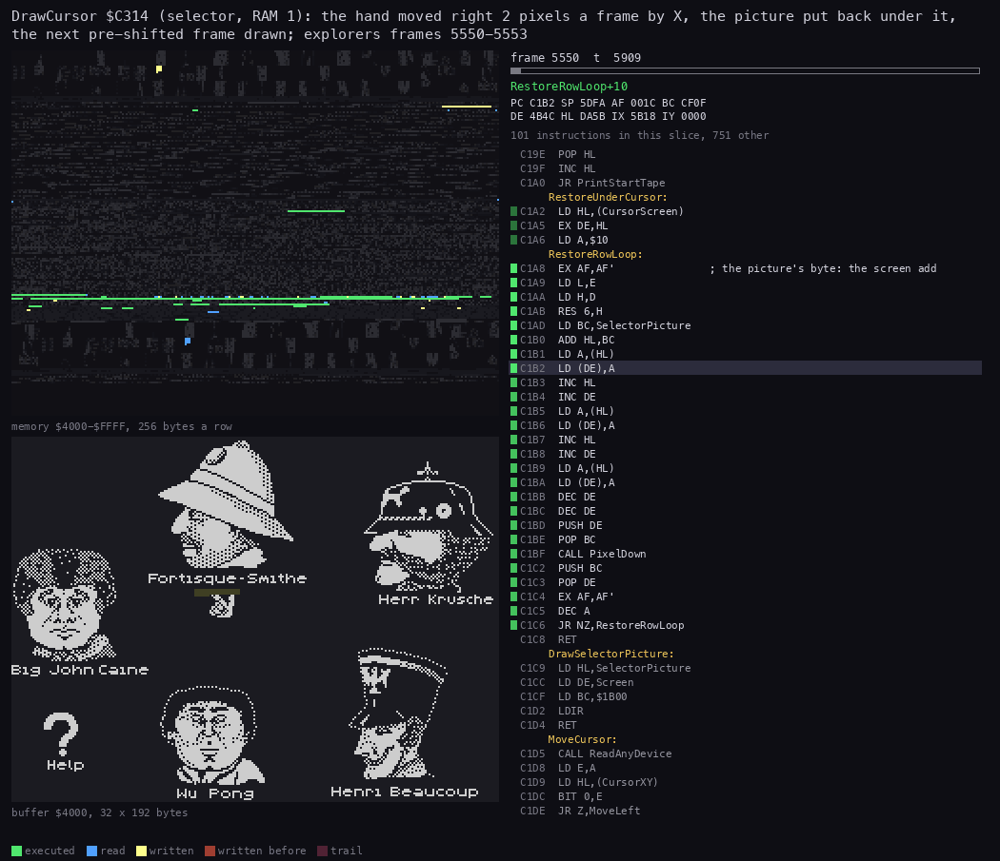

*Figure 6.15: DrawCursor `$C314`, RestoreUnderCursor and MoveCursor moving the hand right, `explorers` frames
5550-5553 (the keyboard round, X held). Made with `python3 ../../kit/routine_anim.py --work work/docs/tmB/explorers
--window 5550:0-5554:0 --listing build/select.lst --view buffer:4000:32x192:screen --range 4000-FFFF --pc
C314-C37E,C1A2-C1C8,C39C-C3BC --pictures 48 --out docs/img/routines/DrawCursor.gif`.*

How to read:

- Left below: the whole screen. The hand moves 2 pixels right each frame.
- Right: the listing moves between RestoreUnderCursor, which writes 48 bytes, and DrawCursor, which writes 48 more.

Worked example (`explorers`): the cursor's x is `$68` at frame 5550. `$68 AND 6 = 0`, so the copy at `$CD8F` is drawn.
One frame later x is `$6A`: `$6A AND 6 = 2`, the copy at `$CDEF`, at the same byte address. The byte address changes
only every fourth frame.

Witness: DrawCursor, MoveCursor and the selector's ReadAnyDevice ran 3 526 times each: once a selector frame.

The point: with four copies and a 2-pixel step, the hand is drawn with no shifting at all, and stays smooth at 50
frames a second.

## 6.14 The code against the screen and the beam

Two figures show who writes the screen in one pass, and when. Both use the pass of `explorers` frames 6001-6004: room
`$14`, the hero walking right, two creatures, the vacuum cleaner on the ground, two empty slots.

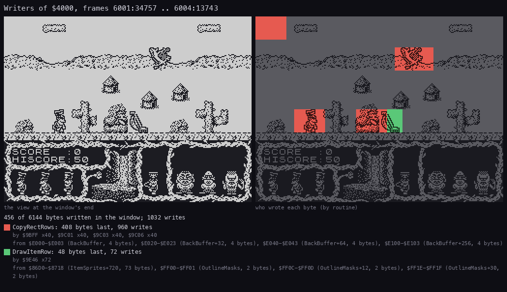

*Figure 6.16: the routine that last wrote each screen byte in the pass of `explorers` frame 6001 T 34757 to frame 6004
T 13743. Made with `python3 ../../kit/writers_map.py --work work/docs/tmB/explorers --window 6001:34757-6004:13743
--listing build/game.lst --view buffer:4000:32x192:screen --sources --out docs/img/render/writers-pass.png`.*

How to read:

- Left: the screen at the end of the pass.
- Right: each byte written in the pass, coloured by its writer. Red is CopyRectRows (CopyRects), green DrawItemRow
  (DrawItem).
- The list below names each writer, the instructions that wrote and the memory they copied from.

What it shows:

- 456 of the 6144 screen bytes are written in the pass, by 1032 writes.
- CopyRectRows writes 960 times: 10 rectangles of 96 bytes. The red block at the top left is the empty slots'
  rectangle at `$4000`, copied twice by each call.
- DrawItemRow writes the 72 bytes of the vacuum cleaner, read from `$86D0-$8717`, through OutlineMasks.
- Nothing else writes the screen: no flame, no panel change, no attribute.

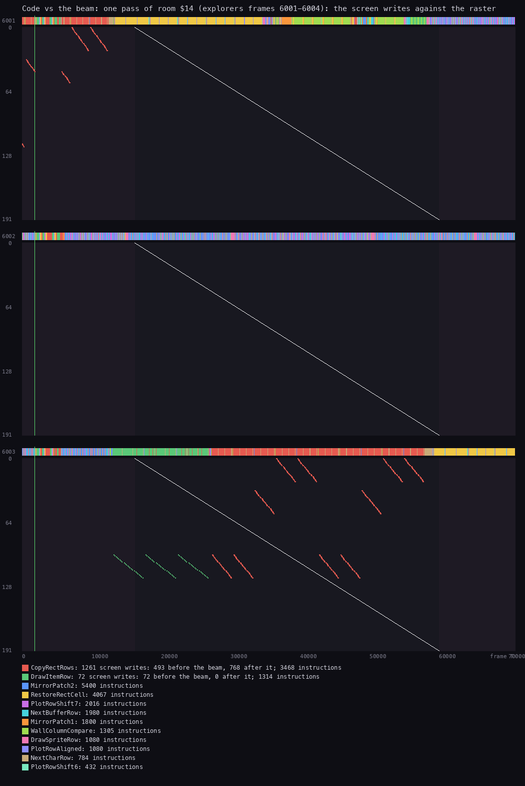

*Figure 6.17: the screen writes of `explorers` frames 6001-6004 against the raster. Made with `python3
../../kit/beam_timeline.py --work work/docs/tmB/explorers --window 6001:0-6005:0 --listing build/game.lst --out
docs/img/render/beam-pass.png`.*

How to read:

- One panel per frame: the T-state across, the screen line (0-191) down. The white diagonal is the beam drawing the
  line.
- A dot is one screen write. A dot left of the diagonal lands before the beam reaches its line, so it shows in this
  frame. A dot right of it lands after, so it shows one frame later.
- The strip above each panel is the routine running at that T-state.

What it shows:

- Frame 6001 begins with the previous pass's copies (red), then RestoreRect (yellow) and the hero's update.
- The sprites go into the buffer from 6001 T 58208 to 6003 T 12474 (the blue and purple strips): no screen write for
  more than a frame.
- At frame 6003 the vacuum cleaner is written (green, T 12000-26000), then the ten rectangles (red, T 27000-57000).
- CopyRectRows makes 1261 screen writes in the window, 493 before the beam and 768 after it. DrawItemRow makes 72,
  all before.

The point: the screen is touched in one burst a pass, and the burst is not timed to the beam. The beam crosses the
copies in the middle. So for one frame a rectangle can show its top half from this pass and its bottom half from the
last one. The game accepts that tearing; it never waits for the interrupt to draw.

## 6.15 Where this reading differs from SK

SK described most of these routines first. Its reading is kept, and credited, for the `$5AE4` base of PrevActorRects
(6.10), the names of the item sprites at `$8400`, and DrawRoom's walk over the 512 cells.

| Entry | SK says | This document | Evidence |
| --- | --- | --- | --- |
| `$99A4` | "Blit the room's tile-index map onto the real screen" | the screen and the back buffer | `LD (BC),A` at `$99DF`, BC = the screen address OR `$E000` (6.4) |
| `$9B22` | "plot pixel ... Then erases last frame's sprites from saved background, redraws the sprites" | the sprites go into the buffer first; then ten rectangles are copied; then the buffer is repaired from the tile map. No background is saved | the step order at `$9B22-$9BE7` (6.7) |
| `$9C97` | "Plot-routine jump table (indexed by screen third)" | the first shift step, never entered: BufferAddress sends k = 0 to PlotRowAligned | `RET Z` at `$9D14`; PlotShiftUnused ran 0 times (6.8) |
| `$9C9B` | "Rotates the sprite byte through a mask 7 times" | 8 - k times, entered at `$9C97 + 4k` | BufferAddress at `$9D15-$9D1E` (6.8) |
| `$9C9B` | "Whole-byte-aligned sprites take the faster path in `$9DE3`" | aligned rows go to PlotRowAligned `$9CE7`; `$9DE3` is DrawItems | IY = `$9CE7` at `$9D10` (6.8) |
| `$9DE3` | two "creature/hazard slots" and a "fixed slot"; "the same masked write repeated into the attribute file" | the two floor items and the thought bubble; the second write is the screen's pixels (RES 5, RES 7: `$E8xx` to `$48xx`) | `$9E42-$9E46` (6.11) |
| `$FF00` | "Sprite blend mask table, used by `$9DE3`" | OutlineMasks, NOT (v OR v << 1 OR v >> 1), read by DrawSpriteRow and DrawItem | `$FF01` = `$FC`, `$FF02` = `$F8`; `LD D,(HL)` at `$9C8E` with H = `$FF` (6.9) |
| `$FE00` | part of the "blend mask table region" | BitReverse: byte n with its bits reversed, for the mirror | `$FE28` = `$14`; MirrorPatch at `$9C82` (6.9) |
| `$91C0` | "sparkles" | the flames (base set), the beams and the capsules (alternate set) | FlameFrames `$933D`, Beams `$9208`, Capsules `$9282` (6.5) |

## 6.16 Known only from the code

- **PlotShiftUnused `$9C97`.** The first step of the shift chain is never entered: for k = 0 BufferAddress returns
  PlotRowAligned. 0 runs.
- **The outline's edges.** OutlineMasks shifts within the byte. A pixel at bit 0 of one column gives no outline to bit
  7 of the next, so the outline has gaps where a sprite crosses a column edge. The last row of a column reads the next
  column's first byte as "below", and the last row of the third column reads the first byte of the next frame.
  DrawItem has the same quirk.
- **The wrap of NextBufferRow.** When a row crosses into `$F0xx`, NextBufferRow sets B back to `$E0`, the top of the
  buffer (`$9CE4`). It ran 8 586 times in 8 builds. A sprite whose bottom row is the window's last row reaches it after
  that row, when the address is no longer used. No recording shows a sprite drawn past row 127; the code would draw
  its lower rows at the top of the window.
- **The beam hit.** `$9260` sets status `$18` when the hero touches a beam. 0 runs: the RZX player never touched one.
- **The rope column of room `$1C`.** SetUpRoomTiles writes tiles `$98` and `$99` down column 8 when RopeCount is set
  (`$98F7`). 0 runs.
- **The Q + A freeze** stops the drawing with the rest of the game ([doc 5](05-controls.md), 5.9). 0 runs.
- **The blank slots.** Empty slots hold frame `$7F` and are drawn, copied and repaired like the others. In the pass
  measured in 6.7 they take about two fifths of the 96 082 T of step 2. Nothing in the code skips them.
