# 7. Objects

What this covers: every object of Terramex and the memory it lives in.

- The hero and up to four other actors are the five 4-byte object slots at `$5B04`.
- The room's three creatures come from a 12-byte record per room (RoomCreatures `$C152`).
- The room's items come from 31 three-byte records (ItemPlaces `$B99D`).
- The items the hero carries live in HeldItem `$5B98` and in the 27 bytes of BearerLoads `$5B7C`.
- The rest of the cast belongs to the room scripts: the professor, the snakes, the basket, the lever, the balloon and
  the asteroid.

This document gives each record byte by byte. It also covers:

- the state machine of each creature type;
- the spawn on a room entry;
- the collision test;
- the random numbers;
- the pickup and the bearers;
- the room script table;
- the game variables: lives, room, countdown, score.

How the hero moves and dies, what each item opens and how the game ends are in doc 10.

The recordings it rests on (WALKTHROUGH 6.0):

- `rzx24750`: a later start of the RZX run's segment at 24 000, replayed. The RZX run is another player's run, and the
  frames are the segment's own. It was opened on an own instance after `source work/env.sh`:
  `python3 ../../kit/rs.py open --work work/docs/tmC/r247 --ttd work/stage1/rzx/r24750/session.ttd --model 128K --port-base 37560`.
  It was sampled with `work/docs/tmC/sample.py` (TTD `memory_at`): `$5B00-$5C47` and CreatureRecords `$BE24-$BE41` at
  every frame 0-1249, in `work/docs/tmC/r247/vars.jsonl`. The segment holds three parts:
  - room `$31` (frames 0-284);
  - room `$30` (285-753), where the crystal is set in place;
  - the teleport to room `$3D`.
- `gameover`: the RZX state at frame 10 000 with Lives `$5B97` = 1 (a POKE, said so in WALKTHROUGH 6.0). It was opened
  the same way into `work/docs/tmC/go` and sampled at every frame 0-1999 (`work/docs/tmC/go/vars.jsonl`). It holds the
  Spring bounce into room `$10`, the two pickups there and the last life lost.
- `rzx06000`: opened into `work/docs/tmC/r06` and sampled at frames 480-720. It shows a creature's touch (7.6). This
  segment drifts from the RZX run at that point (WALKTHROUGH 6.0). The death is a real run of the code, but not one the
  RZX player suffered.
- `rzx44000`: opened into `work/docs/tmC/r44` and sampled at every frame 0-1999: the first two gifts to the professor.
- The RZX run as a whole, through `work/stage1/rzx/vars.bin`: `$5B00-$5CFF` every 250 RZX frames, 205 samples (7.12).
- The L1 counts of the 34 stage-1 builds: c1, explorers, gameover and the 31 RZX segments. They are quoted from the
  witness lines of `src/game/game.ann`.

A sample of frame N is the memory at the start of frame N. A trace, and so an animation, shows an instruction in the
frame in which it ran. So "the crystal is in item slot 1 in frame 614" means the sample of frame 614. The instruction
that put it there ran in frame 613.

One clock drives every object: the main loop pass (MainLoop `$9018`, doc 04). There is no HALT, so a pass lasts as long
as its work takes: 2.4 to 3.3 frames, 2.8 on average in the RZX run. Every speed below ("2 pixels a pass") is per pass,
not per frame.

The creatures, the items, the room script and the hero all run once a pass, in this order:

1. the room script, inside HeroUpdate `$A3E1`;
2. the hero;
3. ItemsPass `$B9FA`;
4. RoomEffects `$91C0`;
5. CountDown `$935D`;
6. RunCreatures `$BE98`;
7. RenderPass `$9B22`, which draws them.

The reading of most routines here started from the SkoolKit disassembly of nzeemin (`work/candidates/
skoolkit-game-revs/terramex-zx`, marked "SK" in the `.ann`). Where this document differs from it, the section says so
and gives the evidence.

## 7.1 The object slots and the game variables

Every moving thing on the screen is one of five 4-byte object slots. RenderPass `$9B22` draws exactly these five, in
order, and nothing else moves on the screen (doc 06). The slots have no kind byte. The owner of a slot is fixed by
convention.

| Slot | Address | Owner | Written by |
| --- | --- | --- | --- |
| 0 | `$5B04` Hero | the hero | HeroUpdate `$A3E1`, the status handlers, Respawn `$9090` |
| 1 | `$5B08` ObjectSlot1 | creature 0 of the room; the asteroid | RunCreatures `$BE98` (IX = `$5B08`); SpaceScene `$B0B6` |
| 2 | `$5B0C` ObjectSlot2 | creature 1; the snakes | RunCreatures; RunSnakes `$B57C` |
| 3 | `$5B10` ObjectSlot3 | creature 2; the professor's speech bubble; the room `$2D` target; room `$39`'s creature | RunCreatures; ProfessorScript `$B5DD`; CricketBallScript `$B370`; SilverCrossScript `$B4E2` |
| 4 | `$5B14` ObjectSlot4 | the room script's actor: the professor, the basket, the lever, the lift, the balloon | ProfessorScript, BasketScript `$B409`, LeverScript `$B735`, LiftPlatform `$AF81`, BalloonRoom `$AFD7` |

Each slot holds the same four bytes:

| Byte | Field | Values |
| --- | --- | --- |
| +0 | X | pixels from the left edge of the play window; the hero leaves the room at X below 4 or at `$E8` and above |
| +1 | Y | pixels from the top of the play window (128 rows); the hero leaves at Y `$67` or more |
| +2 | frame | a sprite of the sprite space: `$00-$3F` the explorer, `$40-$7E` the creatures, `$7F` hidden (the blank sprite), `$80` + n item n |
| +3 | flags | bit 7: facing right; the creatures keep their animation counter in the low bits |

The code does not check which slots a script may use. That is a convention of the room data. Six rooms have both a
script and creature records: `$17`, `$1A`, `$2C`, `$3E`, `$40` and `$43`. In rooms `$3E` and `$40` the lever uses
slot 4, which no creature writes. In rooms `$17` and `$1A` the snake script steers the creatures of the room
themselves, by setting their frames (doc 10.8). On every room entry ClearPartySlots parks slots 1-4 on the blank
frame `$7F`, so no actor of the last room is left on the screen.

The game variables live in one block, `$5B70-$5C47`, which InitGame `$8F69` clears and sets (doc 04). These are the
ones this document and doc 10 use:

| Address | Name | Size | Meaning | Start value |
| --- | --- | ---: | --- | --- |
| `$5B70` | Explorer | 1 | the chosen explorer, 0-4 | from the selector |
| `$5B78` | HiScore | 4 | 32 bits, low byte first | kept between games |
| `$5B7C` | BearerLoads | 27 | the item each invisible bearer carries, `$FF` for none (7.9) | all `$FF` |
| `$5B97` | Lives | 1 | the lives left, the one in play included | 4 |
| `$5B98` | HeldItem | 1 | the item in the hero's hand, `$FF` for none | `$FF` |
| `$5B9E` | LiftRoom | 1 | the room the lift is in | `$2B` |
| `$5BFB` | CountdownDays | 1 | the time left to the collision: days | `$1E` (30) |
| `$5BFC` | CountdownHours | 1 | hours | `$17` (23) |
| `$5BFD` | CountdownMinutes | 1 | minutes | `$3B` (59) |
| `$5BFE` | GameWon | 1 | `$1D` after the sixth gift (doc 10.10) | 0 |
| `$5BFF` | GameOver | 1 | 1 ends the main loop (EndGame `$906D`) | 0 |
| `$5C01` | Room | 1 | the room: 12 x level + column (7.2) | `$14` |
| `$5C02` | PassCount | 1 | +1 every pass; animations and flickers read its low bits | 0 |
| `$5C05` | FallPasses | 1 | the passes of the current fall (doc 10.5) | 0 |
| `$5C06` | Status | 1 | the hero's status, 0-33 (doc 10.2) | 0 |
| `$5C07` | StatusTimer | 1 | counts the passes inside a status | 0 |
| `$5C0E` | ItemSlot1 | 5 | the room's first floor item (7.8) | |
| `$5C13` | ItemSlot2 | 5 | the second | |
| `$5C18` | Score | 4 | 32 bits, low byte first, signed | 0 |
| `$5C23` | BearerIndex | 1 | the first bearer shown in the panel, 0-`$1A` | 0 |
| `$5C2B-$5C33` | Respawn | 9 | the respawn point (doc 10.7) | the start |
| `$5C3C` | WantedItem | 1 | the item the professor asks for | 0 (7.13) |
| `$5C3D` | GiftCount | 1 | the gifts given, 0-6 | 0 |
| `$5C41` | RoomStage | 1 | the room script's stage, cleared on every room entry | 0 |
| `$5C44` | CrystalPlaced | 1 | `$FF` once the crystal is in place: the teleports work | 0 |

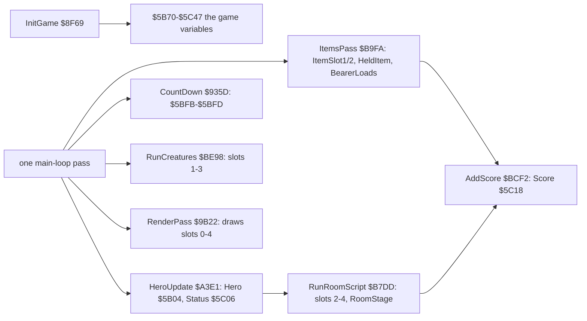

Worked example: the block in `rzx24750` frames 613 and 614. This is the pass that sets the crystal in room `$30`
(7.10). The bytes come from the samples:

| Address | Field | Frame 613 | Frame 614 | Reading |
| --- | --- | --- | --- | --- |
| `$5B04` | Hero | `4C 60 03 00` | `4A 60 03 00` | X `$4C` to `$4A`: one walk step left, frame 3, facing left |
| `$5B08` | slot 1 | `90 38 7F 08` | `90 38 7F 08` | room `$30`'s drop, waiting unseen at its start place |
| `$5B0C`, `$5B10` | slots 2, 3 | `90 60 2C 00`, `68 60 2C 00` | the same | the two scenery objects (type 8), frame `$2C` |
| `$5B7C` | BearerLoads | `1B 0A 01 07 0D 00 03 0C 10 16 06 0B 09 0F 04 13 12 05 FF ...` | the same | 18 bearers loaded, 9 free |
| `$5B97` | Lives | `03` | `03` | three lives: one was lost in room `$1C` near RZX 11 360 |
| `$5B98` | HeldItem | `18` | `FF` | the Energy Crystal leaves the hand |
| `$5BFB` | the countdown | `18 12 0F` | `18 12 0E` | 24 days 18:15, then 18:14: one minute a pass |
| `$5C01` | Room | `30` | `30` | |
| `$5C02` | PassCount | `17` | `18` | one pass |
| `$5C0E` | ItemSlot1 | `90 48 FF DC B9` | `48 60 18 D9 B9` | empty, then the crystal at X `$48`, Y `$60`, record `$B9D9` |
| `$5C18` | Score | `B6 03 00 00` | `01 04 00 00` | 950, then 1025: +75 |
| `$5C3C` | WantedItem | `00` | `00` | the professor has not asked yet: 0, not `$FF` (7.13) |
| `$5C44` | CrystalPlaced | `00` | `FF` | the teleports now work |

The countdown read 24 days 18:15 at RZX frame 25 363 (24 750 + 613). Counted from 30 days 23:59, that is 8 984
minutes. So the run made 8 984 passes in 25 363 frames: 2.82 frames a pass.

**The point**: five slots and one variable block are the whole live state. A creature does not own a slot through a
kind byte. Slot 1 is creature 0 only because RunCreatures starts IX there.

Witness: RenderPass reads the five slots every pass (doc 06). RunCreatures runs 26 514 times in the 34 builds, once a
pass (`.ann`, `$BE98`).

## 7.2 The room record, byte by byte

A room is the number R = 12 x level + column. The levels are 0-5, from the surface down. The columns are 0-11, from
west to east. Rooms `$00-$45` are the 70 rooms of the map. Rooms `$46` and `$47` are two of the explorers' own rooms,
reached only from room `$29` (doc 10.1).

There is no single room record. Each room is one entry in several tables:

| Table | Address | Bytes a room | Read by | What |
| --- | --- | ---: | --- | --- |
| RoomGrids | `$D600 + 32 x R` | 32 | BuildTileMap `$9914` | 8 x 4 back-tile indices; a back-tile is 4 x 4 tiles (BackTiles `$C600`), so the grid makes the 32 x 16 tile map `$F800` (doc 06) |
| RoomCreatures | `$C152 + 12 x R` | 12 | DecodeRoomCreatures `$BE42` | three creature records of 4 bytes (7.3) |
| RoomScripts | `$B7EC + 2 x R` | 2 | RunRoomScript `$B7DD` | the address of the room's script, 0 for none (7.11) |
| ThinkHints | `$A6E6 + R` | 1 | Think `$AB6E` | the item the hero thinks of with the T key, `$FF` for none (doc 10.9) |
| AltTilesetRooms | `$9AC6`, 15 rooms | | SetUpRoomTiles `$9880` | a listed room is drawn with the alternate tiles `$80-$FF` |
| CheckpointRooms | `$9AF5`, 44 rooms | | SetUpRoom `$9855` | entering a listed room saves the respawn point (doc 10.7) |
| ItemPlaces | `$B99D`, 31 x 3 | | SpawnRoomItems `$B93F` | the items lying in the room (7.8) |
| ExplorerRooms | `$A66C`, 5 rooms | | ExitLeft `$A640`, ExitRight `$A671` | the explorers' own rooms `$2D`, `$2E`, `$2F`, `$46`, `$47` |
| TeleportPads | `$B073`, 3 x 3 | | TeleportPadCheck `$B03B` | the pads of rooms `$20`, `$3D` and `$30` |
| LiftStops | `$A9E6` | | LiftAtStop `$A9A9` | the lift's stop in rooms `$1F`, `$2B`, `$37`, `$43` |

The editable resource `src/res/rooms/rooms.txt` holds the first three tables for all 72 rooms, one block a room.
`tools/fig_rooms.py` draws every room from it (docs/img/maps/rooms.png, doc 06).

A room entry reads the tables in this order:

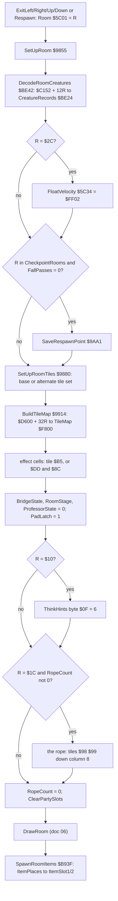

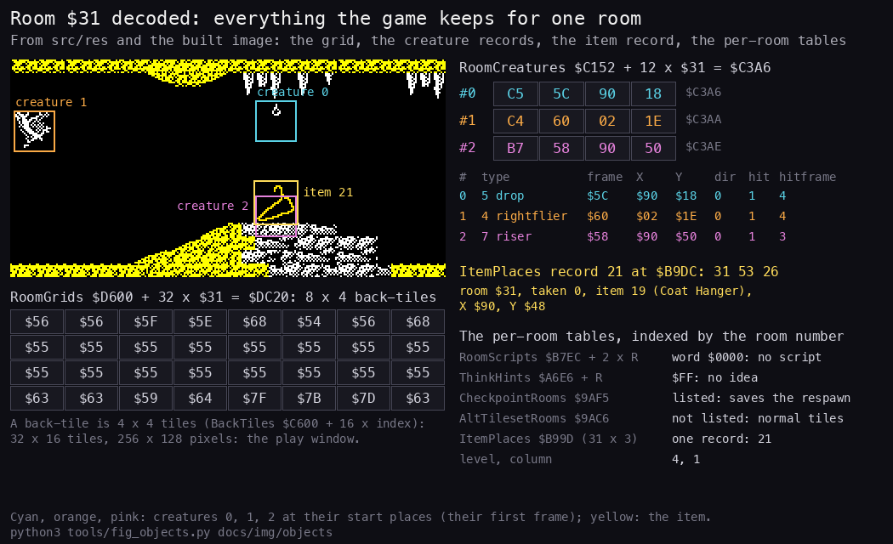

The figure: room `$31` from the built image, drawn by `tools/fig_objects.py`.

```bash
python3 tools/fig_objects.py docs/img/objects
```

How to read the figure:

- Left: room `$31` drawn from the resources (`fig_rooms.room_image`) at twice the size. The boxes mark the three
  creatures at their start places, each drawn in its first frame, and the item that lies there at the start.
- Under the picture: the 32 back-tile indices of RoomGrids at `$DC20`, in rows of 8, in the order the room builder
  reads them.
- Right, top: the 12 bytes of RoomCreatures at `$C3A6`, one row a creature, with their fields decoded (7.3).
- Right, middle: ItemPlaces record 21 at `$B9DC` with its fields decoded (7.8).
- Right, bottom: what the other per-room tables say about room `$31`.

**The point**: a room is a column through ten tables. The grid and the creatures are the bulk, 44 bytes. The rest are
lists that name the room, or words indexed by its number.

Worked example: room `$31` (level 4, column 1), from the built image.

- RoomGrids at `$D600 + 32 x $31` = `$DC20`: `56 56 5F 5E 68 54 56 68 / 55 x 8 / 55 x 8 / 63 63 59 64 7F 7B 7D 63`.
  - Back-tile `$55` is empty cave, so the middle two rows of back-tiles are open air.
  - The top row is the ceiling with its stalactites.
  - The bottom row is the floor, with the rock heap of back-tiles `$7F`, `$7B` and `$7D`.
- RoomCreatures at `$C152 + 12 x $31` = `$C3A6`: `C5 5C 90 18 / C4 60 02 1E / B7 58 90 50`. Decoded (7.3):
  - a drop (type 5) at X `$90`, Y `$18`;
  - a right flier (type 4, frames `$60-$63`, the bird) at X 2, Y `$1E`;
  - a riser (type 7, frames `$58-$5B`) at X `$90`, Y `$50`.
- RoomScripts word `$31` = `$0000`: no script. ThinkHints[`$31`] = `$FF`: no idea.
- CheckpointRooms holds `$31`, so entering the room (not falling) saves the respawn point. AltTilesetRooms does not, so
  the room uses the normal tile set.
- ItemPlaces: record 21 (`31 53 26`) is the only one for room `$31`. It is the Coat Hanger at X `$90`, Y `$48`.

The picture agrees with the screen of `rzx24750` frame 0, the room as the RZX player saw it:

- the bird crosses the top;
- the drop falls from the stalactite above the heap;
- the riser comes up out of the heap.

Witness: SetUpRoom `$9855` runs 105 times in 31 builds, once per room entry (`.ann`).

## 7.3 The creature record and DecodeRoomCreatures

Each room has three creature records of 4 bytes at `$C152 + 12 x R`: 864 bytes for 72 rooms. A record whose byte 0 is
0 is empty. Of the 216 records, 88 are used, in 45 rooms.

| Byte | Bits | Field | Meaning |
| --- | --- | --- | --- |
| 0 | 7 | hit | the creature can hit the hero (7.6); the drop tests even without it |
| 0 | 6-4 | hitframe | the frame index that hits; 4 or more means every frame |
| 0 | 3-0 | type | 0 none, 1-8 the handler (7.4) |
| 1 | 7-0 | first frame | the first sprite frame of the animation, `$40-$7E` (`$2B` and `$2C` for scenery) |
| 2 | 7-0 | X | the start X |
| 3 | 7 | dir | 1: moving right (or down) at the start |
| 3 | 6-0 | Y | the start Y |

On every room entry DecodeRoomCreatures `$BE42` unpacks the three records into CreatureRecords `$BE24`. These are three
working records of 10 bytes. RunCreatures reads only the working copies; nothing writes the packed table.

| Offset | Field | Set from | Changed by |
| --- | --- | --- | --- |
| +0 | type | byte 0 & `$0F` | the fliers, when blocked (7.5) |
| +1 | type copy | byte 0 & `$0F` | never; it restores +0 |
| +2 | hit flag | byte 0 & `$80` | never |
| +3 | hit frame | (byte 0 >> 4) & 7 | never |
| +4 | first frame | byte 1 | never |
| +5 | X | byte 2 | never: it is the start place |
| +6 | Y | byte 3 & `$7F` | never |
| +7 | counter | byte 3 & `$80`: the direction, in bit 7 | the handlers: the animation step in the low bits |
| +8 | timer | 0 | PlaceCreature (bit 0: placed), CreatureTimer (a random wait) |
| +9 | unused | 0 | never read |

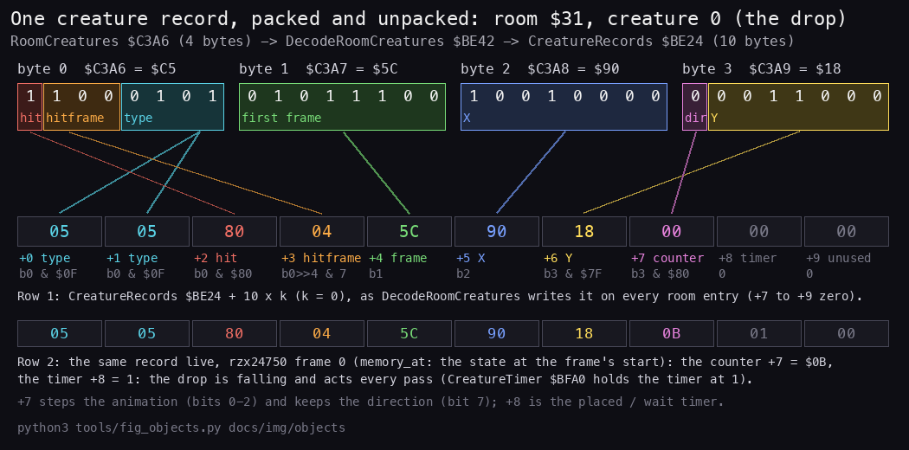

The figure: the first record of room `$31`, drawn by `tools/fig_objects.py`. The live row comes from the `rzx24750`
sample of frame 0.

```bash
python3 tools/fig_objects.py docs/img/objects
```

How to read the figure:

- Top: the four bytes of room `$31`'s first record at `$C3A6`, bit by bit, coloured by field.
- The lines lead each field to the byte of CreatureRecords it fills. Under each byte is the expression the code
  computes.
- Row 1: the working record as DecodeRoomCreatures writes it.
- Row 2: the same record live in `rzx24750` frame 0, after the drop has run for a while. The counter `+7` and the
  timer `+8` are the only bytes that have moved.

**The point**: the packed record keeps only the start state. Everything that moves lives in the working copy and in
the object slot. So leaving a room and coming back resets its creatures.

Pseudocode:

```text
DecodeRoomCreatures(A = room):
    CreatureRecords[0..29] = 0
    src = $C152 + 12 * room
    for k in 0..2:
        rec = CreatureRecords + 10 * k
        rec[0] = rec[1] = src[0] & $0F       ; the type and its copy
        rec[2] = src[0] & $80                ; the hit flag
        rec[3] = (src[0] >> 4) & 7           ; the hit frame
        rec[4] = src[1]                      ; the first frame
        rec[5] = src[2]                      ; X
        rec[6] = src[3] & $7F                ; Y
        rec[7] = src[3] & $80                ; the direction, counter 0
        src += 4
```

The code. It forms 12 x A as 4A + 8A, and the clear is one LDIR:

```asm
DecodeRoomCreatures:
  PUSH AF
  LD HL,CreatureRecords   ; clear the 30 bytes
  LD DE,CreatureRecords+$0001
  LD BC,$001D
  LD (HL),$00
  LDIR
  LD L,A                  ; HL = 12 x room: 4A, then 8A, added
  LD H,$00
  ADD HL,HL
  ADD HL,HL
  PUSH HL
  ADD HL,HL
  POP DE
  ADD HL,DE
  LD DE,RoomCreatures
  ADD HL,DE
  LD DE,CreatureRecords
  LD B,$03
DecodeCreatureLoop:
  PUSH DE
  LD A,(HL)
  PUSH AF
  AND $0F                 ; +0, +1: the type
  LD (DE),A
  INC DE
  LD (DE),A
  INC DE
  POP AF
  AND $80                 ; +2: the hit flag
  LD (DE),A
  INC DE
  LD A,(HL)
  RRCA
  RRCA
  RRCA
  RRCA
  AND $07                 ; +3: the hit frame
  LD (DE),A
  INC DE
  INC HL
  LD A,(HL)               ; +4: the first frame
  LD (DE),A
  INC DE
  INC HL
  LD A,(HL)               ; +5: X
  LD (DE),A
  INC DE
  INC HL
  LD A,(HL)
  AND $7F                 ; +6: Y
  LD (DE),A
  INC DE
  LD A,(HL)
  AND $80                 ; +7: the direction
  LD (DE),A
  INC HL
  POP DE
  PUSH HL
  LD HL,$000A             ; the next working record
  ADD HL,DE
  EX DE,HL
  POP HL
  DJNZ DecodeCreatureLoop
  POP AF
  RET
```

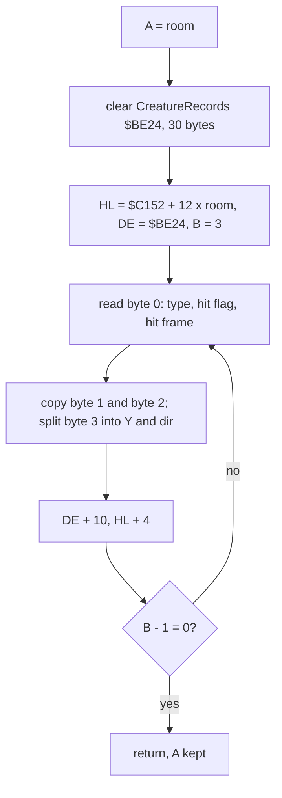

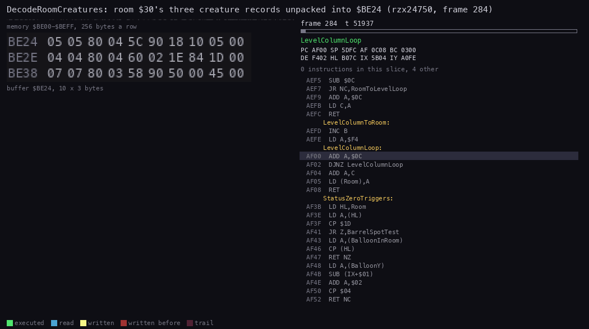

The animation shows `rzx24750` frame 284, T 51 900 to T 54 100: the entry into room `$30`. The view is CreatureRecords
`$BE24` as three rows of 10 bytes. The code panel follows the PC through `$BE42-$BE97`.

```bash
python3 ../../kit/routine_anim.py --work work/docs/tmC/r247 --window 284:51900-284:54100 --listing build/game.lst \
  --pc BE42-BE97 --view buffer:BE24:10x3:hex --range BE00-BEFF --pictures 60 --delay 150 --hold 2500 \
  --title "DecodeRoomCreatures: room \$30's three creature records unpacked into \$BE24 (rzx24750, frame 284)" \
  --out docs/img/routines/DecodeRoomCreatures.gif
```

Worked example: room `$30`. RoomCreatures at `$C152 + 12 x $30` = `$C392` holds
`05 5C 90 38 / 08 2C 90 60 / 08 2C 68 60`. The decode gives three working records:

- `05 05 00 00 5C 90 38 00 00 00`: a drop at X `$90`, Y `$38`, with no hit flag;
- `08 08 00 00 2C 90 60 00 00 00`: a scenery object, frame `$2C`, at X `$90`;
- `08 08 00 00 2C 68 60 00 00 00`: the same at X `$68`.

The last picture of the animation shows exactly these 30 bytes. The drop has no hit flag and still kills, because
DropFall tests the hero with no flag check (7.5).

Witness: DecodeRoomCreatures runs 105 times in 31 builds, the same count as SetUpRoom, its only caller (`.ann`). In
`rzx24750` it runs in frame 284 (the trace `work/docs/tmC/r247/traces/`, timed with `work/docs/tmC/span.py`).

## 7.4 RunCreatures: the three slots and the type dispatch

Once a pass RunCreatures `$BE98` walks the three working records with IY and the object slots 1-3 with IX. For each
pair it calls the handler of the record's type, taken from CreatureHandlers `$BECA`, through JumpHL `$BEC9` (a lone
`JP (HL)`). The handler moves the object in its slot and may test the hero.

```text
RunCreatures:
    IX = ObjectSlot1 ($5B08); IY = CreatureRecords ($BE24)
    repeat 3 times:
        CreatureHandlers[IY+0](IX, IY)     ; type 0-8
        IX += 4; IY += 10
```

```asm
RunCreatures:
  LD B,$03
  LD DE,CreatureRecords
  PUSH IX
  LD IX,ObjectSlot1
RunCreaturesLoop:
  PUSH BC
  PUSH DE
  LD A,(DE)               ; the type
  LD L,A
  LD H,$00
  ADD HL,HL
  LD BC,CreatureHandlers
  ADD HL,BC
  LD A,(HL)
  INC HL
  LD H,(HL)
  LD L,A                  ; HL = CreatureHandlers[type]
  PUSH DE
  POP IY
  CALL JumpHL             ; JP (HL)
  LD DE,$0004
  ADD IX,DE
  POP DE
  LD HL,$000A
  ADD HL,DE
  EX DE,HL
  POP BC
  DJNZ RunCreaturesLoop
  POP IX
  RET
```

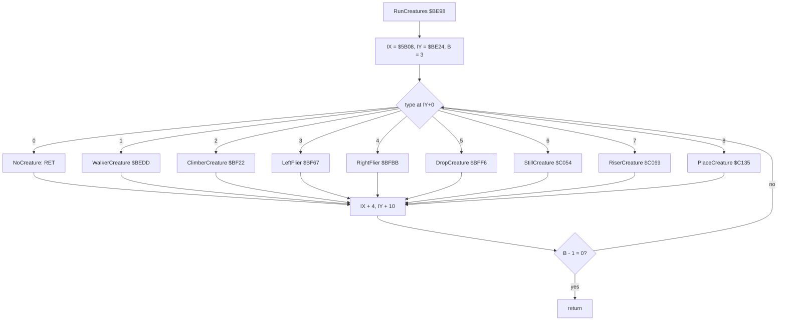

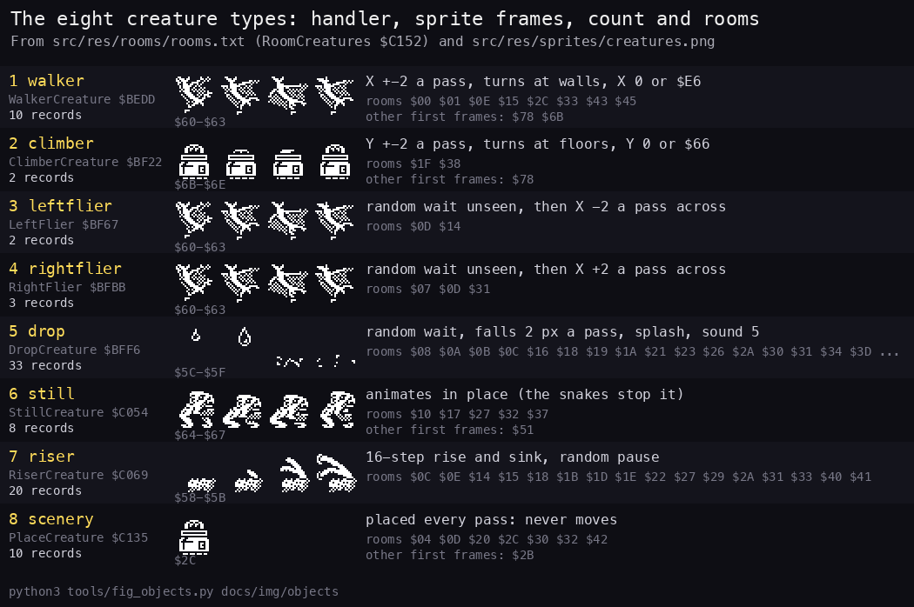

The figure: the 88 creature records of the built image, grouped by type, drawn by `tools/fig_objects.py`.

```bash
python3 tools/fig_objects.py docs/img/objects
```

How to read the figure:

- One row a type: its number and name, its handler, and how many of the 216 room records have that type.
- The sprites are the four frames the handler plays from the most common first frame (one frame for scenery). They are
  white on black, as in src/res/sprites/creatures.png.
- Right: what the handler does, the rooms with that type and the other first frames used.

**The point**: eight small handlers make every creature of the game. The drop (33 records) and the riser (20) are 60 %
of them. The walkers and fliers are only 15.

The counts over the 88 used records are:

| Type | Records | Rooms |
| --- | ---: | --- |
| 5 drop | 33 | 18 rooms |
| 7 riser | 20 | `$0C $0E $14 $15 $18 $1B $1D $1E $22 $27 $29 $2A $31 $33 $40 $41` |
| 1 walker | 10 | `$00 $01 $0E $15 $2C $33 $43 $45` |
| 8 scenery | 10 | `$04 $0D $20 $2C $30 $32 $42` |
| 6 still | 8 | `$10 $17 $27 $32 $37` |
| 4 right flier | 3 | `$07 $0D $31` |
| 3 left flier | 2 | `$0D $14` |
| 2 climber | 2 | `$1F $38` |

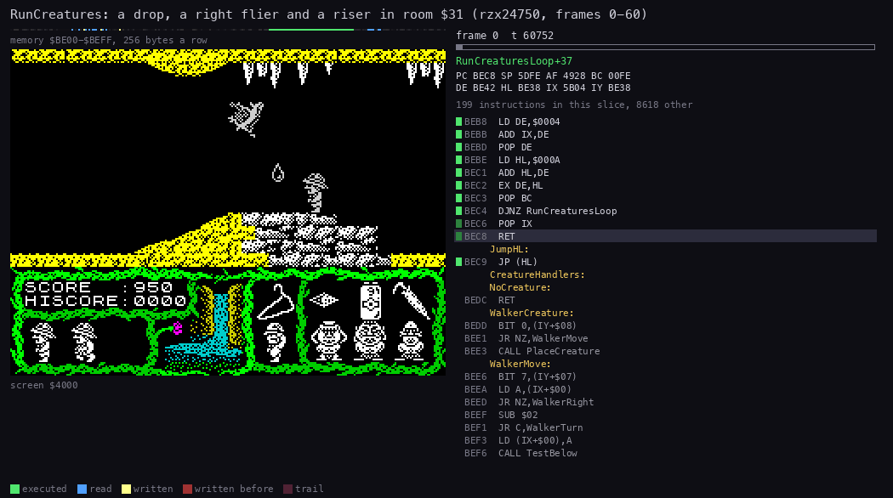

The animation shows `rzx24750` frames 0-60 in room `$31`, in 70 pictures. On the screen:

- the drop falls and splashes;
- the bird crosses to the right;
- the riser stays at rest.

The code panel follows RunCreatures and its handlers (`$BE98-$C151`). Most of each slice is other code: the hero and
the renderer.

```bash
python3 ../../kit/routine_anim.py --work work/docs/tmC/r247 --window 0:0-60:0 --listing build/game.lst \
  --pc BE98-C151 --view screen --range BE00-BEFF --pictures 70 --delay 120 \
  --title "RunCreatures: a drop, a right flier and a riser in room \$31 (rzx24750, frames 0-60)" \
  --out docs/img/routines/RunCreatures.gif
```

Worked example: the three slots in `rzx24750`, from the samples.

| Frame | Slot 1 (drop) | Slot 2 (right flier) | Slot 3 (riser) |
| ---: | --- | --- | --- |
| 0 | `90 42 5D 08` | `7E 1E 60 80` | `90 50 58 00` |
| 1 | `90 44 5D 08` | `80 1E 60 81` | `90 50 58 00` |
| 6 | `90 47 5E 08` | `84 1E 61 83` | `90 50 58 00` |
| 11 | `90 49 5F 08` | `88 1E 62 85` | `90 50 58 00` |
| 16 | `90 4B 7F 08` | `8C 1E 63 87` | `90 50 58 00` |
| 19 | `90 18 7F 10` | `8E 1E 60 80` | `90 50 58 00` |
| 153 | `90 18 7F 10` | `E6 1E 62 84` | `90 50 58 00` |
| 158 | `90 18 7F 10` | `02 1E 7F 84` | `90 50 58 00` |

What the rows show:

- The drop falls 2 pixels a pass (`$42`, `$44`). It lands and splashes, 1 pixel a pass, with frames `$5E` and `$5F`. At
  frame 16 it is gone. By frame 19 it waits unseen at its start place again.
- The bird moves 2 pixels a pass with frames `$60-$63`; bit 7 of byte 3 means facing right. It goes on to X `$E6`,
  then waits unseen at X 2.
- The riser waits all this time. Its timer counts down from `$4A` (CreatureRecords `$BE40`, 7.5).

Witness: RunCreatures `$BE98` runs once a pass in every build (L1 26 514, the same count as ItemsPass). JumpHL `$BEC9`
runs three times a pass.

## 7.5 The creature types, one by one

### Walker and climber (types 1 and 2)

A walker walks 2 pixels a pass along X and turns when a test tells it to. A climber does the same along Y. Both are
placed on their first call (PlaceCreature `$C135`, while bit 0 of the timer is clear). Both animate through
AnimateCreature `$C0AC` (7.6).

```text
WalkerCreature(IX slot, IY record):
    if not IY.timer bit 0: PlaceCreature
    if IY.counter bit 7:                     ; moving right
        x = IX.X + 2
        if x >= $E7: turn
        else: IX.X = x; TestRight; if TileScanFlags+1: turn
    else:                                    ; moving left
        x = IX.X - 2
        if x < 0: turn
        else: IX.X = x; TestBelow; if TileScanFlags+0: turn
    AnimateCreature
turn: IY.counter ^= $80
```

The climber's tests are TestBelowRight `$C121` going down (a tile at X + 12, Y + 24) and TestAhead `$C115` going up (a
tile at X + 12). Its limits are Y `$66` and 0.

The names TestBelow and TestRight come from the SkoolKit. TestBelow calls LeftWallCheck `$A2AC`, which is the hero's
own test for a wall at his left edge (doc 10.3). So "below" in fact means a wall to the left. TestRight calls
RightWallCheck `$A2FA`, which tests for a wall at X + 23. The labels keep SK's names. The meaning given here comes from
the code they call.

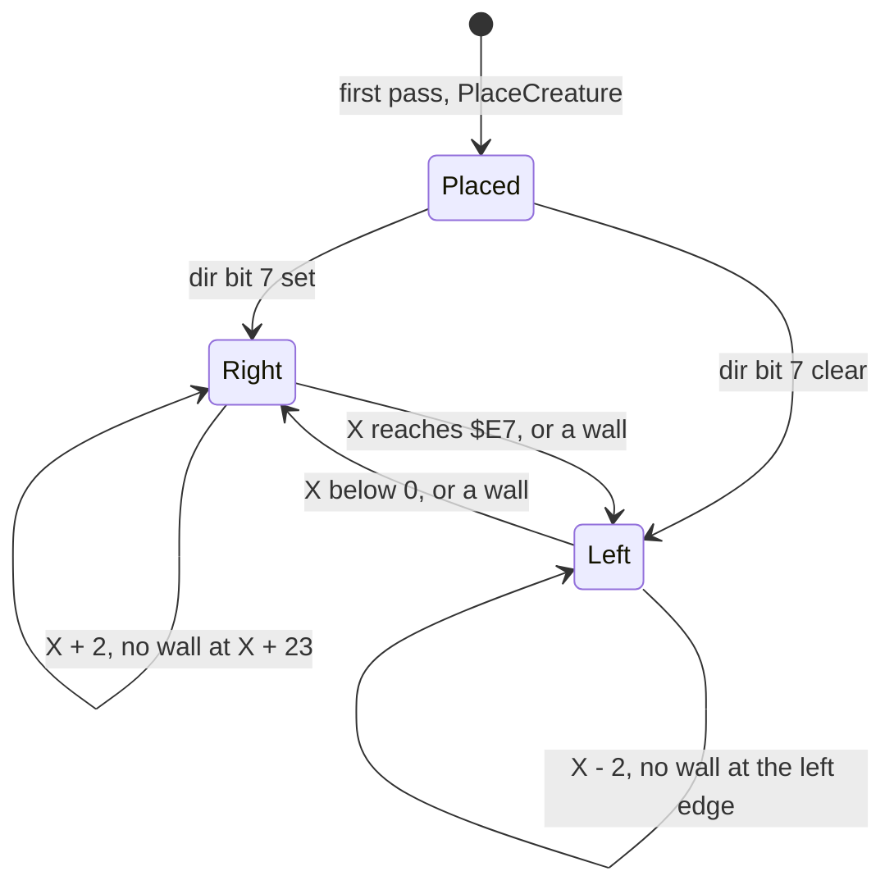

Worked example: room `$00`'s first walker, `C1 60 14 06`. It decodes as hit 1, hit frame 4, type 1, frames `$60-$63`,
X `$14`, Y 6, dir 0. It starts walking left from X `$14`. Ten passes later it is at X 0; the next X - 2 is below 0, so
it turns.

Witness: WalkerCreature runs 2 454 times in 11 builds, and ClimberCreature 266 times in 3 (`.ann`).

### The fliers (types 3 and 4) and CreatureTimer

A flier waits a random time unseen (frame `$7F`) at its start place. Then it crosses the room once at 2 pixels a pass,
and waits again. CreatureTimer `$BFA0` keeps the wait in the timer byte `+8`.

```text
CreatureTimer(C):                     ; Z set: the wait is over, act this pass
    if IY.timer == 0:
        PlaceCreature                 ; back to the start place
        IY.timer = (Random() & $7F) | C
    t = IY.timer - 1
    if t == 0: return Z               ; the timer stays at 1: act every pass from now on
    IY.timer = t; return NZ

LeftFlier:
    if CreatureTimer(1) is NZ: IX.frame = $7F; return
    IY.counter bit 7 = 0
    x = IX.X - 2
    if x < 0: IX.frame = $7F; IY.timer = 0; IY.type = IY.typecopy; return
    IX.X = x
    if TestBelow: IY.type += 1        ; blocked: it becomes a right flier
    AnimateCreature
```

The right flier is the mirror image: X + 2 up to `$E6`, the TestRight test, and a block turns it into a left flier
(type - 1). The type copy at `+1` puts the type back when the flier leaves the room's edge.

No recording blocks a flier. The `INC (IY+$00)` at `$BF9A` and the `DEC (IY+$00)` at `$BFF0` never ran, so this part
is known only from the code.

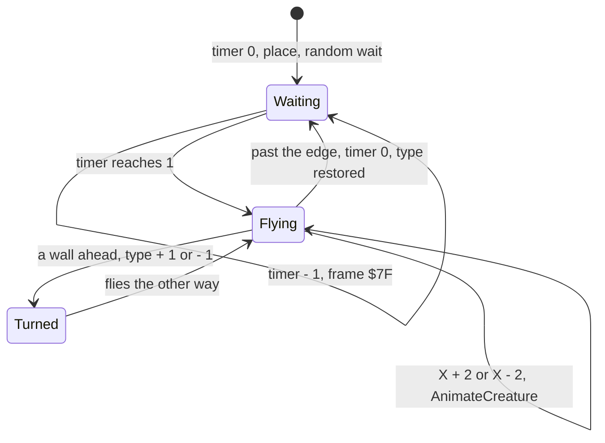

```asm
CreatureTimer:
  LD A,(IY+$08)
  OR A
  JR NZ,CreatureTimerDown
  CALL PlaceCreature
  CALL Random
  AND $7F
  OR C                    ; C = 1 (fliers, drops) or $11 (risers)
  LD (IY+$08),A
CreatureTimerDown:
  LD A,(IY+$08)
  DEC A
  RET Z                   ; run out: Z, and the timer is left at 1
  LD (IY+$08),A
  RET
```

Worked example: the bird of room `$31` in `rzx24750`:

- frame 153: it reaches X `$E6`;
- frame 155: it is hidden (frame `$7F`) and its timer is 0;
- frame 158: it stands at X 2 with the timer `$4C` (76). That is a new wait of 75 passes.

Witness: LeftFlier runs 5 796 times and RightFlier 989 times, each in 4 builds. CreatureTimer runs 31 152 times in 26
builds, and it is the only caller of Random (7.7).

### The drop (type 5)

A drop waits like a flier, through CreatureTimer with C = 1. Then it falls 2 pixels a pass from its start place.

- While it falls, its frame stays at the first or the second frame.
- When the tile under it is solid, it splashes. Each pass its Y goes back by 1 after the + 2, a net + 1. Its frames are
  first + 2 and first + 3.
- When the splash ends, the drop disappears, its timer goes to 0 and sound 5 plays (doc 09).
- If it falls to Y `$67` instead, it ends the same way, but with no splash and no sound.

The drop is the only creature that tests the hero on every pass with no hit flag (`JP HitExplorer` at `$C037`). Its
contact box is half the size, because Near `$9140` uses 8 pixels for frames `$5C-$5F` (7.6).

```asm
DropCreature:
  LD C,$01
  CALL CreatureTimer
  LD (IX+$02),$7F
  RET NZ                  ; still waiting: hidden
DropFall:
  LD A,(IX+$01)
  ADD A,$02
  CP $67
  JR C,DropStep
  LD (IX+$02),$7F         ; out of the window: gone
  LD (IY+$08),$00
  RET
DropStep:
  LD (IX+$01),A
  CALL TestBelowRight
  LD A,(TileScanSecond+$0001)
  OR A
  JR NZ,DropSplash
  LD A,(IY+$07)           ; falling: frame index 0, then held at 1
  INC A
  LD (IY+$07),A
  AND $06
  RRCA
  CP $02
  JR NZ,DropFrame
  DEC (IY+$07)
  DEC A
DropFrame:
  LD C,A
  ADD A,(IY+$04)
  LD (IX+$02),A
  JP HitExplorer          ; always tested, no hit flag
DropSplash:
  DEC (IX+$01)            ; on the ground: the splash frames
  INC (IY+$07)
  LD A,(IY+$07)
  AND $06
  RRCA
  JR NZ,DropFrame
  LD (IY+$08),A           ; the splash is over
  LD (IX+$02),$7F
  LD A,$05
  JP PlaySound
```

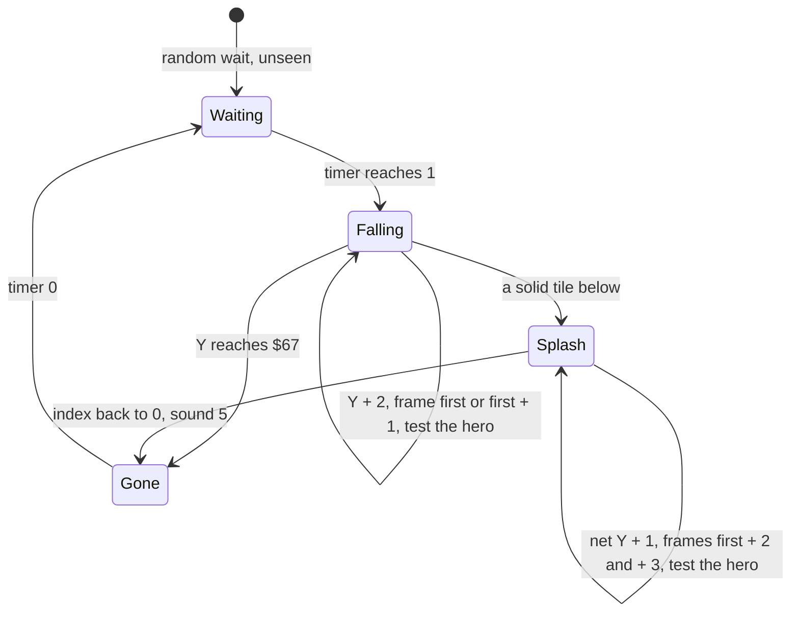

Entry `$C000` is the second half of DropCreature. The cut makes it a label of its own, because `$C000` is also the
address the IM 2 handler calls with RAM 6 paged in: the music player (doc 09). In RAM 0, where the game runs, the same
address is the drop's fall.

Worked example: the drop of room `$31` in `rzx24750` (the table of 7.4).

- Frame 0: Y `$42`, frame `$5D` (falling, first + 1).
- Frame 6: Y `$47`, frame `$5E`: the splash has begun.
- Frame 11: Y `$49`, frame `$5F`.
- Frame 16: frame `$7F`, timer 0.
- Frame 19: back at Y `$18`, with the timer `$62` (98). The number is even here because the timer was already counted
  down once from `(Random AND $7F) OR 1`.

Witness: DropCreature runs 12 834 times in 20 builds and DropFall 3 288 times in 19. There are 105 splashes with
sound 5, in 18 builds (`$C04F`).

### The still creature (type 6)

A still creature is placed once and then animated in place by AnimateCreature every pass. It stops when its frame is
`$55` or `$7F`. Those are the frames the snake scripts set (SnakeStrike `$B5C2`, SnakeBite `$B5C8`, doc 10.8), so a
snake that struck or was removed stops.

The 8 still records are:

- the two snakes of room `$17` (frame `$51`). They have hit 0, so the script does their killing;
- six creatures of frames `$64-$67`, all with hit 1 and hit frame 4, in rooms `$10`, `$27`, `$32` and `$37`.

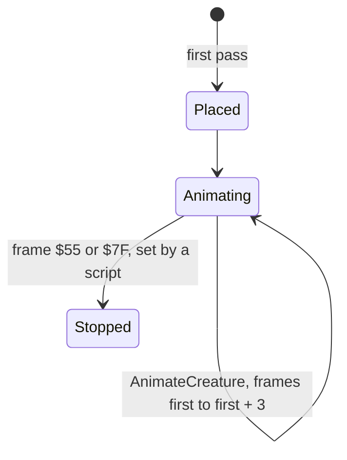

Worked example: room `$10`'s creature `C6 64 16 48` decodes as hit 1, hit frame 4, type 6, frame `$64`, X `$16`,
Y `$48`. It stands on the left of the room the `gameover` hero bounces into. Its hit frame of 4 means that every frame
hits.

Witness: StillCreature runs 2 107 times in 10 builds (`.ann`).

### The riser (type 7)

A riser rests in its first frame. Then it rises and sinks through four frames in 15 steps, and pauses for a random
time. CreatureTimer with C = `$11` makes the pause at least 16 passes long.

```text
RiserCreature:
    if CreatureTimer($11) is NZ: return
    IY.counter += 1                          ; the step n = 1..15 in bits 0-3
    if IY.counter bit 4:                     ; 16 steps done
        IY.counter &= $80; IY.timer = 0; return
    i = (IY.counter & $0E) / 2               ; 0..7
    if i bit 2: i = (~i) & 3                 ; fold 4..7 back to 3..0
    IX.frame = IY.firstframe + i
    if not IY.hit: return
    if IY.hitframe >= 4 or i == IY.hitframe: HitExplorer
```

| Step n (`+7` bits 0-3) | 1 | 2 | 3 | 4 | 5 | 6 | 7 | 8 | 9 | 10 | 11 | 12 | 13 | 14 | 15 |
| --- | --- | --- | --- | --- | --- | --- | --- | --- | --- | --- | --- | --- | --- | --- | --- |
| frame index | 0 | 1 | 1 | 2 | 2 | 3 | 3 | 3 | 3 | 2 | 2 | 1 | 1 | 0 | 0 |
| hits, with hit frame 3 | | | | | | yes | yes | yes | yes | | | | | | |

```asm
RiserCreature:
  LD C,$11
  CALL CreatureTimer
  RET NZ
  INC (IY+$07)
  BIT 4,(IY+$07)
  JR Z,RiserFrame
  LD A,(IY+$07)           ; 16 steps: the counter back to the direction only
  AND $80
  LD (IY+$07),A
  XOR A
  LD (IY+$08),A
  RET
RiserFrame:
  LD A,(IY+$07)
  AND $0E
  RRCA                    ; 0..7
  BIT 2,A
  JR Z,RiserSetFrame
  CPL                     ; 4..7 become 3..0
  AND $03
RiserSetFrame:
  LD C,A
  ADD A,(IY+$04)
  LD (IX+$02),A
  BIT 7,(IY+$02)          ; no hit flag: harmless
  RET Z
  LD A,(IY+$03)
  CP $04
  JR NC,HitExplorer       ; hit frame 4 or more: every frame
  LD A,C
  CP (IY+$03)
  RET NZ
  JR HitExplorer          ; only at the hit frame
```

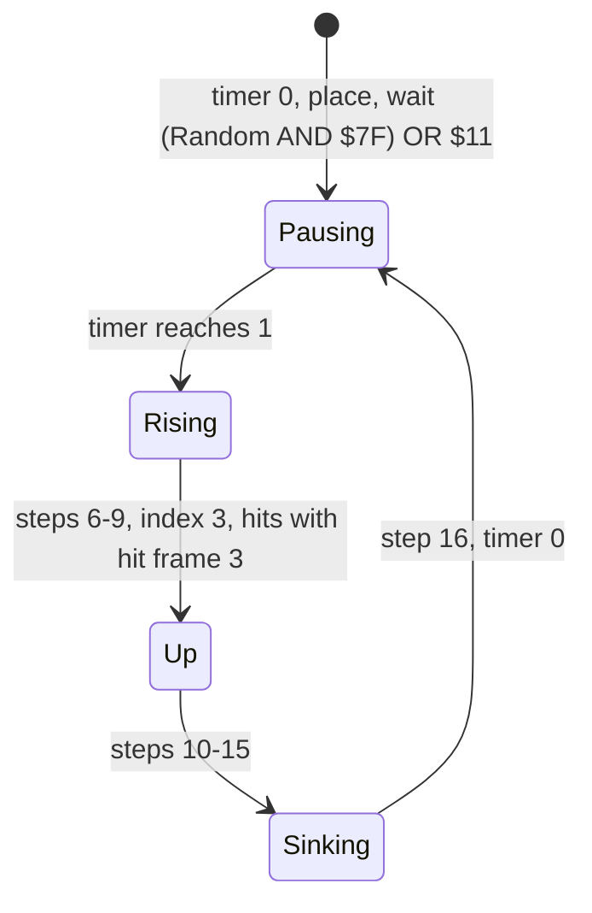

19 of the 20 riser records have hit 1 and hit frame 3. The one in room `$1E` has hit 0. So a riser is harmless while it
rises and sinks, and it kills only in the four passes it stands fully up.

Worked example: in `rzx06000` frame 535 (7.6) the riser of room `$0C` is in frame `$5B` (`$58` + 3) when the jumping
hero touches it.

Witness: RiserCreature runs 11 533 times in 20 builds (`.ann`). The hit at index 3 happens in `rzx06000` (7.6).

### Scenery (type 8)

The handler of type 8 is PlaceCreature `$C135` itself. Every pass it copies X, Y, frame and flags from the record to the
slot. A scenery object never moves, never animates and never hits.

The 10 scenery records use frames `$2C` (and `$2B` in room `$2C`). These are frames of the explorer part of the sprite
space. The selector copies the chosen explorer's set to `$6000-$71FF`, so their picture depends on the explorer. Every
recording plays explorer 0, so the pictures for the other explorers are known only from the code.

```asm
PlaceCreature:
  SET 0,(IY+$08)          ; placed
  LD A,(IY+$05)
  LD (IX+$00),A           ; X
  LD A,(IY+$06)
  LD (IX+$01),A           ; Y
  LD A,(IY+$04)
  LD (IX+$02),A           ; the first frame
  LD A,(IY+$07)
  LD (IX+$03),A           ; the flags: the direction
  RET
```

Witness: PlaceCreature runs 2 377 times in 29 builds (`.ann`). That count includes its calls from CreatureTimer and the
walkers.

**The point** of the eight types: four movement patterns (walk, climb, fly, fall) and two still ones, all on 2-pixel
steps and one counter. The random wait makes the fliers and drops hard to predict. The riser's hit frame gives the hero
a safe moment.

## 7.6 Collision: Near, the hit frame and HitExplorer

Every touch test of the game is Near `$9140`. Two objects are near when |dX| and |dY| are both below 16. The limit is 8
instead when the first object's frame is `$5C-$5F` (a drop). X and Y are the top left corners of 24 x 24 sprites, so 16
pixels means about a third of a sprite of overlap on each axis.

Near is called by:

- the creatures (HitExplorer `$C0DA`);
- the item pickup (PickUpItem `$BB6C`);
- the professor, the basket and the lever (doc 10.9).

```asm
Near:
  PUSH BC
  LD A,(IX+$02)           ; IX's frame: a drop ($5C-$5F)?
  LD C,$10
  CP $5C
  JR C,NearDx
  CP $60
  JR NC,NearDx
  LD C,$08
NearDx:
  LD A,(IX+$00)
  SUB (IY+$00)
  JR NC,NearCheckX
  NEG
NearCheckX:
  CP C
  JR NC,NearDone
  LD A,(IX+$01)
  SUB (IY+$01)
  JR NC,NearCheckY
  NEG
NearCheckY:
  CP C
NearDone:
  POP BC                  ; carry: near
  RET
```

A creature tests the hero only when its handler reaches HitExplorer `$C0DA`. AnimateCreature `$C0AC` serves the
walkers, climbers, fliers and still creatures. It steps the frame and then decides whether to test:

```text
AnimateCreature:
    IY.counter = (IY.counter + 1) & $87         ; bits 0-2 and the direction
    i = (IY.counter & 6) / 2                    ; the frame index 0-3, two passes each
    IX.frame = IY.firstframe + i; IX.flags = IY.counter
    if not IY.hit: return                       ; no hit flag: never hits
    if IY.hitframe >= 4 or i == IY.hitframe: HitExplorer

HitExplorer:
    if not Near(IX creature, IY = Hero): return
    if Status >= $0F: return                    ; the scripted statuses are immune
    if Status == 0 and HeroProbes+3 == 0:       ; standing on a floor
        SetStatus($1A)                          ; 26: FallDeath
    else:
        SetStatus($18)                          ; 24: CreatureDeath
```

```asm
HitExplorer:
  PUSH IY
  LD IY,Hero
  CALL Near
  POP IY
  RET NC
  LD C,$18
  LD A,(Status)
  CP $0F
  RET NC                  ; status 15 and above: immune
  OR A
  JR NZ,HitExplorerStatus
  LD A,(HeroProbes+$0003) ; the rows down to a floor
  OR A
  JR NZ,HitExplorerStatus
  LD C,$1A
HitExplorerStatus:
  LD A,C
  JP SetStatus
```

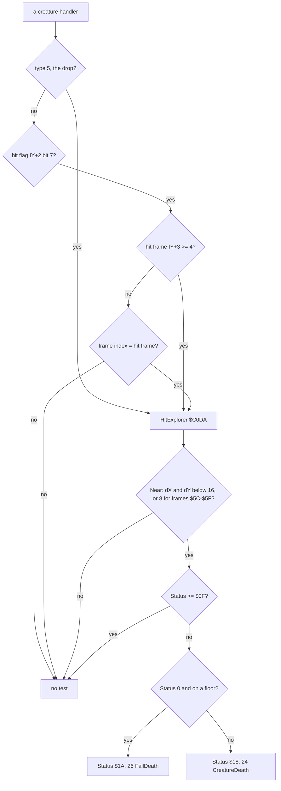

The hit flag reads the opposite way to the resource notes. `src/res/rooms/README.md` says "hit 0: every frame". In the
code, a clear hit flag returns at `$C0C8` (`RET Z`) before any test. So hit 0 never hits, for types 1-4, 6 and 7. The
drop is the exception, because DropFall jumps to HitExplorer directly. The fix is sent to the lead
(`work/docs/tmC-src-changes.md`).

The status choice is a quirk:

- A hero in status 0 with HeroProbes+3 = 0 is standing on a floor. He gets status 26, whose frame list is the one-frame
  flattening of the fall death (doc 10.7).
- A hero in status 0 but above a floor, or in any action status 1-14 (jumping, hovering, riding the barrel), gets
  status 24, the creature death.

The `.ann` of HitExplorer names the handlers of the next status: `$A88F` for `$18` and `$A851` for `$1A`. But the table
at `$A72E` holds the word N - 1 for status N. So the handlers are really CreatureDeath `$A89E` and FallDeath `$A888`
(doc 10.2; sent as a source change).

A hazard can also kill by contact through the electric beams of the alternate-set rooms (RoomEffects `$91C0`, the hit
at `$9262`). The hero dies when he is inside the beam's X span, within 12 rows of it, and in a status below 4: he gets
status `$18`. No recording reaches this (doc 10.8).

Worked example: `rzx06000` frames 493-696, room `$0C`. The samples:

| Frame | Status | StatusTimer | Hero `$5B04` | Slot 1 (the riser) | Lives |
| ---: | ---: | ---: | --- | --- | ---: |
| 494 | 2 | 0 | `86 60 12 80` | `A0 60 58 00` | 4 |
| 535 | 2 | `$0E` | `A2 56 0F 80` | `A0 60 5A 00` | 4 |
| 536 | `$18` | 0 | `A2 56 0F 80` | `A0 60 5B 00` | 4 |
| 564 | `$12` | 0 | `A2 56 7F 80` | `A0 60 58 00` | 4 |
| 689 | 0 | 0 | `02 60 13 80` | `A0 60 58 00` | 3 |

Step by step:

1. The hero jumps in frame 493 (status 2) towards the riser. Room `$0C`'s riser record is `B7 58 A0 60`: hit 1, hit
   frame 3, X `$A0`, Y `$60`.
2. In frame 535 the riser stands fully up, in frame `$5B` = `$58` + 3, its hit frame.
3. Near: |`$A0` - `$A2`| = 2 and |`$60` - `$56`| = 10, both below 16.
4. Status 2 is below `$0F` and not 0, so the hero gets status `$18`.
5. CreatureDeath plays its frames. Status 18 follows at frame 564, and the respawn comes at 689 (doc 10.7). Lives go
   from 4 to 3.

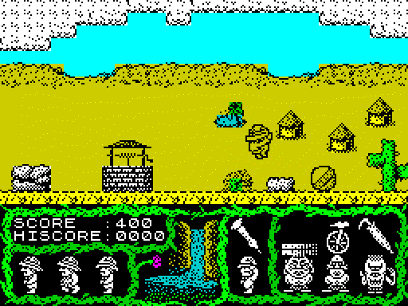

The animation shows `rzx06000` frames 520-700, every third frame. The hero jumps into the riser as it stands up. He
turns into the swirl of frames `$25-$28`, and then restarts at the left edge of the room with one life less.

```bash
python3 ../../kit/screen_anim.py --work work/docs/tmC/r06 --from 520 --to 700 --step 3 --scale 2 --delay 100 \
  --hold 2000 docs/img/play/creature-death-r06000.gif
```

**The point**: one box test serves every touch. What makes a creature dangerous is decided before the box test, by
three things: the hit flag, the hit frame and the hero's status. Every scripted status is safe.

Witness:

- Near runs 67 291 times in the 34 builds (`.ann`, `$9140`).
- HitExplorer runs 10 981 times in 29 builds. It finds 23 contacts in 4 builds (`$C0E6`).
- Four of these contacts set a status (`$C0F9`: rzx06000, rzx22000, rzx24000 and rzx32000), and one of them is `$1A`
  (rzx24000).
- All four are in drifted parts of their segments (WALKTHROUGH 6.0). The RZX player himself loses his one life to a
  fall (7.12).

## 7.7 Random numbers

Random `$9390` makes one byte from a 16-bit linear congruential state and the R register:

```text
Random:
    RandomState = (RandomState * 257 + 41) mod 65536    ; $93AD, $3039 as loaded
    HL = $8F47 + (RandomState & $FF)                     ; H = $8F or $90
    A = (R XOR H) + L
```

```asm
Random:
  PUSH HL
  PUSH DE
  LD HL,(RandomState)
  LD D,L                  ; HL + L x 256: x 257
  LD E,$00
  ADD HL,DE
  LD DE,$0029             ; + 41
  ADD HL,DE
  LD (RandomState),HL
  LD H,$00
  LD DE,$8F47             ; a constant, not a table
  ADD HL,DE
  LD A,R
  XOR H
  ADD A,L
  POP DE
  POP HL
  RET
```

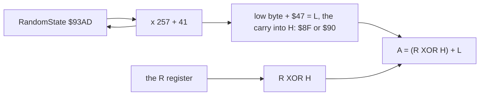

Its only caller is CreatureTimer `$BFA0`: Random sets the waits of the fliers, the drops and the risers. Nothing else in
the game is random. The hero's physics, the items, the scripts and the professor are all fixed. The beam and the
flicker floor read R only to pick their pixels (doc 06).

Nothing is ever read at `$8F47 + n`; the value only enters the sum. The R register makes the result depend on the exact
instruction count since the last reset. So two runs with the same state but different timing get different waits. A
replay of the same inputs from the same snapshot is exact: the RZX segments replay bit for bit.

Worked example: the first call after the load.

- RandomState `$3039`: `$3039 + $3900 + $29` = `$6962`.
- L = `$62 + $47` = `$A9`, with no carry, so H = `$8F`.
- Suppose R holds `$15`. Then A = (`$15` XOR `$8F`) + `$A9` = `$9A` + `$A9` = `$43`, with the carry dropped.
- CreatureTimer keeps `$43 AND $7F OR 1` = `$43`, and the creature waits 66 passes.

**The point**: the creatures' waits are the only chance in the game. R makes them hard to predict, even from the
state.

Witness: Random runs 382 times in 26 builds (`.ann`, `$9390`).

## 7.8 The items: ItemPlaces, the item slots and the sprites

The world has 32 kinds of item, numbered 0-31. Each is one 24 x 24 sprite at ItemSprites `$8400 + 72 x n`
(src/res/sprites/items.png), which is frame `$80 + n` of the sprite space. Where the items lie is given by ItemPlaces
`$B99D`, 31 records of 3 bytes:

| Byte | Bits | Field |
| --- | --- | --- |
| 0 | 7 | taken: set when the item is picked up; the record then matches no room |
| 0 | 6-0 | the room |
| 1 | 7-5 | X, bits 5-3 |
| 1 | 4-0 | the item, 0-31 |
| 2 | 7-2 | Y / 8 |
| 2 | 1-0 | X, bits 7-6 |

So X = (byte 2 & 3) x 64 + (byte 1 & `$E0`) / 4, and Y = (byte 2 & `$FC`) x 2. Both are multiples of 8.

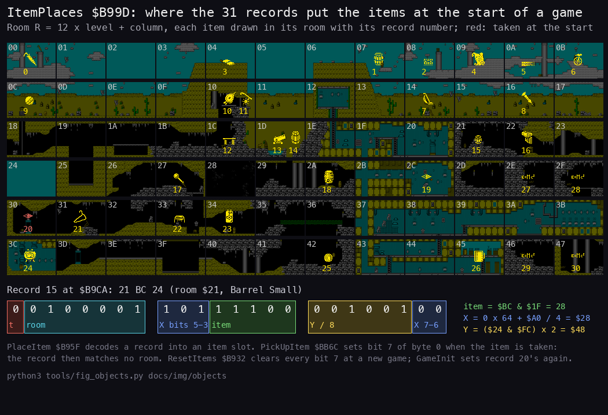

The figure: the 31 ItemPlaces records of the built image on the 72 rooms, drawn by `tools/fig_objects.py`.

```bash
python3 tools/fig_objects.py docs/img/objects
```

How to read the figure:

- The 72 rooms are thumbnails, 12 to a row, with level 0 at the top. Rooms `$46` and `$47` close the last row.
- Each item is drawn in its room's cell with its record number. Yellow means it lies there at the start. Red means it is
  marked taken at the start: record 20, the crystal of room `$30`.
- Bottom: record 15, bit by bit, with the three formulas applied to it.

**The point**: the items are scattered over the whole map, but never more than two to a room. Four Formulas (item 15)
lie in the four explorer rooms `$2E`, `$2F`, `$46` and `$47`, and each explorer reaches only his own (doc 10.9).

ResetItems `$B932` clears every taken bit at the start of a new game. InitGame then sets the bit of record 20 again
(`$8F86`). So the crystal of room `$30` is missing until the hero puts one in place (7.10). The crystal he carries
there is record 19's, from room `$2C`.

On a room entry SpawnRoomItems `$B93F` empties the two item slots and scans the 31 records for the room. Each match
goes to PlaceItem `$B95F`, which fills the next free slot with X, Y, the item and the record's address. The pickup uses
that address to mark the record taken. A third match would be ignored (`BIT 1,C`), but no room has one.

| Slot byte | Field |
| --- | --- |
| +0 | X |
| +1 | Y |
| +2 | the item 0-31; `$FF` empty; `$FE` taken, until EraseItem `$9D21` repaints the floor and writes `$FF` |
| +3, +4 | the address of its ItemPlaces record |

```text
SpawnRoomItems:
    ItemSlot1.item = ItemSlot2.item = $FF
    c = 0
    for rec in ItemPlaces[0..30]:
        if rec.byte0 == Room:                 ; a set taken bit never matches
            if c < 2:
                slot = ItemSlot1 if c == 0 else ItemSlot2
                slot.recaddr = rec
                slot.item = rec.byte1 & $1F
                slot.X = (rec.byte2 & 3) * 64 + (rec.byte1 & $E0) / 4
                slot.Y = (rec.byte2 & $FC) * 2
            c += 1
```

```asm
PlaceItem:
  BIT 1,C                 ; two slots used: ignore
  RET NZ
  LD IX,ItemSlot1
  BIT 0,C
  JR Z,PlaceItemSlot
  LD IX,ItemSlot2
PlaceItemSlot:
  INC C                   ; the record's address into slot +3, +4
  PUSH HL
  PUSH AF
  PUSH BC
  LD (IX+$03),L
  LD (IX+$04),H
  INC HL
  LD A,(HL)
  INC HL
  LD C,(HL)
  PUSH AF
  AND $1F                 ; the item
  LD (IX+$02),A
  POP AF
  AND $E0                 ; X = (byte2 & 3) x 64 + (byte1 & $E0) / 4
  LD L,A
  LD A,C
  AND $03
  RRA
  RR L
  RRA
  RR L
  LD (IX+$00),L
  LD A,C                  ; Y = (byte2 & $FC) x 2
  AND $FC
  ADD A,A
  LD (IX+$01),A
  POP BC
  POP AF
  POP HL
  RET
```

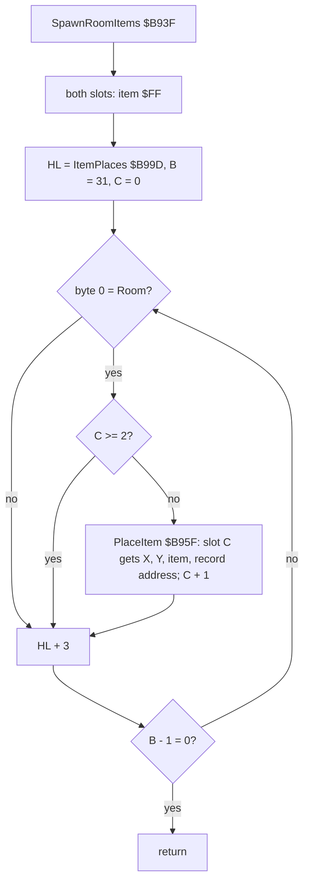

SpawnRoomItems runs at three places:

- on every room entry, from the `JP` at `$9911` that ends the room set-up;
- after a gift to the professor (`$B5F8`);
- after the crystal is placed (`$BA27`).

The two later calls redraw the room's items from the changed records.

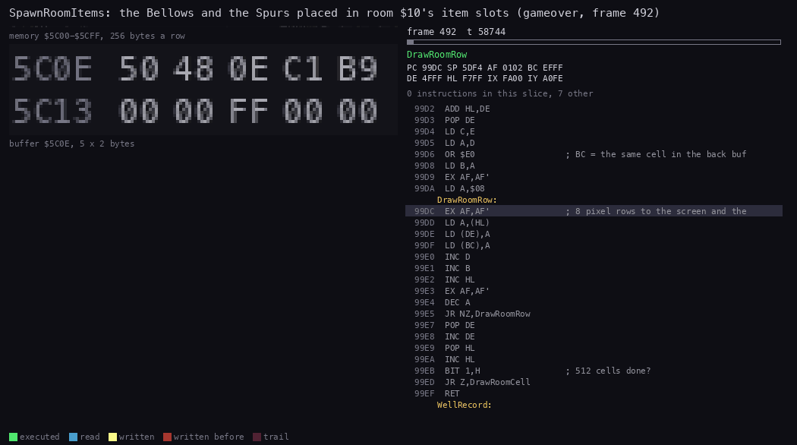

The animation shows `gameover` frame 492, T 58 700 to T 61 300: the end of the set-up of room `$10`. The hero bounced
into the room in frame 486, and DrawRoom took the frames in between. The view is the two item slots, `$5C0E` and
`$5C13`, five bytes each.

```bash
python3 ../../kit/routine_anim.py --work work/docs/tmC/go --window 492:58700-492:61300 --listing build/game.lst \
  --pc B93F-B99C --view buffer:5C0E:5x2:hex --range 5C00-5CFF --pictures 60 --delay 150 --hold 2500 \
  --title "SpawnRoomItems: room \$10's Bellows and Spurs into the item slots (gameover, frame 492)" \
  --out docs/img/routines/SpawnRoomItems.gif
```

Worked example 1: record 15 at `$B9CA` is `21 BC 24`.

- The room is `$21`, and the record is not taken.
- The item is `$BC & $1F` = 28, the Barrel Small.
- X = (`$24` & 3) x 64 + (`$BC` & `$E0`) / 4 = 0 + `$A0` / 4 = `$28`.
- Y = (`$24` & `$FC`) x 2 = `$48`.

A live check (`work/stage2/probe_points.py`) put the barrel at X `$28`, Y `$48`.

Worked example 2: room `$10` in `gameover`. Two records match:

- record 10 at `$B9BB`, `10 E6 1D`: item 6, the Bellows, at X `$78`, Y `$38`;
- record 11 at `$B9BE`, `10 E3 22`: item 3, the Spurs, at X `$B8`, Y `$40`.

The samples show ItemSlot1 = `50 48 0E C1 B9` up to frame 492. That is the Spring of room `$1C` (record 12), left over
from the last room. From frame 493 on, the slots hold `78 38 06 BB B9` and `B8 40 03 BE B9`. The routine ran from frame
492 T 58 831 to T 61 165, 2 334 T-states, and called PlaceItem twice.

Witness: SpawnRoomItems runs 113 times in all 34 builds. PlaceItem runs 42 times in 18 builds, and the second slot
(`$B96A`) is used 3 times (gameover, rzx10000, rzx14500). The third-match guard (`RET NZ` at `$B961`) never returns in
any build; that it would is known only from the code.

## 7.9 Picking up, HeldItem and the 27 bearers

The hero holds one item: HeldItem `$5B98`, shown as the "hand" icon of the panel. On top of that, 27 invisible bearers
carry one item each (BearerLoads `$5B7C`; the Help page calls them "invisible bearers"). The panel shows four bearers,
starting from BearerIndex `$5C23` (doc 08). A pickup puts the new item in the hand and moves the old one to the first
free bearer.

Every pass except in room `$30` (7.10), PickUpItems `$BB5D` runs PickUpItem `$BB6C` for item slot 1 and then for slot
2:

```text
PickUpItem(IY = item slot):
    if not Near(Hero, IY) or IY.item >= $FE: redraw; return
    find the first bearer b with BearerLoads[b] == $FF; if none: return
    item = IY.item
    if item == $16: PillsTaken = $16                ; the Anti Radiation Pills
    if item == 8: return                            ; the Cannon cannot be taken
    if item == $0E or item == $14:                  ; the Spring, the Trampoline
        if Status == 2 and StatusTimer >= 10 and |Hero.X - IY.X| < 6:
            Hero.X = IY.X; Hero.Y = IY.Y - $17; Hero.frame = $0F; Status = 5   ; the bounce
        return
    if HeldItem != $FF: BearerLoads[b] = HeldItem   ; the old item goes to the bearer
    AddScore(50); PlaySound(2)
    HeldItem = item
    IY.item = $FE; set bit 7 of the record at IY+3   ; taken for good
    redraw: the hand, and the bearers with BearerIndex = max(b - 2, 0)
```

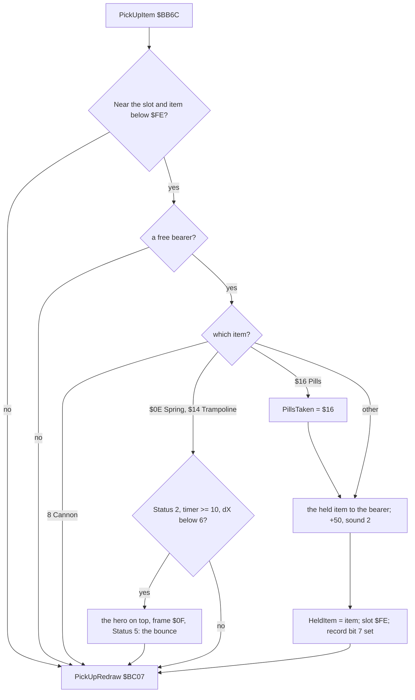

```asm
PickUpTake:
  LD D,$01                ; taken: redraw the hand
  EX AF,AF'
  LD A,(HeldItem)
  CP $FF
  JR Z,PickUpScore
  LD (HL),A               ; the held item to the free bearer
  LD E,$01                ; redraw the bearers
PickUpScore:
  EX AF,AF'               ; +50, sound 2
  PUSH DE
  LD DE,$0032
  CALL AddScore
  PUSH AF
  LD A,$02
  CALL PlaySound
  POP AF
  POP DE
  LD (HeldItem),A
  LD (IY+$02),$FE         ; the slot emptied, the record marked taken
  LD L,(IY+$03)
  LD H,(IY+$04)
  SET 7,(HL)
```

A pickup needs a free bearer even when the hand is empty and nothing would go to one. With all 27 bearers loaded, the
hero can pick up nothing. This is known only from the code: the RZX run loads at most 19 bearers (7.12).

The swap (ItemsKeys `$BA36`) works like this:

- The S key (port `$FDFE` bit 1) exchanges HeldItem with the load of the bearer at BearerIndex.
- It acts once a press (SwapLatch `$BA96`), and not in statuses `$1B-$1D`.
- Either side may be `$FF`, so S also puts the held item down on a bearer, or takes an item back from one.

The keys 1 and 2 scroll the bearer row (BearerKeys `$BC1F`): a 4-step scroll, with BearerIndex wrapping over 27. Doc 05
covers the keys and doc 08 the panel.

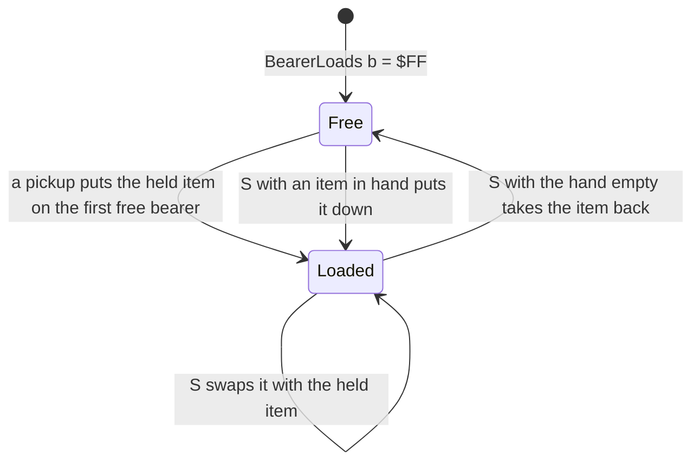

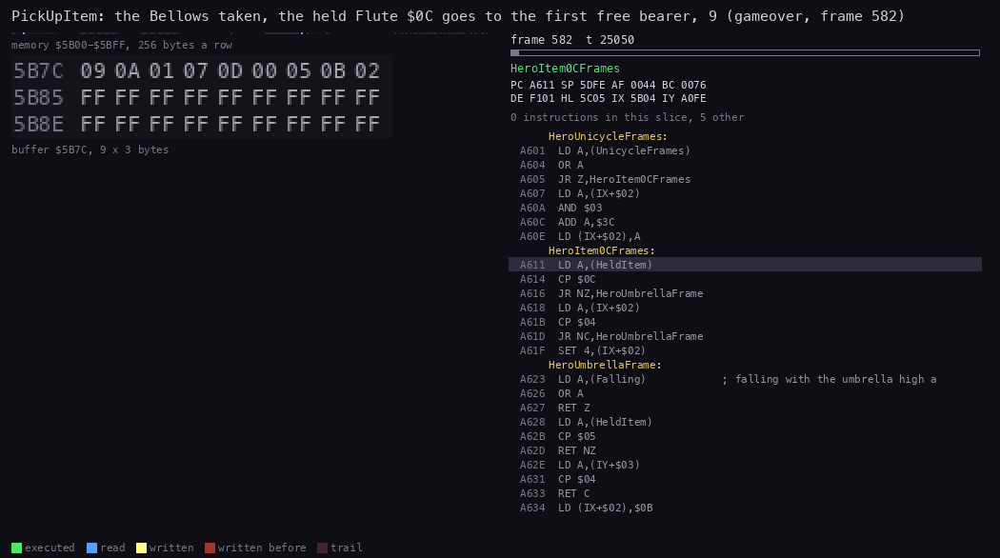

The animation shows `gameover` frame 582, T 25 000 to T 28 000. The view is BearerLoads `$5B7C` as 3 rows of 9. Bearer
9 (`$5B85`) changes from `$FF` to `$0C`.

```bash
python3 ../../kit/routine_anim.py --work work/docs/tmC/go --window 582:25000-582:28000 --listing build/game.lst \
  --pc BB5D-BC1E --view buffer:5B7C:9x3:hex --range 5B00-5BFF --pictures 60 --delay 150 --hold 2500 \
  --title "PickUpItem: the Bellows taken, the held Flute \$0C goes to the first free bearer, 9 (gameover, frame 582)" \
  --out docs/img/routines/PickUpItem.gif
```

Worked example: `gameover`, room `$10`, from the samples.

| Frame | Hero | HeldItem | ItemSlot1 | ItemSlot2 | BearerLoads 0-11 |
| ---: | --- | --- | --- | --- | --- |
| 582 | `68 38 10 80` | `0C` | `78 38 06 BB B9` | `B8 40 03 BE B9` | `09 0A 01 07 0D 00 05 0B 02 FF FF FF` |
| 583 | `6A 38 10 80` | `0C` | the same | the same | `09 0A 01 07 0D 00 05 0B 02 0C FF FF` |
| 585 | `6A 38 10 80` | `06` | `78 38 FE BB B9` | the same | the same |
| 679 | `AA 40 03 80` | `06` | `78 38 FF BB B9` | `B8 40 03 BE B9` | `... 02 0C 06 FF` |
| 680 | `AA 40 03 80` | `03` | `78 38 FF BB B9` | `B8 40 FE BE B9` | `... 02 0C 06 FF` |

Step by step:

1. The hero walks right into the Bellows (item slot 1: X `$78`, Y `$38`). Bearers 0-8 are loaded, and he holds the
   Flute (`$0C`).
2. In frame 582 PickUpItem finds bearer 9 free and puts the Flute there (the sample of 583).
3. It adds 50 and plays sound 2. AddScore prints the score and PlaySound plays the beeper sound inline, so the two take
   until frame 584. Only then does it make the Bellows (6) the held item, write `$FE` into the slot and set bit 7 of
   record 10 (`$B9BB`: `10` becomes `90`). The sample of 585 shows all three.
4. EraseItem later repaints the floor and writes `$FF` (frame 679's slot 1).
5. In frame 679 the same happens to the Spurs. The Bellows go to bearer 10, and slot 2 shows `$FE` until it is erased.

For two frames the Flute is both in the hand and on bearer 9.

The Spring bounce is the other branch, seen in `gameover` frames 415-448:

1. In frame 414 the hero (status 2) jumps straight up from the Spring of room `$1C`.
2. In frame 447 he comes down onto it with StatusTimer `$0B`, which is 10 or more.
3. PickUpItem sets him on top: Y `$48` - `$17` = `$31`, frame `$0F`, status 5. The sample of 448 shows `50 31 0F 80`
   (doc 10.6).

**The point**: one hand and 27 pockets. A pickup always changes what the hero holds, and only the held item works:
every puzzle test in the game reads HeldItem.

Witness:

- PickUpItem runs 52 660 times in the 34 builds, twice a pass.
- The take runs 30 times in 15 builds (`$BBDA`), 22 of them with an item in hand (`$BBE4`).
- The bounce runs 3 times (`$BBC1`: gameover, rzx10000, rzx22000).
- The swap runs 34 times in 21 builds (`$BA5B`). Key 1 runs 128 times and key 2 113 times (`$BC2F`, `$BC43`).

## 7.10 ItemsPass and the crystal of room `$30`

ItemsPass `$B9FA` is the main loop's item step. In every room but `$30` it runs the pickup, then the keys, and then the
item effects of rooms `$19` and `$3A` (the bridge) and `$10` (the rope). In room `$30` the pickup is replaced by the one
"put down" of the game: the Energy Crystal set into its machine.

```text
ItemsPass:
    if Room != $30: PickUpItems
    else if HeldItem == $18 and Hero.Y == $60 and $40 <= Hero.X < $4C:
        CrystalPlace ($B9D9) bit 7 = 0       ; record 20 lies in the room again
        HeldItem = $FF; CrystalPlaced = $FF
        SpawnRoomItems; AddScore(75); DrawPortrait
    ItemsKeys: BearerKeys, the swap key S
    if Room in ($19, $3A): BridgeEffect
    if Room == $10: RopeTrick
```

```asm
ItemsPass:
  LD A,(Room)
  CP $30
  JR NZ,ItemsPickUp
  LD HL,ItemsKeys         ; room $30: return into ItemsKeys
  PUSH HL
  LD A,(HeldItem)
  CP $18                  ; the Energy Crystal in hand
  RET NZ
  LD A,(IX+$01)
  CP $60
  RET NZ
  LD A,(IX+$00)
  CP $40
  RET C
  CP $4C
  RET NC
  LD HL,CrystalPlace      ; the crystal back in its place: clear the taken bit
  RES 7,(HL)
  LD A,$FF
  LD (HeldItem),A
  LD (CrystalPlaced),A
  CALL SpawnRoomItems
  LD DE,$004B             ; +75
  CALL AddScore
  JP DrawPortrait
ItemsPickUp:
  CALL PickUpItems        ; not room $30: pick up what the explorer touches
```

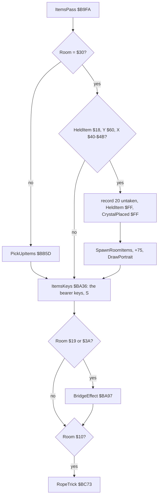

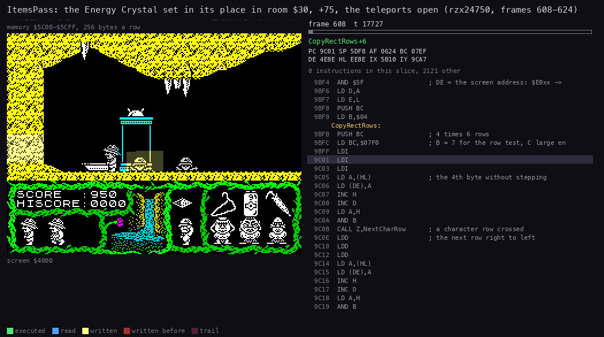

The animation shows `rzx24750` frames 608-624, in 64 pictures, with the screen as the view. The hero walks left over
the machine with the crystal in hand. In frame 613 the crystal appears on the machine, and the score goes from 950 to
1025.

```bash
python3 ../../kit/routine_anim.py --work work/docs/tmC/r247 --window 608:0-624:0 --listing build/game.lst \
  --pc B9FA-BA35,BB5D-BC1E --view screen --range 5C00-5CFF --pictures 64 --delay 150 --hold 2500 \
  --title "ItemsPass: the Energy Crystal set into room \$30's machine (rzx24750, frames 608-624)" \
  --out docs/img/routines/ItemsPass.gif
```

Worked example: `rzx24750`.

1. The hero enters room `$30` in frame 284 (the sample of 285: X `$E6`), holding the Coat Hanger (`$13`).
2. The sample of 435 shows him holding the crystal. That was a swap with the bearer that had carried it since room
   `$2C`.
3. The sample of 613 shows him at X `$4C`, just outside `$40-$4B`. HeroUpdate runs before ItemsPass, so the walk step of
   that pass moves him to `$4A` first, and then the test passes. The placement runs in frame 613 at T 38 828.
4. The sample of 614 shows the result (the table of 7.1): HeldItem `$FF`, ItemSlot1 the crystal at X `$48`, Y `$60`,
   CrystalPlaced `$FF`, the score + 75.
5. In frame 721 he jumps (status 2). In frame 730 he lands on the pad and status 22, the teleport, begins (doc 10.6).

**The point**: the crystal is the only item put down into the world. Its record is reused: the same record 20 that
InitGame marked taken now lies in room `$30` for good, and CrystalPlaced makes the teleports work.

Witness: ItemsPass runs 26 514 times in the 34 builds. The placement runs once, in `rzx24750` (`$BA1A`).

## 7.11 The room scripts

A room script is a routine called every pass from the start of HeroUpdate, with IX = the hero. RunRoomScript `$B7DD`
takes word Room of RoomScripts `$B7EC` (72 words). It jumps to the word through JumpThroughWord `$A6DD`; a zero word
does nothing. 21 rooms have a script.

```asm
RunRoomScript:
  LD A,(Room)
  LD L,A
  LD H,$00
  ADD HL,HL
  PUSH DE
  LD DE,RoomScripts
  ADD HL,DE
  JP JumpThroughWord      ; pops DE; 0: return; else JP (word)
```

| Room | Script | What it runs | Doc 10 |
| --- | --- | --- | --- |
| `$03`, `$0F` | BalloonRoom `$AFD7` | draws the balloon where BalloonInRoom says | 10.6 |
| `$12` | TelescopeRoom `$B16A` | at the telescope: status 30, the time to the collision | 10.10 |
| `$17` | SnakesRoom17 `$B55A` | two snakes strike unless the Flute is held | 10.8 |
| `$1A` | SnakesRoom1A `$B562` | three snakes; the Flute works above Y `$3A` | 10.8 |
| `$28` | SpaceScene `$B0B6` | the asteroid and the Earth: the ending, won or lost | 10.10 |
| `$2C` | FloatInRoom2C `$A34B` | replaces the hero's update: floating with momentum | 10.6 |
| `$2D` | CricketBallScript `$B370` | throw the Cricket Ball and a Formula falls (explorer 0) | 10.9 |
| `$2E` | ExplorerRoom2E `$B263` | explorer 1's room | 10.9 |
| `$2F` | ExplorerRoom2F `$B22D` | explorer 2's room | 10.9 |
| `$35`, `$36` | FloorRoom35 `$B7A3`, FloorRoom36 `$B79C` | the flickering floor | 10.8 |
| `$39` | SilverCrossScript `$B4E2` | the creature that flees from the Silver Cross | 10.9 |
| `$3B` | ProfessorScript `$B5DD` | the professor asks for six items | 10.10 |
| `$3C` | RadiationScript `$B784` | 20 passes without the Pills: death | 10.8 |
| `$3E`, `$40` | LeverRoom3E `$B72D`, LeverRoom40 `$B723` | the lever: fit the Switch, pull it | 10.9 |
| `$3F` | BasketScript `$B409` | the basket across the room | 10.9 |
| `$43` | SilverLiningScript `$B704` | the Silver Lining at one spot: the Silver Cross | 10.9 |
| `$46` | ExplorerRoom46 `$B2EB` | explorer 3's room | 10.9 |
| `$47` | ExplorerRoom47 `$B18A` | explorer 4's room | 10.9 |

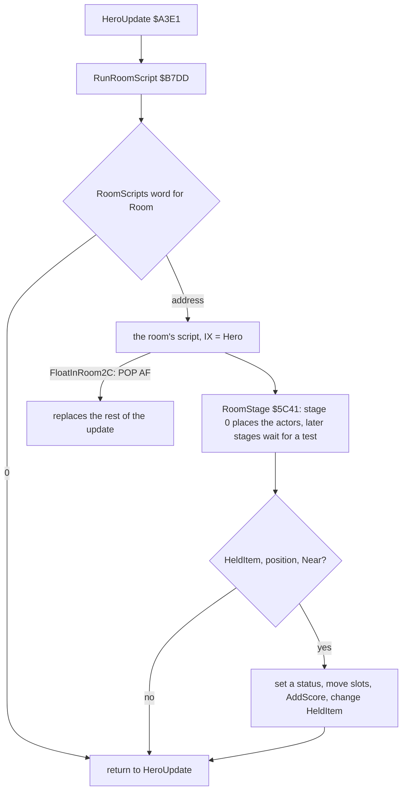

Most scripts share one shape:

- RoomStage `$5C41`, cleared on every room entry, counts their stages.
- Stage 0 places their actors in slots 2-4.
- A later stage waits for the hero to be at a place with an item in hand (HeldItem) or near an actor (Near).
- The reward is one of these: a status for the hero (an animation), a changed HeldItem, points, or a flag that another
  room reads. The flags are BallThrown `$5C00`, LeverState `$5C42`, SwitchFitted `$5C43`, CrystalPlaced `$5C44` and
  CrossState `$5C45`.

Because RoomStage is cleared on entry, leaving a room in the middle of a script restarts the script. The flags outside
RoomStage keep what was done.

Worked example: the professor in `rzx44000` (doc 10.10 animates it). The word of room `$3B`, at `$B7EC + 2 x $3B` =
`$B862`, is `$B5DD`. Each pass, ProfessorScript tests Near (hero, slot 4) and HeldItem = WantedItem. The samples:

| Frame | GiftCount | Score | HeldItem | WantedItem |
| ---: | ---: | ---: | --- | --- |
| 0 | 0 | 1400 | `0F` (a Formula) | `00` |
| 416 | 0 | 1400 | `0F` | `0F`: he asks for the Formula |
| 460 | 1 | 1550 | `FF` | `0F` |
| 724 | 1 | 1550 | `FF` | `13`: he asks for the Coat Hanger |
| 1204 | 2 | 1700 | `FF` | `13` |

The gift runs in frame 459: +150, GiftCount 1.

**The point**: all the game's puzzles are 21 small routines keyed by the room number, run before the hero moves. They
talk to the rest of the game only through the slots, HeldItem, the status and a few flags.

Witness: RunRoomScript runs 26 517 times in the 34 builds, once a pass. The play builds read the words of the rooms
they visit: rzx16000 and rzx18000 read word `$2D`, rzx42000 to rzx50000 word `$3B`. Words `$46` and `$47` are read only
by the load, in c1 (`.ann`). The scripts' own witnesses are in doc 10.

## 7.12 The course of the RZX run

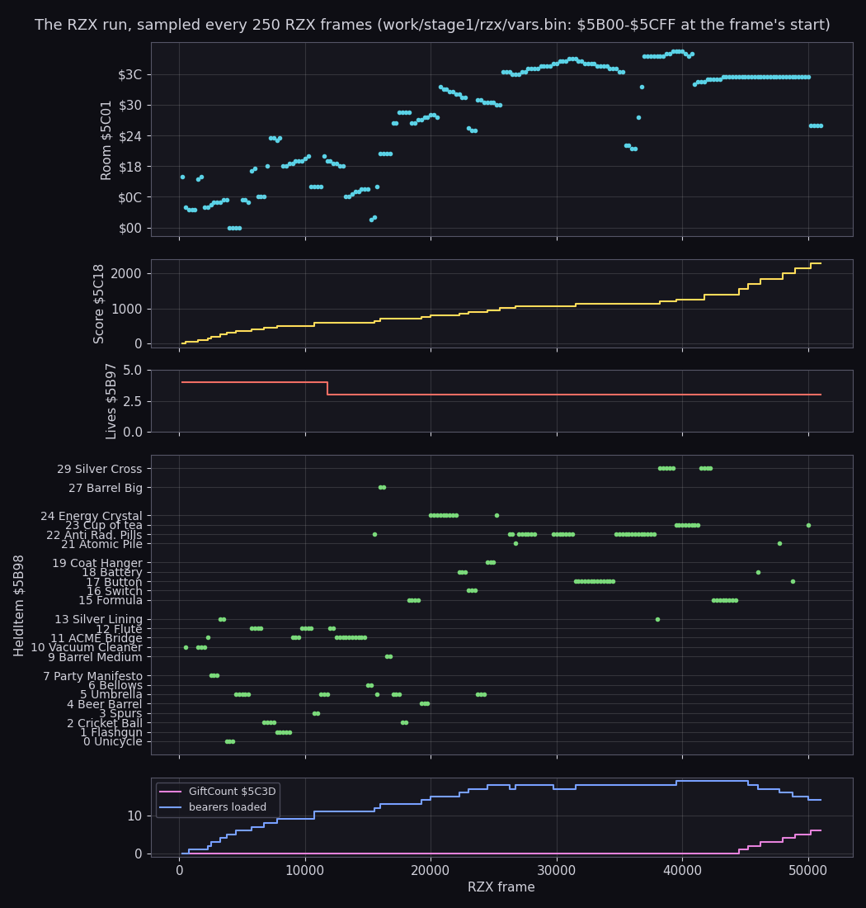

The figure: the RZX run from `work/stage1/rzx/vars.bin`, drawn by `tools/fig_objects.py`.

```bash
python3 tools/fig_objects.py docs/img/objects
```

How to read the figure:

- x is the RZX frame of the whole run, with the 31 segments joined. There is one sample every 250 frames, each the
  state at the frame's start. Sample 0 (before play) is left out.
- Room: the rooms visited, as `$5C01`. The run starts in room `$14` and ends in room `$28`, the space scene.
- Score: 50 a pickup, 75 for the crystal and for the Silver Lining, 150 for each gift and for the Silver Cross. The run
  ends at 2 300.
- Lives: one life is lost, between RZX 10 750 and 11 750 (the fall into room `$1C`, near RZX 11 360).
- HeldItem: the item in hand, one dot a sample.
- GiftCount and the number of loaded bearers: the bearers fill up to 19 by RZX 39 500. The six gifts come between RZX
  44 460 and 50 250.

**The point**: the run is a collecting tour of about 40 000 frames, followed by a delivery of six items in about 6 000.
The player takes few risks: one fall costs him his only lost life.

Worked example: the samples at RZX 44 250 and 44 500 show GiftCount 0 and 1, and the score + 150. The gift is the
Formula, given in `rzx44000` frame 459 (RZX 44 459, 7.11).

## 7.13 Notes, quirks and what no recording reached

- WantedItem starts at 0, not `$FF`. InitGame writes `$FF` at `$8FA6`, and then clears `$5BFA-$5C8D` from `$8FBE`.
  That range includes `$5C3C`. Item 0 is the Unicycle. So a hero who brings the Unicycle to the professor before he
  first asks would give it as a gift. This is known only from the code: the RZX player arrives with other items. The
  samples show `$5C3C` = 0 in `rzx24750` frame 613 and in `rzx44000` frames 0-415. The professor's `.ann` says `$FF`;
  the fix is sent to the lead.
- WantedItem is not cleared after a gift. Until the professor asks again (his frame `$4D`), the same item would count a
  second time. `rzx44000` frames 460-723 show WantedItem `$0F` kept after the gift. Only the Formula has several
  copies (records 27-30, in the explorer rooms), and each explorer reaches only his own room. So no second copy can be
  brought in that window (known only from the code).
- The fliers' change of type when blocked (`$BF9A`, `$BFF0`) never ran.
- No room has a third item (PlaceItem's guard), and the bearers were never full.
- The electric beam's hit (`$9262`) never ran (doc 10.8).
- The scenery objects use explorer frames `$2B` and `$2C`. Every recording plays explorer 0, so their pictures with the
  other explorers are known only from the code.
- Rooms `$46` and `$47`, and the 13 rooms the RZX run does not visit (WALKTHROUGH 6.0), were never played. Their
  creatures are read from the data only.
