# 8. HUD and text

What this covers:

- the font, the ROM's own, and PrintChar, the one routine that puts a character on the screen (8.1);
- PrintString and the device menu: the options, the credits and the highlighted device (8.2);
- PrintPage and the selector's Help pages (8.3);
- every text of the game, as a data sheet (8.4);
- the panel: its picture, its fields and the column blitter that draws them (8.5);
- the portrait, the held item and the spare lives (8.6);
- the bearer row and its scroll on keys 1 and 2 (8.7);
- the score: AddScore, PrintNumber, its four digits, the `:` past 9999 and the missing sign (8.8);
- the high score (8.9);
- the telescope view and PrintByte, the countdown's only display (8.10);
- what is known only from the code (8.11) and the point (8.12).

The names are those of `src/game/game.ann` and `src/select/select.ann`. nzeemin's SkoolKit disassembly
(`terramex-zx`) named most of the printing and panel routines; where its reading is used, the section says so, and
where we differ it gives the evidence. It does not cover the selector, so PrintPage and Help are ours.

The recordings are those of [WALKTHROUGH 6.0](../WALKTHROUGH.md). Each was opened from its stage-1 TTD session on the
writer's own instance (port base 37570, muted):

- `c1` (`work/stage1/c1/session.ttd`, frames 0-26 628): power-on, the tape load, the device menu (frame 21 602), the
  selector, play. The game starts at frame 23 367, the first pickup is at frame 23 508, the bearer row scrolls over
  frames 23 934-23 945 (key 2 held 23 934-23 944), and the game is quit with CAPS SHIFT + Q at frame 26 210.
- `explorers` (`work/stage1/explorers/session.ttd`, frames 0-15 190): the menu (frame 7750), all five explorers, and
  Help (frames 13 660-15 190: from the fire on the question mark to the end of the script).
- `gameover` (`work/stage1/gameover/session.ttd`): the RZX state of frame 10 000 with Lives `$5B97` set to 1, a POKE.
  The game ends at frame 1962.
- the RZX segments `rzxNNNNN`: another player's run (Bobby Lequay's RZX), replayed. They are used for the final score,
  2300.

A moment is written "frame F T t", t counted from the start of the emulator's frame (70 908 T on the 128K). Screen
addresses are the Spectrum's: a character cell at row r, column c of the screen has its top pixel line at `$4000` +
`$800` x (r / 8) + 32 x (r mod 8) + c, and its attribute at `$5800` + 32 x r + c.

The models in `tools/fig_text.py` are Python copies of PrintChar, PrintString, PrintPage, PrintNumber and PrintByte,
run on the bytes of the build and the ROM font. They are checked against the screenshots pixel for pixel (8.2, 8.3).

## 8.1 The font and PrintChar

The game has no font of its own. Every print copies the 8 bytes of a character from the 48 BASIC ROM, paged in during
play, at `$3C00` + 8 x code. The ROM's character set starts at `$3D00` with the space (code `$20`), so `$3C00` + 8 x
code is that character for codes `$20-$7F`. Code `$7F` is the copyright sign, used in the credits.

PrintChar `$90C6` takes the code in A and the screen address of the cell's top line in HL. It copies the 8 bytes down
the cell, one pixel line each: on the Spectrum screen the next pixel line of a cell is 256 bytes on, so `INC D`. It
returns HL + 1, the next cell to the right. It writes no attribute.

```text
PrintChar(A = code, HL = the cell's top line):
    glyph = $3C00 + 8 * A
    for line in 0 .. 7:
        screen[HL + 256 * line] = ROM[glyph + line]
    return HL + 1                          ; BC, DE kept
```

```text
90C6  C5           PUSH BC                 ; PrintChar
90C7  D5           PUSH DE
90C8  E5           PUSH HL
90C9  EB           EX DE,HL                ; DE = the screen
90CA  6F           LD L,A
90CB  26 00        LD H,$00
90CD  29           ADD HL,HL
90CE  29           ADD HL,HL
90CF  29           ADD HL,HL
90D0  01 00 3C     LD BC,$3C00             ; the ROM font: $3C00 + 8 * code
90D3  09           ADD HL,BC
90D4  06 08        LD B,$08
90D6  7E           LD A,(HL)               ; PrintCharRow
90D7  12           LD (DE),A
90D8  14           INC D                   ; the next pixel line of the cell
90D9  23           INC HL
90DA  10 FA        DJNZ PrintCharRow
90DC  E1           POP HL
90DD  D1           POP DE
90DE  C1           POP BC
90DF  23           INC HL                  ; the next cell
90E0  C9           RET
```

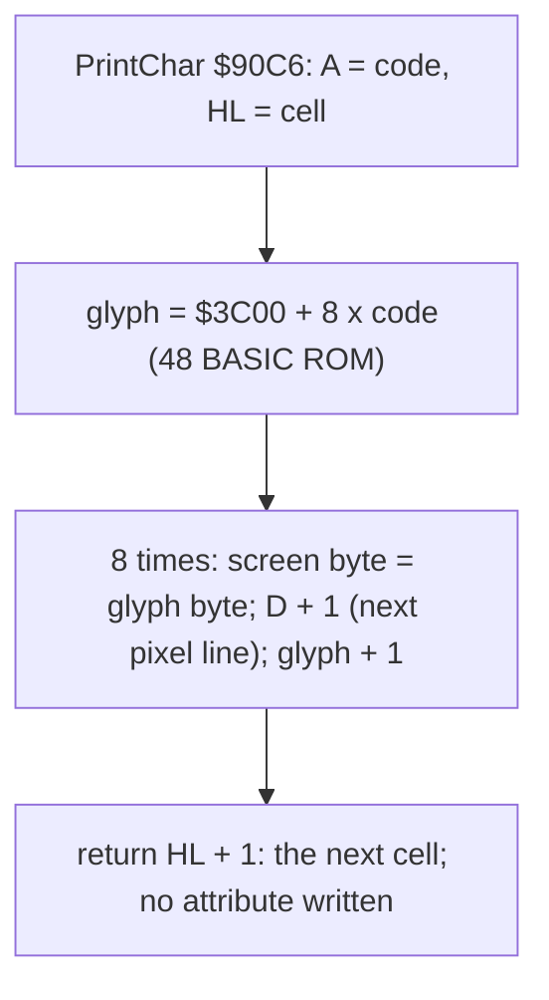

The selector in RAM 1 has its own copy, PrintGlyph `$C4BB`: the same 27 bytes, used by PrintPage (8.3). The game code
is not paged in while the selector runs, so it needs its own.

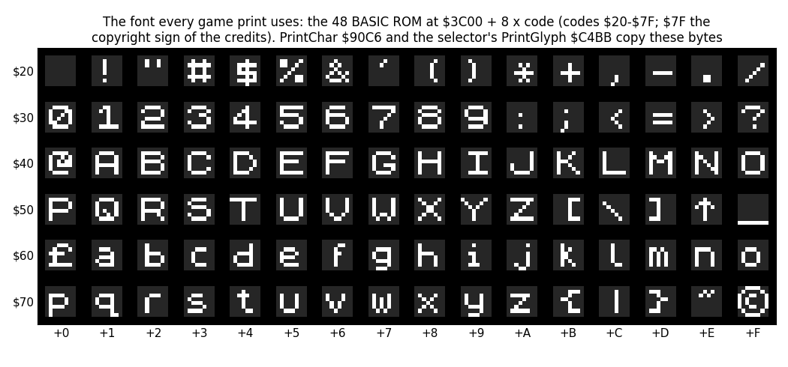

How to read the figure:

- **Each cell** is one character as PrintChar copies it, white on black, from the 128K's second ROM (the 48 BASIC ROM)
  at `$3C00` + 8 x code.
- **Rows** are the high nibble of the code (`$20` to `$70`), **columns** the low nibble.
- **The last cell**, `$7F`, is the copyright sign of the credits.
- **The point**: the game prints in the plain Spectrum font. Its look on screen comes from the attributes, not the
  glyphs.

```bash
python3 tools/fig_text.py font --out docs/img/text/font.png
```

Worked example: the `S` of SCORE is code `$53`. Its glyph is at `$3C00` + 8 x `$53` = `$3E98`:
`00 3C 40 3C 02 42 3C 00`. PrintChar with HL = `$5029` would write those bytes to `$5029`, `$5129`, ... `$5729`, and
return HL = `$502A`.

Witness: PrintChar runs 1933 times in the L1 builds. The writers map of 8.5 shows PrintCharRow `$90D6` (the write at
`$90D7`) writing 40 bytes of the panel when a game starts: 5 characters of 8 lines.

The point: one 27-byte routine and the ROM font are the whole text engine. Everything else in this document is about
where it prints and what colour the cell gets.

## 8.2 PrintString and the device menu

PrintString `$94F9` prints a text at a screen address. DE points at the text, HL is the screen address of the first
cell, and A' is the attribute. It reads bytes until a 0. A `$0D` moves to the start of the next character row. Every
other byte is a character: PrintChar draws it, then ScreenToAttr `$9536` turns the screen address into the cell's
attribute address, and A' is stored there.

The start of the line is kept in the operand of an `LD HL,nn` at `$9516` (self-modified, written at `$94F9`). A
`$0D` adds 32 to it: the next character row. If the add carries, the row crosses into the next third of the screen,
and H gets 8 more.

```text
PrintString(DE = text, HL = screen, A' = attribute):
    line_start = HL                         ; into the operand at $9517
    loop:
        b = *DE++
        if b == 0: return
        if b == $0D:
            HL = line_start + 32; if it carried: HL += $0800   ; the next third
            line_start = HL; continue
        PrintChar(b, HL)
        attribute[ScreenToAttr(HL)] = A'
        HL += 1                              ; INC L: no wrap to the next row

ScreenToAttr(HL): return ($58 OR ((H >> 3) AND 3)) * 256 + L
```

```text
94F9  22 17 95     LD (PrintNewLine+1),HL  ; PrintString: the line start into the operand at $9517
94FC  1A           LD A,(DE)               ; PrintStringLoop
94FD  13           INC DE
94FE  B7           OR A
94FF  C8           RET Z                   ; 0 ends the text
9500  FE 0D        CP $0D
9502  28 12        JR Z,PrintNewLine
9504  D5           PUSH DE
9505  E5           PUSH HL
9506  CD C6 90     CALL PrintChar
9509  E1           POP HL
950A  E5           PUSH HL
950B  CD 36 95     CALL ScreenToAttr
950E  08           EX AF,AF'               ; the cell's attribute = A'
950F  77           LD (HL),A
9510  08           EX AF,AF'
9511  E1           POP HL
9512  2C           INC L
9513  D1           POP DE
9514  18 E6        JR PrintStringLoop
9516  21 00 00     LD HL,$0000             ; PrintNewLine: n = the line start (self-modified)
9519  7D           LD A,L                  ; the next character row
951A  C6 20        ADD A,$20
951C  6F           LD L,A
951D  30 DA        JR NC,PrintString
951F  7C           LD A,H                  ; carried: the next third of the screen
9520  C6 08        ADD A,$08
9522  67           LD H,A
9523  18 D4        JR PrintString
9536  7C           LD A,H                  ; ScreenToAttr
9537  0F 0F 0F     RRCA x 3
953A  E6 03        AND $03                 ; the third, 0-2
953C  F6 58        OR $58
953E  67           LD H,A
953F  C9           RET
```

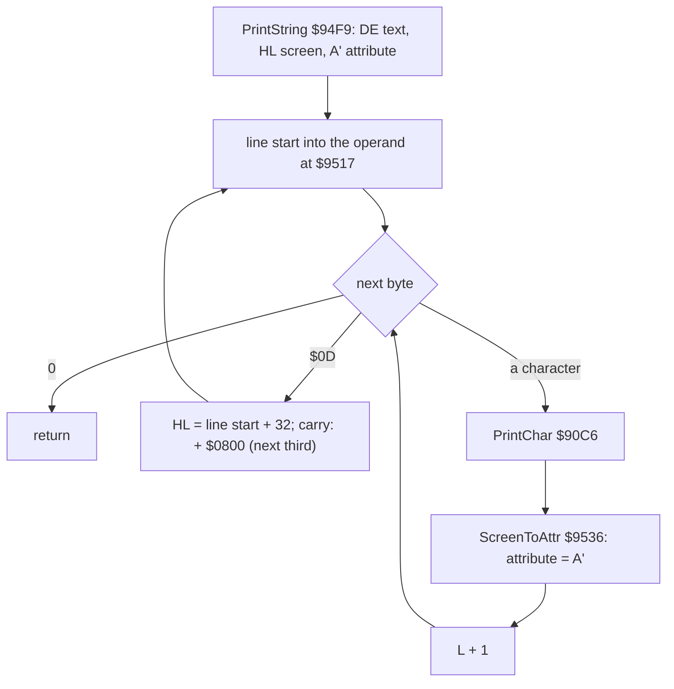

### The device menu

DeviceMenu `$93AF` builds the menu screen, and PrintString prints its two texts:

1. it clears the screen, with attribute `$44` (bright green ink on black);
2. it draws the frame from the panel picture in BackBuffer `$E000`;
3. it draws TitleLogo `$95FD` with attribute `$46` and the two globes (DrawMenuGlobes `$9F27`);
4. PrintMenuText `$94EF` prints MenuText `$9540` at `$4808` (row 8, column 8) with attribute `$44`;
5. it prints CreditsText `$9579` at `$5022` (row 17, column 2) with attribute `$47` (bright white).

MenuLoop `$9440` then colours the options each frame:

- the box of the three devices, 5 rows x 14 columns from row 8, column 8, gets attribute `$43` (bright magenta);
- the chosen device's row, 8 + 2 x InputDevice `$94AF`, gets `$47` over 14 cells;
- MenuKeys `$9468` waits a frame (`HALT`) and reads keys 1, 2, 3 into InputDevice (0 keyboard, 1 Kempston, 2
  Sinclair), and key 0 starts the game.

```text
DeviceMenu():
    CLS with attribute $44; the frame from $E000; TitleLogo with $46; DrawMenuGlobes
    PrintString(MenuText, $4808, $44)
    PrintString(CreditsText, $5022, $47)
MenuLoop():
    loop:
        fill 5 x 14 attributes from $5908 with $43
        fill 14 attributes from $5908 + 64 * InputDevice with $47
        HALT
        keys 1/2/3: InputDevice = 0/1/2
        key 0: return
```

```text
9433  21 22 50     LD HL,Screen+4130       ; the credits at row 17, column 2, attribute $47
9436  11 79 95     LD DE,CreditsText
9439  08           EX AF,AF'
943A  3E 47        LD A,$47
943C  08           EX AF,AF'
943D  CD F9 94     CALL PrintString
9440  FD 21 00 00  LD IY,$0000             ; MenuLoop
9444  01 0E 05     LD BC,$050E             ; the box: 5 rows x 14 columns of $43
9447  21 08 59     LD HL,Attributes+264
944A  E5           PUSH HL
944B  3E 43        LD A,$43
944D  CD 26 95     CALL FillAttrs
9450  3A AF 94     LD A,(InputDevice)      ; the chosen row: 64 bytes (2 rows) per device
9453  D1           POP DE
      ...                                  ; HL = 64 x device + $5908
9464  36 47        LD (HL),$47             ; 14 attributes of $47
9466  ED B0        LDIR
9468  76           HALT                    ; MenuKeys: one turn a frame
9469  01 FE F7     LD BC,$F7FE             ; keys 1-5
      ...
9488  06 EF        LD B,$EF                ; key 0 starts the game
948A  ED 78        IN A,(C)
948C  E6 01        AND $01
948E  C8           RET Z
948F  18 AF        JR MenuLoop
```

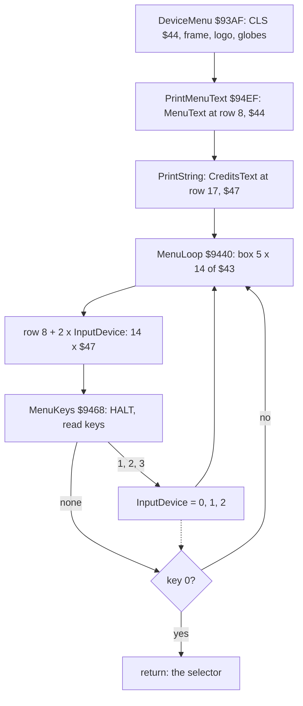

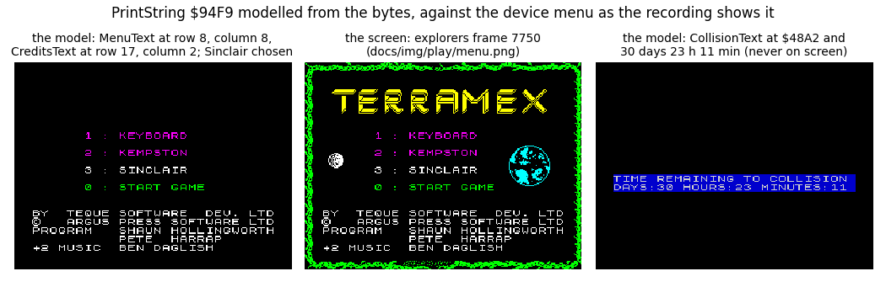

How to read the figure:

- **Left**: the PrintString model run on MenuText and CreditsText from `build/game.bin`, with MenuLoop's colours for
  Sinclair chosen (device 2). Only the text cells are drawn: no logo, frame or globes.
- **Middle**: the screen of `explorers` frame 7750 ([menu.png](img/play/menu.png)), Sinclair chosen.
- **Right**: the same model on CollisionText with the telescope's numbers (8.10). The game never showed it in a
  recording.
- **The point**: the model and the screen agree on every text cell: 12 544 pixels, none different. So the texts, the
  addresses and the attributes above are the machine's.

```bash
python3 tools/fig_text.py menu --out docs/img/text/menu-model.png
python3 tools/fig_text.py check
```

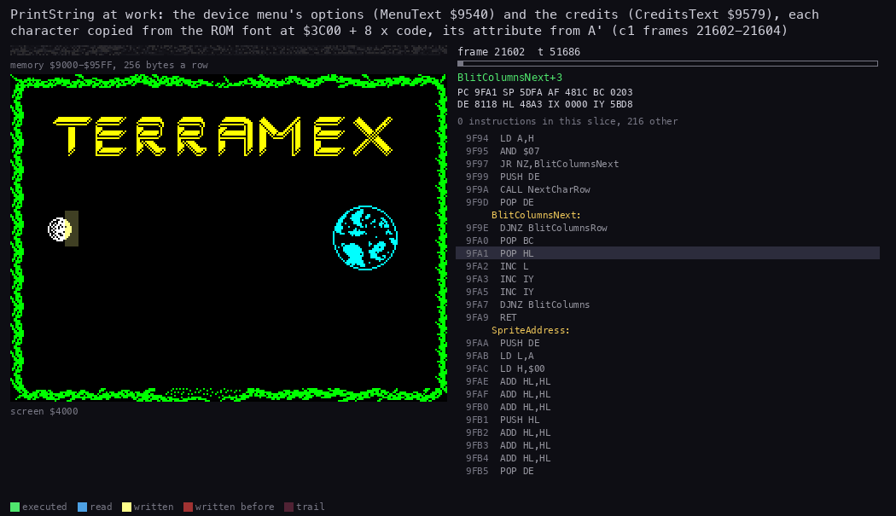

*The routine animation of PrintChar and PrintString in `c1` from 21602:50000 to 21604:43000. It has 80 pictures,
1686 T each, and 16 125 instructions. The view is the screen; the memory grid is `$9000-$95FF`, where the texts are.
Command, from the case folder after `. work/env.sh`: `python3 ../../kit/routine_anim.py --work work/docs/tmD/c1
--window 21602:50000-21604:43000 --listing build/game.lst --view screen --pc 90C6-90E0,94EF-953F --range 9000-95FF
--pictures 80 --out docs/img/routines/PrintString.gif`.*

How to read the animation: the yellow cells on the screen are the bytes written in the picture's slice. They move
along the option lines, one character at a time, then along the five credit lines. The blue reads in the grid are the
text bytes at `$9540-$95FC`. The first option row's attributes turn to the box colour once MenuLoop runs.

Worked example: MenuText starts `"1 : KEYBOARD"` and `$0D`. PrintMenuText sets HL = `$4808`, A' = `$44`.

- `1` (`$31`): PrintChar at `$4808`; ScreenToAttr(`$4808`) = `$5908`; `$44` stored. HL = `$4809`.
- ... `D` lands at `$4813`.
- `$0D`: line start `$4808` + 32 = `$4828` (row 9). No carry.
- `$0D` again: `$4848` (row 10), where `"2 : KEMPSTON"` goes.
- The credits start at `$5022`: row 17 is in the third third (H = `$50`), so ScreenToAttr gives `$5A22`.

Witness: PrintString runs 108 times in the L1 builds, PrintMenuText and DeviceMenu 9 times each (once per menu
shown). MenuLoop runs 6835 times: once a frame while a menu waits.

The point: PrintString is a terminal with one control code. Its colour is a register (A') set by the caller, so the
same routine prints the green menu, the white credits and the blue telescope text.

## 8.3 PrintPage and the Help pages

The selector in RAM 1 shows Help when its cursor is on the Help icon (doc 5). ShowHelp `$C536` uses PrintPage `$C574`,
a second printer with its own codes:

- PrintPage clears the screen, sets the border to blue (`OUT ($FE)` = 1) and every attribute to `$0F` (white ink on
  blue paper).
- `$16` c r moves the cursor to column c, row r.
- `$0D` moves to column 0 of the next row.
- `$01` waits 6 x 65 536 turns of a 26 T loop, 10.2 M T (2.9 s), and returns.
- `$00` waits for SPACE (returns A = 1) or ENTER (A = 0).
- Any other byte is a character: PrintGlyph `$C4BB` draws it at row B, column C. The column wraps from 31 to 0 of the
  next row, so long lines run on.

ShowHelp prints HelpTitle `$C708` (which ends on `$01`, the pause), then HelpPage1 `$C721`, HelpPage2 `$C97F` and
HelpPage3 `$CB7D`. ENTER on any page returns to the selector; SPACE goes on, and SPACE on page 3 starts again from the
title. On a 48K, Help48KText `$C5F9` comes first.

```text
PrintPage(HL = the page):
    border blue; screen 0; attributes $0F
    row, col = 0, 0
    loop:
        b = *HL++
        if b == $16: col = *HL++; row = *HL++
        elif b == $01: wait 10.2 M T; return
        elif b == $00: wait for SPACE (return A = 1) or ENTER (return A = 0)
        elif b == $0D: row += 1; col = 0
        else:
            PrintGlyph(b, screen address of (row, col))
            col += 1; if col == 32: col = 0; row += 1

ShowHelp():
    if a 48K: if PrintPage(Help48KText) == ENTER: return to the selector
    loop:
        PrintPage(HelpTitle); if PrintPage(HelpPage1) == ENTER: return
        if PrintPage(HelpPage2) == ENTER: return
        if PrintPage(HelpPage3) == ENTER: return
```

```text
C574  E5           PUSH HL                 ; PrintPage
C575  3E 01        LD A,$01                ; the border blue
C577  D3 FE        OUT ($FE),A
      ...                                  ; the screen 0, the attributes $0F
C593  01 00 00     LD BC,$0000             ; B = row, C = column
C596  7E           LD A,(HL)               ; PageNextByte
C597  23           INC HL
C598  FE 16        CP $16                  ; $16 c r: the position
C59A  20 06        JR NZ,PageControl
C59C  4E           LD C,(HL)
C59D  23           INC HL
C59E  46           LD B,(HL)
C59F  23           INC HL
C5A0  18 F4        JR PageNextByte
C5A2  FE 01        CP $01                  ; PageControl: $01, pause and return
C5A4  20 0D        JR NZ,PageEndOrCr
C5A6  11 00 00     LD DE,$0000
C5A9  06 06        LD B,$06
C5AB  1B           DEC DE                  ; PauseLoop: 6 x 65 536 turns of 26 T
C5AC  7B           LD A,E
C5AD  B2           OR D
C5AE  20 FB        JR NZ,PauseLoop
C5B0  10 F9        DJNZ PauseLoop
C5B2  C9           RET
C5B3  B7           OR A                    ; PageEndOrCr: $00 ends the page
C5B4  28 2E        JR Z,WaitSpaceOrEnter
C5B6  FE 0D        CP $0D                  ; $0D: the next row
C5B8  20 05        JR NZ,PrintPageGlyph
C5BA  04           INC B
C5BB  0E 00        LD C,$00
C5BD  18 D7        JR PageNextByte
C5BF  C5           PUSH BC                 ; PrintPageGlyph: the cell of row B, column C
C5C0  E5           PUSH HL
C5C1  08           EX AF,AF'
C5C2  78           LD A,B                  ; H = $40 + (row AND $18)
C5C3  E6 18        AND $18
C5C5  F6 40        OR $40
C5C7  67           LD H,A
C5C8  CB 08 CB 08 CB 08  RRC B x 3        ; L = (row AND 7) x 32 + column
C5CE  78           LD A,B
C5CF  E6 E0        AND $E0
C5D1  B1           OR C
C5D2  6F           LD L,A
C5D3  08           EX AF,AF'
C5D4  CD BB C4     CALL PrintGlyph
C5D7  E1           POP HL
C5D8  C1           POP BC
C5D9  0C           INC C                   ; the column wraps at 32
C5DA  79           LD A,C
C5DB  FE 20        CP $20
C5DD  20 03        JR NZ,PageGlyphDone
C5DF  0E 00        LD C,$00
C5E1  04           INC B
C5E2  18 B2        JR PageNextByte
C5E4  01 FE 7F     LD BC,$7FFE             ; WaitSpaceOrEnter: SPACE gives A = 1
C5E7  ED 78        IN A,(C)
C5E9  E6 01        AND $01
C5EB  28 0A        JR Z,SpacePressed
C5ED  01 FE BF     LD BC,$BFFE             ; ENTER gives A = 0
C5F0  ED 78        IN A,(C)
C5F2  E6 01        AND $01
C5F4  C8           RET Z
C5F5  18 ED        JR WaitSpaceOrEnter
C5F7  3C           INC A                   ; SpacePressed
C5F8  C9           RET
```

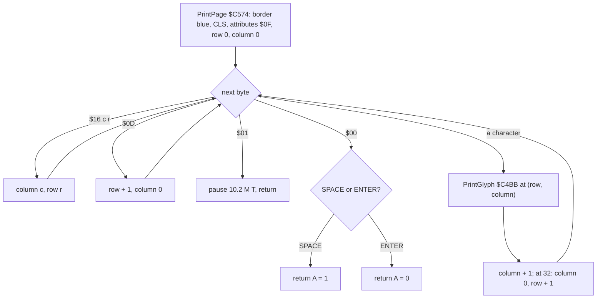

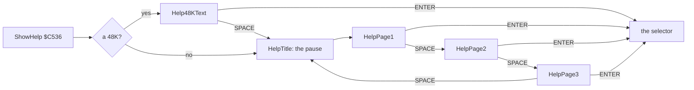

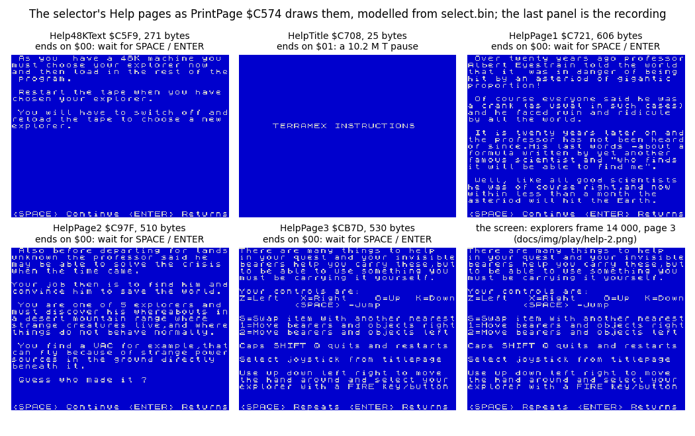

How to read the figure:

- **The first five panels** are the PrintPage model on each Help text of `build/select.bin`: Help48KText, HelpTitle
  and the three pages. Each title gives the address, the size and the code that ends the page.
- **The last panel** is the screen of `explorers` frame 14 000 ([help-2.png](img/play/help-2.png)), page 3.
- **The bottom line** of each page, "SPACE Continue ENTER Returns", is placed by `$16 $00 $17`: column 0, row 23.
- **The text runs on** across line ends: "professor" and "Albert" are split by the wrap at column 32, not by a code.
- **The point**: the model is pixel-exact against all three Help screenshots: help-1.png is HelpTitle, help-2.png
  HelpPage3, help-3.png HelpPage1, each 49 152 pixels with none different.

```bash
python3 tools/fig_text.py help --out docs/img/text/help-model.png
python3 tools/fig_text.py check
```

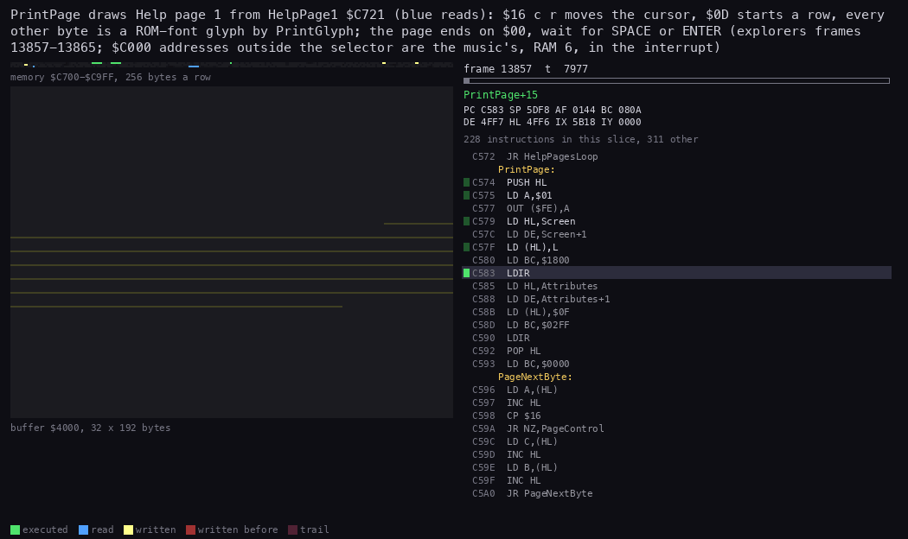

*The routine animation of PrintPage and PrintGlyph in `explorers` from 13857:0 to 13866:0. It has 80 pictures and
60 329 instructions. The view is the whole screen bitmap, `$4000` as 32 x 192 bytes; the memory grid is
`$C700-$C9FF`, where HelpTitle and HelpPage1 are. Command: `python3 ../../kit/routine_anim.py --work
work/docs/tmD/ex --window 13857:0-13866:0 --listing build/select.lst --view buffer:4000:32x192:screen --pc
C4BB-C4D6,C574-C5F8 --range C700-C9FF --pictures 80 --out docs/img/routines/PrintPage.gif`.*

How to read the animation: the screen fills paragraph by paragraph as the blue reads move along HelpPage1 in the grid.
The page then ends on `$00`, and the last pictures sit in WaitSpaceOrEnter, reading the keyboard. Addresses at
`$C000` outside the selector are the music's (RAM 6, in the interrupt).

Worked example: HelpTitle `$C708` is `16 05 0A` + "TERRAMEX INSTRUCTIONS" + `01`, 25 bytes.

- `$16 $05 $0A`: column 5, row 10.
- The cell address: H = `$40` + (10 AND `$18`) = `$48`; L = (10 AND 7) x 32 + 5 = `$45`. So `T` lands at `$4845`.
- 21 characters run to column 25.
- `$01`: the pause. 6 x 65 536 x 26 T = 10 223 616 T, 144 frames: the title shows for 2.9 s, then page 1 is drawn.

Witness: `explorers` enters Help at the fire of frame 13 660. The title is on the screen at 13 750, and page 1 is
drawn over frames 13 857-13 865 (the PrintPage animation below). The screenshots at 13 750, 14 000 and 15 000 are the
title, page 3 and page 1 (SPACE through the pages and round again). The script's ENTER at 14 780 did not return to
the selector: page 1 is still on the screen at 15 000, and Help runs to the end of the script, 15 190. PrintPage's
model equals all three screenshots.

The point: PrintPage is a page printer, not a line printer. It clears, it wraps and it waits for a key, so Help is
three byte strings and a ten-line loop.

## 8.4 The texts

Every text is in `src/res/texts`, one quoted string a line, with `\x0D` and the other codes written out. The spelling
is the original's ("asteriod").

| Text | Address | Bytes | Printer | Where it shows |
| --- | --- | ---: | --- | --- |
| MenuText | `$9540` (game) | 57 | PrintString via PrintMenuText `$94EF` | the device menu, row 8, column 8, attribute `$44` |
| CreditsText | `$9579` (game) | 132 | PrintString from DeviceMenu `$93AF` (at `$943D`) | the device menu, rows 17-21, column 2, attribute `$47` |
| CollisionText | `$B07C` (game) | 58 | PrintString from TelescopeView `$A7B9` (at `$A7EB`) | the telescope view, `$48A2`, attribute `$0F` (8.10) |
| Help48KText | `$C5F9` (selector) | 271 | PrintPage | Help on a 48K |
| HelpTitle | `$C708` (selector) | 25 | PrintPage | Help's title card, ends on the pause `$01` |
| HelpPage1 | `$C721` (selector) | 606 | PrintPage | the story: the professor and the asteroid |
| HelpPage2 | `$C97F` (selector) | 510 | PrintPage | the mission: find him, five explorers |
| HelpPage3 | `$CB7D` (selector) | 530 | PrintPage | the controls and the bearers |
| StopTapeText | `$C2B8` (selector) | 48 | the ROM's RST `$10` | the 48K: stop the tape |
| StartTapeText | `$C2E8` (selector) | 44 | copied by CopySet48K | the 48K: explorer selected, start the tape |
| BreakMessage | `$5DB7` (BASIC loader) | 34 | the loader | a block failed to load (doc 3) |

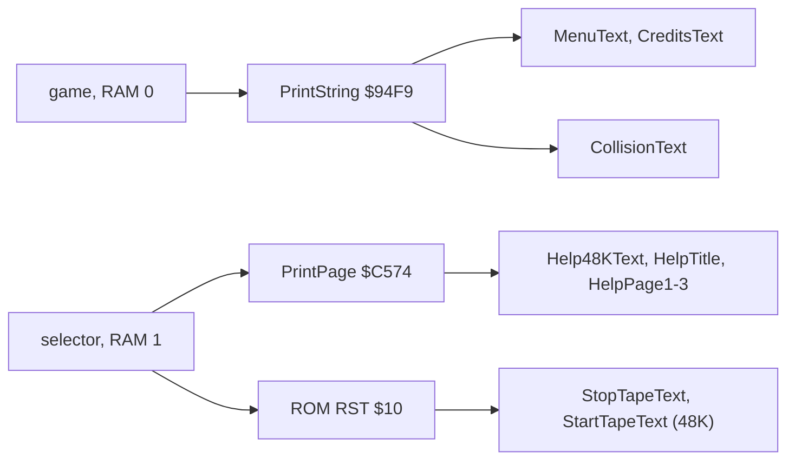

The credits, as printed (row 17 on):

```text
BY  TEQUE SOFTWARE  DEV. LTD
©   ARGUS PRESS SOFTWARE LTD
PROGRAM   SHAUN HOLLINGWORTH
          PETE  HARRAP
+2 MUSIC  BEN DAGLISH
```

The music credit is printed on a 48K too, which has no music (doc 9).

Worked example: CollisionText is `"TIME REMAINING TO COLLISION "`, `$0D`, `"DAYS:   HOURS:   MINUTES:   "`, `$00`. The gaps of
three spaces after each colon are where PrintByte puts the numbers (8.10).

Witness: the texts of the menu and Help are on the screenshots ([menu.png](img/play/menu.png),
[help-1.png](img/play/help-1.png), [help-3.png](img/play/help-3.png)) and match the models. CollisionText, the 48K
texts and BreakMessage are shown in no recording.

The point: the game has very little text: a menu, the credits, one line of the telescope. Everything else the player
reads is in the selector's Help, which the game itself never sees.

## 8.5 The panel

The panel is the bottom third of the screen, rows 16-23. Its picture (the vine frame, SCORE and HISCORE, the tree) is
part of BackBuffer `$E000`: InitGame `$8F69` copies `$E000-$E7FF` to `$5000-$57FF` and `$E800-$E8FF` to the
attributes `$5A00-$5AFF`. The game then writes seven fields into it:

| Field | Screen | Written by | When |
| --- | --- | --- | --- |
| the score | `$5029` (row 17, column 9) | PrintScore `$BD75` | every AddScore |
| the high score | `$5049` (row 18, column 9) | PrintHiScore `$BD3B` | a new high score at the game's end |
| the spare lives | `$5081` (rows 20-22, columns 1-9) | DrawSpareLives `$9E96` | a game's start, a life lost |
| the held item | `$5032` (rows 17-19, columns 18-20) | DrawPortrait `$9E5D` | a pickup, a swap, a gift |
| the portrait | `$5092` (rows 20-22, columns 18-20) | DrawPortrait | the same |
| the bearers' loads | `$5036` (rows 17-19, columns 22-30) | DrawBearers `$9EBD` | a pickup, a swap, keys 1 and 2 |
| the bearers | `$5096` (rows 20-22, columns 22-30) | DrawBearers | the same |

There is no time display on the panel. The countdown shows only in the telescope view (8.10).

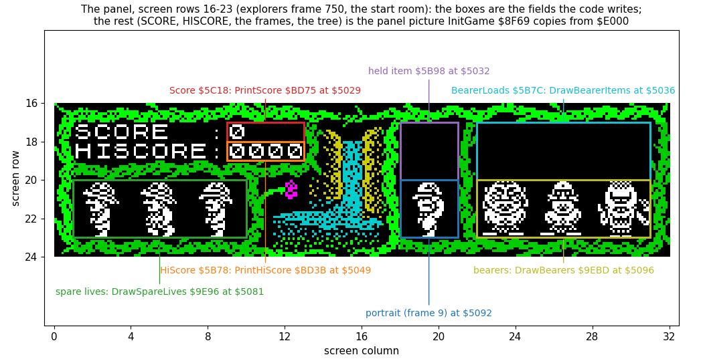

How to read the figure:

- **The picture** is the panel of `explorers` frame 750, the start room, rows 16-23 with the screen's columns.
- **Each box** is a field the code writes, labelled with its variable, its routine and its screen address.
- **Everything outside the boxes** is the picture InitGame copies: the frame, the words SCORE and HISCORE, the colon,
  the tree.
- **The point**: the panel is a picture with holes. Each hole has one writer, and no field is redrawn unless its value
  changes.

```bash
python3 tools/fig_text.py panel --out docs/img/text/panel.png
```

### The column blitter

All the pictures of the panel are sprites of 72 bytes: 3 columns of 24 bytes, a column being 3 character cells high.
SpriteAddress `$9FAA` gives sprite A of a set at DE: DE + 72 x A. AddColumnPointers `$9FBA` writes the addresses of
the sprite's 3 columns into PanelColumns `$5BD6`. BlitColumns `$9F86` then copies B columns, each 24 bytes down the
screen, to consecutive cells from HL. NextCharRow `$9DBF` moves to the next character row when the pixel line wraps.

```text
SpriteAddress(A, DE): return DE + 72 * A

AddColumnPointers(HL = sprite, IY = PanelColumns slot):
    3 times: *IY = HL; IY += 2; HL += 24

BlitColumns(B columns, HL = screen, IY = PanelColumns):
    for each column:
        src = *IY; IY += 2
        24 times: screen[HL'] = *src++; HL' = the next pixel line (NextCharRow at a cell's end)
        HL += 1
```

```text
9F84  06 09        LD B,$09                ; Blit9Columns
9F86  E5           PUSH HL                 ; BlitColumns
9F87  C5           PUSH BC
9F88  FD 5E 00     LD E,(IY+$00)           ; the column's source
9F8B  FD 56 01     LD D,(IY+$01)
9F8E  06 18        LD B,$18                ; 24 pixel lines
9F90  1A           LD A,(DE)               ; BlitColumnsRow
9F91  13           INC DE
9F92  77           LD (HL),A
9F93  24           INC H
9F94  7C           LD A,H
9F95  E6 07        AND $07
9F97  20 05        JR NZ,BlitColumnsNext
9F99  D5           PUSH DE
9F9A  CD BF 9D     CALL NextCharRow
9F9D  D1           POP DE
9F9E  10 F0        DJNZ BlitColumnsRow     ; BlitColumnsNext
9FA0  C1           POP BC
9FA1  E1           POP HL
9FA2  2C           INC L                   ; the next column of cells
9FA3  FD 23        INC IY
9FA5  FD 23        INC IY
9FA7  10 DD        DJNZ BlitColumns
9FA9  C9           RET
9FAA  D5           PUSH DE                 ; SpriteAddress: HL = DE + 72 x A
9FAB  6F           LD L,A
9FAC  26 00        LD H,$00
9FAE  29 29 29     ADD HL,HL x 3           ; 8 A
9FB1  E5           PUSH HL
9FB2  29 29 29     ADD HL,HL x 3           ; 64 A
9FB5  D1           POP DE
9FB6  19           ADD HL,DE               ; 72 A
9FB7  D1           POP DE
9FB8  19           ADD HL,DE
9FB9  C9           RET
```

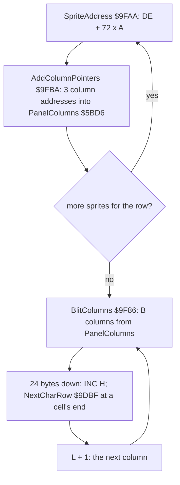

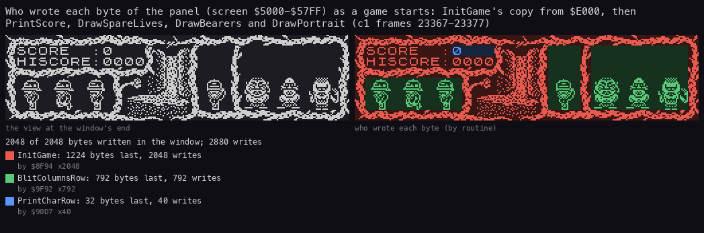

*The writers map of the panel's bitmap, `$5000-$57FF`, in `c1` from 23367:60000 to 23377:20000: the game's start.
Command: `python3 ../../kit/writers_map.py --work work/docs/tmD/c1 --window 23367:60000-23377:20000 --listing
build/game.lst --view buffer:5000:32x64:screen --out docs/img/text/panel-writers.png`.*

How to read the figure:

- **Left**: the panel at the window's end. **Right**: each byte coloured by the routine that wrote it last.
- **Red, InitGame** (`$8F94`, the LDIR): 1224 bytes last, 2048 writes. Every byte of the panel is copied from
  `$E000`.
- **Green, BlitColumnsRow** (`$9F92`): 792 bytes. The spare lives (9 columns), the portrait and held item (6), the
  bearers and their loads (18): 33 columns of 24 bytes.
- **Blue, PrintCharRow** (the write at `$90D7`): 32 bytes last, 40 writes. PrintScore's four spaces and the `0`. The
  space writes over the cell of the `0` are written again by the `0`.
- **HISCORE's 0000** is red: the picture's own digits, never printed (8.9).
- **The point**: at the start of a game, 1224 bytes of the panel come from the picture, 792 from the sprite blitter
  and 32 from the text printer.

Witness: BlitColumns runs 21 217 times in the L1 builds.

The point: the panel uses the sprite sets of the game itself (the explorers, the items, the bearers). A column
blitter of 24-byte columns and a table of column pointers draws all of them, and the scroll of 8.7 is only a
different first pointer.

## 8.6 The portrait, the held item and the spare lives

DrawPortrait `$9E5D` draws two sprites of 3 columns:

- frame 9 of the explorer's set (ExplorerSet `$6000` + 9 x 72 = `$6288`) at `$5092`, rows 20-22: the explorer's face;
- the held item, HeldItem `$5B98`, from ItemSprites `$8400` at `$5032`, rows 17-19. With no item (`$FF`) it draws
  BlankIcon `$5C46`.

DrawSpareLives `$9E96` draws Lives `$5B97` - 1 icons in three places: frames 2, 3 and 4 of the explorer's set, at
`$5081`, 9 columns. A place with no spare life gets BlankIcon. With Lives = 0 it returns at once.

```text
DrawPortrait():
    BlitColumns(3, $5092, the columns of ExplorerSet + 9 * 72)
    item = BlankIcon if HeldItem == $FF else ItemSprites + 72 * HeldItem
    BlitColumns(3, $5032, the columns of item)

DrawSpareLives():
    if Lives == 0: return
    spare = Lives - 1
    for place in 0 .. 2:                     ; frames 2, 3, 4
        sprite = ExplorerSet + 72 * (2 + place) if place < spare else BlankIcon
        add its 3 columns
    Blit9Columns($5081)
```

```text
9E5D  21 88 62     LD HL,ExplorerSet+9*72  ; DrawPortrait: frame 9
9E60  FD 21 D6 5B  LD IY,PanelColumns
9E64  CD BA 9F     CALL AddColumnPointers
9E67  06 03        LD B,$03
9E69  21 92 50     LD HL,Screen+4242       ; $5092
9E6C  FD 21 D6 5B  LD IY,PanelColumns
9E70  CD 86 9F     CALL BlitColumns
9E73  21 46 5C     LD HL,BlankIcon         ; no item held: the blank sprite
9E76  3A 98 5B     LD A,(HeldItem)
9E79  FE FF        CP $FF
9E7B  28 06        JR Z,DrawPortraitItem
9E7D  11 00 84     LD DE,ItemSprites
9E80  CD AA 9F     CALL SpriteAddress
      ...                                  ; DrawPortraitItem: 3 columns at $5032
9E96  3A 97 5B     LD A,(Lives)            ; DrawSpareLives
9E99  B7           OR A
9E9A  C8           RET Z
9E9B  3D           DEC A                   ; the spare lives
9E9C  FD 21 D6 5B  LD IY,PanelColumns
9EA0  4F           LD C,A
9EA1  06 03        LD B,$03
9EA3  3E 02        LD A,$02                ; frame 2 first
9EA5  F5           PUSH AF                 ; DrawSpareLivesIcon
9EA6  11 00 60     LD DE,ExplorerSet
9EA9  CD AA 9F     CALL SpriteAddress
9EAC  0D           DEC C
9EAD  F2 B3 9E     JP P,DrawSpareLivesStore
9EB0  21 46 5C     LD HL,BlankIcon         ; no spare life for this place
9EB3  CD BA 9F     CALL AddColumnPointers  ; DrawSpareLivesStore
9EB6  F1           POP AF
9EB7  3C           INC A
9EB8  10 EB        DJNZ DrawSpareLivesIcon
9EBA  C3 1E 9F     JP SpareLivesShow       ; Blit9Columns at $5081
```

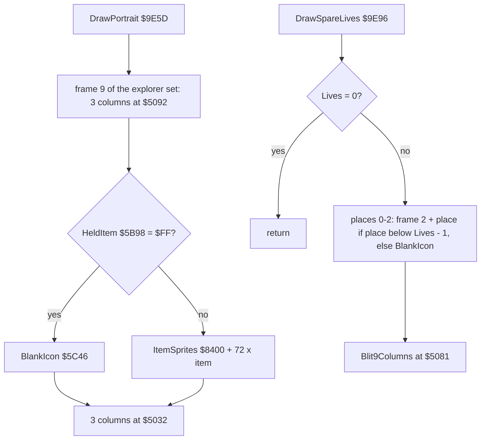

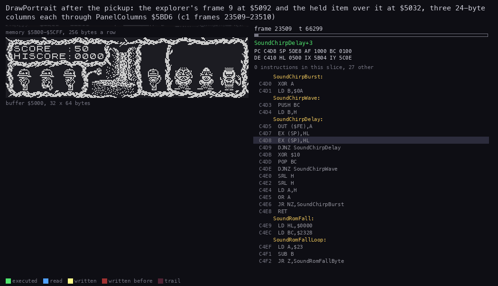

*The routine animation of DrawPortrait and the blitter in `c1` from 23509:66000 to 23510:13000. It has 60 pictures,
299 T each, and 2133 instructions. The view is the panel's bitmap `$5000` as 32 x 64 bytes; the memory grid is
`$5B00-$5CFF`, the game variables and PanelColumns. Command: `python3 ../../kit/routine_anim.py --work
work/docs/tmD/c1 --window 23509:66000-23510:13000 --listing build/game.lst --view buffer:5000:32x64:screen --pc
9E5D-9EBC,9F6B-9FDD --range 5B00-5CFF --pictures 60 --out docs/img/routines/DrawPortrait.gif`
(`work/docs/tmD/anim08.sh`).*

How to read the animation: the yellow bytes go down the portrait's three columns first, 24 lines each, then down the
held item's. The blue reads in the grid are PanelColumns `$5BD6`, the six column pointers. The face is redrawn with the
same bytes; only the item cell changes, from blank to the new item.

Worked example, a game's start: InitGame sets Lives = 4 (`$8FEB`) and calls DrawSpareLives. Lives - 1 = 3, so all three
places get a sprite: frames 2, 3 and 4 at `$5081`, `$5084` and `$5087`. After the first death, LifeLossOp `$A9FD`
(`DEC (HL)`) takes Lives to 3 and `JP DrawSpareLives` at `$AA01` draws with Lives = 3: frames 2 and 3, and BlankIcon
in the third place.

Witness: DrawPortrait runs 81 times in the L1 builds and DrawSpareLives 11 times.

The point: the panel shows lives as pictures, not as a number. The spare-lives row is three explorer frames, so it is
also a little animation strip: the three pictures are sprite frames 2, 3 and 4 of the explorer's set (2 and 3 are
walk frames, [doc 6](06-rendering.md), 6.8: walking is 0-3; 4 is the next frame of the set).

## 8.7 The bearer row

The explorer has bearers who carry the items he picks up (doc 10). BearerLoads `$5B7C` holds 27 entries, one per
bearer: an item number, or `$FF` for none. The panel draws four bearers: their figures (BearerFigures `$9FDE`, four
poses chosen by bearer AND 3) at `$5096`, and their loads (ItemSprites) above them at `$5036`. Four sprites are 12
columns; the panel shows 9: three whole bearers at phase 0 (and at phase 3), parts of four at phases 1 and 2.

BearerIndex `$5C23` is the first bearer shown. BearerPhase `$5C22` (0 at rest, 1-3 while the row scrolls; 4 only
between key 1 and the next pass) is how many columns of the 12 are skipped, so the row slides in steps of one column.
A bearer is 3 columns, so phase 3 of one BearerIndex shows what phase 0 of the next shows: a scroll is one bearer,
three one-column moves, in four phases. Keys 1 and 2 (BearerKeys `$BC1F`) scroll it:

- **key 2** sets BearerScrollDir `$5C21` = 0 and BearerPhase = 0, then falls into BearerScrollStep `$BC4A`. This pass
  and each later one draw the row, then add 1 to the phase; at 4 the phase is 0 again, BearerIndex goes up by 1
  (27 wraps to 0) and the row is drawn again. The first draw (phase 0) leaves the row as it was; phases 1, 2 and 3
  each move it one column; the second draw of the fourth pass gives the same picture as phase 3. 4 passes, 5 draws,
  3 moves.
- **key 1** sets BearerScrollDir = 1, BearerPhase = 4 and takes 1 from BearerIndex (below 0: 26), and returns
  without drawing. Each later pass takes 1 from the phase and draws: phase 3 (the row as it was), then 2, 1, 0, one
  column each. 5 passes, 4 draws, 3 moves.

```text
DrawBearers():
    DrawBearerItems()                      ; 4 loads from BearerLoads[BearerIndex ...] at $5036
    for k in 0 .. 3:
        b = (BearerIndex + k) mod 27
        add the 3 columns of BearerFigures + 72 * (b AND 3)
    ShowScrolled($5096)

ShowScrolled(HL):
    skip BearerPhase column pointers; Blit9Columns(HL)

BearerKeys(a scroll running):              ; once a pass
    if running: step
    elif key 1: dir = 1; phase = 4; BearerIndex -= 1 (wrap 26)
    elif key 2: dir = 0; phase = 0; step
step:
    if dir == 0: DrawBearers(); phase += 1; at 4: phase = 0; BearerIndex += 1 (wrap 0); DrawBearers()
    else:        phase -= 1; DrawBearers()
```

```text
9EBD  CD E3 9E     CALL DrawBearerItems    ; DrawBearers: the loads first
9EC0  06 04        LD B,$04                ; four bearers
9EC2  FD 21 D6 5B  LD IY,PanelColumns
9EC6  3A 23 5C     LD A,(BearerIndex)
9EC9  4F           LD C,A
9ECA  79           LD A,C                  ; DrawBearersFigure
9ECB  E6 03        AND $03                 ; the pose: bearer AND 3
9ECD  11 DE 9F     LD DE,BearerFigures
9ED0  CD AA 9F     CALL SpriteAddress
9ED3  CD BA 9F     CALL AddColumnPointers
9ED6  0C           INC C
9ED7  79           LD A,C
9ED8  FE 1B        CP $1B                  ; 27 bearers: wrap to 0
9EDA  20 02        JR NZ,DrawBearersNext
9EDC  AF           XOR A
9EDD  4F           LD C,A
9EDE  10 EA        DJNZ DrawBearersFigure  ; DrawBearersNext
9EE0  C3 6B 9F     JP BearerRowShow        ; $5096
9F73  FD 21 D6 5B  LD IY,PanelColumns      ; ShowScrolled
9F77  3A 22 5C     LD A,(BearerPhase)
9F7A  B7           OR A
9F7B  28 07        JR Z,Blit9Columns
9F7D  FD 23        INC IY                  ; ShowScrolledSkip: one column per phase
9F7F  FD 23        INC IY
9F81  3D           DEC A
9F82  20 F9        JR NZ,ShowScrolledSkip
BC43  AF           XOR A                   ; BearerKey2: scroll from phase 0 up
BC44  32 21 5C     LD (BearerScrollDir),A
BC47  32 22 5C     LD (BearerPhase),A
BC4A  3A 21 5C     LD A,(BearerScrollDir)  ; BearerScrollStep
BC4D  B7           OR A
BC4E  20 1C        JR NZ,BearerScrollBack
BC50  CD BD 9E     CALL DrawBearers
BC53  21 22 5C     LD HL,BearerPhase
BC56  34           INC (HL)
BC57  7E           LD A,(HL)
BC58  FE 04        CP $04
BC5A  C0           RET NZ
BC5B  36 00        LD (HL),$00             ; phase 4: the next bearer
BC5D  21 23 5C     LD HL,BearerIndex
BC60  34           INC (HL)
      ...                                  ; 27 wraps to 0, DrawBearers
```

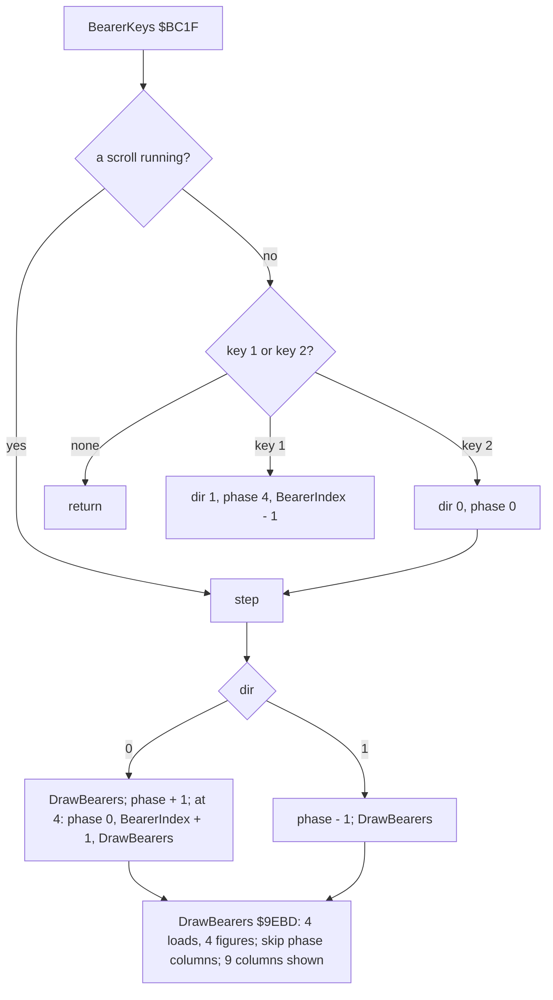

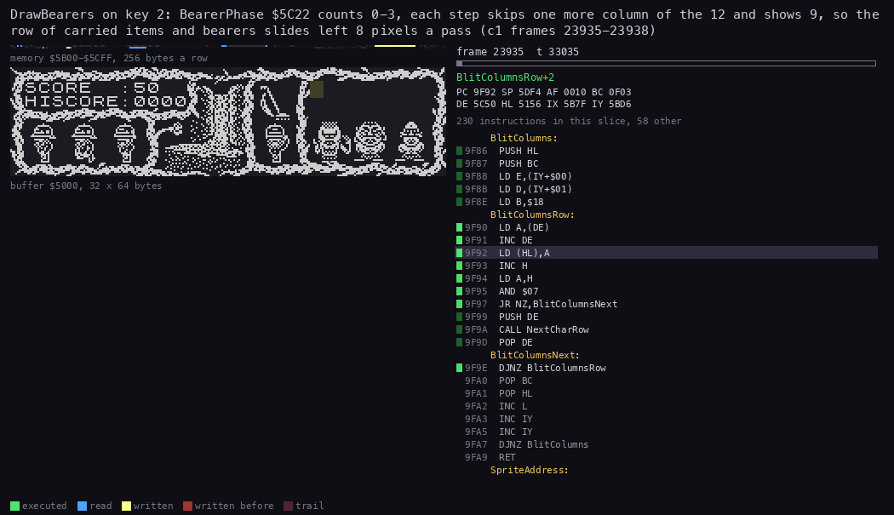

*The routine animation of BearerKeys, DrawBearers and the blitter in `c1` from 23934:0 to 23946:0, the whole scroll
of key 2. It has 80 pictures, 10 637 T each, and 119 347 instructions. The view is the panel's bitmap `$5000`; the
memory grid is `$5B00-$5CFF`; the title is "BearerKeys `$BC1F` and DrawBearers `$9EBD`: key 2 held". Command:
`python3 ../../kit/routine_anim.py --work work/docs/tmD/c1 --window 23934:0-23946:0 --listing build/game.lst --view
buffer:5000:32x64:screen --pc BC1F-BC72,9EBD-9F1D,9F6B-9FDD --range 5B00-5CFF --pictures 80 --title '...' --out
docs/img/routines/DrawBearers.gif`.*

How to read the animation: the player holds key 2 over frames 23 934-23 944; the bearer box is at the right of the
view (the loads above it are blank: the bearers shown carry nothing). The redraws flash yellow, then fade. The first
pass (about picture 9, frame 23 935) redraws the row unchanged at phase 0; the next three (pictures 29, 45 and 64)
each move it one column, 8 pixels, to the left; the pass that wraps the phase draws it twice in a row (pictures
64-76), the second time identical. The last picture shows the row one bearer on: new poses in the same places. The
kit's memory grid is one thin strip for 512 bytes and the view is single, so BearerPhase is not readable in the
GIF; the samples of `$5C21-$5C23` at the frame starts are `01 00 1A` up to 23 935, `00 01 1A` at 23 936, `00 02 1A`
at 23 939, `00 03 1A` at 23 942 and `00 00 00` at 23 945 (BearerIndex `$1A` wraps to 0).

Worked example: BearerIndex = 0, BearerPhase = 2. DrawBearers adds the columns of bearers 0, 1, 2, 3 (poses 0-3): 12
pointers. ShowScrolled skips 2 of them, so the screen shows columns 2-10: the last column of bearer 0, all of bearers
1 and 2, and the first two columns of bearer 3.

Witness: c1 presses keys 1 and 2 (`tests/inputs/c1.txt`). Key 1 runs 128 times in 21 builds (`$BC2F`) and key 2 113
times (`$BC43`). DrawBearers runs 1139 times.

The point: the scroll is not a pixel scroll. It redraws 18 columns from a column pointer table, three columns in
four passes (key 2) or five (key 1). That costs 432 bytes of copying a pass (18 columns of 24), but the panel needs no buffer of its own.

## 8.8 The score

Score `$5C18` is 4 bytes, low byte first, a signed 32-bit number. AddScore `$BCF2` adds DE (signed) to it and prints
it:

1. it saves every register (main and alternate, IX, IY);
2. AddToScore `$BD11` sets IX = Score; AddToNumber `$BD15` adds DE, sign-extended to 32 bits (BC = `$FFFF` if DE is
   negative), with ADD and ADC;
3. PrintScore `$BD75` sets HL = `$5029` and falls into PrintNumber `$BD78`.

PrintNumber prints four spaces, then copies the number (PrintNumberSource `$BD88`: an `LD HL,nn` whose operand is
Score, self-modified for the high score) to NumberWork `$5C1C`. If it is negative, NegateNumber `$BCDE` turns it
positive (CPL, then +1), and no sign is printed. Then for each place value of PlaceValues `$BE18` (1000, 100, 10, 1)
DivideNumber `$BDDF` subtracts until it would go below 0, counting in C. DigitShown `$5C20` suppresses leading zeros;
the last digit is always printed. The character is `$30` + C.

```text
AddScore(DE):
    Score += sign_extend(DE)               ; 32 bits
    PrintNumber(Score, $5029)

PrintNumber(n, HL):
    print 4 spaces at HL                   ; HL then points back at the first cell
    if n < 0: n = -n                       ; no sign
    shown = 0
    for p in 1000, 100, 10, 1:
        c = 0; while n >= p: n -= p; c = (c + 1) AND $FF
        if shown or c != 0 or p == 1:
            print chr($30 + c); shown = 1
```

```text
BD11  DD 21 18 5C  LD IX,Score             ; AddToScore
BD15  01 FF FF     LD BC,$FFFF             ; AddToNumber: IX = the number, DE = the amount
BD18  CB 7A        BIT 7,D
BD1A  20 03        JR NZ,AddToNumberLow
BD1C  01 00 00     LD BC,$0000
BD1F  DD 6E 00     LD L,(IX+$00)           ; AddToNumberLow: the low word + DE
BD22  DD 66 01     LD H,(IX+$01)
BD25  19           ADD HL,DE
      ...                                  ; stored; the high word + BC + carry
BD75  21 29 50     LD HL,Screen+4137       ; PrintScore: $5029
BD78  E5           PUSH HL                 ; PrintNumber
BD79  06 04        LD B,$04
BD7B  3E 20        LD A,$20                ; four spaces
BD7D  CD C6 90     CALL PrintChar
BD80  10 F9        DJNZ PrintNumberBlank
BD82  E1           POP HL
BD83  D9           EXX
BD84  AF           XOR A
BD85  32 20 5C     LD (DigitShown),A
BD88  21 18 5C     LD HL,Score             ; PrintNumberSource: the number (self-modified)
BD8B  11 1C 5C     LD DE,NumberWork
BD8E  01 04 00     LD BC,$0004
BD91  ED B0        LDIR
      ...
BD99  CB 7E        BIT 7,(HL)              ; negative: made positive, no sign
BD9B  28 05        JR Z,PrintNumberDigits
BD9D  CD DE BC     CALL NegateNumber
BDA2  FD 21 18 BE  LD IY,PlaceValues       ; PrintNumberDigits: 1000, 100, 10, 1
BDA6  06 04        LD B,$04
BDA8  C5           PUSH BC                 ; PrintNumberLoop
BDA9  0E 00        LD C,$00                ; the quotient: 8 bits
      ...                                  ; DE, B = the place value
BDBA  CD DF BD     CALL DivideNumber
BDBD  3A 20 5C     LD A,(DigitShown)
BDC0  B7           OR A
BDC1  79           LD A,C
BDC2  20 06        JR NZ,PrintNumberDigit
BDC4  B7           OR A
BDC5  28 0E        JR Z,PrintNumberZero    ; a leading zero
BDC7  32 20 5C     LD (DigitShown),A
BDCA  C6 30        ADD A,$30               ; PrintNumberDigit: '0' + the quotient
BDCC  D9           EXX
BDCD  CD C6 90     CALL PrintChar
      ...
BDDF  DD 6E 00     LD L,(IX+$00)           ; DivideNumber: subtract the place value
      ...
BE05  0C           INC C                   ; one more, until below 0
BE06  18 D7        JR DivideNumber
BE18  E8 03 00 64 00 00 0A 00 00 01 00 00  ; PlaceValues: 1000, 100, 10, 1 (24 bits each)
```

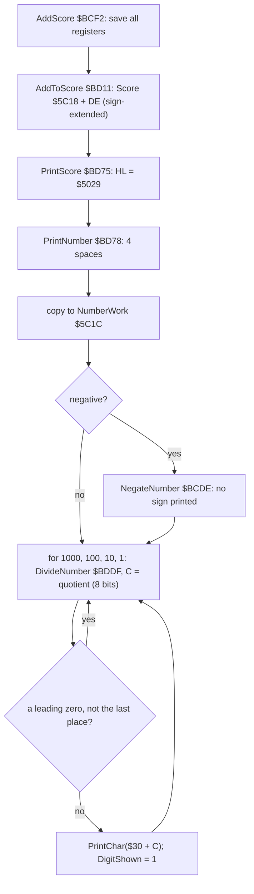

Who adds to the score:

| Routine | Call site | Amount | What |
| --- | --- | ---: | --- |
| InitGame `$8F69` | `$8FCC` | 0 | a game's start: prints "0" |
| PickUpItem `$BB6C` | `$BBE9` | +50 | an item picked up |
| ItemsPass `$B9FA` | `$BA2A` | +75 | the crystal |
| Room43Anim `$A851` | `$A865` | +75 | the scene of room `$43` |
| CrossFlee `$B52B` | `$B538` | +150 | a creature flees from the Silver Cross |
| ProfessorScript `$B5DD` | `$B5FE` | +150 | a gift the professor wanted |

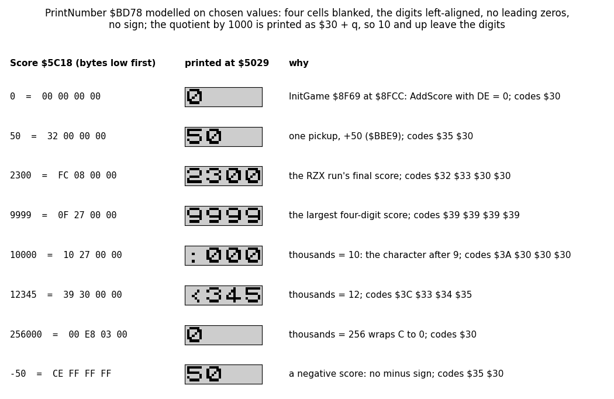

How to read the figure:

- **Each row** is a Score value, its 4 bytes low first, the four cells PrintNumber leaves at `$5029`, and why.
- **0, 50, 2300 and 9999** are normal: left-aligned digits, no leading zeros.
- **10000** prints `:000`. The quotient by 1000 is 10, and `$30` + 10 is `$3A`, the colon.
- **12345** prints `<345`: quotient 12, `$3C`.
- **256000** prints `0`. The quotient is 256, but C has 8 bits, so it wraps to 0, and the leading zero is suppressed.
- **-50** prints `50`: the sign is dropped.
- **The point**: the printer is built for 0-9999. Past that it prints punctuation, and a negative score would look
  positive.

```bash
python3 tools/fig_text.py score --out docs/img/text/score-cases.png
```

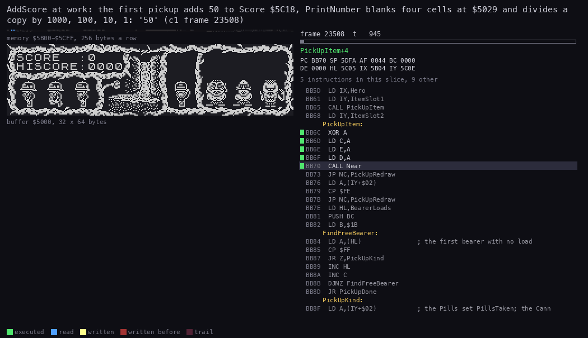

*The routine animation of PickUpItem, AddScore and PrintNumber in `c1` from 23508:800 to 23508:12400. It has 80
pictures, 145 T each, and 1086 instructions. The view is the panel's bitmap `$5000`; the memory grid is `$5B00-$5CFF`
with Score `$5C18`, NumberWork `$5C1C` and DigitShown `$5C20`. Command: `python3 ../../kit/routine_anim.py --work
work/docs/tmD/c1 --window 23508:800-23508:12400 --listing build/game.lst --view buffer:5000:32x64:screen --pc
BB6C-BC1E,BCDE-BE23,90C6-90E0 --range 5B00-5CFF --pictures 80 --out docs/img/routines/AddScore.gif`.*

How to read the animation: the first yellow bytes in the grid are Score (0 + 50). Then the panel's four score cells
go blank, NumberWork gets its copy, and DivideNumber subtracts 1000 (none), 100 (none), 10 five times, 1 none. The
`5` and the `0` are drawn at `$5029` and `$502A`.

Worked example, 2300 (the RZX run's final score, `FC 08 00 00`):

- four spaces at `$5029-$502C`;
- 2300 / 1000: C = 2, rest 300. DigitShown = 2. `2` at `$5029`;
- 300 / 100: C = 3, rest 0. `3` at `$502A`;
- 0 / 10: C = 0, but DigitShown is set: `0` at `$502B`;
- 0 / 1: `0` at `$502C`. The panel reads `2300`.

The sign bug, known only from the code: no award is negative, so NegateNumber never runs (L1 0). The highest score of
any recording is 2300, so the `:` never shows either. A player would need 200 pickups to reach 10 000.

Witness: AddScore and PrintScore run 46 times each in the L1 builds, PrintNumber 50 times (4 more by PrintHiScore).

The point: the score routine is careful (32 bits, a sign, all registers saved), but its printer is not. Four cells,
an 8-bit quotient and no sign: it works because the game never gets near its limits.

## 8.9 The high score

HiScore `$5B78` is 4 bytes, like Score. EndGame `$906D` calls NewHiScore `$BD50` when a game ends:

- a negative Score returns at once;
- the two numbers are compared from the top byte down; the first byte where Score is higher takes the score, and the
  first where it is lower returns;
- a higher Score is copied to HiScore (`LDIR`, 4 bytes), and the routine jumps to PrintHiScore `$BD3B`.

PrintHiScore patches PrintNumberSource to HiScore, calls PrintNumber at `$5049` (row 18, column 9) and puts Score
back.

EndGame then saves the panel's bitmap and attributes to `$E000` and `$E800`, so the next game's InitGame copies the
new high score back with the picture. Until a first high score is printed, the panel shows the picture's own `0000`:
four digits, where a printed 0 would be one.

```text
NewHiScore():
    if Score < 0: return
    for byte in 3 .. 0:                       ; the top byte first
        if HiScore[byte] < Score[byte]: HiScore = Score; PrintHiScore(); return
        if HiScore[byte] > Score[byte]: return
    return                                    ; equal

PrintHiScore():
    saved = PrintNumberSource; PrintNumberSource = HiScore
    PrintNumber(HiScore, $5049)
    PrintNumberSource = saved
```

```text
BD50  21 1B 5C     LD HL,Score+3           ; NewHiScore: the top byte
BD53  CB 7E        BIT 7,(HL)              ; a negative score: no high score
BD55  C0           RET NZ
BD56  11 7B 5B     LD DE,HiScore+3
BD59  06 04        LD B,$04
BD5B  1A           LD A,(DE)               ; NewHiScoreLoop
BD5C  BE           CP (HL)
BD5D  38 08        JR C,NewHiScoreTake     ; HiScore byte below Score's
BD5F  28 01        JR Z,NewHiScoreNext
BD61  C9           RET
BD62  2B           DEC HL                  ; NewHiScoreNext
BD63  1B           DEC DE
BD64  10 F5        DJNZ NewHiScoreLoop
BD66  C9           RET
BD67  21 18 5C     LD HL,Score             ; NewHiScoreTake
BD6A  11 78 5B     LD DE,HiScore
BD6D  01 04 00     LD BC,$0004
BD70  ED B0        LDIR
BD72  C3 3B BD     JP PrintHiScore
BD3B  2A 89 BD     LD HL,(PrintNumberSource+1) ; PrintHiScore
BD3E  E5           PUSH HL
BD3F  21 78 5B     LD HL,HiScore
BD42  22 89 BD     LD (PrintNumberSource+1),HL
BD45  21 49 50     LD HL,Screen+4169       ; $5049
BD48  CD 78 BD     CALL PrintNumber
BD4B  E1           POP HL
BD4C  22 89 BD     LD (PrintNumberSource+1),HL
BD4F  C9           RET
```

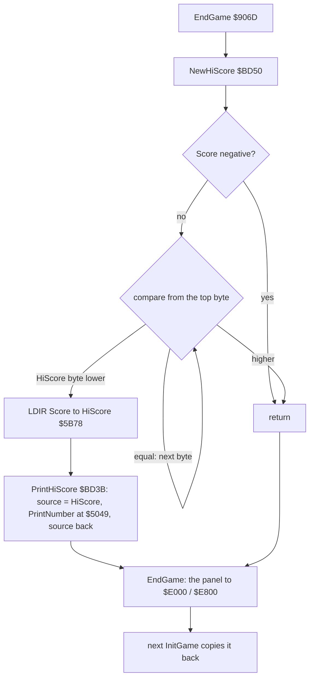

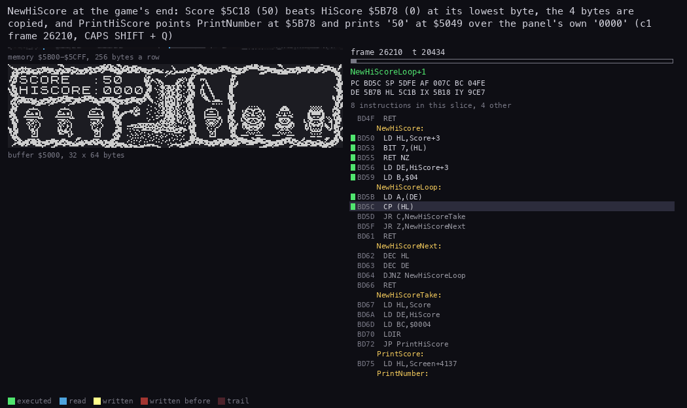

*The routine animation of EndGame, NewHiScore, PrintHiScore and PrintNumber in `c1` from 26210:20300 to
26210:28300. It has 60 pictures and 713 instructions. The view is the panel's bitmap `$5000`; the memory grid is
`$5B00-$5CFF`. Command: `python3 ../../kit/routine_anim.py --work work/docs/tmD/c1 --window 26210:20300-26210:28300
--listing build/game.lst --view buffer:5000:32x64:screen --pc 906D-908F,BD3B-BE23,90C6-90E0 --range 5B00-5CFF
--pictures 60 --out docs/img/routines/NewHiScore.gif`.*

How to read the animation: the player quits with CAPS SHIFT + Q at Score 50. NewHiScore reads the top bytes (both 0)
and finds Score higher at the lowest byte. The four yellow bytes at `$5B78` are the copy. Then the picture's `0000`
after HISCORE goes blank and `50` is drawn at `$5049`. The last pictures are EndGame's LDIR saving the panel.

Worked example: Score = 50 (`32 00 00 00`), HiScore = 0. Bytes 3, 2 and 1 are equal (0); at byte 0, `$00` < `$32`, so
the score is taken. HiScore = `32 00 00 00`, and PrintNumber prints `50` at `$5049`. The panel saved to `$E000` now
holds `HISCORE:50`.

Witness: c1, explorers, gameover and rzx50000 each set a high score once (`$BD67`). PrintHiScore runs 4 times in the
L1 builds, NewHiScore 8 times. In c1 it is frame 26 210, Score 50.

The point: the high score lives in two places: HiScore for the comparison, and the saved panel picture for the
display. That is why the first game shows a `0000` that no code printed.

## 8.10 The telescope view and PrintByte

The countdown (CountdownDays `$5BFB`, CountdownHours `$5BFC`, CountdownMinutes `$5BFD`; doc 4) is not on the panel.
It is shown only in the telescope view: status 31, TelescopeView `$A7B9`, reached by looking into the telescope in
room `$12` (doc 10).

- On its first pass TelescopeView sets up room `$28` (the sky), puts the asteroid object at Y = 2 x (40 - days), and
  prints CollisionText at `$48A2` (row 13, column 2) with attribute `$0F`.
- On every pass it prints the three numbers with PrintByte `$90E1` at `$48C7` (days), `$48D0` (hours) and `$48DB`
  (minutes): into the gaps of `"DAYS:   HOURS:   MINUTES:   "`.
- After 128 passes it sets up room `$12` again.

PrintByte prints A (0-255) in decimal, left-aligned in three cells: its digits first, then a space for each leading
zero. So 30 is `30 ` and 5 is `5  `.

SkoolKit read the three prints as minutes, hours, days. The addresses say otherwise: `$5BFB` is printed at `$48C7`,
after `DAYS:`.

```text
TelescopeView():                             ; status 31, once a pass
    if first pass:
        SetUpRoom($28); asteroid.Y = 2 * (40 - CountdownDays)
        PrintString(CollisionText, $48A2, $0F)
    else: asteroid.Y = 2 * (40 - CountdownDays); after 128 passes: SetUpRoom($12), status cleared
    PrintByte(CountdownDays, $48C7); PrintByte(CountdownHours, $48D0); PrintByte(CountdownMinutes, $48DB)

PrintByte(A, DE):
    digits = the three ASCII digits of A
    lead = the leading zeros (0, 1 or 2)
    print the digits after the leading zeros at DE
    print lead spaces after them
```

```text
A7E2  11 7C B0     LD DE,CollisionText     ; TelescopeView's first pass
A7E5  21 A2 48     LD HL,Screen+2210       ; $48A2
A7E8  3E 0F        LD A,$0F
A7EA  08           EX AF,AF'
A7EB  CD F9 94     CALL PrintString
A7EE  3A FB 5B     LD A,(CountdownDays)    ; TelescopeNumbers: days, hours, minutes
A7F1  11 C7 48     LD DE,Screen+2247       ; $48C7
A7F4  CD E1 90     CALL PrintByte
A7F7  3A FC 5B     LD A,(CountdownHours)
A7FA  11 D0 48     LD DE,Screen+2256       ; $48D0
A7FD  CD E1 90     CALL PrintByte
A800  3A FD 5B     LD A,(CountdownMinutes)
A803  11 DB 48     LD DE,Screen+2267       ; $48DB
A806  C3 E1 90     JP PrintByte
90E1  F5           PUSH AF                 ; PrintByte
90E2  21 A6 5B     LD HL,DigitBuffer       ; three ASCII digits at $5BA6
      ...                                  ; hundreds, tens, units by subtraction
9107  21 A6 5B     LD HL,DigitBuffer       ; PrintByteDigits: B = 1 + the leading zeros
910A  3E 30        LD A,$30
910C  06 01        LD B,$01
910E  BE           CP (HL)
910F  20 09        JR NZ,PrintByte3Digits
9111  04           INC B
9112  23           INC HL
9113  BE           CP (HL)
9114  20 09        JR NZ,PrintByte2Digits
9116  04           INC B
9117  23           INC HL
9118  18 0A        JR PrintByte1Digit
      ...                                  ; PrintDigitAt $9136 for each digit, E + 1
9128  EB           EX DE,HL
9129  10 02        DJNZ PrintBytePad
912B  18 07        JR PrintByteDone
912D  3E 20        LD A,$20                ; PrintBytePad: a space for each leading zero
912F  CD C6 90     CALL PrintChar
9132  10 F9        DJNZ PrintBytePad
```

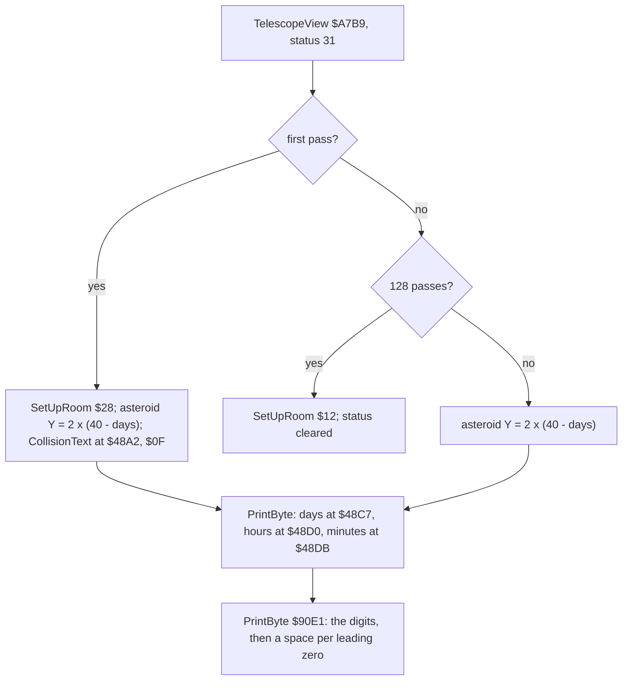

The right panel of the menu figure in 8.2 is this view, modelled: CollisionText and 30 days, 23 hours, 11 minutes,
printed by the PrintString and PrintByte models with the game's addresses and attribute.

Worked example: at a game's start the countdown is 30 days, 23 hours, 59 minutes (InitGame `$8F69`, at `$9007`). A look at that
moment would print:

- days 30 at `$48C7`: digit buffer `030`, one leading zero: `3`, `0`, then one space;
- hours 23 at `$48D0`: `23 `;
- minutes 59 at `$48DB`: `59 `;
- the asteroid at Y = 2 x (40 - 30) = 20. On the last day (days 0), Y = 2 x 40 = 80: the asteroid
  stands 60 lines lower on the screen.

Witness: none. TelescopeView and PrintByte run in none of the 34 recordings (L1 0): neither c1, the explorers nor
the RZX player looked into the telescope. The view is known only from the code and the model.

The point: the game's only clock is hidden behind a puzzle. A player who never looks into the telescope plays the
whole game without seeing how much time is left.

## 8.11 Known only from the code

- **The telescope view** and PrintByte (8.10): no recording runs them. The screen in 8.2's figure is a model.
- **The sign bug** (8.8): NegateNumber never runs; no award is negative.
- **The `:` and `<` scores** (8.8): no recording passes 2300.
- **Help on a 48K**: Help48KText, and SPACE on it going on to the 128K pages (8.3).
- **StopTapeText, StartTapeText, BreakMessage** (8.4): the 48K and the failed load.
- **The coordinate read-out** in the selector: ShowCoords `$C4D6` is a `RET` in front of PrintNumber3 `$C4D7`, a
  three-digit print MoveCursor `$C1D5` calls three times a pass. It would print the explorer under the cursor and the
  cursor's x and y at the top left: the author's debug read-out, switched off by that one byte.
- **UnusedRet** `$9525`: a lone `RET` after PrintString, reached by nothing.

The point: the text system has two dead ends, the debug read-out and the negative score, and one live feature, the
telescope, that no recording happened to use.

## 8.12 The point

Terramex prints very little, and all of it with the ROM's font. PrintString with an attribute in A' does the menu and
the telescope; PrintPage, a page printer in the selector, does Help. The panel is a picture with holes: a column
blitter fills the lives, the portrait and the bearer row from the game's own sprite sets, and a four-cell printer
writes the score. That printer is the one weak spot: it prints a `:` at 10 000 and drops the sign. The high score
lives in the saved panel picture, and the clock is shown only to a player who looks into the telescope.
