# 9. Sound

What this covers:

- the two sound systems: Ben Daglish's AY player in RAM 6, called by the IM 2 handler, and seven beeper sounds in the
  game code (9.1);
- the interrupt that runs the player, and what one call costs (9.2);
- the player's frame: MusicFrame, UpdateTune and the channel records (9.3);
- the order lists (9.4) and the patterns (9.5), byte by byte;
- the instruments and the software envelope (9.6);
- WriteAY and the ten registers it sets (9.7);
- tune 0, the only tune played, its 9698-frame loop, and tunes 1-3, never started (9.8);
- the model of the player checked against a recording (9.9);
- the beeper: PlaySound, SoundEffects and who calls each sound (9.10);
- the seven sounds decoded, rendered and measured on the machine (9.11-9.13);
- the audio files (9.14), what is known only from the code (9.15) and the point (9.16).

The names are those of `src/music/music.ann` and `src/game/game.ann`. The music player has no SkoolKit counterpart:
nzeemin's disassembly (`terramex-zx`) does not cover RAM 6. Where the game's sound code follows its reading, the
section says so.

The recordings are those of [WALKTHROUGH 6.0](../WALKTHROUGH.md). Each was opened from its stage-1 TTD session on the
writer's own instance (port base 37570, muted). No audio was played.

- `c1` (`work/stage1/c1/session.ttd`, frames 0-26 628): power-on, the tape load, the device menu, the selector and
  play. The first MusicFrame call is at frame 21 599, and it starts tune 0. So c1 frame F is tune frame F - 21 599.
  The first pickup, with its chirp, is at frame 23 508.
- `explorers` (`work/stage1/explorers/session.ttd`, frames 0-15 190): all five explorers and Help, from the menu. It
  holds a whole loop of tune 0: EndTune at frame 9581, StartTune at frame 9582.
- `gameover` (`work/stage1/gameover/session.ttd`, frames 0-6000): the RZX state of frame 10 000 with Lives `$5B97` set
  to 1, a POKE. It plays the jump beep (frame 16), the fall death (frame 1368) and the space scene's strike (frame
  1579).
- the RZX segments `rzxNNNNN`: another player's run (Bobby Lequay's RZX), replayed. They are used here only for the
  stage-2 witness frames of the rarer sounds.

A frame is 70 908 T on the 128K: 50 frames a second. A moment is written "frame F T t", with t counted from the start
of the emulator's frame. The interrupt comes at about T 1846 of it. The CPU clock is 3 546 900 Hz and the AY clock is
1 773 400 Hz.

Most numbers of the music come from a model. `tools/sound_sim.py` runs the player's own bytes (`build/music.bin` at
`$C000`) in SkoolKit's Z80 simulator, one MusicFrame call a frame, and records every `OUT` to the AY. Section 9.9
checks the model against c1, write for write. The beeper numbers come from the same simulator running PlaySound
`$C4B2` from `build/game.bin`, and from four sounds traced on the machine (9.11-9.13).

## 9.1 Two sound systems

Terramex makes sound in two unrelated ways.

- **The AY music.** On a 128K, the IM 2 handler `$9491` pages RAM 6 in and calls MusicFrame `$C000` once an
  interrupt. The player there is Ben Daglish's: the menu credits say "+2 MUSIC BEN DAGLISH" (doc 8). It plays tune 0
  in a loop from GameEntry on: through the selector, the play, the game over and the ending. It plays no effects.
- **The beeper.** Seven short sounds, PlaySound `$C4B2` with A = 0-6, toggle bit 4 of port `$FE` in busy loops. They
  run in the game code with the interrupts on, so the music goes on under them.
- **A 48K** has no music. Has128K `$5FFE` is 0 there, and the handler only re-enables the interrupts. The beeper
  sounds are the same.

The two never meet. AYWrite `$CD56` is the only routine that uses ports `$FFFD` and `$BFFD`. Its writes are the only
AY writes in the 34 recordings after the 128K ROM's power-on set-up. The beeper routines never touch the AY.

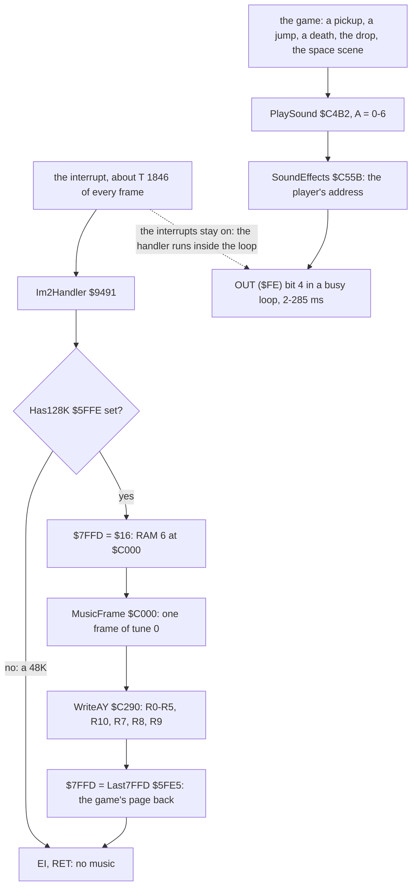

The point: the AY and the beeper share no state. The AY is the background and the beeper is the event. The only link
is time: an interrupt in the middle of a beep stretches it (9.11).

## 9.2 The interrupt and the cost

GameEntry `$8F00` fills the IM 2 table `$8E00-$8F00` (257 bytes) with `$5F`, puts `JP $9491` at `$5F5F` and sets IM 2
with I = `$8E`: whatever byte the bus gives, the vector is `$5F5F`. Every interrupt then reaches Im2Handler.

```text
Im2Handler(on every interrupt):
    if Has128K == 0: EI, return               ; a 48K: no music
    OUT ($7FFD), $16                          ; RAM 6 at $C000, ROM 1 (the 48 BASIC ROM)
    MusicFrame()                              ; keeps AF', DE, HL, IX and IY
    OUT ($7FFD), Last7FFD                     ; the game's page
    EI, return
```

```text
9491  F5           PUSH AF                 ; Im2Handler
9492  3A FE 5F     LD A,(Has128K)
9495  B7           OR A
9496  28 14        JR Z,Im2Done            ; a 48K: no music
9498  C5           PUSH BC
9499  01 FD 7F     LD BC,$7FFD             ; RAM 6, ROM 1
949C  3E 16        LD A,$16
949E  ED 79        OUT (C),A
94A0  CD 00 C0     CALL MusicFrame         ; the music player
94A3  3A E5 5F     LD A,(Last7FFD)         ; the page the game had
94A6  01 FD 7F     LD BC,$7FFD
94A9  ED 79        OUT (C),A
94AB  C1           POP BC
94AC  F1           POP AF                  ; Im2Done
94AD  FB           EI
94AE  C9           RET
```

The handler ends with EI and RET, not RETI. Nothing in a Spectrum needs the RETI.

When in the frame: in c1 the handler's first instruction runs at about T 1880 of each frame and MusicFrame's at about
T 1970. MusicFrame takes 1801-9842 T, so the handler returns between about T 3800 and T 11 800. The game's own work
fills the rest of the frame.

Cost: in the model, MusicFrame takes 3629 T a call on average over the whole loop of tune 0. That is 5.1 % of a
frame. The cheapest call is 1801 T and the dearest 9842 T. There are two kinds of frame:

| Frames | Calls | Mean T | What |
| --- | ---: | ---: | --- |
| with an AY write | 8591 | 3714 | the channels run their effects; WriteAY sends 10 registers |
| a note ends, no write | 1107 | 2965 | NoteEndFlag up: no channel runs its effects, no write |
| the whole loop | 9698 | 3629 | 9696 frames of notes, the EndTune frame and the StartTune frame |

The L1 profile of explorers agrees: 54 533 870 T in 15 190 calls, 3590 T a call. The dearest calls are frames where a
note ends and a channel reads its order list and a new pattern. Tune frame 1, where all three channels read their
first patterns, costs 9640 T.

```text
costs():
    StartTune; for k in 0 .. 9697: T[k] = the T-states of MusicFrame k; wrote[k] = any OUT to $BFFD
    print min, mean, max of T, and the means over wrote / not wrote
```

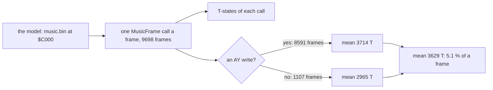

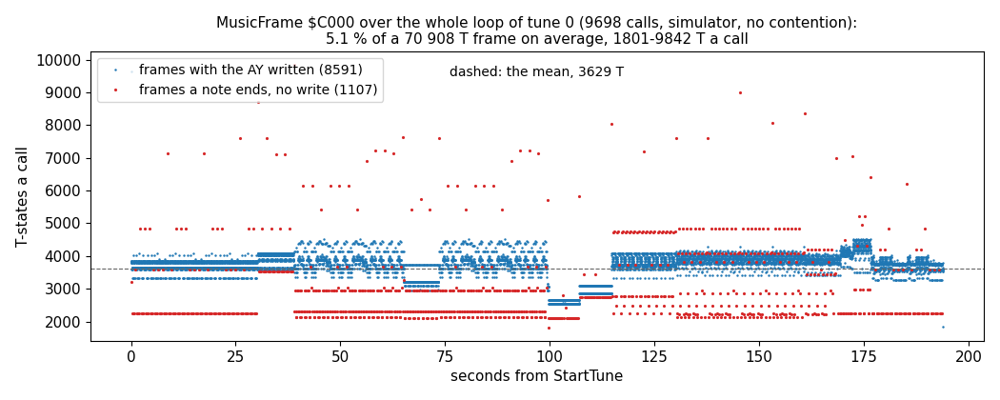

How to read the figure:

- **Each dot** is one MusicFrame call of the model, at its time in the loop (x) and its cost in T-states (y).
- **Blue dots** are frames with an AY write; **red dots** are frames where a note ended and nothing was written.
- **The dashed line** is the mean, 3629 T.
- **The bands** follow the arrangement: each section of the tune has its own few costs, by the effects its
  instruments run. The cheap stretch at 100-108 s (about 2600 T) is where channels B and C rest and only channel A
  plays (9.8).
- **The red spikes** of 5000-9000 T are frames where a channel ends a pattern and reads its order list.
- **The point**: the music costs about a twentieth of the CPU, steady, with spikes to 14 %. The game's pass is not
  paced by the frame (doc 4), so the music only slows it a little.

```bash
python3 tools/sound_sim.py fig-cost docs/img/sound/cost.png
```

Witness: Im2Handler runs 83 616 times in the L1 builds of all 34 recordings, once a frame after GameEntry.
UpdateTune runs 83 609 times: the 7 calls short are the StartTune frames.

The point: the music is a fixed tax of about 3600 T at the top of every frame. The handler re-enables the interrupts
only at its end, but even the dearest call ends at about T 11 800, far from the next interrupt.

## 9.3 The player's frame: MusicFrame and UpdateTune

MusicFrame saves the registers and calls MusicTick `$C014`. MusicTick starts tune 0 when PlayerState `$C027` is 0.
Otherwise it runs UpdateTune `$C1E4`, the frame.

Each channel has a 45-byte record: ChannelA `$C153`, ChannelB `$C180`, ChannelC `$C1AD`. The bytes the frame uses
most:

| Offset | What |
| --- | --- |
| +`$00` | the order-list position |
| +`$01` | the transpose, signed semitones |
| +`$02` | the pattern position |
| +`$03` | the note timer: frames left of the note or rest |
| +`$04` | the repeats left of the pattern |
| +`$06` | the gate-off time (2 in every instrument) |
| +`$09` | the detune, added to the period |
| +`$10` | the arpeggio record (0: none) |
| +`$11` | the slide count |
| +`$16` | the rest counter |
| +`$1C` | the period-table index of the note |
| +`$1D`, +`$1E` | the period, low and high: what WriteAY sends |
| +`$1F` | the volume: what WriteAY sends |
| +`$20`-+`$28` | the envelope: sustain level, decay, attack and release steps and rates |
| +`$2A` | bit 0: the gate |
| +`$2B` | the instrument's peak volume |

```text
MusicTick():
    if PlayerState == 0: StartTune(0); return          ; the only tune ever started
    UpdateTune()

UpdateTune():
    for ch in A, B, C:
        if ch.timer == 1: ch.timer = 0; NoteEndFlag += 1   ; the note ends this frame
    for n, ch in (0, A), (1, B), (2, C):
        ChannelIndex = n; SlotRowOp = 8 * n
        the four order-list operands = TuneTable word n of the tune   ; self-modified code
        UpdateChannel(ch, PatternPointers[n])
    if NoteEndFlag == 0: WriteAY()                     ; else the AY keeps last frame's values
    NoteEndFlag = 0

UpdateChannel(ch, pattern):
    if ch.timer != 0: CheckGateOff(); ChannelEffects(); return   ; a note or rest is running
    if ch.slide_count != $FF: ch.slide_count = 0
    ReadPatternEvent()                                 ; events until a note or a rest takes time
```

```text
C000  08           EX AF,AF'               ; MusicFrame
C001  F5 D5 E5     PUSH AF / PUSH DE / PUSH HL
C004  DD E5 FD E5  PUSH IX / PUSH IY
C008  CD 14 C0     CALL MusicTick
      ...                                  ; the pops, EX AF,AF', RET
C014  3A 27 C0     LD A,(PlayerState)      ; MusicTick
C017  B7           OR A
C018  CA 9F C7     JP Z,StartTune          ; A = 0 here: the only tune StartTune is ever given
C01B  FD E5        PUSH IY
C01D  FD 21 00 00  LD IY,$0000
C021  CD E4 C1     CALL UpdateTune
C024  FD E1        POP IY
C026  C9           RET
C1E9  21 4D C1     LD HL,NoteEndFlag       ; UpdateTune, after its PlayerState guard
C1EC  3A 56 C1     LD A,(ChannelATimer)    ; channel A's timer 1: 0, and the flag up
C1EF  3D           DEC A
C1F0  20 04        JR NZ,UpdateTuneB
C1F2  32 56 C1     LD (ChannelATimer),A
C1F5  34           INC (HL)
      ...                                  ; the same for channels B and C
C20A  AF           XOR A                   ; UpdateTuneChannels: channel A, index 0, slot row 0
C20B  32 E3 C1     LD (ChannelIndex),A
C20E  DD 21 53 C1  LD IX,ChannelA
C212  32 DB C3     LD (SlotRowOp+1),A
C215  2A 4B C1     LD HL,(TunePointer)     ; the tune's word 0: channel A's order list
C218  7E 23 66 6F  LD A,(HL) / INC HL / LD H,(HL) / LD L,A
C21C  22 16 C3     LD (OrderListOp1+1),HL  ; into the four self-modified operands
C21F  22 D7 C7     LD (OrderListOp2+1),HL
C222  22 EA C7     LD (OrderListOp3+1),HL
C225  22 08 C8     LD (OrderListOp4+1),HL
C228  ED 5B DA C1  LD DE,(PatternPointers) ; DE = channel A's pattern
C22C  CD E4 C2     CALL UpdateChannel
      ...                                  ; channel B (slot row 8) and channel C (slot row 16)
C285  21 BF FF     LD HL,$FFBF             ; the AY port high bytes in H and L
C288  0E FD        LD C,$FD
C28A  3A 4D C1     LD A,(NoteEndFlag)      ; a note ended this frame: no AY write
C28D  B7           OR A
C28E  20 4F        JR NZ,EndFrame          ; else fall into WriteAY $C290
C2E4  DD 7E 03     LD A,(IX+$03)           ; UpdateChannel
C2E7  B7           OR A
C2E8  C2 55 C5     JP NZ,CheckGateOff      ; a note or a rest is running
C2EB  DD 7E 11     LD A,(IX+$11)           ; the slide count: $FF keeps it, any other value ends
C2EE  FE FF        CP $FF
C2F0  28 04        JR Z,ReadPatternEvent
C2F2  DD 36 11 00  LD (IX+$11),$00
```

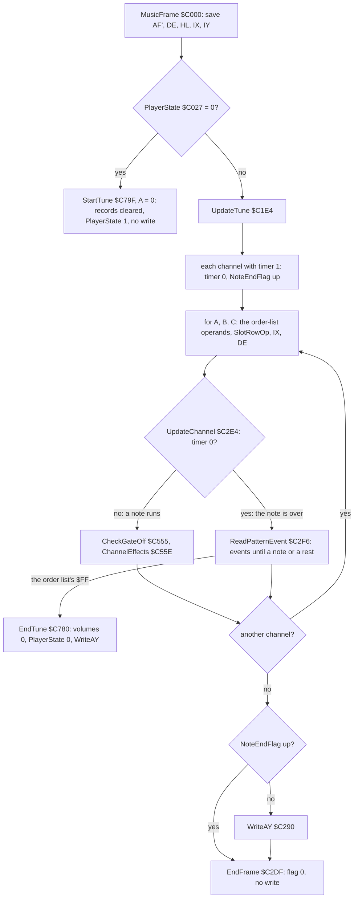

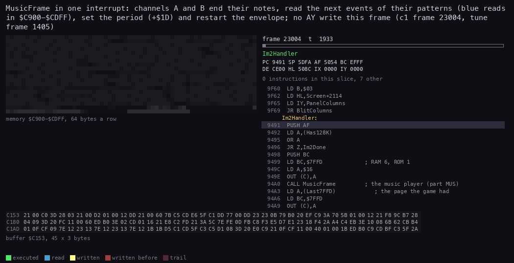

*The routine animation of the player (`$C000-$CD60`) in `c1` from 23004:1870 to 23004:6900, tune frame 1405. It has
80 pictures, 63 T each, and 428 instructions. The view is the three channel records `$C153-$C1D9` as hex, 45 bytes a
row. The memory grid is `$C900-$CDFF`: the period tables' end, the tune table, the order lists and the patterns.
Command, from the case folder after `. work/env.sh`: `python3 ../../kit/routine_anim.py --work work/docs/tmD/c1
--window 23004:1870-23004:6900 --listing build/music.lst --view buffer:C153:45x3:hex --pc C000-CD60 --range
C900-CDFF --pictures 80 --out docs/img/routines/MusicFrame.gif` (`work/docs/tmD/anim09.sh`).*

How to read the animation:

- **Tune frame 1405** is a frame where the notes of channels A and B end: their timers were 1.
- UpdateChannel finds their timers 0 and reads the next event of each pattern. The blue reads in the grid are the
  pattern bytes and the period table.
- The yellow bytes of rows A and B are the new period (+`$1D`, +`$1E`: `$0541` and `$054B`, E2) and the envelope
  counters cleared by StartNote.
- NoteEndFlag is up, so the animation ends at EndFrame without an AY write. The new notes reach the AY on the next
  frame, 1406.

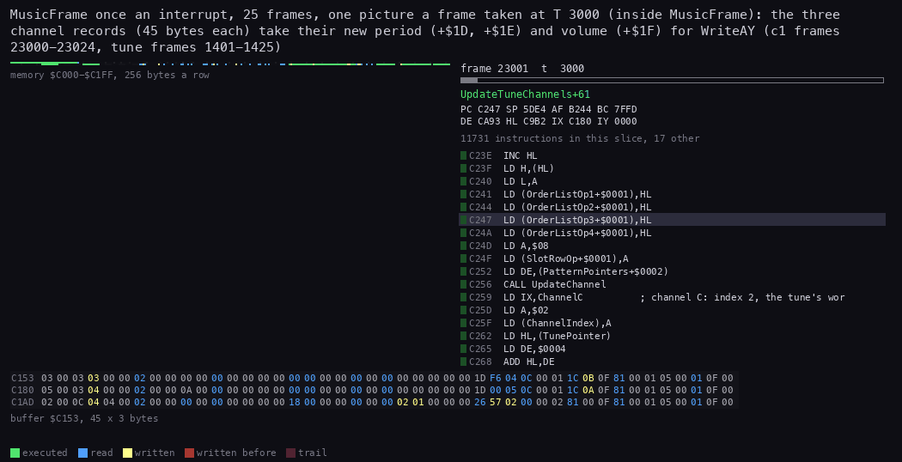

*The routine animation of the player in `c1` from 23000:3000 to 23025:3000, tune frames 1401-1425. It has 25
pictures, one a frame (70 908 T), each taken at T 3000 of its frame. The view is the same three records. Command:
`python3 ../../kit/routine_anim.py --work work/docs/tmD/c1 --window 23000:3000-23025:3000 --listing build/music.lst
--view buffer:C153:45x3:hex --pc C000-CD60 --range C000-C1FF --step 70908 --delay 400 --hold 2000 --out
docs/img/routines/MusicFrame-frames.gif`.*

How to read it: each picture is one interrupt, and the bytes are the AY state of that interrupt.

- Row C's +`$1F` (the volume) falls 15, 13, 11 ... 1, 0 after frame 1406: the noise drum's decay.
- Row C's +`$1D` cycles three values: the arpeggio. Channel C's tone is off (R7 bit 2), so the arpeggio changes
  nothing audible: only the noise sounds.
- Rows A and B hold F2 (`$04F6`, `$0500`) to frame 1405, then E2 (`$0541`, `$054B`) from frame 1406. Their volumes
  go from 12 to 15 as the new notes start.

Worked example, tune frame 1 (the frame after StartTune). All three timers are 0, so each channel reads its order
list and its first pattern:

- **Channel A** reads `A3` (repeat 3) and `00` (pattern 0). Pattern 0 gives `80` (instrument slot 0) and `09 6C`:
  note 9 for 108 frames. The index is 9 + 20 + transpose 0 = 29. The period is `$04F6` = 1270. 1 773 400 / (16 x
  1270) = 87.3 Hz: F2.
- **Channel B** reads `C0 0A` (detune 10), then the same as A. Its period is `$04F6` + 10 = `$0500`.
- **Channel C** reads `BE` (repeat 30) and `02` (pattern 2). Pattern 2 gives `82` (instrument 2, noise), `93`
  (arpeggio 3) and `12 12`: note 18 for 18 frames, D3, period `$02F3`.
- **The registers** after the call: R0-R1 = `$04F6`, R2-R3 = `$0500`, R4-R5 = `$02F3`, R7 = `$9C` (tones A and B,
  noise C), R8 = R9 = R10 = 0. The volumes are still 0: StartNote returns without running the envelope.
- **Frame 2**: the envelopes take their first step. Every instrument here has attack nibble 0, and AttackRates[0] is
  15 steps a frame. So R8 = R9 = R10 = 15.
- **Cost**: 9640 T.

| Tune frame | R0-1 | R2-3 | R4-5 | R7 | R8 R9 R10 | Write |
| ---: | --- | --- | --- | --- | --- | --- |
| 0 | - | - | - | - | - | none: StartTune |
| 1 | `04F6` | `0500` | `02F3` | `9C` | 0 0 0 | yes |
| 2 | `04F6` | `0500` | `02F3` | `9C` | 15 15 15 | yes |
| 3 | `04F6` | `0500` | `0257` | `9C` | 15 15 13 | yes |
| 4 | `04F6` | `0500` | `01F8` | `9C` | 15 15 11 | yes |

```bash
python3 tools/sound_sim.py regs --from 0 --frames 12
```

Witness: the model's registers of tune frames 1761-1780 and 1909 equal the AY writes of the c1 traces at frames
23 360-23 379 and 23 508-23 509 (9.9).

The point: the player is a C64-style tracker player moved to the AY. The frame is a fixed sequence: end the notes,
run the three channels, write. Its one oddity is the frame with no write when any note ends. That frame is nearly
free here, because the envelope never releases (9.6).

## 9.4 The order lists

Each channel has an order list, and the tune's entry in TuneTable `$C967` gives its three addresses. ReadOrderList
`$C310` reads it at position +`$00`. The byte decides:

| Byte | Meaning | Handler |
| --- | --- | --- |
| `$00-$7F` | play pattern n (PatternLo `$CA37`, PatternHi `$CA52`) | StartPattern `$C34A` |
| `$80-$9F` t | transpose t, signed semitones, for the patterns after it | SetTranspose `$C7E4` |
| `$A0-$BF` | play the next pattern (byte AND `$1F`) times; 0 is 256 | SetRepeat `$C81B` |
| `$C0-$DF` d | detune d, added to every period | SetDetune `$C7D1` |
| `$E0-$FE` r | instrument slot (byte AND `$1F`) of this channel = record offset r | SetSlot `$C7F7` |
| `$FF` | the tune's end | EndTune `$C780` |

Bits 5-6 of a command byte pick the handler and bits 0-4 are its parameter. The dispatch is self-modified.
ReadOrderList writes 4 x (bits 5-6) into the offset of a `JR`, which lands on a table of four `JP`s four bytes apart.
The three filler bytes between them (OrderJumpPad1-3) are never executed.

```text
ReadOrderList(ch):
    b = order_list[ch.order_pos]; ch.order_pos += 1
    if b == $FF: EndTune(); return                     ; drops UpdateChannel's return
    if b < $80: StartPattern(b); return
    CommandParam = b AND $1F
    jump to [SetTranspose, SetRepeat, SetDetune, SetSlot][(b >> 5) AND 3]   ; each reads on
```

```text
C310  DD 6E 00     LD L,(IX+$00)           ; ReadOrderList: the position
C313  26 00        LD H,$00
C315  01 7F C9     LD BC,Tune0OrderA       ; OrderListOp1: the channel's list (self-modified)
C318  09           ADD HL,BC
C319  7E           LD A,(HL)
C31A  DD 34 00     INC (IX+$00)
C31D  FE FF        CP $FF                  ; the tune's end
C31F  CA 80 C7     JP Z,EndTune
C322  CB 7F        BIT 7,A                 ; bit 7 clear: a pattern number
C324  CA 4A C3     JP Z,StartPattern
C327  6F           LD L,A                  ; a command: the parameter
C328  E6 1F        AND $1F
C32A  32 E0 C1     LD (CommandParam),A
C32D  7D           LD A,L
C32E  E6 60        AND $60                 ; bits 5-6, shifted right 3: 0, 4, 8 or 12
C330  CB 3F        SRL A
C332  CB 3F        SRL A
C334  CB 3F        SRL A
C336  32 3A C3     LD (OrderCommandJump+1),A
C339  18 FE        JR OrderCommandJump     ; d = 0, 4, 8 or 12 (self-modified)
C33B  C3 E4 C7     JP SetTranspose
C33E  00           DEFB $00                ; OrderJumpPad1, never executed
C33F  C3 1B C8     JP SetRepeat
C342  00           DEFB $00                ; OrderJumpPad2
C343  C3 D1 C7     JP SetDetune
C346  00           DEFB $00                ; OrderJumpPad3
C347  C3 F7 C7     JP SetSlot
C81B  3A E0 C1     LD A,(CommandParam)     ; SetRepeat
C81E  3D           DEC A                   ; the pattern plays n times: n - 1 repeats
C81F  DD 77 04     LD (IX+$04),A
C822  C3 10 C3     JP ReadOrderList
```

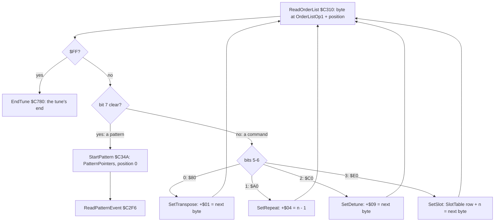

Worked example: Tune0OrderA `$C97F` starts `A3 00 03 80 F9 A4 05 80 F4 A8 05 80 F7 05 ...`.

- `A3`: repeat 3. SetRepeat stores 3 - 1 = 2 in +`$04`, so the pattern after it plays three times.
- `00`: pattern 0, 432 frames (108 + 54 + 54 + 216). Three times: 1296 frames.
- `03`: pattern 3, 216 frames. The intro ends at frame 1512 (30.2 s).
- `80 F9`: transpose -7. `A4 05`: pattern 5 four times.
- `80 F4`: transpose -12. `A8 05`: pattern 5 eight times.
- `80 F7 05`: transpose -9, pattern 5 once, and so on through the bass line.

Tune0OrderB `$C9B2` starts `C0 0A A3 00 03`: the same intro, detuned by 10. So channels A and B play the same notes
ten period units apart. 1280 against 1270 is 0.8 % lower: a slow beat of about 0.7 Hz on F2.

Tune0OrderB also holds tune 0's three slot commands: `E0 48` (slot 0 = record 8, the noise instrument), then `E6 51`
and `E6 5A` (slot 6 = record 9, then record 10). The other slots keep the image's SlotTable `$C11B`, where slot n is
record n on every channel.

Witness: SetRepeat runs 123 times in the L1 builds, SetSlot 21 times. explorers writes `$C123` (B slot 0) with `$48`
and `$C129` (B slot 6) with `$51`, then `$5A`.

The point: an order list is a tiny program. Transpose and repeat let tune 0 build three minutes from 20 short
patterns. The self-modified jump saves a compare chain, at the cost of three dead bytes.

## 9.5 The patterns

A pattern is a string of events ended by `$FF`. ReadPatternEvent `$C2F6` fetches each byte and PatternEvent `$C36D`
acts on it. Only a note or a rest takes time. Every other event is read in the same frame, and the channel reads on.

| Bytes | Event | Handler |
| --- | --- | --- |
| n d (`$00-$7F`) | note n for d frames (0 is 256) | StartNote `$C4C9` |
| `$A0` d | rest for d frames: period 0, the volume left as it was | PatternEvent |
| `$80-$8F` | instrument slot (byte AND `$0F`) | SetInstrument `$C3D8` |
| `$90-$BE` but `$A0` | arpeggio record 8 x (byte AND `$0F`); 0 is none | PatternEventSetArp `$C3CA` |
| `$BF` | the slide off | PatternEventArpeggio `$C3C0` |
| `$C0-$FE` lo hi c | a slide: delay (byte AND `$1F`), step hi:lo, count c | PatternEventCommand `$C38F` |
| `$FF` | the pattern's end: repeat it, else the order list | ReadPatternEvent `$C2F6` |

A note's period-table index is n + 20 + the transpose. The period is PeriodLo `$C82E` / PeriodHi `$C89A` at that
index, plus the detune. At transpose 0, note n sounds as MIDI note n + 32: note 0 is G#1.

```text
ReadPatternEvent(ch, pattern):
    b = pattern[ch.pattern_pos]
    if b == $FF:
        if ch.repeats: ch.repeats -= 1; ch.pattern_pos = 0; read again
        else: ReadOrderList(ch)
    else PatternEvent(ch, b)

PatternEvent(ch, b):
    if b < $80:  StartNote(ch, b, duration = next byte); return     ; takes d frames
    if b == $A0: ch.rest = ch.timer = next byte; ch.period = 0; ChannelEffects(); return
    if b < $90:  SetInstrument(ch, b AND $0F)
    elif b == $BF: ch.slide_count = 0
    elif b < $C0: ch.arpeggio = 8 * (b AND $0F)
    else:        ch.slide = (b, b AND $1F, next 3 bytes)
    ch.pattern_pos += 1; ReadPatternEvent()                          ; no time: read on
```

```text
C2F6  DD 6E 02     LD L,(IX+$02)           ; ReadPatternEvent
C2F9  26 00        LD H,$00
C2FB  19           ADD HL,DE
C2FC  7E           LD A,(HL)
C2FD  FE FF        CP $FF                  ; $FF: the pattern's end
C2FF  20 6C        JR NZ,PatternEvent
C301  DD 7E 04     LD A,(IX+$04)           ; repeats left: the pattern again from its start
C304  B7           OR A
C305  28 09        JR Z,ReadOrderList
C307  DD 35 04     DEC (IX+$04)
C30A  DD 36 02 00  LD (IX+$02),$00
C30E  18 E6        JR ReadPatternEvent
C36D  CB 7F        BIT 7,A                 ; PatternEvent
C36F  CA C9 C4     JP Z,StartNote          ; $00-$7F: a note
C372  FE A0        CP $A0                  ; $A0: a rest, its duration next
C374  20 19        JR NZ,PatternEventCommand
C376  DD 34 02     INC (IX+$02)
C379  CD 25 C8     CALL FetchPatternByte
C37C  DD 77 16     LD (IX+$16),A           ; the rest counter
C37F  DD 77 03     LD (IX+$03),A           ; the timer
C382  DD 34 02     INC (IX+$02)
C385  AF           XOR A                   ; a rest plays period 0
C386  DD 77 1D     LD (IX+$1D),A
C389  DD 77 1E     LD (IX+$1E),A
C38C  C3 5E C5     JP ChannelEffects
C38F  FE 90        CP $90                  ; PatternEventCommand
C391  38 45        JR C,SetInstrument      ; $80-$8F
C393  FE C0        CP $C0
C395  38 29        JR C,PatternEventArpeggio
      ...                                  ; $C0-$FE: the slide's command byte and three more
```

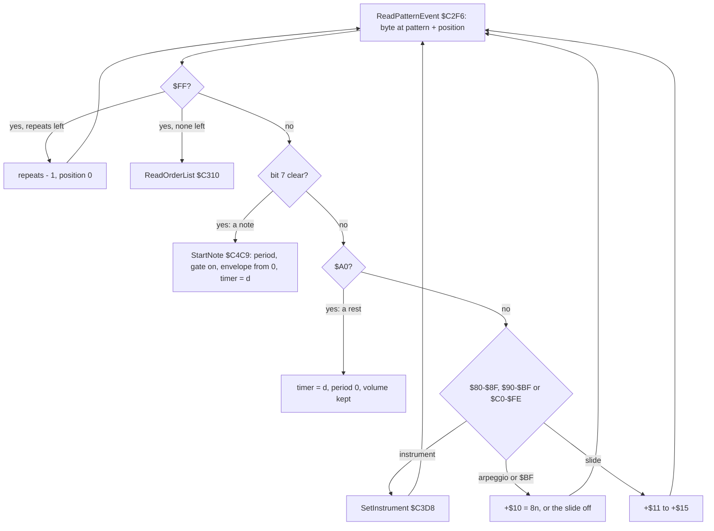

Worked example: Pattern0 `$CA6D` is `80 09 6C 08 36 04 36 06 D8 FF`.

- `80`: instrument slot 0. SlotTable row 0 (channel A), slot 0, is offset `$00`: record 0.
- `09 6C`: note 9 for 108 frames, F2 (`$04F6`).
- `08 36`: note 8 for 54 frames, E2. `04 36`: note 4 for 54 frames, C2.
- `06 D8`: note 6 for 216 frames, D2.
- `FF`: the end. +`$04` is 2 after `A3`, so the pattern starts again twice before the order list goes on.

Pattern2 `$CA86` is the noise drum: `82 93 12 12 12 06 12 06 12 06 12 12 FF`. Instrument 2, arpeggio 3, then notes
of 18 and 6 frames, all note `$12`. In `src/res/music/tunes.txt` every pattern is written out as `note`, `rest` and
`instr` lines with the note names.

Witness: the slide's set-up (`$C397-$C3BD`) runs in none of the 34 recordings. Only patterns 1 and 4 hold a slide,
and tune 0 plays neither. ReadPatternEvent runs 250 815 times in the L1 builds.

The point: the pattern is a C64 tracker's format almost unchanged: a note and its length in two bytes. The AY port
keeps the arpeggios and slides but drops the pulse width and the filter (9.6).

## 9.6 The instruments and the envelope

Instruments `$C028` holds 27 records of 9 bytes; records 0-10 are real, 11-26 blank. SetInstrument `$C3D8` reads the
record at Instruments + SlotTable[8 x channel + slot].

| Byte | Field | Used |
| --- | --- | --- |
| 0, 1 | the C64 pulse width | never read |
| 2 | wave: bit 7 set noise (tone off), clear tone (noise off) | MixerImage `$C14E` |
| 3 | attack (high nibble), decay (low nibble) | AttackRates `$CD36`, DecayRates `$CD46` |
| 4 | sustain level (high nibble), release (low nibble) | DecayRates for the release |
| 5 | gate-off: the release starts this many frames before the note's end | +`$06` |
| 6 | a C64 byte | never read |
| 7 | the vibrato record (0: none) | +`$0B` |
| 8 | the peak volume | +`$2B` |

A rate byte below `$80` is that many volume steps every frame. `$80` + n is one step every n frames. The envelope in
ChannelEffects `$C55E` is the C64 ADSR in software:

```text
ChannelEffects(ch):                           ; once a frame while a note or rest runs
    if a rest: ch.rest -= 1; at 0: ch.timer = 0; return
    ch.timer -= 1
    if NoteEndFlag: return                    ; a note ended somewhere: no effects this frame
    if gate on:
        attack: volume += attack_step every attack_rate frames, up to the peak
        then decay: volume -= decay_step every decay_rate frames, down to the sustain level, then hold
    else:                                     ; CheckGateOff: the timer reached the gate-off time
        release: volume -= release_step every release_rate frames, down to 0
    then VibratoEffect, ArpeggioEffect and SlideEffect move the period
```

```text
C555  DD BE 06     CP (IX+$06)             ; CheckGateOff: timer = gate-off time?
C558  20 04        JR NZ,ChannelEffects
C55A  DD CB 2A 86  RES 0,(IX+$2A)          ; the gate off: the release
C55E  DD 7E 16     LD A,(IX+$16)           ; ChannelEffects: a rest?
C561  B7           OR A
C562  28 09        JR Z,ChannelEffectsNote
C564  DD 35 16     DEC (IX+$16)            ; a rest: count it; at 0 its end
C567  C0           RET NZ
C568  DD 36 03 00  LD (IX+$03),$00
C56C  C9           RET
C56D  DD 35 03     DEC (IX+$03)            ; ChannelEffectsNote: the note's timer
C570  3A 4D C1     LD A,(NoteEndFlag)      ; a note ended this frame: no effects
C573  B7           OR A
C574  C0           RET NZ
C575  DD CB 2A 46  BIT 0,(IX+$2A)          ; the gate off: the release
C579  28 64        JR Z,EnvelopeRelease
C57B  DD CB 25 7E  BIT 7,(IX+$25)          ; the attack done: the decay
C57F  20 2B        JR NZ,EnvelopeDecay
C581  DD 34 26     INC (IX+$26)            ; the attack: every rate frames
C584  DD 7E 26     LD A,(IX+$26)
C587  DD BE 25     CP (IX+$25)
C58A  20 7D        JR NZ,VibratoEffect
C58C  DD 36 26 00  LD (IX+$26),$00
C590  DD 7E 24     LD A,(IX+$24)           ; the volume + the attack step
C593  DD 86 1F     ADD A,(IX+$1F)
C596  DD BE 2B     CP (IX+$2B)             ; up to the peak
C599  38 0C        JR C,EnvelopeAttackStore
      ...                                  ; at the peak: the attack done
```

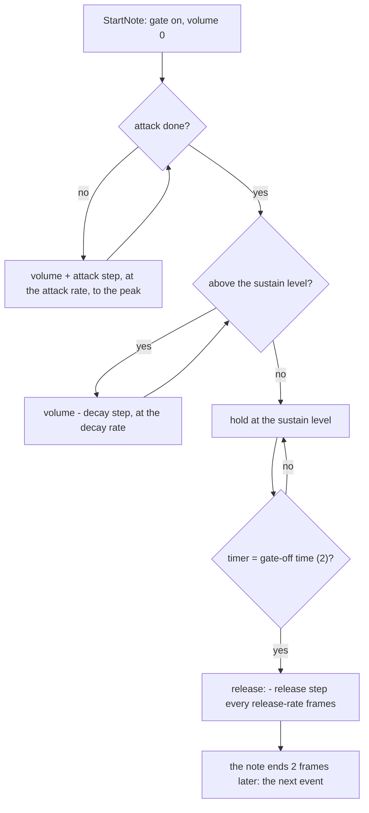

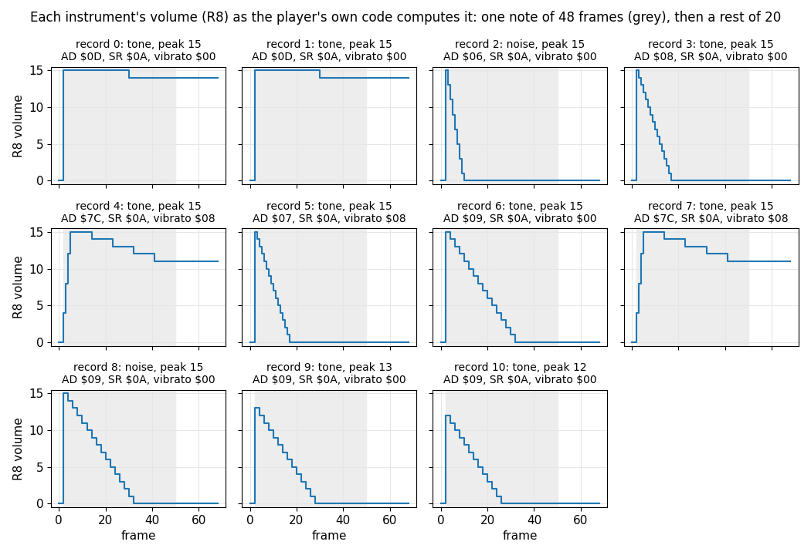

How to read the figure:

- **Each panel** is one instrument record, played by the real player code in the simulator. The test pattern is one
  note of 48 frames (the grey band) and a rest of 20, on channel A, with channels B and C resting.
- **The title** of a panel gives the wave (tone or noise), the peak and the raw bytes 3 (AD), 4 (SR) and 7
  (vibrato).
- **The blue line** is R8, channel A's volume, as WriteAY sends it each frame.
- **Records 2, 3, 5, 6, 8, 9 and 10** are plucks: full volume at once, then a straight decay to 0.
- **Records 0, 1, 4 and 7** hold: their decay rate (nibble `$D` or `$C`) is one step every 28 or 9 frames. Records 4
  and 7 also climb: attack nibble 7 is 4 steps a frame.
- **The release never shows**: through the rest, the volume stays where the note left it.
- **The point**: every sound of tune 0 is a pluck or an organ tone. None fades out at its end.

```bash
python3 tools/sound_sim.py fig-instruments docs/img/sound/instruments.png
```

Worked example, instrument 2 (the noise drum of channel C): its bytes are `00 08 81 06 0A 02 7F 00 0F`.

- Byte 2 is `$81`: bit 7 set, so the channel's noise is on and its tone off.
- Byte 3 is `$06`. Attack nibble 0: AttackRates[0] = `$0F`, 15 steps a frame. The volume reaches the peak 15 on the
  first effects frame.
- Decay nibble 6: DecayRates[6] = `$02`, 2 steps a frame. Byte 4's sustain nibble is 0, so the decay goes to 0.
- So R10 runs 15, 13, 11, 9, 7, 5, 3, 1, 0: eight frames of a falling hiss. The model's tune frames 2-10 show exactly
  that (9.3).
- Byte 4's release nibble is `$A`: DecayRates[10] = `$85`, one step every 5 frames. The gate goes off 2 frames before
  the note's end, so the release needs 5 frames and has 2. It never steps.

Witness: the release code (`$C5F0`), the slow attack (`$C452`) and a release rate below `$80` (`$C4A9`) run in none
of the 34 recordings. No instrument of tune 0 reaches them. The recordings read records 0 and 2-10; record 1 is read
in none.

The point: the instruments are C64 sounds with the waveform cut down to tone or noise. The pulse-width and filter
bytes are copied along and ignored. The release is configured but has no time to act, so every note ends by a cut.

## 9.7 WriteAY: the ten registers

WriteAY `$C290` writes, in this order: R0-R1 (A's period), R2-R3 (B's), R4-R5 (C's), R10 (C's volume), R7
(MixerImage), R8 and R9 (the volumes of A and B). Each goes through AYWrite `$CD56`: an `OUT` to `$FFFD` selects the
register, an `OUT` to `$BFFD` writes it.

```text
WriteAY():
    write R0, R1 = A.period; R2, R3 = B.period
    if TuneNumberOp == 0:                       ; self-modified by StartTune: tune 0 only
        write R4, R5 = C.period; R10 = C.volume
    write R7 = MixerImage; R8 = A.volume; R9 = B.volume
```

```text
C290  16 00        LD D,$00                ; WriteAY: register 0
C292  3A 70 C1     LD A,(ChannelAPeriod)
C295  CD 56 CD     CALL AYWrite
C298  14           INC D
      ...                                  ; R1, R2, R3
C2AE  3E 00        LD A,$00                ; TuneNumberOp: the tune playing (always 0)
C2B0  FE 01        CP $01
C2B2  30 15        JR NC,WriteAYMixer      ; not tune 0: channel C is left alone
      ...                                  ; R4, R5, R10
C2C9  16 07        LD D,$07                ; WriteAYMixer: register 7
C2CB  3A 4E C1     LD A,(MixerImage)
C2CE  CD 56 CD     CALL AYWrite
      ...                                  ; R8, R9
C2DF  AF           XOR A                   ; EndFrame
C2E0  32 4D C1     LD (NoteEndFlag),A
C2E3  C9           RET
CD56  44           LD B,H                  ; AYWrite: B = $FF
CD57  ED 51        OUT (C),D               ; select register D at $FFFD
CD59  45           LD B,L                  ; B = $BF
CD5A  ED 79        OUT (C),A               ; write A at $BFFD
CD5C  C9           RET
```

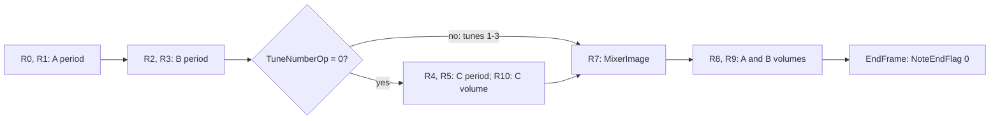

R6 (the noise period) and R11-R13 (the envelope generator) are never written. The noise instruments therefore sound
at whatever R6 holds. The 128K ROM's set-up leaves it at 0, the AY's fastest noise. No peak volume is above 15, so
bit 4 of R8-R10 is never set and the hardware envelope is never used.

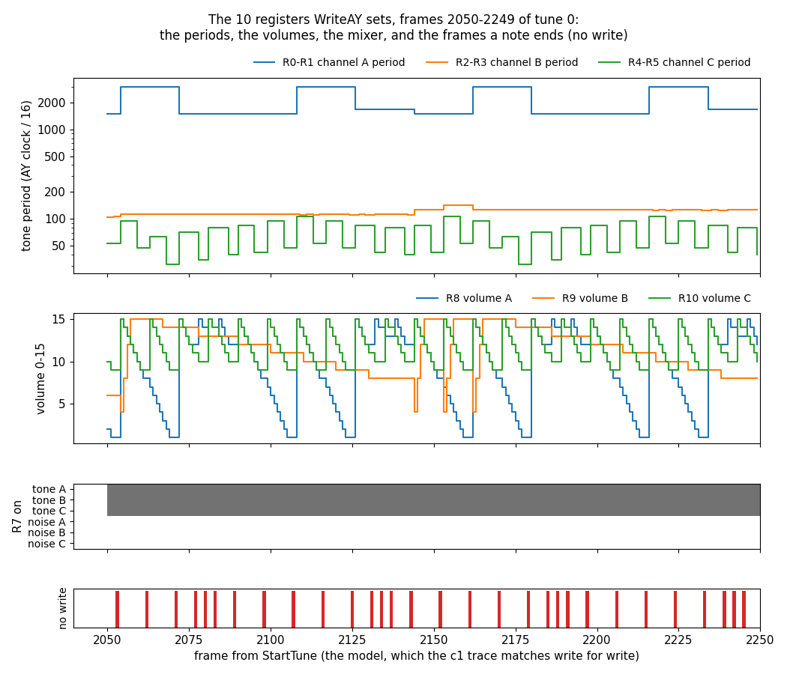

How to read the figure:

- **Top**: the three tone periods, log scale. A low period is a high note. Channel A (blue) is the bass, channel B
  (orange) the melody near period 110-140, channel C (green) a fast arpeggio.
- **Second**: the three volumes, 0-15. Channel A's plucks decay one step a frame; channel C's restart at 15 with
  every note.
- **Third**: R7, dark where a tone or a noise is on. Here tones A, B and C play, with no noise.
- **Bottom**: the red bars are the frames where a note ended. Nothing is written on those frames, so the AY keeps the
  last values one frame longer.
- The values are the registers after the frame's MusicFrame call. They hold on the AY from about T 4000-12 000 of
  that frame to the same point of the next.
- **The point**: the AY state per interrupt is ten bytes. The tune is a sequence of such snapshots, with a frame
  skipped at every note end.

```bash
python3 tools/sound_sim.py fig-regs docs/img/sound/registers.png --from 2050 --frames 200
```

Witness: WriteAY runs 73 906 times in the L1 builds, against UpdateTune's 83 609: 88.4 % of the frames write. The
model gives 8591 / 9698 = 88.6 %.

The point: one routine of ten `OUT` pairs, always in the same order, is the whole AY interface. The self-modified tune
test would leave channel C free in tunes 1-3, for an effect perhaps; nothing uses it.

## 9.8 Tune 0, the loop, and the tunes never played

StartTune `$C79F` takes the tune number in A. Its only caller is MusicTick's `JP Z` at `$C018`, with A = 0. No code
outside RAM 6 writes PlayerState, TuneNumberOp or TunePointer. So Terramex plays tune 0 and only tune 0.

```text
StartTune(A):                              ; A is always 0
    TuneNumberOp = A
    TunePointer = TuneTable + 6 * A        ; three order-list words
    PatternPointers[A, B, C] = EmptyPattern $C82D   ; each first frame goes to the order list
    ChannelA-ChannelC = 0                  ; 135 bytes
    PlayerState = 1                        ; nothing sounds this frame

EndTune():                                 ; a channel's order list reached $FF: channel A's
    the three volumes = 0; PlayerState = 0
    drop UpdateChannel's return; WriteAY   ; the channels after it are not updated this frame
```

```text
C780  AF           XOR A                   ; EndTune
C781  32 72 C1     LD (ChannelAVolume),A
C784  32 9F C1     LD (ChannelBVolume),A
C787  32 CC C1     LD (ChannelCVolume),A
      ...                                  ; the same three stores again
C793  32 27 C0     LD (PlayerState),A
C796  F1           POP AF                  ; drop the return into UpdateTune
C797  21 BF FF     LD HL,$FFBF
C79A  0E FD        LD C,$FD
C79C  C3 90 C2     JP WriteAY
C79F  F5           PUSH AF                 ; StartTune
C7A0  32 AF C2     LD (TuneNumberOp+1),A
C7A3  87           ADD A,A                 ; HL = 6 x A
C7A4  6F           LD L,A
C7A5  87           ADD A,A
C7A6  85           ADD A,L
      ...                                  ; TunePointer, PatternPointers = EmptyPattern
C7BD  21 53 C1     LD HL,ChannelA          ; the three channel records zero
C7C0  11 54 C1     LD DE,ChannelA+1
C7C3  01 86 00     LD BC,$0086
C7C6  36 00        LD (HL),$00
C7C8  ED B0        LDIR
C7CA  3E 01        LD A,$01
C7CC  32 27 C0     LD (PlayerState),A
C7CF  F1           POP AF
C7D0  C9           RET
```

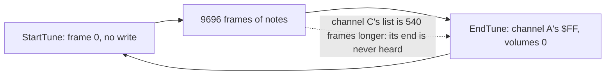

The loop is 9698 frames, 194.0 s: 9696 frames of notes, the EndTune frame and the StartTune frame. In the model
StartTune runs at frames 0, 9698 and 19 396. Channel C's order list lasts 10 236 frames, so its last 540 frames are
never heard: channel A's end stops the tune first.

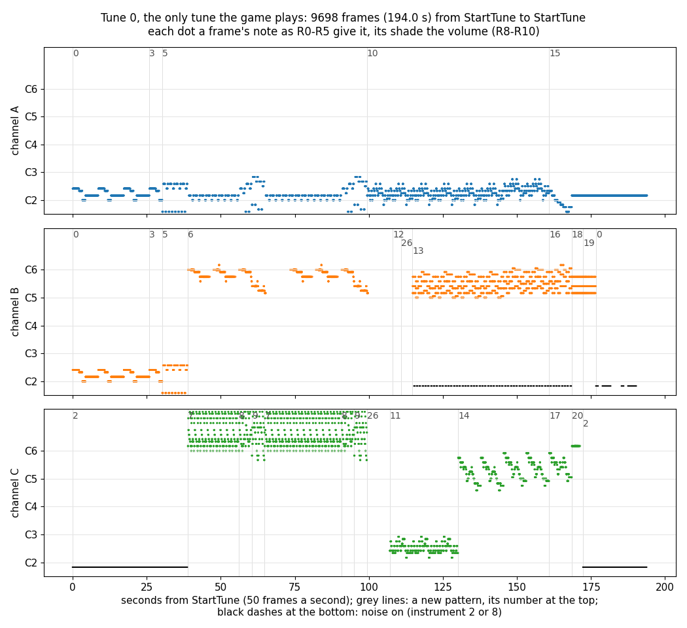

How to read the figure:

- **Each dot** is one frame's note on a channel, from its period (R0-R5), shaded by its volume (R8-R10). Frames with
  the tone off or the volume 0 have no dot.
- **The grey lines** are pattern changes, with the pattern number at the top.
- **The black dashes** at the bottom of B and C are the frames with the noise on (instrument 2 or 8).
- **Channel A** is the bass: patterns 0 and 3 (the intro), then pattern 5 transposed again and again, then patterns
  10 and 15.
- **Channel B** doubles the intro ten units lower, then plays the melody (6, 13, 16) around C5-C6. From about 114 s it
  carries the noise of record 8 as well (slot 0 changed by `E0 48`).
- **Channel C** opens with the noise drum (pattern 2), plays chords by arpeggio (7, 8, 9), a low middle part (11), a
  high one (14, 17) and the drum again at the end.
- **The point**: three minutes of music from 20 patterns of 3 to 98 bytes, by transposition and repeats.

```bash
python3 tools/sound_sim.py fig-tune docs/img/sound/tune0.png
```

Listen: [tune-0.mp3](audio/tune-0.mp3), the whole loop rendered from the model's registers (9.14).

Tunes 1-3 are known only from the code:

- **Tune 1** (Tune1OrderA `$CA05`, B `$CA0F`, C `$CA26`) is a shorter tune, made of tune 0 from its pattern-10
  section on. It has 4728 frames of notes on A and B, 94.6 s. With tune 1, TuneNumberOp is 1 and WriteAY leaves R4,
  R5 and R10 alone, so channel C is silent. In the model, started by hand with A = 1:
  [tune-1.wav](audio/tune-1.wav).
- **Tunes 2 and 3** point at tune 0's three order lists. They would play tune 0 without channel C.
- **Pattern 1** is played only by tune 1. **Pattern 4** and the empty **patterns 21-25** (a lone `$FF` each) are
  played by no tune.

Worked example: TuneTable `$C967` holds four entries of three words:

| Tune | Bytes | Order lists A, B, C |
| ---: | --- | --- |
| 0 | `7F C9 B2 C9 DA C9` | `$C97F`, `$C9B2`, `$C9DA` |
| 1 | `05 CA 0F CA 26 CA` | `$CA05`, `$CA0F`, `$CA26` |
| 2 | `7F C9 B2 C9 DA C9` | tune 0's |
| 3 | `7F C9 B2 C9 DA C9` | tune 0's |

StartTune with A = 0 sets TunePointer = `$C967`. UpdateTune reads `$C97F`, `$C9B2` and `$C9DA` from it, one per
channel, every frame.

Witness: StartTune runs once in c1 (frame 21 599) and once in explorers (frame 9582, after EndTune at 9581). EndTune
also runs in rzx08000 (frame 1676), rzx18000 (1374), rzx28000 (1072), rzx38000 (770) and rzx48000 (468). Those are
9698 frames apart through the RZX run.

The point: the tune table was built for a game with more than one tune. Terramex wires only tune 0 and loops it for
as long as the machine runs.

## 9.9 The model checked against c1

The model is only as good as its match with the machine. `tools/sound_sim.py check` reads the AY writes of an access
trace (an `OUT` to `$FFFD`, then one to `$BFFD`) and compares them, frame by frame, with the model's writes. The
model's frame 0 is the recording's StartTune frame.

```text
check(trace, start):
    for every frame f of the trace window:
        k = f - start                              ; the model's frame
        if the trace has AY writes on f:
            the (register, value) list must equal the model's frame k
        else:
            the model's frame k must have no write either
```

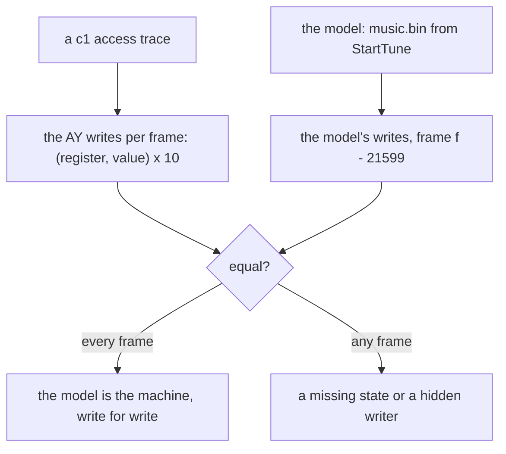

Results:

| c1 frames | Tune frames | Frames with writes | Equal | Frames without a write | Silent in the model too |
| --- | --- | ---: | ---: | ---: | ---: |
| 23 360-23 379 | 1761-1780 | 19 | 19 | 1 | 1 |
| 23 508-23 509 | 1909-1910 | 1 | 1 | 1 | 1 |

Earlier traces of frames 23 000-23 011 and 23 507-23 510 matched in the same way. Each matching frame has the same
ten writes, in the same order, with the same values.

```bash
python3 ../../kit/rs.py open --work work/docs/tmD/c1 --ttd work/stage1/c1/session.ttd --model 128K --port-base P
python3 tools/sound_sim.py check --work work/docs/tmD/c1 --window 23360:0-23380:0 --start 21599
python3 tools/sound_sim.py check --work work/docs/tmD/c1 --window 23508:0-23510:0 --start 21599
python3 ../../kit/rs.py stop --work work/docs/tmD/c1
```

Worked example: c1 frame 23 360 is tune frame 23 360 - 21 599 = 1761. The trace's ten `OUT` pairs of that frame give
R0-R5, R10, R7, R8 and R9. The model's frame 1761 gives the same ten (register, value) pairs.

The point: the simulator runs the player's own bytes, so every figure of this document is the machine's music, not a
reconstruction. The traces confirm the frame offset and show no other writer.

## 9.10 The beeper: PlaySound and SoundEffects

PlaySound `$C4B2` keeps HL, DE and BC and calls SoundDispatch `$C4BC`. SoundDispatch reads the player's address from
SoundEffects `$C55B`, pushes it, sets E = `$10` (the speaker bit) and returns into it. An A of 7 or more plays
nothing.

```text
PlaySound(A):
    if A >= 7: return
    E = $10                                  ; the speaker bit, for AND E and OUT
    jump to SoundEffects[A]                  ; by PUSH and RET
```

```text
C4B2  E5           PUSH HL                 ; PlaySound
C4B3  D5           PUSH DE
C4B4  C5           PUSH BC
C4B5  CD BC C4     CALL SoundDispatch
C4B8  C1           POP BC
C4B9  D1           POP DE
C4BA  E1           POP HL
C4BB  C9           RET
C4BC  FE 07        CP $07                  ; SoundDispatch
C4BE  D0           RET NC
C4BF  87           ADD A,A
C4C0  6F           LD L,A
C4C1  26 00        LD H,$00
C4C3  11 5B C5     LD DE,SoundEffects
C4C6  19           ADD HL,DE
C4C7  5E           LD E,(HL)
C4C8  23           INC HL
C4C9  56           LD D,(HL)
C4CA  D5           PUSH DE                 ; the player's address
C4CB  1E 10        LD E,$10                ; the speaker bit
C4CD  C9           RET                     ; into the player
C55B  06 C5 E9 C4 CE C4 21 C5 4A C5 37 C5 32 C5   ; SoundEffects: the seven words
```

SkoolKit read `$C55B` as one block. Here it is split into SoundEffects (14 bytes), SoundPad and AltTileAttrs.
SkoolKit also read the operand of `LD HL,$0000` at `$C54A` as NOPs.

| A | Sound | Player | Played by | When |
| ---: | --- | --- | --- | --- |
| 0 | rise | SoundRise `$C506` | FallDeath `$A888` (C = 0 set at `$A88B`); DeathFrames `$A8AB` plays it at `$A8B7` after the death frames, unless C = `$FF` | at the end of the death's frames |
| 1 | ROM fall | SoundRomFall `$C4E9` | BarrelGo `$AA66` (at `$AA6C`); the space scene, SpaceExplodeEnd `$B13C` (at `$B140`) | a barrel; the asteroid's strike |
| 2 | chirp | SoundChirp `$C4CE` | PickUpItem `$BB6C` (at `$BBF2`); the space scene, SpaceAsteroidIn `$B104` (at `$B122`) | a pickup; the asteroid deflected |
| 3 | hiss | SoundHiss `$C521` | CreatureDeath `$A89E` (at `$A8A3`) | a creature's touch |
| 4 | ROM burst | SoundRomBurst `$C54A` | Room1ADeath `$A88F` (C = 4 set at `$A89A`); DeathFrames plays it at `$A8B7`, as sound 0 | the snakes, at the end of the death's frames |
| 5 | beep high | SoundBeepHigh `$C537` | DropFall `$C000` (at `$C051`) | the drop |
| 6 | beep low | SoundBeepLow `$C532` | the jump start `$A484` | every jump |

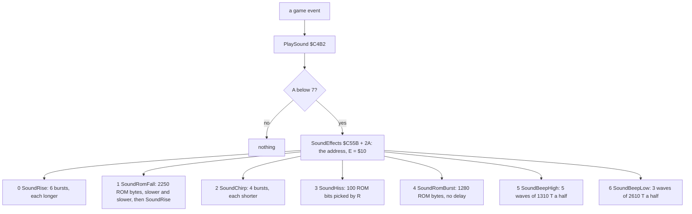

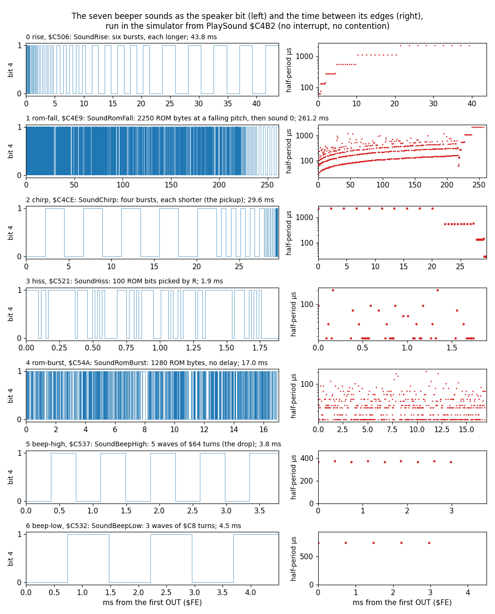

How to read the figure:

- **Each row** is one sound, run from PlaySound in the simulator: no interrupt, no contention.
- **Left**: the speaker bit (port `$FE` bit 4) against time in ms from the first `OUT`.
- **Right**: the time between two edges, the half-period, in µs. A rising line is a falling pitch.
- **Two families.** Sounds 0, 2, 5 and 6 are square waves whose half-period the code sets. Sounds 1, 3 and 4 send ROM
  bytes to the speaker: noise, with or without a pitch slope.
- **The point**: seven sounds from three loops (the burst loop, the ROM loop, the tone loop), told apart by one or two
  constants each.

```bash
python3 tools/sound_sim.py fig-effects docs/img/sound/effects.png
```

The costs, in the simulator:

| Sound | T | ms | `OUT` writes | Speaker edges | Frames on the machine |
| --- | ---: | ---: | ---: | ---: | ---: |
| 0 rise | 155 364 | 43.8 | 2460 | 60 | 3-4 |
| 1 ROM fall (with the rise) | 926 419 | 261.2 | 4710 | 1137 | 15-16 |
| 2 chirp | 104 886 | 29.6 | 1660 | 40 | 2 |
| 3 hiss | 6698 | 1.9 | 100 | 42 | 1 |
| 4 ROM burst | 60 365 | 17.0 | 1280 | 589 | 1-2 |
| 5 beep high | 13 421 | 3.8 | 10 | 10 | 1 |
| 6 beep low | 15 945 | 4.5 | 6 | 6 | 1-2 |

The interrupt state: none of the seven routines executes DI, and the four traced sounds (9.11-9.13) all have the
IM 2 handler inside them. So the music, about 3600 T of it, runs inside any sound that spans an interrupt. Every
`OUT ($FE)` writes 0 or `$10`: border colour 0 and MIC 0. The border is black in play, so the sounds do not show on
it.

Witness, from the stage-2 L1 builds (the routine ran on that frame):

| Sound | Witness frames |
| --- | --- |
| 0 rise | gameover 1368-1371 (and inside sound 1 at 1591-1594), rzx10000 1368, rzx24000 794 |
| 1 ROM fall | gameover 1579-1594, rzx16000 491-505 |
| 2 chirp | c1 23 508-23 509, explorers 957 |
| 3 hiss | rzx06000 537-563, rzx22000 1912, rzx32000 835 |
| 4 ROM burst | rzx10000 1958-1959, the only one |
| 5 beep high | rzx02000 47 |
| 6 beep low | gameover 16-17 |

The point: PlaySound is a seven-entry jump table with the speaker mask in E. The sounds block the game while they
play. The ROM fall holds it for about 14 frames (285 ms), which is why the asteroid's strike freezes the screen.

## 9.11 The burst sounds: the chirp and the rise

SoundChirp and SoundRise share one loop. A burst is 10 half-waves. A half-wave is H turns of `OUT ($FE),A` with two
`EX (SP),HL` of delay: 62 T a turn. Between bursts H changes:

- the chirp shifts H right twice (`$7F`, `$1F`, 7, 1): the half-waves shrink and the pitch rises;
- the rise shifts H left with a 1 bit in (3, 7, `$0F`, `$1F`, `$3F`, `$7F`): the half-waves grow and the pitch falls.

The name SoundRise is the waveform's look, not its pitch: its half-periods grow, so it sounds as a fall.

```text
SoundChirp():                              ; sound 2
    H = $7F
    repeat:
        A = 0
        10 times:                          ; one burst
            H times: OUT ($FE), A; EX (SP),HL; EX (SP),HL   ; 62 T a turn
            A = A XOR $10                  ; the next half-wave
        H = H >> 2
    until H == 0

SoundRise():                               ; sound 0, also the tail of sound 1
    H = 3
    repeat: one burst as above; H = (H << 1) + 1
    until H == $FF
```

```text
C4CE  26 7F        LD H,$7F                ; SoundChirp
C4D0  AF           XOR A                   ; SoundChirpBurst
C4D1  06 0A        LD B,$0A                ; 10 half-waves
C4D3  C5           PUSH BC                 ; SoundChirpWave
C4D4  44           LD B,H
C4D5  D3 FE        OUT ($FE),A             ; SoundChirpDelay
C4D7  E3           EX (SP),HL
C4D8  E3           EX (SP),HL
C4D9  10 FA        DJNZ SoundChirpDelay
C4DB  EE 10        XOR $10
C4DD  C1           POP BC
C4DE  10 F3        DJNZ SoundChirpWave
C4E0  CB 3C        SRL H
C4E2  CB 3C        SRL H
C4E4  7C           LD A,H
C4E5  B7           OR A
C4E6  20 E8        JR NZ,SoundChirpBurst
C4E8  C9           RET
C506  26 03        LD H,$03                ; SoundRise: the same loop at $C508-$C516, then
C518  37           SCF                     ; H = H x 2 + 1
C519  CB 14        RL H
C51B  7C           LD A,H
C51C  FE FF        CP $FF
C51E  20 E8        JR NZ,SoundRiseBurst
C520  C9           RET
```

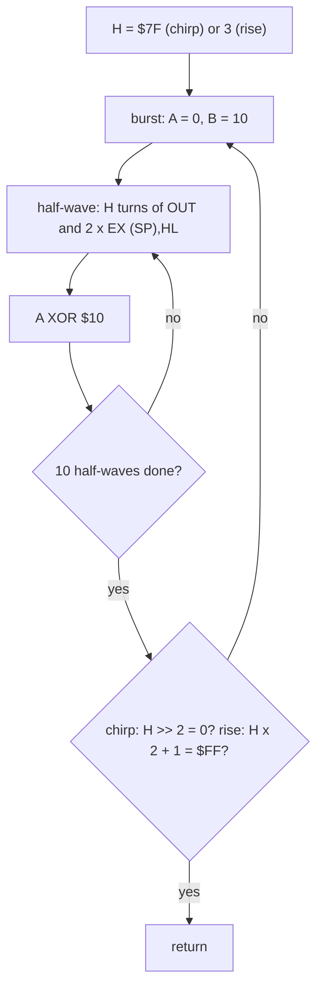

Worked example, the chirp in the simulator:

| Burst | H | Half-period T | Pitch | `OUT`s |
| ---: | ---: | ---: | ---: | ---: |
| 1 | 127 | 7914 | 224 Hz | 1270 |
| 2 | 31 | 1962 | 904 Hz | 310 |
| 3 | 7 | 474 | 3.7 kHz | 70 |
| 4 | 1 | 102 | 17 kHz | 10 |

A half-period is H x 62 T plus about 40 T of overhead. That makes 1660 `OUT`s and 40 edges in 104 886 T.

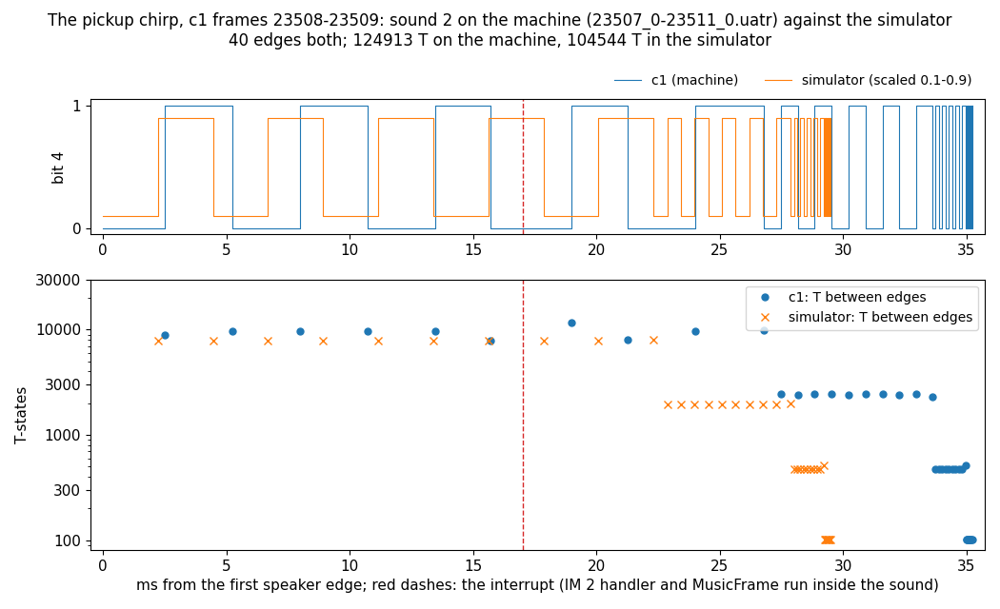

*The chirp of c1's first pickup, from the access trace of c1 frames 23 507-23 511, against the simulator. Command,
with an instance of c1 open (`python3 ../../kit/rs.py open --work work/docs/tmD/c1 --ttd work/stage1/c1/session.ttd
--model 128K --port-base P`): `python3 tools/sound_sim.py fig-witness docs/img/sound/chirp-witness.png --work
work/docs/tmD/c1 --window 23507:0-23511:0 --sound 2 --label "The pickup chirp, c1 frames 23508-23509"`. It records the
trace into `work/docs/tmD/c1/traces/23507_0-23511_0.uatr` when that file is missing.*

How to read the figure:

- **Top**: the speaker bit on the machine (blue) and in the simulator (orange, drawn a little smaller).
- **Bottom**: the T-states between edges, edge by edge. The red dashed line is the interrupt of frame 23 509.
- **The machine** plays 1660 `OUT`s and 40 edges, as the simulator. It starts at frame 23 508 T 12 395 and ends at
  frame 23 509 T 66 400. The first and last edges are 124 913 T apart, against 104 544 T in the simulator.
- **The interrupt stretch.** The half-wave over the interrupt is 11 679 T instead of 7914: MusicFrame ran inside it.
- **The contention stretch.** Half-waves played while the beam draws the paper are about 9700 T instead of 7914 and
  about 2450 T instead of 1962. `EX (SP),HL` reads and writes the stack at `$5DE0`, in contended RAM 5, and
  `OUT ($FE)` is a contended port.
- **The border.** The last two bursts fall in the bottom border of frame 23 509. They are 474 and 102 T, exactly the
  simulator's.
- **The point**: the code fixes the shape and the machine fixes the pitch. A pickup's chirp is up to a quarter lower
  than its code says, by where the beam is.

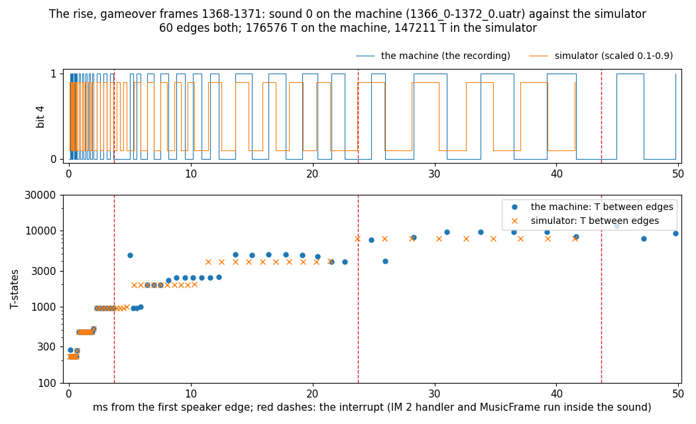

*The rise at the fall death of gameover, from the access trace of gameover frames 1366-1372, against the simulator.
Command, with an instance of gameover open (`python3 ../../kit/rs.py open --work work/docs/tmD/go --ttd
work/stage1/gameover/session.ttd --model 128K --port-base P`): `python3 tools/sound_sim.py fig-witness
docs/img/sound/rise-witness.png --work work/docs/tmD/go --window 1366:0-1372:0 --sound 0 --label "The rise, gameover
frames 1368-1371"`.*

How to read the figure: the same layout as the chirp's. The machine plays 2460 `OUT`s and 60 edges, as the
simulator, from frame 1368 T 59 644 to frame 1371 T 33 094. The first and last edges are 176 576 T apart, against
147 211 T. Three interrupts fall inside it. The short bursts match the simulator where they fall in the border; the
long ones are stretched by the paper's contention, as in the chirp.

Witness: c1 23 508-23 509 and gameover 1368-1371, both traced; the stage-2 table of 9.10 for the rest.

The point: two sounds from one loop, shaped only by how H changes. They are the game's good and bad sounds: up for a
pickup, down for a death.

## 9.12 The ROM sounds: the ROM fall, the ROM burst and the hiss

Three sounds send bytes of the 48 BASIC ROM, paged in during play, to the speaker. The ROM's code is a random-looking
bit stream. Bit 4 of each byte (AND E, E = `$10`) drives the speaker.

- **SoundRomFall** `$C4E9` (sound 1): HL from `$0000`, BC = 9000 counted down by 4: 2250 bytes. Before each byte comes
  a delay of `$23` - B turns of `DJNZ`. B, the high byte of the count, falls from `$23` to 0, so the delay grows and
  the noise slows: a falling crash. It has no RET: it falls into SoundRise.
- **SoundRomBurst** `$C54A` (sound 4): 1280 bytes from `$0000`, 256 x 5, with no delay: a short burst of noise.
- **SoundHiss** `$C521` (sound 3): 100 bytes from `$0000-$003F`, picked by `LD A,R`: 1.9 ms of noise.

```text
SoundRomFall():                            ; sound 1
    HL = $0000; BC = 9000
    repeat:
        wait ($23 - B) turns of DJNZ        ; B = the count's high byte: the wait grows
        OUT ($FE), ROM[HL] AND $10; HL += 1
        BC -= 4
    until BC == 0
    SoundRise()                             ; falls in

SoundRomBurst():  1280 times: OUT ($FE), ROM[HL] AND $10; HL += 1
SoundHiss():      100 times:  OUT ($FE), ROM[R AND $3F] AND $10
```

```text
C4E9  21 00 00     LD HL,$0000             ; SoundRomFall
C4EC  01 28 23     LD BC,$2328             ; 9000
C4EF  3E 23        LD A,$23                ; SoundRomFallLoop: the delay $23 - B
C4F1  90           SUB B
C4F2  28 05        JR Z,SoundRomFallByte
C4F4  C5           PUSH BC
C4F5  47           LD B,A
C4F6  10 FE        DJNZ SoundRomFallDelay
C4F8  C1           POP BC
C4F9  7E           LD A,(HL)               ; SoundRomFallByte
C4FA  23           INC HL
C4FB  A3           AND E                   ; the speaker bit
C4FC  D3 FE        OUT ($FE),A
C4FE  0B 0B 0B 0B  DEC BC x 4
C502  79           LD A,C
C503  B0           OR B
C504  20 E9        JR NZ,SoundRomFallLoop  ; then falls into SoundRise $C506
C521  06 64        LD B,$64                ; SoundHiss: 100 bits
C523  ED 5F        LD A,R                  ; SoundHissLoop
C525  E6 3F        AND $3F
C527  6F           LD L,A
C528  26 00        LD H,$00
C52A  7E           LD A,(HL)
C52B  E6 10        AND $10
C52D  D3 FE        OUT ($FE),A
C52F  10 F2        DJNZ SoundHissLoop
C531  C9           RET
C54A  21 00 00     LD HL,$0000             ; SoundRomBurst
C54D  45           LD B,L                  ; 256 x 5 bytes
C54E  0E 05        LD C,$05                ; SoundRomBurstLoop
C550  7E           LD A,(HL)               ; SoundRomBurstByte
C551  A3           AND E
C552  D3 FE        OUT ($FE),A
C554  23           INC HL
C555  0D           DEC C
C556  20 F8        JR NZ,SoundRomBurstByte
C558  10 F4        DJNZ SoundRomBurstLoop
C55A  C9           RET
```

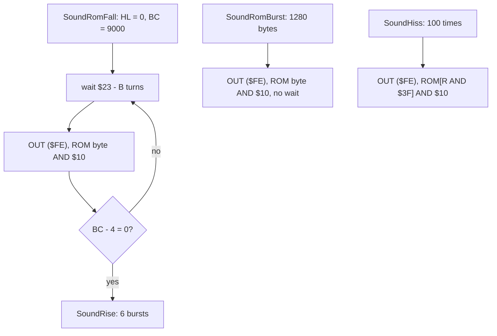

Worked example, the ROM fall's first bytes: the 48 ROM starts `F3 AF 11 FF FF C3 CB 11`. AND `$10` gives `$10`, 0,
`$10`, `$10`, `$10`, 0, 0, `$10`: the speaker's first eight states. While B is `$23` (the first 11 bytes, count 9000
down to 8960) the delay is 0 turns. The next 64 bytes wait 1 turn each, and so on: each step of B is 64 bytes. The
last 63 bytes, with B = 0 (count 252 down to 4), wait 35 turns each: 11 + 34 x 64 + 63 = 2250.

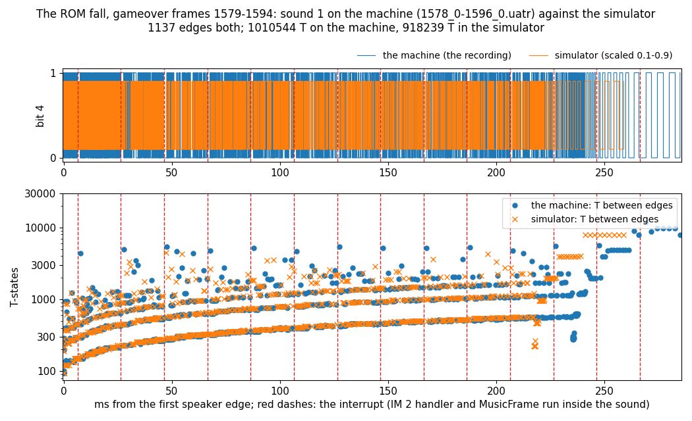

*The asteroid's strike in gameover, from the access trace of gameover frames 1578-1596, against the simulator.
Command, with the gameover instance of the rise (9.11) open: `python3 tools/sound_sim.py fig-witness
docs/img/sound/romfall-witness.png --work work/docs/tmD/go --window 1578:0-1596:0 --sound 1 --label "The ROM fall,
gameover frames 1579-1594"`.*

How to read the figure:

- **The same 1137 edges** on the machine and in the simulator. On the machine they span 1 010 544 T (285 ms), against
  918 239 T.
- **Fourteen interrupts** fall inside (the red dashes). MusicFrame runs under the sound each time, and the gap that
  holds it grows by a few thousand T.
- **The bands of dots** are the ROM's bit patterns at a growing delay. The half-periods rise from about 100 T to about
  1000 T: the falling pitch.
- **The last 60 edges**, from about 245 ms, are the rise.
- **The point**: no sample data. The ROM is the noise source, and a delay that grows with the loop count turns it into
  a falling crash.

Witness: gameover 1579-1594, traced: 4710 `OUT`s and 1137 edges, as the simulator. The burst and the hiss: the
stage-2 table of 9.10.

The point: three noises with no data of their own. The hiss picks its bits by the refresh register, so it differs a
little every time.

## 9.13 The square tones: the two beeps

SoundTone `$C53A` plays H square waves of 2 x L `DJNZ` turns. SoundBeepHigh `$C537` sets HL = `$0564` (5 waves, 100
turns a half) and falls in. SoundBeepLow `$C532` sets HL = `$03C8` (3 waves, 200 turns a half) and jumps to it.

```text
SoundTone(H waves, L turns):
    repeat H times:
        OUT ($FE), 0;   wait L turns of DJNZ
        OUT ($FE), $10; wait L turns of DJNZ
```

```text
C532  21 C8 03     LD HL,$03C8             ; SoundBeepLow: 3 waves, 200 turns
C535  18 03        JR SoundTone
C537  21 64 05     LD HL,$0564             ; SoundBeepHigh: 5 waves, 100 turns
C53A  AF           XOR A                   ; SoundTone
C53B  45           LD B,L
C53C  D3 FE        OUT ($FE),A
C53E  10 FE        DJNZ SoundToneLow
C540  7B           LD A,E                  ; E = $10
C541  D3 FE        OUT ($FE),A
C543  45           LD B,L
C544  10 FE        DJNZ SoundToneHigh
C546  25           DEC H
C547  20 F1        JR NZ,SoundTone
C549  C9           RET
```

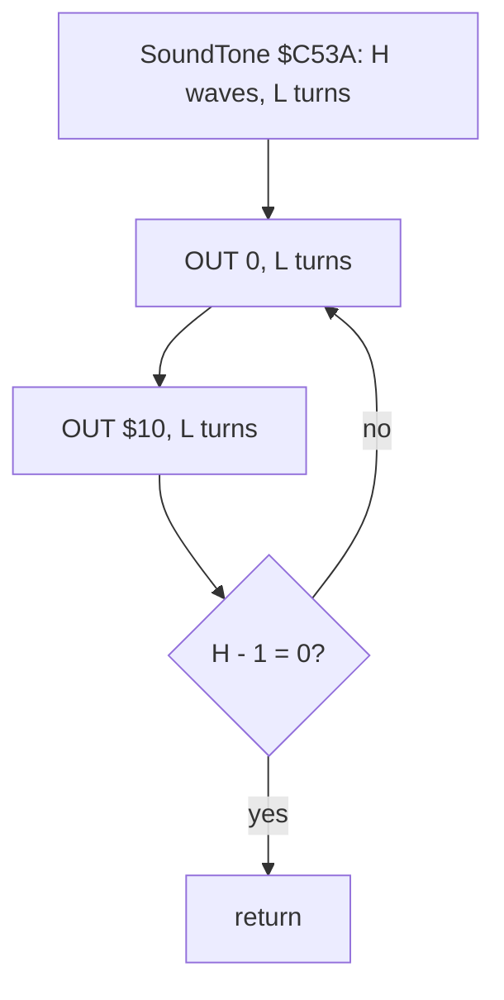

Worked example: a half-wave of the high beep is 100 x 13 T plus about 10 T = 1310 T: 1354 Hz. Five waves last 3.8 ms.
The low beep's half-wave is 2610 T: 680 Hz, three waves, 4.5 ms. So the low beep is the high one an octave down, with
fewer waves.

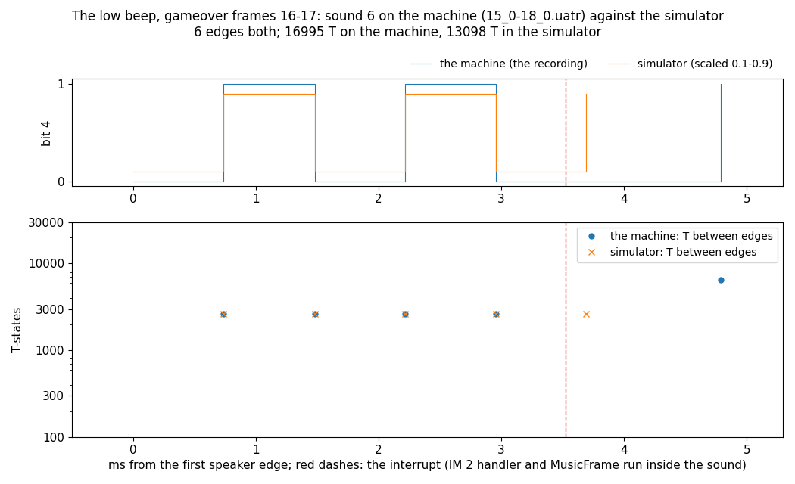

*The jump beep at gameover frame 16, from the access trace of gameover frames 15-18. Command, with the gameover
instance open: `python3 tools/sound_sim.py fig-witness docs/img/sound/beeplow-witness.png --work work/docs/tmD/go
--window 15:0-18:0 --sound 6 --label "The low beep, gameover frames 16-17"`.*

How to read the figure: the machine plays the same 6 `OUT`s, from frame 16 T 60 297 to frame 17 T 6384. The interrupt
of frame 17 falls in the fifth half-wave, so the first and last edges are 16 995 T apart against 13 098 T. The other
halves equal the simulator's: the `DJNZ` loop touches no contended memory, and each half has only one `OUT`.

Witness: gameover 16-17, traced; the high beep at rzx02000 frame 47 (9.10).

The point: the two beeps are the game's only clean tones. At 4 ms they are clicks with a pitch, which suits a sound
heard at every jump.

## 9.14 The audio files

Every file was rendered by `tools/sound_sim.py`, written and never played. The AY files come from the model's
registers, one frame at a time, with tone, noise and the AY's volume curve. The beeper files come from the speaker
edges, at 44 100 Hz, with a little silence after the sound.

| File | What |
| --- | --- |
| [tune-0.mp3](audio/tune-0.mp3) | tune 0, the whole loop of 9698 frames, 194 s |
| [tune-1.wav](audio/tune-1.wav) | tune 1, never played: 94.6 s, channel C silent as WriteAY leaves it |
| [beeper-0-rise.wav](audio/beeper-0-rise.wav) | sound 0, the simulator |
| [beeper-1-rom-fall.wav](audio/beeper-1-rom-fall.wav) | sound 1 with its rise |
| [beeper-2-chirp.wav](audio/beeper-2-chirp.wav) | sound 2 |
| [beeper-2-chirp-c1.wav](audio/beeper-2-chirp-c1.wav) | sound 2 as the machine played it in c1 frames 23 508-23 509 (the trace's edges, 9.11) |
| [beeper-3-hiss.wav](audio/beeper-3-hiss.wav) | sound 3 |
| [beeper-4-rom-burst.wav](audio/beeper-4-rom-burst.wav) | sound 4 |
| [beeper-5-beep-high.wav](audio/beeper-5-beep-high.wav) | sound 5 |
| [beeper-6-beep-low.wav](audio/beeper-6-beep-low.wav) | sound 6 |

```bash
python3 tools/sound_sim.py wavs docs/audio
python3 tools/sound_sim.py trace-beeper --work work/docs/tmD/c1 --window 23507:0-23511:0 \
    --out docs/audio/beeper-2-chirp-c1.wav             # the c1 instance open, as for the chirp (9.11)
```

The point: the simulator files are the sounds as written. The c1 file is the sound as heard: a little lower, with a
gap where the music ran.

## 9.15 Known only from the code

- **Tunes 1, 2 and 3.** StartTune is only ever given A = 0. Tune 1, tunes 2 and 3 (tune 0 without channel C) and the
  channel-C test in WriteAY (TuneNumberOp `$C2AE`) are reached only by a call nobody makes (9.8).
- **Patterns 1, 4 and 21-25**, and with them the slide: its set-up `$C397-$C3BD` and SlideEffect's body
  `$C735-$C77C`. No tune 0 order list names a pattern with a slide.
- **The release** (`$C5F0`), the slow attack (`$C452`) and a release rate below `$80` (`$C4A9`): configured, never
  reached (9.6).
- **Instrument record 1** and records 11-26: no slot of tune 0 selects them.
- **The arpeggio's end** (`$C70E`): arpeggio 1, the only one without a loop, plays on 9-frame notes, which end first.
- **OrderJumpPad1-3**: three filler bytes in the order-list jump table, never executed.
- **The noise period.** R6 is never written. The noise sounds at the value the 128K ROM's set-up left, 0. On a machine
  whose R6 held another value the drum would sound different.
- **MusicLeftover** `$CD5D-$D1FF`: 1187 bytes copied with the player, read by nothing.
- **SoundDispatch for A of 7 or more**: no caller passes it.

The point: the player carries a whole toolkit (four tunes, slides, slots, releases), and tune 0 uses the notes, the
transposes, the repeats, the slots, arpeggios and plucked envelopes.

## 9.16 The point

Terramex's sound is two separate machines. On a 128K, a C64-style tracker player in RAM 6 plays one tune, tune 0, from
the first interrupt after GameEntry. It loops every 9698 frames, for about 3600 T a frame. The game itself owns only
the beeper: seven sounds made from three loops, with the ROM as the noise source. They run with the interrupts on, so
the music plays under them and, with the ULA's contention, sets their real pitch.
