# 10. Gameplay logic

What this covers: the rules of Terramex as the code runs them.

- the world and its exits;
- the hero's 34 statuses;
- walking, climbing, the jump, the fall, the refusal and the umbrella;
- the rides: the bounce, the hover, the lift, the balloon, the barrels, the basket, the float and the teleport;
- every death, the lives and the restart;
- every creature and hazard;
- every item and puzzle, the explorer rooms and the professor's six wishes;
- the telescope, the countdown, the ending and the score;
- the notable features and what no recording reached.

The records these rules work on (slots, creature records, item records, bearers) are in doc 07.

The recordings it rests on (WALKTHROUGH 6.0) are the ones doc 07 uses:

- `gameover`, sampled into `work/docs/tmC/go/vars.jsonl`:
  - the Spring jump and bounce into room `$10`;
  - the two pickups;
  - the RZX player's fatal fall into room `$1C`, replayed as the last life (Lives POKEd to 1, said so);
  - the space scene without the deflector.
- `rzx24750` (`work/docs/tmC/r247`): room `$31`, the crystal and the teleport.
- `rzx06000` (`work/docs/tmC/r06`): a creature's touch, in a drifted part of that segment.
- `rzx44000` (`work/docs/tmC/r44`): the first two gifts.
- `rzx50000`: the sixth gift and the ending, as recorded at stage 1.
- The RZX run as a whole: `work/stage1/rzx/vars.bin`, one sample every 250 RZX frames.
- The L1 counts of the 34 builds, quoted from the witness lines of `src/game/game.ann`.
- The clone probes of stage 2 (`work/stage2/probe_points.py`). These changed one variable on a copy of an RZX state, to
  reach what the run never did. Each is said so where it is used.

As in doc 07:

- A sample of frame N is the memory at the start of frame N; a trace shows an instruction in the frame it ran in.
- Every speed is per main-loop pass. A pass is 2 to 17 frames, mostly 2 or 3, 2.84 on average over the RZX run's play.
- "SK" marks a reading taken from the SkoolKit disassembly of nzeemin.

## 10.1 The world and its exits

The world is 6 levels of 12 rooms. Room R = 12 x level + column; level 0 is the surface and level 5 the deepest lab
level (doc 07.2). The play window is 256 x 128 pixels. The hero is a 24 x 24 sprite whose X and Y are its top left
corner.

The hero leaves a room by one of four routines:

| Exit | When | New room | New position | Called from |
| --- | --- | --- | --- | --- |
| ExitLeft `$A640` | X below 4 (walking), X 1 or 2 (jumping) | column - 1, column 0 wraps to 11; from room `$29`, the explorer's own room | X `$E6` | HeroUpdate, JumpArc, FloatInRoom2C |
| ExitRight `$A671` | X `$E8` or more (walking), `$E7` (jumping) | column + 1, 11 wraps to 0; from an explorer room, room `$29` | X 2 | HeroUpdate, JumpArc, BarrelRideLong |
| ExitUp `$A69B` | Y above 0 | level - 1; on level 0 the hero is put back | Y `$66` | HeroUpdate, BounceUp, Hover, JumpStepY, BalloonRide, LiftUp |
| ExitDown `$A6AE` | Y `$67` or more (`$68` when falling or jumping) | level + 1; from level 5 the hero is put back | Y 2 | HeroUpdate, HeroFall, Hover, LiftDown, BalloonRide, JumpHoleCheck |

```text
ExitLeft:
    level, column = Room / 12, Room mod 12
    if Room == $29: Room = ExplorerRooms[Explorer]      ; $2D, $2E, $2F, $46, $47
    else: Room = 12 * level + (column - 1) mod 12
    Hero.X = $E6
    SetUpRoom(Room)

ExitRight:
    if Room in ExplorerRooms: Room = $29
    else: Room = 12 * level + (column + 1) mod 12
    Hero.X = 2
    SetUpRoom(Room)
```

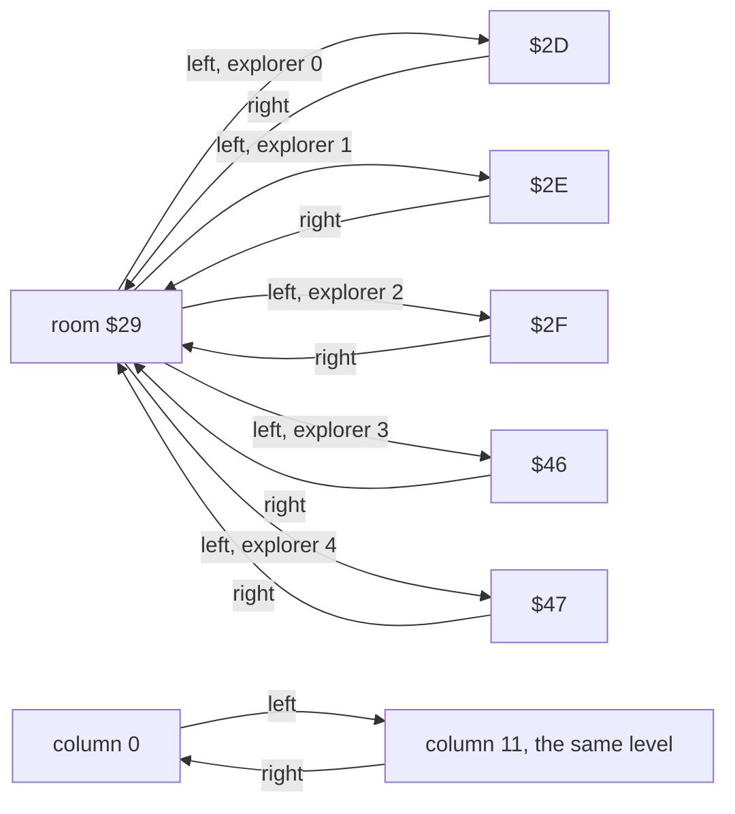

The horizontal wrap makes every level a ring of 12 rooms. The explorer rooms replace the usual left neighbour of room
`$29` (room `$28`, the space scene), so each explorer sees only his own room there. Room `$28` is never entered by an
exit: only LoseGame and ProfessorEnding set it.

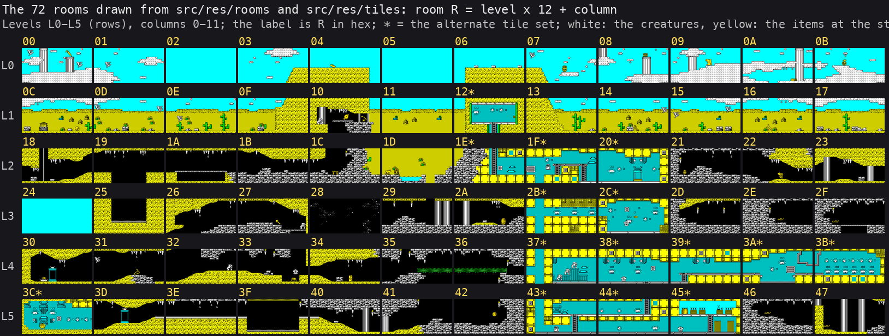

The map: every room drawn from `src/res/rooms/rooms.txt` by `tools/fig_rooms.py` (doc 06).

How to read the map:

- 12 rooms to a row, one row a level, the surface at the top.
- The last row ends with rooms `$46` and `$47`.

**The point**: the map is a 12 x 6 grid that wraps sideways. The only special link is room `$29`'s left exit, which
leads to the chosen explorer's room.

Worked example: the RZX run's first exits. The run starts in room `$14` (level 1, column 8). By RZX 750 it is in room
`$07` (level 0, column 7), one level up and one column left. The samples of `work/stage1/rzx/vars.bin` show it there
with the first pickup made (score 50).

Witness:

- ExitLeft: 30 exits in 17 rzx segments, 3 of them wrapping. The room `$29` path ran once, with explorer 0.
- ExitRight: 38 exits in gameover and 18 rzx segments; the explorer room path once.
- ExitUp: 13 calls, 5 of them blocked (`.ann`).

## 10.2 The statuses

The hero's state is Status `$5C06`, 0-33, with StatusTimer `$5C07` counting the passes inside it. Status 0 is the
normal update (walk, climb, fall, jump start). Every other status is a handler that replaces the rest of the update:
StatusDispatch `$A6CC` jumps to word N - 1 of StatusHandlers `$A72E`, and each handler drops the return into
HeroUpdate with a POP (Teleport's first pass does not: 10.6).

```asm
StatusDispatch:
  LD A,(Status)
  OR A
  RET Z                   ; status 0: the normal update goes on
  LD C,$FF                ; no sound, for the death lists
  DEC A
  ADD A,A
  LD L,A
  LD H,$00
  PUSH DE
  LD DE,StatusHandlers    ; word N - 1 for status N
  ADD HL,DE
                          ; falls into JumpThroughWord: pop DE, JP (word)
```

| Status | Handler | What | Set by |
| ---: | --- | --- | --- |
| 0 | none | the normal update | ClearStatus `$AE84` |
| 1, 2, 3 | JumpArc `$ADAC` | the jump: 1 off an edge after three refusals, 2 the fire key, 3 the hop out of room `$18`'s ladder top | RefuseDrop, StartJump `$A465`, ClimbOutTop |
| 4 | Hover `$AD32` | hover with the Vacuum Cleaner in rooms `$14` and `$08` | StartHover `$A42B` |
| 5 | BounceUp `$AD17` | rise 4 pixels a pass, then the jump arc | PickUpItem (the Spring, the Trampoline) |
| 6 | Status6Entry `$A5F0` | stand and animate: the Flute played | RopeTrick `$BC73` |
| 7, 8 | BalloonRide `$AC35` | in the balloon | StatusZeroTriggers `$AF3B` |
| 9 | BalloonCrash `$AC1A` | the balloon falls | BalloonRide, in room 3 with the Party Manifesto |
| 10 | Think `$AB6E` | the T key: think | ThinkKey `$B02E` |
| 11 | BrightIdea `$ABC7` | the idea: an item | Think |
| 12 | NoIdea `$ABD9` | no idea: head shaking | Think |
| 13 | BarrelSpot `$AA3C` | at room `$1D`'s barrel spot | StatusZeroTriggers |
| 14 | BarrelRide `$AA6F` | the ride in the Barrel Medium | BarrelSpot |
| 15 | BarrelRideShort `$AAA7` | the Barrel Small: fatal | BarrelSpot |
| 16 | BarrelRideLong `$AABA` | the Barrel Big: on to the next room, fatal | BarrelSpot |
| 17 | SinkInMud `$AA04` | sink one row into the mud, then status 0: not a death | HeroTileChecks (`$A15C`, written directly), after 50 passes on mud |
| 18 | LoseLifeWait `$A9EE` | 50 passes, then a life lost | StartDying `$AAF0` |
| 19 | LiftUp `$A96B` | the lift up | LiftPlatform `$AF81` |
| 20 | LiftDown `$A9C4` | the lift down | LiftPlatform |
| 21 | RideObject4 `$A95F` | carried by the basket | BasketScript `$B409` |
| 22 | Teleport `$A8EA` | the teleport pads | TeleportPadCheck `$B03B` |
| 23 | SilentDeath `$A8A8` | room `$20`'s pad, the radiation, room `$39`'s creature | Teleport, RadiationScript, SilverCrossScript |
| 24 | CreatureDeath `$A89E` | a creature's touch, the beam | HitExplorer `$C0DA`, RoomEffects `$91C0` (the beam hit `$9260`) |
| 25 | Room1ADeath `$A88F` | a snake's bite | RunSnakes `$B57C` |
| 26 | FallDeath `$A888` | the fall, tile `$A5`, the balloon crash, room `$2E` | HeroLand, HeroTileChecks, BalloonCrash, ExplorerRoom2E, HitExplorer |
| 27 | Room43Anim `$A851` | the Silver Lining becomes the Silver Cross | SilverLiningScript `$B704` |
| 28 | Room2DAnim `$A828` | the Cricket Ball throw | CricketBallScript `$B370` |
| 29 | Frozen `$A90E` | nothing: a script moves the hero | LoseGame, ProfessorEnding, Room2DAnim, ExplorerRoom46 |
| 30 | LookIntoTelescope `$A822` | bend to the telescope | TelescopeRoom `$B16A` |
| 31 | TelescopeView `$A7B9` | the asteroid and the time left | LookIntoTelescope |
| 32 | DrinkPose `$A783` | room `$2E`, the Beer Barrel | ExplorerRoom2E `$B263` |
| 33 | FlashPose `$A770` | room `$47`, the Flashgun | ExplorerRoom47 `$B18A` |

The table holds word N - 1 for status N: status `$19` is Room1ADeath `$A88F`, `$15` RideObject4 `$A95F`, and so on.

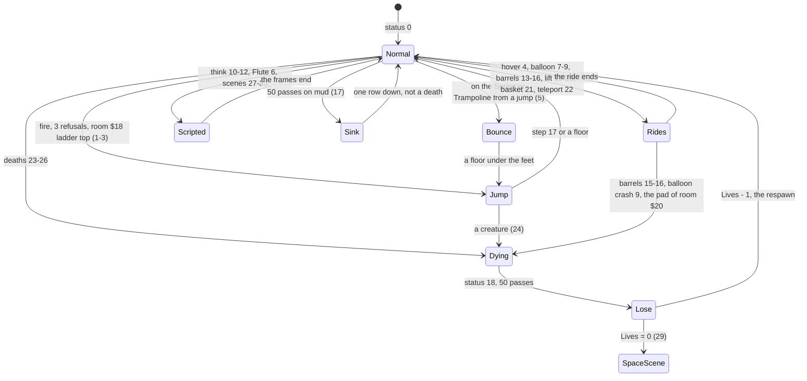

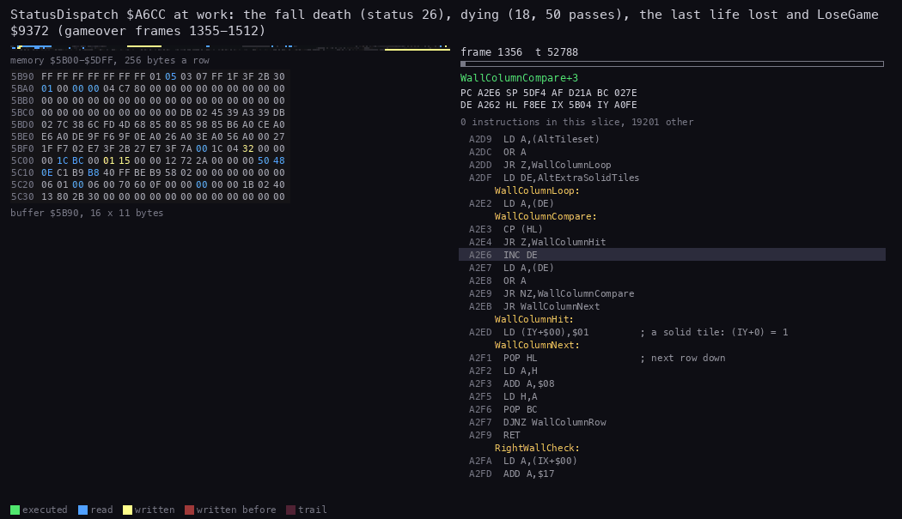

The animation of StatusDispatch, made by another writer, shows the dispatch through the table.

**The point**: one byte selects the hero's whole behaviour. The deaths, the rides and the scripted scenes are all
statuses, so a creature can only kill a hero whose status is below 15 (doc 07.6).

Witness: StatusDispatch makes 9 430 dispatches in c1, explorers, gameover and 26 rzx segments (`.ann`). Each status's
witness is given in its section.

## 10.3 Walking and climbing

In status 0, HeroUpdate `$A3E1` reads the controls into E (bit 0 right, 1 left, 2 down, 3 up, 4 fire). Left with right
or up with down reads as nothing (ReadControls). The steps:

```text
HeroUpdate, status 0, not falling:
    if fire and standing and not on the lift and not on the unicycle and (Room != $1A or Y >= $3A):
        StartJump: Status = 2, JumpDirection = E, sound 6
    if right: X += 2, facing right; X >= $E8: ExitRight
    if left:  X -= 2, facing left;  X < 4: ExitLeft
    if down and OnLadder: Y += 2, ClimbFrame; Y >= $67: ExitDown
    if up and OnLadder:   Y -= 2, ClimbFrame; above 0: ExitUp (room $18: hop out, status 3)
    HeroTileChecks
    if a wall at the leading edge: X back
    if OnLadder: nothing more
    elif floor distance 0: HeroLand
    elif floor distance 1-4: HeroFall
    else: RefuseDrop (unless the umbrella is held)
    the walk frame: 0-3 every other pass, 2 at rest
```

The climb frame is `$20 + (Y AND 6) / 2`, so the four climb frames change every 2 pixels. A ladder is a tile `$98` or
`$99` in every room, also `$92` and `$95` on level 0, or `$C6`, `$C7`, `$CE`, `$CF` with the alternate tile set
(OnLadder `$A193`). The test reads the tile under the middle of the feet (X + 12, Y + 23).

```asm
  CP $67                  ; down a ladder: Y >= $67 leaves by the bottom
  JP NC,ExitDown
  JR ClimbFrame
  ...
ClimbFrame:               ; A = Y
  AND $06                 ; frame $20 + (Y AND 6) / 2: the four climb frames
  RRCA
  ADD A,$20
  LD (IX+$02),A
  RET
```

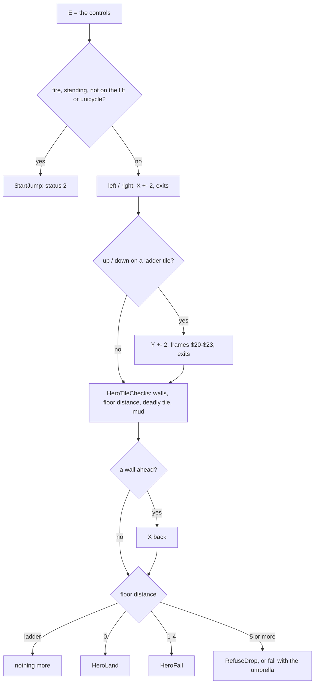

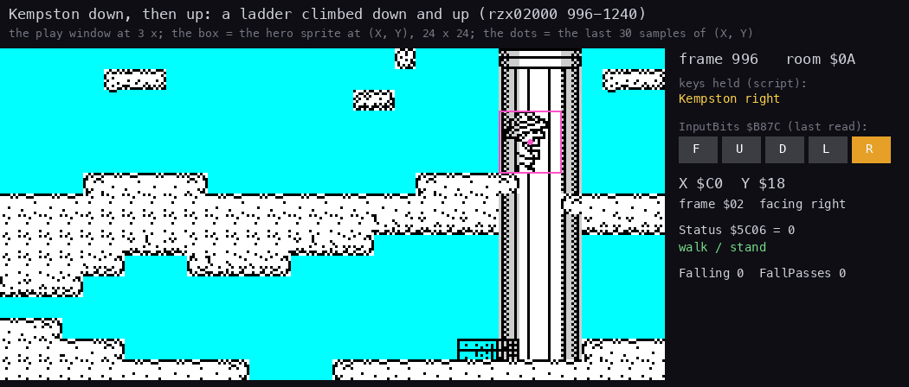

The animation was made by another writer. It shows the climb frames changing as the hero moves up a ladder.

**The point**: the walk and the climb are 2 pixels a pass, the same step as every creature. The ladder is a property
of a tile under the hero's middle, not of the room.

Worked example: `rzx24750` frames 612-614. The hero walks left in room `$30`: X `$4C` in the samples of 612 and 613,
`$4A` in 614, frame 3. The walk frame steps only on every other pass (PassCount bit 0), and the X changes once a pass
because the pass is about 2.84 frames long.

Witness: HeroUpdate's climb runs 439 passes in 8 rzx segments (`.ann`, OnLadder). HeroWalkFrames runs 15 541 times in
the 34 builds.

## 10.4 The jump

A jump lasts 17 passes. Each pass sets the frame from JumpFrames `$AE8D`, moves Y by JumpRise `$AE9E` and moves X by 2
in the jump's direction. A floor under the feet ends the jump early, and step 17 puts the hero on the row.

| Step | 0 | 1 | 2 | 3 | 4 | 5 | 6 | 7 | 8 | 9 | 10 | 11 | 12 | 13 | 14 | 15 | 16 | 17 |
| --- | --- | --- | --- | --- | --- | --- | --- | --- | --- | --- | --- | --- | --- | --- | --- | --- | --- | --- |
| frame | `$0C` | `$0C` | `$0D` | `$0D` | `$0E` | `$0E` | `$0E` | `$0E` | `$0E` | `$0F` | `$0F` | `$0F` | `$0F` | `$0F` | `$0F` | 2 | 2 | `$04` |
| rise | 4 | 3 | 3 | 3 | 2 | 2 | 1 | 0 | 0 | 0 | -1 | -2 | -2 | -3 | -3 | -3 | -4 | Y AND `$F8` |

Step 17 is the snap pass. JumpArc calls FrameFromTable before its `CP $11` (`$ADB0`), so in that pass the frame is
JumpFrames[17]: the byte past the 17-byte table, which is JumpRise[0] = `$04`. Then Y goes onto the row (Y AND `$F8`)
and the status is cleared. The frame `$04` shows only when the jump runs its full 17 steps without meeting a floor.

The rise sums to 18 pixels up and 18 down. A sideways jump covers 17 x 2 = 34 pixels. The hero is 24 pixels tall, so a
jump clears less than his own height.

```text
JumpArc (statuses 1, 2, 3):
    Hero.frame = JumpFrames[StatusTimer]             ; step 17 reads JumpRise[0] = $04
    step = StatusTimer; StatusTimer += 1
    if step == $11: Y = Y AND $F8; Status = 0; return
    JumpStepY(step):
        if step == $10 and over the hole of $5BA2: fall to the room below
        Y -= JumpRise[step]
        if Y < 0: ExitUp; if Y >= $68: ExitDown
        if a floor under the feet: frame 2, Status = 0
    if JumpDirection has left or right:
        X += 2 or X -= 2 (exits at $E7 and at 1-2)
        if a wall at the leading edge: X and Y back
```

```asm
JumpArc:
  POP HL
  LD DE,JumpFrames
  CALL FrameFromTable
  LD HL,StatusTimer
  LD A,(HL)
  INC (HL)
  CP $11                  ; step 17: onto the row, status 0
  JR NZ,JumpMove
  LD A,(IX+$01)
  AND $F8
  LD (IX+$01),A
  JP ClearStatus
JumpMove:
  CALL JumpStepY
  LD A,(JumpDirection)
  LD E,A
  AND $03                 ; straight up: no X move
  RET Z
  ...
```

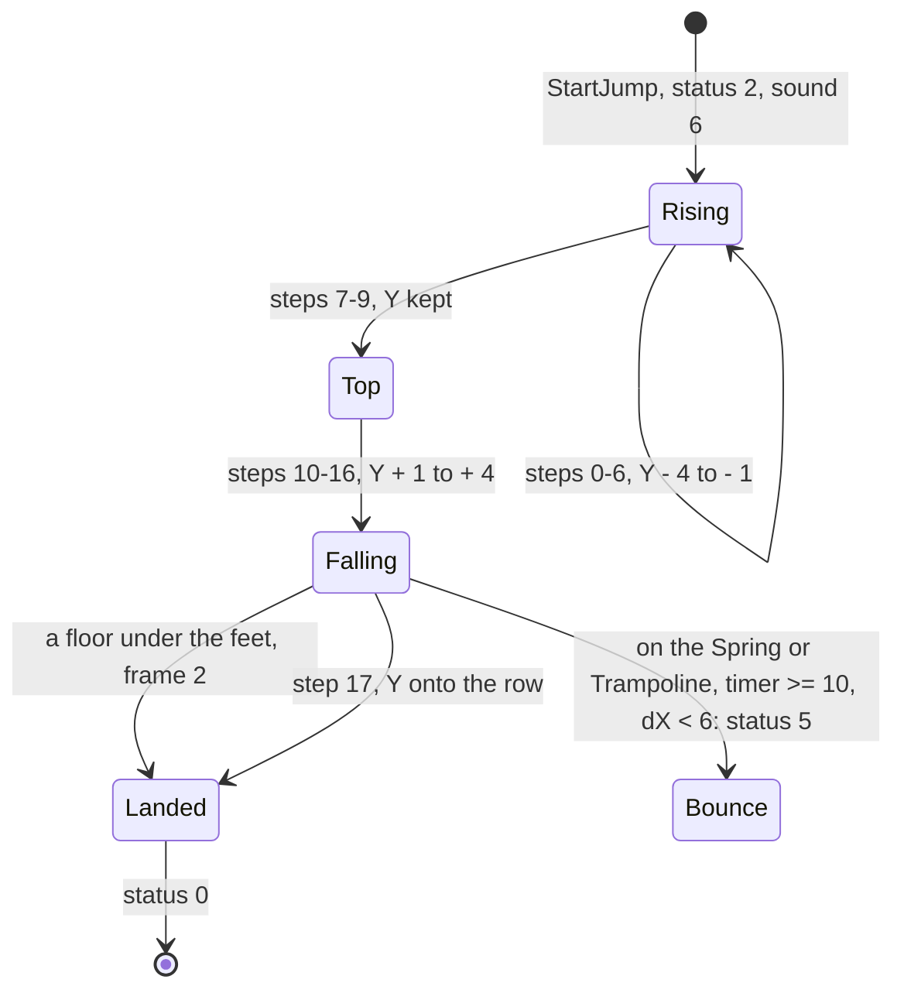

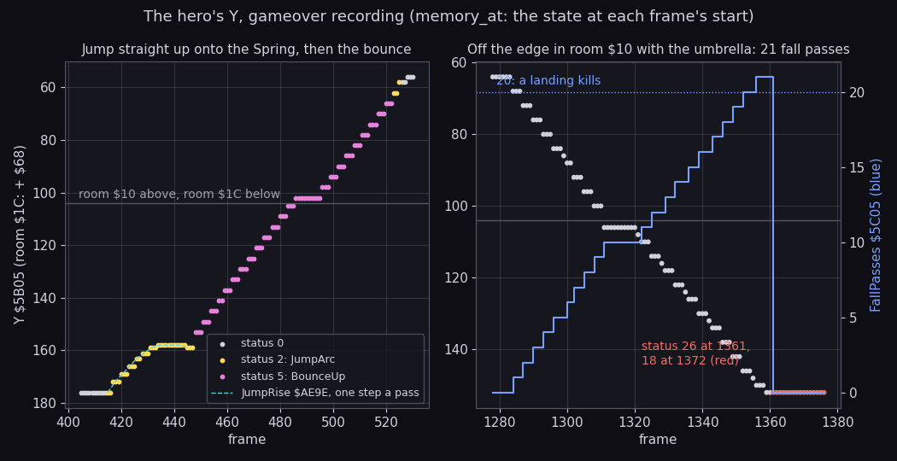

The figure: `gameover` frames 405-530 (left) and 1278-1376 (right), from the samples (`work/docs/tmC/go/vars.jsonl`),
drawn by `tools/fig_gameplay.py`.

```bash
python3 tools/fig_gameplay.py docs/img/gameplay
```

How to read the figure:

- Left: the hero's Y, one dot a frame, coloured by the status: white 0, yellow 2 (JumpArc), pink 5 (BounceUp). In room
  `$1C` the Y is drawn `$68` lower, so the climb into room `$10` reads as one curve. The dashed line is JumpRise, one
  step a pass.
- Right: the fall; the dots are the Y, the blue steps are FallPasses `$5C05`. The dotted line is the limit of 20.

**The point** (left): a jump is one curve of 17 passes. The Spring turns its fall into a climb of 4 pixels a pass, high
enough to pass through the ceiling into the room above.

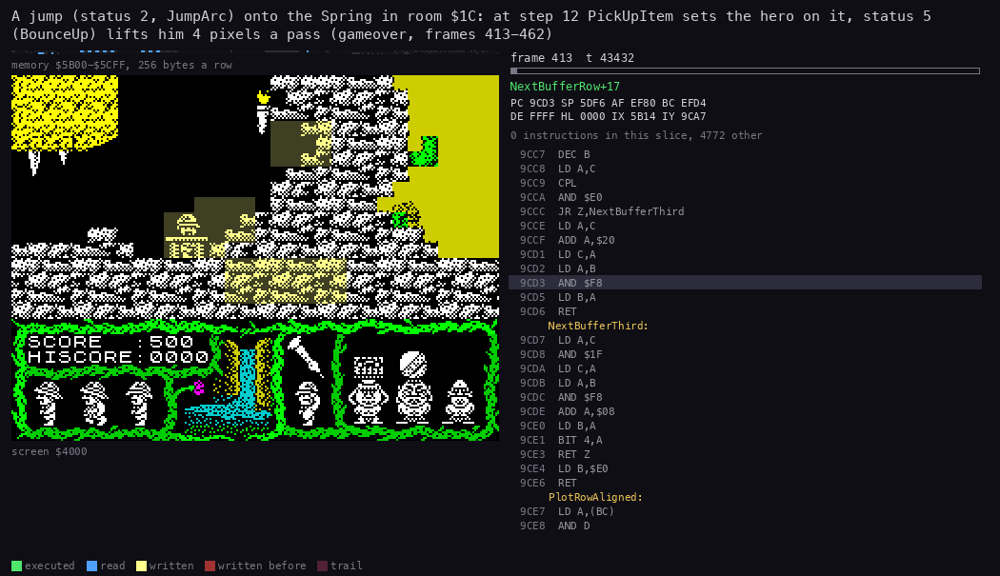

The animation shows `gameover` frames 413-462, in 80 pictures, with the screen as the view. The code panel follows
JumpArc `$ADAC-$AE8C`, BounceUp `$AD17` and PickUpItem `$BB6C`.

```bash
python3 ../../kit/routine_anim.py --work work/docs/tmC/go --window 413:0-462:0 --listing build/game.lst \
  --pc ADAC-AE8C,AD17-AD31,BB6C-BC06 --view screen --range 5B00-5CFF --pictures 80 --delay 120 \
  --title "A jump (status 2, JumpArc) onto the Spring in room \$1C: at step 12 PickUpItem sets the hero on it, status 5 (BounceUp) lifts him 4 pixels a pass (gameover, frames 413-462)" \
  --out docs/img/routines/JumpArc.gif
```

Worked example: `gameover`, room `$1C`. The hero stands on the floor next to the Spring at X `$50`, Y `$48`.

1. Frame 414: fire, straight up. The sample of 415 shows status 2.
2. The Y samples go `$48`, `$44`, `$41`, `$3E`, `$3B`, `$39`, `$37`, `$36`, `$36`, `$36`, then `$37` at step `$0B`.
   These are the JumpRise steps 4, 3, 3, 3, 2, 2, 1, 0, 0, 0, -1.
3. In frame 447, at StatusTimer `$0B`, PickUpItem finds him near the Spring (item slot 1: X `$50`, Y `$48`), in status
   2 with the timer 10 or more and |dX| = 0. It sets Y = `$48` - `$17` = `$31`, frame `$0F` and status 5.
4. BounceUp lifts him 4 pixels a pass. In frame 485 he leaves the top of the room (Y 1), and in frame 486 he is in room
   `$10` at Y `$66`.
5. In frame 522 BounceUp finds a floor under his feet: status 2, timer 0, Y `$3E` (the sample of 523). The new jump
   lands at once on that floor: timer 1 and Y `$3A` at 525, status 0 and frame 2 in the sample of 526.

Witness: JumpArc runs 2 391 passes in gameover and 23 rzx segments; BounceUp 67 passes in gameover, rzx10000 and
rzx22000 (`.ann`).

## 10.5 The fall, the refusal and the umbrella

HeroTileChecks puts the number of tile rows below the feet in HeroProbes+3 (FloorDistance `$A1F4`). HeroUpdate then
chooses:

| Rows | What happens |
| --- | --- |
| 0 | land (HeroLand `$A5B9`) |
| 1-4 | fall (HeroFall `$A570`) |
| 5 or more | refuse (RefuseDrop `$A545`): the hero is put back and shakes his head; the third refusal in a row jumps off the edge (status 1). With the Umbrella in hand he falls instead |

A falling hero moves 2 pixels, probes again, and moves 2 more while still above the floor: 4 pixels a pass. The input is
ignored. Each pass counts FallPasses `$5C05`, except with the Umbrella in hand. A landing after 20 fall passes or more
kills: status 26.

The Umbrella exception has its own exceptions, decided by the room and X:

- in rooms `$35` and above, the passes count even with the Umbrella;
- in rooms `$10` and `$1C`, left of X `$80`, they count even with the Umbrella;
- everywhere else, the Umbrella stops the count.

```asm
HeroFall:
  INC (IX+$01)            ; 2 pixels, probe, 2 more while still above the floor
  INC (IX+$01)
  CALL HeroTileChecks
  LD A,(IY+$03)
  OR A
  JR Z,HeroFalling
  INC (IX+$01)
  INC (IX+$01)
  LD A,(Room)             ; count the fall passes unless the umbrella is in use ...
  CP $35
  JR NC,HeroFallCount
  BIT 7,(IX+$00)
  JR NZ,HeroFallUmbrella
  CP $10
  JR Z,HeroFallCount
  CP $1C
  JR Z,HeroFallCount
HeroFallUmbrella:
  LD A,(HeldItem)         ; ... rooms $35 and up, and rooms $10 and $1C left of X $80
  CP $05
  JR Z,HeroFalling
HeroFallCount:
  LD HL,FallPasses        ; + 1, kept at 255
  INC (HL)
  JR NZ,HeroFalling
  DEC (HL)
HeroFalling:
  LD E,$00                ; no input while falling
  LD A,$01
  LD (Falling),A
  LD A,(IX+$01)
  CP $68
  JP NC,ExitDown
  JR HeroWalkAnim
HeroLand:
  LD HL,FallPasses        ; 20 fall passes or more kill
  LD A,(HL)
  LD (HL),$00
  CP $14
  LD A,$1A
  CALL NC,SetStatus
  LD A,(IX+$01)           ; Y onto the row
  AND $F8
  LD (IX+$01),A
```

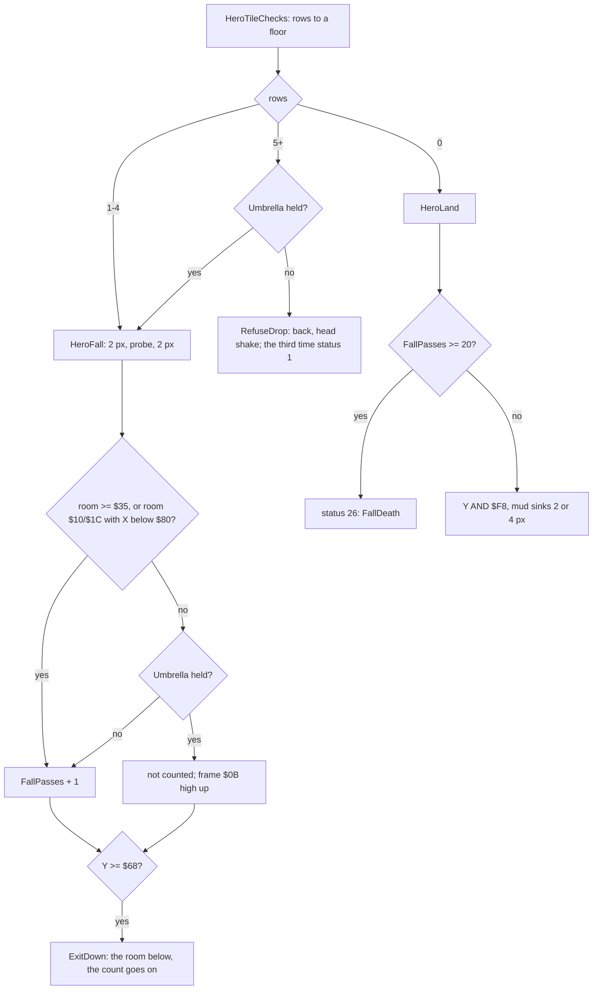

A room entry saves the respawn point only while FallPasses is 0, so a falling hero never saves a checkpoint mid-fall
(doc 07.2).

**The point** (right panel of the figure in 10.4): the umbrella is a parachute everywhere except in the deep levels and
in the shaft of rooms `$10` and `$1C`. That shaft is exactly where the RZX player lost his only life.

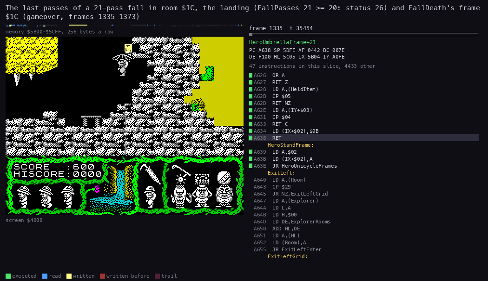

The animation shows `gameover` frames 1335-1373, in 76 pictures, with the screen as the view. The code panel follows
HeroUpdate `$A3E1-$A63F`, FallDeath `$A888-$A8E9` and StartDying `$AAF0`.

```bash
python3 ../../kit/routine_anim.py --work work/docs/tmC/go --window 1335:0-1373:0 --listing build/game.lst \
  --pc A3E1-A63F,A888-A8E9,AAF0-AAF9 --view screen --range 5B00-5CFF --pictures 76 --delay 120 \
  --title "The last passes of a 21-pass fall in room \$1C, the landing (FallPasses 21 >= 20: status 26) and FallDeath's frame \$1C (gameover, frames 1335-1373)" \
  --out docs/img/routines/FallDeath.gif
```

Worked example: `gameover`, the RZX player's fall, from the samples.

| Frame | Room | Hero | HeldItem | FallPasses | Status |
| ---: | --- | --- | --- | ---: | --- |
| 1283 | `$10` | `72 40 03 00` | `05` (Umbrella) | 0 | 0 |
| 1284 | `$10` | `72 44 0B 00` | `05` | 1 | 0 |
| 1310 | `$10` | `72 64 0B 00` | `05` | 9 | 0 |
| 1311 | `$1C` | `72 02 0B 00` | `05` | `$0A` | 0 |
| 1360 | `$1C` | `72 30 02 00` | `05` | `$15` (21) | 0 |
| 1361 | `$1C` | `72 30 02 00` | `05` | 0 | `$1A` |
| 1364 | `$1C` | `72 30 1C 00` | `05` | 0 | `$1A` |
| 1372 | `$1C` | `72 30 1C 00` | `05` | 0 | `$12` |

Step by step:

1. The hero walks left off a ledge in room `$10` at X `$72`, below `$80`, with the Umbrella in hand. Frame `$0B` is the
   umbrella pose.
2. Room `$10` and X below `$80`: the passes count despite the Umbrella.
3. He falls through the floor into room `$1C`. The count goes on: `$0A` at the entry, 21 at the landing.
4. FallPasses 21 is 20 or more: status 26 in frame 1360. FallDeath shows frame `$1C` (the flattened hero) and moves to
   status 18 at 1372.

Witness: HeroLand's kill ran in gameover (frame 1360), rzx10000 (the same fall) and rzx24000 (`.ann`, FallDeath). The
refusal frames play 7 times in 3 rzx segments (RefuseFrames).

## 10.6 The rides

Each ride is a status that moves the hero by its own rules until it ends.

| Ride | Status | Start | Motion | End | Witness |
| --- | --- | --- | --- | --- | --- |
| Bounce | 5 | landing on the Spring (14) or the Trampoline (20) in a jump (doc 07.9) | Y - 4 a pass, through the ceiling into the room above | a floor: status 2 | gameover, rzx10000, rzx22000: 67 passes |
| Hover | 4 | the Vacuum Cleaner (10) in hand in room `$14` or `$08` | frame `$1D`; 2 pixels in four directions | another item in hand | 4 908 passes in c1, explorers, rzx00000 |
| Lift down / up | 20 / 19 | down or up on the lift platform (LiftPlatform `$AF81`, X `$1A-$2F`) in the lift's room | Y + 2 or - 2 a pass along column 7 | the stop of rooms `$1F`, `$2B`, `$37`, `$43` | down: 220 passes in rzx20000, rzx36000; up: none |
| Balloon | 7, 8 | standing at the balloon (StatusZeroTriggers) | the Bellows (6): rise 1 a pass; the Party Manifesto (7): rise; any other item: sink 2 a pass | on the ground, step out left or right | rzx14500 frames 195-849, the Bellows; rzx14000 frames 696-1104, no rise; 452 passes |
| Balloon crash | 9 | rising with the Party Manifesto to the top of room 3 | sink | the ground: status 26 | none |
| Barrel spot | 13 | left held at Y `$48`, X `$1C-$1F` in room `$1D` | frame `$17`, wait 5 passes | the barrel in hand chooses 14, 15 or 16 | rzx16000 frames 479-491 |
| Barrel Medium | 14 | item 9 in hand | 84 passes, X + 2, Y along BarrelArc `$AAFA` | status 0 | rzx16000 frames 508-745 |
| Barrel Small | 15 | item 28 in hand | BarrelShortArc, 32 passes | frame `$1C`, status 18: death | none |
| Barrel Big | 16 | item 27 in hand | X + 2, Y - 1 on four passes of eight, 101 passes, on to the next room | status 18: death | none |
| Basket | 21 | near the basket at its end in room `$3F` | the hero takes the basket's place, frame `$2D` | the other end: Y - 8, status 0 | 418 passes in rzx28000, rzx32750, rzx34000 |
| Float | none: FloatInRoom2C replaces the update | entering room `$2C` | velocity -3..3 on each axis, +1 a pass towards the held direction, bounce off walls | the left exit | rzx18000, rzx20000: 149 passes |
| Teleport | 22 | standing on a pad (TeleportPads `$B073`), PadLatch 0; it moves him only with CrystalPlaced set | TeleportFrames, then the other pad | room `$30` to `$3D`, `$3D` to `$20`; the pad of room `$20` kills (status 23) | rzx24750 frames 731-780, rzx34000 frames 1461-1512 |

```text
TeleportPadCheck (every pass in status 0):
    for (room, Y, X) in TeleportPads:            ; ($20,$58,$80) ($3D,$38,$60) ($30,$58,$60)
        if Room == room and Hero.Y == Y and X <= Hero.X < X + 8:
            if not PadLatch: Status = 22
            return
    PadLatch = 0                                 ; off every pad

Teleport (status 22), no POP: it may return into HeroUpdate
    while StatusTimer == 0: LiftRoom = $1F, LiftY = $50
        Room $30: destination $3D; Room $3D: destination $20
        Room $20: Status = 23 (the silent death)
        if not CrystalPlaced: return                  ; RET Z into HeroUpdate: the normal update runs on
    play TeleportFrames; at the room byte: SetUpRoom(destination), PadLatch = pad X
```

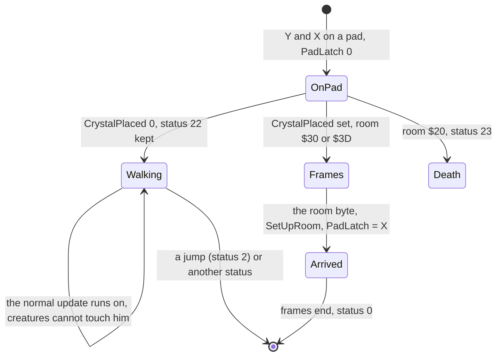

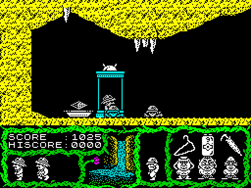

The animation shows `rzx24750` frames 716-786, every second frame, at twice the size. The hero jumps onto the pad of
room `$30`, dissolves, and appears in room `$3D`.

```bash
python3 ../../kit/screen_anim.py --work work/docs/tmC/r247 --from 716 --to 786 --step 2 --scale 2 --delay 100 \
  --hold 2000 docs/img/play/teleport-r24750.gif
```

**The point**: the pad, not the crystal, starts status 22. Only the crystal makes it a journey; without it the hero
stays in a status no creature can touch, until he jumps.

Worked example: `rzx24750`. The crystal was placed at frame 613 (doc 07.10). The hero jumps in frame 721 (status 2 in
the sample of 722) and lands on the pad at Y `$58`, X `$62`: the pad of room `$30` is (`$58`, `$60`), and `$62` is
within `$60-$67`. Status 22 shows in the sample of 731. The frames run to 780, and the hero arrives in room `$3D`.


Without the crystal the pad does not hold the hero. Teleport has no POP, so its `RET Z` (`$A914`) returns into
HeroUpdate before the `POP HL` at `$A919`: the normal update runs on, walk and jump, with Status 22 kept and the timer
at
0. Each pass the first-pass code runs again and puts the lift back in room `$1F` at Y `$50`. HitExplorer ignores a hero
in a status of `$0F` or more (`$C0EB`) and the tile-`$A5` probe is off (`$A114`), so until he jumps (status 2) no
creature can touch him. The two teleports of the builds both had the crystal, so this is known only from the code.

### The lift (statuses 19 and 20)

The lift runs in the shaft of column 7, rooms `$1F`, `$2B`, `$37` and `$43`. LiftRoom `$5B9E` holds the room it is in
and LiftY `$5B9F` its Y. In that room the main loop calls LiftPlatform `$AF81`, which draws the lift as slot 4 (frame
`$9F`, item sprite 31) and reads the keys of a hero standing on it. The ride moves the hero 2 pixels a pass and the lift
8 pixels under his feet. Each room of the shaft has one stop (LiftStops `$A9E6`): there the ride ends.

```text
LiftPlatform (in room LiftRoom, every pass):
    slot 4 = (X $24, Y LiftY, frame $9F)
    if Hero.Y == LiftY - 8 and $12 <= Hero.X < $38:
        NotOnLift = 0                                 ; HeroTileChecks: he stands on the lift
        if $1A <= Hero.X < $30 and Status in (0, 19, 20):
            if down held: SetStatus(20)               ; down wins when both are held
            elif up held: SetStatus(19)

LiftDown (status 20):
    if Room == $43 and AtStop(): return               ; the bottom of the shaft
    Y = Hero.Y + 2
    if Y < $62: Hero.Y = Y; LiftY = Y + 8; AtStop()
    else: ExitDown; LiftY = Hero.Y + 8; LiftRoom = Room

LiftUp (status 19):
    if Room == $1F and AtStop(): return               ; the top of the shaft
    if Room == $1F: SaveRespawnPoint
    if Hero.Y >= 2: Hero.Y -= 2; LiftY = Hero.Y + 8; AtStop()
    else: ExitUp; LiftY = Hero.Y; Hero.Y -= 8; LiftRoom = Room

AtStop (LiftAtStop $A9A9):
    if (Room, LiftY) is in LiftStops ($1F,$50  $2B,$30  $37,$50  $43,$68): ClearStatus
```

```asm
LiftDown:
  POP HL
  LD A,(Room)
  CP $43
  JR NZ,LiftDownMove
  CALL LiftAtStop
  RET Z
LiftDownMove:
  LD A,(IX+$01)
  ADD A,$02
  CP $62
  JR C,LiftMoveY          ; still in this room: Y + 2, the lift 8 lower, the stop test
  CALL ExitDown
  LD A,(IX+$01)
  ADD A,$08
  LD (LiftY),A
  JR LiftSetRoom          ; the lift goes with him into the room below
```

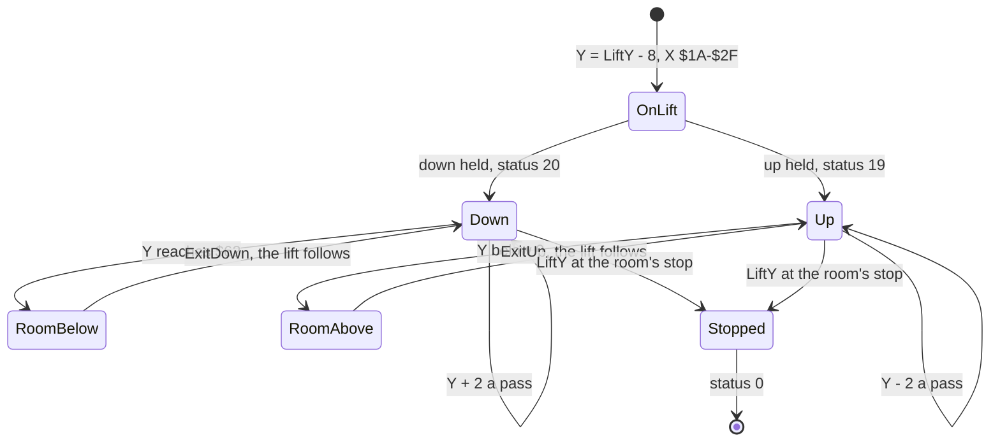

The lift stays where the ride left it: a room change does not move it. A new game puts it in room `$2B` at Y `$30`
(InitGame), the teleport in room `$1F` at Y `$50` (Teleport, above), and a respawn back where it was at the last
checkpoint room (Respawn `$9090` reads `$5C32-$5C33`). A hero who rides down and walks away leaves the lift below; to
go up again he must come back to it.

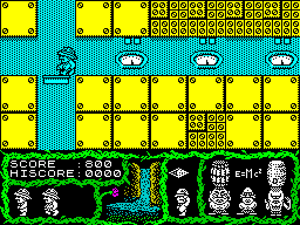

The animation shows `rzx20000` frames 612-828, every third frame, at twice the size. The hero steps onto the lift in
room `$2B`, rides down through the floor, and the ride ends at the stop of room `$37`.

```bash
python3 ../../kit/screen_anim.py --work work/review/fixC/r20000 --from 612 --to 828 --step 3 --scale 2 --delay 80 \
  --hold 2000 docs/img/play/lift-down-r20000.gif
```

**The point**: the lift is a persistent object: it stays where the ride left it, and only InitGame, the teleport and a
respawn move it.

Worked example: `rzx20000`, sampled every frame from `$5B00`.

1. The hero stands on the lift in room `$2B` at its stop: LiftY `$30`, his Y `$28`, NotOnLift `$5BA0` = 0.
2. Down is held: status 20 is set in frame 628. The sample of 629 shows Y `$2A`, LiftY `$32`.
3. Y + 2 a pass up to `$60`. The next step gives `$62`: ExitDown, room `$37` and Y `$02` in the sample of 707. The
   room build inside ExitDown spans frames 707-713; LiftY `$0A` and LiftRoom `$37` are written after it returns, in
   the sample of 714.
4. Y + 2 a pass again. Room `$37`'s stop is LiftY `$50`: at Y `$48` AtStop clears the status, status 0 in the sample
   of 806.
5. 28 + 1 + 35 = 64 passes in 178 frames: 2.8 frames a pass, as in the rest of play.

Witness: LiftDown 220 passes (L1), `rzx20000` frames 628-805 and `rzx36000` frames 334-937; LiftPlatform 1406 calls in
6 segments. LiftUp never ran: the up ride is known only from the code.

### The balloon (statuses 7, 8 and 9)

The balloon flies between room `$0F` and room 3 above it. BalloonX `$5C25`, BalloonY `$5C26` and BalloonInRoom
`$5C27` keep it between visits. In its room BalloonRoom `$AFD7` draws the basket as slot 4 (frame `$99` empty, `$24`
with the hero in it) and the envelope as slot 3, 16 pixels higher (frame `$9A`, hidden in status 9). During the ride
the hero's own frame is `$7F` (not drawn): the basket's frame `$24` is the hero in the basket. The held item decides the
ride, every pass.

```text
StatusZeroTriggers (status 0, outside room $1D):
    if Room == BalloonInRoom and BalloonY - Hero.Y in -2..1 and BalloonX - Hero.X in -2..1:
        Status = 7                                    ; in the balloon

BalloonRide (statuses 7 and 8):
    BalloonInRoom = Room; Hero.frame = $7F; HeroTileChecks
    if in the air:                                    ; no floor under the basket
        if Status != 7 and right held and no wall: X += 2 (below $E4)
        if left held and no wall: X -= 2 (not below 8)
        BalloonX = X
    if HeldItem == 6: Status = 8; Rise                ; the Bellows
    elif HeldItem == 7: Status = 7; Rise              ; the Party Manifesto
    else: Sink

Rise:
    if Hero.Y - 1 >= $18: Hero.Y -= 1
    elif Room != 3: ExitUp                            ; into room 3
    elif Status == 7: Status = 9                      ; room 3's top with the Manifesto: the crash
    else: return                                      ; room 3's top with the Bellows: hover
    BalloonY = Hero.Y

Sink:
    if in the air:
        Hero.Y += 2; if Hero.Y >= $66: ExitDown; Hero.Y += $18
        BalloonY = Hero.Y
    else:                                             ; on the ground
        BalloonY = Hero.Y
        if right held and X + 2 < $E7: X += 2; ClearStatus  ; step out
        if left held and X >= 2: X -= 2; ClearStatus

BalloonCrash (status 9):
    BalloonInRoom = Room; HeroTileChecks
    if in the air: Sink
    else: slot 4 frame $7F; SetStatus(26)             ; FallDeath
```

```asm
BalloonItem:
  LD A,(HeldItem)         ; item 6 or 7 lifts it
  CP $06
  JR Z,BalloonItem6
  CP $07
  JR Z,BalloonItem7
  JR BalloonSink
BalloonItem6:
  LD A,$08
  LD (Status),A
  JR BalloonRise
BalloonItem7:
  LD A,$07
  LD (Status),A
BalloonRise:
  LD A,(IX+$01)
  DEC A
  CP $18
  JR NC,BalloonSetY       ; Y - 1, not above $18
  LD C,A
  LD A,(Room)
  CP $03
  LD A,C
  JR Z,BalloonTop         ; room 3: hover (status 8) or burst (status 7 -> 9)
  CALL ExitUp
  LD A,(IX+$01)
BalloonSetY:
  LD (IX+$01),A
  LD (BalloonY),A
  RET
```

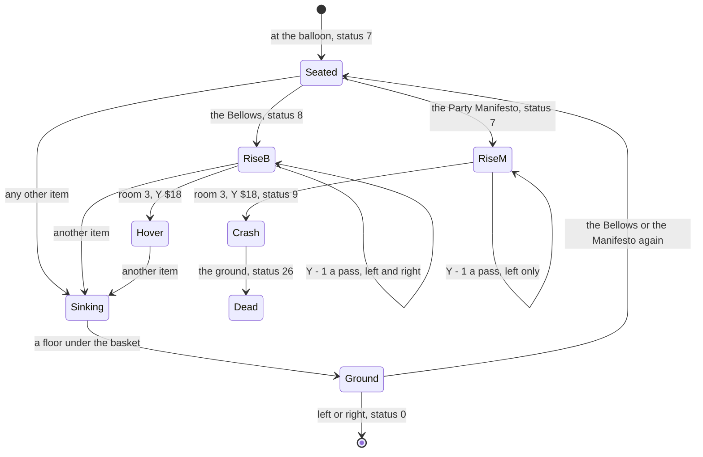

Two details follow from the code. The Party Manifesto keeps status 7, and status 7 skips the right key: with the
Manifesto the balloon only drifts left. And status 9 still sinks through BalloonSink, so the crash falls all the way
to a floor before FallDeath; the envelope is hidden from the start of status 9. No recording holds the Manifesto in
the balloon, so the crash is known only from the code.

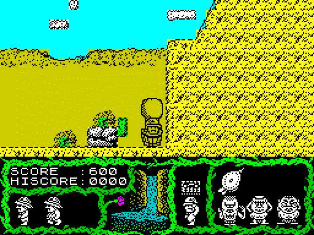

The animation shows `rzx14500` frames 384-864, every sixth frame, at twice the size. With the Bellows in hand the
balloon rises out of room `$0F` into room 3, drifts right at the top, then sinks to the ground when another item is
taken, and the hero steps out.

```bash
python3 ../../kit/screen_anim.py --work work/review/fixC/r14500 --from 384 --to 864 --step 6 --scale 2 --delay 80 \
  --hold 2000 docs/img/play/balloon-ride-r14500.gif
```

**The point**: the held item steers the balloon every pass: the Bellows lift it, any other item lets it sink, and the
Party Manifesto lifts it into a crash.

Worked example: `rzx14500`, sampled every frame from `$5B00`.

1. The hero walks into the basket in room `$0F` at frame 195: status 7 in the sample of 196; slot 4 frame `$24` (the
   hero in the basket) in that of 198, slot 3 frame `$9A`.
2. The Bellows (6) are in hand from frame 396: status 8 at 399. Y - 1 a pass, from `$60` to `$18` in the sample of 569.
3. Y - 1 would pass `$18`: ExitUp, room 3 at frame 572 with Y `$66`. BalloonInRoom is 3 from the sample of 581.
4. Right is held: X + 2 a pass from frame 603. At frame 786 the balloon is at room 3's top, Y `$18`: status 8 stays,
   the balloon hovers.
5. The ACME Bridge (`$0B`) is taken back at frame 813: the balloon sinks 2 a pass to Y `$30` at 846, where the probes
   find the floor. Right is held: the hero steps out, status 0 at 848, and walks into room 4 at 858.

The other ride, `rzx14000` frames 696-1104, never rises: the hero enters at 697 with the ACME Bridge in hand, the hand
is empty (`$FF`) from 896, and he steps out at 1103 where he sat.

Witness: BalloonRide 452 passes (L1), `rzx14000` frames 696-1104 and `rzx14500` frames 195-849; BalloonRoom 1017
passes in the same two segments. BalloonCrash never ran.

### The barrels of room `$1D` (statuses 13 to 16)

Room `$1D` holds the Cannon (item 8, which cannot be picked up) and its barrel spot. The hero stands at the spot with
a barrel item in hand; the barrel chooses the ride. Only the Barrel Medium (9) lands safely.

```text
StatusZeroTriggers (status 0, room $1D):
    if left held and Hero.Y == $48 and $1C <= Hero.X < $20: Hero.X = $1E; Status = 13

BarrelSpot (status 13):
    Hero.frame = $17, facing left
    if right held: ClearStatus                        ; he gives up
    if StatusTimer < 5: StatusTimer += 1; return
    HeldItem 9: SetStatus(14); $1C: SetStatus(15); $1B: SetStatus(16); else wait
    PlaySound(1)                                      ; sound 1, the ROM fall (doc 09): the beeper holds the main loop

BarrelRide (status 14, item 9):
    if StatusTimer == $54: ClearStatus; return        ; 84 passes
    Hero.Y -= BarrelArc[StatusTimer]; StatusTimer += 1
    Hero.X += 2; facing right
    frame + 1 up to $19; from StatusTimer $28 frame $1A

BarrelRideShort (status 15, item $1C):
    if StatusTimer == $20: frame $1C; StartDying      ; status 18 after 32 passes
    else as BarrelRide with BarrelShortArc

BarrelRideLong (status 16, item $1B):
    facing right; frame + 1 up to $19
    t = StatusTimer; StatusTimer += 1; Hero.X += 2
    if t bit 2: Hero.Y -= 1                           ; (t / 2) bit 1: four passes of eight (t = 4-7, 12-15, ...)
    if t / 2 == $32: ExitRight; X 8, Y 8, frame $1B; StartDying   ; t = $64, the 101st pass
```

```asm
BarrelRide:
  POP HL
  LD DE,BarrelArc
  LD HL,StatusTimer
  LD A,(HL)
  CP $54
  JP Z,ClearStatus        ; 84 passes: the ride is over
BarrelRideStep:
  INC (HL)                ; also status 15's
  LD L,A
  LD H,$00
  ADD HL,DE
  LD A,(IX+$01)
  SUB (HL)                ; Y - BarrelArc[timer]: up first, then down
  LD (IX+$01),A
  INC (IX+$00)
  INC (IX+$00)            ; X + 2
  SET 7,(IX+$03)          ; facing right
```

BarrelArc `$AAFA` (84 signed steps) and BarrelShortArc `$AB4E` (32) are `src/res/tables/barrel-arcs.txt`. The 84 steps
of BarrelArc add up to 0: the Medium ride ends at Y `$48`, on the floor it started from, 168 pixels to the right.

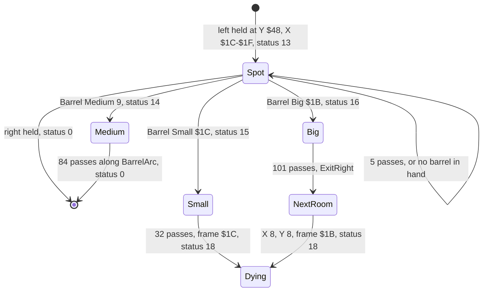

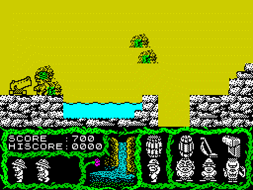

The animation shows `rzx16000` frames 476-752, every fourth frame, at twice the size. The hero walks left to the spot,
turns into the barrel, is shot along the arc to the right and lands.

```bash
python3 ../../kit/screen_anim.py --work work/review/fixC/r16000 --from 476 --to 752 --step 4 --scale 2 --delay 80 \
  --hold 2000 docs/img/play/barrel-ride-r16000.gif
```

**The point**: the spot is the same for every barrel; the item in hand alone decides between the one safe arc and two
deaths.

Worked example: `rzx16000`, sampled every frame from `$5B00`.

1. The Barrel Medium (9) is in hand. Left is held at Y `$48`: status 13 from the sample of 480, X `$1E`, frame `$17`,
   facing left. StatusTimer counts to 5.
2. Status 14 in the sample of 492. PlaySound(1) plays sound 1 on the beeper and holds the main loop: no pass ends
   until frame 509.
3. 84 passes: X + 2 a pass from `$1E` to `$C6`; Y from `$48` up to `$31` and back to `$48`. The frame steps to `$18`
   and `$19`, and from StatusTimer `$28` (the sample of 609) it is `$1A`.
4. StatusTimer reaches `$54`: status 0 in the sample of 746. The hero stands at X `$C6`, Y `$48`.

Witness: BarrelSpot 6 passes and BarrelRide 85 (L1), both in `rzx16000`. Statuses 15 and 16 never ran: the Small and
Big barrels kill only in the code. In the Barrel Big the hero climbs 49 pixels in 101 passes (Y - 1 on t = 4-7,
12-15, ..., 92-95 and `$64`) while X gains 202, then he is put at X 8, Y 8 in the room to the right and dies.

### The float of room `$2C`

Room `$2C` is the lab of floating objects. Its room handler FloatInRoom2C `$A34B` starts with `POP AF`: it drops the
return into HeroUpdate and replaces the whole update in that room. There is no walking, jumping or falling: the hero
floats with a velocity, FloatVelocity `$5C34` (C = the X step, B = the Y step), and bounces off the walls. SetUpRoom
`$9855` sets it to `$FF02` on entry: X + 2, Y - 1 a pass.

```text
FloatInRoom2C (room $2C, every pass, instead of HeroUpdate):
    ClearStatus; Hero.frame = $1A; HeroTileChecks
    keys: right C + 1, left C - 1, down B + 1, up B - 1, each kept within -3..3
    if C >= 0 and a wall at the right edge: C = -C    ; bounce
    if C < 0 and a wall at the left edge: C = -C
    if B >= 0 and a floor under the feet: B = -B
    if B < 0 and a tile at the head (HeadroomRows): B = -B
    FloatVelocity = (C, B); facing right when C >= 0
    Hero.Y += B; Hero.X += C
    if Hero.X < 4: ExitLeft                           ; the only exit
```

```asm
FloatBounceX:
  BIT 7,C                 ; moving right: a wall at the right edge reverses it
  JR NZ,FloatBounceLeft
  BIT 0,(IY+$01)
  JR Z,FloatBounceY
  LD A,C
  NEG
  LD C,A
  JR FloatBounceY
FloatBounceLeft:
  BIT 0,(IY+$00)          ; moving left: a wall at the left edge reverses it
  JR Z,FloatBounceY
  LD A,C
  NEG
  LD C,A
```

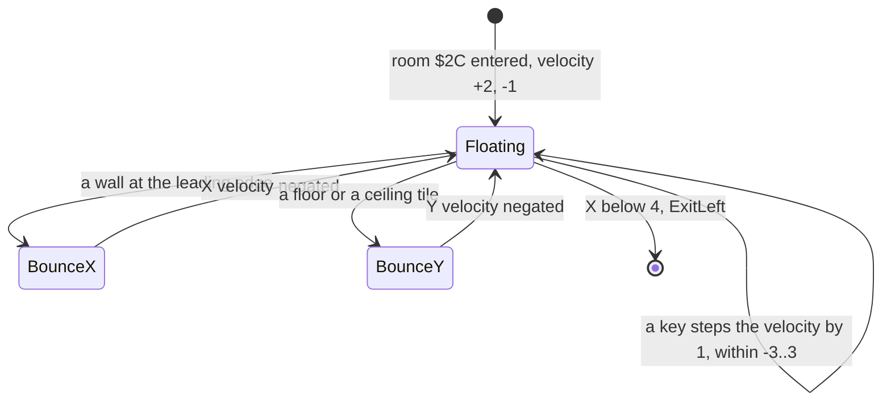

A key held for a pass changes the velocity by 1, so the hero steers by pushing: three passes of left turn +2 into -1.
Each pass clears the status and skips the rest of HeroUpdate: no walk, jump or fall code runs in this room.

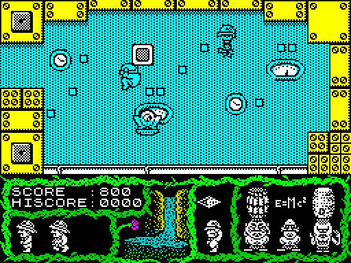

The animation shows `rzx20000` frames 0-316, every fourth frame, at twice the size. The hero floats around the lab,
bounces off the left wall and the ceiling, and leaves by the left exit.

```bash
python3 ../../kit/screen_anim.py --work work/review/fixC/r20000 --from 0 --to 316 --step 4 --scale 2 --delay 80 \
  --hold 2000 docs/img/play/float-r20000.gif
```

**The point**: room `$2C` swaps the whole hero update for a velocity: the keys only nudge it by 1 a pass, so the player
steers a drifting body, not a walker.

Worked example: `rzx20000` frames 0-312, sampled every frame from `$5B00`. The segment starts in the middle of the
float (the hero entered in `rzx18000` frame 1769).

1. Frame 0: FloatVelocity C = `$FD`, B = `$FD`: X - 3, Y - 3 a pass.
2. At frame 41 the left edge meets the wall: C becomes `$03`, X goes from `$35` back to `$38`.
3. At frames 45-49 the head meets the ceiling at Y `$08`: B goes from `$FD` to `$03`.
4. X falls below 4: ExitLeft takes the hero into room `$2B` at frame 313, X `$E6`.

Witness: FloatInRoom2C 149 passes (L1), `rzx18000` frames 1769-1997 and `rzx20000` frames 0-312.

**The point**: each puzzle item is a vehicle. The game's movement is mostly in these rides, and three of them kill on
purpose: the Barrel Small, the Barrel Big and the pad of room `$20`.

Witness: in the table and at the end of each subsection. Teleport's two runs are the only ones in the builds (`.ann`).

## 10.7 Deaths, lives and the restart

Every death goes the same way: a death status plays a frame list, then status 18 waits 50 passes and takes a life.

| Status | Handler | Causes | Frames (FallDeathFrames `$A8BF`) | Sound |
| ---: | --- | --- | --- | --- |
| 26 | FallDeath `$A888` | a landing after 20 fall passes; tile `$A5` under the feet; the balloon crash; room `$2E`'s creature; a creature's touch while standing | `$1C` | 0 at the end |
| 23 | SilentDeath `$A8A8` | room `$20`'s pad; room `$3C` without the Pills; room `$39`'s creature without the Silver Cross | 30 frames: `$04 $05 $04 $02 $06 ...`, then `$29 $2A $2B $2C` | none |
| 24 | CreatureDeath `$A89E` | a creature's touch; the electric beam | `$25 $26 $27 $28 $7F` | 3 every pass |
| 25 | Room1ADeath `$A88F` | a snake's bite | `$14 $15 $16` | 4 at the end |
| 18 (direct) | | the Barrel Small, the Barrel Big, room `$2F` without the Unicycle, room `$46` without the Spurs, room `$47`'s creature | | |

```text
DeathFrames(DE = the list, C = the sound):     ; statuses 23-26
    Hero.frame = DE[StatusTimer / 2]; StatusTimer += 1
    at $FF: PlaySound(C) unless $FF; StartDying: Status = 18

LoseLifeWait (status 18):
    StatusTimer += 1
    if StatusTimer != 50: return
    LifeLost = 50                        ; the main loop sees it and runs Respawn
    Lives -= 1                           ; LifeLossOp $A9FD
    if Lives == 0: LoseGame
    else: DrawSpareLives

Respawn ($9090), from the main loop:
    Status, StatusTimer, Room, Hero X Y frame flags, the lift = the respawn state $5C2B-$5C33
    SetUpRoom(Room)
```

```asm
LoseLifeWait:
  POP HL
  LD HL,StatusTimer
  INC (HL)
  LD A,(HL)
  CP $32                  ; 50 passes
  RET NZ
  LD (LifeLost),A
  LD HL,Lives
LifeLossOp:
  DEC (HL)                ; GameEntry makes it OR A when InfiniteLives is 1
  JP Z,LoseGame
  JP DrawSpareLives
```

The respawn state is written by SaveRespawnPoint `$9AA1` on every entry into one of the 44 CheckpointRooms while the
hero is not falling, and by InitGame. A life lost in an unlisted room restarts in the last listed room entered, at the
place and status of that entry.

The 44 checkpoint rooms are:

- `$00 $01 $04 $07 $08 $09 $0C $0D $0E $12 $13 $14 $15 $17 $18 $19 $1A $1B $1F $21 $22 $23`;
- `$26 $27 $28 $29 $2A $2C $30 $31 $32 $33 $34 $35 $36 $38 $39 $3A $3B $3D $3E $40 $44 $45`.

The infinite lives: the loader sets InfiniteLives `$5B03` to 1 when `$8000` held `$C9` before the load, and GameEntry
then makes LifeLossOp an `OR A` (doc 03). SK's POKE 43517,182 does the same.

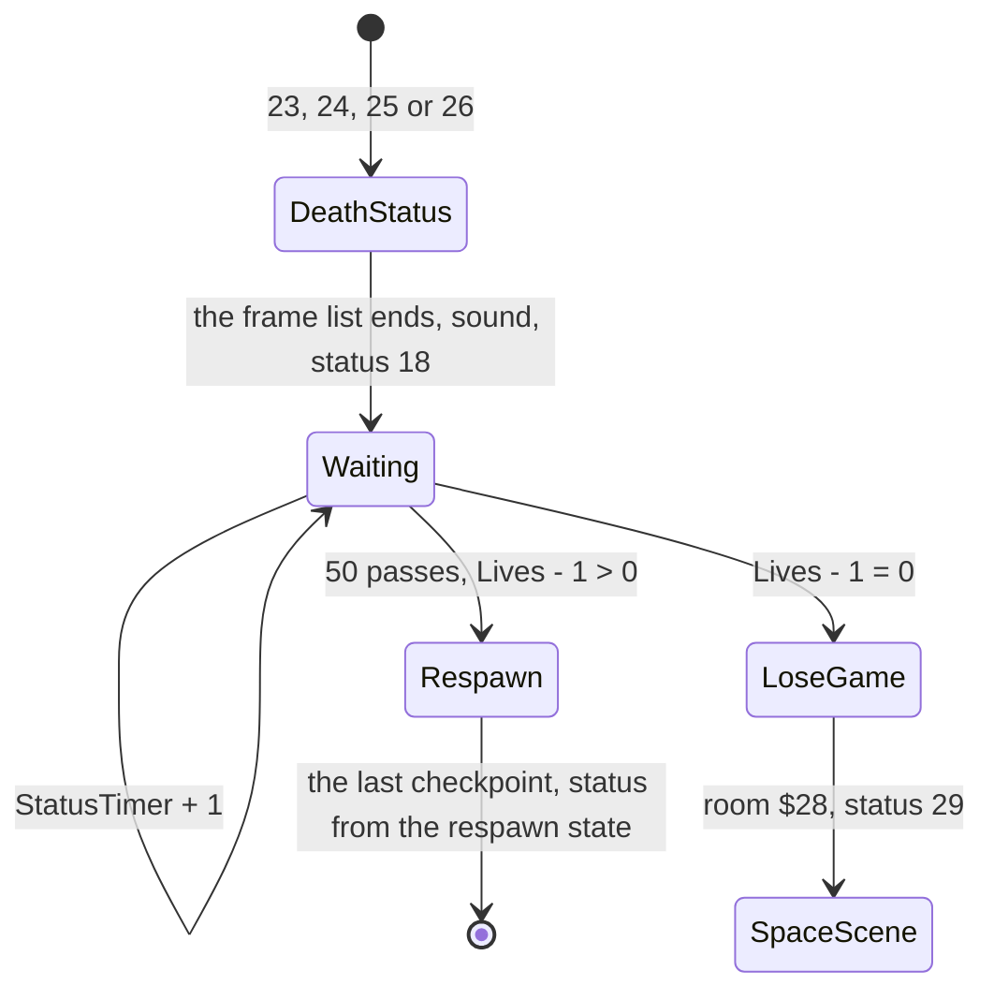

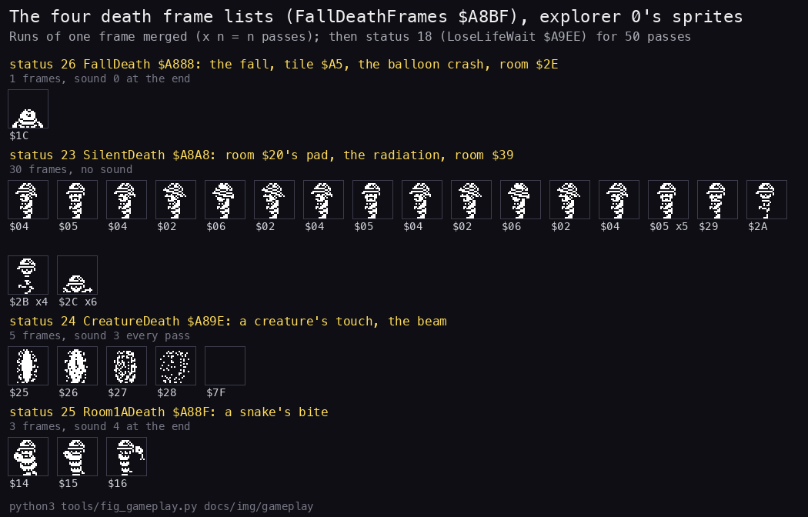

The figure: the four lists of FallDeathFrames `$A8BF` from the built image, drawn with explorer 0's sprites by
`tools/fig_gameplay.py`.

```bash
python3 tools/fig_gameplay.py docs/img/gameplay
```

How to read the figure:

- One block a death status: its handler, its causes, the number of frames and the sound.
- Each sprite is one frame of the list, 2 passes each; "x n" merges n repeats of one frame.
- Status 26 is one frame: the flattened hero. Status 23 is the long one: the hero swaying, then collapsing.

**The point**: four lists, four ways to die on screen, then one common wait. The sound tells the deaths apart as much as
the picture.

Worked example 1: the creature death of `rzx06000` (doc 07.6) and its restart.

| Frame | Status | Room | Hero | Lives |
| ---: | ---: | --- | --- | ---: |
| 536 | `$18` | `$0C` | `A2 56 0F 80` | 4 |
| 564 | `$12` | `$0C` | `A2 56 7F 80` | 4 |
| 688 | `$12` (timer `$31`) | `$0C` | `A2 56 7F 80` | 4 |
| 689 | 0 | `$0C` | `02 60 13 80` | 3 |

Status 18 starts at 564 and runs 50 passes to 688. In frame 688 the life is lost and the respawn puts the hero back at
the entry point of room `$0C`: X 2, Y `$60`, the place where he walked in from the left.

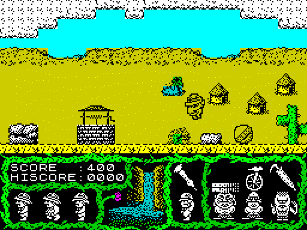

The animation shows `rzx06000` frames 520-700, every third frame, at twice the size.

```bash
python3 ../../kit/screen_anim.py --work work/docs/tmC/r06 --from 520 --to 700 --step 3 --scale 2 --delay 100 \
  --hold 2000 docs/img/play/creature-death-r06000.gif
```

Worked example 2: the last life in `gameover`. Status 18 runs from 1372 to 1502. In frame 1502 Lives goes from 1 to 0,
and LifeLossOp jumps to LoseGame: Room `$28`, the respawn state set to room `$28` with status `$1D`. The respawn of
frame 1509 restores exactly that, and status 29 shows in the sample of 1510 (10.10).

Witness: LoseLifeWait runs in gameover (frames 1372-1502) and five rzx segments: rzx06000, rzx10000, rzx22000,
rzx24000 and rzx32000. SaveRespawnPoint runs 78 times in 27 builds (`.ann`).

## 10.8 Creatures and hazards

The creature types are in doc 07.5. Here is what each means for the hero.

| Hazard | Where | Kills when | Death | Defence |
| --- | --- | --- | --- | --- |
| Drop | 18 rooms | it touches him (8-pixel box) on any pass | 24, or 26 if standing | timing: it waits a random time |
| Riser | 16 rooms | it stands fully up (index 3) and touches him | 24 or 26 | pass while it rises or rests |
| Walker, climber, flier, still creature | 19 rooms | a frame with the hit flag touches him | 24 or 26 | jump over, or wait |
| Snakes | rooms `$17`, `$1A` | the snake's X equals the hero's X rounded down to 4 pixels | 25 | the Flute in hand (in room `$1A` only above Y `$3A`) |
| Radiation | room `$3C` | 20 passes in the room without having picked up the Pills | 23 | the Anti Radiation Pills (22), picked up once |
| Room `$39`'s creature | room `$39` | the hero below Y `$48`, X `$62` or more, status below 4 | 23 | the Silver Cross (29): it flees |
| Electric beams | rooms `$20`, `$38`, `$39`, `$3A`, `$3C`, `$43` | the hero inside a beam's span and within 12 rows, status below 4 | 24 | timing |
| Mud | tiles `$BC`, `$BD` (rooms `$35`, `$36` flicker them) | never: 50 passes on them sink him one row | status 17, one row down (not a death) | jump, or leave the mud tiles |
| Tile `$A5` | the normal tile set | standing on it in status 0 | 26 | do not step on it |
| Long falls | anywhere | 20 fall passes | 26 | the Umbrella, outside the exceptions |

```text
RunSnakes (rooms $17, $1A), for each snake slot:
    if frame == $7F: skip
    if frame == $55: frame = $7F; Status = 25            ; struck last pass: the bite
    else:
        frame = $51 + (step through $51-$54 by PassCount bit 0)
        if Hero.X AND $FC == snake X and not charmed: frame = $55   ; the strike
charmed = HeldItem == $0C and (Room == $17 or Hero.Y < $3A)
```

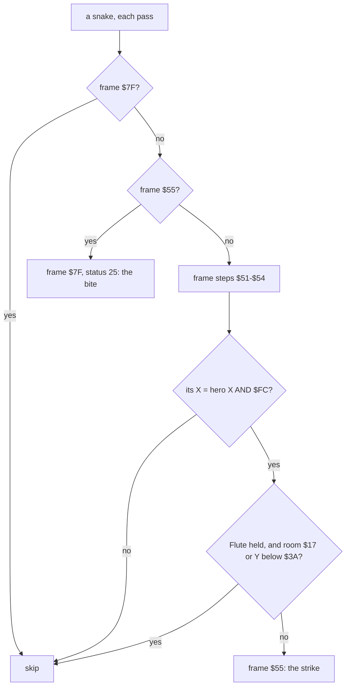

The bite also changes the hints: Room1ADeath sets the ThinkHints of rooms `$17` and `$1A` to `$0C`, the Flute
(`$A88F-$A894`). After one bite, thinking (the T key) in either snake room suggests the Flute (Think, 10.9).

The strike and the bite take two passes: the strike frame `$55` shows for one pass before the bite. That pass is the
hero's only warning.

**The point**: most hazards have an item that defuses them, and the item must be in the hand, not on a bearer. The
creatures and the beams are pure timing.

Worked example: the snakes of room `$1A` in the RZX run. At RZX 11 750 the hero has just restarted in room `$1A` with
the Umbrella in hand (`work/stage1/rzx/vars.bin`). At RZX 12 000 he holds the Flute (`$0C`), and at 12 250 he is in room
`$19`, past the snakes, with 3 lives. The replay of `rzx10000` drifts at its end: there the hero is bitten in frame
1943 (Room1ADeath, frames 1943-1958), which the RZX's own state at 12 000 does not show.

Witness:

- The snake strike and bite ran once each, in rzx10000's drifted end (`$B5C2`, `$B5C8`).
- The radiation death branch (`$B796`) never ran. A clone probe (`work/stage2/probe_points.py` C: the RZX state at
  44 000 with PillsTaken = 0, room `$3C` entered from `$3D`) shows status 23 at frame 70, status 18 at 225, and the
  restart in room `$3B` at 355 with Lives 3 to 2.
- The beam's hit (`$9260`), the mud sink (`$A15A`) and tile `$A5` (11 772 tests, no match) never ran.

## 10.9 Items and puzzles

Every puzzle test reads HeldItem. The table gives every item, where it lies (doc 07.8), and what holding it does.

| Item | Name | Lies in | Use |
| ---: | --- | --- | --- |
| 0 | Unicycle | `$0B` | room `$2F` (explorer 2): ride across; unicycle frames, no jump |
| 1 | Flashgun | `$22` | room `$47` (explorer 4): flash the creature (status 33) |
| 2 | Cricket Ball | `$0C` | room `$2D` (explorer 0): throw it at X `$DC`, a Formula falls |
| 3 | Spurs | `$10` | room `$46` (explorer 3): ride the creature |
| 4 | Beer Barrel | `$2A` | room `$2E` (explorer 1): the creature drinks (status 32) |
| 5 | Umbrella | `$00` | slows falls: no fall count, except rooms `$35`+ and `$10`/`$1C` left of `$80` |
| 6 | Bellows | `$10` | the balloon rises |
| 7 | Party Manifesto | `$09` | the balloon rises, and crashes at the top of room 3 |
| 8 | Cannon | `$1D` | cannot be picked up |
| 9 | Barrel Medium | `$07` | the barrel ride of room `$1D` |
| 10 | Vacuum Cleaner | `$14` | hover in rooms `$14` and `$08` |
| 11 | ACME Bridge | `$08` | the bridge of room `$19` |
| 12 | Flute | `$16` | charms the snakes; in room `$10` grows the rope into room `$1C` |
| 13 | Silver Lining | `$0A` | room `$43` at Y `$20`, X `$76-$83`: becomes the Silver Cross (status 27, +75) |
| 14 | Spring | `$1C` | bounce, where it lies |
| 15 | Formula | `$2E $2F $46 $47`, `$2D` by the throw | gift 1 |
| 16 | Switch | `$27` | fits the lever of rooms `$3E` and `$40` |
| 17 | Button | `$42` | gift 5 |
| 18 | Battery | `$34` | gift 3 |
| 19 | Coat Hanger | `$31` | gift 2 |
| 20 | Trampoline | `$33` | bounce, where it lies |
| 21 | Atomic Pile | `$3C` | gift 4 |
| 22 | Anti Radiation Pills | `$04` | room `$3C`: no radiation (set on pickup) |
| 23 | Cup of tea | `$45` | gift 6 |
| 24 | Energy Crystal | `$2C`; record 20 is its place in `$30` | room `$30`'s machine: the teleports (+75) |
| 27, 28 | Barrel Big, Barrel Small | `$1D`, `$21` | the fatal barrel rides |
| 29 | Silver Cross | from the Silver Lining | room `$39`'s creature flees (+150) |

The "Lies in" column is ItemPlaces (doc 07.8). Items 25, 26, 30 and 31 are not items to carry: their sprites draw the
balloon's basket (`$99`) and envelope (`$9A`), room `$3F`'s basket (`$9E`) and the lift (`$9F`).

The puzzles depend on each other:

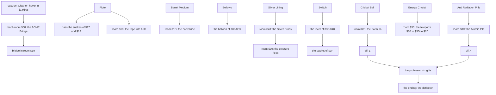

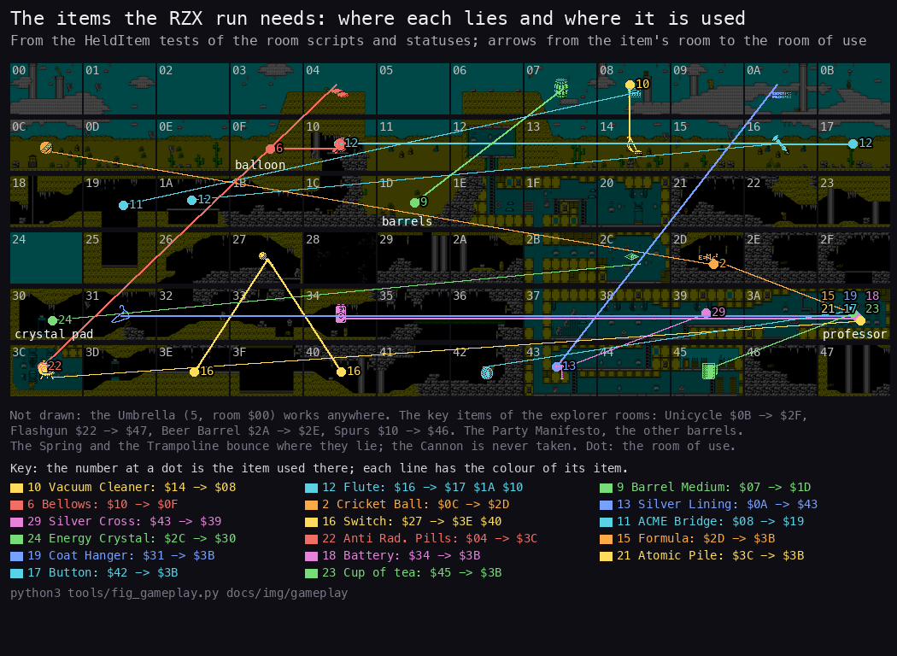

The figure: the arrows of the USES list in `tools/fig_gameplay.py`, made from the HeldItem tests of the room scripts
and statuses, drawn on the room map.

```bash
python3 tools/fig_gameplay.py docs/img/gameplay
```

How to read the figure:

- The 72 rooms, darkened, 12 to a row.
- Each item is drawn in its colour in the room where it lies; its line ends in a dot in the room where it is used. The
  number at the dot is the item. The professor's room gets its six numbers as a list beside the dot.
- The key below gives each line's colour, item number and name, and its rooms (from -> to). An item used in more
  than one room (the Flute in three, the Switch in two) has one line to each.
- The labels mark the professor (`$3B`), the crystal pad (`$30`), the barrels (`$1D`) and the balloon (`$0F`).
- The grey text lists what is not drawn: the Umbrella, the key items of the explorer rooms, the Party Manifesto and the
  other barrels, the Spring and the Trampoline.

**The point**: the items are spread over the map, and most are used far from where they lie. The professor's room is
the hub: six lines end there.

The explorer rooms each test one key item, the explorer's own from the instructions:

| Explorer | Room | Item | With it | Without it |
| ---: | --- | --- | --- | --- |
| 0 | `$2D` | Cricket Ball (2) at X `$DC`, Y `$48` | the throw (status 28), the Formula falls into the hands | nothing happens |
| 1 | `$2E` | Beer Barrel (4) at X `$B2`, Y `$48` | the creature drinks (status 32) | touching it: status 26 |
| 2 | `$2F` | Unicycle (0) at Y `$48`, X `$54-$B3` | ride across | status 18 left of X `$96` |
| 3 | `$46` | Spurs (3) | ride the creature to the left (status 29, then 1) | status 18 left of X `$DC` |
| 4 | `$47` | Flashgun (1) at Y `$60` | the flash (status 33), two screen flashes | eaten: status 18 |

Each explorer room except `$2D` holds a Formula (ItemPlaces records 27-30). Room `$2D` gives its Formula by the throw.
So every explorer can get exactly one Formula. The code does not check which explorer plays: ExitLeft from `$2E`,
`$2F` and `$47` leads by the grid into `$2D`, `$2E` and `$46` (`$A657`), and CricketBallScript tests only the item and
the place. What keeps each explorer to his own room is the rock: the left three tile columns of rooms `$2D`, `$2E`,
`$2F` and `$46` are solid (ExtraSolidTiles, rows 0-15), and those of `$47` from row 3 down, so no explorer walks on into
a neighbour's room.

The actors of these rooms are drawn from the chosen explorer's own sprite set, frames `$37-$3F` (doc 07.5): room `$2D`'s
ball `$39` and throw pose `$3E` (`$B3B6`), room `$2E`'s creature `$3C`, `$37`, `$38` (`$B276`, `$B2B7`), room `$2F`'s
UnicycleFrames `$3C` and fall `$3B` (`$B246`, `$B258`), room `$46`'s creature `$39-$3F` (`$B2F6`, `$B30F`, `$B324`,
`$B338`). Each explorer's set carries his own room's creature and poses; since no explorer reaches another
explorer's room, the frames `$37-$3F` of a set only need to serve that one room.

Worked example: room `$2D` in the RZX run (explorer 0), in rzx16000 and rzx18000 (`.ann`, CricketBallScript):

1. Stage 0 puts the target in slot 3 at X `$64`, Y `$48`, frame `$4F`.
2. The hero stands at X `$DC`, Y `$48` with the Cricket Ball (2): stage 1, status 28.
3. At the throw frame `$3E` the ball appears in slot 4 at X `$C8`, Y `$39` and flies 4 pixels left and 1 down a pass to
   Y `$52`.
4. The target's frame goes to `$50`, and the Formula drops from Y 8 to Y `$48`, 1 pixel a pass.
5. BallThrown is set, HeldItem = `$0F`, the status is cleared. The RZX run gets its Formula here (rzx18000, stage 3).

### The bridge of rooms `$19` and `$3A`

Both rooms have a gap in tile row 11. BridgeEffect `$BA97`, called by the items pass in these two rooms, lays a
bridge across it one tile at a time. BridgeState `$5C0C` is 0 when idle (SetUpRoom zeroes it on every room entry);
bits 0-6 count the tile (1-`$10`); bit 7 marks the second sweep. BridgeReverse `$5C0D` is 1 for a bridge laid from
the right end.

```text
BridgeEffect(room) (items pass, rooms $19 and $3A):
    if BridgeState == 0:
        room $19: needs HeldItem == $0B               ; the ACME Expanding Bridge
        room $3A: needs LastGift != 0 or HeldItem == $0F   ; the professor has an item, or the Formula
        if $2C <= Hero.X < $36: BridgeState = 1, BridgeReverse = 0      ; the left end
        elif $B2 <= Hero.X < $B8: BridgeState = $10, BridgeReverse = 1  ; the right end
        return
    if PassCount & 3 != 0: return                     ; one tile every fourth pass
    column = 8 + (BridgeState & $7F) - 1
    tile = the bridge tile ($07, room $3A $BF), or in the second sweep BridgeTiles[column & 3]
    SetTile(row 11, column, tile)
    forward: BridgeState + 1 up to $10; there wait until Hero.X >= $BA; then $81 .. $90; then 0
    reverse: BridgeState - 1 down to 1; there wait until Hero.X < $30; then $90 .. $81; then 0
```

```asm
BridgeWrite:
  CALL SetTile            ; write the tile; then step BridgeState
  LD HL,BridgeState
  LD A,(BridgeReverse)
  OR A
  JR NZ,BridgeReverseStep
  LD A,(HL)
  AND $7F
  CP $10
  INC (HL)
  RET C                   ; not yet the 16th tile
  BIT 7,(HL)
  JR NZ,BridgeDone        ; the second sweep is over: BridgeState = 0
  DEC (HL)                ; stay at $10 ...
  LD A,(Hero)
  CP $BA
  RET C                   ; ... until the explorer is across
  LD (HL),$81             ; then the second sweep
  RET
```

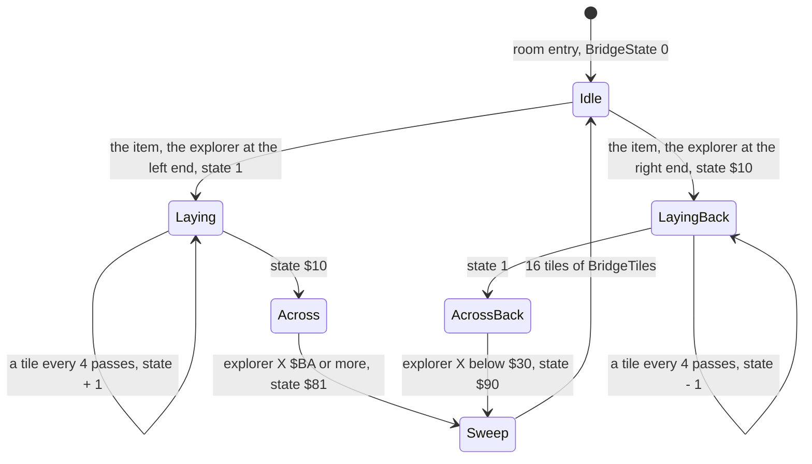

One tile is 8 pixels and comes every fourth pass: 2 pixels a pass, the walking speed. The bridge grows exactly as fast
as the hero walks along it. The second sweep writes the tiles of BridgeTiles `$BB51` (room `$19`: `$97 $9A $9D $9E`;
room `$3A`, `$BB55`: `$81` four times) over the bridge: in room `$19` the gap comes back behind the hero. The bridge
is gone again on every entry, when the room's tile map is set up anew: each crossing needs the item in hand again.

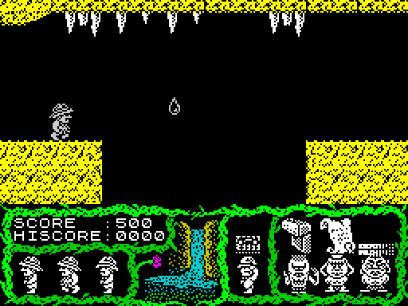

The animation shows `rzx08000` frames 880-1200, every fourth frame, at twice the size. The hero stands at the left end
with the ACME Bridge, the bridge grows under his feet as he walks, and behind him the gap opens again as he leaves to
the right.

```bash
python3 ../../kit/screen_anim.py --work work/review/fixC/r08000 --from 880 --to 1200 --step 4 --scale 2 --delay 80 \
  --hold 2000 docs/img/play/bridge-r08000.gif
```

**The point**: the bridge is not an object but tile-map writes paced at the walking speed: it exists only while the hero
is in the room, and each crossing needs the item again.

Worked example: `rzx08000`, room `$19`, sampled every frame from `$5B00`.

1. The ACME Bridge (`$0B`) is in hand from frame 841.
2. In the sample of 899 the hero is at X `$2C`, the left end: BridgeState = 1.
3. BridgeState + 1 every fourth pass while the hero walks right 2 pixels a pass; it is `$10` at frame 1032.
4. It waits at `$10` until the hero's X is `$BA`: `$81` in the sample of 1132.
5. The second sweep has written five tiles (BridgeState `$86`) when the hero leaves into room `$1A` at frame 1187, X
   `$02`. SetUpRoom zeroes BridgeState: 0 in the sample of 1188.

Witness: the bridge starts 3 times (`$BACC`): `rzx08000` and `rzx12000` in room `$19`, `rzx42000` in room `$3A`.
`rzx08000` and `rzx42000` cross forward (`$BB37` once each), `rzx12000` in reverse (`$BB4E`). BridgeEffect runs 857
times (L1).

### The lever of rooms `$3E` and `$40` and the basket of room `$3F`

Room `$3F` lies between rooms `$3E` and `$40`. Its basket (slot 4, frame `$9E`, item sprite 30) runs on a track across
the room and carries the hero from one end to the other. The lever stands in both side rooms (slot 4 at Y `$12`, X
`$DC` in room `$3E`). The two levers are one: SwitchFitted `$5C43` and LeverState `$5C42` are shared. The Switch (item
16) must be fitted once; then each touch flips LeverState, and LeverState decides to which end the basket goes when it
has no rider.

```text
LeverScript (rooms $3E and $40):
    lever.Y = $12; lever.frame = $57 if SwitchFitted else $56
    if not SwitchFitted:
        if HeldItem == $10 and Near(): HeldItem = $FF; SwitchFitted = $FF; DrawPortrait
        return
    mirror bit = (LeverState == 0)
    if not Near(): RoomFlag = 0; return
    if RoomFlag == 0: RoomFlag = 1; LeverState ^= $FF; mirror bit = (LeverState == 0)   ; a new touch

BasketScript (room $3F):
    stage 0: basket at X $D8 and RoomFlag = 1 when Hero.X < $C8, else X $08 and RoomFlag = 0; Y $30; stage 1
    stage 1: RoomFlag 1 and LeverState != 0: BasketLeft      ; travel to the explorer, if the lever allows
             RoomFlag 0 and LeverState == 0: BasketRight
             at the end of the track and Near(): stage 2, RoomFlag ^= 1, Status = $15
    stage 2: RoomFlag 1: BasketLeft, else BasketRight        ; carry him, whatever the lever
             at the end: Hero.Y -= 8; stage 3; ClearStatus
    stage 3: nothing until the room is entered again

RideObject4 (status $15): Hero.X, Hero.Y = the basket's; Hero.frame = $2D

The track (BasketRight, X + 1 a pass; BasketLeft, X - 1):
    going right: X below $38: Y - 2 (not above 8); from X $C8: Y + 2 (below $30); between: level
    going left:  X from $7B up: Y - 2 (not above 8); X below $1C: Y + 2 (below $30); between: level
```

```asm
BasketLeft:
  LD E,$00
  LD A,(IY+$00)
  CP $09
  RET C                   ; X 8: the left end, E = 0
  INC E
  LD B,(IY+$01)
  DEC A
  LD (IY+$00),A
  CP $1C
  JR NC,BasketLeftTail
  LD C,A                  ; X below $1C: sink 2 pixels, below Y $30
  LD A,B
  ADD A,$02
  CP $30
  RET NC
  LD (IY+$01),A
  RET
  ...
BasketLeftTail:
  CP $7B
  RET C                   ; X $1C-$7A: keep the height
  LD A,B
  SUB $02                 ; X $7B or more: rise 2 pixels, not above Y 8
  CP $08
  RET C
  LD (IY+$01),A
  RET
```

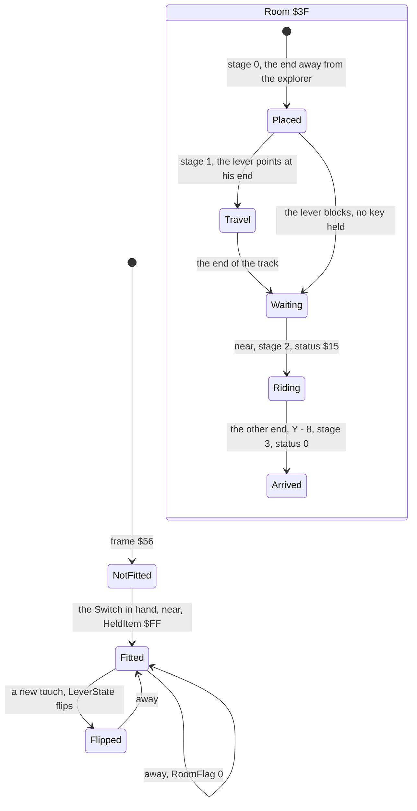

A blocked move (the lever pointing at the basket's own end) returns at once and leaves E as BasketScript's caller had
it, the key bits: on a pass with no key held the basket counts as at its end, and an explorer who walks up to it can
board it there. Known only from the code.

The track is not symmetric: going right the basket climbs at once and sinks only from X `$C8`; going left it climbs
from the right end and stays high down to X `$1C`. Either way it rides at Y 8, high over the floor of room `$3F`.

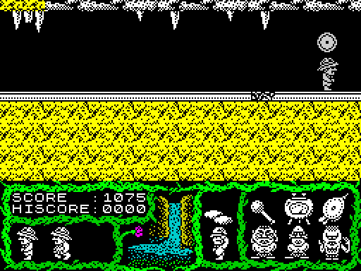

The animation shows `rzx28000` frames 380-488, every third frame, at twice the size. The hero jumps to the lever with
the Switch; the Switch leaves his hand, the lever's frame changes and its arm turns.

```bash
python3 ../../kit/screen_anim.py --work work/review/fixC/r28000 --from 380 --to 488 --step 3 --scale 2 --delay 100 \
  --hold 2000 docs/img/play/lever-r28000.gif
```

**The point**: the Switch is fitted once for both lever rooms (one flag); after that each new touch flips LeverState,
the only input of the basket.

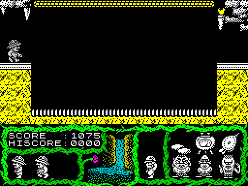

The animation shows `rzx28000` frames 528-1672, every twelfth frame, at twice the size. The basket travels from the
right end to the hero at the left end, then carries him back along the track and sets him down at the right end.

```bash
python3 ../../kit/screen_anim.py --work work/review/fixC/r28000 --from 528 --to 1672 --step 12 --scale 2 --delay 80 \
  --hold 2000 docs/img/play/basket-r28000.gif
```

**The point**: the lever chooses only where the empty basket waits; a rider is carried whatever it says.

Worked example: `rzx28000`, sampled every frame from `$5B00`.

1. Room `$3E`: the Switch (`$10`) is in hand from frame 389. The lever is high (Y `$12`): the hero jumps, status 2 at
   434.
2. Near the lever in frame 442: fitted. The sample of 443 shows HeldItem `$FF`, SwitchFitted `$FF`, LeverState 0, the
   lever's frame still `$56`.
3. The next pass is a new touch, since RoomFlag is still 0: RoomFlag 1, LeverState `$FF`, frame `$57` in the sample of
   446. LeverState is not 0, so the mirror bit is cleared.
4. Room `$3F` is entered at frame 518 from the left. Stage 0 at 527: the hero's X is 4, below `$C8`, so the basket
   starts at X `$D8`, Y `$30`, RoomFlag 1.
5. Stage 1: LeverState is `$FF`, so the basket travels left, X - 1 a pass. From X `$D8` it rises 2 a pass to Y 8 at X
   `$C4`, keeps its height down to X `$1C`, and sinks to Y `$2E` at X 8 (the sample of 1096). The hero waits at X 4,
   Y `$28`.
6. Near at the end of the track: stage 2 at frame 1098, RoomFlag 0, status `$15`. The hero takes the basket's place
   with frame `$2D`.
7. BasketRight: Y 8 from about X `$1B`, level, and from X `$C8` down to Y `$2A` at X `$D8` (frame 1621).
8. Arrival at frame 1624: status 0, stage 3. The hero is set 8 pixels above the basket and drops onto the floor, Y
   `$28` at 1627.

Witness: the Switch is fitted once (`$B751`, `rzx28000`) and the lever pulled twice (`$B770`, `rzx28000` and
`rzx32750`). BasketScript runs in `rzx28000` frames 526-1693, `rzx32750` frames 364-1249 and `rzx34000` frames 2-159;
stage 0 and the ride (`$B44E`) once each in `rzx28000` and `rzx32750`, the arrival (`$B471`) in `rzx28000` and
`rzx34000`.

### The rope of room `$10`

Playing the Flute (12) at one spot of room `$10` grows a rope down through the floor into room `$1C` below. RopeTrick
`$BC73` runs in the items pass of room `$10`; RopeCount `$5C24` counts the notes.

```text
RopeTrick (room $10, every pass):
    if RopeCount == $0D or HeldItem != $0C: return    ; the rope is whole, or no Flute
    if Hero.Y not in ($46, $48) or not ($28 <= Hero.X < $34): return
    facing right; Hero.Y rocks between $46 and $48 by PassCount bit 0
    if PassCount & 3 != 0: return
    Status = 6                                        ; stand and animate
    n = RopeCount; RopeCount += 1
    if n == $0C: ClearStatus; return                  ; the rope is whole
    if n >= 6: SetTile(row 9 + (12 - n), column 8, $98); SetTile(the same row, column 9, $99)

SetUpRoom, room $1C entered:
    if RopeCount != 0: rope tiles $98, $99 into columns 8 and 9 of rows 0-11
    RopeCount = 0                                     ; on every room entry
```

```asm
RopeGrow:
  LD A,(PassCount)        ; every fourth pass: status 6, RopeCount + 1
  AND $03
  RET NZ
  LD A,$06
  LD (Status),A
  LD A,(HL)
  INC (HL)
  CP $0C
  JP Z,ClearStatus        ; the 13th note: the rope is whole
  SUB $06
  RET C                   ; the first six notes draw nothing
  LD C,A
  LD A,$06
  SUB C                   ; row 9 + (6 - (count - 6)): rows 15 up to 10
```

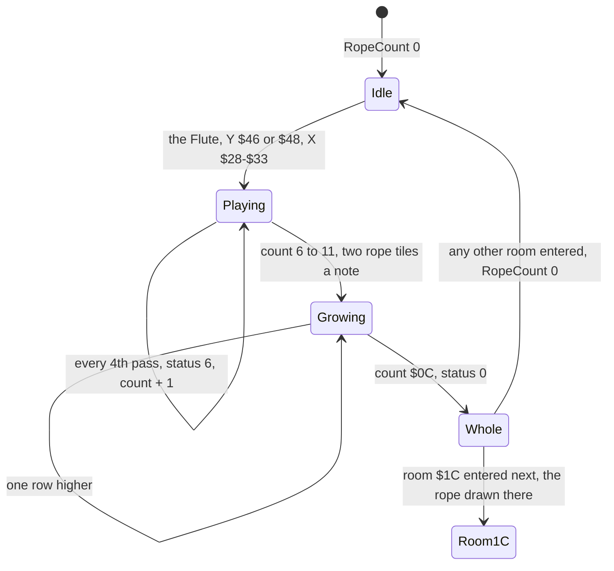

The rope grows upwards in room `$10`, rows 15 to 10, while the hero plays: 12 notes take 48 passes. Room `$1C` gets
the rope only when it is the next room entered, since every room entry clears RopeCount. Room `$1C`'s set-up draws
the whole rope, 12 rows, whenever RopeCount is not 0: a single note in room `$10` would be enough. The rope then lets
the hero climb columns 8 and 9 of room `$1C`. SK called this a seesaw. No recording stood at the spot with the Flute
(`rzx10000` and `gameover` reach Y `$46` / `$48` with it, `$BC8A` once each, but never X `$28-$33`), so the rope is
known only from the code and there is no animation.

**The point**: the rope is made in one room and used in the next: RopeCount carries it over exactly one room entry.

Witness: RopeTrick runs 674 times (L1) in `gameover` and two rzx segments; the rope code from `$BC91` never
runs.

### The creature of room `$39` and the Silver Cross

Room `$39`'s creature (slot 3, X `$A4`, Y `$40`, frame `$40`) guards the right half of the room. SilverCrossScript
`$B4E2` keeps its state in CrossState `$5C45`: 0 waiting, 1 fleeing, `$FF` gone. The Silver Cross (29) is the
Silver Lining (13) changed in room `$43` (status 27).

```text
SilverCrossScript (room $39, every pass):
    stage 0: slot 3 = (X $A4, Y $40, frame $40); stage 1
    if CrossState == $FF: frame $7F; return           ; gone for good
    if CrossState == 0:
        if Hero.Y >= $48 or Hero.X < $62: return      ; not yet in its reach
        if HeldItem != $1D:                           ; no Silver Cross
            facing right; frame $44
            if Status < 4: SetStatus($17)             ; status 23, the silent death
            return
    CrossState = 1; facing left                       ; flee
    if creature.X >= $E6: AddScore(150); CrossState = $FF; frame $7F; return
    creature.X += 2; frame = $41 + (PassCount / 2 & 3)
```

```asm
CrossFlee:
  LD (HL),$01             ; flee right until X $E6
  RES 7,(IY+$03)
  LD A,(IY+$00)
  CP $E6
  JR C,CrossStep
  LD DE,$0096             ; out of the room: +150
  CALL AddScore
  JR CrossGone
CrossStep:
  INC (IY+$00)            ; X + 2, frame $41 + (PassCount / 2 & 3)
  INC (IY+$00)
  LD C,$41
  LD A,(PassCount)
  SRL A
  AND $03
```

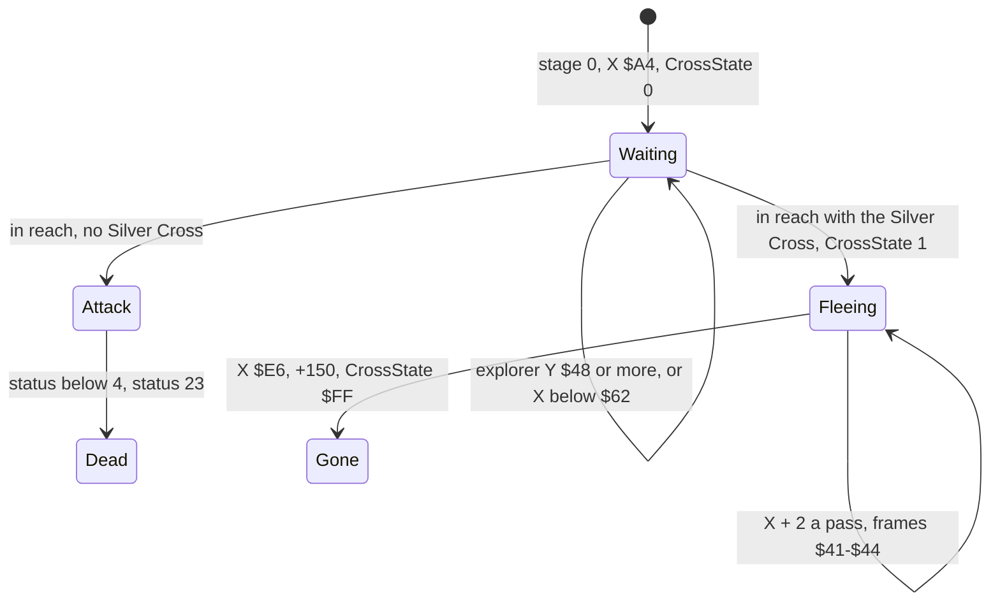

Once fleeing, the creature does not stop: CrossState 1 skips the tests, so dropping the cross does not bring it back.
CrossState is cleared only by InitGame, so the creature never comes back in that game.

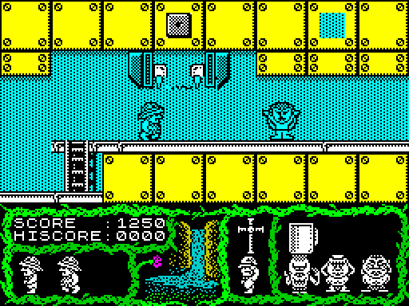

The animation shows `rzx40000` frames 1600-1730, every third frame, at twice the size. The hero walks right with the
Silver Cross; when he reaches X `$62` the creature runs off to the right edge.

```bash
python3 ../../kit/screen_anim.py --work work/review/fixC/r40000 --from 1600 --to 1730 --step 3 --scale 2 --delay 80 \
  --hold 2000 docs/img/play/silver-cross-r40000.gif
```

**The point**: the Silver Cross is a key held in the hand: with it the creature flees for good and pays 150 points,
without it the creature kills.

Worked example: `rzx40000`, sampled every frame from `$5B00`.

1. Room `$39` is entered at frame 1161. Stage 0 places slot 3 at X `$A4`, Y `$40`, frame `$40` (the sample of 1171).
2. The hero holds the Cup of tea (`$17`) and takes the Silver Cross (`$1D`) from the bearers at frame 1423.
3. He climbs a ladder at X `$24` and walks right at Y `$40`, below `$48`.
4. At X `$62` the test passes with the cross in hand: CrossState 1 in the sample of 1623, the creature at X `$A6`,
   frame `$42`.
5. X + 2 a pass with frames `$41-$44`, 33 passes to X `$E6`.
6. Frame 1715: AddScore(150). The sample of 1716 shows CrossState `$FF` and the score `$04E2` -> `$0578`, 1250 ->
   1400.

Witness: `rzx40000` runs SilverCrossScript 273 times: the placing (`$B4ED`) once, the flight (`$B540`) 33 times, the
score (`$B538`) once. The attack (`$B518`) never ran.

### Think and ThinkHints

The T key (ThinkKey `$B02E`, half row Q-T, bit 4) starts status 10. HeroUpdate reads it after StatusDispatch and only
when the hero stands on a floor, so in practice in status 0. The hero puts his hand to his head,
and a thought bubble shows the item that ThinkHints `$A6E6` gives for the room, or he shakes his head. Each frame of
the three lists lasts 2 passes (NextFrame).

```text
Think (status 10):
    play ThinkFrames ($09 $0A four times: 16 passes)
    if Hero.Y >= $18: Thought.Y = Hero.Y - $18; Thought.X = Hero.X        ; above the head
    else:             Thought.Y = Hero.Y;       Thought.X = Hero.X -/+ $18 ; beside him
                      (on the side he faces; at an edge the facing turns and the other side is used)
    Thought.item = ThinkHints[Room]
    SetStatus(12 if Thought.item == $FF else 11)

BrightIdea (status 11): IdeaFrames ($1F twelve times, then $07 $08 $07 $05 three times: 48 passes)
NoIdea (status 12):     NoIdeaFrames ($04 $05 $04 $02 $06 $02 twice: 24 passes)
    at the end: Thought.item = $FE (EraseItem); ClearStatus

DrawItems (every pass): ItemSlot1, ItemSlot2, then Thought (X, Y, item); $FF draws nothing
```

```asm
Think:
  POP HL
  LD DE,ThinkFrames
  CALL NextFrame
  CP $FF
  JR NZ,SetHeroFrame
  LD A,(IX+$01)
  CP $18
  JR C,ThinkPlaceY        ; Y below $18: carry set, the bubble goes beside him
  SUB $18                 ; else above the head, carry clear
ThinkPlaceY:
  LD (Thought+1),A
ThinkPlaceX:
  LD A,(IX+$00)
  JR NC,ThinkHint         ; above the head: the hero's X
```

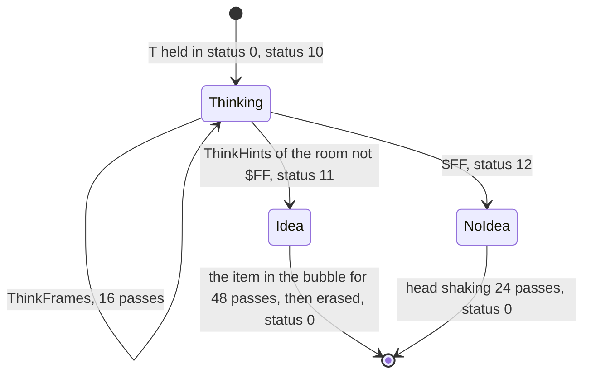

The hints, ThinkHints `$A6E6`, one byte a room (`src/res/tables/think-hints.csv`); every other room is `$FF`:

| Room | Idea | Room | Idea |
| --- | --- | --- | --- |
| `$01`, `$04`, `$0A`, `$0B` | 5 Umbrella | `$1A` | `$FF` after InitGame; `$0C` Flute after a bite |
| `$07` | 8 Cannon | `$1D` | 9 Barrel Medium |
| `$08`, `$14` | `$0A` Vacuum Cleaner | `$2D` | 2 Cricket Ball |
| `$09` | `$1A`, no carried item | `$30` | `$18` Energy Crystal |
| `$0F` | 7 Party Manifesto; 6 Bellows once room `$10` is entered | `$39` | `$1D` Silver Cross |
| `$10` | `$0C` Flute | `$3A` | `$0F` Formula |
| `$17` | `$FF` after InitGame; `$0C` Flute after a bite | `$3C` | `$16` Anti Radiation Pills |
| `$19` | `$0B` ACME Bridge | `$3E` | `$10` Switch |
| | | `$43` | `$0D` Silver Lining |

Three writers change the table in play. InitGame puts `$FF` into rooms `$17` and `$1A` and 7 into room `$0F`.
SetUpRoomTiles `$9880` (at `$98E9`) puts 6 into room `$0F` when room `$10` is entered. Room1ADeath `$A88F` (status 25, a
snake's bite) puts `$0C` into rooms `$17` and `$1A`. The hints mostly match the puzzles above. Two are traps or
oddities: room `$0F` first suggests the Party Manifesto, the item that crashes the balloon (BalloonCrash), and only
after a visit to room `$10` the Bellows; room `$09` holds `$1A`, an item number that draws the balloon's envelope, not
an item to carry.

**The point**: Think is the game's built-in hint, one byte a room; the table changes only three times, and two of
its hints mislead.

Worked example, from the code (no recording pressed T). The hero thinks in room `$19` at X `$2C`, Y `$40`, facing
right:

1. Status 10, frames `$09 $0A` alternate for 16 passes.
2. Y `$40` >= `$18`: Thought = (X `$2C`, Y `$28`, item `$0B`), the bubble above his head. Status 11.
3. IdeaFrames for 48 passes; DrawItems draws the ACME Bridge at X `$28` (X AND `$F8`), Y `$28` every pass.
4. At the end Thought.item = `$FE`: EraseItem clears it; status 0.

In room `$31` (ThinkHints `$FF`) the same key gives status 12 and 24 passes of head shaking, with nothing drawn.

Witness: Think, BrightIdea and NoIdea never ran (L1: 0 passes); ThinkKey runs 16 037 times and is never taken. The
lists, the placement and the hints are known only from the code; there is no animation.

Witness:

- The bridge (BridgeEffect) ran in rzx08000 and rzx12000 (room `$19`) and rzx42000 (room `$3A`).
- The lever was fitted and pulled in rzx28000 and rzx32750; the basket arrived in rzx28000 and rzx34000.
- The Silver Cross made room `$39`'s creature flee in rzx40000: 33 passes, with the score once (`$B538`). The Silver
  Lining became the Silver Cross in room `$43`: status 27 shows in rzx38000 frames 2-135. The trigger instruction of
  room `$43` (`$B71E`) is in no build: the segment starts with status 27 already set.
- The rope (`$BC91` on), Think (status 10) and every explorer room but `$2D` never ran.

## 10.10 The professor, the telescope and the ending

Professor Eyestrain stands in room `$3B` (ProfessorScript `$B5DD`). He walks to and fro. On his way left he stops,
plays his frames (ProfFrames `$B6C1`), and his last frame `$4D` is the asking pose: WantedItem = WantedItems[GiftCount],
and the speech bubble in slot 3 shows that item's sprite (`$80` + item).

The six wishes, in order (WantedItems `$B6BB`): the Formula (15), the Coat Hanger (19), the Battery (18), the Atomic
Pile (21), the Button (17) and the Cup of tea (23).

```text
ProfessorScript, every pass:
    if Near(Hero, professor) and HeldItem == WantedItem:
        HeldItem = $FF; LastGift = item
        SpawnRoomItems; DrawPortrait; AddScore(150)
        GiftCount += 1
        if GiftCount == 6: ProfessorEnding
    the professor: place, walk, stop, frames; at frame $4D on the way left:
        WantedItem = WantedItems[GiftCount]; the bubble = $80 + WantedItem

ProfessorEnding:
    Room = $28; SetUpRoom; GameWon = $1D; Status = 29; Hero.frame = $7F
```

```asm
ProfessorScript:
  LD IY,ObjectSlot4
  CALL Near
  JR NC,ProfState
  LD HL,HeldItem          ; the wanted item in hand?
  LD A,(WantedItem)
  CP (HL)
  JR NZ,ProfState
  PUSH IY
  PUSH IX
  LD (HL),$FF             ; given: HeldItem = $FF, LastGift = the item
  LD (LastGift),A
  CALL SpawnRoomItems
  CALL DrawPortrait
  LD DE,$0096             ; +150
  CALL AddScore
  POP IX
  POP IY
  LD HL,GiftCount         ; the sixth gift ends the game
  INC (HL)
  LD A,(HL)
  CP $06
  JP Z,ProfessorEnding
```

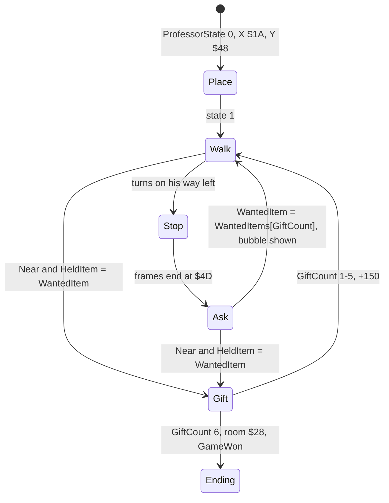

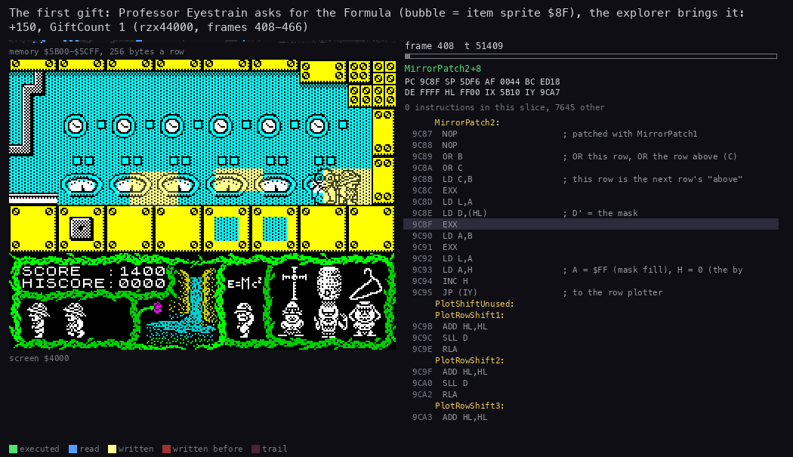

The animation shows `rzx44000` frames 408-466, in 80 pictures, with the screen as the view. The code panel follows
ProfessorScript `$B5DD-$B703`, DrawPortrait and AddScore.

```bash
python3 ../../kit/routine_anim.py --work work/docs/tmC/r44 --window 408:0-466:0 --listing build/game.lst \
  --pc B5DD-B703,9E5D-9EBC,BCF2-BD10 --view screen --range 5B00-5CFF --pictures 80 --delay 120 \
  --title "The first gift: Professor Eyestrain asks for the Formula (bubble = item sprite \$8F), the explorer brings it: +150, GiftCount 1 (rzx44000, frames 408-466)" \
  --out docs/img/routines/ProfessorScript.gif
```

Worked example: `rzx44000`, from the samples (doc 07.11 has the table).

1. The hero holds the Formula from frame 0; WantedItem is 0 (doc 07.13).
2. In frame 415 the professor asks: the sample of 416 shows WantedItem `$0F`.
3. In frame 459 the hero is near him with the Formula: HeldItem `$FF`, score 1400 to 1550, GiftCount 1.
4. The professor asks for the Coat Hanger (`$13`) in frame 723. The hero swaps it from a bearer into his hand (the
   sample of 1067) and gives it in frame 1203: GiftCount 2, score 1700.

The telescope of room `$12`: standing at X `$C0`, Y `$40` with right held starts status 30. The hero bends to the
eyepiece, and status 31 shows space: room `$28` set up, the asteroid in slot 4 at X `$75`, Y = 2 x (40 - days), and the
text "TIME REMAINING TO COLLISION" with the days, hours and minutes. The fewer the days, the lower the asteroid stands.
After `$80` passes the hero is back in room `$12`. Room `$12` was never reached, so this is known only from the code.

A quirk of the telescope, known only from the code. TelescopeView calls SetUpRoom(`$28`) and later SetUpRoom(`$12`)
without writing Room (`$A7CA`, `$A81A`), so Room stays `$12` through the view, and room `$12`'s script and items run
on. Both `$28` and `$12` are CheckpointRooms, so each call runs SaveRespawnPoint with Room `$12`, Status 31 and the
hero's frame `$7F`: the timer is 1 at the first call and `$80` at the last, just before ClearStatus. A life lost later,
before another checkpoint room is entered, respawns into status 31 with the timer at `$80`. TelescopeWait then counts on
from `$80`: 128 passes print the clock over room `$12` with the hero hidden; when the timer wraps to 0 the view starts
again (room `$28` set up, the respawn saved once more with timer 1), and 127 passes later the hero is back in room
`$12` in status 0. A clone with Room `$12` and a life lost would settle the effect; no recording comes near room `$12`.

The ending is the script of room `$28`, SpaceScene `$B0B6`. LoseGame and ProfessorEnding both lead there; GameWon
decides the outcome.

```text
SpaceScene (RoomStage steps):
    0: the asteroid in slot 1 at X $A2, Y 4, frame $75
       the Earth in slots 2, 3 at X $89, $71, Y $68, frames $72, $71
       if GameWon: the deflector in slot 4 at X $89, Y $5C, frame $6F
    1: the asteroid X - 1, Y + 4 a pass, down to Y $54
    won:  the deflector frame + 1, sound 2; the asteroid X - 4, Y - 1 a pass; gone at X 4
    lost: the asteroid hidden; the Earth frames $76, then $77; sound 1
    then count to $80 passes; GameOver = 1
```

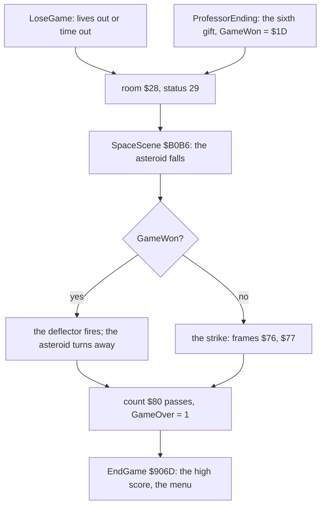

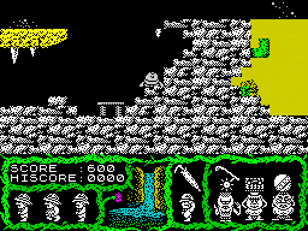

The animation shows `gameover` frames 1504-1964, every sixth frame, at twice the size: the asteroid falls on the Earth
with no deflector.

```bash
python3 ../../kit/screen_anim.py --work work/docs/tmC/go --from 1504 --to 1964 --step 6 --scale 2 --delay 100 \
  docs/img/play/space-scene-strike.gif
```

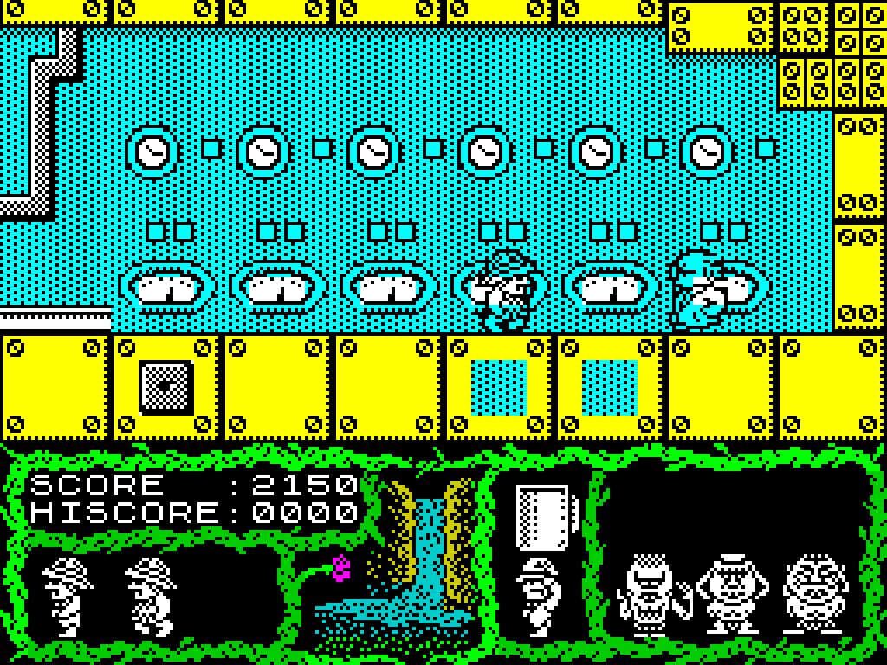

The won ending (`rzx50000` frames 194-729), from another writer's animation: the deflector fires and the
asteroid turns away. GameOver is set at frame 729 and the menu follows at 732.

**The point**: one scene serves both endings. The only difference is GameWon, which places the deflector; without it the
same script plays the strike.

Witness: the gifts ran 6 times (rzx44000 2, rzx46000 2, rzx48000 1, rzx50000 1) and the ending once (rzx50000).
SpaceScene ran 327 times in gameover and rzx (`.ann`).

## 10.11 The countdown

CountDown `$935D` takes one minute off the clock every pass. The clock is three plain binary bytes: days `$5BFB`, hours
`$5BFC`, minutes `$5BFD`. It starts at 30 days, 23 hours and 59 minutes.

```asm
CountDown:
  LD HL,CountdownMinutes
  DEC (HL)
  BIT 7,(HL)
  RET Z
  LD (HL),$3B             ; minutes back to 59
  DEC HL
  DEC (HL)
  BIT 7,(HL)
  RET Z
  LD (HL),$17             ; hours back to 23
  DEC HL
  DEC (HL)
  BIT 7,(HL)
  RET Z                   ; days below 0: falls into LoseGame
```

```mermaid
flowchart LR
    M["minutes - 1"] --> MN{"below 0?"}
    MN -- no --> R["return"]
    MN -- yes --> H["minutes = 59, hours - 1"]
    H --> HN{"below 0?"}
    HN -- no --> R
    HN -- yes --> D["hours = 23, days - 1"]
    D --> DN{"below 0?"}
    DN -- no --> R
    DN -- yes --> L["LoseGame $9372"]
```

The whole clock is 31 x 24 x 60 = 44 640 passes. At 2.84 frames a pass that is about 126 800 frames, 42 minutes of
play.
Because there is no frame sync, the clock runs faster in quiet rooms and slower in busy ones.

**The point**: the countdown counts work, not time. A player who stands in an empty room spends days faster than one in
a crowded room.

Worked example: the RZX run. At RZX 250 the clock reads 30 days 23:41; at 25 000, 24 days 20:40 (`$18 $14 $28`); at the
end, 18 days 15:32. The run used 12 days 8 hours 27 minutes: 17 787 passes. Between RZX frame 225 (30 days 23:51) and
the game's end at RZX frame 50 730 the clock lost 17 779 minutes in 50 505 frames: 2.84 frames a pass, the figure the
other documents use.

Witness: the hours roll over 440 times and the days 13 times in the builds (`$9364`, `$936B`). The time running out was
reached only on a clone (`work/stage2/probe_points.py` A: the RZX state at 44 000 with the clock set to 0 days 0 hours
2 minutes). The pass after 0:00:00 falls into LoseGame; room `$28` follows 10 frames after the change, and GameOver at
frame 430. The days wrap to 255, and the clock goes on counting.

## 10.12 The score

The score `$5C18` is 32 bits, signed, low byte first. AddScore `$BCF2` adds DE (signed) and prints it.

| Event | Points | Where |
| --- | ---: | --- |
| a pickup | 50 | PickUpItem `$BB6C` |
| the crystal set in place | 75 | ItemsPass `$B9FA` |
| the Silver Lining made into the Silver Cross | 75 | Room43Anim `$A851` |
| a gift to the professor | 150 | ProfessorScript `$B5DD` |
| room `$39`'s creature fleeing from the Silver Cross | 150 | SilverCrossScript `$B4E2` |

```asm
AddScore:                 ; DE = the points, signed; every register kept
  PUSH IX
  PUSH IY
  PUSH HL
  PUSH BC
  PUSH AF
  EXX
  PUSH HL
  PUSH BC
  PUSH DE
  EXX
  CALL AddToScore         ; the 32-bit add
  CALL PrintScore         ; the panel digits (doc 08)
  EXX
  POP HL
  POP BC
  POP DE
  EXX
  POP AF
  POP BC
  POP HL
  POP IY
  POP IX
  RET
```

```mermaid
flowchart LR
    P["pickup +50"] --> A["AddScore $BCF2"]
    C["crystal +75"] --> A
    L["Silver Lining +75"] --> A
    G["gift +150"] --> A
    X["Silver Cross +150"] --> A
    A --> S["Score $5C18, 32 bits"]
    S --> E["EndGame: HiScore $5B78 if higher"]
```

The RZX run ends at 2 300. The fixed events give 6 x 150 + 150 + 75 + 75 = 1 200, which leaves 1 100 = 22 pickups at
50 (an inference from the sums; the run's samples show the score rising in steps of 50 through RZX 39 500).

**The point**: points come only from progress. There is nothing to shoot and no bonus for time left, so the score is a
measure of how far the player got.

Witness: AddScore has six callers: the five scoring ones of the table (`$A868`, `$B53B`, `$B601`, `$BA2D`, `$BBEC`)
and InitGame (`$8FCC`), which calls it with DE = 0 to print the zeroed score (`.ann`). The score samples of the RZX run
are drawn in doc 07.12.

## 10.13 Notable features

- **No frame sync.** The main loop has no HALT; a pass takes 2.84 frames on average over the RZX run, 2 to 17 each. All
  speeds, the countdown and the random waits are per pass (doc 04).
- **The countdown counts passes** (10.11), so it runs at the speed of the room.
- **R-based random numbers.** Random mixes a 16-bit state with the R register (doc 07.7). Only the creatures' waits use
  it; everything else is fixed.
- **`$C000` is two routines.** In RAM 0 it is the drop's fall (DropFall); with RAM 6 paged in, the IM 2 handler calls
  the music player there (doc 07.5, doc 09).
- **The umbrella's exceptions.** The Umbrella stops the fall count except in rooms `$35` and up and in rooms `$10` and
  `$1C` left of X `$80` (10.5). The RZX player died there with the Umbrella in hand.
- **A creature touch while standing kills as a fall.** HitExplorer gives status 26 to a standing hero and 24 to a hero
  in the air (doc 07.6).
- **Hit 0 never hits, except for the drop** (doc 07.6), against the resource notes.
- **WantedItem starts at 0**, the Unicycle, because InitGame's clear runs after its `$FF` (doc 07.13).
- **Three deliberate death rides**: the Barrel Small, the Barrel Big and the pad of room `$20` (10.6).
- **A Cursor joystick reader that no menu choice reaches** (ReadCursorKeys `$B8D4`), with a bug: a released 6 returns
  the port byte instead of the input bits (doc 05).
- **The game rewrites ThinkHints as it learns**: entering room `$10` makes the idea of room `$0F` 6, the Bellows
  (SetUpRoomTiles); a snake bite makes the idea of rooms `$17` and `$1A` `$0C`, the Flute (Room1ADeath `$A88F`);
  InitGame puts back `$FF`, `$FF` and 7 (10.9).
- **The bridge grows at walking speed**: one 8-pixel tile every fourth pass, 2 pixels a pass, so the hero walks on the
  tile just laid; the second sweep opens the gap again behind him (10.9).
- **The first hint is a trap**: until room `$10` is entered, thinking at the balloon suggests the Party Manifesto, the
  item that crashes it (10.9).
- **One note is a rope**: room `$1C` draws the whole rope whenever RopeCount is not 0 (10.9).
- **The telescope leaves a respawn in status 31** (10.10): a life lost after the view, before another checkpoint, would
  replay the clock over room `$12`.
- **Off-by-one handler names** in the `.ann` comments: several name the handler of status N + 1 (10.2, sent to the
  lead).

## 10.14 What no recording reached

Known only from the code, or from a clone probe where said:

- the beam's hit; the mud sink (status 17); tile `$A5`;
- the telescope (room `$12` never visited; statuses 30, 31) and its respawn state in status 31;
- Think and its ideas (statuses 10-12);
- the lift up (status 19); the balloon crash (status 9); the Barrel Small and the Barrel Big (statuses 15, 16);
- the rope of room `$10`; the Silver Lining's trigger (status 27 is seen, its start is not);
- the explorer rooms `$2E`, `$2F`, `$46` and `$47` (statuses 32, 33), and every explorer but 0;
- status 23 in play (only the radiation probe), room `$39`'s attack, the pad of room `$20`;
- a teleport pad without the crystal (status 22 kept while the hero walks on);
- boarding room `$3F`'s basket where it stands while the lever blocks it (10.9);
- the countdown running out (only the clock probe);
- the flier's change of type, a third item in a room, the full bearers (doc 07.13);
- the WantedItem = 0 gift of the Unicycle;
- the 15 rooms the RZX run does not visit: `$01 $02 $05 $06 $11 $12 $15 $1E $21 $24 $25 $2E $2F $46 $47` (13 of them
  on screen in stage 2's probe B; WALKTHROUGH 6.0).
