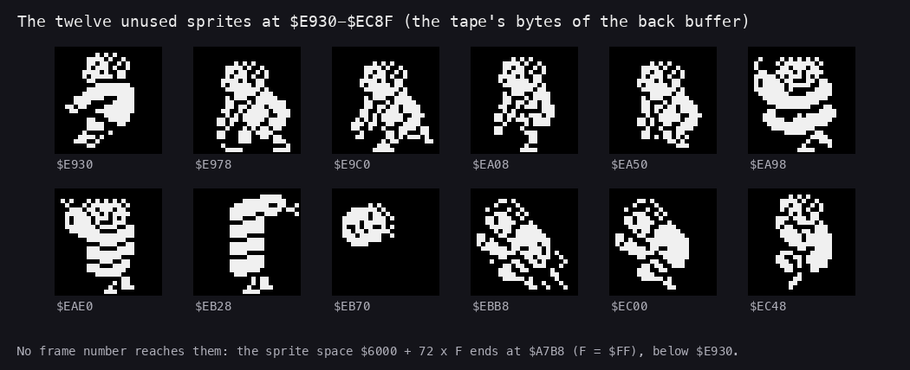

# Leftovers

Bytes the tape holds that no code reads before writing them, or reads at all: kept as bytes (or a hex grid) so the
tape comes back bit for bit. The play builds (c1, explorers, gameover and the 31 rzx pieces, work/stage2/bytemap.py)
are the evidence.

| File | Address | Bytes | What |
| --- | --- | ---: | --- |
| `8d01.bin` | Leftover8D01 `$8D01-$8DFF` | 255 | no play build reads or writes it; 350 of the 511 bytes up to `$8EFF` are zeros |
| `im2-table-tape.bin` | Im2Table `$8E00-$8EFF` | 256 | the IM 2 table's place: GameEntry `$8F00` fills `$8E00-$8F00` with `$5F` before interrupts are on, so the tape's bytes are never read |
| `back-buffer-tape.bin` | BackBufferLeftover `$E900-$EFFF` | 1792 | the rest of the back buffer: play writes it before reading it. It holds twelve 24 x 24 sprites in the sprite layout at `$E930-$EC8F` that no frame number reaches (the sprite space ends at `$A7B8`): explorer poses and the snake coiled round a captive (SK: "captured by the snake"), drawn in docs/img/arch/leftover-sprites.png |
| `tile-map-tape.txt` | TileMap `$F800-$F9FF` | 512 | the tile map of a room as it was when the tape was saved, 16 rows of 32 hex tile indices; BuildTileMap `$9914` rewrites it on every room entry before anything reads it |

