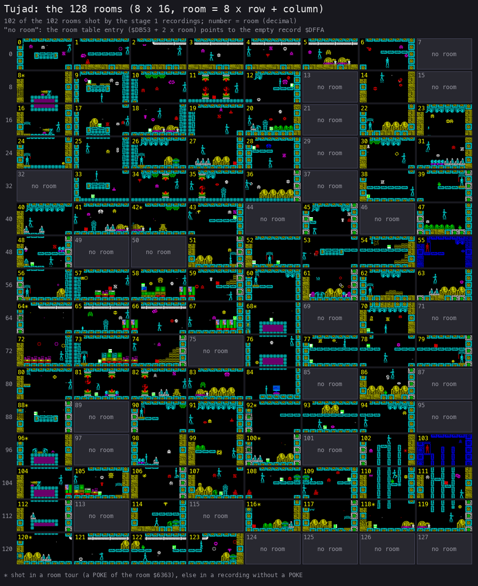

# Tujad: walkthrough

How the reverse was done, step by step, and which unreal-ng call answered each question. Terms:
[docs/README.md](docs/README.md). Recipes: `../recipes/`.

Every recording is named with its load (ROM speed or the fast LD-BYTES trap) beside every frame number.

## 0. The medium

Asked: which copy is the original Ariolasoft release, what is on it, and where does each block land?

ZXDB (the local `catalog-sources/zxdb/v1.0.242/zxdb.sqlite`, entry 5448) lists three downloads for the game: the TZX
33911 (release 0, source type "O", "Original release"), a TAP 33912 of the same release and the Dro Soft TZX 143623
(release 1), and an input recording, `tujad.rzx` (161527). All four are in the local ZXDB mirror and were copied
unchanged to `work/candidates/zxdb/`; every Tujad file of `software/zxart.ee-offline` went to
`work/candidates/zxart-offline/` and the TOSEC pack's 14 files to `work/candidates/tosec-knobchez-2026/`. The TZX
33911 is `orig/Tujad.tzx.zip`, still zipped.

```bash
. work/env.sh
md5 orig/Tujad.tzx.zip; shasum orig/Tujad.tzx.zip
unzip -o orig/Tujad.tzx.zip -d work/media/zxdb-Tujad.tzx
python3 tools/tzxblocks.py list work/media/zxdb-Tujad.tzx/Tujad.tzx            # archive info + 5 ROM blocks
for i in 1 2 3 4 5; do python3 tools/tzxblocks.py work/media/zxdb-Tujad.tzx/Tujad.tzx $i work/stage1/blocks/o-$i.raw; done
python3 tools/basic_list.py work/stage1/blocks/basic.bin                       # line 10
python3 tools/media_compare.py work/media/zxdb-Tujad.tzx/Tujad.tzx work/candidates --out work/stage1/media-compare.tsv
python3 tools/image.py work/mkgame/original.bin                                 # the image as loaded
z80dasm -a -t -g 0x60C0 work/stage1/game.bin > work/stage1/g.asm
python3 ../../kit/sig_scan.py work/mkgame/original.bin --base 0 --all --out work/stage1/sig-game.json   # no hit
```

Found:

- **The original is ZXDB download 33911.** ZXDB marks it the original release and its archive info says "Original".
  Every other copy is a conversion of its blocks, a translation (Dro Soft into Spanish, Sinclairsoft, Kis and Prospekt
  into Russian), a crack, a TR-DOS conversion or a snapshot of a game in progress; the README's table lists each with
  what differs, from `work/stage1/media-compare.tsv`.
- **The tape** ([doc 3, 3.1](docs/03-build-and-load.md#31-the-tape-block-by-block)): a BASIC header "TUJAD" (LINE 10,
  88 bytes), a one-line BASIC (`CLEAR 24767 ... LOAD "" CODE 16384: RANDOMIZE USR 23296`), a CODE header "TUJAD"
  (6944 bytes, its start 32768 overridden), the CODE block (the loading screen and a stub at `$5B00`), and one
  headerless block of 40 256 bytes the stub loads with LD-BYTES to `$60C0-$FDFF`. The game is entered at `$6300`
  (`JP $68F3`). The signal lasts 262.85 s (13 163 frames).
- **A save routine in the stub** (`$5B10`: the same block with SA-BYTES `$04C2`), never reached: the mastering tool
  left on the tape.
- **No known module**: the signature scan finds nothing.
- **The image's text** (a strings scan of `$60C0-$FDFF`): the scrolling messages at `$63D3` on ("TUJAD FROM
  ORPHEUS", "EDS COMPLETED", "GEN 19 COLLECTED", "UCF REACTOR NO 14C DESTROYED"), the menu at `$8D38` ("1 KEYBOARD",
  "2 CURSOR JOYSTICK", "3 KEMPSTON JOYSTICK", "0 START GAME"), "1986 ORPHEUS LTD" at `$8D85`, "YOU HAVE COMPLETED %
  OF TUJAD" at `$9072`. And leftover assembler source text from the authors' editor in the variables area
  (three runs, `$6359-$637F`, `$639C-$63D1`, `$65E5-$6887`: "hl,(pos)", "lookup", "hl,alnmap", "scra1"; [doc
  2.9](docs/02-architecture.md#29-the-authors-leftover-source)), NOTES.md.

## 1. One recording from power-on

Asked: what runs from power-on to play, and how is play paced?

`c1` records from power-on: the 48K with zeroed RAM and muted sound, `LOAD ""` typed and the original TZX played
with the fast LD-BYTES trap and turbo tape off (`tools/rs_capture.py`), so every block loads from the signal at ROM
speed; 13 700 frames of load, then `tests/inputs/c1.txt`: the menu, 2 (cursor joystick), 3 (Kempston), 1
(keyboard), 0 (start), then play with the keyboard (right, Q up beside the terminal, where an ED piece is taken and the progress screen
shown, fire, left, down, SPACE weapon select, ENTER pause and resume). 15 871 frames in all, `session.ttd` 6.0 MB, L1 1543 interrupts, 0 diverged.

```bash
. work/env.sh
python3 tools/rs_capture.py --work work/stage1/c1 --media orig/Tujad.tzx.zip --model 48K --record-load \
    --load-frames 13700 --inputs tests/inputs/c1.txt --ranges 4000-FFFF --port-base 36910 --binary $BIN
python3 work/stage1/tt.py 37110 '{"action":"probe_frames","probes":[{"probe":"exec","address":"0x6300"}]}'  # 13580
python3 $RS open --work work/stage1/entry --ttd work/stage1/c1/session.ttd --port-base 36900
python3 $RS build --work work/stage1/entry --from-frame 13580 --to-frame 13581 --into work/stage1/entry/f13580
python3 tools/passes.py --port-base 36900 --passes 400 --out work/stage1/passes.json \
    work/stage1/rec/menu-cursor/end.szx work/stage1/rzx/at0{1,3,5,7}0000.szx
```

| Stage | Entered | Frame of `c1` (ROM-speed load) | What runs |
| --- | --- | --- | --- |
| 0 | `$5B00` | 2908, T 8352 | the stub: LD-BYTES of the headerless block to `$60C0` |
| 1 | `$6300` | 13580 | `JP $68F3`: the setup, then the menu `$8854` (the RNG loop `$7DD5` from 13586) |
| 2 | `$95D0` | 14297 (the first interrupt taken) | play: the main loop `$6911` and the IM 2 handler |

The keys of the script land at frames 13900 (2), 14010 (3), 14120 (1) and 14230 (0); the rooms change at 14932,
15433 and 15493; no life is lost.

Found, interrupts and the frame (first look; stage 2 reads the routines):

- **IM 2 through `$5B5B`**: `$9584` fills `$FE00-$FF00` with 257 bytes of `$5B`, `$95B2-$95B7` writes `JP $95D0`
  at `$5B5B`, `$95BA-$95BE` sets I = `$FE` and IM 2. `$95C1-$95CF` (I = `$3F`, IM 1, `EI`, the ROM's CLS `$0D6B`,
  a white border) would go back to BASIC; it never runs in any recording.
- **The handler `$95D0`** does the frame's drawing and input: the controls (`$7161` into `$63C2`), every sprite of
  the list at `$FF01` drawn with XOR (`$95DB-$963F`), the message scroller (`$9640`), `$96CB`, the weapon select
  (`$7976`, CAPS SHIFT or SPACE on port `$7EFE` bit 0: A8 and A15 low read both half rows), `$7AB6`, `$7906` and the ROM's KEYBOARD (`$02BF`, which
  keeps `$5C04-$5C08`), then `EI; RETI` at `$96FB`. It runs 54 825 times over the 70 builds (`$96FB`).
- **DI / EI**: the setup starts with `DI` (`$68F3`) and `LD HL,$60C0; LD SP,HL` (`$68F4-$68F7`), and enables at `$6910`. The game runs with
  interrupts off: the main wait `$795D` is `EI; NOP; HALT` (`$796B-$796D`), `DI` (`$796E`). Nine other `EI`s run in
  the recordings (L1 counts over the 70 builds): `$6B2D` (279, the room setup `$6B22`, followed by `DI` at `$6E0B`),
  `$7F5B` (210) and `$7F6B` (649) after the two sweeps, `$7816` and `$7825` (13 each), `$777E` (8, with a HALT at
  `$777F`), `$8F5E` (36), `$6AA2` (1, with a HALT at `$6AA3`), `$6910` (4). `$6A22` (WinTest) never runs in an L1 build (the
  RZX playback runs it); `$95C7` is in the dead ExitToBasic; the other `$FB` bytes of the first-look scan (`$6F15`,
  `$6F17` in TileGraphics, `$8D25`, `$8D2A` in IconEnergySource) are data. Other HALTs: `$6A26` (990, a wait loop entered with interrupts on) and `$6AA3`
  (512). The menu (`$8854`) runs with interrupts off, polling the keys while it calls the random-number step `$7DC9`
  (`$893B`), so the seed `$63A4-$63A7` depends on how long the player waits.
- **The main loop syncs twice a pass**: `CALL $795D` at `$6911` and at `$6929`. So a pass holds at least two
  interrupts (corrected by docs, see doc 4.7: 2, or 3 when its work overruns; never 1).
- **Frames per pass** (`tools/passes.py`, a muted instance on base 36900 through the WebAPI: skip_until `$6911`,
  the beam's frame and T-state; 200 whole passes from each state, no key held; `work/stage1/passes.json`):

  | State | Room | Frames a pass (count of 200) | Mean | Median T | Heaviest T |
  | --- | --- | --- | --- | --- | --- |
  | `rec/menu-cursor/end.szx` | 84 | 2: 200 | 2.00 | 141 273 | 192 312 |
  | `rzx/at010000.szx` | 73 | 1: 9, 2: 180, 3: 11 | 2.01 | 139 776 | 178 740 |
  | `rzx/at030000.szx` | 51 | 1: 15, 2: 162, 3: 23 | 2.04 | 140 489 | 209 713 |
  | `rzx/at050000.szx` | 102 | 1: 11, 2: 159, 3: 30 | 2.095 | 144 561 | 210 142 |
  | `rzx/at070000.szx` | 34 | 1: 9, 2: 176, 3: 15 | 2.03 | 139 840 | 207 799 |

  The median, 139 776 T in room 73, is exactly two frames (2 x 69 888). The 1-frame passes (9-15 of 200) are an
  artefact of numbering frames from T 0: they are passes that start before T 1812, where unreal-ng's 48K INT falls;
  counted by the interrupts inside it a pass holds 2 or 3, never 1 (corrected by docs, see doc 4.7; doc 4 uses stage
  2's `passes2.py`, which gives 3 / 177 / 20 at `at050000`, not this table's 11 / 159 / 30). In play with keys, `energy-out`'s L1 has `$6911` 2434 times in
  5001 frames: 2.05 frames a pass. The half pass (one wait to the next, 400 from each state) has a median work of
  13 483-26 612 T and at most 35 278 T (room 51); the handler runs about 36 000 T in the median and 63 013 T at most
  (room 73). The big handlers are not sprites alone: the scroller step (about 26 200 T, every 5 interrupts) added to
  the droid's list (34 156 T) gives 60 939 T (corrected by docs, see doc 4.8).
- **The heaviest pass**: stage 1's `passes.py` measured 210 142 T (3 frames) from the RZX state after 50 000 frames
  (room 102), no key held; stage 2's `passes2.py` and the trace of `room-102` give 197 394 T for the heaviest pass from
  the same state (doc 4.8). The two tools' runs differ; doc 4 uses the trace. Its cause: the scroller step and three enemy pairs in handler 1, after which the droid half crosses the next INT, which
  is lost (doc 4.8, the recording `room-102`).
  The heaviest half pass with its handler: 97 122 T (room 51), more than a frame.

## 2. Static pass over the medium

## 3. The stages and the packers

## 4. The medium from source

## 5. Tool gaps found and fixed in unreal-ng

Stage 1 builds nothing in unreal-ng; these gaps were found and worked around.

| Gap | Fix | unreal-ng commit |
| --- | --- | --- |
| A TTD recording cannot hold an RZX playback: `/rzx/play` loads the RZX's snapshot, which ends the TTD session; a TTD started during the playback stays at "frames 0..1", and the L1 build then fails ("the recording is shorter than one frame"; `work/stage1/lab/rzxttd.py`) | worked around: the RZX's keys were logged frame by frame (`tools/rzx_keys.py log`: the variables `$6300-$63FF` after each of 81 000 frames and a saved state every 1000) and replayed as input scripts from the saved states, which the TTD records | not fixed |
| The fast LD-BYTES trap stays on while TTD records, so a capture loads the tape in 700 frames, not at its real length (`work/stage1/c1-trap`) | `tools/rs_capture.py` sets `fast_tape` and `turbo_tape` off before the load | not fixed |
| An RZX's keys replayed from a saved state do not keep to the RZX for long: the game is timing-bound (EnergyTimer `$6366`, which counts interrupts down to the next energy step, and the random number `$63A4-$63A7`, stepped by the menu and by play, part within hundreds of frames, after which a key lands in another state) | `tools/rzx_align.py` checks every frame against the RZX's log and ends a chunk at the first frame that matches no sample: 59 chunks, 42 952 frames, each a recording | not a fault of unreal-ng: the RZX's own playback (`/rzx/play`, tolerant) runs all 80 680 frames to the win |

## 6. The game

### 6.0 The recordings

Asked: which recordings reach every part of the game, and how was each made?

Every recording keeps its `session.ttd`, `l1.json`, `states.json` (the room `$6363`, the lives `$636D`, the energy
`$636E` and the controls `$63C2` every 25-60 frames) and its screenshots, in `work/stage1/rec/<name>/` (`c1` in
`work/stage1/c1/`; the writers' `room-102` and `probe-shield` in `work/docs/tjA/rec/` and `work/docs/tjB/rec/`). All but `c1` start from a saved state and are made by `tools/record.py` (a fresh muted instance on
base 36910, the state loaded, the TTD started, the script played one run call a segment, L1 built):

```bash
python3 tools/record.py --start work/stage1/menu.szx --inputs tests/inputs/menu-cursor.txt --work work/stage1/rec/menu-cursor --shot 50
python3 tools/record.py --start work/stage1/menu.szx --inputs tests/inputs/game-over.txt --work work/stage1/rec/game-over \
    --poke 200,0x636D,0 --poke 200,0x636E,1 --shot 25
python3 tools/record.py --start work/stage1/rec/menu-cursor/end.szx --inputs tests/inputs/room-tour.txt \
    --pokes tests/inputs/room-tour.pokes --work work/stage1/rec/room-tour --shot 60
python3 tools/rzx_keys.py log --rzx work/candidates/zxdb/tujad.rzx --out work/stage1/rzx       # 81 000 samples
python3 tools/rzx_align.py --log work/stage1/rzx --from 1000 --out work/stage1/rzx-chunks     # 59 scripts
python3 tools/record.py --start work/stage1/menu.szx --inputs tests/inputs/menu-kempston.txt --work work/stage1/rec/menu-kempston --shot 50
python3 tools/record.py --start work/stage1/rzx/at047000.szx --inputs tests/inputs/energy-out.txt --work work/stage1/rec/energy-out --shot 50
python3 tools/record.py --start work/stage1/rzx/at080000.szx --inputs tests/inputs/win.txt --work work/stage1/rec/win --shot 25
python3 tools/record.py --start work/stage1/rzx/at005000.szx --inputs tests/inputs/room-23.txt --work work/stage1/rec/room-23 --shot 50
for n in 29000 31000 32000; do python3 tools/record.py --start work/stage1/rzx/at0$n.szx \
  --inputs tests/inputs/rzx-free-$n.txt --work work/stage1/rec/rzx-free-$n --shot 50; done
for f in tests/inputs/rzx/rzx-*.txt; do n=$(basename $f .txt); \
  python3 tools/record.py --start work/stage1/rzx/at0${n#rzx-0}.szx --inputs $f --work work/stage1/rec/$n --shot 50; done
# the writers' recordings (docs 04 and 05), each on the writer's own port base
python3 tools/record.py --start work/stage1/rzx/at050000.szx --inputs work/docs/tjA/inputs/room-102.txt \
    --work work/docs/tjA/rec/room-102 --shot 100 --port-base 36930
python3 tools/record.py --start work/stage1/rzx/at065000.szx --inputs work/docs/tjB/probe-shield.txt \
    --work work/docs/tjB/rec/probe-shield --shot 25 --port-base 36940
```

`work/stage1/menu.szx` is `c1`'s `start.szx`: the menu at `c1` frame 13700. The `at<N>.szx` states are the RZX
playback's, saved after N of its frames (`/rzx/play`, tolerant; [WALKTHROUGH 5](#5-tool-gaps-found-and-fixed-in-unreal-ng)).

| Recording | Start | How | Frames | What it reached | `session.ttd` |
| --- | --- | --- | ---: | --- | --- |
| `c1` | power-on | the tape at ROM speed, then `c1.txt` (menu 2, 3, 1, 0; keyboard play) | 15 871 | the load, the menu with every option, play in room 84 and three more rooms, the progress screen (an ED piece taken next to the terminal), the pause (ENTER) | `work/stage1/c1/session.ttd` |
| `c1-trap` | power-on | `tools/rs_capture.py` before it set `fast_tape` and `turbo_tape` off: the tape by the LD-BYTES trap (`work/stage1/c1-trap/capture.json`) | 700 of load, 2111 in all | the evidence of the trap gap only ([WALKTHROUGH 5](#5-tool-gaps-found-and-fixed-in-unreal-ng)); no document rests on it | `work/stage1/c1-trap/session.ttd` |
| `menu-cursor` | `menu.szx` | `menu-cursor.txt`: 2, 0, play with the cursor keys | 1201 | the cursor-joystick method (`$63C2` = `$41` with right held: bit 6 the method) | `work/stage1/rec/menu-cursor/session.ttd` |
| `menu-kempston` | `menu.szx` | `menu-kempston.txt`: 3, 0, play with the Kempston stick | 1201 | the Kempston method (`$63C2` bits 6 and 7 clear) | `work/stage1/rec/menu-kempston/session.ttd` |
| `energy-out` | `rzx/at047000.szx` (room 76, energy 18, lives 5) | no key | 5001 | the energy run down by the enemies to 0 and a life lost in frame 1570 (lives 5 to 4, the energy back to 99; the HUD shows it at 1634, after the death effect) | `work/stage1/rec/energy-out/session.ttd` |
| `game-over` | `menu.szx` | `game-over.txt`: 1, 0, no key; **POKE** `$636D` = 0 and `$636E` = 1 at frame 200 | 3121 | the last life lost (lives `$99` by frame 400), "YOU HAVE COMPLETED 0% OF TUJAD" from about 450 to 950 with the game-over message scrolling in the panel (shot at 700), the menu from about 975 | `work/stage1/rec/game-over/session.ttd` |
| `win` | `rzx/at080000.szx` (every ED complete, room 84) | no key | 1501 | "CONGRATULATIONS TUJAD HAS NOW RESUMED NORMAL FUNCTIONS WELL DONE" over the circuit-board picture (25-475), then the menu (from frame 497) | `work/stage1/rec/win/session.ttd` |
| `room-tour` | `rec/menu-cursor/end.szx` | 8 (right) held; **POKEs** (`room-tour.pokes`): every 60 frames the room `$6363` = r - 1, x `$6359` = `$1C`, lives `$636D` = 9, energy `$636E` = `$99`, so the game's own room change (`$7403`) draws room r | 7681 | the game moved into 65 rooms: 53 of the 102 rooms (11 of them shot nowhere else: the world map's starred cells) and 12 of the 26 empty slots, drawn empty | `work/stage1/rec/room-tour/session.ttd` |
| `room-23` | `rzx/at005000.szx` (the RZX in room 23) | no key | 100 | room 23 | `work/stage1/rec/room-23/session.ttd` |
| `rzx-free-29000`, `-31000`, `-32000` | `rzx/at029000.szx`, `at031000`, `at032000` | the RZX's keys for 1000 frames, unchecked (they part from the RZX) | 1001 each | rooms 43, 106 and 91, which the checked chunks end before | `work/stage1/rec/rzx-free-<N>/session.ttd` |
| `rzx-001000` ... `rzx-080000` (59) | `rzx/at<N>.szx` | the RZX's keys, checked frame by frame (`tests/inputs/rzx/`) | 42 952 in all (2-3706) | 90 rooms; the hazard death in `rzx-035000` (room 109 to 117, lives 5 to 4 in frame 250) | `work/stage1/rec/rzx-<N>/session.ttd` |
| `room-102` (tjA, doc 4) | `rzx/at050000.szx` (room 102) | no key (`work/docs/tjA/inputs/room-102.txt`) | 401 | the heaviest room's passes, traced: the light pass 41-43, the heaviest pass 239-242 ([doc 4.8](docs/04-game-loop.md#48-the-beam-a-light-pass-and-the-heaviest-pass)) | `work/docs/tjA/rec/room-102/session.ttd` |
| `probe-shield` (tjB, doc 5) | `rzx/at065000.szx` (room 12, weapon 3, ammunition 5, Kempston) | `work/docs/tjB/probe-shield.txt`: turn left, fire held with the directions (the probe steered), fire released, then down alone | 317 | the probe steered and its frames 2 and 4, the shield ([doc 5.8](docs/05-controls.md#58-the-probe-under-fire-held), [5.9](docs/05-controls.md#59-the-shield-down-alone)) | `work/docs/tjB/rec/probe-shield/session.ttd` |

The POKEs never reach the image: `tools/image.py` builds it from the tape alone, and every POKE recording is named
here. The poked bytes are variables (`$6359`, `$6363`, `$636D`, `$636E`); they garble the panel's digits in the tours.

Coverage:

- **The menu and every control method**: the menu has four entries, 1 keyboard, 2 cursor joystick, 3 Kempston
  joystick, 0 start (`$8D38`); `c1` presses all four, and each method is played (`c1` keyboard, `menu-cursor`,
  `menu-kempston`). The pause (ENTER, `$793A`) and the weapon select (SPACE) are in `c1`.
- **Every room and the world map**: the room table at `$DB53` has 128 entries; 26 point at one empty record
  (`$DFFA`, all zero), and the RZX's complete game (80 680 frames, the win) never enters those 26. The other 102
  rooms are all shot by the recordings: 91 in recordings without a POKE, 11 in `room-tour` only
  ([the world map](#61-the-screens)).
- **Objects, enemies and pickups**: the sprite lists of all saved states hold 28 graphics (the player's five, the
  enemies' pre-shifted buffers, the objects' 11 frames at `$B16D-$B65A` and the patroller's 4 at `$B962-$BAE2`; [doc 2.6](docs/02-architecture.md#26-the-sprites-first-look)).
  What each one is (enemy, ED, weapon, generator) is stage 2's work; the RZX chunks cover the whole game, so every
  kind the game uses appears in them.
- **Every way to lose a life**: the energy running out (`$6A30`; `energy-out`) and a hazard, which takes the life at
  once (`$75C8`, `JP NZ` at `$75E1` to `$6992`; `rzx-035000`). Game over: `game-over`. The win: `win` and the RZX.
- **The hi-score table and the name entry**: the game has none. The image holds no score text ("SCORE", "HIGH",
  "NAME", "BEST", "TABLE": no hit), and the game over goes straight to the progress screen and the menu
  (`game-over`).
- **Every sound**: the game's sounds are its `OUT ($FE),A` sites; L1 counts of each over the recordings:

  | Site | Routine | What it plays | Reached in |
  | --- | --- | --- | --- |
  | `$7F79` | `$7F6D`, called from the main loop at `$6914` | two edges a pass: a tick | every play recording |
  | `$7B68`, `$7B6C` | `$7B65` | 50 cycles before the first digit of a number: one click per number (doc 9.4) | every play recording |
  | `$785A` | `$7856` (called from `$7837`) | a tone of 256 edges | `c1`, `menu-cursor`, `menu-kempston`, `room-tour`, RZX chunks |
  | `$7F61` | FallSweep `$7F5D` (called at `$7B2B`, `$808E`) | a falling sweep (delays 0, 1 .. 255: a click, then 38 kHz down to 523 Hz), interrupts off | `energy-out`, `game-over`, `room-tour`, RZX chunks |
  | `$7F51` | RiseSweep `$7F4D` (called at `$8091`) | a rising sweep (delays 220 down to 1: 605 Hz up to 38 kHz), interrupts off | RZX chunks |
  | `$7FD0` | `$7F9C` | 30 edges per row of a column drawn with attribute `$42`/`$A0` | RZX chunks |
  | `$801A` | `$8005` (called at `$782D`) | the same per row | RZX chunks |
  | `$69D5` | `$69C3-$69E2` | an edge per row of a five-row fill: HazardFlash under the shield (doc 9.5) | `menu-cursor`, `menu-kempston`, RZX chunks |

  `$88E2` (`OUT` 0 when the menu screen is set up) and `$95CD` (the white border of the exit to BASIC, never run) are
  the border only. Every sound site runs in at least one recording.

### 6.1 The screens

Asked: what does each screen look like, at which frame?

Each figure is the screen at the named frame of the named recording (`c1`'s frames count from power-on, the ROM-speed
load included).

| Screen | Figure | Recording, frame |
| --- | --- | --- |
| the loading screen | [loading.png](docs/img/play/loading.png) | the CODE block's first 6912 bytes (`work/stage1/blocks/b4.bin`), on the screen whole from `c1` frame 2907 |
| the menu | [menu.png](docs/img/play/menu.png) | `c1` 13950 |
| the start room (84), the TUJAD terminal, "TUJAD FROM ORPHEUS" | [start-room.png](docs/img/play/start-room.png) | `c1` 14450 |
| the progress screen (an ED piece taken next to the terminal) | [progress.png](docs/img/play/progress.png) | `c1` 14700 |
| a room with enemies | [room-enemies.png](docs/img/play/room-enemies.png) | `c1` 14950 |
| a room being drawn | [room-drawing.png](docs/img/play/room-drawing.png) | `c1` 15450 |
| a room with the domes | [room-domes.png](docs/img/play/room-domes.png) | `c1` 15700 |
| the energy at 1 | [energy-low.png](docs/img/play/energy-low.png) | `energy-out` 1550 |
| the life lost to the energy | [energy-out-after.png](docs/img/play/energy-out-after.png) | `energy-out` 1650 |
| before the hazard (room 109) | [hazard-before.png](docs/img/play/hazard-before.png) | `rzx-035000` 200 |
| after the hazard (room 117, a life lost) | [hazard-after.png](docs/img/play/hazard-after.png) | `rzx-035000` 350 |
| the game-over message over the 0% screen | [game-over-message.png](docs/img/play/game-over-message.png) | `game-over` 700 |
| "YOU HAVE COMPLETED 0% OF TUJAD" | [game-over-progress.png](docs/img/play/game-over-progress.png) | `game-over` 900 |
| the win: "CONGRATULATIONS" | [win-congratulations.png](docs/img/play/win-congratulations.png) | `win` 100 |
| the win: "WELL DONE" | [win-well-done.png](docs/img/play/win-well-done.png) | `win` 475 |
| the world map | [world-map.png](docs/img/play/world-map.png) | below |
| every room drawn from `src/res/rooms` (stage 2) | [world-map-rooms.png](docs/img/play/world-map-rooms.png) | no recording: `tools/fig_roommap.py` |

The writers' figures built on screenshots (each caption gives its command):

| Screen | Figure | Recording, frame |
| --- | --- | --- |
| GEN 19 before and after the pickup | [key-moments.png](docs/img/play/key-moments.png) | `rzx-036000` 110 and 135 |
| the energy source before and after | [key-moments.png](docs/img/play/key-moments.png) | `rzx-028000` 300 and 325 |
| on the teleporter pad, TRANSPORTING | [key-moments.png](docs/img/play/key-moments.png) | `rzx-002000` 880 |
| a patroller walking its row | [key-moments.png](docs/img/play/key-moments.png) | `rzx-019000` 400 |
| room 84 from its triples against the screen | [room84.png](docs/img/render/room84.png) | `c1` 15466 |
| the screen and its writers, room 92 | [writers-room92.png](docs/img/render/writers-room92.png) | `c1` 15006-15011 |
| the probe's path over the screen | [probe.png](docs/img/controls/probe.png) | `probe-shield` 40-146 (the screen at 146) |
| the shield, every fourth frame | [shield.png](docs/img/controls/shield.png) | `probe-shield` 180-300 |
| the HUD panel (rows 0-5) | [hud.png](docs/img/text/hud.png) | `c1` 14450 |
| the menu screen and its texts | [menu.png](docs/img/text/menu.png) | `c1` 13950 |



*The world map (`tools/fig_worldmap.py work/stage1/rec docs/img/play/world-map.png --json work/stage1/world-map.json`):
the room numbers run 8 to a row (+1 east, +8 south, the room changes at `$7403`, `$7477`, `$74BE`, `$750F`); each
cell is the play area of a shot in that room (the source of each in `work/stage1/world-map.json`). The starred cells are from `room-tour`.*

### 6.2 The animations

Asked: which animation shows what, from which recording?

Every animation of the documents (31 GIFs, `find docs -name '*.gif'`); the command is in each caption. A window
`F:T-F:T` is frame:T to frame:T.

| Animation | Document | Recording | Frames |
| --- | --- | --- | --- |
| [load-c1.gif](docs/img/load/load-c1.gif) | 3.3 | `c1` | 100-13600, a picture each 150 frames |
| [MainLoop.gif](docs/img/routines/MainLoop.gif) | 4.3 | `room-102` | 41:37800-43:57600 (a light pass) |
| [Interrupt.gif](docs/img/routines/Interrupt.gif) | 4.5 | `room-102` | 239:50000-242:38000 (the heaviest pass) |
| [ReadControls.gif](docs/img/routines/ReadControls.gif) | 5.3 | `c1` | 14600:0-14604:20000 (X held) |
| [probe-steer.gif](docs/img/play/probe-steer.gif) | 5.8 | `probe-shield` | 40-146, every second frame |
| [DrawRoom.gif](docs/img/routines/DrawRoom.gif) | 6.2 | `c1` | 15433:35000-15465:6000 (room 84) |
| [InterruptSprite.gif](docs/img/routines/InterruptSprite.gif) | 6.4 | `c1` | 15010 |
| [ShiftGraphic3.gif](docs/img/routines/ShiftGraphic3.gif) | 6.5 | `c1` | 15009:36700-15009:56000 |
| [SaveRoomObjects.gif](docs/img/routines/SaveRoomObjects.gif) | 7.3 | `rzx-001000` | 104:46600-104:48800 |
| [room-change.gif](docs/img/play/room-change.gif) | 7.3 | `rzx-010000` | 1938-1952 (room 58 to 57) |
| [MoveEnemy.gif](docs/img/routines/MoveEnemy.gif) | 7.6 | `rzx-010000` | 1146-1171 (room 58) |
| [enemy-touch.gif](docs/img/play/enemy-touch.gif) | 7.6, 10.11 | `rzx-010000` | 104-124 (room 73) |
| [MoveObject.gif](docs/img/routines/MoveObject.gif) | 7.8 | `rzx-010000` | 1456-1476 (room 58) |
| [fight.gif](docs/img/play/fight.gif) | 7.8, 10.5 | `rzx-010000` | 1440-1480 |
| [death-hazard.gif](docs/img/play/death-hazard.gif) | 7.10, 10.6 | `rzx-035000` | 244-330, every second frame |
| [PrintText.gif](docs/img/routines/PrintText.gif) | 8.3 | `game-over` | 954:22000-955:12000 |
| [PrintBcd.gif](docs/img/routines/PrintBcd.gif) | 8.4 | `rzx-030000` | 64:14800-64:20800 |
| [DrawHud.gif](docs/img/routines/DrawHud.gif) | 8.5 | `menu-cursor` | 122:0-123:4500 |
| [InterruptScroll.gif](docs/img/routines/InterruptScroll.gif) | 8.8 | `rzx-030000` | 158:27000-209:0 |
| [message-tujad.gif](docs/img/play/message-tujad.gif) | 8.8 | `menu-cursor` | 130-230, every second frame |
| [ProgressScreen.gif](docs/img/routines/ProgressScreen.gif) | 8.10 | `game-over` | 434:23000-438:5000 |
| [progress-flash.gif](docs/img/play/progress-flash.gif) | 8.10 | `menu-cursor` | 224-420, every fourth frame |
| [win-congratulations.gif](docs/img/play/win-congratulations.gif) | 8.11 | `win` | 0-500, every tenth frame |
| [game-over.gif](docs/img/play/game-over.gif) | 8.11 | `game-over` | 360-960, every twelfth frame |
| [FallSweep.gif](docs/img/routines/FallSweep.gif) | 9.7 | `rzx-030000` | 251:68300-258:30000 |
| [BeamDown.gif](docs/img/routines/BeamDown.gif) | 9.9 | `rzx-030000` | 118:32000-250:0 |
| [MoveDroid.gif](docs/img/routines/MoveDroid.gif) | 10.1 | `rzx-007000` | 256-259 (the landing and the shield) |
| [teleport.gif](docs/img/play/teleport.gif) | 10.2 | `rzx-007000` | 720-1136, every eighth frame |
| [shield.gif](docs/img/play/shield.gif) | 10.3 | `rzx-007000` | 252-282 |
| [LoseLife.gif](docs/img/routines/LoseLife.gif) | 10.6 | `rzx-035000` | 250-313 |
| [ed-pickup.gif](docs/img/play/ed-pickup.gif) | 10.8 | `rzx-010000` | 1680-1712 |

## 7. Review
