# 1. Game design

What this covers: the game as a player meets it: the story the texts tell, every screen and mode, the play screen,
the controls in brief, the cast, the world of 102 rooms, the rules (energy, lives, hazards, weapons), the pickups and
the ED pieces with the progress screen, the key moments of a game, and the two endings.

The recordings it rests on ([WALKTHROUGH 6.0](../WALKTHROUGH.md#60-the-recordings), all on the 48K):

| Recording | Load | Used for |
| --- | --- | --- |
| `c1` | power-on, the tape at ROM speed | the loading screen, the menu, the start room, an ED piece and the progress screen, rooms, the pause |
| `energy-out` | `work/stage1/rzx/at047000.szx` (room 76, energy 18, lives 5), no key | the energy run down, a life lost |
| `rzx-035000` | `rzx/at035000.szx`, the RZX's keys | a hazard death |
| `rzx-002000`, `rzx-019000`, `rzx-028000`, `rzx-036000` | the RZX states, the RZX's keys | the teleporter, a patroller, the energy source, GEN 19 |
| `game-over` | `work/stage1/menu.szx`; POKE `$636D` = 0, `$636E` = 1 at frame 200 | the game over |
| `win` | `rzx/at080000.szx` (every ED piece taken, room 84), no key | the win |
| `room-tour` | `rec/menu-cursor/end.szx`; POKEs of the room every 60 frames | the rooms no other recording enters (the world map) |

Every screenshot is the screen at the start of the named frame of the named recording (`kit/screen_shot.py` or
`tools/record.py --shot`). `c1`'s frames count from power-on, the load included.

## 1.1 The game in one paragraph

The player is a droid, GEN 19, inside TUJAD, a computer that has broken down. The droid walks, climbs and falls through
102 rooms of a maze of circuit-board walls, collecting the 50 pieces of an ED circuit. Enemies materialise and fly
about the rooms, objects drift through them and patrollers crawl along their floors; the droid shoots them with four
weapons. Energy runs down with time and runs down fast while an enemy touches the droid; an object, a patroller or a
stray shot kills it at once. When all 50 pieces are taken, the game says EDS COMPLETED RETURN TO TUJAD CONTROL ROOM;
back in the control room, where the game began, TUJAD HAS NOW RESUMED NORMAL FUNCTIONS. There is no score and no
hi-score table: the only measure is the percentage of the circuit completed.

The story is told only by the game's texts (`src/res/text/Messages.txt`): no inlay text was found among the case's
media. The game-over message names the stakes: COMPUTER MALFUNCTION, GEN 19 TERMINATED, UCF REACTOR NO 14 C
DESTROYED.

**The point**: a collecting maze game with a single goal, 50 pieces, and two ways to fail, the energy and the hazards.

## 1.2 The screens and the modes

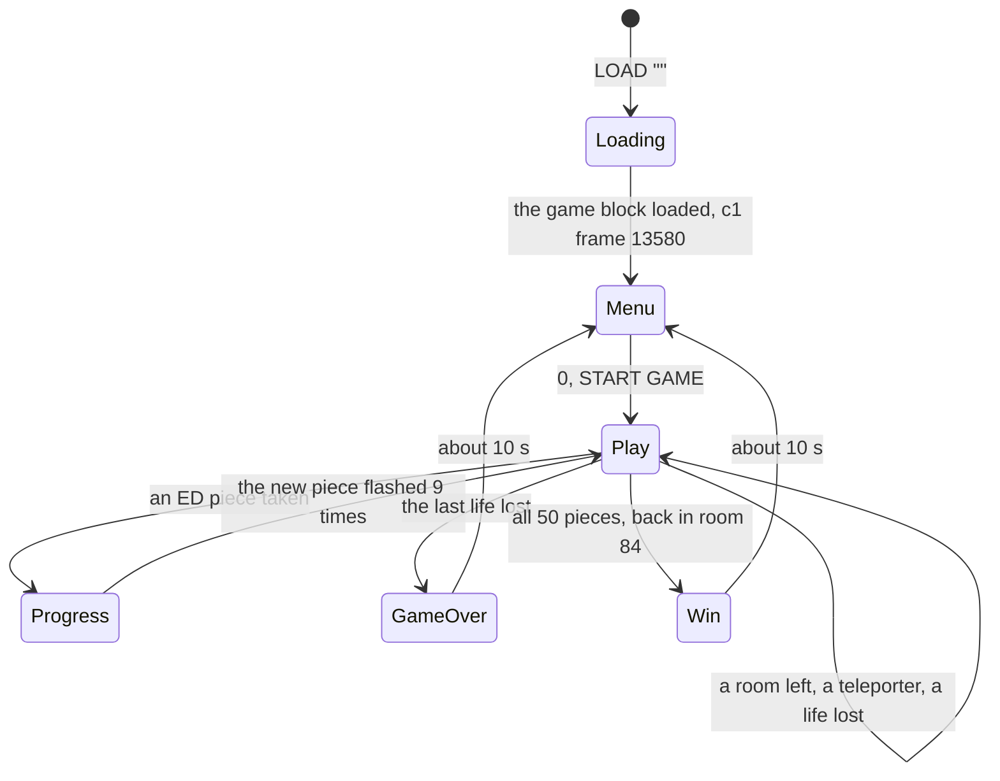

| Screen | Figure | Recording, frame | What the player does |
| --- | --- | --- | --- |
| the loading screen | 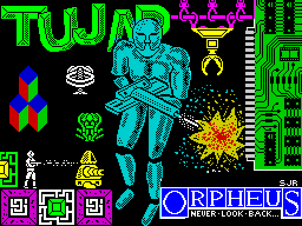 | block 4 of the tape, whole from `c1` 2907 | waits about 3.5 minutes more for the game block |
| the menu | 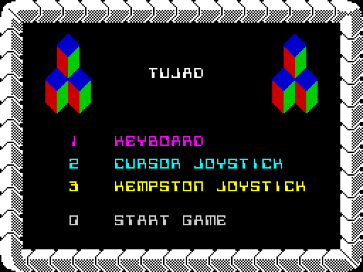 | `c1` 13950 | 1 keyboard, 2 cursor joystick, 3 Kempston joystick, 0 START GAME; the chosen method is lit |
| play: the start room 84, the TUJAD terminal | 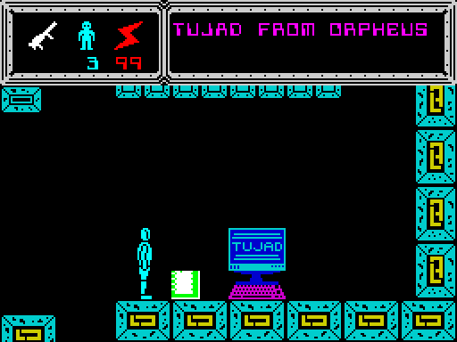 | `c1` 14450 | moves, shoots, collects |
| the progress screen | 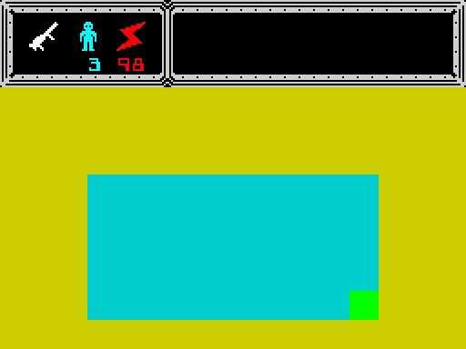 | `c1` 14700 | watches the new ED piece flash (an ED piece taken next to the terminal) |
| the game-over screen | 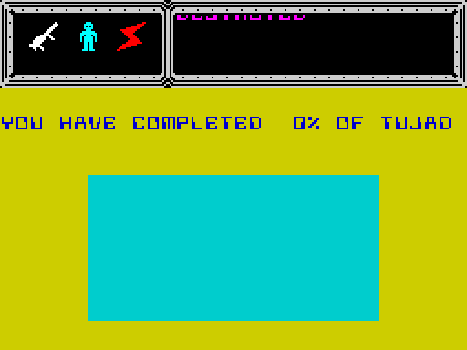 | `game-over` 900 | waits: YOU HAVE COMPLETED nn% OF TUJAD |
| the win | 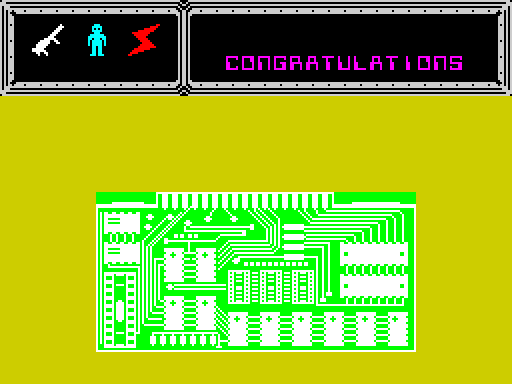 | `win` 100 | waits: CONGRATULATIONS over the whole circuit |

*Six screens, each shot at the start of the named frame (the 256 x 192 screen doubled to 512 x 384, no border; WALKTHROUGH 6.1). How to
read: the left column names the mode; the figure is the screen the player sees in it. The point: there are only two
interactive screens, the menu and play; the progress, game-over and win screens are timed waits.*

- The menu runs with interrupts off and polls the keys; it never times out and has no demo mode.
- The progress screen and both endings use the same picture: the 50 ED pieces as a circuit board, with the pieces
  found drawn in.
- The pause (ENTER) freezes the whole game, the energy included ([doc 4.6](04-game-loop.md#46-interrupts-on-and-off)).

**The point**: a menu, play and three kinds of interlude, all drawn over one HUD.

## 1.3 The play screen

| | |
| --- | --- |
| 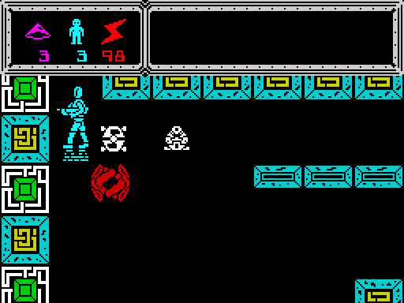 | 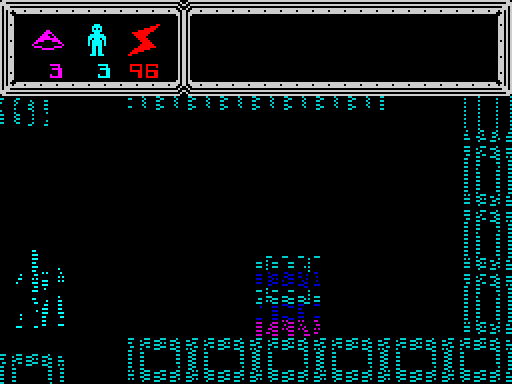 |

*Left: `c1` frame 14950, a room with enemies. Right: `c1` frame 15450, a room being drawn as the droid enters it
(the old room wiped with 8 pixel shifts, the new tiles coming in). How to read: the top six character rows are the
HUD; the play area below is 32 x 18 cells. The point: the HUD stays while the play area is redrawn room by room.*

- **The left panel** shows the weapon in use (its icon in its colour), the lives (the GEN 19 figure and a number) and
  the energy (the bolt and a number from 99 down). The ammunition of weapons 1-3 is printed under the weapon.
- **The right panel** is a scroller: one message at a time rises through a window 19 characters wide, a pixel line at
  a time. A message is taken only when its priority is higher than the one showing (TUJAD FROM ORPHEUS 1, ENERGY
  SOURCE ABSORBED 2, WARNING ENERGY LOW 5, WEAPON LOCATED AND STORED and GEN 19 messages 8, TRANSPORTING and EDS
  COMPLETED 10, the two endings 20).
- **The play area** shows one room. The droid leaves it by an edge and the next room is drawn.

**The point**: the play screen gives three numbers and one message, nothing else; there is no map and no score on
screen.

## 1.4 The controls

The menu picks one of three methods (Controls `$63C2` bits 7-6: `$80` keyboard, `$40` cursor keys, 0 Kempston).
ReadControls `$7161` reads it every interrupt ([doc 5](05-controls.md) has the decoding):

| Action | Keyboard | Cursor joystick | Kempston |
| --- | --- | --- | --- |
| left | Z C M B | 5 | left |
| right | X V N SYMBOL SHIFT | 8 | right |
| down | A-G, H-L | 6 | down |
| up | Q-T, Y-P | 7 | up |
| fire | 1-5, 6-0 | 0 | fire |
| next weapon | SPACE | SPACE | SPACE |
| pause | ENTER | ENTER | ENTER |

- Whole half rows of the keyboard act as one key, so the keyboard needs no redefinition.
- SPACE picks the next weapon that has ammunition, and only while no shot is in flight.
- `c1` presses every menu key and plays with the keyboard; `menu-cursor` and `menu-kempston` play with the other two
  methods.

**The point**: one key per action, on whole rows of the keyboard, read 50 times a second.

## 1.5 The cast

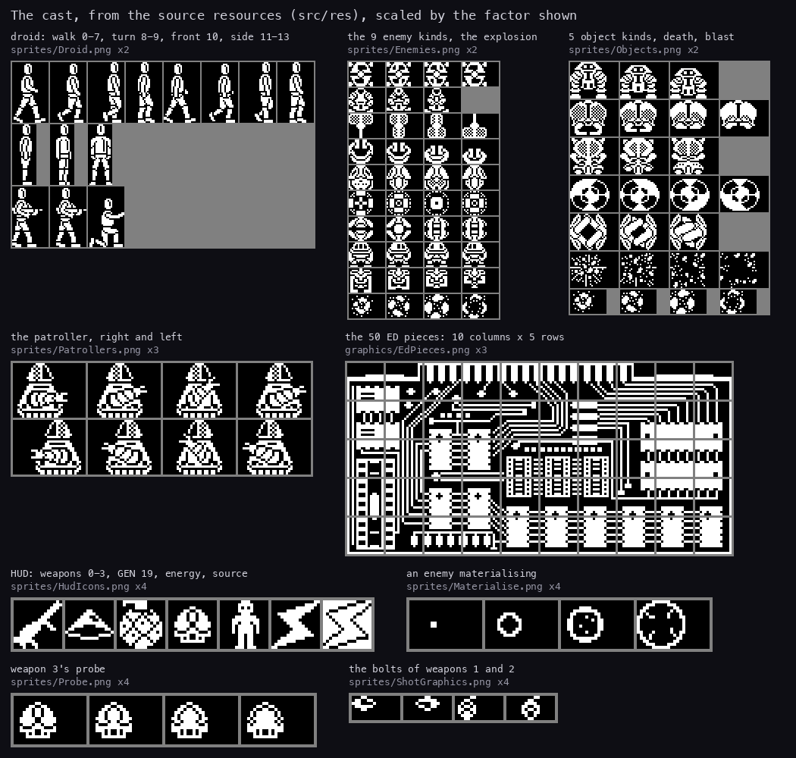

*The cast from the source resources, scaled up by the factor shown. How to read: each sheet is the resource the build
turns into bytes; grey cells are padding of the sheet. Made with `python3 tools/fig_cast.py docs/img/play/cast.png`
from `src/res/sprites/*.png` and `src/res/graphics/EdPieces.png`. The point: the cast is small, nine enemy kinds, five
object kinds and one patroller, and every one is a one-colour block.*

| Who | How many in a room | What it does | Witness |
| --- | --- | --- | --- |
| the droid, GEN 19 | 1 | walks left and right a column at a time, turns round, climbs and steps down 2 pixel rows at a time, falls when nothing is under it | every play recording |
| enemies | up to 4 | materialise on a free spot, fly diagonally and bounce off walls; a touch drains energy fast; shot, they explode and come back later; their kind cycles 1-9 | `c1` 14950 |
| objects | up to 2 | drift through the room; a touch kills; each kind dies only to one weapon | `rzx-028000` |
| patrollers | 3 in the world | crawl along a row from one turn point to the next, crossing rooms; a touch kills | `rzx-019000` from frame 216 |

Each room's record says which enemies and objects it holds ([doc 7](07-objects.md)). The objects' weapons, from the
kill marks: the robot head dies to weapon 1; the brain and the spotted ball to weapon 2; the insect face and the
rotating box to weapon 3.

**The point**: enemies cost energy, everything else costs a life, and the weapons decide which objects can be cleared.

## 1.6 The world: 102 rooms

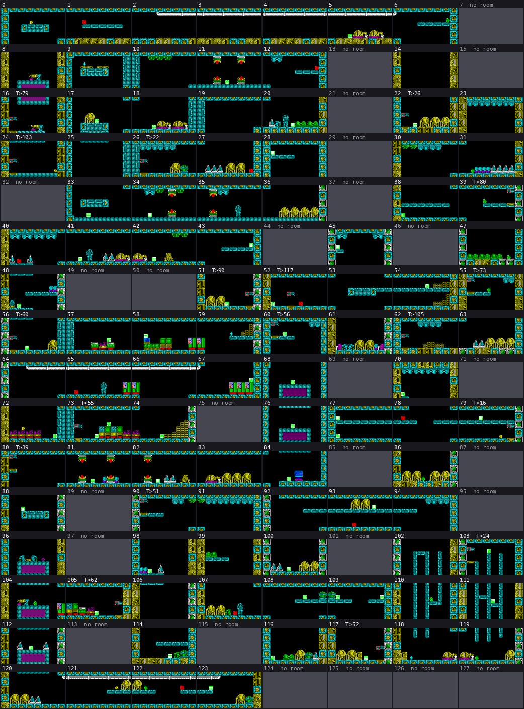

*Every room as DrawRoom draws it, from `src/res/rooms/Rooms.txt` and the tile resources (`python3
tools/fig_roommap.py docs/img/play/world-map-rooms.png`). How to read: 8 rooms across and 16 down, room 0 at the top
left; the room east is + 1, the room south is + 8; each cell shows the tiles and the items lying there at the start;
a red frame and "T>n" mark a teleporter to room n; grey cells are the 26 empty slots. The point: the maze is one
8 x 16 grid with holes, and the teleporters are its short cuts.*

- **102 rooms**: the room table at `$DB53` has 128 entries, and 26 point at one empty record. The RZX's complete game
  (80 680 frames, to the win) never enters those 26.
- **The edges**: the droid leaves east at x = `$1D` into room + 1, west at x = 0 into room - 1, south at y = `$98` into
  room + 8, north at y = `$30` into room - 8 (MoveDroid `$7208`).
- **Teleporters**: a pad in some rooms; standing on it shows TRANSPORTING, a beam carries the droid down and up, and the
  target room is drawn.
- **Items change rooms each game**: NewGame `$7A2F` deals the items, then ScrambleRooms `$7BA0` passes every GEN 19,
  energy source and ED piece one room on, 1-31 times (a random count). Weapons stay where they are.

The world map of the shots (every room as a recording saw it) is [WALKTHROUGH 6.1](../WALKTHROUGH.md#61-the-screens).

| | |
| --- | --- |
| 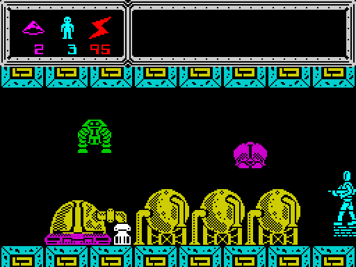 | 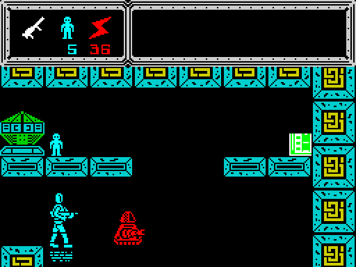 |

*Left: `c1` frame 15700, a room with the domes. Right: `rzx-035000` frame 200, room 109, just before the hazard
death. How to read: the walls are tiles, each cell of a tile in its own colour; everything not black is solid. The
point: the rooms are built from a few dozen tiles (70 in all), and their colour cells are also the walls the droid
meets.*

**The point**: a big, open maze whose items move between games, so no two games are dealt alike.

## 1.7 The rules

### Energy

- The energy starts at 99 (BCD) and steps down by 1 every 250 interrupts: 5 s when no interrupt is lost (EnergyTick
  `$7AB6`).
- While an enemy touches the droid it steps every 10 interrupts (0.2 s), and stays fast for 50 interrupts after the
  touch (DrainTimer `$7906`). The droid's attributes flash and the beeper clicks (HazardFlash `$699B`).
- WARNING ENERGY LOW is queued when the energy steps from 11 to 10.
- At 0, unless the droid is turning round, a life is lost (EnergyOut `$6A30`).
- An energy source restores 99.

**A worked example: `energy-out`.** The recording starts in room 76 with energy 18 and lives 5, and no key is held.

1. At 250 interrupts a step, 18 steps would take 4500 interrupts, about 90 s or 4700 frames.
2. The enemies keep touching the droid, so many steps come at 10 interrupts each.
3. The energy reaches 0 and the life is lost between frames 1550 and 1600: lives 5 to 4, energy back to 99.

| | |
| --- | --- |
| 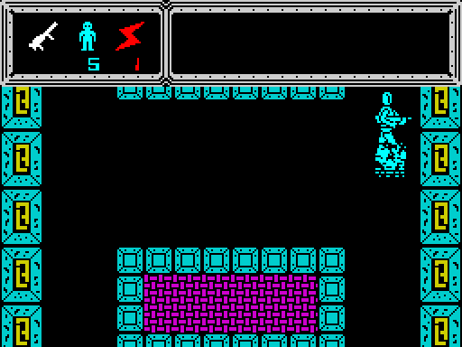 | 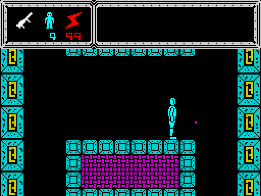 |

*`energy-out` (from `rzx/at047000.szx`, no key). Left: frame 1550, energy 1. Right: frame 1600, the life lost: lives
4, energy 99. How to read: the numbers in the HUD's left panel, under the GEN 19 figure and the bolt. The point: the
enemies turned a 90 s budget into 31 s.*

### Lives

- A game starts with 3 lives. A GEN 19 item (a small cyan figure) adds one: GEN 19 COLLECTED.
- A life is lost when the energy runs out, or at once on a hazard. The game shows GEN 19 DESTROYED, the droid is shaken
  apart with a falling sweep (DeathEffect `$7ADF`), and it starts again at the room's start position with energy 99.
- After the last life the count goes to `$99` (0 - 1 in BCD) and the game is over (1.10).

### Hazards

When the interrupt finds the droid's ink on other ink, the cells under it are tested:

- an enemy's mark: the fast drain;
- an object's, a patroller's or a shot's mark: HazardDeath `$6992`, a life lost at once, unless the droid is turning
  round at that moment.

| | |
| --- | --- |
|  | 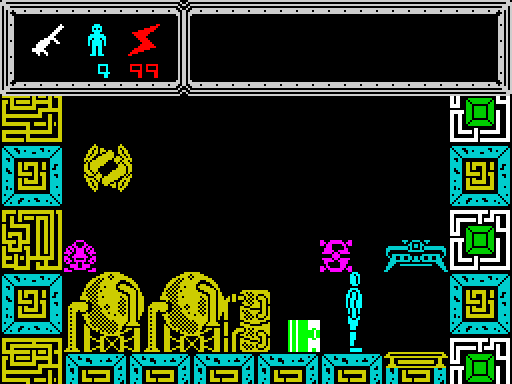 |

*`rzx-035000` (the RZX's keys). Left: frame 200, room 109. Right: frame 250, room 117, lives 5 to 4: the droid went
south and met a hazard. How to read: the lives under the GEN 19 figure. The point: a hazard takes the life however
much energy is left.*

### Weapons

| Weapon | Icon | Shot | Ammunition | Kills |
| --- | --- | --- | --- | --- |
| 0 | a gun | a dash, 8 pixels a pass | none needed | enemies, by collision |
| 1 | a disc | a bolt, 4 pixels a pass | 3 at the start, + 1 a pickup | enemies; the robot head |
| 2 | a grenade | a bolt, 4 pixels a pass | 3, + 1 | enemies; the brain, the spotted ball |
| 3 | the probe dome | the probe, steered while fire is held, then it explodes | 3, + 1 | enemies; the insect face, the rotating box |

- Only one shot is in flight at a time, and the weapon can be changed only between shots.
- A weapon pickup adds one shot to that weapon: WEAPON LOCATED AND STORED.
- Weapon 3 is fired in only three RZX chunks (`rzx-040000`, `rzx-052000`, `rzx-070000`); its steering is known only from
  the code.

**The point**: energy is a clock that enemies speed up, lives are bought back with GEN 19, and a wrong weapon leaves an
object in the way.

## 1.8 The pickups and the ED pieces

Each room holds up to two items, drawn where they lie. Walking into one takes it (MoveDroid's pickup, `$7208`):

| Item | Kind | Effect | Message | Witness |
| --- | --- | --- | --- | --- |
| GEN 19 | `$80` | lives + 1 | GEN 19 COLLECTED | `rzx-036000` frame 123 |
| energy source | `$81` | energy 99 | ENERGY SOURCE ABSORBED | `rzx-028000` frame 317 |
| ED piece 1-50 | `$82-$B3` | the piece's flag set; the progress screen | | `c1` 14700 |
| weapon 1-3 | `$C1-$C3` | that weapon's ammunition + 1 | WEAPON LOCATED AND STORED | `rzx-002000` frames 1388, 1643 |

**The ED pieces.** Piece n (kind - `$81`) sets bit (n - 1) mod 5 of EdFlags byte (n - 1) / 5 (`$6681-$668A`, ten
bytes of five bits). It is the tile at column (n - 1) / 5, row (n - 1) mod 5 of the 10 x 5 circuit picture.

**A worked example: piece 26.** Kind `$9B`:

1. n = `$9B` - `$81` = 26.
2. Byte (26 - 1) / 5 = 5, bit (26 - 1) mod 5 = 0: EdFlags + 5 (`$6686`) gets bit 0.
3. The picture's column 5, row 0: the top tile of the sixth column.
4. The progress screen draws every found tile and flashes this one 9 times, about 3.3 s.
5. With 26 pieces found the game-over screen would say 52 %: 2 % a piece, in BCD.

*`c1` frame 14700: the progress screen after the first ED piece of the game, taken next to the TUJAD terminal in room
84. How to read: the circuit picture in the play area, with only the found pieces drawn; the HUD stays above it. From
the shots of WALKTHROUGH 6.1. The point: the screen is the game's only measure of progress, and it
appears on every pickup.*

The whole picture is shown when the game is won ([cast](#15-the-cast): `EdPieces.png`).

**The point**: 50 pieces, ten bytes of flags, one picture; each piece shows exactly where it fits.

## 1.9 The key moments of a game

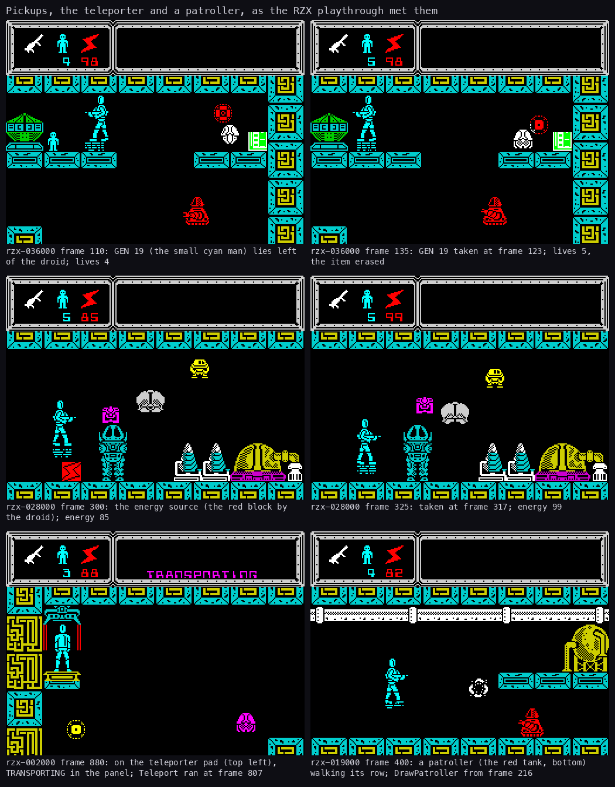

*Six moments from the RZX playthrough's chunks, each shot at the start of the named frame. How to read: each pair
reads left to right, before and after; the caption under each shot names the recording, the frame and what changed.
Top: GEN 19 taken (`rzx-036000` frames 110 and 135, taken at frame 123; lives 4 to 5). Middle: the energy source
(`rzx-028000` frames 300 and 325, taken at 317; energy 85 to 99). Bottom: on the teleporter pad with TRANSPORTING in
the panel (`rzx-002000` frame 880, Teleport ran at 807), and a patroller walking its row (`rzx-019000` frame 400).
Made with `work/docs/tjA/key-moments.sh`: `python3 tools/fig_moments.py docs/img/play/key-moments.png --title
"..." SHOT.png="caption" ...` over six shots by `kit/screen_shot.py` (`work/docs/tjA/shoot.sh rzx-036000
gen-before=110 gen-after=135`, and the same for `rzx-028000` 300 and 325, `rzx-002000` 880, `rzx-019000` 400; base
36930). The point: every pickup shows at once in the HUD's
numbers, and the panel names what happened.*

A game, in order, as the RZX playthrough plays it (80 680 frames, about 27 minutes):

1. The menu; 0; the start room 84 with TUJAD FROM ORPHEUS in the panel.
2. Rooms, one after another; enemies shot or avoided; items taken; the progress screen at each ED piece.
3. Lives lost and won back with GEN 19.
4. The fiftieth piece in room 28: EDS COMPLETED RETURN TO TUJAD CONTROL ROOM (RZX frame 71 845).
5. Back to room 84 (RZX frame 79 916): CONGRATULATIONS (79 947), the whole circuit, about 10 s, the menu.

**The point**: the game's rhythm is room, item, progress screen; the end is a walk home.

## 1.10 The win and the game over

| | |
| --- | --- |
|  | 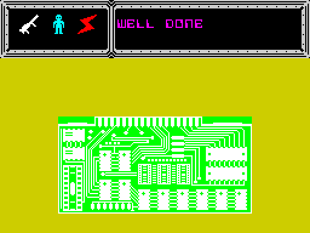 |

*`win` (from `rzx/at080000.szx`, every ED piece taken, room 84, no key). Left: frame 100, CONGRATULATIONS over the
whole circuit. Right: frame 475, WELL DONE, the message's end. How to read: the panel scrolls the seven rows of the
message over the progress picture. The point: the win shows the completed picture and nothing more; then the menu.*

- **The win** comes when all 50 pieces are taken and the droid is in room 84: CONGRATULATIONS TUJAD HAS NOW RESUMED
  NORMAL FUNCTIONS WELL DONE, the whole picture, 512 interrupts (10.24 s), the menu.
- **The game over** comes when the last life is lost: COMPUTER MALFUNCTION GEN 19 TERMINATED UCF REACTOR NO 14 C
  DESTROYED, the picture with the pieces found and YOU HAVE COMPLETED nn% OF TUJAD, 10.24 s, the menu.
- The energy stops in both (EnergyTimer = 0). Nothing is saved: no score, no hi-score, no name.

| | |
| --- | --- |
| 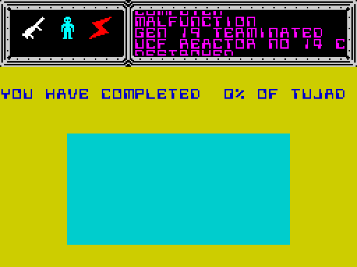 |  |

*`game-over` (from `work/stage1/menu.szx`; POKE `$636D` = 0 and `$636E` = 1 at frame 200). Left: frame 700, the
message scrolling. Right: frame 900, YOU HAVE COMPLETED 0% OF TUJAD. How to read: no piece was taken, so the picture
is empty. The point: the game over reports progress, not a score.*

The code of both endings is [doc 4.2](04-game-loop.md#42-the-state-machine) and
[doc 4.9](04-game-loop.md#49-the-delays-between-scenes).

**The point**: one goal, one measure (the percentage), and the same picture for the progress, the win and the game
over.

## 1.11 What no recording reached

- **The 26 empty slots** in normal play: the RZX's complete game never enters them; `room-tour` draws 12 of them, empty,
  by POKEing the room.
- **Weapon 3's steering** while fire is held (CellSolidColumn `$7D24`, CellSolidRow `$7D50`): known only from the code.
- **A difficulty setting or levels**: the game has none; the enemies' kinds cycle and their spawn points and timers are
  random, seeded by how long the player waits in the menu.
